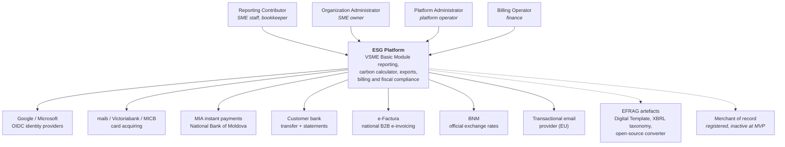
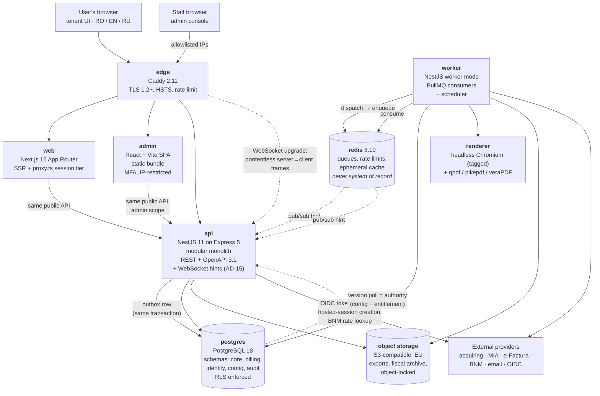
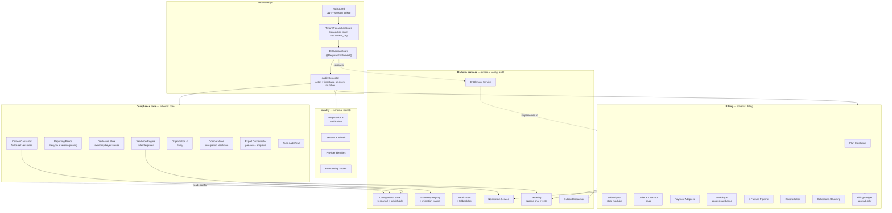
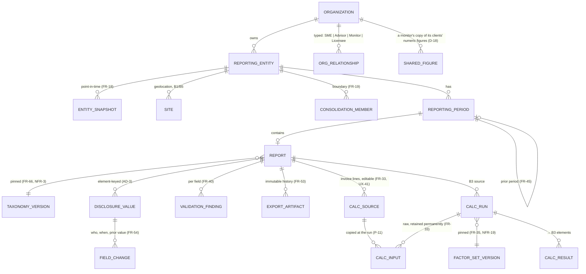
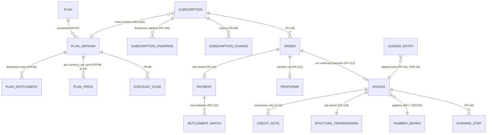
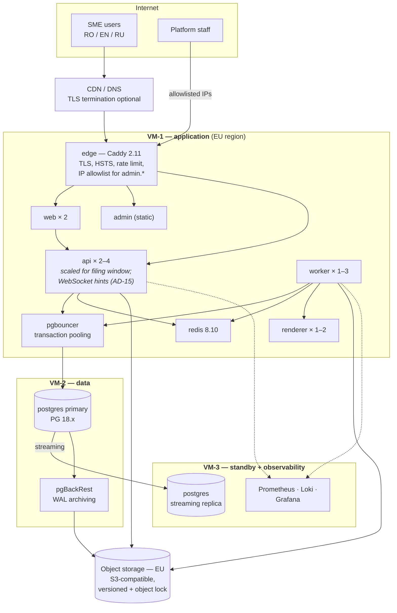
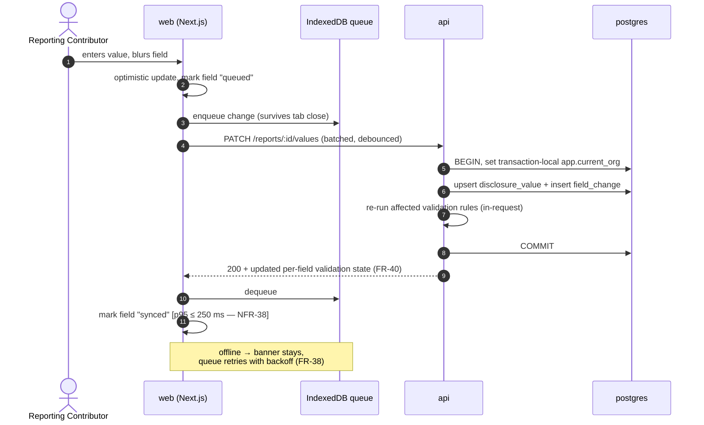
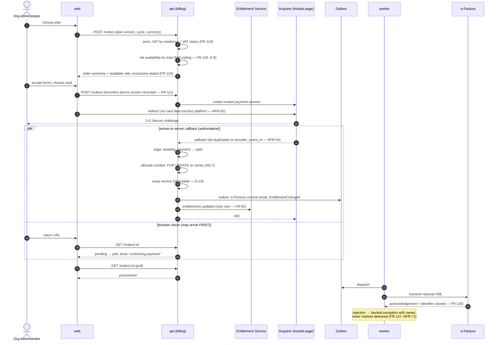

# ESG Platform — System Architecture (MVP)

| Field | Value |
|---|---|
| Document ID | architecture.md |
| Version | 1.0 |
| Status | Consolidated baseline |
| Date | 2026-08-17 |
| Consolidates | `ESG Platform System Architecture (MVP)` (primary, detail), `ESG Platform Architecture Overview (MVP)` (primary, framing), `ESG Platform Private Monetization Architecture` (commercial-layer separation), `ESG Platform Research and Architecture Notes` (background, earlier, lower authority) |

---

## 1. Purpose and scope; how to read this document

### 1.1 What this document is

This is the canonical architecture baseline for the ESG Platform MVP. It defines **how the system is built**, in the same way the FR register defines what it does and the NFR register defines how well. It is written so that a delivery team can start work from it without re-deriving decisions, and so that a reviewer can check any structural claim against the requirement that forced it.

It consolidates four prior documents into one record. Where the two architecture documents overlapped, `System Architecture (MVP)` was preferred for detail and `Architecture Overview (MVP)` for framing; genuine conflicts are recorded in §17.8 rather than silently reconciled.

### 1.2 The system, in one paragraph

A multi-tenant SaaS that lets a Moldovan SME produce a **VSME Basic Module (B1–B11)** sustainability report, with the Comprehensive Module (C1–C9) additive over it since 25 Aug 2026 (FR-177; `problem_overview.md` OQ-12) in Romanian, English or Russian, calculate Scope 1 and location-based Scope 2 emissions feeding B3, and export the result as PDF and as the official EFRAG Excel Digital Template — with a full self-serve billing, invoicing and Moldovan fiscal-compliance stack behind it.

| Dimension | Value |
|---|---|
| Scale envelope | ≤ 2,000 organizations · ≤ 3,000 users · ≤ 2,500 reports/year · ≈ 150 peak concurrent sessions · < 100 GB |
| Peak season | April–May, peaking in the last two weeks of May (Art. 33(3), Law 287/2017 — 150 days after year end) |
| Locales | Romanian (source), English, Russian — all separately authored, none machine-translated |
| Hosting | EU/EEA, self-managed VMs, Docker Compose |
| Scope | Full register: FR-1 … FR-229; NFR-1 … NFR-93 and NFR-106 … NFR-110 (MVP), NFR-94 … NFR-105 deferred. 8–12 month build |

### 1.3 Companion documents and identifier scheme

This document is a companion to, and traceable against, the six other baseline documents:

- `problem_overview.md` — the problem, the scope and the closed scope decisions
- `actors.md` — the actors `CA`, `RC`, `OA`, `PA`, `BO`, `SYS`, `VI`, `AD`, `MO`
- `use_cases.md` — UC-01 … UC-235, and the use case design decisions and constraints D-1 … D-18
- `functional_requirements.md` — FR-1 … FR-229
- `non_functional_requirements.md` — NFR-1 … NFR-93 and NFR-106 … NFR-110 (MVP), and NFR-94 … NFR-105 (deferred)
- `design_spec.md` — UX-1 … UX-142, S-01 … S-49, A-01 … A-21


This document owns two identifier schemes of its own: the architectural decisions **AD-1 … AD-15** (§4) and the drivers **DR-1 … DR-11** (§2). The four notification qualities authored in §17.3 as NFR-106 … NFR-109 were **ratified into `non_functional_requirements.md` §4.16 on 18 August 2026**.

All identifiers are preserved verbatim from the sources. There is no `ACT-*` scheme: actors are the letter codes `CA`, `RC`, `OA`, `PA`, `BO`, `SYS`, `VI`, `AD`, `MO` (§2.4; `actors.md` owns the list).

### 1.4 How to read it

- §2 is the load-bearing part. It lists the eleven **drivers** (DR-1 … DR-11) that actually shape the structure. Everything from §4 onward is a consequence of those.
- A reader with thirty minutes should read §2, §3 and §5.
- A reader who needs to know *why* a specific structural choice was made should read the corresponding AD in §4.
- A reader who needs to know what is **not** decided should read §18.

### 1.5 What is out of scope for this architecture

By prior decision: XBRL export (Phase 2; the Comprehensive Module was promoted into MVP on 25 Aug 2026, FR-177), energy-provider and accounting integrations, AI assistance, the public disclosure portal (Phase 3), the ESAP bridge and blockchain traceability (uncommitted roadmap). Extension points for each are named in §15 so that adding them is additive rather than structural.

### 1.6 Four scope facts that drive the architecture more than the feature list does

1. **Billing is not a thin Stripe wrapper.** Stripe does not serve Moldova-resident businesses. The platform owns the plan catalogue, subscription state machine, order lifecycle, invoice and credit-note documents, gapless fiscal numbering, dunning, reconciliation, and the billing ledger (D-7). Four payment rails sit behind one adapter interface (D-8). This is 69 functional requirements (FR-84 … FR-152), and the part with statutory consequences.
2. **e-Factura is MVP, not Phase 2.** Moldova's national B2B e-invoicing mandate takes effect **1 October 2026** (D-9). The invoice is therefore modelled as a structured platform-owned record rendered into national XML by an adapter, never as "a PDF that gets emailed".
3. **The compliance core must be able to run with billing switched off.** D-11 and NFR-1 make this a testable obligation, not an aspiration: with `BILLING_ENABLED=false`, the UC-17 … UC-48 suite must pass.
4. **The standard moves.** The VSME XBRL taxonomy had a backwards-incompatible release in February 2026 and updates several times a year. NFR-12, NFR-85 and NFR-86 require content, thresholds, factor sets and validation rules to change **without a code release**, and require a compatible template/taxonomy rollout to need no deployment. This forces a configuration-as-data architecture rather than a code-first one.

---

## 2. Architectural drivers

### 2.1 The eleven structural drivers

These are the constraints that determine structure. Everything else is detail.

| # | Driver | Source | Structural consequence |
|---|---|---|---|
| DR-1 | Billing and the compliance core are separate bounded contexts sharing no transaction, foreign key or table; disabling billing leaves reporting working | D-11, NFR-1, NFR-15, FR-154 | Two PostgreSQL schemas with no cross-schema FKs; communication only by published entitlement state and domain events; a feature flag that disables the billing module wholesale |
| DR-2 | The internal schema mirrors VSME taxonomy element names and structure | NFR-2, FR-155 | A generic, taxonomy-driven disclosure store (element-keyed values), not a hand-modelled table per module |
| DR-3 | Thresholds, factor sets, validation rule definitions, effective dates, notification behaviour, help-centre articles and plan presentation copy change without a redeploy, published within one working day and revertible in one step | NFR-12, NFR-85, NFR-86, FR-61 … FR-74, FR-173 | A versioned, publishable **configuration store** as a first-class subsystem; the application interprets it, it does not embed it. The *wording* of labels, help text, validation messages and notification templates ships in the release as committed message catalogues (OQ-43, 19 Aug 2026). Plan versions, entitlements, prices and discounts are tables in `billing` with their own published and retired state and UX-123 publication, edited in A-09, and they still change without a redeploy (project owner, 5 Oct 2026, task 182, 182/59); only plan *presentation* copy stays configuration |
| DR-4 | Every report is pinned to an explicit template and taxonomy version and can be re-exported or migrated against a later one | NFR-3, FR-51, FR-65 … FR-69 | Version is a dimension of the data model, not a global; export and validation are parameterised by it; migration is a first-class operational job |
| DR-5 | Tenant isolation is structural at the data-access layer, not a filter at call sites | NFR-63 | PostgreSQL Row-Level Security with a per-request session variable; the connection, not the query, carries the tenant |
| DR-6 | Audit, ledger and metering records are append-only, enforced at database privilege level | NFR-33, FR-151, FR-159, FR-105 | Separate DB roles; no UPDATE/DELETE grant on ledger tables to the application role; corrections are new rows |
| DR-7 | Money is provider-executed; the platform never touches card data or holds funds | D-7, D-8, NFR-60, NFR-74 | Payment adapters only; PCI DSS SAQ-A scope; no custody or settlement code path exists |
| DR-8 | Fiscal documents are immutable, gaplessly numbered per series per year, and transmitted to e-Factura with acknowledgement stored | D-9, D-10, NFR-55, NFR-71, FR-123 … FR-130 | A numbering service holding a row lock inside the issuing transaction; an outbox-driven transmission pipeline; six-year independent archive |
| DR-9 | Payment callbacks, provider webhooks and e-Factura acknowledgements are idempotent under duplicate, delayed and out-of-order delivery; order → payment → invoice → entitlement is all-or-nothing | NFR-54, NFR-59 | Transactional outbox + saga coordinator; every inbound event keyed and de-duplicated at the edge |
| DR-10 | Export generation must not degrade interactive latency; 10× concurrency spike in the filing window with no maintenance window | NFR-37, NFR-42, NFR-44, NFR-46, NFR-48 | Export and all long-running work leaves the request tier by queue into a separate worker container; horizontal scale of API and worker independently |
| DR-11 | Every tenant-facing capability is reachable through one documented, versioned API under identical authorization — no interface-only privileged route | FR-153, NFR-16, NFR-83 | The Next.js app is a client of the same public API, not a privileged backend; OpenAPI generated from source and diffed in CI |

### 2.2 The commercial driver behind DR-1

`Private Monetization Architecture` supplies the reason DR-1 is worth its cost, and it is not a technical reason. EFRAG's own VSME Excel Digital Template and open-source XBRL converter are **free, official and already available to any SME in Europe**. That sets a hard ceiling: the platform cannot charge for "the ability to produce a compliant VSME report" as a standalone feature. Every viable monetization path sells convenience, automation, integration, collaboration, aggregation or distribution — not the compliance content itself.

The architectural consequence is that pricing and packaging decisions must never touch compliance logic, because the packaging is expected to change while the compliance core stays identical for a free-tier user and an enterprise contract alike. That is DR-1, and it is why §5 treats the compliance-core / commercial-layer split as the central structural fact rather than as a modularity preference.

### 2.3 Confirmed platform and operational choices

**Confirmed platform choices** (given, not derived): NestJS for backend services, Next.js for the tenant-facing application, React + Vite for the administrative console, PostgreSQL as the primary store, Docker and Docker Compose as the packaging and deployment mechanism. Versions are in §12.

**Confirmed operational choices** (decided in review): EU-region VPS with Docker Compose; a modular monolith plus a separate worker process; shared-schema multi-tenancy with PostgreSQL Row-Level Security.

### 2.4 Actors

| Code | Actor | Does |
|---|---|---|
| CA | Common Access | Register, authenticate, manage own profile |
| RC | Reporting Contributor | Fills the report, runs the calculator, exports |
| OA | Organization Administrator | Entities, periods, users, plan, billing |
| BO | Billing Operator | Reconciliation, dunning, refunds, fiscal reporting |
| PA | Platform Administrator | Content, taxonomy versions, factor sets, plans, support grants |
| SYS | System | Scheduled and event-driven work |

`actors.md` also defines `VI` (Visitor), `AD` (Advisor Administrator) and `MO` (Monitoring Organization Administrator), and owns the full list.

---

## 3. Architecture principles

Each principle is applied in more than one place, traces to a driver or a requirement, and has a named enforcement mechanism.

| # | Principle | Enforced by | Traces to |
|---|---|---|---|
| P-1 | **The compliance core knows nothing about plan, price or tenant type.** It only knows how to produce a correct report, and it is identical on the free tier and on an enterprise contract | CI boundary rule; `contracts/` as the only cross-context surface; `BILLING_ENABLED=false` CI job | DR-1, D-11, NFR-1, NFR-15 |
| P-2 | **The standard is data, not code.** Taxonomy elements, thresholds, factor sets and validation rules are registered configuration interpreted at runtime | Configuration store (AD-4), taxonomy-keyed disclosure store (AD-3) | DR-2, DR-3, DR-4, NFR-12, NFR-85, NFR-86 |
| P-3 | **Version is a dimension of the data, not a global setting.** Reports, calculations and exports each record the version of the artefact that produced them | Version pinning on `report`, `calc_run`; effective-dated config with temporal constraints | DR-4, NFR-3, NFR-19, NFR-87 |
| P-4 | **Guarantees belong below the application.** Tenant isolation, append-only-ness and gapless numbering are enforced by the database, not by discipline at call sites | RLS `FORCED`; privilege-level `GRANT`/`REVOKE` plus triggers; `SELECT … FOR UPDATE` on the counter row | DR-5, DR-6, DR-8, NFR-33, NFR-55, NFR-63 |
| P-5 | **One documented API, no privileged back door.** Both front ends are ordinary clients of the same versioned surface, authorized identically | OpenAPI 3.1 generated from source and diffed in CI; route-coverage diff | DR-11, FR-153, NFR-16, NFR-83 |
| P-6 | **Nothing long-running happens in the request tier.** All generation, transmission, dispatch and scheduled work leaves by queue | BullMQ consumers in a separate `worker` container; the outbox is the only producer | DR-10, NFR-42, NFR-46 |
| P-7 | **Every external system sits behind a port with exactly one adapter per provider.** No vendor type appears outside its adapter | Ports in `contracts/`; provider registry read from configuration; dependency review per release | DR-7, NFR-11, NFR-14 |
| P-8 | **Cross-boundary effects are written in the same transaction as the state change that caused them.** No dual writes | `outbox_event` written transactionally; `inbound_event` unique-keyed at the edge | DR-9, NFR-54, NFR-59 |
| P-9 | **Fail closed on tenancy, fail open on already-granted entitlements.** An absent tenant context yields zero rows; an unreachable billing context keeps granted capabilities working | RLS `missing_ok` policy form; `TenantRepository` that throws with no context; cached entitlement snapshot | NFR-49, NFR-63 |
| P-10 | **Instrument every billable-shaped action, including actions not currently billed.** Pricing units must be evaluable end to end without a code change | Append-only `metering_event` stream | FR-105, NFR-10 |
| P-11 | **What is expensive to retrofit is built on day one, regardless of which phase its feature lands in.** Version pinning, RLS, retained calculator inputs, per-field audit, append-only ledgers, multi-period model, outbox, config-as-data | Build order (§15.4); §16.3 debt register | NFR-19, NFR-33, NFR-63, FR-45, FR-54 |
| P-12 | **A requirement verified by rehearsal needs a runbook, and the runbook is a deliverable.** A rehearsal without one is not repeatable and therefore not evidence | `docs/runbooks/` in the repository layout | NFR-28, NFR-29, NFR-31, NFR-51, NFR-52, NFR-85, NFR-86, NFR-93 |

---

## 4. Architecture decision record index

Every architectural decision carries an **AD-n** identifier, cites the drivers and requirements it discharges, and records rejected alternatives where the choice was real.

### 4.1 Index

| ID | Decision | Status | Drivers | Key requirements |
|---|---|---|---|---|
| AD-1 | Modular monolith (`api`) + worker, boundaries enforced in CI | Accepted | DR-1, DR-10 | NFR-1, NFR-15, NFR-46, D-11 |
| AD-2 | Shared schema + PostgreSQL RLS, transaction-local tenant context per request | Accepted | DR-5 | NFR-63, NFR-62, FR-158 |
| AD-3 | Taxonomy-driven element-keyed disclosure store + generated typed facade | Accepted | DR-2, DR-4 | NFR-2, NFR-3, NFR-86, FR-155 |
| AD-4 | Configuration-as-data with versioned publish/revert and effective dating | Accepted | DR-3 | NFR-12, NFR-73, NFR-85 … NFR-87 |
| AD-5 | Single key-based entitlement service, cached, degrading open for granted keys | Accepted | DR-1 | NFR-17, NFR-41, NFR-49, FR-99 … FR-104 |
| AD-6 | Transactional outbox + inbound de-duplication + order saga | Accepted | DR-9 | NFR-54, NFR-59, NFR-50 |
| AD-7 | Gapless fiscal numbering by `SELECT … FOR UPDATE` on a counter row at `READ COMMITTED`, consumed at issuance | Accepted | DR-8 | NFR-55, FR-123, D-10 |
| AD-8 | Port + adapter per third party; merchant-of-record registered but inactive | Accepted | DR-7 | NFR-11, NFR-14, NFR-60, NFR-74 |
| AD-9 | Two front ends, both clients of one public API; admin separately addressed | Accepted | DR-11 | NFR-16, NFR-65, NFR-38, NFR-56 |
| AD-10 | All long-running work leaves the request tier by queue | Accepted | DR-10 | NFR-42, NFR-46, NFR-82 |
| AD-11 | One channel-agnostic notification subsystem with per-recipient delivery evidence | Accepted | — | FR-157, FR-160 … FR-173 |
| AD-12 | Short-lived JWT + server-side revocable refresh sessions | Accepted | — | FR-5 … FR-8, FR-58, NFR-62 |
| AD-13 | TypeScript 6.0.3, single compiler; TS 7 side-by-side documented but not adopted | Accepted | — | NFR-16, NFR-26, NFR-30, NFR-58, NFR-88 |
| AD-14 | TypeORM 1.1 with `synchronize` off, SQL migrations, ALS-bound `QueryRunner`, two `DataSource`s | Accepted | DR-1, DR-5 | NFR-1, NFR-58, NFR-63, NFR-86 |
| AD-15 | A push accelerator over a polling floor: the api fans out contentless hints over a WebSocket, the HTTP read stays the authority | Accepted | DR-10, DR-11 | FR-58, FR-161, NFR-110 |

### 4.2 AD-1 — Modular monolith plus worker, not microservices

| | |
|---|---|
| **Context** | The scale envelope is ≤ 2,000 organizations, ≤ 3,000 users, ≈ 150 concurrent sessions at peak. DR-1 demands a hard separation between billing and the compliance core; DR-10 demands that export generation not touch interactive latency; NFR-59 demands all-or-nothing behaviour across order, payment, invoice and entitlement. |
| **Decision** | One NestJS deployable, `api`, containing all bounded contexts as NestJS modules with enforced boundaries; one NestJS deployable, `worker`, running the same codebase in worker mode, consuming queues. Both are built from the same image and differ only by entrypoint and configuration. DR-1's separation is a **compilation and schema** boundary, not a network boundary. |
| **Alternatives considered** | *Three separate services from day one* — rejected: distributed-system cost buys nothing at this scale and works against NFR-59, which is far easier to satisfy inside one process with a durable outbox than across a service mesh; splitting later is cheap once the boundary is already enforced, because a module lifts out with its schema. *Single process including workers* — rejected outright by NFR-46: an export burst must not touch NFR-37's p95 ≤ 300 ms. |
| **Consequences** | Boundary enforcement moves to static analysis: `dependency-cruiser` / `eslint-plugin-boundaries` rules in CI forbid any import between `modules/billing/**` and `modules/core/**` except through `contracts/`. Each context owns a PostgreSQL schema, but **runtime enforcement is not claimed** — `search_path` governs only unqualified name resolution, so a schema-qualified cross-context join would work; genuine database-level prevention would need `USAGE` revoked across the boundary, which conflicts with AD-6's outbox. The schema split therefore exists to make a violation obvious in review and to keep contexts physically separable later. Cross-context communication is one-directional: billing publishes `EntitlementChanged`; core reads entitlements through an `EntitlementService` interface whose only implementation lives in billing and whose null implementation (grant-everything) runs when billing is disabled. A second CI job runs UC-17 … UC-48 with `BILLING_ENABLED=false`; that job is what keeps the boundary honest over time. |

### 4.3 AD-2 — Shared schema with PostgreSQL Row-Level Security for tenancy

| | |
|---|---|
| **Context** | NFR-63 requires cross-tenant access to be **structurally prevented rather than filtered at call sites**. The platform is government-branded, holds fiscal and confidential sustainability data, and serves companies who are each other's competitors, while adoption is entirely voluntary. |
| **Decision** | Every tenant-owned table carries `organization_id uuid not null`. RLS is `ENABLED` and `FORCED`, with a policy of the form `organization_id = current_setting('app.current_org', true)::uuid`. Two clarifications (20 Aug 2026, task 12) follow the table. The application connects as a non-superuser, non-owner role for which RLS is not bypassable. A request-scoped guard, `TenantTransactionGuard` (§6.2), sets `app.current_org` and `app.current_user` on the pooled connection **inside the transaction**, and the ORM never issues a tenant query outside a transaction. |
| **Alternatives considered** | *Schema-per-tenant* — rejected: 2,000 schemas makes every migration a 2,000-step job and makes FR-83's adoption dashboard and FR-105's metering rollups awkward. *ORM global scope or base repository injecting the predicate* — roughly 90% as effective and materially cheaper to live with, but weaker than NFR-63's wording; if the team wants it, the honest route is to amend NFR-63 explicitly rather than implement RLS half-heartedly and describe it as structural. *One deployment per customer* — incompatible with NFR-47's per-free-tier-organization cost ceiling, and turns FR-83 and FR-105 into cross-instance ETL. |
| **Consequences** | Three database roles, not two: `esg_app` and `esg_worker` are both RLS-enforced; only `esg_admin_ro` (read-only, `BYPASSRLS`) bypasses it, used solely for explicit cross-tenant rollups and the admin API, with every acquisition logged (FR-79, NFR-66). Taxonomy migration runs are executed by the worker, one transaction per report under that report's organization (§7.6), not by `esg_admin_ro`, which is read-only (project owner, 5 Oct 2026, task 182, 182/42). Giving the worker `BYPASSRLS` would be the obvious shortcut and is wrong: the worker is what materialises one tenant's regulatory and fiscal record into a PDF, an Excel file, an e-Factura payload and an email. Session-scoped `SET` is prohibited — it leaks to the next borrower of a pooled connection, the single most common way RLS multi-tenancy is broken in production. PgBouncer, if used, runs in **transaction** pooling mode. CI carries a cross-tenant probe suite plus a job-level probe that enqueues work for organization A while the worker's context says organization B and asserts the job fails rather than returning data. Policies are enabled in **every** environment from the first sprint: the value of RLS is that a missing tenant context breaks loudly and early. |

**Two clarifications from the first policy, 20 Aug 2026 (task 12).**

- **The tenant root is scoped by its own `id`.** `core.organization` *is* the tenant, so it carries
  no `organization_id`; its policy reads `id = current_setting('app.current_org', true)::uuid`. The
  rule is therefore two clauses — the root by `id`, every other tenant table by `organization_id` —
  and both are enforced mechanically by the schema-invariant gate rather than by review. A
  self-referencing or generated `organization_id` column was considered for uniformity and declined:
  a stored duplicate of the primary key.
- **`INSERT` on the tenant root carries `WITH CHECK (true)`, and only there.** FR-13 creates an
  organization from a verified account that holds no membership yet, so `app.current_org` cannot
  already equal an id that does not exist — a `WITH CHECK` on that insert makes organization creation
  impossible rather than secure. Creating a row you then own is not a cross-tenant act; reading or
  altering another tenant's data is, and the `SELECT`, `UPDATE` and `DELETE` policies still prevent
  both. Every other tenant table keeps a real `WITH CHECK`.

**A third detail:** the policy wraps the setting in `NULLIF(..., '')`. The `missing_ok` form gives
NULL, and so zero rows, for an *unset* context, but a context set to the **empty string** would
raise `invalid input syntax for type uuid`; `NULLIF` collapses both to the same fail-closed NULL.

**Implementation note that is part of the decision.** The setting is written with `SELECT set_config('app.current_org', $1, true)` — **not** `SET LOCAL`, which is utility syntax and accepts no bind parameter, so writing it that way forces string interpolation into the one value the entire tenancy model rests on. The `true` third argument makes it transaction-local. The policy reads `current_setting(..., true)` in the `missing_ok` form, so an unset context yields NULL and therefore zero rows rather than a 500 on every endpoint. The organization id comes from the **server-side membership lookup** already performed in `AuthGuard`, never from the raw JWT claim — AD-12 declines to treat the token claim as authoritative, and grounding the RLS boundary in a value the auth design does not trust would make an org-switch race or a revoked membership into a cross-tenant read.

**On the argument that public disclosure makes NFR-63 unnecessary**, three answers:

- **Timing.** The public portal is Phase 3 and opt-in; at MVP nothing is public. This product is a
  **drafting tool**, so a report is confidential for the whole period a company is using the system,
  and a leaked draft is not an early copy of a public document but a wrong number the company had
  not yet corrected. B9 carries recordable accidents and fatalities, B11 corruption convictions and
  fines.
- **Scope.** Even if every finished report were public, that would justify relaxing access control
  on published report content only. The field-level audit trail with previous values (FR-54, FR-55),
  calculator raw inputs retained permanently by site and source (FR-33), fields declared not
  material or omitted as sensitive, all billing data (IDNO, VAT code, legal address, invoices,
  dunning state) and all identity data are never public.
- **Consistency.** Applying RLS to `billing` and `identity` but not to `core` is worse than applying
  it everywhere: uniform enforcement is verifiable in one pass, while selective enforcement is a
  rule every future query author must remember, which is exactly what NFR-63 exists to eliminate.

### 4.4 AD-3 — A taxonomy-driven disclosure store, not a table per module

| | |
|---|---|
| **Context** | NFR-2 and FR-155 require the internal schema to mirror the VSME taxonomy. DR-4 requires reports pinned to different taxonomy versions to coexist and be migrated. The taxonomy already delivered one backwards-incompatible release (February 2026) and updates several times a year. Each Excel named range in the Digital Template corresponds exactly by local name to an XBRL taxonomy element, and dimensions are used sparingly. Measured against the published `2026-05-01` package on 29 Aug 2026 (task 33.1): 143 reportable elements, 34 of them dimensioned, along 8 axes; `report_disclosure_value` is keyed on `(report_id, element_key, dimension_key, ordinal)`. |
| **Decision** | Disclosure data is stored as element-keyed values against a report, where the element key **is** the VSME XBRL taxonomy element local name (e.g. `EnergyConsumptionFromFuels`, `NumberOfFemaleEmployees`). The set of elements, their datatypes, units, cardinality, dimensions, validation rules and applicability conditions comes from a **registered taxonomy version** held in the configuration store, not from TypeScript types or table columns. |
| **Alternatives considered** | *Column-per-disclosure relational modelling* — rejected on DR-4 / NFR-86 grounds: a hand-modelled `b3_energy_emissions` table would need DDL migration on every taxonomy release. *Whole report as a single JSONB blob* — rejected because per-field audit attribution (FR-54, NFR-7, NFR-35), per-field validation state (FR-40) and per-field comparative display (FR-46) all need row granularity; a blob makes each of those an application-level diff. |
| **Consequences** | A taxonomy release becomes **data registration plus a mapping**, which is what NFR-86 demands. The trade accepted is loss of compile-time typing and database-level check constraints on individual disclosures. That is bought back three ways: a typed **facade** generated per taxonomy version, so application code and the API still see `report.b3.scope1Emissions` rather than string keys; validation running from registered rule definitions (FR-73) rather than column constraints; and a golden-report cross-format regression corpus (NFR-20, NFR-21, NFR-22) that catches what the type system no longer can. |

### 4.5 AD-4 — Configuration-as-data, with an explicit publish/revert step

| | |
|---|---|
| **Context** | DR-3's artefacts (content, thresholds, factor sets, validation rules, notification templates) change without a redeploy, publish within one working day of approval and revert in one step. Plan definitions also change without a redeploy, but they are `billing` tables, not store artefacts (5 Oct 2026, 182/59). NFR-19 requires a stored calculation to reproduce exactly against its stored raw inputs and factor-set version; NFR-87 forbids a rule or factor change from silently restating a previously reported figure. |
| **Decision** | A single **configuration store** subsystem holds every artefact that must change without a release, each versioned with `draft → in review → published → superseded` states, each revertible in one action, and each with an effective date where the domain needs one. Published versions are **immutable**. Publication is a single transactional action that writes a new immutable version and flips a pointer; revert flips the pointer back. |
| **Alternatives considered** | *Event-based cache invalidation via PostgreSQL `LISTEN/NOTIFY`* — rejected on two counts: `LISTEN` requires a pinned session and is unsupported through PgBouncer in transaction pooling mode, which is exactly what fronts the database; and `NOTIFY` is lossy, so a replica disconnected during the notify never learns it missed one, leaving it indefinitely stale. *Effective-dating without immutability* — rejected: an edited "published" factor set silently rewrites history. |
| **Consequences** | **The store is two tables (20 Aug 2026, task 16).** §7.9 and §12.3 specify `PRIMARY KEY (scope, validity WITHOUT OVERLAPS)` for effective-dated configuration, which cannot sit on a table that also keeps superseded versions: two versions of one scope necessarily cover overlapping dates. `config.entry_version` therefore holds every version and no validity; `config.entry_schedule` holds only what is in force, carries that primary key and **is** the pointer this decision describes. Publication writes a version and updates the slot's `version_id`; revert updates it back. The store version is bumped by a trigger on the schedule rather than by the publishing code, because a publish that forgot to bump it is a change no replica ever notices. Cache invalidation is **version-based, not event-based**: every `api` and `worker` replica holds a cached read model stamped with a `config_version`; a poll of a single-row version table (≤ 5 s) is the **authority**, and a Redis pub/sub message is only a latency optimisation, so a lost message costs seconds of staleness. Effective-dated tables carry a non-overlap guarantee at database level (§12.3). |

Artefacts held, and whether they are effective-dated:

| Artefact | Requirement | Effective-dated |
|---|---|---|
| Help-centre articles and plan presentation copy, per locale | FR-61, FR-62, NFR-85 | No — published/superseded |
| Locale registration — which locales are offered; the catalogues themselves are committed (OQ-43) | FR-63, NFR-25 | No |
| Social provider behaviour — enabled state, client id, issuer, scopes, redirect-URI allowlist; the client secret stays in the environment (§12.5.6) | FR-82 | No |
| Organization legal forms, per country — the codes; their wording is committed (OQ-43) | FR-17 | No |
| Organization relationship types — `direct_sme` at MVP, with Advisor (task 116) and Monitor (task 245); Buyer and Licensee added as data | FR-14, NFR-9 | No |
| VSME template + XBRL taxonomy versions and their artefacts | FR-65, FR-66 | Pinned per report, not dated |
| Version-to-version field mappings | FR-67 | Pinned to a version pair |
| Emission and conversion factor sets | FR-71, NFR-19 | **Yes** |
| Conditional-applicability thresholds (≥50 turnover, ≥150 pay gap) | FR-72 | **Yes** |
| Disclosure axis shapes — which explicit axes a reporter answers for every member (a *breakdown*) rather than selects from (a *classification*); EFRAG's package does not distinguish them (task 36.4) | UX-14, UC-21 | **Yes** |
| Validation rule definitions, each naming a message key whose wording is committed (OQ-43) | FR-73 | **Yes** |
| Notification category behaviour — channels, classification, lead times, repeat interval; template wording is committed (OQ-43). **A mandatory system category's classification is code, not configuration** (§12.5.6's task-49.3 row (1)) | FR-173 | No |
| ~~Plan versions, entitlements, quotas, prices, discounts~~ — **not configuration; tables in `billing`** with their own published and retired state (amended 5 Oct 2026, project owner, task 182, 182/59; §7.4) | FR-84 … FR-89 | — |
| **Interim seat ceiling** — an organization's maximum active members plus pending invitations, **lapsed ones included** (corrected 13 Sep 2026 from *live pending*; §12.5.6's task-142 row), one global value, until AD-5's entitlement service exists (task 142; **task 54.2 deletes this row**) | FR-57 | No |
| VAT rates and treatment rules | FR-148, NFR-73 | **Yes** |
| MIA per-transaction and cumulative ceilings | FR-118, NFR-73 | **Yes** |
| BNM rate sourcing | FR-129, NFR-73 | **Yes** |

### 4.6 AD-5 — One entitlement service, consulted by everything, depended on by nothing

| | |
|---|---|
| **Context** | FR-100 requires gating logic to live outside the gated capability. NFR-17 requires that adding a gated capability needs no entitlement-service change and that changing a plan needs no capability change. NFR-41 sets p95 ≤ 20 ms (≤ 100 ms on cache miss). NFR-49 requires the core to keep serving UC-17 … UC-48 when the billing context is unavailable. |
| **Decision** | A single `EntitlementService` answers every gated action with `allow \| deny \| allow_with_warning`, plus the reason and the current limit. It is defined by an interface in `contracts/`, implemented in the billing context, consumed by the core. The contract is a **key lookup, not a method per feature**: `check(orgId, key, requested?) → Decision`, where `EntitlementKey` is a string registered as catalogue data in `billing` (amended 5 Oct 2026, 182/59, 182/68). Entitlements are computed from plan-version entitlements plus per-subscription overrides, cached per organization. **Amended 5 Oct 2026** (project owner, task 182, 182/57): an organization with no subscription is computed from the Free plan's currently published version. |
| **Alternatives considered** | *A method per gated feature* — rejected: it makes NFR-17 false by construction, since a new capability would require an entitlement-service change. |
| **Consequences** | A new gated capability is a new key in the plan catalogue; a new plan is new data. NFR-17's verification — a synthetic entitlement key and a synthetic plan introduced in test — is a CI job. Availability behaviour is a requirement, not an accident: the cache carries a last-known-good snapshot per organization with a generous TTL, and a deny from an unreachable billing context is treated as allow for **already-granted** keys and closed for new purchases; a chaos test that disables billing mid-session is the verification. In-process cache per `api` container means no network hop on the hot path, which is what makes 20 ms trivially achievable — another point in favour of AD-1. The version poll matters more here than for content: a missed invalidation on a downgrade or cancellation would let an organization keep entitlements it no longer holds until the TTL expires. |

Registered keys named in the sources: `report.export.pdf`, `org.entities.max`, `org.seats.max`, `api.calls.monthly`, `module.comprehensive`.

### 4.7 AD-6 — Transactional outbox and a saga for the order lifecycle

| | |
|---|---|
| **Context** | DR-9. Acquirers and national platforms deliver duplicate, delayed and out-of-order events, and NFR-54 requires convergence on a single state under all three. NFR-59 requires order → payment → invoice → entitlement to be all-or-nothing. |
| **Decision** | All cross-boundary effects — e-Factura transmission, email dispatch, payment-provider calls, entitlement propagation, webhook fan-out — are written to an `outbox_event` table **in the same transaction** as the state change that caused them, and dispatched by the worker. All inbound provider events land in an `inbound_event` table keyed `(provider, provider_event_id)` with a unique constraint. The order → payment → invoice → entitlement sequence runs as an explicitly modelled **saga** with persisted state and compensations, not a chain of awaits. |
| **Alternatives considered** | *Direct provider calls inside the request* — rejected by DR-9 and NFR-50. *Claiming exactly-once delivery* — explicitly declined: delivery is at-least-once and processing is **effectively once** (the unique constraint deduplicates insertion, the effect commits with the processed marker). "Exactly once" is not available across a network boundary and is not claimed. *Treating `invoiced` as reversible* — rejected: an issued fiscal document cannot be withdrawn (D-10) and its number cannot be released (AD-7). |
| **Consequences** | **Implementation note added 20 Aug 2026 (task 15): the dispatcher enqueues *before* marking a row dispatched, both inside one transaction.** Reversing that order yields an at-most-once system that passes every test identically — a crash between the mark and the enqueue loses the row silently, because nothing errors. Enqueue-then-mark means a crash rolls the transaction back and the row returns to pending. The `idempotency_key` is passed to BullMQ as the **job id**, so the re-emitted duplicate is discarded by the queue: that pairing is what makes "delivery is at-least-once and processing is effectively once" true in code rather than in intent. Every outbox row carries an `idempotency_key` generated in the originating transaction and passed to every provider that supports one; adapters for providers that do not — e-Factura among them — declare a **recovery query** (for e-Factura, look up by invoice number before re-transmitting). Without this, a dispatcher restart produces a duplicate e-Factura submission or a duplicate refund execution. NFR-59's "all-or-nothing" is, strictly, **eventual convergence with compensation and a surfaced terminal inconsistency**, not atomicity; the saga's terminal `inconsistent` state is a monitored operational metric with a Billing Operator work queue, not a silent log line. Saga states: `draft → awaiting_payment → paid → invoiced → provisioned`, terminals `expired \| cancelled \| failed`, compensation out of `invoiced` is `credit_note_issued`. Invoice numbering is consumed only at the `invoiced` step. Entitlements change on confirmed payment or, for approved transfer terms, on invoice issuance — never on order creation (FR-92, FR-108). |

### 4.8 AD-7 — Gapless fiscal numbering by a row lock on the counter, consumed at issuance

| | |
|---|---|
| **Context** | NFR-55 requires gapless, sequential allocation **under concurrent issuance and partial failure**, verified by a concurrency test with induced mid-transaction failure plus a sequence audit for gaps and duplicates. D-10 makes issued documents immutable. |
| **Decision** | Invoice numbers are allocated inside the issuing transaction by `SELECT next_number FROM billing.number_series WHERE document_type=$1 AND series=$2 AND fiscal_year=$3 FOR UPDATE`, incrementing the counter row and writing the document in the same transaction, at `READ COMMITTED`. The table carries `UNIQUE (document_type, series, fiscal_year, number)` as the invariant of record. A number is consumed **only** at issuance, never reserved at order creation. |
| **Alternatives considered** | *PostgreSQL sequence* — rejected: sequences are explicitly non-transactional, so a rolled-back transaction burns the number and produces a gap. *Advisory lock* — rejected with the flavour distinction spelled out: `pg_advisory_lock()` is **session**-scoped and is not released by `COMMIT` or `ROLLBACK`, so under transaction-pooled PgBouncer it is returned to the pool still held and the next borrower inherits it, deadlocking issuance for that series until the backend is killed; `pg_advisory_xact_lock()` avoids that but keys on `bigint`, so `(document_type, series, fiscal_year)` would have to be hashed, accepting silent collisions between unrelated series. `FOR UPDATE` gives the identical guarantee with no flavour ambiguity, no hashing and no pooler interaction. |
| **Consequences** | The isolation level is part of the decision, not an ambient default: read-then-increment is correct at `READ COMMITTED`, where a waiter re-reads after the lock is released; at `REPEATABLE READ` or `SERIALIZABLE` the waiter resumes on its original snapshot and the `UPDATE` aborts with a serialization failure, turning every concurrent issuance into a retry. AD-6's saga is exactly the code where someone raises the isolation level for unrelated reasons, so the issuing transaction pins its own. The cost is serialised issuance per series — at ≈ 200 documents per month this is not a bottleneck by four orders of magnitude. |

### 4.9 AD-8 — Adapter-and-port for every third party, with the merchant-of-record registered but inactive

| | |
|---|---|
| **Context** | DR-7: money is provider-executed and the platform never touches card data or holds funds. NFR-11 requires no vendor type outside its adapter, verified by a dependency review per release. NFR-14 requires an adapter to be activated with a diff limited to the adapter plus configuration. |
| **Decision** | Each external dependency is reached through a port defined in `contracts/` with exactly one adapter per provider, registered in a provider registry read from configuration. |
| **Alternatives considered** | *Direct SDK use in domain code* — rejected by NFR-11. *Building the merchant-of-record path at MVP* — rejected: D-8 requires activation to be configuration, not a build, so the port is registered and the adapter inactive. |
| **Consequences** | PCI DSS scope stays SAQ-A: no PAN reaches the platform, and no custody or settlement code path exists. Phase 2 XBRL is additive because the export pipeline is already format-parameterised; `DocumentConversionPort` will be created with the Phase 2 work (**amended 5 Oct 2026**, project owner, task 182, 182/164: it does not exist in the code, and no task builds it). |

| Port | MVP adapters | Notes |
|---|---|---|
| `CardAcquiringPort` | maib (primary), Victoriabank, MICB | Hosted page / SDK only. No PAN ever reaches the platform (NFR-60, SAQ-A). Tokenisation for recurring |
| `InstantPaymentPort` | MIA (via participating bank APIs) | Offered only where order total ≤ configured per-transaction ceiling (FR-118) |
| `BankTransferPort` | Proforma + reconciliation | No provider call; settlement is asynchronous and reconciled (FR-131 … FR-134) |
| `MerchantOfRecordPort` | Paddle-class — **registered, inactive** | D-8; NFR-14's verification is adapter activation in staging with the diff limited to adapter + config |
| `EInvoicingPort` | e-Factura national XML; Peppol anticipated | FR-126, FR-127, D-9 |
| `ExchangeRatePort` | BNM official rate, by invoice date | FR-129, D-14 |
| `IdentityProviderPort` | Google, Microsoft (OIDC) | FR-2, FR-82, D-6. Registration/rotation without redeploy |
| `EmailPort` | Transactional ESP, EU region | FR-169, NFR-84 (SPF/DKIM/DMARC) |
| `DocumentConversionPort` | EFRAG open-source converter (MIT), self-hosted | Phase 2 XBRL; the port is created with the Phase 2 work, and the format-parameterised export pipeline is what keeps Phase 2 additive (amended 5 Oct 2026, 182/164) |
| `ObjectStoragePort` | S3-compatible, EU region | Exports, archives (NFR-27, NFR-36) |

### 4.10 AD-9 — Two front-end applications, both clients of one public API

| | |
|---|---|
| **Context** | DR-11 and NFR-16 forbid an interface-only privileged route. NFR-65 requires the administrative surface to be separately addressed, network-restricted and MFA-mandatory, sharing no session, cookie scope or credential with the tenant surface. NFR-43 sets LCP ≤ 2.5 s on 4G mid-range. |
| **Decision** | **`web`** — Next.js 16 (App Router), tenant-facing: registration, report wizard, calculator, validation, exports, organization and user administration, billing self-service. Server components for shell, navigation, list views and export preview; client components for the wizard's field-level interaction. **`admin`** — React 19 + Vite 8 SPA, the Platform Administrator console: content and translation publication, taxonomy version registration and migration runs, factor sets and thresholds, plan catalogue, reconciliation and dunning workspaces, adoption metrics, support-access grants. Both authenticate against and call the **same** `api`. |
| **Alternatives considered** | *Admin as a route group inside the tenant app* — rejected: it shares an origin and a cookie scope by construction, which NFR-65 forbids. *Next.js for the admin console* — rejected: an internal, authenticated, behind-the-firewall console has no SEO and no cold-start latency concern, and benefits from the simpler Vite build. *A privileged Next.js server route reaching the database directly* — rejected by DR-11. |
| **Consequences** | Next.js server-side code acts as a **session-holding proxy** — it holds the httpOnly refresh cookie and forwards requests with a short-lived access token, so no token is exposed to browser JavaScript — but every route it calls exists in the public OpenAPI surface and is authorized identically. Three Next.js 16 specifics are load-bearing: `proxy.ts` replaces `middleware.ts` and runs on the Node.js runtime, which is exactly the tier this decision describes, so the project starts on `proxy.ts`; **Cache Components (`"use cache"`) stay off as a security rule, not a performance preference** — every page is tenant-scoped, and a framework-level cache whose key the compiler generated without knowing about `organization_id` would leak across tenants **above** the RLS boundary of AD-2, where none of its probes would catch it; and `next lint` is removed, so CI must invoke ESLint directly or every gate in AD-13's table silently turns off. Turbopack is the default bundler; React Compiler stays off until the wizard's render profile is measured. |

**The wizard's persistence model** is where three requirements collide: FR-37 (autosave on blur/step change, no save button), FR-38 (queue locally and retry offline), NFR-38 (p95 ≤ 250 ms, non-blocking), NFR-56 (no acknowledged change lost — acknowledge only after durable write). The design: field-level optimistic update in a client store, a debounced batched `PATCH` per field group, an IndexedDB-backed outbound queue that survives a tab close, a per-field `synced | queued | failed` indicator, and a persistent banner while anything is unsynced. The server acknowledges only post-commit. Conflict resolution is last-write-wins per field with the audit trail (FR-54) as the reconciliation record — appropriate because the realistic concurrency is one or two people in one SME, not simultaneous editing.

### 4.11 AD-10 — Exports and all long-running work leave the request tier by queue

| | |
|---|---|
| **Context** | NFR-46 requires export generation decoupled from the request tier such that an export burst affects only export latency, verified by fault injection flooding the export queue while measuring NFR-37. NFR-42 requires any generation projected beyond 30 s to run asynchronously with progress indication and completion notification. |
| **Decision** | A BullMQ queue on Redis carries PDF generation, Excel template population, e-Factura transmission, email dispatch, dunning runs, reconciliation imports, taxonomy migration runs, trial and invitation expiry, metering rollups and backup verification. The `worker` container consumes it. **Amended 11 Oct 2026** (project owner, task 44.5; §12.5.6's task-44 row (5)): document generation has a queue of its own, `easyesg-export`, beside the queue every other job stays on — measured, an export burst on the shared queue held an email behind it for the whole burst; each queue has its one processor, and a handler declares which queue its job goes to. The queue store is used for queueing, rate limiting and short-lived caches — **never** as a system of record. **The outbox is the only producer**: `api` does not enqueue directly. |
| **Alternatives considered** | *Synchronous export in the request* — rejected by NFR-46. *A synchronous fast path plus an async slow path* — rejected: since NFR-42 forces the async path to exist anyway, making it the only path removes a branch. *`api` enqueueing to Redis directly* — rejected as a dual write: a job enqueued for a transaction that then rolls back runs against state that does not exist, and a commit whose `LPUSH` fails silently drops the work. *ExcelJS for the EFRAG template* — rejected (see below). *Ghostscript in the PDF path* — rejected (see below). |
| **Consequences** | Every queued job has a durable outbox row behind it, so a total queue-store loss costs in-flight jobs that the dispatcher re-emits, not data. Export is always `202 + job id`. Completion raises a notification through AD-11. |

**PDF, and why the obvious pipeline does not work.** PDF is produced by headless Chromium (Playwright) rendering the same React templates the preview uses, so FR-48's preview and FR-49's PDF cannot drift, with `tagged: true` set — Chromium emits an untagged PDF by default. Semantic HTML is what makes the resulting structure tree meaningful, which is why the templates are semantic rather than absolutely positioned. Two corrections to the conventional recipe:

- **PDF/A-2b is the wrong conformance level for what NFR-75 asks.** 2b is *basic* — visual reproducibility only. Logical structure, tagging and Unicode mapping are level **a**; reading order and accessibility conformance are PDF/UA-1. A veraPDF pass against 2b proves nothing about tagged reading order, so a suite built that way reports green on a requirement it never tested. This architecture targets **PDF/A-2a plus PDF/UA-1** and validates against both profiles; NFR-82 is amended accordingly (§17.1).
- **Ghostscript must not be in this path.** Its `pdfwrite` device does not post-process; it re-interprets and re-emits, and the structure tree, marked content and `/Lang` do not survive — it would strip exactly the tags NFR-75 requires, before veraPDF ever saw the file. (It is also AGPL-3.0, which the network clause makes a live licensing question for a hosted commercial service.) The OutputIntent, ICC profile and conformance XMP are instead injected **in place** with `qpdf`/`pikepdf`, which leave the rest of the file untouched.

Measured 11 Oct 2026 on Chromium 151 (task 44; §12.5.6's task-44 row, which closes OQ-7), Chromium's tagged output carries headings, paragraphs, lists and tables, table headers with their scope and data cells with their headers, `/Lang` and the displayed title. veraPDF finds five things left: the output intent, the identification metadata, a body for each list item, a description for each link, and Artifact marking of what is drawn but is not content. The in-place step (`qpdf`/`pikepdf`) adds exactly those, and both profiles (PDF/A-2a, PDF/UA-1) pass.

**Excel, and why ExcelJS is not the tool.** FR-50 requires writing into the **official EFRAG template's named ranges** while preserving its dropdowns and consistency formulas. ExcelJS parses an `.xlsx` into its own object model and writes a *new* workbook from it — there is no binary-base mode — so everything it does not model is lost on round trip, and data validation (the dropdowns) is its most frequently reported round-trip loss; sheet-scoped and formula-defined names generally do not survive either, and the template's named ranges are the target. The export therefore treats the `.xlsx` as what it is — a zip of XML parts — and patches it surgically: resolve the named ranges from `xl/workbook.xml`, rewrite only the target `<c>` nodes in the relevant `xl/worksheets/sheetN.xml`, delete `xl/calcChain.xml`, set `<calcPr fullCalcOnLoad="1"/>` so consumers recalculate on open, and rezip **every other part byte-for-byte unchanged**. Dropping `xl/calcChain.xml` also removes its relationship and its content-type override, because a reference to a missing part prompts a repair (task 45; §12.5.6's task-45 row (b), (3), 11 Oct 2026). LibreOffice does not honour `fullCalcOnLoad` by default, but it recalculates on open a file whose `docProps/app.xml` names an application other than Microsoft Excel (measured), so an export names the platform there and LibreOffice computes the template's formulas with its defaults, the gate included (task 46; §12.5.6's task-46 row (4), (7), 11 Oct 2026). A patch therefore changes exactly: the written sheets, the workbook's `calcPr`, its relationships, the content types, `docProps/app.xml` and, for NFR-22's facts, `docProps/core.xml`.

NFR-20's verification needs restating for the same reason: LibreOffice Calc headless is automatable in CI and is the automated gate; Microsoft 365 and desktop Excel are not server-automatable on Linux, so those become a manual item on the release checklist rather than a CI job.

### 4.12 AD-11 — One notification subsystem, channel-agnostic, with delivery evidence

| | |
|---|---|
| **Context** | FR-157 requires every producer to raise through one mechanism. FR-167 requires cancelling an outstanding notice when its condition clears and deduplicating on category and subject. FR-170 requires per-recipient channel, dispatch timestamp and outcome as **the evidence that a required update was actually requested** — a compliance artefact, not telemetry. |
| **Decision** | A notification is a first-class record (category, subject reference, recipients, state) held separately from the channels it is delivered on (FR-160). One notice to two people on two channels is one notification with four delivery records. In-app delivery writes directly to the recipient's notification centre with no external dependency (FR-168); email goes through `EmailPort`, language resolved **per recipient** (FR-169). |
| **Alternatives considered** | *Fire-and-forget send per producer* — rejected: FR-167's cancellation and deduplication are only expressible if the notification is a stateful record keyed by `(category, subject_ref, recipient_scope)` with an upsert. |
| **Consequences** | Every producer — payment failure, quota approach, trial expiry, dunning, service restriction, invitation, invoice delivery, version change, outstanding-report, deadline — raises through this one mechanism and acquires no delivery path of its own. FR-160 … FR-173 had no NFR counterpart, which left FR-170's delivery records with no acceptance threshold; NFR-106 … NFR-109 were authored to close that (§17.3). |

### 4.13 AD-12 — Auth by short-lived JWT plus server-side revocable refresh sessions

| | |
|---|---|
| **Context** | FR-6 requires a consumed password-reset link to invalidate all existing sessions; FR-7 offers termination of other sessions; FR-58 requires a role change to take effect **on the user's next request rather than at their next login**. FR-5 requires server-side session termination on logout. |
| **Decision** | The access token is a short-lived (≤ 15 min) signed JWT carrying **`session_id` and nothing else of authorization consequence** — no role, no organization, no entitlement snapshot. Refresh tokens are opaque, stored server-side, rotated on use, revocable. Role, active organization and per-report rights are read server-side on every request from the session and membership records. |
| **Alternatives considered** | *Claims in the token (role, org, entitlements)* — rejected: all three of FR-6, FR-7 and FR-58 need a per-request server-side lookup, and once that lookup exists the token is doing no authorization work. Carrying `role` anyway would be a live footgun — some guard, at some point, trusts the claim instead of the lookup, and nothing in the design would catch it. |
| **Consequences** | The 15-minute lifetime bounds replay of a stolen token; the lookup, not the lifetime, bounds staleness. This is also why AD-2 grounds `app.current_org` in the membership lookup rather than in a claim. The admin surface needs its own token handler: AD-9's httpOnly-cookie proxy pattern depends on a server-side rendering tier, which `web` has and a static Vite SPA does not — left unaddressed, the *more* privileged surface would be the one holding its access token in browser JavaScript, inverting the intended risk gradient. `admin` therefore gets its own token handler so it uses the same httpOnly-cookie pattern. The admin token handler is a route on `api`, `POST /auth/admin/session`, not an endpoint at `edge` (OQ-17; §12.5 governs). A handler at the edge would be a second auth surface outside the one public API, unseen by any contract test or OpenAPI diff (P-5). The admin realm also reads the session on every admin request (task 145, closed 13 Sep 2026, decided 12 Sep 2026; §12.5.6's task-145 row), so the lookup, not the lifetime, bounds staleness in both realms, at the cost of one lookup per admin request. |

### 4.14 AD-13 — TypeScript 6.0.3, single compiler

| | |
|---|---|
| **Context** | TypeScript 7.0 shipped 3 August 2026 as the first stable release of the native Go compiler, 8–12× faster on full builds — and **without a stable programmatic API**, expected in 7.1. typescript-eslint declares support for `>=4.8.4 <6.1.0` with no tsgo support. This architecture leans on static analysis to discharge requirements that have no other verification. |
| **Decision** | Build on **TypeScript 6.0.3**, single compiler. The optional TS 7 side-by-side type-check is documented but **not adopted**. |
| **Alternatives considered** | *Adopt TS 7 on day one* — rejected: it would disable the tooling that several NFRs name *as their acceptance criterion*. The build would be faster and four requirements would become unverifiable — a bad trade at any compile speed. *Side-by-side (TS 7 advisory `typecheck`, TS 6 authoritative `build`)* — Microsoft's own recommended shape, documented, available, not taken; if adopted, TS 6 remains authoritative and a TS 7 failure is a signal to investigate, never a merge block. |
| **Consequences** | Decorators are **not** the blocker — `tsgo` emits the same `__decorate`, `__metadata` and `__param` helpers, so NestJS DI, TypeORM entity metadata and class-validator all work under TS 7. The blocker is every consumer of the compiler API: `nest build` calls `createProgram()` and `program.emit()`, as do the Swagger and GraphQL CLI plugins, ts-jest, ts-loader, ts-morph and type-aware ESLint. 7.1 will ship a *different* API, so tooling must be **ported**, not widened — the wait is likely longer than 7.1's release date. Promotion criterion: make TS 7 the compiler of record when `nest build` **and** typescript-eslint both support it. Building on 6.0.3 now is the shortest route there, since 7.0 converts 6's deprecations into hard errors and makes `strict` and `esnext` the defaults. |

Gates that depend on the TypeScript 6 compiler API, and the requirement each verifies:

| Gate | Requirement it verifies |
|---|---|
| `dependency-cruiser` / `eslint-plugin-boundaries` on `modules/core` ↔ `modules/billing` | DR-1, NFR-15 — the *only* runtime-independent enforcement of the bounded-context split |
| Rule prohibiting float in monetary types | NFR-58's stated verification, verbatim |
| Rule prohibiting hardcoded date/number/currency format patterns | NFR-26's stated verification, verbatim |
| Log-scanning rule for personal data | NFR-30 |
| Route-coverage diff (interface-only privileged routes) | NFR-16 |

### 4.15 AD-14 — TypeORM 1.1, adopted with five parts switched off

| | |
|---|---|
| **Context** | The ORM choice was previously open. TypeORM sat on `0.3.x` for years with patchy maintenance; it reached **1.0 on 19 May 2026** and **1.1 on 13 July 2026**, making it — alongside Prisma — one of only two candidates with a 1.0-and-later stability commitment, while Drizzle (0.45) and Kysely (0.29) remain pre-1.0 on a system carrying a six-year fiscal retention obligation. |
| **Decision** | **TypeORM 1.1.0** with `@nestjs/typeorm` 11.0.3 as the persistence layer, adopted with five parts deliberately switched off. |
| **Alternatives considered** | *Prisma* — the other 1.0-committed candidate; TypeORM chosen for the first-party NestJS adapter, which removes real glue (module wiring, request scoping, health checks, testing utilities). *Drizzle, Kysely* — rejected as pre-1.0 against a six-year retention obligation. *Leaving the choice open* — closed by this decision. |
| **Consequences** | The honest trade: an ORM's headline value is entity-driven schema generation and relational navigation, and this design uses **neither** — AD-3's disclosure store is a keyed upsert, not an object graph, and DR-1 forbids relations across the core/billing boundary. TypeORM is adopted for repository ergonomics, migration tooling and team familiarity, on condition that the parts which fight the design are switched off now rather than discovered in month four. |

The five constraints, each non-negotiable:

1. **`synchronize: false`, permanently, and no auto-generated migrations.** TypeORM's schema generation cannot express RLS policies or `FORCE ROW LEVEL SECURITY`, the `GRANT`/`REVOKE` model, `WITHOUT OVERLAPS` primary keys, `uuidv7()` defaults, statement-level triggers, AD-3's composite `(report_id, organization_id)` foreign key, or expression indexes. The failure mode is worse than "unsupported": a generated migration reads those objects as drift and tries to **revert** them. Migrations are hand-authored SQL inside TypeORM migration classes.
2. **Every tenant query runs on the request's `QueryRunner`.** The largest integration risk in this decision. AD-2's RLS binding is transaction-local; a bare `repository.find()` takes an arbitrary pooled connection with no tenant GUC set. Mitigation: a `TenantRepository` base that resolves the active `QueryRunner` from `AsyncLocalStorage` and **throws when there is none**. Throwing is the point — without context, RLS returns zero rows, which presents as "this customer has no data" rather than as a bug. AD-2's CI probe suite gains a case that calls a repository method outside a request context and asserts it raises.
3. **Two `DataSource`s, not one.** `coreDataSource` and `billingDataSource`, with `audit` entities registered on both so an outbox row commits in the same transaction as the billing state change (AD-6). This makes NFR-1's "disable the billing context" test a matter of not registering the second data source, and makes a cross-context entity relation impossible to declare rather than merely forbidden.
4. **`numeric` stays a string.** The `pg` driver returns `numeric` as a JavaScript string and TypeORM preserves it — exactly what NFR-58 wants. The risk is a well-meaning `transformer` calling `parseFloat`; the CI float rule covers transformers explicitly.
5. **The audit-trail write is raw SQL.** `RETURNING old.*, new.*` is not expressible in the query builder, so any application path that wants both row images uses `queryRunner.query()`. Per-field capture is a database trigger, not an application function (20 Aug 2026, task 14): a function must be called, so a plain `UPDATE` written later would bypass it silently, the application-discipline failure DR-6 rejects, and FR-54's trail supports a limited-assurance review (NFR-7) that cannot tolerate unknown gaps. Capture sits with RLS, gapless numbering and append-only under P-4. The capture function is `SECURITY DEFINER`, so `esg_app` holds `SELECT` on `core.field_change` and no `INSERT`: the trail is authored only by the trigger.

`@nestjs/typeorm` 11.0.3 declares its peer range as `^0.3.0 || ^1.0.0-dev`; verified 18 Aug 2026, it resolves TypeORM 1.1.0 with no peer warning, and the only peer conflict in the tree is TypeORM's own optional `ioredis` range, recorded in §12.1. Still to verify before any TypeScript 7 move: the behaviour of `experimentalDecorators` / `emitDecoratorMetadata`, on which TypeORM and NestJS both rely.

---

### 4.16 AD-15 — A push accelerator over a polling floor, never an authority

| | |
|---|---|
| **Context** | §11.1 states that adding a push transport is a deliberate change to §5.4 and §10.4, and this decision is that change. It was requested 12 Sep 2026 by the project owner, for two drivers: the notification centre (FR-161) and S-16 updating when an invitation is accepted. The standing rule is "nothing pushes, everything polls" (§12.1, OQ-41). Every immediacy requirement (FR-58, FR-5 … FR-7, FR-197) is met by AD-12's per-request lookup and would be met less well by a connection authenticated once at handshake, so the question is what a pushed frame may be allowed to mean. |
| **Decision** | The **api** process fans out **contentless hints** to connected browsers over a WebSocket it serves itself (project owner, 23 Sep 2026, task 147; §12.5.6's task-147 row). A frame is `{event, organizationId, since}` and carries no tenant data, no authorization consequence and nothing to render. Its only effect is to trigger the screen's **existing, already-authorized HTTP read** — sooner than that screen's poll would have. **Every event in the catalogue names the HTTP path that is its authority**, and a CI gate asserts that path exists (task 146). The poll is not removed and not slowed: it remains the floor, so a frame that is never delivered costs latency and never correctness. Transport is a plain **WebSocket** (`ws`), deliberately not Socket.IO — see *Alternatives*. |
| **Alternatives considered** | *Keep polling only* — the status quo, and it remains the floor; rejected as the whole answer because a filing-window administrator watching S-16 has no acceptable poll frequency that also fits §12.5.6's 300 req/min per-organization budget. *Socket.IO* — rejected on a specific property rather than on weight: its HTTP long-polling fallback **requires sticky sessions**, which would reintroduce the replica affinity §11.1 objected to and which `edge` does not implement. *Server-Sent Events* — viable and nearly chosen; a WebSocket was taken because the ticket handshake and the frame cap are easier to state and to bound at the edge, and the browser API needs no polyfill. *A frame that carries the payload* — rejected, and this is the decision's hinge: a frame carrying tenant data executes a read outside AD-2's transaction-local binding and makes a lossy channel load-bearing. *A new FR obliging the interface to reflect a change without the reader acting* — **deliberately not written**, because it would rest a correctness obligation on a delivered frame, which is precisely what this decision refuses. |
| **Consequences** | **This extends AD-4 rather than reversing §11.1.** The architecture already runs this exact pattern server-to-server: a Redis pub/sub hint as a latency optimisation over a version poll that is the authority, chosen *because* `NOTIFY` is lossy. AD-15 is that pattern one hop further, from server-to-server to server-to-browser, which is why it needs no new driver. **AD-2 is untouched** — no tenant-scoped query ever runs on a socket. **AD-12 is untouched** — the socket's authorization does no work that matters, so FR-58 and FR-5 … FR-7 still bind on the next request. **AD-9/P-5 is satisfied by a second contract, not by an exemption**: the event catalogue is emitted, diffed and authority-checked in CI the way `openapi:check` already works for paths. **The socket is served by the api, and DR-10 is outweighed rather than satisfied** (amended 23 Sep 2026, project owner, task 147): the upgrade reaches the api process on its own port, so AD-1 stays two roles. At this platform's scale — about 150 peak concurrent sessions — the idle sockets cost an api replica almost nothing, and a separate process bought a third boot path, a third deploy unit and a fourth e2e run for no load it had to carry. What is given up is stated: a restart or deploy of an api replica drops its sockets, and the clients on it reconnect with backoff while their screens keep polling, which is the floor this decision already relies on. The **worker** still publishes the hint as it drains the outbox, and every api replica subscribes. **No sticky routing is required**, because a socket holds no per-connection state beyond the account — a reconnect lands on any replica and re-subscribes. **The real cost is testing**: every accelerated surface is proven twice, once connected and once with the socket disabled, and a surface with only the first assertion has quietly made push the authority. |

Three constraints, each non-negotiable:

1. **A frame carries no tenant data.** The catalogue's payload type admits `event`, `organizationId` and `since`, and a gate proves it. This is what keeps AD-2 whole: the client's reaction is an ordinary authenticated request that opens its own transaction and sets `app.current_org`, so even a subscription that should have been torn down can learn nothing — the read it triggers is authorized on its own and returns nothing its caller may not see.
2. **Every event names its authority, and the authority is an HTTP path.** *Push is never the authority* is otherwise a sentence in a document; as a CI assertion over the catalogue against `openapi/v1.json`, it is a property of the build.
3. **The floor is never removed to pay for the accelerator.** Poll intervals do not lengthen because a socket exists (OQ-36 sets them, and NFR-110 makes the disconnected interval the guaranteed ceiling). A change that slows a poll on the grounds that the socket covers it has made delivery load-bearing and is a breach of this decision, not a tuning of it.


## 5. Logical architecture

### 5.1 The three layers, and why the separation is the central structural fact

`Private Monetization Architecture` states the layering that DR-1 encodes. Keeping these three layers cleanly separated is what allows pricing and packaging decisions never to touch compliance logic.

| Layer | Name | Owns | Knows nothing about |
|---|---|---|---|
| **Layer 1** | **Compliance core — "the truth"** | The entity data model mirroring the VSME taxonomy, the validation engine, and the PDF/Excel export generators | Plan, price, or tenant type. It only knows how to produce a correct report, and it is identical on the free tier and on an enterprise contract |
| **Layer 2** | **Commerce / entitlement layer** | Plan-and-entitlement resolution ("can this org perform this action right now"), usage counters, the metering-event stream, and the payment/invoicing rails | Report content. It gates by key, not by capability |
| **Layer 3** | **Distribution / tenancy layer** | The organization model and the typed relationships between organizations | Which monetization model is active for a given tenant |

Layer 1 is the trust asset the whole product depends on. Layer 2 supports **multiple concurrent pricing units** (per-seat, per-report, per-API-call, per-managed-supplier) rather than one hardcoded unit, which is what lets several packagings run simultaneously for different customer segments without special-casing the core. Layer 3 models organization relationships as a generic typed graph from day one — retrofitting a multi-tenant hierarchy after the fact is one of the most expensive re-architectures to do later.

**Cross-cutting: API-first.** The reporting core has a complete, documented API from day one, not a UI with an API bolted on afterwards. This is what makes usage-based billing, embedded/B2B2B use, enterprise integrations and white-labelling possible later without a separate engineering effort per channel — and it is the same principle DR-11 and NFR-16 require for a different reason (no privileged interface-only route).

### 5.2 How the three layers map onto the deployed modules

The three logical layers do not map one-to-one onto the six schemas; the mapping is stated explicitly so neither model is misread.

| Logical layer | Modules | Schema |
|---|---|---|
| Layer 1 — compliance core | `modules/core/*` (organization, entity, period, disclosure, calculator, validation, comparatives, export, trace) | `core` |
| Layer 2 — commerce / entitlement | `modules/billing/*` (catalogue, subscription, entitlement, account, order, payment, invoicing, efactura, reconciliation, collections, refunds, enterprise, finreporting) | `billing` |
| Layer 3 — distribution / tenancy | `modules/identity/*` (account, session, provider, membership, invitation, access) plus `core.organization` and `core.org_relationship` | `identity`, `core` |
| Cross-cutting platform services | `modules/platform/*` (configuration, content, taxonomy, localization, notification, metering, audit, support-access, admin, legal, push, support) | `config`, `audit`, `notification` (task 50.1) |
| The only cross-context surface | `contracts/` — ports and event schemas | — |

Note the deliberate asymmetry: the **organization aggregate lives in `core`**, not in a separate tenancy schema, while `billing` references it **by ID with no foreign key**. That is the physical expression of NFR-15 ("sharing no transaction, foreign key or table"). Metering — the instrumentation that makes Layer 2's pricing units evaluable — lives in `audit`, not in `billing`, so that the metering stream keeps flowing with `BILLING_ENABLED=false`.

### 5.3 System context (C4 level 1)



Dotted edges are offline/artefact relationships rather than runtime calls: EFRAG artefacts are registered into the configuration store by a Platform Administrator (FR-65), not fetched live — a live dependency on an external standards body inside the export path would put NFR-42 and NFR-48 at the mercy of someone else's uptime.

`CA` (Common Access) and `SYS` do not appear as boxes on this diagram: `CA` is the pre-organizational capability set every authenticated principal holds, and `SYS` is the platform's own scheduled and event-driven work, which is internal. Both remain valid actors in the register.

### 5.4 Container view (C4 level 2)



**Seven Compose services, plus two stores outside the Compose file** — PostgreSQL runs on its own VM from the launch stage onward and object storage is an external EU S3-compatible provider. Each container exists because a requirement forces it, not because it is conventional.

| Container | Responsibility | Replicas | Exists because |
|---|---|---|---|
| `edge` | TLS 1.2+, HSTS, rate limiting, admin IP allowlist, dynamic upstreams | 1 | NFR-61, NFR-64, and NFR-65's admin network restriction |
| `web` | Tenant UI; holds the httpOnly refresh cookie; calls the public API only | 2 | SSR of list/preview views (NFR-43) and server-side session holding (AD-9) |
| `admin` | Static SPA on `admin.<host>`; separate auth realm; MFA mandatory | 1 | NFR-65 — separate address, cookie scope and credential realm |
| `api` | All bounded contexts; HTTP, and the WebSocket over which it fans out AD-15's contentless hints; no long-running work | 2–4 | AD-1; the socket since task 147 (AD-15 as amended 23 Sep 2026) |
| `worker` | Outbox dispatch, queue consumers, scheduler | 1–3 | NFR-46, NFR-42, NFR-93 |
| `renderer` | Tagged PDF generation, PDF/A-2a + PDF/UA-1 conformance | 1–2 | Chromium is heavy, has a different memory profile from Node, and must be independently restartable; NFR-82 and NFR-75 both live here |
| `postgres` | Primary store | 1 (+ standby) | Primary store; NFR-51 |
| `redis` | Queues, rate limits, ephemeral cache. **Never a system of record** | 1 | AD-10 |
| `object storage` | Exports, fiscal archive (six years, object-locked) | external | NFR-36, NFR-72 |

`api` and `worker` are the **same image**, different entrypoint. That matters for NFR-89 (buildable to a deployable artefact from source with no manual step) and for the reproducibility drill — one build, one version, two roles.

---

## 6. Component model

### 6.1 Component view of the `api` container (C4 level 3)



### 6.2 The request edge — four cross-cutting obligations discharged once

This is the only way those obligations stay true across the whole register.

| Component | Responsibility | Requirement |
|---|---|---|
| `AuthGuard` | Server-side evaluation on every request; the interface layer is untrusted. Resolves session → user → membership → active organization, the last step by `selectActiveMembership` — a pure function with its own spec (task 25.3) | FR-4 … FR-8, NFR-62 |
| `TenantTransactionGuard` | Opens the transaction and sets `app.current_org` / `app.current_user` transaction-locally (AD-2). A handler reaching the database outside this transaction gets no tenant context and therefore no rows — a fail-closed default | NFR-63 |
| `RequiresRoleGuard` | `@RequiresRole(MEMBERSHIP_ROLE.ORGANIZATION_ADMINISTRATOR)`, reading the role `AuthGuard` resolved onto the request context — never a token claim, which AD-12 leaves empty of authorization consequence. Added 25 Aug 2026 with task 25.2 | FR-158, NFR-62 |
| `AdminRealmGuard` | `@RequiresAdminRole(ADMIN_ROLE.PLATFORM_ADMINISTRATOR)` on an admin-realm route — **the realm's own first obligation, parallel to `AuthGuard` rather than after it**. The tenant `AuthGuard` stands aside for such a route, which carries no bearer (NFR-65); this guard resolves the sealed admin cookie through the realm's per-request session read (task 145), re-sets it when it rotates, and compares the operator's role. Added 13 Sep 2026 with task 67.3, whose §12.5.6 row carries the refusals and the read path the guard opens | FR-75, FR-76, NFR-65 |
| `EntitlementGuard` | `@RequiresEntitlement('report.export.pdf')` decorator, so the gated capability contains no gating logic | FR-100, NFR-17 |
| `AuditInterceptor` | Attributes every state-changing action to an actor with a timestamp, across reporting, administration and billing alike. **Since task 67.4 it records every successful state-changing admin-realm request** — one row in `audit.system_audit_log` per request, under the action the route declares with `@AuditAction`, carrying the operator, the target and the time — and a route-table gate fails an admin-realm write that declares none. **FR-159 is discharged by three mechanisms, not duplicated by one:** a tenant mutation is attributed per field by `core.field_change`'s trigger (task 14), a billing one by its ledger (DR-6), and an administrative one here. §12.5.6's task-67.4 row carries the rest | FR-81, FR-159 |

**The order above is normative; the component *kinds* are not.** The tenant binding is a **guard**,
`TenantTransactionGuard`, not an interceptor (19 Aug 2026, task 11): NestJS runs every guard before
any interceptor, and `EntitlementGuard` reads per-organization subscription state, which needs
`app.current_org` already bound.

**The surface is closed by default, and `@Public()` is the whole of the exception. Task 28.1,
25 Aug 2026.** `AuthGuard` is an `APP_GUARD`, so a route added later is closed by omission rather
than open by it.
There are exactly three kinds of exemption and each carries its reason at the route: the routes that
make a session exist (`/auth/*`, including sign-out, which AD-12 has authenticate by refresh token
so it still works in UC-07's state), liveness (`/health`, which must not depend on the database),
and **the admin realm** — `/auth/admin/*` is public to the *tenant* guard and not public at all,
carrying no bearer because NFR-65 gives it a separate credential store and a sealed cookie its own
handler verifies. Swagger needs no marker: `SwaggerModule.setup` mounts express middleware rather
than a Nest route, so no `APP_GUARD` runs for it.

**The per-request lookup.** The guard re-reads the session and the membership on every request. A
revoked session's access token is therefore refused on the next request rather than honoured for up
to 15 minutes (AD-12: the lookup, not the lifetime, bounds staleness), and a demotion binds on the
member's next request with the token the member is already holding (FR-58).

**Two refusals, and the distinction is for the client rather than the user.** *(This is the tenant
`AuthGuard`'s line. The admin realm draws its own — a revoked admin session answers
`authentication-required` — and §12.5.6's task-145 row says why.)*
`authentication-required` means there is nothing to work with — no token, a token this API did not
issue, a session that does not exist. `session-expired` means the token was ours and the session
behind it is over, which is the signal to refresh or to re-authenticate in place with work preserved
(UC-07, UX-38). A resolved actor with **no** organization is a success, not a refusal: it is the
state UC-16's list exists to report and task 25.4's branch reads.

**`@RequiresRole` applies its own guard. Decided 25 Aug 2026 (task 25.2).** The conventional shape registers the guard globally and
sets metadata per route, which leaves the guard ubiquitous and the *gate* opt-in: a route carrying
the metadata and not the guard is open, and a route carrying neither is open, and both read as gated
in review. The decorator therefore composes `SetMetadata` with `UseGuards`, so the two cannot
separate. What that does not solve — a route declaring neither — is `AuthGuard`'s, because
"authenticated by default" is a property of the chain and not of any decorator.

It refuses in three ways, each a different "what now" under NFR-79 that a front end cannot tell
apart by wording:

- no resolved actor: `401 authentication-required` (sign in);
- an actor with no active organization: `403 membership-required` (join or create an organization);
- a member in the wrong role: `403 insufficient-role` (ask an administrator).

Two consequences follow:

- **Commit and rollback are not symmetric.** A `TransactionInterceptor` commits on the success
  path, but rollback cannot live there — a guard that throws never reaches an interceptor, so
  `AuthGuard` or `EntitlementGuard` failing would leave the transaction open. Rollback belongs to
  the exception filter, which is the single error exit every failure passes through (§6.8).
- **No transaction is opened when no organization is bound.** Anonymous and pre-authentication
  requests, and `/health`, take no connection at all, so liveness does not depend on the database.
  A tenant query on such a request then fails loudly at `TenantRepository` rather than quietly
  returning zero rows, which is T-11's stated mitigation.

### 6.3 Compliance-core components

| Component | Responsibility | Owned data | Depends on |
|---|---|---|---|
| Organization & Entity | Organization profile, typed organization relationships, reporting entities, sites, consolidation boundary, point-in-time entity snapshots | `core.organization`, `core.org_relationship`, `core.reporting_entity`, `core.entity_snapshot`, `core.site`, `core.consolidation_member` | Configuration (relationship types) |
| Reporting Period | Period lifecycle, prior-period linkage, due date, template and taxonomy version pinning at period open | `core.reporting_period` | Taxonomy Registry, Configuration |
| Disclosure Store | Element-keyed disclosure values, per-field state, carried-forward flags | `core.report`, `core.report_disclosure_value` | Taxonomy Registry, Field Audit Trail |
| Validation Engine | Interprets registered rule definitions; produces per-field findings and per-module/per-report roll-up | `core.validation_finding` | Configuration (rules, thresholds) |
| Carbon Calculator | Raw energy/fuel input capture, unit conversion, factor-set application, results written to B3 elements | `core.calc_source`, `core.calc_run`, `core.calc_input`, `core.calc_result` | Configuration (factor sets) |
| Comparatives | Prior-period resolution and year-over-year movement flags at the point of entry | — (reads across periods) | Reporting Period |
| Export Orchestrator | Preview rendering, entitlement check, version resolution, enqueue, immutable export history | `core.export_artifact` | Entitlement Service, Outbox, Object Storage |
| Field Audit Trail | Per-field who/when/previous-value capture, written from the same statement as the change; survives membership revocation | `core.field_change` | — |

### 6.4 Commercial-layer (billing) components

| Component | Responsibility | Owned data | Depends on |
|---|---|---|---|
| Plan Catalogue | Plans, plan versions, declarative entitlement keys, per-currency/per-cycle prices, discount codes | `billing.plan`, `plan_version`, `plan_entitlement`, `plan_price`, `discount_code` | — (its own tables, 182/59; plan presentation copy is Configuration, FR-61) |
| Subscription | Subscription state machine, per-subscription overrides (Enterprise additive), change history | `billing.subscription`, `subscription_override`, `subscription_change` | Plan Catalogue |
| Entitlement (implements `contracts/entitlement.port`) | Resolves plan entitlements + overrides into decisions; quota evaluation | — (derived; cached) | Plan Catalogue, Subscription, Metering |
| Billing Account | Billing identity and fiscal attributes of the paying party | `billing` account records (FR-106, FR-107) | — |
| Order + Checkout saga | Order lifecycle as its own aggregate; rail availability; terms-version capture; saga state and compensations | `billing.order` | Payment, Invoicing, Entitlement, Outbox |
| Payment | Rail routing and provider adapters; tokenisation for recurring | `billing.payment` | `CardAcquiringPort`, `InstantPaymentPort`, `BankTransferPort` |
| Invoicing | Proforma and invoice documents, gapless numbering, credit notes, FX rate capture at issuance | `billing.invoice`, `proforma`, `credit_note`, `number_series` | `ExchangeRatePort`, Outbox |
| e-Factura Pipeline | Renders the invoice record into national XML, transmits, stores acknowledgement and identifier, tracks rejections | `billing.efactura_transmission` | `EInvoicingPort`, Outbox |
| Reconciliation | Bank statement import, settlement matching, exception queue | `billing.settlement_match` | `BankTransferPort` |
| Collections / Dunning | Dunning step sequencing, service-restriction decisions | `billing.dunning_step` | Notification, Entitlement |
| Refunds | Refund execution against the original rail, with idempotent dispatch | (FR-139 … FR-141) | Payment, Outbox |
| Enterprise | Contract path, additive subscription overrides, approved transfer terms | (FR-142 … FR-147) | Subscription |
| Financial reporting | VAT treatment, fiscal reporting outputs, ledger consistency | (FR-148 … FR-152) | Billing Ledger, Configuration |
| Billing Ledger | Append-only entries; corrections are superseding entries referencing the original | `audit.ledger_entry` | — |

### 6.5 Identity components

| Component | Responsibility | Owned data |
|---|---|---|
| Registration + verification | Account creation, email verification, password reset, uniform responses regardless of account existence. **Captures the account's given and family name at registration** (FR-9), which a provider sign-up seeds from its assertion and never overwrites | accounts — including the two name parts, from which the display name is **derived and not stored** (`design_spec.md` UX-137) — credentials, verification tokens |
| Session + refresh | Short-lived access token issuance, opaque server-side refresh sessions rotated on use, server-side termination | sessions |
| Provider identities | OIDC identities matched on **subject identifier**, not email | provider identities |
| Membership + roles | Organization membership, role in active organization, and the inputs from which **per-report rights are evaluated** (see below); revocation without cascading historical attribution | memberships |
| Invitation | Invitation issuance, expiry, acceptance | invitations |

**Per-report rights are derived, not stored. Decided 18 Aug 2026.** FR-158 requires authorization
"scoped per organization and per report", but no functional requirement creates, grants or revokes a
per-report grant: FR-57 assigns a single organization role at invitation (edit or view-only), FR-22's
period lock is what makes a report read-only, and `design_spec.md` has no per-report access screen
(S-16 is organization-level). The rights on a report are therefore **computed per request** from the
acting user's organization role, the state of the report's period (open or locked) and the entity the
report belongs to. The *evaluation* is per report, so FR-158 is satisfied as written; no per-report
grant record exists.

The cost: in a multi-entity organization (FR-17) every member holding the edit role can edit every
entity's report, and narrowing that is not an MVP capability. Adding it later is additive, an
explicit grant table that further restricts with this derivation as the default. **Amended 5 Oct
2026** (project owner, task 182, 182/139): the narrowing exists for one case, a grant to an advisor
organization (FR-195). The row-security policy of every entity-scoped table gains an entity
dimension, bound per request as a second setting beside `app.current_org`, which stays in every
predicate; a request that binds no entity set, every member's, is narrowed by nothing. This closes
OQ-26 for the advisor type.

**The role vocabulary, and what removal does to a row. Decided 25 Aug 2026 (task 25.1).** The three
roles above are §3's data-model row — *edit / view-only / Organization Administrator* — carried into
the schema as `editor`, `viewer` and `organization_administrator`, one per membership per
organization (FR-12). **CA is not among them**: actors.md is explicit that Common Access is "not a
role and not a permission level" but the capabilities every authenticated user holds regardless of
role, so admitting it would make *no role* representable as a role and force every authorization
check to special-case the one value granting nothing.

**The Advisor Administrator is not a fourth role. Decided 5 Oct 2026 (project owner, task 182, 182/2).** `AD` is the `organization_administrator` of an organization of the advisor type, and the firm's other staff are `editor` or `viewer`. The role vocabulary stays three values behind its `CHECK`; FR-60's last-administrator rules protect the firm's administrator without change; and what makes `AD` different from an ordinary administrator is the organization's type (182/8), not a role. If a fourth role is ever wanted, it is a migration of that `CHECK` and a re-reading of FR-190 and FR-191.

**FR-59's removal is a status change, not a delete, and no runtime role holds `DELETE` on the
table.** `core.field_change` already keeps a removed member's field-level attribution — its
`actor_id` carries no foreign key precisely so it survives (FR-55) — but a deleted membership row
still erases the *membership's own* history: when the role was granted, by whom, and when access was
withdrawn, which is what an assurance reviewer asking who could see this data in March is asking.
Withholding the privilege rather than relying on the application to remember follows P-4: the row
leaves only on the cascade from its account (NFR-28's erasure) or its organization, and
referential-integrity actions bypass row security by design, so those still work.

**The active organization is a column on the session record.** AD-12 requires role and active
organization to be "read server-side on every request from the session and membership records";
`identity.session.active_organization_id` is that record, written by an invitation's acceptance, an
organization's founding and `PUT /api/v1/session/organization`, which the global-tier switcher and S-37 both call (`design_spec.md` OQ-6, S-37; task 83), and read by
`AuthGuard` — the post-sign-in branch selects among memberships and writes nothing. It is deliberately *not* named
`organization_id`: the schema-invariant gate treats that name as the mark of a tenant-scoped table
and would require RLS on `identity.session`, where a policy scoped to the bound organization would
break the pre-authentication lookup for the same reason §7.6 gives for membership. A session is an
account's and merely points at a tenant.

### 6.6 Platform-service components

| Component | Responsibility | Owned data | Notes |
|---|---|---|---|
| Configuration Store | Versioned artefacts with `draft → in review → published → superseded`, one-step revert, effective dating | `config.*` | AD-4. Version-poll invalidation is the authority |
| Taxonomy Registry + migration engine | Registration of template and taxonomy versions and their artefacts, version-pair mappings, migration runs that preserve pre-migration state | `config` taxonomy tables | FR-65 … FR-70 |
| Localization | Locale registration; per-key runtime fallback logging into a review queue for FR-61 content; and, since task 33.2, **VSME disclosure label resolution per taxonomy version, with each label's EFRAG standing attached** (NFR-24, T-14, DR-4). Application chrome text resolves in the front ends from committed message files and never reaches this module (OQ-43); disclosure labels resolve here, because the worker renders PDF and Excel exports against a report's *pinned* version and cannot reach a front-end catalogue. A label reaches the browser through the API, on the step read (OQ-58, closed 1 Sep 2026) | `config` locale tables; committed per-version label catalogues | FR-63, FR-64, NFR-24 |
| Notification Service | Stateful notifications with N delivery records; dedup, cancellation, per-recipient channel and language | notification + delivery records | AD-11 |
| Metering | Append-only event stream for every billable-shaped action, including actions not currently billed | `audit.metering_event` | FR-105, NFR-10 |
| Audit | System audit log, support-access log | `audit.system_audit_log`, `audit.support_access_log` | FR-79, FR-81, FR-151, FR-159 |
| Support access | Time-boxed, reasoned, ticket-referenced, auto-expiring grants to tenant content, fully logged | grant records | D-5, FR-77 … FR-79 |
| Support | A reader's request to support, its reference, its delivery to the support address and its purge (task 77) | `identity.support_request` | FR-212, UC-182 |
| Admin | Platform-administration surface behind the separate admin realm | — | FR-75, FR-76, FR-80, FR-82, FR-83 |
| Outbox Dispatcher | Reads `audit.outbox_event`, dispatches with idempotency keys, is the **sole** queue producer | `audit.outbox_event`, `audit.inbound_event` | AD-6, AD-10 |
| Entitlement Service (interface) | The `contracts/` port every gated capability consults; null implementation grants everything | — | AD-5 |

### 6.7 Internal interfaces — the `contracts/` surface

`contracts/` is the **only** cross-context surface, and the CI rule over it is one line of configuration and one of the highest-leverage things in the build: `modules/core/**` may not import `modules/billing/**`, and vice versa; both may import `contracts/**`. Without it, DR-1 degrades within about three sprints, because the shortest path to "show the plan name on the report page" is always a direct import.

```
apps/api/src/
├─ contracts/                  # the ONLY cross-context surface
│   ├─ entitlement.port.ts     # EntitlementService interface (AD-5)
│   ├─ notification.port.ts
│   └─ events/                 # EntitlementChanged, SubscriptionLapsed,
│                              #   ConfigurationPublished, ReportCompleted
│
├─ modules/
│   ├─ core/                   # ← schema: core        (FR-13 … FR-55, FR-83)
│   │   ├─ organization/       #   FR-13 … FR-16
│   │   ├─ entity/             #   FR-17 … FR-20
│   │   ├─ period/             #   FR-21, FR-22, FR-23
│   │   ├─ disclosure/         #   FR-24 … FR-32   (AD-3)
│   │   ├─ calculator/         #   FR-33 … FR-36
│   │   ├─ validation/         #   FR-40 … FR-44
│   │   ├─ comparatives/       #   FR-45 … FR-47
│   │   ├─ export/             #   FR-48 … FR-53
│   │   └─ trace/              #   FR-54, FR-55
│   │
│   ├─ identity/               # ← schema: identity    (FR-1 … FR-12, FR-56 … FR-60)
│   │   ├─ account/  session/  provider/  membership/  invitation/
│   │
│   ├─ billing/                # ← schema: billing     (FR-84 … FR-152)
│   │   ├─ catalogue/          #   FR-84 … FR-89
│   │   ├─ subscription/       #   FR-90 … FR-98
│   │   ├─ entitlement/        #   FR-99 … FR-105  ← implements contracts/entitlement.port
│   │   ├─ account/            #   FR-106, FR-107
│   │   ├─ order/              #   FR-108 … FR-113  (saga, AD-6)
│   │   ├─ payment/            #   FR-114 … FR-120  (adapters, AD-8)
│   │   ├─ invoicing/          #   FR-121 … FR-130  (numbering, AD-7)
│   │   ├─ efactura/           #   FR-126, FR-127   (D-9)
│   │   ├─ reconciliation/     #   FR-131 … FR-134
│   │   ├─ collections/        #   FR-135 … FR-138
│   │   ├─ refunds/            #   FR-139 … FR-141
│   │   ├─ enterprise/         #   FR-142 … FR-147
│   │   └─ finreporting/       #   FR-148 … FR-152
│   │
│   └─ platform/               # ← schema: config, audit
│       ├─ configuration/      #   FR-61, FR-62, FR-71 … FR-74   (AD-4)
│       ├─ content/            #   FR-61 read side, UC-180, UC-181  (OQ-44)
│       ├─ taxonomy/           #   FR-65 … FR-70
│       ├─ localization/       #   FR-63, FR-64
│       ├─ notification/       #   FR-157, FR-160 … FR-173       (AD-11)
│       ├─ metering/           #   FR-105
│       ├─ audit/              #   FR-79, FR-81, FR-151, FR-159
│       ├─ support-access/     #   FR-77, FR-78, FR-79           (D-5)
│       ├─ support/            #   FR-212, UC-182 — the support request (task 77)
│       └─ admin/              #   FR-75, FR-76, FR-80, FR-82, FR-83
│
└─ infrastructure/
    ├─ persistence/            # RLS session management, repositories, migrations
    ├─ outbox/                 # AD-6
    ├─ queue/                  # BullMQ producers
    └─ adapters/               # one directory per port (AD-8)
```

### 6.8 The public API surface

One versioned REST surface. OpenAPI 3.1 generated from source and diffed in CI. `web` and `admin` are ordinary clients — no privileged route exists. Base `/api/v1`; breaking changes only in a new version, after a stated deprecation window. Bearer access token; the active organization comes from the session, not from a header or a path segment. Errors are RFC 9457 problem+json, with *what failed / consequence / resolving action* in the detail.

**Success responses carry an envelope; errors do not. Decided 18 Aug 2026.** A successful
response is wrapped by a global interceptor in `ResultObjectDto<T>` (`htmlcode`, `object`,
`messages`) or `ResultListDto<T>` (`htmlcode`, `objects`, `total`, `totalpages`, `messages`),
matching the two sibling projects so one response shape spans all three codebases. The siblings
carry an `error: boolean`; here errors leave as problem+json, so the field is omitted rather than
shipped permanently false. `messages` carries a `MessageType` of `SUCCESS` or `WARNING` only:
`WARNING` conveys AD-5's `allow_with_warning` to a caller who still got what they asked for. Each
message carries a stable `key` **and** its rendered `text`, never a literal sentence written at the
call site (OQ-46, 19 Aug 2026): the API resolves wording server-side against the locale negotiated
from `Accept-Language`, so `text` is what a caller displays and `key` is the machine-readable
discriminator it may branch on, never something it renders. Four responses bypass the envelope: a
204 (the `NO_CONTENT_RESPONSE` sentinel or an explicit 204 status), `StreamableFile` and `Buffer`
(FR-53 requires an export to be re-downloadable byte-for-byte, and an envelope would corrupt it),
and anything already wrapped.

**Pagination is the compact list format. Decided 18 Aug 2026**.
`?filters=field,v1,v2|field2,v3&order=field,asc&page=1&onpage=25`, parsed by an opt-in
`ListQueryInterceptor` so routes that do not list cannot silently accept list parameters. It
carries filtering and sorting in the same parse, which is why it beats a bare `page`/`pageSize`
here. `onpage=-1` ("all rows") is honoured **only on routes explicitly marked bounded**; every
route over an append-only store — `audit.system_audit_log`, the billing ledger, metering events,
all retained for six years under §12.5.7 — clamps to `MAX_ON_PAGE` instead. Accepted cost:
OpenAPI describes a bespoke query encoding only as three strings, so the generated client types
them loosely. NFR-83's contract tests and NFR-16's route-coverage diff are unaffected — they
check routes, status codes and declared security, not query grammar.

**Time on the wire is an epoch-millisecond integer. Decided 18 Aug 2026.** Every instant — creation,
update, dispatch, transmission, token expiry, metering event — leaves the API as a UTC-based Unix
timestamp in milliseconds; no locale-formatted string reaches a DTO (NFR-26 puts formatting at
presentation). OpenAPI can only type it `integer`, so the field name must read as a time and its
`@ApiProperty` must state the unit — nothing else in the contract will.

Storage is `timestamptz` (§7.8, §7.9; OQ-50, 19 Aug 2026). This section owns the wire contract and
§7 owns the column; the two meet only in the mapping between a persistence row and a DTO.

This does **not** extend to a date carrying legal force. NFR-34 requires the originating timezone to be stored wherever a legal date is
determined, and an epoch instant cannot settle which fiscal year a document belongs to. Invoice and
credit-note dates, the fiscal year a number series rolls on (AD-7, DR-8), reporting period start, end
and due dates (FR-21), the BNM rate date (FR-129), and the effective dates on VAT rules, factor sets
and thresholds (AD-4) therefore stay calendar dates plus the timezone that determines them. The test:
*would a different timezone change the answer to a legal or regulatory question?* If yes, it is a date.
An invoice dated 31 December encoded as an instant lands in the wrong fiscal year, and FR-125 makes
that uncorrectable by editing — only by credit note.

| Area | Paths |
|---|---|
| Identity | `/auth/*`, `/account/*` — the account's own credentials, providers and setup, and since task 52.1 its notification preferences, `/account/notification-preferences`, served by `platform/notification` (§12.5.6's task-52.1 row (2)) — with, since task 52.2.2, FR-169's two public unsubscribe routes beneath it, the signed token in the body (the task-52.2 row). |
| Notifications | `/notifications` — the recipient's centre in the active organization, its unread count, and `/{id}/read`, `/{id}/dismiss` (task 50.1.2, §12.5.6's task-50.1 row (8)), and `/read`, every notice the unread count counts marked read (task 50.2.1, §12.5.6's task-50.2 row (2)) |
| Organization | `/organizations/{id}`, `/organization/history` (task 84), `/members`, `/invitations` |
| Entities | `/entities`, `/entities/{id}/periods`, `/entities/{id}/history` (task 84) |
| Reporting | `/reports/{id}` (`DELETE` the Organization Administrator's, soft — §12.5.6's task-192 row), `/reports/{id}/values`, `/reports/{id}/values/{elementKey}/history` (a field's trail, §12.5.6's task-84 row), `/validate`, `/preview` |
| Calculator | `/reports/{id}/calculations`, `/inputs` |
| Export | `POST /reports/{id}/exports` → 202 + the export, whose id is its job's; `GET /reports/{id}/exports` (the history); `GET /reports/{id}/exports/languages` (the dialogue's languages, row (k)); `GET /exports/{id}`; `GET /exports/{id}/file` (the file, streamed); `PUT`/`DELETE /reports/{id}/filing` (§12.5.6's task-47 row (a)) |
| Content | `/content/help/topics`, `/content/help/articles`, `/content/help/articles/{key}`, `/content/plans` — FR-61's published content, each in the language `?locale=` asks for, read with no session (task 76, §12.5.6's task-76 row (1)) |
| Support | `POST /support/requests` — a request to support, with no session or any, answered with its reference (task 77, §12.5.6's task-77 row (1)) |
| Billing | `/plans`, `/subscription`, `/orders`, `/invoices`, `/payment-methods` |
| Admin | `/admin/*` — organizations (task 67.3), accounts, invitations and the system audit log (task 67.4), content, taxonomy, factors, rules, plans, metrics, support-grants; an invitation's acceptance sits beside the handshake at `/auth/admin/invitation/*` (task 67.4), because its bearer holds no session |

---

## 7. Domain and data model

### 7.1 Schema layout and the cross-context rule

Six schemas in one PostgreSQL 18 instance:

| Schema | Contents | Cross-schema FKs |
|---|---|---|
| `identity` | accounts, credentials, provider identities, sessions, memberships, invitations | to `core.organization` only (membership target) |
| `core` | organizations, entities, snapshots, periods, reports, disclosure values, calculator inputs/results, exports, field audit; **and, from task 249, a monitoring organization's copy of the numeric figures its clients share with it** (D-18, §12.5.6's monitoring row) | none outward |
| `billing` | plans, subscriptions, orders, payments, invoices, credit notes, ledger, dunning, reconciliation, number series | **none** — organization is referenced by ID, unenforced, deliberately (NFR-15) |
| `config` | content, locales, taxonomy versions, mappings, factor sets, thresholds, rules, notification templates, plan presentation copy | none |
| `audit` | system audit log, support-access log, billing ledger, metering events, outbox, inbound events | none |
| `notification` | notifications and their per-recipient delivery rows — channel, dispatch time, outcome, and for in-app the recipient's read and dismissed state; a recipient without an account named by address, the link a token-carrying notice sent kept sealed, and each key's latest cancellation (task 50.1, AD-11); **the addresses a hard bounce suppressed** (task 51.4) and **each person's notification preferences** (task 52.1), neither of which carries an organization | **none** — organization and account referenced by ID, unenforced: for the notices and deliveries because NFR-109 keeps delivery evidence a year past the organization it belonged to; for the preferences because they follow the person across organizations and are keyed by the account alone (the task-52.1 row (1)) |

One more schema, `migration`, sits beside these and is deliberately not in the table above: it holds only TypeORM's applied-migration ledger (added 19 Aug 2026, task 9). No runtime role is granted `USAGE` on it, so the ledger is unreadable and unforgeable from the application tier; `public` holds nothing but extensions. It is created by `infra/postgres/init/init.sh` rather than by the baseline migration, because TypeORM's `MigrationExecutor` creates its migrations table before executing any migration and never creates the schema: the same resolution as the roles below.

That `billing` holds **no foreign key** to `core.organization` is the physical expression of NFR-15. It costs referential integrity across the boundary, bought back by a nightly reconciliation job that reports orphaned billing records as an operational metric. This is the correct trade: an FK would make NFR-1's "disable billing entirely" test impossible to run, because the schema itself would not load.

### 7.2 The reporting core



Four modelling points carry disproportionate weight.

**`ENTITY_SNAPSHOT`** exists because FR-18 requires entity master data to be retained point-in-time, so a report for a closed period keeps reflecting the values in force when it was prepared. Without a snapshot, an address correction in 2028 silently rewrites the 2026 report. The snapshot is taken at period open and referenced by **the period** — `core.reporting_period.entity_snapshot_id` — with the report reaching it through its period (§12.5.6's task-31.1 row, 29 Aug 2026).

**`ORG_RELATIONSHIP` with a typed relationship** is present at MVP with the direct-SME type active (and the advisor type from task 116.1; 5 Oct 2026, 182/8), because FR-14 and NFR-9 require Advisor, Buyer and Licensee types to be addable **without a schema migration** — NFR-9's verification is a fourth relationship type registered as data in staging, so the type is a `config` lookup, not a PostgreSQL enum. This is also Layer 3 of §5.1: the four relationship shapes the commercial model may need — direct SME, advisor managing N clients, buyer monitoring N suppliers, licensee white-labelling for M sub-orgs — are the same typed graph.

**Two typed axes, not one — decided 28 Aug 2026 (task 29.1, project owner).** FR-14 names two things that move at different rates, and merging them loses the property NFR-9 tests. The **kind** of edge — `parent`, `child`, `peer` — is the shape of a graph and does not move with the commercial model, so it is a `CHECK` mirrored by an `as const`, like every other closed vocabulary here. The **organization type** — `direct_sme` at MVP, Advisor, Buyer and Licensee later — is the roadmap axis NFR-9 is written about, so it is a configuration key validated against the registered vocabulary and never a constraint. As one merged column the two would share a release cadence, and registering `advisor` would either need DDL, defeating NFR-9, or leave `parent`/`child`/`peer` unconstrained, defeating the reason a fixed set is a constraint at all.

**Advisor relationships are written at MVP; the Buyer and Licensee shapes write none, which is the state FR-14 describes for them.** Tasks 116 … 117 create the advisor edge (FR-192 … FR-197), so an MVP tenant is a direct SME or an advisor; the Buyer and Licensee shapes §5.1's Layer 3 anticipates arrive with Phase 2/3 actors. The table is built now because §7.5's expand → migrate → contract would otherwise make it a migration against a live filing window, and because NFR-9's staging demonstration needs somewhere to insert the fourth type's edge. **The vocabulary is read from the configuration store at request time, and that its answer moves when the registration moves is specified in both directions** — registered and unregistered. **No function admits a type against it, because nothing writes a relationship to admit.** The database's only guarantee on `organization_type` is a shape regex; the admission belongs with the first flow that creates an edge, and arrives with it, which is task 116's advisor lifecycle. NFR-9's demonstration stays an operational rehearsal in staging.

**Legal form is a configuration vocabulary scoped by country — decided 28 Aug 2026 (task 29.1, project owner), against the recommendation on record.** FR-15 required the organization's legal form — **the reporting entity's since 29 Sep 2026 (task 177), admitted against its organization's country exactly as this paragraph describes** — and no document in the set enumerates the permitted values. The declined alternative was free text with the vocabulary question deferred to task 33. Held as configuration it is kind `organization_legal_form` — seeded from `organization-legal-form.<country>.json`, since the loader turns filename dashes into underscores — with **scope = the ISO 3166-1 alpha-2 country code**, lower case, and a payload listing the codes — seeded at MVP for `md` with the forms Law 220/2007 and the Civil Code register: `srl`, `sa`, `snc`, `sc`, `ii`, `cp`, `ci`, `is`, `im`, `gt`.

The country scope matters because one global list would admit a Romanian *SRL* because Moldova happens to spell it the same way, and refuse a Romanian *PFA* with a message about Moldova. **Consequence:** an organization whose country registers no vocabulary cannot be created at MVP, and the reversal is one configuration entry, with no code change and no redeploy (AD-4).

**What the consolidation boundary does to B1 and to everything downstream — stated 28 Aug 2026 (task 29.4).** FR-19 says the boundary "feeds B1 and bounds every quantitative figure in the report", which is two obligations with different owners:

- **B1 discloses it** (UC-19, task 36.2). The basis is a disclosure field, and where it is `consolidated` the subsidiaries inside the boundary are disclosed with it. Per **D-2** these values *pre-populate* from the entity record and stay editable in the report, because B1 is a disclosure rather than master data — so the entity is the default, never the authority, and a report may legitimately disclose a boundary that differs from the entity's current one.
- **Every quantitative disclosure is gathered against it** — B3's energy and emissions, B6's water, B8's employee counts, and each of their siblings. `individual` means the undertaking alone; `consolidated` means the undertaking together with the listed subsidiaries. This is not a validation rule, it is what the numbers *mean*: the same figure is correct under one basis and wrong under the other, and nothing in the data distinguishes them.
- **Task 38's calculator aggregates over it.** Scope 1 and location-based Scope 2 are summed across the sites of whatever the boundary contains, so the boundary decides which `core.calc_input` rows belong to a run.

**Which basis a filed report reflects is settled by FR-18, not by the entity's current value.** The snapshot is taken at period open (§7.2 above), so a report for a closed period keeps the basis and the member list in force when it was prepared — an entity that consolidates from 2027 does not retroactively re-scope its 2026 filing. That is the whole reason the snapshot exists, and the consolidation boundary is the field where getting it wrong is most expensive: it would restate every quantitative figure at once.

**The one rule enforced at the record rather than deferred to task 40** is that `consolidated` with an empty boundary is refused. It is a structural contradiction rather than a completeness question — a consolidated basis names a boundary, an empty boundary names nothing, and every figure is gathered against it — so it is refused where the record is written. Whether a report may be *filed* with no basis at all is the ordinary completeness question, and that is FR-73's validation rule in task 40, where the IDNO's requiredness also lives.

**The activity classification is configuration, scoped by country — decided 28 Aug 2026 (task 29.3, project owner).** FR-17 requires NACE code(s) on a reporting entity, and Moldova's classifier is **CAEM Rev.2**, which the National Bureau of Statistics harmonises 1:1 with NACE Rev.2 to four characters — so a code recorded against an entity is the NACE code B1 exports. It is held as configuration under kind `nace_code`, scope = the country code, alongside legal forms and for the same reason.

**The list was sourced, not assembled**: the project owner authorised downloading the National Bureau of Statistics' own `caem_rev2.zip`, and both documents in it, Romanian and Russian, parse to **996 entries with identical code sets**. The totals match NACE Rev.2 exactly at every level: 21 sections, 88 divisions, 272 groups, 615 classes.

**This seed carries names, and that is an apparent exception to OQ-43 rather than a real one.** OQ-43 keeps authored wording in committed catalogues. A classifier's published names are an external authority's text, the case NFR-24 covers for EFRAG's taxonomy labels, and 996 codes × three locales is 2,988 catalogue entries that must never be machine-translated. Romanian and Russian are seeded from the official documents, and English is seeded too: 996 names taken from NACE Rev. 2 itself through the EU Publications Office and matched on code (§12.5.6's task-30.4.1 row, 29 Aug 2026).

**Entity identifiers, decided 28 Aug 2026 (task 29.2, project owner); the IDNO check digit amended 5 Oct 2026 (project owner, task 182, 182/12).** The IDNO's structure is fixed by Annex 2 point 5 of Moldovan Government Decision 272/2002 (*Monitorul Oficial* 40-42/2002 art. 376; consolidated versions as amended by HG 962 of 8 Aug 2016 and HG 955 of 28 Dec 2022): thirteen digits, of which the first is the identification index, the second to fourth the last three digits of the year of assignment, the fifth to seventh the registering authority's code, the eighth to twelfth the sequence number within that year and office, and the thirteenth the check digit. The annex states that the check digit exists but not its algorithm.

The check digit is the first twelve digits multiplied by the repeating weights 7, 3, 1 and summed; the sum modulo 10 is the thirteenth digit. It holds for 1003600005148 and 1017600033216, and its source (StephenAbbott/opencheck PR #269, `backend/opencheck/sources/asp_moldova.py`) validated all 265,814 IDNOs in the State Register export of 14 Sep 2026. `validateIdno` reports `checkDigits` as `true` or `false` and the api refuses `false` with `identifier-check-digits`, the type the LEI already uses — **built by task 188 (9 Oct 2026)**, with S-13 telling the two IDNO refusals apart inline as it does the LEI's. **A subsidiary's IDNO and LEI are judged the same way since task 215 (12 Oct 2026)**, refused under messages naming the subsidiary.

For the LEI, ISO 17442 fixes the twenty-character shape and ISO 7064 MOD 97-10 the two check digits; both are implemented (FR-16). **MOD 97-10 does not catch every single-character error**: it reads a letter as two digits, so a digit typed for a letter, or a letter for a digit, can keep the remainder, and such a slip passes (§12.5.6's task-212 row (3)). The IDNO's check digit catches every one. The VAT registration code gets a shape check only, on the recorded assumption that no public checksum exists (FR-107).

**No uniqueness constraint on `idno` at MVP.** A platform-wide unique index would be an **existence oracle** over the Moldovan company register crossed with our customer list: anyone could learn which companies use the platform by observing which IDNOs are refused, which is the enumeration surface NFR-64 exists to close, opened across the whole tenant population instead of one account at a time. It would also need a cross-tenant read that no RLS policy grants. And the premise is weaker than it looks — a group legitimately running two workspaces for one legal entity is indistinguishable, from here, from a double registration. Duplicates are therefore permitted and the question is operational, alongside T-2's billing reconciliation, rather than structural.

**`idno` is nullable and nothing in the profile requires it.** S-04 does not collect identifiers and S-15 does, so an organization exists before it has one. **Moved 29 Sep 2026 (task 175): both columns are `core.reporting_entity`'s now, with their CHECKs and the partial index** — every paragraph of this section holds of them there, the entity standing where the organization stood (§12.5.6's task-175 row). What makes it *required* is that B1 cannot be filed without it — which is a validation rule interpreted from configuration (FR-73, task 40), not a `NOT NULL` constraint here. That keeps the enforcement where every other B1 field's enforcement lives, and keeps the profile screen usable while half-complete.

**Wording follows OQ-43, not the data.** The payload carries codes; `organization.legalForm.srl` is a catalogue key resolved in the front end and shipped with the release. A form registered as data ahead of its label renders its key — the same consequence AD-3's taxonomy elements carry, accepted here for the same reason.

*(On `state` in the disclosure store being a database enum while relationship types must be config: the rule is whether the value set changes with the standard. Relationship types are a roadmap axis and must move without DDL. The disclosure states are fixed by the Digital Template's own validation vocabulary plus the two the design decisions add, and a new one would be a genuine change in the meaning of the record — worth a migration. If a future FR adds a state such as "pending third-party data", this choice should be revisited.)*

**`CALC_INPUT` retained permanently, `CALC_RUN` pinned to a factor-set version.** *(Amended 1 Oct 2026, task 38.1 — §12.5.6's task-38.1 row: a report's invoice lines are `CALC_SOURCE`, the editable working set UX-41 keeps on screen, and `CALC_INPUT` is each line as a run copied it, so an edit after the run changes the next calculation and never the retained one.)* NFR-19 requires a stored calculation to reproduce exactly when re-run; a nightly replay of the whole report corpus is a release gate, and divergence blocks the release. This is the single strongest correctness guarantee in the system, costs almost nothing if the model is right from day one, and is nearly impossible to retrofit.

**`FIELD_CHANGE` is written by an `AFTER` trigger on the changing statement** (`core.capture_field_change`, task 14), so there is no window in which a value has moved and its audit row has not. It is a `SECURITY DEFINER` trigger comparing `to_jsonb(OLD)` and `to_jsonb(NEW)`, and a writer who forgets it cannot bypass it.

### 7.3 The disclosure store

Element keys are VSME XBRL taxonomy local names. No table per module.

The taxonomy's shape is not inferable from the disclosure's prose, and the DDL below reads wrongly without knowing it (found 29 Aug 2026 by task 33.1, the first work to hold the published package):

- The renewable split is a *dimension member*, not an element: `EnergyConsumptionFromFuels` is taken along `BreakdownOfEnergyConsumptionAxis`, whose members are `RenewableEnergyMember` and `NonRenewableEnergyMember`.
- B8 states gender as *four separate elements* — `NumberOfFemaleEmployees`, `NumberOfMaleEmployees`, `NumberOfOtherGenderEmployees`, `NumberOfNonReportedGenderEmployees` — not as a dimension, and permanent and temporary contracts are elements too. The real set is eight axes, five explicit and three typed.

This is why the artefact is extracted from the published package by a committed script and asserted, never transcribed (task 33.1).


```sql
CREATE TABLE core.report_disclosure_value (
  id                   uuid    NOT NULL DEFAULT uuidv7(),  -- surrogate; see the third note below
  report_id            uuid    NOT NULL,
  element_key          text    NOT NULL,             -- e.g. EnergyConsumptionFromFuels
  dimension_key        text    NOT NULL DEFAULT '',  -- an axis member: energy, pollutant, waste,
                                                     -- country of employment, reporting scope
  ordinal              int     NOT NULL DEFAULT 0,   -- sites, subsidiaries, materials
  value_numeric        numeric,                      -- never float
  value_text           text,
  value_boolean        boolean,
  value_date           date,
  unit_code            text,                         -- MWh, tCO2e, m3, kg, t, ha, sqkm (task 91.4's seven)
  state                text    NOT NULL,       -- CHECK against the vocabulary; see below
  not_available_reason text,
  carried_forward      boolean NOT NULL DEFAULT false,
  organization_id      uuid    NOT NULL,
  PRIMARY KEY (id),
  UNIQUE (report_id, element_key, dimension_key, ordinal),
  FOREIGN KEY (report_id, organization_id)
    REFERENCES core.report(id, organization_id)
);
```

`disclosure_state` = `ok | missing | inconsistency | error | invalid_url | not_available | not_material | nil_return` — FR-40's five validation states plus FR-30, FR-31 and FR-32/D-4's three answers. **Amended 5 Oct 2026 (project owner, task 182, 182/17):** the five verdicts are findings, not row states. A row's `state` holds `ok`, `nil_return` or `not_available` and the platform writes no other member; the rest stay in the `CHECK` as frozen history, as `not_material` does. A value is always stored. **Carried as `text` with a `CHECK`, not a PostgreSQL enum or domain** (task 34.1): CLAUDE.md makes a `CHECK` the database's own copy of a closed vocabulary and an `as const` its mirror, `core.report.status` established the idiom one task earlier, and `identity.encrypted_secret` is a domain because it makes plaintext unrepresentable — which a state list does not do.

Four structural details are deliberate rather than incidental:

- `dimension_key` and `ordinal` are `NOT NULL` with `''` / `0` defaults so the natural key is a plain composite. PostgreSQL does not accept expressions in a `PRIMARY KEY` or `UNIQUE` *constraint*, so nullable-with-`COALESCE` would leave the natural key unenforceable by a constraint at all.
- **The primary key is a surrogate `id`, and the composite is a `UNIQUE` beside it. Amended 1 Sep 2026 (task 34.1, project owner).** `core.field_change` is a **generic** trail keyed by `(table_name, record_id)` with no foreign key to anything, so nothing needs an FK target here. What `core.capture_field_change` does need is a single `uuid` it can read as `to_jsonb(NEW) ->> 'id'` for a `record_id` column that is `uuid NOT NULL`; against a composite key the trigger would raise a not-null violation on every write to the table. FR-54's acceptance criterion is *"for any **disclosure field**, the history shows acting user, timestamp and previous value"*, so this is the one table the per-field trail exists for, and NFR-7 adds that attribution cannot be retrofitted. **Declined: generalising the trigger to carry a composite subject**, which would have altered `core.field_change.record_id` — partitioned by range, sealed append-only and depended on by every other audited table — to avoid one column here. The accepted cost is one `uuid` and one index per row on the highest-volume table in the system.
- The denormalised `organization_id` is **tied** to the report's, not merely copied: `report` carries `UNIQUE (id, organization_id)` and the composite FK above enforces the pair. Without this, a wrong `organization_id` hides a row from its own tenant or exposes it to another, and RLS will faithfully enforce whatever the column says. The index leads with `organization_id`, since every RLS-filtered scan predicates on it.
- `state` carries **nil return** (FR-30) and **not available with reason** (FR-32, D-4) as first-class values, distinct from an absent row. **`not_material` is in the vocabulary and the `CHECK` and is unreachable** (9 Sep 2026, task 36.13): FR-31 was realigned to the standard's own omission ground, which is a **B1 disclosure** rather than a per-field state, so nothing writes it and nothing should. It stays in the constraint because a migration is frozen history — removing a `CHECK` member is a change to what past rows were allowed to be — and it is named here so a reader does not take its presence for a feature. The data model has to be able to say "answered zero" and "deliberately unanswered, because X" in different ways.

**A second, much smaller table beside it: `core.report_derivation_input`** (added 9 Sep 2026,
task 36.10, project owner).

```sql
CREATE TABLE core.report_derivation_input (
  id              uuid    NOT NULL DEFAULT uuidv7(),
  report_id       uuid    NOT NULL,
  organization_id uuid    NOT NULL,
  input_key       text    NOT NULL,   -- e.g. HoursWorkedByOneFullTimeEmployee
  value_numeric   numeric NOT NULL,   -- every input is a number; there is no other kind
  created_at      timestamptz NOT NULL DEFAULT now(),
  updated_at      timestamptz NOT NULL DEFAULT now(),
  PRIMARY KEY (id),
  UNIQUE (report_id, input_key),
  FOREIGN KEY (report_id, organization_id)
    REFERENCES core.report (id, organization_id) ON DELETE CASCADE
);
```

**What it is for.** EFRAG's Digital Template computes two Basic-module figures rather than asking
for them, and **the values it computes them from are not in the taxonomy**:

| Derived element | EFRAG's formula (Digital Template 1.3.0) | Inputs that are reportable |
| --- | --- | --- |
| `EmployeeTurnoverRate` (B8) | `departures ÷ ((employees at start + employees at end) ÷ 2)` | **none of the three** |
| `RateOfRecordableWorkRelatedAccidentsInTheReportingPeriod` (B9) | `(recordable accidents ÷ total hours) × 200 000`, where `total hours = hours per full-time employee × B1 headcount` | the accident count; the headcount is B1's |

So four values — three for B8, one for B9 — are report-scoped, reporter-entered, and have no
element. `total hours` is **shown and not stored**, being a product of two values that are.

**Why not `report_disclosure_value` with a synthetic key.** `WriteDisclosureValues` refuses an
element key the registered version does not carry, which is the guard that keeps invented keys out. Storing these there means
weakening that guard for exactly the class of key it exists to refuse. **Declined with it: carrying
the template's input concepts in the taxonomy artefact as non-reportable elements**, which needs no
migration and was the cheaper answer; it puts two kinds of key in one column and makes the export's
correctness depend on a filter rather than on a table, and it makes this section's opening sentence —
*"Element keys are VSME XBRL taxonomy local names"* — false for the first time.

**What it costs**: every guarantee the value store
already has is re-established here — the composite tenancy FK, four RLS policies, the period lock and
FR-54's per-field capture. Two of those are free in practice: `core.refuse_locked_disclosure_write()`
reads `report_id` off `OLD` or `NEW` and is attached unchanged, and `core.capture_field_change` is
generic. The table is deliberately **not** a generic key/value store for the report — it holds the
declared inputs of declared derivations and nothing else, which is what keeps it from becoming the
place anything without a home is put.

**The derived figure itself needs nothing new.** It is an ordinary `core.report_disclosure_value`
row with `origin = 'calculated'` — task 36.4's column, whose second member this makes reachable for
the first time. A reporter does not type it (FR-29). UC-34's override is built for the carbon
calculator's figures (task 38.4, which took in 38.5; 1 Oct 2026): a computed B3 scope is explained
or replaced with a reason, held in an `explanation` column beside `origin` and required by a `CHECK`
on an override, while a derived figure, B3's total and intensity among them, stays unwritable
(§12.5.6's task-38.4 row).

### 7.4 The billing core



`ORDER` sits between subscription and invoice as its own aggregate with its own lifecycle, exactly as FR-108 requires, so an abandoned checkout leaves neither an orphaned subscription nor a consumed invoice number.

**Amended 5 Oct 2026** (project owner, task 182, 182/57, 182/59, 182/60, 182/80): `PLAN` through `DISCOUNT_CODE` are `billing` tables, not configuration artefacts. `SUBSCRIPTION` is optional for an organization: an organization with no row is on Free, and a row appears at the first trial or order. A plan version is published and a plan is retired with a named successor plan, to which its subscribers move at renewal.

### 7.5 Versioning and effective-dating strategy

Three distinct mechanisms, applied to different things. Conflating them is the most likely modelling error in this area.

| Mechanism | Applies to | Semantics |
|---|---|---|
| **Version pinning** | `reporting_period` **and** `report` → taxonomy and template version; `calc_run` → factor-set version | The record names the exact version that produced it. Re-export and re-calculation resolve the pinned version, not the current one (NFR-3, NFR-19). **The period is where the version is *determined*** (FR-65, UC-56 step 3) and **the report is where FR-66 requires it *stored*** — so the report's pair is **copied from its period at creation, never resolved a second time**: re-asking the registry would answer differently if an adoption were registered in between, producing two disagreeing pins for one filing (§12.5.6's task-31.3 row, 31 Aug 2026). `TAXONOMY_REGISTRY.pinFor()` is the only resolver anywhere, and `esg_app` holds no `UPDATE` privilege on either report column |
| **Publish/supersede** | Help-centre articles, plan presentation copy, locale registrations, notification category behaviour | A pointer flip; the prior version becomes `superseded` and remains immutable. Revert is one action (NFR-85). Catalogue wording is not in this row — it ships with the release (OQ-43) |
| **Effective dating** | Factor sets, applicability thresholds, validation rules, VAT rates, MIA ceilings | Validity is a `daterange`; exactly one version is in force for any given date, enforced at database level |

Published configuration versions are **immutable**. Effective-dating without immutability is not enough: an edited "published" factor set silently rewrites history, which NFR-87 forbids.

**Amended 5 Oct 2026** (project owner, task 182, 182/59): plan versions and their prices are not in this section's mechanisms. They are `billing` tables whose versions carry a published or retired state and are immutable once published, and a subscription references the exact version it was sold under, so no price needs a date range to say which is in force. A plan version has no effective-from date of its own; if a scheduled future price is wanted, a published-from date is added to the version.

**Taxonomy version rollout is deliberately not a schema migration** — that is the whole point of AD-3. Registering a version writes configuration; authoring a version-pair mapping writes configuration; a migration run is a worker job over a selected set of reports that **preserves the pre-migration state rather than overwriting in place** (FR-69), so a bad mapping is reversible. Affected organizations are notified through AD-11 (FR-70, FR-166), not left to discover it at export time.

Schema migrations themselves follow **expand → migrate → contract**, because NFR-53 forbids any schema change that cannot be reversed while the prior version runs. Adding a column and backfilling is one release; removing the old one is a later release after the previous version is retired.

### 7.6 Multi-tenancy and the tenant isolation model

Every tenant table carries `organization_id uuid not null`. RLS `ENABLED` and `FORCED`.

```sql
CREATE POLICY tenant_isolation ON core.report
  USING (organization_id = current_setting('app.current_org', true)::uuid);
```

Per request, inside the transaction:

```sql
SELECT set_config('app.current_org',  $1, true);   -- from AuthGuard membership lookup
SELECT set_config('app.current_user', $2, true);   -- never from a JWT claim
```

| Role | RLS | Used by |
|---|---|---|
| `esg_app` | enforced | `api` request path |
| `esg_worker` | enforced — sets context from the job payload's organization | `worker`; since 5 Oct 2026 (182/42) also **taxonomy migration runs** (§11.5): one transaction per report under that report's organization, with `UPDATE` on `core.report`'s two pin columns, `template_version` and `taxonomy_version`, added to its grants and nothing else added |
| `esg_admin_ro` | `BYPASSRLS`, read-only, every acquisition logged — since task 67.3 through `infrastructure/persistence/admin-readonly.ts`, which writes the acquisition row before the read and refuses the read when it cannot. Since task 67.4 it also reads `audit.system_audit_log` for A-08 — a platform row is invisible to `esg_app` by that table's own policy — with column grants on `identity.admin_account (id, email)` and `identity.admin_invitation (id, email)` to name who acted and on what, and nothing else of either table | cross-tenant rollups, admin API |
| `esg_migrator` | n/a — see below | schema migration job only; not a superuser; credentials never available at runtime |

**The fourth role is named `esg_migrator` (19 Aug 2026, task 9).** Taxonomy migration runs (§11.5) are executed by `esg_worker`, not by `esg_admin_ro`, which is read-only and cannot run one that moves a pin: one transaction per report under that report's organization binding, with `UPDATE` on the two pin columns alone, which keeps tenancy enforced by row-level security (project owner, 5 Oct 2026, task 182, 182/42). Neither role runs a schema migration. `esg_migrator`'s RLS column reads "n/a" for a reason that is a trap rather than an exemption: a table's **owner is exempt from its own RLS policies regardless of `rolbypassrls`**, so `esg_migrator` is created `NOBYPASSRLS` and AD-2's policies must additionally be written with `FORCE ROW LEVEL SECURITY`. Without `FORCE`, the exemption is invisible until a probe runs as the owner.

TypeORM: all tenant queries run on the request's `QueryRunner`, resolved from `AsyncLocalStorage`. A `TenantRepository` base **throws** when no context is present.

**What is expensive to retrofit is the plumbing, not the policies.** The costly parts are `organization_id` on every tenant table, the `AsyncLocalStorage` wiring and the repository discipline; the `CREATE POLICY` statements are a migration. Policies are nonetheless enabled in **every** environment from the first sprint, because the entire value of RLS is that a missing tenant context breaks loudly and early rather than leaking quietly later.

**`identity.membership` needs a second SELECT policy, and the reason generalises. Decided 25 Aug 2026 (task 25.1).** The binding above is annotated *"from AuthGuard membership lookup"*, and that annotation contains a circularity this section had not stated: the lookup that produces `app.current_org` necessarily runs **before** `app.current_org` exists. A membership table scoped only to the bound organization would therefore answer that lookup with zero rows for every account, forever — and fail as *"this account belongs to no organization"* rather than as an error, which is the quiet-leak failure mode inverted. The membership table carries two permissive `SELECT` policies:

```sql
CREATE POLICY membership_tenant_select ON identity.membership   -- UC-59: this organization's members
  FOR SELECT USING (organization_id = <bound org>);
CREATE POLICY membership_self_select ON identity.membership     -- UC-16, and the bootstrap above
  FOR SELECT USING (account_id = <bound account>
                    AND <no organization bound>);              -- amended 11 Sep 2026, task 130
```

The second grants **read and nothing else** — `INSERT` and `UPDATE` stay scoped to `app.current_org` alone — so an account sees where it belongs from anywhere and can alter a membership only in the organization whose context it actually holds. The general rule this is the first instance of: *a table the tenant binding is derived from cannot be scoped solely by that binding*, and the escape is the second setting, which is already bound and already trusted to the same degree.

**The second conjunct was added 11 Sep 2026 (task 130), for the same reason as `organization_directory_select`'s below.** Without it, on a tenant request — where `app.current_user` is bound as well as `app.current_org` — every untenanted query over the table also received the caller's memberships in other organizations. `listActiveMembers()` put a second row for the caller into S-16's list, carrying a role held in another organization, and `countActiveAdministrators()`, FR-60's lockout counter, counted an administrator role held **elsewhere**: an account administering two organizations could demote itself in one and leave that organization with no administrator, an FR-60 bypass. The policy is the only correct site, since naming an organization in a statement in `MembershipStoreRepository` would be a second source of tenancy (P-4, AD-2). Nothing needs the wider read while an organization is bound — UC-16's picker binds only the account, and `AuthGuard` reads before any organization exists — and `tenant-isolation.e2e-spec.ts`'s probes assert the narrowed policy.

**The tenant root needs the mirror of that, and it is narrower than the obvious version. Decided 25 Aug 2026 (task 25.3).** Knowing *where* you belong is useless without knowing what those organizations are called: FR-12's switcher and S-05's membership list render names, and `core.organization` is readable only as the bound tenant — so a member of three organizations read three membership rows and zero names. The fix is a third policy, on the tenant root:

```sql
CREATE POLICY organization_directory_select ON core.organization
  FOR SELECT USING (
    <no organization bound>
    AND EXISTS (SELECT 1 FROM identity.membership m
                 WHERE m.organization_id = core.organization.id
                   AND m.account_id = <bound account> AND m.status = 'active'));
```

**The first conjunct is the decision.** Without it the tenant root would be readable beyond the active organization *on every request*, and §7.2's profile fields — the contact email and phone, and, until tasks 175 and 177 moved them to the reporting entity, the IDNO, the registered address and the report-cover contact — ride on that row; every later reader would then need an explicit `WHERE id = <active org>` to stay correct, which is the filtering-at-call-sites AD-2 rejects, on the one table where it matters most. Conditioned on the pre-tenant state, the policy is active exactly when `AuthGuard` and the switcher read, and inert for every request that has resolved a tenant. Without the conjunct, a request bound to Alpha by a member of Alpha and Beta sees **two** organizations.

**A `SECURITY DEFINER` function was the first answer and does not work here**, recorded so it is not retried. It runs as the function's owner; `esg_migrator` owns `core.organization`; and `FORCE ROW LEVEL SECURITY` subjects an owner to its own policies — so it returns nothing. Making it work needs a fifth cluster role holding `BYPASSRLS`, and `CREATE ROLE` is cluster-level, lives in `infra/postgres/init/init.sh` outside the migration ledger, and would amend the four-role table above.


### 7.7 Append-only enforcement at privilege level

NFR-33 requires append-only storage of audit and ledger records **enforced at database privilege level**, with the stated verification that attempted mutation fails at the store, not in application code.

```sql
-- the migration role owns these tables; the application roles get INSERT/SELECT only
REVOKE ALL ON ALL TABLES IN SCHEMA audit FROM PUBLIC, esg_app, esg_worker;
ALTER DEFAULT PRIVILEGES IN SCHEMA audit REVOKE ALL ON TABLES FROM esg_app, esg_worker;
GRANT INSERT, SELECT ON audit.ledger_entry, audit.system_audit_log,
                        audit.metering_event, audit.support_access_log
  TO esg_app, esg_worker;

-- defence in depth: UPDATE/DELETE is a row trigger, TRUNCATE is a separate
-- statement-level trigger — a BEFORE UPDATE OR DELETE trigger does NOT fire on TRUNCATE
CREATE TRIGGER no_mutate  BEFORE UPDATE OR DELETE ON audit.ledger_entry
  FOR EACH ROW       EXECUTE FUNCTION audit_immutable();
CREATE TRIGGER no_truncate BEFORE TRUNCATE ON audit.ledger_entry
  FOR EACH STATEMENT EXECUTE FUNCTION audit_immutable();
```

**Two things partitioning changes, added 20 Aug 2026 (task 13) and verified against PostgreSQL 18
rather than assumed.** §15 requires "a partitioning plan gate for every append-only store", and
§12.5.7's 24-month retention on system audit and metering is only executable by `DETACH PARTITION`
+ `DROP TABLE`, since `DELETE` is denied — so these tables are partitioned, and partitioning
reopens two doors the design above closes:

- **A statement-level `TRUNCATE` trigger on a partitioned parent does not propagate to its
  partitions.** `TRUNCATE audit.system_audit_log_2026` succeeds where `TRUNCATE` on the parent is
  refused — precisely the hole the paragraph above calls the fastest way to lose a ledger, reopened
  by a storage decision. The row trigger *is* cloned onto partitions, so `UPDATE` and `DELETE` are
  covered either way.
- **RLS does not propagate either.** A partition reads `relrowsecurity = false`, and any role
  holding a direct grant on it sees every tenant's rows.

Both are closed by `audit.enforce_append_only(regclass)`, which seals each partition: its own
`TRUNCATE` trigger, and RLS `ENABLED` + `FORCED` with **no policy**, which denies direct access
outright while queries through the parent continue to use the parent's policies. The application is
granted on the parent only — a routed `INSERT` is privilege-checked against the parent — so a
partition is a storage detail the application can never name. The schema-invariant gate asserts all
of this per partition, because the next one is added by a task that will not be reading this
paragraph.

**Which layer does the work:** the three layers deny in order:
privilege first (`esg_app` holds `INSERT, SELECT` and nothing else), then RLS (no `UPDATE` or
`DELETE` policy exists, so even the owner matches zero rows and sees `UPDATE 0` rather than an
error), and only then the triggers. The triggers are therefore the last line rather than the first,
and become operative exactly in the case this section names — a `GRANT ALL` that should not have
happened. That is why the test suite lifts the first two layers inside a rolled-back transaction to
prove the trigger is live rather than merely present: a trigger that never fires is
indistinguishable from one that was never created.

The blanket `REVOKE ... FROM PUBLIC` and the `ALTER DEFAULT PRIVILEGES` line are the load-bearing statements, not the `GRANT`: revoking `UPDATE, DELETE` from a role that was only ever granted `INSERT, SELECT` is a no-op, and the realistic failure mode is an ORM bootstrap script having issued `GRANT ALL ON ALL TABLES IN SCHEMA audit`. `TRUNCATE` needs its own statement-level trigger. And NFR-33's "fails at the store" holds only if **the owning migration role is not a superuser, is used only by the migration job, and its credentials are never available to a runtime process or an operator's psql session**, because an owner can `ALTER TABLE ... DISABLE TRIGGER` or simply drop it. `esg_admin_ro` is neither the owner nor a member of the owner role.

Corrections are superseding entries referencing the original (FR-151), which is also what D-10 requires of fiscal documents.

### 7.8 Precision, money and time

- **One representation per kind, not a choice.** Disclosure quantities are `numeric`; monetary amounts are **integer minor units** (bani). "`numeric` or minor units" would not be a rule a static-analysis gate could implement, and NFR-58's stated verification is exactly such a gate. Float is prohibited in both.
- **Rounding is applied once at presentation for disclosure quantities** (NFR-18), so screen, PDF and Excel renderings of the same figure carry the same rounded decimal value — verified by a golden-report cross-format comparison **after locale normalisation**, since RO renders `1.234,5` where EN renders `1,234.5`. The comparison is of values, not of bytes.
- **Money is the explicit exception: it is rounded at issuance and stored.** An invoice must foot — line nets plus VAT must equal the stated total to the bani, the e-Factura schema enforces line-to-total consistency, and the ledger must balance. Presentation-time rounding would let the PDF, the XML and the ledger each round independently from an unrounded value and legitimately differ by one minor unit, producing a rejected transmission of a document that, per D-10, cannot be corrected by editing. The rounding rule (half-up), the level (per line, then summed) and the VAT base are declared and stored with the document.
- Foreign-currency invoices store the BNM rate for the invoice date **on the invoice record** and compute the MDL equivalent once at issuance (D-14, FR-129, NFR-58).
- Timestamps are `timestamptz` in UTC at second precision or better, from an NTP-synchronised clock with drift alarmed above one second (NFR-34). Where a **legal date** is determined — invoice date, period end, deadline — the originating timezone is stored alongside, because "the invoice date" in a fiscal filing is a local-calendar fact, not an instant. **The wire representation differs and that is deliberate** (§6.8, OQ-50): an instant leaves the API as an epoch-millisecond integer and is converted at the persistence-to-DTO boundary. `timestamptz` is what keeps `date_trunc`, range partitioning of `metering_event` and the `audit` tables, and interval arithmetic available on the columns §12.5.7 retains for six years — and what makes those tables readable by an auditor querying them directly in 2032, when `1787097600000` would not be.

### 7.9 Data conventions

| Rule | Applies to |
|---|---|
| `uuidv7()` primary keys | all internal tables — **except** externally visible tokens (verification, password reset, invitation), which stay high-entropy random per NFR-64 |
| `numeric` | disclosure quantities; rounded once at presentation |
| Integer minor units (bani) | money; rounded at issuance, stored, half-up, per line then summed |
| `timestamptz`, UTC, ≥ second precision | every instant in storage; converted to an epoch-ms integer at the DTO boundary, never in the column (§6.8, OQ-50) |
| `date` + IANA timezone column, named `<field>` and `<field>_tz` | every legal date (NFR-34). The pairing is enforced by the schema-invariant gate, not by review — **and since task 34.1 the gate consults `LEGAL_DATE_EXEMPT_COLUMNS`, so *which* `date` columns are legal dates is a declared list with a reason per entry**, on task 31.4's `LOCK_GUARD_EXEMPT_TABLES` pattern. NFR-34 binds a date *"wherever a legal date is determined"*, and a value the reporter asserts rather than a clock determines is not one; a second assertion holds every entry to naming a column that exists |
| `daterange` + `PRIMARY KEY (..., validity WITHOUT OVERLAPS)` | the configuration **schedule** — the table holding what is in force. It cannot go on one that also keeps superseded versions, which necessarily overlap (AD-4, task 16) |
| An `AFTER INSERT OR UPDATE OR DELETE` row trigger calling `core.capture_field_change` | field-change capture. The trigger compares `to_jsonb` row images and cannot be bypassed by a writer who forgets it |
| Append-only at privilege level | all `audit.*` tables; row trigger for UPDATE/DELETE, **statement** trigger for TRUNCATE |
| `synchronize: false`, hand-written SQL migrations | always |
| expand → migrate → contract | all schema change |

**On `uuidv7()` and tokens.** UUIDv7 encodes its creation timestamp, so it must not be used where a value is externally visible and unguessability is the point. This belongs in the code-review checklist, because `uuidv7()` becoming the house default is exactly how such a token quietly becomes predictable.

### 7.10 Key entity inventory

**`core`** — `organization`, `org_relationship` (typed, config-driven), `reporting_entity`, `entity_snapshot` (point-in-time, taken at period open), `site`, `consolidation_member`, `reporting_period` (pins template + taxonomy version, links prior period, holds due date), `report`, `report_disclosure_value`, `report_derivation_input` (declared derivation inputs — §7.3), `validation_finding`, `export_artifact`, `field_change`, `calc_source` (a report's invoice lines, editable — task 38.1), `calc_run` (pins factor-set version), `calc_input` (raw, permanent: each line as its run copied it), `calc_result`.

**`billing`** — `plan` → `plan_version` → `plan_entitlement` / `plan_price` / `discount_code`; `subscription` → `subscription_override` / `subscription_change`; `order`, `payment`, `proforma`, `invoice`, `credit_note`, `efactura_transmission`, `number_series`, `settlement_match`, `dunning_step`.

**`audit`** — `ledger_entry`, `system_audit_log`, `support_access_log`, `metering_event`, `outbox_event`, `inbound_event`.

**`notification`** — `notification`, `delivery`, `cancellation`, `suppressed_address`, `preference`.

---

## 8. Integration architecture

### 8.1 The anti-corruption-layer approach

All third parties sit behind a **port** declared in `contracts/`, with exactly one **adapter** per provider, registered in a provider registry read from configuration. No vendor type appears outside its adapter — NFR-11's stated verification is a dependency review per release, so this is checkable by static analysis. Activation or replacement of a provider is a configuration change plus an adapter, with the diff limited to those two (NFR-14, verified by activating an adapter in staging).

The port is where the external model is translated into the platform's own: an `invoice` is a platform-owned structured record that an adapter renders into national XML, not "a PDF that gets emailed"; an FX rate is a value captured onto the invoice at issuance, not a live lookup at read time; a taxonomy release is registered configuration, not a fetch.

### 8.2 External systems

| System | Direction | Purpose | Port |
|---|---|---|---|
| Google, Microsoft (OIDC) | out | Social sign-in, matched on subject identifier | `IdentityProviderPort` |
| maib / Victoriabank / MICB | out | Card acquiring, hosted page + tokenisation | `CardAcquiringPort` |
| MIA (National Bank) | out | Instant payment, offered only within the configured per-transaction ceiling (≈ 5,000 MDL) | `InstantPaymentPort` |
| Customer bank | in | Statement import for transfer reconciliation | `BankTransferPort` |
| e-Factura | out | National B2B e-invoicing XML, mandatory from 1 October 2026 | `EInvoicingPort` |
| BNM | out | Official FX rate by invoice date | `ExchangeRatePort` |
| Transactional email (EU) | out | Notification delivery, SPF/DKIM/DMARC aligned | `EmailPort` |
| EFRAG artefacts | offline | Digital Template + XBRL taxonomy, registered by `PA`, **never fetched at runtime** | — (configuration) |
| EFRAG open-source converter | out (Phase 2) | XBRL/iXBRL conversion, MIT-licensed, self-hosted | `DocumentConversionPort` |
| Object storage (EU, S3-compatible) | out | Exports, six-year fiscal archive | `ObjectStoragePort` |
| Merchant of record | out | Non-resident billing — **registered, inactive at MVP** | `MerchantOfRecordPort` |

### 8.3 What is stubbed, inactive or absent at MVP

| Integration | State at MVP | Why |
|---|---|---|
| `MerchantOfRecordPort` | Port registered, adapter **inactive** | D-8: activation must be configuration, not a build. Non-resident billing is Phase 2 |
| `DocumentConversionPort` | Port **not yet created**: it belongs to the Phase 2 work (amended 5 Oct 2026, 182/164) | XBRL/iXBRL export is Phase 2; the format-parameterised export pipeline is what keeps Phase 2 additive. Self-hosting the converter would add an eighth Compose service |
| Peppol | **Anticipated, not built** | `EInvoicingPort` is shaped to accommodate it |
| Energy-provider and accounting ingestion | **Not built** | Phase 3. `CALC_INPUT` already accepts sourced values with provenance, so the seam is an ingestion adapter per provider behind a port |
| AI assistance / risk flagging | **Not built** | Phase 3. New port + adapter; the no-training-on-customer-data obligation (NFR-6) is a contractual gate on the adapter, not a code change |
| ESAP bridge, blockchain traceability | **Not built, no seam claimed** | No requirements written |
| Enterprise SSO (SAML / OIDC federation) | **Not built** | `IdentityProviderPort` is already provider-agnostic (D-6) |

### 8.4 Integration behaviour that is architectural, not per-adapter

- **Inbound events are de-duplicated at the edge**, keyed `(provider, provider_event_id)` with a unique constraint, before any handler runs (AD-6).
- **Outbound calls carry an idempotency key** generated in the originating transaction. Providers without idempotency support — e-Factura among them — require the adapter to declare a **recovery query**; for e-Factura, look up by invoice number before re-transmitting.
- **Provider unavailability is an operational exception with an owner, not a blocked user action.** An untransmitted invoice is a tracked exception (NFR-71); it never blocks checkout, and it is never marked delivered.
- **Per-adapter outage simulation** is part of the availability verification set (NFR-50).
- **e-Factura rejection is reconciled daily** (NFR-71) and cannot be repaired by editing the invoice — per D-10 the correction is a credit note. This is why XML encoding of user-entered narrative text is treated as a first-class injection concern (§9.7).

---

## 9. Cross-cutting concerns

### 9.1 Authentication and authorization

| Concern | Mechanism | Requirement |
|---|---|---|
| Email + password | Argon2id, per-user salt, pepper from secret manager | FR-1 |
| Password policy | ≥ 8 and ≤ 128 characters, requiring a lowercase letter, an uppercase letter, a digit and one further character. The ceiling is a cost bound on a deliberately expensive hash, not a rule about secrets (OQ-51, closed 20 Aug 2026) | FR-1, UX-108 |
| Social sign-in | OIDC to Google/Microsoft; matched on **subject identifier, not email** | FR-2, FR-4, D-6 |
| Provider registration | Config-driven; disabling stops new registrations, existing accounts keep other credentials | FR-82 |
| Verification, reset, invitation | Single-use, high-entropy, time-limited tokens; uniform responses regardless of account existence. **FR-169's unsubscribe link is a fourth kind, and deliberately none of these**: signed rather than random, not stored, repeatable and without expiry, since its one effect is switching one optional email off (§12.5.6's task-52.2 row (4)) | FR-3, FR-6, FR-11, FR-169, NFR-64 |
| Session | ≤ 15-min JWT carrying `session_id` only + server-side revocable refresh (AD-12) | FR-5 … FR-8 |
| Active organization | Session-scoped — `identity.session.active_organization_id`, resolved server-side per request, never from a claim or a path segment (§6.5, task 25.1) | FR-12 |
| Authorization | Server-side per request, role in active org + per-report rights. `RequiresRoleGuard` reads the role from the request context, which `AuthGuard`'s membership lookup wrote — so a role change binds on the member's next request rather than at their next sign-in (§6.2, task 25.2) | FR-158, NFR-62 |
| Tenant isolation | RLS (AD-2) | NFR-63 |
| Secrets at rest | AES-256-GCM under a 256-bit key HKDF-derived from `SECRET_ENCRYPTION_KEY`, ciphertext carrying the key version it was written under. Distinct from the rows above and deliberately so: a password hash is one-way and a session secret rotates at no cost to data, while a *recoverable* secret — today `identity.admin_account.totp_secret`, tomorrow the tenant's — must survive its own key's rotation. The storage TYPE refuses plaintext — `identity.encrypted_secret`, a domain over `text` — so the guarantee is the store's rather than the caller's (P-4). Task 27.1; §12.5.6's secrets-at-rest row is normative | NFR-61, NFR-69 |
| Tenant MFA | **Opt-in TOTP**, available to any user, recommended to Organization Administrators (amended — §17.1) | — |
| Admin surface | Separate host, IP allowlist, mandatory MFA, separate cookie scope and credential store | FR-75, NFR-65 |
| Support access to tenant content | Time-boxed, reasoned, ticket-referenced grant; auto-expiring; logged | D-5, FR-77 … FR-79, NFR-66 |
| Abuse | Rate limiting and lockout on all auth paths | FR-4, NFR-64 |

**Matching a provider identity on subject rather than email (FR-4)** is worth calling out because getting it wrong is a real account-takeover path: email addresses are reassignable, and a provider may assert an address the account holder no longer controls.

**WCAG 2.2's Accessible Authentication criterion constrains the login path** (§17.1), so AD-12 and D-6's social sign-in must be designed against it from the start rather than audited against it later.

### 9.2 Auditability and append-only ledgers

Four distinct audit surfaces, each with a different subject and a different retention driver:

| Surface | Records | Retention driver |
|---|---|---|
| `core.field_change` | Per-field who / when / previous value, written by an `AFTER` trigger on the changing statement (§7.2); survives membership revocation | FR-54, FR-55, NFR-7, NFR-35 |
| `audit.system_audit_log` | Platform events attributed to an actor with a timestamp: since task 67.4 every state-changing admin-realm request, written by `AuditInterceptor` under the action its route declares, and the events a use case records where no session-bearing request carries them — every admin sign-in attempt (task 28.4), an invitation's acceptance, the provisioning CLI. Tenant attribution is `core.field_change`'s and billing's is the ledger's (§6.2) | FR-81, FR-159 |
| `audit.ledger_entry` | Billing ledger; corrections are superseding entries referencing the original | FR-151, NFR-33 |
| `audit.support_access_log` | Every support-access grant and every acquisition of the `BYPASSRLS` role — the acquisition half created by task 67.3, the grant half task 67.9's | FR-79, NFR-66 |

All are append-only at **database privilege level** (§7.7), not by convention. Fiscal documents are additionally written to write-once object storage with a six-year retention lock, readable independently of the application and the database (NFR-36, NFR-72); the annual verification is a restore-and-read from cold storage.

### 9.3 Configurability without redeploy

AD-4 is the mechanism; this is what it buys, expressed as obligations the platform must be able to meet:

- A wording fix, a threshold change, a new factor set, a new validation rule, a new plan or a new notification template is published **within one working day of approval** and **reverted in one step** (NFR-85).
- A compatible template/taxonomy rollout needs **no deployment** (NFR-86).
- A fourth locale is content and configuration only — no code change, no schema change, no redeploy (NFR-25).
- A new gated capability is a new entitlement key; a new plan is new data. Neither touches the other's code (NFR-17).
- A fourth organization-relationship type is registered as data (NFR-9).
- An unsold pricing unit can be evaluated end to end without a code change (NFR-10), because metering already emits for actions not currently billed.

The staging environment is where each of these is rehearsed, and NFR-14, NFR-25, NFR-85 and NFR-86 all name staging rehearsal as their verification.

### 9.4 Localization

Three locales are live at MVP: **Romanian is the source**, with English and Russian each separately authored rather than machine-translated (NFR-23, as amended in §17.1).

- Where EFRAG publishes an official translation of a VSME label, that translation is used **verbatim** (NFR-24) and diffed against the official template on every version rollout — the platform must not invent its own wording for a standard's label.
- **This is unavailable for Romanian *and* Russian at `2026-05-01`. Amended 1 Sep 2026 (task 33.2).** EFRAG's published package ships label linkbases for 23 languages of which **twelve carry labels**, and `ro` is a stub holding none; the Digital Template's own Language Selection sheet offers the same twelve. So **of this product's three live locales NFR-24 binds English alone**, Romanian and Russian VSME labels are both platform-authored, each needs its own editorial sign-off, and the language to produce for a bank or an EU buyer is **English**. See T-14, NFR-24, UX-47, UX-98 and `problem_overview.md` OQ-5. The rule is **written against which labels are official rather than naming locales**: EFRAG ships the `ro` stub as a file it evidently means to fill, `standing.json` records the answer per `(version, locale)` as data, and NFR-12's quarterly watch re-checks it.
- **Text divides by who is blocked waiting on a release** (OQ-43, closed 19 Aug 2026). Application chrome, VSME disclosure labels and help text, validation finding messages, units and notification template wording ship as **committed message catalogues** in the release — a developer editing a catalogue file is not waiting on anyone, and it is the faster path for them. Help-centre articles and plan presentation copy stay **versioned configuration** (FR-61, FR-62), because support and marketing cannot deploy. Every non-text configuration artefact is untouched by this line: rule definitions, thresholds, factor sets, effective dates, notification channels, lead times and repeat intervals remain data, which is what DR-3 and AD-4 are actually for.
- **Catalogue gaps are a build failure, not a runtime queue.** Every locale's catalogue is present at build time, so a key in the source catalogue and absent from another fails CI (FR-64). The runtime per-key fallback queue (FR-64, FR-10) remains for FR-61 content, where a translation genuinely is absent until authored.
- **VSME label catalogues are scoped by taxonomy version, not global.** DR-4 pins each report to a template and taxonomy version, so a report authored under one version must still render that version's labels years later. Catalogues therefore live in per-version directories and are append-only — the same shape `config/efrag/` already uses for the official template binaries. The directory is EFRAG's own release identifier, `YYYY-MM-DD` (OQ-45, closed 29 Aug 2026), which sorts chronologically as text.
- Dates, numbers, units and currency format come from the active locale, with hardcoded format patterns blocked by a CI static-analysis rule (NFR-26).
- Interface language, **export language** (FR-52) and **email language** (per recipient, FR-169) are selected independently.
- Russian's addition at MVP is itself the NFR-25 verification, replacing the planned staging rehearsal. NFR-4 imposes no architectural limit on locale count.

### 9.5 Notifications

AD-11 is the mechanism. Operationally: a notification is one stateful record with N delivery records, deduplicated on `(category, subject_ref, recipient_scope)`, cancelled when its condition clears. In-app delivery writes directly to the notification centre with no external dependency; email goes through `EmailPort` with language resolved per recipient. Delivery records — channel, dispatch timestamp, outcome, read state — are **compliance evidence**, not telemetry. Quality thresholds are NFR-106 … NFR-109 (§17.3).

### 9.6 Entitlement, metering and graceful reduction

One append-only event stream (`audit.metering_event`) carries `organization_id`, action type, quantity, timestamp and a stable event key. **Every billable-shaped action emits, including actions not currently billed** (FR-105) — which is what makes NFR-10 achievable and what makes future pricing models a pricing decision rather than an instrumentation project.

Three consumers read that one stream: organization usage counters (FR-105, surfaced per UC-66), quota evaluation in the entitlement service (FR-99), and the adoption dashboard (FR-83). Delivery is at-least-once with de-duplication on the event key, producing exact rather than approximate counters, continuously reconciled (NFR-57). It also feeds NFR-47's per-organization infrastructure cost attribution, which is how the free tier's viability gets measured rather than assumed.

**Entitlement reduction never deletes.** Per D-13, FR-103 and FR-104: content beyond a reduced entitlement goes read-only by a deterministic, published rule — most recently active retained — with the outcome shown to the customer **before** the change takes effect (NFR-80). Previously generated documents stay downloadable throughout, and full data export in an open format works irrespective of subscription state (NFR-31), rehearsed as an exit drill.

### 9.7 Output encoding and injection defence

NFR-70 has three distinct destinations and one shared source — user-entered narrative text — so all three live in **one output-encoding layer** with an injection corpus in the export regression suite:

| Destination | Threat | Neutralisation |
|---|---|---|
| Excel | A leading `=`, `+`, `-` or `@` turns the export into a formula-injection vector in the recipient's spreadsheet | Neutralise or escape the leading character |
| PDF and interface | Markup and script injection | Markup and script escaping |
| e-Factura XML | A malformed payload is rejected by the national platform and, per D-10, **cannot be corrected by editing the invoice** — only by a credit note | Proper XML encoding |

### 9.8 Validation as a cross-cutting mechanism

Validation is a **rule interpreter over registered rule definitions** (FR-73), not compiled logic, so that a rule change is a configuration publish (NFR-85). Rules are typed:

- **presence** — is a required element answered, given applicability
- **consistency** — the taxonomy's calculation linkbase, reused directly: headcount by gender and contract must total headcount; waste fractions must total waste; GHG rollups must reconcile
- **range / format** — units, non-negativity, URL validity
- **cross-period** — year-over-year movement flags surfacing beside the prior-period value at the point of entry (FR-46)

**Written as eight rule kinds** (7 Oct 2026, project owner, task 40): `required`, `required_any` and `row_complete` are presence; `sum` and `exclusive` are consistency; `range` and `url` are range and format; and `year_over_year` is cross-period. Each kind is a check the EFRAG template itself makes, and each rule carries its verdict and its message key. A new rule is data and a new kind is code. §12.5.6's task-40 row holds the vocabulary, the treatment of gaps inside a total, the address form and what was declined.

**Applicability is not a rule type here.** The ≥50-employee turnover threshold, the ≥150-employee gender pay gap threshold, site-driven biodiversity relevance and sector-driven water relevance (FR-28) are a thresholds artefact the api evaluates against B1's stored answers, so fields are shown or hidden rather than presented and later rejected: a *shape* of the form, not a verdict. §12.5.6's task-91.3 row records the decision and declines making it a rule kind. Presence, below, is evaluated given that shape.

Every finding carries the field, the rule, its plain-language explanation and a deep link (FR-42, NFR-78, NFR-79). Validation is idempotent at any completeness level (FR-43), which makes it a drafting tool rather than only a pre-export gate. State rolls up per module and per report, **discounting sections declared omitted as classified or sensitive** (FR-31, as realigned by task 36.13) so a legitimate exclusion does not depress the completion figure (FR-41). Export with unresolved findings is permitted after explicit warning, with gaps marked visibly in the output rather than silently omitted (FR-44). Target: p95 ≤ 2 s for a fully populated Basic Module report (NFR-39), benchmarked against a maximum-population fixture. **Amended 5 Oct 2026** (project owner, task 182; §12.5.6's task-182 validation row, 182/17, 182/25, 182/26): a verdict lives in the findings only and never on a value row; `INVALID URL` checks the form of an address and never reaches it; and the api evaluates when asked (an explicit run, an export request, a notice's schedule), not on each write.

`packages/validation` is shared between `api` and `web`: the wizard shows validation inline as the user types (FR-40) and the server re-validates authoritatively. One rule interpreter, two execution sites, no drift.

**The package also holds the password policy (added 20 Aug 2026, task 20).** OQ-51's policy is needed client-side too — S-02 requires it enforced at the point of entry — and `apps/web` may not import `apps/api/src` (DR-11's boundary rule). Duplicating it in `web` would be a second source of truth of exactly the kind this section exists to prevent, and `@easyesg/contracts` cannot hold it because `apps/api` must never import the package it produces. This does not widen the package into a general utility bin: its charter is *validation logic evaluated identically in both runtimes*. `apps/api`'s domain module re-exports from the package so the API remains authoritative.

**And FR-9's name-part rule (added 6 Oct 2026, task 185)**, a third instance of the same property: §12.5.6's task-182 identity and organization row (182/6) refuses a given or family name with no visible character at registration, as at setup and S-27, and S-01, S-36 and S-27 say so inline. The api's `presentNamePart` lives in the package and `display-name.ts` re-exports it, as the password policy's domain module does. It reaches the forms as a react-hook-form `validate` rule, as the password policy does. The rule interpreter's findings reach a field differently (OQ-49, closed 8 Oct 2026, §12.5.6's task-42 row (1)): in the wizard, as data the browser computes over the answers it holds and the last run's findings.

### 9.9 Carbon calculation

Raw energy and fuel inputs are stored permanently by source and site in invoice units, converted to MWh, and a factor set is applied; results are written to B3 elements. Every `calc_run` pins the factor-set version. **The set is the one in force for the reporting period's start, not for the day the run happens** (amended 1 Oct 2026, project owner, task 37 — §12.5.6's task-37 row): factors are chosen for the reported year, as a taxonomy version is (FR-65), so a FY2026 report calculated in 2027 uses the FY2026 set, and a correction published inside that window is what UX-44 offers as a recalculation. A nightly replay of the whole report corpus is a release gate, and divergence blocks the release. Computed values may be overridden with attribution, and the superseded value is retained. Target: p95 ≤ 1 s.

### 9.10 Observability and operations

- **Correlation identifier** propagated across order → payment → fiscal document → e-Factura transmission → entitlement change (NFR-90), with weekly sampled trace-completeness checks. This is what makes a customer's "I paid and nothing happened" answerable in one query.
- **Structured logs, no personal data** — pseudonymous identifiers in logs, error traces, metering events and analytics, with a log-scanning gate in CI and sampled scanning in production (NFR-30).
- **Alerts** for unreconciled settlements beyond tolerance, e-Factura rejections, dunning backlog, metering-event lag, migration-run failures and locale-fallback spikes (NFR-91) — each exercised at least annually, because an untested alert is a decoration.
- **Scheduled-job heartbeats with absence alerting** for dunning, trial and invitation expiry, reconciliation import, backup and taxonomy migration (NFR-93). Absence alerting matters more than failure alerting: a job that stops running silently is the failure mode that actually happens.
- **SLI collection** for NFR-37 … NFR-42 and NFR-48 against a monthly-reviewed error budget (NFR-92).
- Stack: OpenTelemetry SDK in `api` and `worker` → self-hosted Prometheus + Loki + Grafana on VM-3, which keeps NFR-27's EU data-residency assertion trivially true and adds no sub-processor. **Pulled, and the worker first** (amended 22 Nov 2026, project owner, task 202; §12.5.6's task-202 row): each worker replica serves `/metrics` on `METRICS_PORT`, which the edge never routes, and Prometheus scrapes it. The HTTP tier opens no such port until an instrument of its own needs one. The first instrument is NFR-106's raise-to-dispatch histogram. The dev Compose stack runs Prometheus and Grafana under its `observability` profile, with the rules and the dashboard that VM-3 is to load (task 257).

---

## 10. Deployment and infrastructure architecture

### 10.1 Hosting and residency constraints

All compute and all stores are in the **same EU region**, with backups replicated to EU object storage (NFR-27). The platform is operated as a privately owned, EU/EEA-hosted service acting as controller or processor directly with each customer under standard EU data-protection rules; residency is asserted for the primary store, replicas, backups, exports and logs. NFR-5 and NFR-27 stand unamended. Self-hosted observability and self-hosted PostgreSQL are chosen partly for this reason — each avoids adding a sub-processor.

**Amended 23 Oct 2026** (project owner, tasks 71.3 and 72.2): the residency above is **production's**. Staging runs on a shared host in Moldova, outside the EU/EEA, which NFR-27's claim does not cover and need not — staging holds no production customer data (NFR-32). §10.5 records the environment.

Packaging and deployment are **Docker and Docker Compose** on self-managed VMs. Named candidate regions in the sources are illustrative (e.g. Hetzner Falkenstein, OVH Gravelines) rather than a committed provider.

### 10.2 Runtime topology — end state



**Three VMs, not one.** A single-VM Compose stack cannot meet NFR-51, because the database and the application share a failure domain. Separating data onto VM-2 with a streaming replica on VM-3 makes recovery a promotion rather than a restore. Three specifics that the diagram alone would leave misleading:

- **Asynchronous streaming replication cannot deliver RPO = 0.** By default a commit is acknowledged before the WAL reaches the standby, so losing VM-2 loses the replication-lag window — and NFR-51 asks for zero on exactly the records where one lost commit is a fiscal-numbering gap. The answer is **scoped synchronous commit**: `synchronous_standby_names` names the VM-3 standby, and the invoice, payment and ledger transactions run `SET LOCAL synchronous_commit = on` while the rest of the workload stays asynchronous. The consequence must be accepted explicitly: if the sole synchronous standby is down, those transactions block — mitigated by a quorum (`ANY 1 (...)`) or a documented degradation procedure.
- **PgBouncer runs on VM-1 with the application, not on VM-2.** Co-locating the connection router with the primary means it fails with the primary, and every client must be reconfigured before promotion counts as recovery.
- **Failover is a manual runbook unless something automates it.** No Patroni, repmgr or VIP/DNS switch is specified. That is acceptable against RTO ≤ 4 h but must be stated rather than implied by the phrase "streaming replica".

### 10.3 The topology is a schedule, not a prerequisite

Nothing requires the end state on day one, and of everything in this document it is the **easiest** thing to defer, because it is the only structural decision that is fully reversible: moving PostgreSQL to its own host is a connection string and a restore, with no application code change.

Two things are worth separating before choosing a start point. **Capacity is not the driver** — the scale envelope fits comfortably on one modest machine. And **the third VM buys durability, not uptime**: `edge`, `redis` and VM-1 remain single points of failure regardless, so anyone justifying the third machine on availability grounds is justifying it wrongly.

| Stage | Trigger | Topology | What it satisfies |
|---|---|---|---|
| **Build and pilot** — free tier, invited cohort | — | **1 VM.** Everything in one Compose stack, PostgreSQL included. Nightly base backup plus WAL archiving to EU object storage | RPO in minutes, RTO "restore from backup" — adequate while no fiscal document, payment or invoice exists, which are the records NFR-51 singles out |
| **Public launch** — open registration | Public launch | **2 VMs.** PostgreSQL on its own host | The application VM can be rebuilt, redeployed or lost without touching data. The step that buys the most per unit of effort |
| **Commercial** | First paid invoice, or first filing window | **3 VMs.** Add the streaming standby, scoped `synchronous_commit` on fiscal transactions, PgBouncer on the app host | NFR-51 in full, including RPO = 0 where it now has actual subjects |

The one thing not to defer alongside the machines is the **restore rehearsal**. NFR-52 is verified by rehearsal rather than by test, and a backup nobody has restored is a hypothesis. Run it at the single-VM stage, when it is a ten-minute exercise.

### 10.4 Compose services

```yaml
# docker-compose.yml (structure; values via .env, secrets via file mounts)
services:
  edge:      # Caddy — TLS, HSTS, rate limiting, admin IP allowlist, dynamic upstreams
  web:       # Next.js, standalone output          [replicas 2, no host ports]
  admin:     # static Vite bundle served by edge
  api:       # NestJS HTTP mode, + AD-15's socket  [replicas 2–4, no host ports, no sticky routing]
  worker:    # same image, MODE=worker             [replicas 1–3]
  renderer:  # Chromium (tagged PDF) + pikepdf; veraPDF runs in the regression suite  [memory-limited, restart policy, init]
  redis:     # queues, rate limits, ephemeral cache
  # postgres — see the note below: in the base file, not in docker-compose.prod.yml
```

The comment above describes the **production** file. `infra/compose/docker-compose.yml` is the base file and carries `postgres`, because §10.3's build-and-pilot stage is one VM with PostgreSQL in the stack and §12.5.10 makes that same file the local development environment. `docker-compose.prod.yml` drops the service at the launch stage, when the primary moves to VM-2 and the application connects to it across the private network. `redis` stays in every file: it is on VM-1 in the end-state topology (§10.2).

The base file holds `postgres`, `redis` and, since task 44, `renderer` and `storage` (the S3-compatible export store). Four Dockerfiles exist — `apps/{api,web,admin}/Dockerfile` (20 Aug 2026, task 18) and `apps/renderer/Dockerfile` (task 44) — each built with the repository root as context because a pnpm workspace install needs the lockfile and every workspace package. Production's remaining Compose services, and `docker-compose.prod.yml` itself, wait for the deploy work of task 72.

**Staging's file exists since 23 Oct 2026** (tasks 71.3 and 72.2): `infra/compose/docker-compose.staging.yml`,
the build-and-pilot shape of §10.3 on one host — `postgres`, `redis`, the export store, `renderer`, `api`, `worker`,
`web` and `admin`, with `migrate` and `seed` run from the api image before either entrypoint starts. It has **no
`edge` service**, because the host it runs on is shared and its nginx already owns ports 80 and 443; §10.5 says what
stands in for each production component there.

**`pnpm deploy` is deliberately not used.** On pnpm 11 it refuses without `--legacy`
(`ERR_PNPM_DEPLOY_NONINJECTED_WORKSPACE`); `--legacy` ignores the shared lockfile and re-resolves
the whole graph (475 packages, 0 reused, then out of memory); and the non-legacy path needs
`inject-workspace-packages: true`, which copies workspace packages instead of linking them, so a
rebuild of `packages/i18n` is invisible to `apps/api` until a reinstall. What replaces it is
`pnpm install --frozen-lockfile --prod --filter <app>...`, which resolves nothing, followed by
copying the three directories pnpm's **relative** links span: the root `node_modules`, the workspace
package and the app. An app's `node_modules` copied alone yields dangling links.

### 10.5 Environments

| Environment | Purpose | Data | Gates |
|---|---|---|---|
| `local` | Full Compose stack + seeded fixtures | Synthetic only | — |
| `ci` | Ephemeral stack per pipeline | Synthetic | Migrations, RLS cross-tenant probe, module boundaries, contract tests, coverage floors, accessibility, injection corpus, cross-browser, `BILLING_ENABLED=false` suite |
| `staging` | Production-shaped; the rehearsal environment NFR-14, NFR-25, NFR-85 and NFR-86 all name as their verification | **Anonymised** (NFR-32) | Adapter activation, locale addition, config publish/revert, taxonomy rollout |
| `production` | — | Live | — |

NFR-32 prohibits production customer data in non-production environments. The anonymisation job is part of the platform, not a manual script, because a manual script is what gets skipped.

**Staging is the shared host `zeus` — decided 23 Oct 2026** (project owner, tasks 71.3, 72.2 and 72.3): the server magnamed already runs on, where the platform is tested and shown. It differs from production in the ways below, each a statement about staging only, with the production design in its own section unchanged:

- **Residency.** The host is in Moldova, outside the EU/EEA, so §10.1's residency claim and NFR-27 do not reach it. That
  is acceptable only because of the row above: staging holds synthetic or anonymised data and never a production
  customer's (NFR-32). A production restore must never be made here.
- **The edge is the host's nginx, behind Cloudflare.** The host is shared with other tenants, its nginx owns ports 80
  and 443 and holds every tenant's Let's Encrypt certificate, so no `edge` service can exist (§10.4). Three names, each
  proxied by Cloudflare, which terminates TLS before nginx does: `staging.easyesg.md` (`apps/web`),
  `api-staging.easyesg.md` (`apps/api`, with AD-15's socket) and `admin-staging.easyesg.md` (`apps/admin`). §12.5.1's
  *no CDN* is production's. The vhost is `infra/staging/nginx/easyesg-staging.conf`, symlinked into nginx so it stays
  under version control. **§12.5.6's edge rate limits are not enforced on staging** until task 71.1 builds them, so
  staging admits what the application's own throttles admit; and **the console has no IP allowlist** there (§10.2's is
  production's) — its own sign-in, with a mandatory second factor, is what guards it.
- **Ports and networks.** The three services nginx proxies publish on `127.0.0.1` only (18101 api, 18102 web, 18103
  admin); PostgreSQL, Redis, the export store and the renderer sit on an internal network with no route out and publish
  nothing.
- **Its data is grouped under the project** (project owner, 23 Oct 2026): `/opt/easyesg/staging`, the host's
  `/opt/<project>/<environment>` convention, holds `postgres/`, `redis/` and `storage/`, each bind-mounted into its
  service, rather than Docker named volumes in Docker's own area. PostgreSQL's is mounted at `/var/lib/postgresql`, the
  directory its 18 image declares, so no unnamed volume is left behind on a recreate.
- **Images come from CI, by commit.** The Gates workflow's image job, having started and exercised each image, pushes
  the four images it tested to `ghcr.io/eamtcprog/easyesg-{api,web,admin,renderer}:<sha>` on a green push to `dev` or
  `main`; the host pulls and never builds. **A deploy is a person's act, not a push's**: the *Deploy staging* workflow
  is run by hand with a sha (the head of `main` by default — **amended 26 Nov 2026**, project owner, from the head of
  `dev`: since 20 Nov a release is `dev` merged into `main` once that pull request's own run is green, then deployed, so
  a blank deploy puts on staging what was just released, never `dev`'s unreleased commits; a `dev` sha, published by
  its own push, is still deployed by pasting it), so a build never lands mid-presentation. It reaches the host
  through an SSH key the host pins to `infra/staging/deploy.sh` with `restrict`, so the secret GitHub holds can deploy a
  published sha of this repository and do nothing else. The script checks every image exists, moves the checkout and
  the tag, pulls, and starts the stack — **`migrate` (the api image as `esg_migrator`) and then `seed` (as `esg_app`,
  from the `config/seed` the image carries) complete before `api` or `worker` start**, task 18's ordering fact — then
  waits for both front doors to answer, and on a failure puts the previous images back and says whether a migration
  had already run, since that is a restore and not a rollback.
- **Secrets are a root-readable `.env` on the host** (`infra/compose/.env.staging`, its template beside it), each value
  generated there. OpenBao (§12.5.3) is production's, and NFR-69's access log is a production obligation; staging's
  secrets protect synthetic data.
- **The export store is the S3 gateway the development stack runs**, not Scaleway (§12.5.1): staging holds no fiscal
  archive, so Object Lock has nothing to protect.
- **Mail** is Gmail's SMTP relay, `non_functional_requirements.md` OQ-17's pre-production exception — or the `log`
  provider until its credentials are in the host's `.env`.
- **Google sign-in is on** (project owner, 23 Oct 2026, reversing the design's *no social sign-in on staging*). The
  OAuth client's authorised redirect URI is `https://staging.easyesg.md/auth/social/google/callback`; its secret is
  `AUTH_SOCIAL_GOOGLE_CLIENT_SECRET` in the host's `.env`, passed to the api alone, and its client id, enabled state and
  redirect allowlist are configuration published from A-18 (§12.5.6's task-24 row), so the seed's disabled, localhost-only
  entry is never what staging serves once an operator has published over it (task 172). Microsoft stays unavailable:
  no client exists for it.
- **Billing is off** (`BILLING_ENABLED=false`) while the billing context is structure without behaviour, so the
  commerce routes render their unavailable state (DR-1).
- **The admin bundle is built for staging's API origin.** Vite inlines `VITE_API_BASE_URL` at build time and the image
  job passes staging's, so the published admin image serves staging alone. How production's bundle gets its own is
  §18.1's second OQ-43, still open; staging does not decide it.
- **No backup is taken.** Staging data is disposable; the volumes outlive every deploy, and NFR-51 and NFR-52 are
  rehearsed against production's topology (task 72).
- **Host configuration is not Ansible's** (§12.5.5): the host is administered for every tenant on it, and converging
  it from this repository would reach state that is not this platform's. What this platform needs of it — the vhost,
  the certificate, the pinned key, the checkout — is set up once by the steps `infra/staging/deploy.sh`'s header names.

### 10.6 Release, rollback and the filing window

- **Zero-downtime, reversible deployment** (NFR-53) needs a mechanism Compose does not have. `deploy.replicas` is honoured by Compose v2, but `deploy.update_config` — the key that defines health-gated, one-at-a-time replacement — is **Swarm-only and ignored by `docker compose up`**, whose recreate strategy is stop-then-start with no drain and no rollback primitive. The mechanism is therefore **blue/green**: two Compose project instances behind `edge`, health-check the new one, switch the Caddy upstream, retire the old. Caddy must be configured with dynamic upstreams or an explicit upstream list, or it resolves the Docker DNS name once at config load and pins a single container — making the filing-window scale-up have no effect on traffic distribution. A service fronted by `edge` must also publish no host `ports:` mapping, or replicas collide on the port. Schema changes follow expand → migrate → contract, with a rollback drill per release train.
- **Filing-window posture.** The window is **April–May, peaking in the final two weeks of May** (§17.2). Ahead of it: scale `api` and `worker` replicas, run the 10× load test and a 24-hour soak at 3× (NFR-44), and impose a change freeze. NFR-48 permits **no** announced maintenance inside the window.
- **Backup and DR.** Continuous WAL archiving to EU object storage with object lock; nightly base backup; **quarterly full restore rehearsal measured against both RPO and RTO** (NFR-52). Fiscal documents are additionally written to write-once object storage with a six-year retention lock, readable independently of the application and the database (NFR-36, NFR-72).
- **Secrets** in a managed secret manager, or SOPS-encrypted files with age keys for a Compose deployment, scoped per environment and access-logged, with CI secret scanning on source and on the image registry (NFR-69).

### 10.7 Repository layout

A single pnpm workspace monorepo. One repository, because the OpenAPI contract, the shared types and the boundary rules are only cheaply enforceable inside one.

```
easyesg/
├─ apps/
│  ├─ api/                 # NestJS — HTTP and worker modes (AD-1)
│  ├─ web/                 # Next.js tenant application
│  └─ admin/               # React + Vite platform console
├─ packages/
│  ├─ contracts/           # OpenAPI-generated client + shared DTOs + event schemas
│  ├─ vsme/                # taxonomy model, element registry, typed facade generator (AD-3)
│  ├─ validation/          # rule interpreter — shared by api and web for inline checks
│  ├─ ui/                  # design system: wizard primitives, WCAG 2.2 AA components (SCSS)
│  ├─ xlsx-patch/          # byte-preserving named-range writer for the EFRAG template
│  └─ i18n/                # locale registry, message loading, fallback reporting
├─ config/
│  ├─ seed/                # initial taxonomy version, factor sets, rules, plans, templates
│  └─ efrag/<version>/     # official Digital Template binaries, per template version — EFRAG's
│                          #   own release id, `1.3.0` (OQ-45's reasoning; §12.5.6's task-45 row)
├─ design/                # visual identity layer, delivered 18 Aug 2026 (design_spec.md §11)
│  ├─ (tokens.css)         # MOVED to packages/ui/src/styles/tokens.css, 18 Aug 2026
│  ├─ screens/             # 14 hi-fi prototypes; reference, never copied as markup
│  ├─ HANDOFF.md           # as-delivered record, superseded by design_spec.md §11
│  └─ IMPLEMENTATION_PLAN.md  # UI phase sequencing against §15.4
├─ infra/
│  ├─ compose/             # docker-compose.{yml,staging.yml,prod.yml}
│  ├─ caddy/
│  ├─ postgres/            # roles, RLS policies, grants, pgBackRest config
│  ├─ ansible/            # host state: users, SSH, Docker, PgBouncer, pgBackRest (§12.5.5)
│  ├─ tofu/               # VMs, firewalls, DNS, buckets — added with the DR runbook (§12.5.5)
│  ├─ staging/            # the shared staging host's nginx vhost and deploy script (§10.5)
│  └─ ci/
└─ docs/
   ├─ architecture.md      # this document
   └─ runbooks/            # DR restore, taxonomy migration, e-Factura outage,
                           #   reconciliation exception, support-access grant
```

Notes on the tree above:

- **`design/tokens.css` is gone from `design/`.** The token cascade lives at
  `packages/ui/src/styles/tokens.css`, moved rather than copied per §15.4.
- **Formatting is owned by next-intl's global `formats`**, declared once in
  `apps/web/src/i18n/formats.ts` and reached by name through `useFormatter`/`getFormatter`; a second
  formatting layer in `packages/i18n` would be the drift the package exists to prevent. Among other
  things, the package holds the locale registry, the message-loader port, the fallback-reporting
  channel (FR-64, UX-97), the +40 % string-expansion harness and the committed message catalogues
  (OQ-43).
- **`apps/web`'s internal structure is documented in `apps/web/CLAUDE.md`**, not here — the same
  split as `apps/api`, whose module tree sits in §6.7 rather than in this section. It has nine route
  groups — `(public)`, `(identity)`, `(identity)/(session-issuing)`, `(app)`, `(app)/(workspace)`,
  `(app)/(wizard)`, `(app)/(account)`, `(help)` and `(help)/(centre)` — whose count `docs:check` holds
  against the directories on disk. The load-bearing facts: `(public)` is the only zone where
  `"use cache"` is legal; `(app)/(workspace)` and `(app)/(wizard)` are **siblings**, because UX-5 has
  the wizard suppress the workspace tier rather than nest inside it; and
  `(identity)/(session-issuing)` (task 112) is a group for one reason: its layout is where UX-136's
  gate runs, so *being in the directory* is what makes a screen guarded and no page has to remember a
  call.
- **The tree above is a snapshot.** It predates four directories that now exist — `apps/renderer` (the
  PDF renderer image, §12.5.9), `config/version-pinned`, `config/golden-reports` and
  `infra/compose/calc` — and shows three that do not exist yet: `infra/caddy`, `infra/ansible` and
  `infra/tofu`. `infra/compose` holds `docker-compose.yml`, `docker-compose.test.yml` and
  `docker-compose.staging.yml` and no `prod` file, and `docs/runbooks/` holds `release-checklist.md`
  only.

**Runbooks are a deliverable, not an afterthought**, because six NFRs are verified by *rehearsal* rather than by test — NFR-28/29 (data-subject requests), NFR-31 (exit), NFR-51/52 (restore), NFR-85 (publish-and-revert), NFR-86 (version rollout), NFR-93 (job failure).

### 10.8 Public URL structure and locale prefixes

**Decided 21 Aug 2026 (product owner), on SEO grounds.** The tenant application serves the **source
locale unprefixed** and prefixes the other two: `/`, `/register`, `/reports/:id` are Romanian;
`/en/register` and `/ru/register` are the English and Russian variants. A request carrying a
superfluous `ro` prefix — `/ro/register` — is `307`-redirected onto the canonical unprefixed
address, so one page never has two live addresses. This is `localePrefix: 'as-needed'` in
`apps/web/src/i18n/routing.ts`.

**What the change buys is the root URL, not a ranking rule.** Google supports either scheme when
`hreflang` is declared, so this is not a conformance question; but `/` is the most linked, most typed
and most crawled address in the product, and an always-prefixed scheme costs every hit on it a
redirect hop. Romanian is the source locale (NFR-23) and Moldova the only market at MVP.

The alternates are emitted by next-intl's `alternateLinks` as a **`Link` response header** rather
than as `<link>` tags in the markup, a form Google reads for `hreflang`, so the markup carries no
`rel="alternate"`. The set includes `x-default`, pointing at the unprefixed source locale.

**Language is in the URL; tenancy never is, and the two must not be reasoned about together.** UX-2
forbids the active organization from appearing in a path segment because a second source of tenancy
turns an org-switch race into a cross-tenant read (AD-2). Language carries no such property, and
UX-4 requires every addressable state to have a shareable address.

**One consequence is a security property.** `apps/web/src/proxy.ts`'s auth boundary resolves the
first **non-locale** path segment, because an unprefixed route has no second segment and reading the
route by position would classify every authenticated Romanian route as public. The allowlist stays
default-closed; `e2e/web/routing.spec.ts` is the regression guard, and it asserts the closed default
for an unknown segment as well as for the known authenticated ones.

**Amended 5 Oct 2026** (project owner, task 182, 182/119). Each locale's page carries a **self-referencing canonical** address, and the `hreflang` alternates cover all three locales with Romanian as `x-default`. None of it depends on OQ-31's host question, since each address is relative to whichever host serves the page. **Built 23 Oct 2026 (task 74.5), as a header**: the proxy appends `rel="canonical"` to the same `Link` header, taken from the alternate whose `hreflang` is the page's own locale, so it shares next-intl's host, protocol and prefix rules and cannot disagree with the alternates beside it. It is not a `<link>` in the markup, because the marketing home is prerendered (§12.5.6's task-74 row (3)), the public origin is a runtime input to `apps/web`, and Google advises against a relative canonical. `e2e/web/routing.spec.ts` reads it per locale.

Interacts with **OQ-31** (which host serves the tenant application, and whether the public marketing
site shares it): that question is still open, and if a host split is confirmed the marketing home
moves off `/` and `/home` takes it. This section fixes the *locale* half of the address; OQ-31 owns
the *host* half.

---

## 11. Key runtime flows

Only flows evidenced in the sources are given here.

### 11.1 Report authoring — autosave under three colliding requirements



The acknowledgement lands **after** commit, never optimistically — that is the whole content of NFR-56, verified by kill-during-write fault injection across the autosave path.

**Validation runs inside the same request and ships in the same response.** The alternative — computing validation asynchronously and pushing the result — would require an asynchronous transport. Since NFR-39's budget is p95 ≤ 2 s for a *full* report and only the rules touching the changed fields re-run here, the incremental cost fits inside NFR-38's 250 ms.

**AD-15 does not change this.** AD-15 (12 Sep 2026) added a push accelerator, which carries contentless hints whose only effect is to trigger a read the client was already entitled to make; it carries **no validation result and no autosave acknowledgement**, and validation still runs in-request. Computing validation asynchronously would be a *new* decision, never an inference from AD-15, because a validation result addressed to one browser would need per-connection state and so replica affinity, which the hint socket does not hold.

### 11.2 Order → payment → invoice → e-Factura → entitlement



**The browser return and the acquirer callback are separate events, and the return very often arrives first.** Collapsing them — drawing the user's "provisioned" screen as a synchronous consequence of the webhook — is the most common checkout bug on hosted-payment-page rails. The rule this design encodes: **order state is authoritative from the callback only**; the return URL triggers a poll and nothing else, and a return-before-callback shows "confirming payment" rather than failing the order.

### 11.3 Export generation

```mermaid
sequenceDiagram
    autonumber
    actor RC as Contributor
    participant A as api
    participant ENT as Entitlement
    participant Q as BullMQ
    participant WK as worker
    participant CH as renderer
    participant S3 as object storage
    participant N as Notification

    RC->>A: POST /reports/:id/exports  (format, language)
    A->>ENT: check('report.export.pdf')   [p95 ≤ 20 ms — NFR-41]
    ENT-->>A: allow | allow_with_warning
    A->>A: resolve pinned template/taxonomy version (FR-51)
    A->>Q: enqueue export job (via outbox dispatch)
    A-->>RC: 202 + job id (never blocks the request tier — NFR-46)
    WK->>CH: render semantic HTML → PDF
    CH->>CH: finish in place (pikepdf): OutputIntent, XMP, list bodies, link descriptions, artifacts
    WK->>S3: store artefact + metadata (NFR-22)
    WK->>A: record immutable export history entry (FR-53)
    WK->>N: raise completion notification (NFR-42; with S-11, task 47.3)
    N-->>RC: in-app + email per preference (FR-163)
```

The unresolved-findings warning is the compliance core's and not an entitlement outcome; the diagram's `allow_with_warning` is the entitlement decision only (FR-44). A request for a report with unresolved findings that carries no acknowledgement is refused with the findings listed, and the same request carrying one is accepted, so an api client meets the protocol the screen does. Validation is evaluated at the request (project owner, 5 Oct 2026, task 182, 182/20).

Excel export follows the same path, writing into the official EFRAG template's named ranges at the report's pinned version and preserving its dropdowns and consistency formulas (FR-50, NFR-20). Export history is immutable, and any prior export is re-downloadable exactly as distributed.

### 11.4 Entitlement check

1. A gated handler carries `@RequiresEntitlement('<key>')`; `EntitlementGuard` calls `check({ organizationId, key, requested? })` through the `contracts/` port.
2. The billing implementation resolves the decision from the in-process cache, keyed by `organization_id` and an entitlement snapshot version. No network hop on the hot path — p95 ≤ 20 ms.
3. On cache miss, entitlements are computed from plan-version entitlements plus per-subscription overrides, and quota keys are evaluated against the metering counters — ≤ 100 ms.
4. Invalidation is a version poll of a single-row table (the authority) with Redis pub/sub as the fast path. A missed message costs seconds of staleness, not an indefinitely stale replica.
5. If the billing context is unreachable, the cached last-known-good snapshot serves: **open** for already-granted keys, **closed** for new purchases (NFR-49).
6. With `BILLING_ENABLED=false`, the null implementation grants everything, and UC-17 … UC-48 pass.

### 11.5 Taxonomy migration

1. `PA` registers a new template and taxonomy version in the configuration store. Its artefacts are committed in the release under `config/efrag/` and registered; nobody uploads them (FR-65, FR-66; 182/48). This is data registration with no change to application code (NFR-86 as amended 5 Oct 2026, 182/47): the version's labels and its generated typed facade ship in a content release.
2. `PA` authors a version-to-version field mapping, pinned to the version pair (FR-67). It records each field's kind alone, added, removed or semantically altered, and the pair's backwards-compatibility determination (182/39, 182/40).
3. A migration run is enqueued as a worker job over a **selected set** of reports.
4. The run executes as `esg_worker`, one transaction per report (182/42). It **preserves the pre-migration state**: the report is migrated in place, its pin is moved, and its prior values are kept in retained rows, so the pre-migration report stays retrievable and a bad mapping is reversible (FR-69; 182/41).
5. Affected organizations are notified through the notification subsystem (FR-70, FR-166), not left to discover the change at export time. For a breaking change the Organization Administrator of each affected organization reviews its own migrated report and accepts or declines it; the PA starts the run and sees counts, never values (182/43).
6. Reports not migrated keep their pinned version and continue to export and validate against it (NFR-3). Two taxonomy versions are registered in staging from day one, with a report pinned to each, so the version dimension is exercised continuously rather than discovered at the first rollout.

### 11.6 Configuration publish and revert

1. An edit is made in the admin console against a **draft**.
2. Review moves it to `in review`, then approval triggers publication.
3. Publication is a **single transactional action**: write a new immutable version, flip a pointer. Effective-dated artefacts carry a validity range with a database-enforced non-overlap guarantee.
4. Replicas notice within ≤ 5 s by version poll; Redis pub/sub may deliver it sooner.
5. Revert flips the pointer back — one action (NFR-85).

---

## 12. Technology stack and rationale

Versions were verified on **10 August 2026** and are part of the build contract, not a detail. This table is accurate as of that date and will not stay accurate: it rides the quarterly regulatory-watch cycle (NFR-12), because the same review that checks EFRAG taxonomy releases should check this table.

### 12.1 The stack

| Layer | Component | Pinned | Rationale as stated in the sources |
|---|---|---|---|
| Runtime | Node.js | **26.7.0** (verified 18 Aug 2026) — **adopted on the Current channel, 10 weeks ahead of its 28 Oct 2026 LTS date; see §12.6** | Deliberate, time-boxed deviation from "never Current". 26 becomes Active LTS on 2026-10-28 and is supported to April 2029; v24 drops to Maintenance on 2026-10-20 |
| Language | TypeScript | **6.0.3** | AD-13. TS 7 has no compiler API, which breaks `nest build`, ts-jest and type-aware ESLint |
| Backend framework | NestJS | **11.1.29** (pin re-verified 12 Sep 2026) | NestJS 12 is stable (12.0.1 on `latest`, checked 12 Sep 2026) and **declined because it is ESM-only**: its `package.json` carries `"type": "module"`, its internal imports use explicit `.js` extensions, and the consuming application must be ESM too, while `apps/api` emits CommonJS. **The ecosystem is not the blocker** — `@nestjs/typeorm` 12.0.1, `config` 12.0.0, `swagger` 12.0.1, `bullmq` 12.0.0, `jwt` 12.0.1 and `passport` 12.0.0 all ship v12 peers. **The measured cost:** 1,571 relative imports across 350 files would need explicit `.js` extensions, there are nine CJS-specific usages in `src`, the TypeORM CLI entry is the `cli-ts-node-commonjs` variant, and the three jest runs would need `--experimental-vm-modules`. NestJS 12's own samples also pin **TypeScript 5.9.3** against this project's **6.0.3** (AD-13), so the combination is untested by upstream. **What would change the answer:** a deliberate ESM migration of `apps/api`, a task with its own rationale |
| HTTP adapter | Express | **5.2.1** | NestJS's default adapter. Fastify was considered; at ≈ 150 peak concurrent sessions throughput is not the constraint, and Express has the wider middleware ecosystem and the documentation NestJS examples assume |
| ORM | TypeORM | **1.1.0** | AD-14. Left `0.3.x` on 19 May 2026; adopted with five features deliberately switched off |
| NestJS ORM adapter | `@nestjs/typeorm` | **11.0.3** | Peer range `^0.3.0 \|\| ^1.0.0-dev`; smoke-test against 1.1 |
| Auth — password hashing | `@node-rs/argon2` | **2.1.0** (verified 19 Aug 2026) | **Added 19 Aug 2026.** §9.1 fixes Argon2id, per-user salt and a pepper from the secret manager. Chosen over `argon2` 0.45.1 because it ships N-API prebuilds as platform `optionalDependencies` with **no install script**, so `strictDepBuilds` has nothing to gate and an ABI-stable prebuild is indifferent to the §12.6 Node window, while `argon2`'s node-gyp `install` script is exactly the source-build path control 3 warns about. Its `secret` option is where the §9.1 pepper goes. bcrypt was declined: it truncates input at 72 bytes and has no memory hardness. The binding is canaried by `argon2-binding.spec.ts`, so a missing prebuild surfaces at require-time, not install-time |
| Auth — tokens and middleware | `@nestjs/jwt` **11.0.2**, `@nestjs/passport` **11.0.5**, `passport` **0.7.0**, `passport-jwt` **4.0.1** | — (verified 19 Aug 2026) | **Added 19 Aug 2026.** AD-12's design: ≤15-min JWT carrying only `session_id`, opaque server-side refresh tokens. `@nestjs/jwt` wraps `jsonwebtoken` 9, which is CommonJS, so no OQ-48 pressure; `jose` was declined for being ESM-only. The passport trio is the strategy seam the NestJS guard shape documents; OIDC does not attach there (see the OIDC row and §12.5.6's task-24 flow row). Refresh tokens need no package — they are opaque DB rows by design |
| Auth — TOTP (FR-75) | `otpauth` **9.5.1** | — (verified 24 Aug 2026) | **Added 24 Aug 2026.** The TOTP primitive is not hand-rolled: a specification's test vectors cover the happy path, and the failures live in boundary and malformed input. Node has no base32 (verified on 26.7.0), and `otpauth` covers the whole primitive — base32 `Secret`, HOTP truncation, windowed `validate` and the Key Uri Format for enrolment. It is MIT, depends only on `@noble/hashes` **2.2.0**, compares with `crypto.timingSafeEqual` internally, and **ships a real Node CommonJS build**, so OQ-48's objection to `jose` does not apply. Declined: `otplib` (needs preset assembly for the same result) and `@scure/base` (a bare codec, which would leave the truncation and window hand-rolled). One recorded behavioural difference, accepted: `validate` returns on its first matching window rather than comparing all three, disclosing a ±30 s clock offset by timing to someone who already holds a valid code |
| Auth — OIDC client (FR-2, FR-4, D-6) | `openid-client` **6.8.7** | — (verified 24 Aug 2026) | **Added 24 Aug 2026, task 24's open-question batch**. The certified Relying Party implementation: one generic OIDC client serves Google and Microsoft alike, which is what keeps D-6's "enterprise SSO is a provider registration rather than a rework" true, and it owns the security-critical plumbing — `state`, `nonce`, PKCE, ID-token validation — that must not be hand-rolled. It is **ESM-only**, which fired OQ-48's stated revisit trigger; the revisit concluded **no bridge and no migration**: Node 26's stable `require(esm)` loads it natively from this CommonJS app (proven by an actual `require()` on 26.7.0 — its module graph has no top-level await), and TS 6's `module: nodenext` emits exactly that `require`. The dynamic-import bridge remains `use-intl`'s alone. Declined: `passport-google-oauth20` (last published March 2019, OAuth 2.0-level — it never validates an ID-token nonce) and `passport-microsoft` (community-maintained, same level). OIDC does not attach at the passport strategy seam: §12.5.6's task-24 flow row records why the redirect endpoints live on `apps/web`, leaving the api a back channel behind `IdentityProviderPort`, where passport middleware has nothing to mount on |
| Tenant UI | Next.js | **16.3.0** | App Router; `proxy.ts` session tier; SSR for list and preview views |
| UI library | React | **19.2.8** | No major after 19 exists. **Read by `apps/api` too since task 43** (`react`, `react-dom` at the same pins, from the catalog): the report document's templates, rendered to static markup and never hydrated (§12.5.6's task-43 row) |
| UI DOM renderer | `react-dom` | **19.2.8** | **Added 18 Aug 2026** with the `apps/web` scaffold. Must equal the `react` pin exactly — React and its renderer are released as one unit and a split pair fails at runtime, not at install |
| Tenant i18n | `next-intl` | **4.13.7** | **Added 18 Aug 2026** with the `apps/web` scaffold. Catalogue text is a committed message file (OQ-43); its `getRequestConfig` accepts messages from an arbitrary async source, and that loader seam is what lets FR-61 content join the catalogue at runtime without rewriting the front ends. Its global `formats` is also where NFR-26's "no hardcoded format pattern" becomes structural. Pulls two non-optional native builds — `@swc/core` and `@parcel/watcher` — both reviewed and allowed in `pnpm-workspace.yaml` |
| Admin build | Vite | **8.2.1** | Vite 8 makes Rolldown the single bundler and Oxc the React transform, replacing esbuild/Rollup/Babel — a straight build-speed win for an internal SPA. In the catalog since 19 Aug 2026 (the `apps/admin` scaffold) |
| Admin router | `@tanstack/react-router` | **1.170.29** (verified 19 Aug 2026) | **Added 19 Aug 2026** with the `apps/admin` scaffold. Chosen for typed, schema-validated **search params**: UX-4 requires every addressable state — "an admin queue filter" among the examples it names — to be bookmarkable and restore on load, and the console's whole information architecture is saved filters over exception queues. A router with untyped string params leaves UX-4 a convention nobody enforces; this makes it a compile-time property. Ships with `@tanstack/router-plugin` **1.168.32**, which generates the route tree at build time |
| Admin i18n | `use-intl` | **4.13.7** (verified 19 Aug 2026) | **Added 19 Aug 2026** with the i18n wiring; the console is Romanian-only (OQ-42) but still resolves every string through a key. `use-intl` is the framework-agnostic core `next-intl` is built on and is already in the tree as its dependency, so the console shares one ICU message syntax and one `Formats` type with `apps/web`. **Pin it to the same version as `next-intl`** — a divergence surfaces as a runtime throw on a plural or a placeholder, not as a build error |
| Admin router codegen | `@tanstack/router-plugin` | **1.168.32** (verified 19 Aug 2026) | **Added 19 Aug 2026.** Moves with the router pin and only with it: the plugin declares the router as a peer at an *exact-looking* caret (`^1.170.29`) and the two are released from one monorepo on independent counters, so the plugin's lower number is normal and the pair must be bumped together. Generates `apps/admin/src/app/route-tree.gen.ts`, which is committed and gated by `pnpm routes:check` — the analogue of `openapi:check` |
| Client server state | `@tanstack/react-query` | **5.101.4** (verified 19 Aug 2026) | **Added 19 Aug 2026** with the `apps/admin` scaffold. A static SPA has no server tier. §11.2 settles the shape — nothing pushes, everything polls — so `refetchInterval` is the transport for every queue and counter, and the cache/stale/error states map onto §8.1's eleven required states. **Extended to `apps/web` on 19 Aug 2026** (OQ-41). Its three client-side needs are all server state with cache, staleness and retry semantics — order state after a payment hand-off, export job state past AD-10's 202, and the notification unread count (FR-161) — and FR-37/FR-38 autosave wants debounced batched mutations with retry and a per-field `synced \| queued \| failed` marker, which is the mutation API. One library across both front ends, one catalog entry, one idiom. **Scope boundary, and it is load-bearing: in `apps/web` this is for client islands only, never a parallel data path.** Anything reachable server-side keeps going through the session proxy, because that proxy is what holds the access token out of browser JavaScript (AD-9); a `useQuery` calling the API directly routes around it and puts the token where AD-12 says it must not be |
| Styling | Tailwind CSS | **4.3.3** | Utilities for layout and application UI |
| Styling | `@tailwindcss/postcss` | **4.3.3** | **Added 18 Aug 2026.** Tailwind 4 ships its PostCSS integration separately; it tracks the Tailwind pin |
| Styling | Dart Sass | **1.102.0** | **Pinned but not adopted** (project owner, 9 Oct 2026, task 43; §12.5.6's task-43 row): the repository holds no SCSS — `packages/ui` is plain CSS modules, and the export templates are plain CSS, since `@page`, break control, counters and print media queries are CSS. The pin stands unused until a stylesheet needs what only Sass gives; if used, modern API only, `@use` not `@import` |
| Icons | `lucide-react` | **1.32.0** (verified 19 Aug 2026) | **Added 19 Aug 2026**, closing design_spec.md OQ-15. ISC-licensed continuation of Feather: stroke-consistent, tree-shakeable per-icon exports, and icons inherit `currentColor`, so the tier-2 semantic tokens stay the only colour authority (UX-78). Lives in `packages/ui`, the design system's home. Registry latest on the verification date was 1.33.0, published four hours earlier; pnpm's release-age supply-chain policy held resolution to 1.32.0, and the pin records what installed |
| QR rendering (UC-193, NFR-95) | `qrcode.react` | **4.2.0** (verified 12 Sep 2026) | **Added 12 Sep 2026 for task 143.** **Not hand-rolled**, on the argument made for `otpauth`: a QR symbol is Reed–Solomon error correction, mask selection and a version/capacity table, and the failures live in boundary cases a worked example never reaches. It renders **SVG**, so there is no raster asset. The colour is **not** the scheme's (project owner, 13 Sep 2026, task 143): a tier-3 pair, `--enrolment-code-module` on `--enrolment-code-ground`, holds dark on light in both schemes, because ISO/IEC 18004 leaves decoding a reflectance-reversed symbol optional, and is named scheme-independent in `tokens.spec.ts` (§12.5.6's task-143 row). **No client boundary**: `QRCodeSVG` calls `useMemo` and `forwardRef` and no other React API, and React's server build exports both — read from both packages' source, so re-read on a pin move. **Zero runtime dependencies**, **ISC**, React 19 in its peer range. Declined: `qrcode`, which pulls `pngjs`, `dijkstrajs` and `yargs`; `@nuintun/qrcode`, which carries `tslib` and a decoder this product has no use for; and `uqr`, which is pre-1.0 with no React binding. Lives in `packages/ui`, where UX-89 requires the inventory addition |
| UI primitives | `radix-ui` | **1.6.7** (verified 19 Aug 2026) | **Added 19 Aug 2026**. design_spec.md §1.2 is deliberately library-agnostic and states only the contract one must satisfy. Headless and unstyled, so §12.2's split holds: the token cascade stays the sole styling authority and UX-79's "re-skinning edits tier 1 only" survives the dependency. The unified `radix-ui` package supersedes the per-primitive `@radix-ui/react-*` scatter. Base UI was declined on the stable-means-stable rule — it has never shipped a stable release, and its `1.0.0-rc.0` had sat unchanged since 4 Dec 2025 on the verification date. React Aria Components (stable, active) was the runner-up, declined for its heavier API surface; a shadcn-style copy-in was declined because its Tailwind-styled output contradicts §12.2. The 14 domain components remain first-party per design_spec.md §11.5 — the primitives sit underneath them only |
| Form state | `react-hook-form` | **7.85.0** (verified 19 Aug 2026) | **Added 19 Aug 2026** for `apps/web` and `apps/admin`. Uncontrolled-by-default with per-field subscriptions, which is what the B1–B11 wizard needs: a controlled tree re-renders every disclosure field on each keystroke, against NFR-43's budget on the longest form in the product. **It holds form state and field-level UX only.** Business validation stays in `packages/validation`, interpreted from rule definitions and shared with `apps/api` (§9.8); a rule re-expressed in a resolver schema is a second source of truth. No resolver package is installed (OQ-49, closed 8 Oct 2026, the task-42 row (1): the wizard's verdicts are computed from its own answers). The presentational controls in `packages/ui/src/form/` do not depend on it and take `value`/`onChange`/`ref`, which is what keeps UX-79's swappability true; the binding lives in `packages/ui/src/forms/`, exported only as `@easyesg/ui/forms`, with react-hook-form a **peer** dependency of `packages/ui`, and the boundary rule `ui-forms-out-of-the-barrel` keeps it out of the package barrel. **`@tanstack/react-form` 1.33.5 is declined on a project-specific ground, not on maturity**: its headline advantage is end-to-end type inference from a statically declared form shape, and **the largest form surface in this product does not have one** — the B1–B11 wizard renders fields from the taxonomy registry at runtime (AD-4, DR-3), and T-3 has already accepted losing compile-time typing over exactly that data. It also pulls `@tanstack/react-store` at a pre-1.0 caret, while `react-hook-form` has **no runtime dependencies**. Revisit if the admin console's static forms outgrow the wizard in volume, or if the disclosure model ever becomes statically typed |
| Spreadsheet reading (FR-211) | `read-excel-file` **9.3.10** · `papaparse` **5.7.0** · `@types/papaparse` **5.5.2** | — (installed 7 Oct 2026) | **Added 7 Oct 2026 with task 204.2**, S-09's spreadsheet import, which §12.5.6's task-204 row (1) reads in the browser. Both MIT, both in `apps/web` alone, and both loaded only when the import opens (`client/spreadsheet/read-spreadsheet.ts`), so neither weighs on any other screen. **`read-excel-file` for `.xlsx`**: current and maintained (9.3.10, 10 Aug 2026), a `browser` entry of its own, and a `parseNumber` option that hands over a number cell's stored text, which is what lets a figure reach the api as the decimal the workbook holds rather than through a float (NFR-58). In 9.3.10 its parsing runs on the main thread — the worker parameter is marked unused — so no `blob:` worker meets the content security policy. Its `CellValue` type declares a date cell as `typeof Date`, the constructor; one cast in the reader corrects that. **`papaparse` for `.csv`**: no dependencies, RFC 4180 quoting, the separator guessed from the file and a byte-order mark dropped. Its guess counts an empty line as a row of one field, so it is asked with empty lines skipped and the file read with them kept. Types from `@types/papaparse`, the package shipping none. *Declined:* SheetJS (`xlsx`), whose npm release is frozen at 0.18.5 with two published advisories fixed only in builds served from its own CDN, outside the registry this repository installs from; ExcelJS, §4.11's own *not the tool* for the export and a far larger reader than an import needs; and a hand-written `.csv` parser, `otpauth`'s precedent (a library over hand-rolled code where the format has edge cases). |
| Database | PostgreSQL | **18.4** | §12.3 — five features are load-bearing. Stable since 25 September 2025; EOL November 2030 |
| DB driver | `pg` | **8.23.0** | Returns `numeric` as a string, which NFR-58 wants |
| Queue store | Redis | **8.10.0** | BullMQ's officially supported and tested backend, which removes a compatibility spike rather than adding one |
| Jobs | BullMQ | **6.0.9** | Runs on its supported backend |
| Transactional mail (FR-3, FR-6, FR-57) | `nodemailer` | **10.0.7** · `@types/nodemailer` **8.0.1** (verified 12 Sep 2026) | **Added 12 Sep 2026 with task 51.1**. **Zero runtime dependencies**, MIT. It speaks SMTP and nothing else, which is the property that matters here rather than any feature: §12.5.2 requires a provider swap to be *"a configuration change, not a code change"*, and SMTP is the one interface every candidate exposes — so `EmailPort`'s single adapter serves Mailjet, Gmail or an EU host identically and **no vendor type crosses the port because none enters it**. Declined: a provider SDK (Mailjet's, Resend's, SendGrid's), each of which would put a vendor type inside the adapter and make the swap a class rather than an environment value — the exact thing P-7 and §12.5.2 exist to prevent. The registry showed **10.0.9** as `latest` on the verification date and pnpm resolved **10.0.7**: the release-age supply-chain policy holding the newest release back, not a stale cache. The pin records what installed. Connection, greeting and socket timeouts are configured rather than defaulted, because the outbox drain awaits each send while holding a row lock |
| Push accelerator (AD-15) | `ws` + `@nestjs/websockets` / `@nestjs/platform-ws` | **8.21.3** · **11.2.3** / **11.2.3** (verified 12 Sep 2026) | **Added 12 Sep 2026 with AD-15**, for tasks 147–149. **Socket.IO was declined on a property, not on weight**: its HTTP long-polling fallback requires **sticky sessions**, which would reintroduce exactly the replica affinity §11.1 objected to and which `edge` does not implement — and AD-15's claim that a reconnect may land on any replica is load-bearing, not incidental. A plain WebSocket has no fallback transport and therefore no affinity requirement. `ws` has **zero dependencies**; the Nest packages are pinned on the **11 line to match `@nestjs/common` 11.1.29**, not on their `latest` (12 declined, NestJS row). Declined also: SSE, viable and nearly chosen, where a WebSocket made the ticket handshake and the frame cap easier to bound at the edge. **Amended 23 Sep 2026 (task 147): all three are installed at these pins, with `@types/ws` 8.18.1 for `ws`'s types.** The socket is a Nest gateway (`@WebSocketGateway`) behind `TicketWsAdapter`, a `WsAdapter` subclass that adds `ws`'s `verifyClient` to the gateway's server, so a refused ticket is an HTTP status on the upgrade response before any socket exists — the gateway's own `handleConnection` runs after the handshake and could only close an open socket. The gateway was the project owner's choice (23 Sep 2026) |
| Redis client | ioredis | **6.0.0** | MIT-licensed. **Note (18 Aug 2026):** TypeORM 1.1.0 declares its `ioredis` peer as `^5.0.4`, so this pin and the TypeORM pin are internally inconsistent. Inert — the peer is `optional: true` and TypeORM touches ioredis only in `cache/RedisQueryResultCache.js`, and this design never enables TypeORM's query-result cache (AD-4 invalidates by version poll; AD-5's cache is in-process; Redis is never a system of record). Recorded as a justified `peerDependencyRules.allowedVersions` entry rather than silenced globally |
| Edge | Caddy | **2.11.4** | TLS, HSTS, rate limiting, admin IP allowlist, dynamic upstreams |
| Rendering | Playwright / Chromium | **1.62.1** | Renderer and cross-browser CI; `tagged: true` for PDF structure. **The renderer's `playwright` since task 44** (11 Oct 2026), at the same catalog pin as `@playwright/test`; its Chromium answers **151.0.7922.34**, asserted when the image is built (§12.5.9) |
| PDF post-processing | pikepdf over libqpdf; veraPDF | **pikepdf 6.0.0** and **libqpdf 11.3.0** (Debian bookworm's, installed 11 Oct 2026); **veraPDF 1.30.2** (`verapdf/cli`, verified 11 Oct 2026) | In-place finishing (§12.5.6's task-44 row): the output intent, the identification XMP, list bodies, link descriptions and Artifact marking. **From Debian rather than pip** — one package beside the free sRGB profile (`icc-profiles-free` **2.0.1**), its version fixed with the base image rather than pinned by hand. veraPDF runs as its own image in the export regression suite, not in the renderer and not per export. 1.30.3 existed and was four days old; the release before it was taken |
| Excel check (NFR-20's automated half) | LibreOffice Calc, headless | **LibreOffice 25.2.3** (Debian trixie's `libreoffice-calc-nogui`, installed 11 Oct 2026) | The Calc gate (§12.5.6's task-46 row (4), (h)): a test-stack image of its own, `infra/compose/calc`, run by the Excel suites once per file and never by the product. **From Debian rather than a pinned download**, as pikepdf is — its version fixed with the base image; the build refuses a LibreOffice outside the 25.2 line the gate was measured on, since what it shows of a template's formulas is the measurement. Microsoft 365 and desktop Excel are the release checklist's (`docs/runbooks/release-checklist.md`, T-12) |
| Object storage client | `@aws-sdk/client-s3` | **3.1149.0** (verified 11 Oct 2026) | Task 44.2's `ObjectStoragePort` adapter: the S3 API Scaleway speaks, confined to `infrastructure/adapters/object-storage` (P-7). Path-style addressing, and checksums only where an operation requires them — an S3-compatible store's answers, not AWS's |
| Object storage emulator (dev and test stacks) | Versity S3 Gateway (`versity/versitygw`) | **1.8.0** (verified 11 Oct 2026) | **Added 11 Oct 2026, task 44.** S3 over a directory, Apache-2.0, a 31 MB image; stands in for Scaleway locally and in CI. MinIO, the usual choice, stopped publishing community images in October 2025 |
| PDF reading in the export suite | `pdfjs-dist` | **6.4.299** (verified 11 Oct 2026) | **Test-only, added 11 Oct 2026, task 44**: what a reader of an exported file sees, asserted from the file itself. ES modules only, so it runs in a child process beside the api's CommonJS suites |
| Package manager | pnpm | **11.22.0** (verified 18 Aug 2026) | Workspace monorepo. **Moved from 11.21.0 on 18 Aug 2026**: 11.21.0 cannot bootstrap itself from an 11.22.0 host on `darwin-x64`. 11.22.0 installs with no override. Same minor; catalog, `allowBuilds` and `catalogMode` behave identically |
| Lint | ESLint | **10.8.1** | Next 16 removed `next lint`; CI calls ESLint directly |
| Build — alias rewrite (api) | `tsc-alias` | **1.9.2** (verified 20 Aug 2026) | **Added 20 Aug 2026** with the `@api/*` import alias. tsc emits path aliases verbatim and Node cannot resolve them, so `postbuild` rewrites `dist/` to relative specifiers — the alternative, `tsconfig-paths/register` at run time, would put a resolver and a shipped tsconfig inside the production image for a problem the build can finish. Dev-only; the emitted image is unchanged. Guarded end to end: dependency-cruiser's `api-no-unresolvable` rule fails the build if the alias ever stops resolving, because a boundary rule whose imports resolve to nothing does not fail — it silently stops matching |
| Seed runner — alias registration (api) | `tsconfig-paths` | **4.2.0** (installed 6 Oct 2026) | **Added 6 Oct 2026** with task 37.3: `config:seed` runs `src/` under ts-node, and the publisher it drives asks the calculator's factor-set rule (37.4) and announces a replacement (37.3), which no relative path of one level reaches. Registered with `-r tsconfig-paths/register`, as `@nestjs/cli` registers it for `start:dev`. **Dev and CI only** — the seed is not run from the image, so the row above's reason for keeping a run-time resolver out of production is untouched. The TypeORM CLI stays unregistered and its files stay lint-banned from the alias |
| Test runner (web) | Vitest | **4.1.10** | **Added 18 Aug 2026.** §12.5.6 and OQ-16 named Vitest as the runner for `apps/{web,admin}` and `packages/*` without pinning it. With `jsdom` **30.0.1**, `@vitejs/plugin-react` **6.0.5**, `@testing-library/react` **16.3.2**, `@testing-library/user-event` **14.6.4** and `@testing-library/jest-dom` **7.0.1** (added 20 Aug 2026, task 20 — the DOM matchers, registered in `apps/web/src/test/setup.ts` together with the explicit `cleanup()` that `globals: false` withholds). **`@vitest/coverage-v8` 4.1.10** (added 8 Oct 2026, task 205 — NFR-88's measurement): a peer pinned to Vitest's exact version, so it moves with this row and never alone. **Checked that day and not moved in passing:** the registry's `latest` is 5.0.3 and the newest 4.x is 4.1.11, so this row is behind on both — a pin move with its own rationale, for the quarterly review (NFR-12) |
| Property-based testing | `fast-check` | **4.10.3** (verified 22 Nov 2026) | **Test-only, added 22 Nov 2026, task 212** (NFR-88's *including property-based tests*; §12.5.6's task-212 row). The one maintained property-based testing library for TypeScript, and runner-agnostic: its own `fc.assert` serves Jest in `apps/api` and Vitest in `packages/validation`, so neither `@fast-check/jest` nor `@fast-check/vitest` is added, each wrapping `it` for the seed report the library already prints. A dev dependency of those two workspaces and nothing else. **4.11.0 was `latest`, published the day before; pnpm's release-age policy installed 4.10.3, recorded as installed** |
| Contract types | `openapi-typescript` | **7.13.0** (verified 20 Aug 2026) | **Added 20 Aug 2026, task 20** — the generator behind `@easyesg/contracts`' stated design ("OpenAPI-generated client"): `openapi/v1.json` → `src/generated/v1.ts`, types only, no runtime. Committed and diffed by the same `openapi:check` gate as the spec itself, so decorators → JSON → TS is one chain a route change must regenerate whole. Declares a `typescript ^5.x` peer, predating TS 6; verified generating and typechecking under 6.0.3 and recorded as a justified `peerDependencyRules.allowedVersions` entry |
| Fonts | `@fontsource/onest`, `@fontsource/ibm-plex-mono`, `@fontsource/source-serif-4` | **5.3.0**, **5.3.0** (verified 20 Aug 2026), **5.3.0** (verified 10 Oct 2026) | **Added 20 Aug 2026, task 20** — §11.6's self-hosting obligation (Phase 0 deliverable 2), as lockfile-pinned packages rather than a build-time fetch from Google. Only the delivered weights are imported (Onest 400/500/600/700, Plex Mono 400/500). UX-84's two silent-subsetting failures checked at install: ș/ț comma-below sit in the latin-ext unicode-range (U+0218–021B ⊂ U+0100–02BA) and the Cyrillic subsets ship in full. **Source Serif 4 added 10 Oct 2026, task 43** — the generated document's serif (UX-117; `EasyESG Exported Document.dc.html`), read by `apps/api`, which embeds its 400 and 600 Latin and Cyrillic faces, and Plex Mono's 400, in the document's markup (§12.5.6's task-43 row (a)); nothing in the interface loads it |
| Lint (web) | `eslint-plugin-react-hooks` **7.1.1**, `eslint-plugin-jsx-a11y` **6.10.2**, `@next/eslint-plugin-next` **16.3.1** | — | **Added 18 Aug 2026.** jsx-a11y still declares a peer range ending at ESLint ^9; verified working under 10.8.1 by loading the plugin and asserting a rule fires, and recorded as a justified `peerDependencyRules.allowedVersions` entry |
| Accessibility CI | `@axe-core/playwright` | **4.13.0** | **Added 18 Aug 2026.** The automated half of NFR-75's verification; the manual keyboard and screen-reader audit of the wizard is the other half |
| QR decoding in the browser suite (task 143) | `zxing-wasm` | **3.1.4** (verified 13 Sep 2026) | **Added 13 Sep 2026 with task 143** (project owner), a root dev dependency and nothing more. `e2e/web/support/symbol.ts` decodes the symbol S-28 actually draws, from a screenshot of the element, and the enrolment journey confirms with a code generated from what it read — the one check that fails when the symbol encodes the wrong value, since jsdom rasterises nothing and a check that an SVG exists passes on any squares at all. MIT, published 10 Sep 2026, its two dependencies type-only (`type-fest`, `@types/emscripten`). **Its default loader fetches the wasm binary from jsDelivr on first use — in Node as well, measured on this version** — so the helper hands it the packaged `zxing_reader.wasm` and makes `fetch` a thrower while it decodes: a test run must not execute code downloaded at test time, nor fail offline for a reason unrelated to the screen. Declined: **`jsqr`** 1.4.0, zero dependencies but last published April 2021 — the supported-versus-unsupported axis this table applies everywhere — and **no decoder**, which would leave *a phone authenticator enrols by scanning S-28* asserted by nothing |
| Lint | typescript-eslint | **8.66.0** | The constraint behind AD-13 |
| Lint (conventions) | `eslint-plugin-sonarjs` | **4.2.0** (verified 21 Aug 2026) | **Added 21 Aug 2026** for `no-duplicate-string` alone — not the `recommended` set, which is dozens of rules nobody reviewed. It puts a mechanical check under `CLAUDE.md`'s closed-vocabulary convention. The rule carries `MIN_LENGTH = 10` and `NO_SEPARATOR_REGEXP = /^\w*$/` internally, and `\w` includes the underscore, so a single word of word-characters is invisible at any repetition count — measured, not assumed (`'unverified'` × 3 and `'password_reset'` × 3 pass; `'a sentence with separators'` × 3 is caught). It therefore covers message keys, route paths, SQL and prose, and misses exactly the bare tokens the convention is mostly about. Kept on that basis rather than as enforcement of the convention. Peer range already includes ESLint ^10, so no `allowedVersions` entry is needed |
| Boundaries | dependency-cruiser | **18.1.1** | AD-1's boundary enforcement |
| Telemetry | OpenTelemetry JS: `@opentelemetry/api`, `@opentelemetry/sdk-metrics`, `@opentelemetry/exporter-prometheus` | **1.10.0**, **3.1.1**, **0.301.2** (verified 22 Nov 2026) | Each pinned exactly; the exporter is pre-1.0. **Moved 22 Nov 2026 from 0.221.0, which was never installed** (project owner, task 202; §12.5.6's task-202 row (3)): the first instrument is the time to adopt the current line rather than a year-old experimental one. The metrics SDK alone, in `apps/api`, read in worker mode only: no `sdk-node`, no auto-instrumentation and no tracing until a task needs them |
| Observability | Prometheus, Loki, Grafana | Dev stack: `prom/prometheus` **v3.16.0**, `grafana/grafana` **13.3.1** (verified 22 Nov 2026) | Self-hosted on VM-3; keeps NFR-27's EU-residency assertion trivially true and adds no sub-processor. **The two images run in the dev Compose stack since task 202**, under its `observability` profile, with the rules and dashboard VM-3 is to load (task 257). Loki is not run yet |
| Backup | pgBackRest | — | Continuous WAL archiving to EU object storage |
| Connection pooling | PgBouncer | — | Transaction pooling mode only, on the application host. Deferred until connection count bites (§16) |
| Configuration poll interval | `CONFIG_POLL_INTERVAL_MS` | **5000 ms** | AD-4's own bound, taken at its limit: the poll of the single-row version table is the authority and must be ≤ 5 s. It is a question about whether a reload is needed, not a reload — one query against a one-row table, answered "no" almost always |
| Outbox dispatch interval | `DISPATCH_INTERVAL_MS` | **1000 ms** | **Set 20 Aug 2026 (task 15).** No source stated one — OQ-36 covers order state, export jobs and the unread count, not this. One second because the user-visible flow that depends on it is verification and invitation email (FR-9, FR-11), where someone is waiting and the interval is dead time before the job is even enqueued; at this scale an empty query against a partial index costs nothing. Tunable, unlike the queue name, which is durable in Redis |
| Outbox dispatch batch | `DISPATCH_BATCH_SIZE` | **100** | Claimed per poll under `FOR UPDATE SKIP LOCKED`, so several dispatchers never contend for the same rows |
| Outbox attempt limit | `MAX_DISPATCH_ATTEMPTS` | **10** | Past this a row stops being retried and becomes a tracked exception with an owner (NFR-71). Retrying for ever turns one poisonous row into a permanent backlog hiding every healthy one behind it |
| Application pool size | `poolSize` per `DataSource` | **10** | **Set 19 Aug 2026 (task 11).** No source stated one. Every request holds a `QueryRunner` for its lifetime, so the pool is what bounds concurrency until PgBouncer arrives. Four pools exist at peak — `core` + `billing` on `api`, the same two on `worker` — so 40 of PostgreSQL's default `max_connections` of 100, leaving headroom for the migration job, `esg_admin_ro`, monitoring and an operator's `psql`. It is also TypeORM's inherited default, so this records existing behaviour rather than changing it, and gives §16's PgBouncer trigger a number to be measured against |

**The catalog is this table's machine-readable form.** `pnpm-workspace.yaml`'s `catalog:` block
holds one version per dependency across the workspace, and `catalogMode: strict` makes adding a
dependency outside it an install error — so the installer enforces the pins. Packages this table does not pin are resolved to
current stable through `pnpm add --save-catalog` and recorded there with the rest; those resolved
**18 Aug 2026** at foundation stage were `@nestjs/swagger` 11.4.7, `@nestjs/config` 4.0.4,
`@nestjs/bullmq` 11.0.5, `class-validator` 0.15.1, `class-transformer` 0.5.1, `nestjs-pino` 4.6.1,
`pino` 10.3.1, `jest` 30.4.2, `ts-jest` 29.4.12 and `@types/node` 26.2.0; `@types/passport-jwt`
4.0.1 followed on **19 Aug 2026** with the auth stack.

### 12.2 The styling split, and two configuration facts

Tailwind utilities carry layout and application UI. The `packages/ui` primitives are plain CSS modules and the export templates are plain CSS, since `@page` rules, page-break control, counters and print media queries are CSS and none of them is utility-shaped; no SCSS is adopted anywhere (9 Oct 2026, task 43; §12.5.6's task-43 row). Two configuration facts apply if a stylesheet ever needs Sass:

- Sass runs **before** Tailwind. Write `@use`, never `@import` — Sass would try to resolve `@import "tailwindcss"` itself. Tailwind's own entry stays in a plain `.css` file; `.scss` files consume tokens through `@use` and `@apply`.
- Use the **modern Sass API** (`sass-embedded` where build speed matters). The legacy JS API is deprecated and `@import` is slated for removal in Dart Sass 3.

### 12.3 PostgreSQL 18 — where the version changes a decision, not a version string

| Feature | What it changes |
|---|---|
| **Temporal constraints** (`WITHOUT OVERLAPS`, `PERIOD` foreign keys) | Turns AD-4's effective dating from an application invariant into a database one. Six configuration artefacts are effective-dated, and in every one of them two overlapping validity ranges is a correctness bug of the worst kind: silent, and visible only in a figure that was already reported. `PRIMARY KEY (scope, validity WITHOUT OVERLAPS)` is declarable. This is the single strongest argument for 18 here, because NFR-19 and NFR-87 both rest on exactly one factor set being in force for any given date |
| **`RETURNING OLD.* / NEW.*`** | Available to any caller wanting both row images in one statement. On 17 this is read-then-write with a lock; on 18 the upsert returns both in the same round trip, removing a lock, a round trip and a class of race. The field audit trail is written by a trigger (AD-14 constraint 5, 20 Aug 2026), which cannot be bypassed and needs no read. Verified on 18.4 for `INSERT`, `UPDATE` and `DELETE` alike, where the absent image reads NULL |
| **`uuidv7()`** | Time-ordered primary keys keep inserts at the right edge of the B-tree on the append-heavy tables (`report_disclosure_value`, `metering_event`, `outbox_event`, `field_change`), instead of v4's scatter, WAL inflation and page splits. **Not** for externally visible tokens, which encode their creation time |
| **B-tree skip scan** | Every tenant index leads with `organization_id` because of AD-2; pre-18 a query filtering only on a later column could not use the index and needed a duplicate. Skip scan makes the composite index usable, so there are fewer indexes to maintain on already write-heavy tables |
| **`NOT NULL ... NOT VALID`** | Fits expand-migrate-contract. Previously adding `NOT NULL` to a populated table meant a validating scan under `ACCESS EXCLUSIVE` — a de facto maintenance window, which NFR-48 forbids inside the filing window |

Two further conveniences, not decisions: the asynchronous I/O subsystem (`io_method`) gives sequential scans, bitmap heap scans and vacuum more headroom against NFR-37, and `pg_upgrade` now preserves optimizer statistics, removing the post-upgrade "everything is slow until `ANALYZE` finishes" cliff from the major-version runbook.

**Not used:** PostgreSQL 18's OAuth authentication method. It authenticates *database* connections against an identity provider; this system's application roles authenticate by password or certificate from inside the private network, and AD-12 governs *user* authentication. Conflating the two would be a security regression, not a simplification.

**Version policy.** Pin **18.x** and track minor releases on the quarterly cadence. PostgreSQL 19 is due around September 2026, i.e. mid-build; it is a post-launch runbook item, not a build-time decision (§18).

### 12.4 The Redis licence question, answered rather than avoided

Redis 8.10 is tri-licensed **RSALv2 / SSPLv1 / AGPLv3** — the licensee chooses. Valkey (the BSD-3 Linux Foundation fork) was considered and is not needed, because none of the three licences creates an obligation for this platform:

- **AGPLv3** — its network clause triggers on *modified* versions served over a network. The platform runs stock Redis, does not modify it, does not redistribute it, and reaches it over a wire protocol using an MIT-licensed client (`ioredis`), so there is no derivative-work argument either.
- **SSPLv1** — targets offering *the software itself* as a service. This platform uses Redis as an internal job queue; it does not resell Redis.
- **RSALv2** — forbids offering a competing commercial product. Not applicable.

If a procurement review ever objects on principle rather than on obligation, Valkey is a drop-in replacement on the same protocol — that is the fallback, not the default.

The same licence discipline is applied consistently elsewhere: the EFRAG converter is MIT and therefore embeddable; **Ghostscript is AGPL-3.0 and is excluded from the PDF path on technical grounds, with the licence noted as a second reason it should not return** (§16).

---

### 12.6 The Node line — Node 26 adopted early, deliberately

Verified against `nodejs/Release` on **18 August 2026**:

| Line | Status on 18 Aug 2026 | Active LTS from | Maintenance | End of life |
|---|---|---|---|---|
| v24 "Krypton" | Active LTS | 2025-10-28 | 2026-10-20 | 2028-04-30 |
| **v26** | **Current** | **2026-10-28** | 2027-10-20 | **2029-04-30** |
| v25 | End of life | never | 2026-04-01 | 2026-06-01 |

**Decision: pin 26.7.0 now.** This is a knowing, time-boxed departure from the standing rule that production runs Active or Maintenance LTS and never Current. It was taken with the alternative — 24.19 until 28 October — put and declined.

**The reasoning for it.** v26 is the destination on any timeline: it becomes Active LTS on 28 October 2026, ten weeks from this decision and well inside a build estimated at 8–12 months, and it is supported to April 2029 against v24's April 2028. v24 enters Maintenance on 20 October, so adopting 26 now means the runtime is never migrated mid-build.

**What is being accepted.** Until 28 October, 26.x carries no LTS stability commitment, and the ecosystem writes support matrices and ships native prebuilt binaries against LTS lines, so a missing prebuild or an untested combination is likelier here than on 24. v26 is an even-numbered line and *will* reach LTS, which makes this a timing bet rather than a line bet; v25 is the shape of the risk on a line that never does (end of life eight months after release, never LTS).

**Four controls, in force until 28 October 2026:**

1. **Pin the exact patch — 26.7.0 — not a floating `26`.** On a Current line a patch can carry more change than on an LTS line, so each bump is an explicit decision with a re-verification date, never an implicit pickup.
2. **Laptops, the Docker base image and CI run the same 26.7.0.** Dev parity is doing real work here (§12.5.10); on a Current runtime a version split between host and image is the most likely source of a "works locally" failure.
3. **A native-module or prebuild failure is a Node-version hypothesis first.** On an LTS line that would be an unlikely cause; for these ten weeks it is the first thing to check, before the dependency itself.
4. **Any 26.x patch bump inside the window re-runs the full gate set** before acceptance — boundary rules, RLS probes, contract tests, coverage floors, accessibility, injection corpus, cross-browser, `BILLING_ENABLED=false`.

**Scheduled action — on or after 28 October 2026:** confirm v26 has entered Active LTS, record the confirmation date against the §12.1 pin, and **retire this exception**. No migration is involved; the deviation closes by the calendar. Controls 1 and 3 relax to normal practice at that point; controls 2 and 4 are standing policy regardless.

### 12.5 Infrastructure, tooling and operational values

Decided 18 August 2026, closing §18.2's fourteen "the sources are silent" entries. Taken as one decision rather than fourteen because the parts constrain each other: the compute provider determines what "independent of the hosting provider" can mean for the archive (NFR-72), the archive provider determines the backup plan, and NFR-69's wording already narrows the secret store.

| Concern | Decision |
|---|---|
| Compute (OQ-9) | **Hetzner Cloud, Falkenstein (DE)** — VM-1, VM-2, VM-3. Off-site copy to Helsinki (FI) |
| CDN, DNS, TLS (OQ-10) | **No CDN at MVP.** DNS at Hetzner. **TLS terminates at `edge` (Caddy)** |
| Object storage (OQ-11) | **Scaleway Object Storage, Paris** — versioning + Object Lock (Compliance), Glacier for the fiscal archive. **A different provider from compute, on purpose** |
| Transactional email (OQ-12) | **Mailjet (EU)** behind `EmailPort` — one of four adapters the platform can run without a code change |
| Secrets (OQ-13) | **Self-hosted OpenBao on VM-3.** SOPS + age only for the pre-OpenBao bootstrap `.env` |
| CI (OQ-14) | **GitHub Actions.** CI holds no long-lived production credentials |
| Provisioning (OQ-15) | **Ansible** from foundation stage · **OpenTofu** when the DR runbook is written · Compose for the workload |
| Test tooling (OQ-16) | **Jest + ts-jest** in `apps/api` (both modes); **Vitest** in `apps/{web,admin}` and `packages/*`; Playwright for E2E |
| Admin token handler (OQ-17) | **A route on `api`** — not a Caddy module, not a separate service |
| Rate limits and tokens (OQ-19) | Values in §12.5.6 |
| Non-fiscal retention (OQ-20) | Schedule in §12.5.7 |
| Redis durability (OQ-21) | **RDB snapshots on a volume; AOF off; `maxmemory-policy noeviction`** |
| Backups (OQ-22) | 35-day PITR · 12 monthly · 6 yearly Object-Locked · quarterly rehearsal, one per year provider-independent |
| Chromium (OQ-27) | Derived from the Playwright pin — 1.62.1 ships **Chromium 151.0.7922.34** |

#### 12.5.1 Compute, network and the storage split

**Hetzner Cloud, Falkenstein (DE)** for all three VMs. EU-owned, so no CLOUD Act argument has to be made in a compliance product's sub-processor register; lowest per-vCPU price in the EU field, which is what makes NFR-47's €0.50 per free-tier organization comfortable at 2,000 organizations rather than tight; and plain VMs suit the Compose topology, which does not want a managed control plane. No multi-AZ within a location — already priced in, since NFR-48 is scoped to application availability precisely because `edge`, `redis` and VM-1 are unreplicated (R-11, T-7).

**No CDN at MVP.** At ~150 peak concurrent sessions and under 100 GB there is no performance case, and both ways of adding one cost something real: proxying terminates TLS at a third party that then sees every request, and full-strict passthrough adds a hop for almost nothing. Static assets are served by Next.js and Caddy with long-lived immutable cache headers. Reopens only as part of NFR-48's standing second-app-VM alternative (OQ-4).

**Object storage is Scaleway (Paris), deliberately a different provider from compute.** Object Lock in **Compliance mode** is the deciding capability, not a preference: under it an object cannot be overwritten or deleted by anyone — owner and administrator included — until retention expires, which is what DR-6's append-only guarantee and NFR-72's six-year statutory archive actually require. Verified against Scaleway's documentation on 18 Aug 2026: Object Lock requires versioning, cannot be disabled once enabled, and is supported on the Glacier class. Buckets: `esg-fiscal-archive` (locked, Glacier), `esg-exports`, `esg-backups`.

**Staging differs on both counts** (23 Oct 2026, §10.5): a shared host in Moldova rather than Hetzner, proxied by
Cloudflare, with its exports in the development stack's S3 gateway. This section describes production.

The provider split is load-bearing. NFR-72 requires fiscal documents retrievable "independently of the application, the database and the hosting provider", and `non_functional_requirements.md` OQ-14 records that NFR-36 only ever tests independence from the *application* — so the strongest clause is asserted and unverified. Putting the archive on a different provider from the VMs makes provider-independence **true by construction**, and the rehearsal in §12.5.8 makes it testable.

**Providers evaluated and rejected for storage.** AWS S3 and Google Cloud Storage — excluded on ownership, not capability: both are US-controlled, which turns NFR-27's residency assertion into a transfer-mechanism argument for a product whose whole proposition is regulatory compliance. **bunny.net** — EU-owned (Slovenia) and attractive on price and residency, but Edge Storage is positioned as CDN origin storage and **no Object Lock, versioning or WORM retention capability could be confirmed from its documentation**. For a six-year statutory archive an unconfirmed WORM capability is disqualifying on its own: the requirement is that deletion be structurally impossible, and that cannot rest on an assumption. bunny.net remains the strongest candidate to revisit for OQ-10 — CDN and DNS — if the second application VM is ever added, where its ownership and price are advantages and no WORM guarantee is needed.

#### 12.5.2 Transactional email — provider-swappable by construction

**Mailjet (EU/France)** at MVP, reached only through an `EmailPort` behind a DI token, per P-7 and D-8's adapter pattern. NFR-84 and NFR-108 need SPF/DKIM/DMARC alignment, ≥ 99% accepted delivery and — the part that eliminates most candidates — per-message bounce and complaint events fed back against the notification record (FR-157, NFR-107). Mailjet is EU-resident with a mature event webhook, so NFR-27 needs no transfer-mechanism argument.

**Switching providers must be a configuration change, not a code change**, and three rules make that true rather than aspirational:

- **No vendor type crosses the adapter boundary** (P-7). `EmailPort` speaks in platform terms — recipient, template key, locale, idempotency key, and three provider-neutral additions since: the unsubscribe's two addresses (task 52.2), the operator a footer names (task 225) and a reply-to address, the support mail's (task 77) — and returns a platform result. No Mailjet SDK type, error class or status string appears in `modules/*`, and dependency-cruiser enforces it.
- **Retry and suppression semantics live in the worker, not in provider configuration.** NFR-107's exponential schedule bounded at 24 hours and its hard-bounce suppression are ours. A provider that offers its own retry is told not to use it. This is what makes the swap LSP-clean: a different adapter cannot change caller behaviour, because the behaviour is not in the adapter.
- **Inbound events normalise at the adapter.** Every provider spells bounces, complaints and deferrals differently; the adapter maps them onto one platform event vocabulary before anything else sees them, so FR-157's records and NFR-109's retention are provider-independent.

The adapter pattern is the one the payment rails and `EInvoicingPort` already use (D-7, D-8). Second candidate on file: **Scaleway TEM**, which consolidates to two providers and is the swap if the Mailjet relationship fails. **Postmark** has the best transactional deliverability in the field and is US-resident. GDPR would permit it under the EU–US Data Privacy Framework, but **NFR-27 relies on no adequacy decision and no SCCs** (amended 25 Aug 2026, `non_functional_requirements.md` OQ-16), so Postmark is excluded by the platform's own rule and not by law: an adequacy decision can fall, and a rule that rests on one has to be re-argued each time.

**The transport is SMTP and the provider is an environment value** (`task.md` 51.1). Every candidate above exposes SMTP, so a swap is a configuration change, not a new adapter class. What is *not* provider-neutral is the inbound leg: bounce and complaint webhooks differ per provider and normalise at the adapter, which is where a swap actually costs work (`task.md` 51.4).

#### 12.5.3 Secrets — the open question was already half-decided

**Self-hosted OpenBao on VM-3.** NFR-69 requires secrets held "in a managed secret manager, scoped per environment and **access-logged**", and SOPS-encrypted files in a repository cannot produce an access log: decryption happens on whatever host holds the age key, unobserved. SOPS alone would have needed an NFR amendment. Self-hosting rather than buying follows the argument already made for observability — it keeps NFR-27 trivially true and adds no sub-processor — and for a platform holding payment-rail credentials and fiscal transmission keys, a real audit log of secret access is proportionate.

SOPS + age is retained for exactly one purpose: encrypting the bootstrap `.env` that Compose needs before OpenBao is reachable. Unseal keys are split and held out-of-band, and the seal/unseal procedure is a runbook deliverable.

**Staging holds its secrets in a root-readable `.env` on its host** (23 Oct 2026, §10.5) — synthetic values protecting
synthetic data. OpenBao and NFR-69's access log are production's.

#### 12.5.4 CI, and what it may not hold

**GitHub Actions** on hosted `ubuntu-latest` runners. The gates — boundary rules, RLS probes, contract tests, coverage floors, accessibility, injection corpus, cross-browser, `BILLING_ENABLED=false` — all run on a stock Linux runner: PostgreSQL 18 and Redis, Chromium via Playwright, veraPDF for NFR-82, headless LibreOffice Calc for NFR-20's CI half.

**The database comes from the Compose stack, not from `services:` containers (20 Aug 2026, task 17).** `infra/postgres/init/init.sh` creates the four roles of §7.6 and a `services:` block has no clean way to run it, so CI would carry a second copy of the role split, and the copy CI ran would be the one no developer ever executes. `pnpm dev:up` gives the roles, the health checks and the init script, and `--wait` blocks until every health check passes, so no step races a half-built cluster. The suites then run against the test stack they bring up beside it (`pnpm test:stack`, §12.5.10).

**Workflow entrypoints live in `.github/workflows/`**, which is the only place GitHub reads them; §10.7's `infra/ci` holds the composite setup action every job shares (Node, pnpm, frozen install).

**Amended 24 Oct 2026 (project owner, task 224): a push confined to the two leaf applications skips the api's stack suites.** No workspace depends on `apps/web` or `apps/admin` — they are the dependency graph's leaves — so a change confined to them cannot move the outcome of a suite that exercises only the api (`pnpm e2e` is 5.3 of the stack job's 19.9 minutes). `tools/ci-scope.sh` decides, never the workflow, and anyone can run it to see what CI will skip:

- **What counts as confined.** Every path that differs is under `apps/web/` or `e2e/web/` (the tenant application), under `apps/admin/` or `e2e/admin/` (the console), or **neutral** — `docs/`, `design/`, `.gitignore` and markdown, which the workflow's push trigger already treats as unable to break a gate. Markdown under `packages/` or `config/` is not neutral: a spec reads `packages/ui`'s contrast record, and the seed's README sits in the folder the seed reader lists and ships in the api image. Any other path — a package, the lockfile, root configuration, `tools/`, `infra/`, `config/`, the browser suite's own configuration under `e2e/` — runs the whole set.
- **Against what.** The tree of the branch's last *green* push run, not the previous push: a newer push cancels an older run, and a red run followed by a confined fix would otherwise skip the very suite that went red. Trees are compared rather than history, so a force push is handled too, and with rename detection off, so a file moved out of a package counts as a change to that package. No green run to compare with, a pull request or a manual run: the whole set.
- **What a confined push skips.** In the stack job, `migrations:check`, the seed run twice, `pnpm e2e` and `pnpm e2e:worker`; in the `BILLING_ENABLED=false` job, `pnpm e2e`. The browser suite runs only its `admin` project when the console alone changed; a change to the tenant application runs all three, because three console journeys open the tenant application and the console's specs import `e2e/web/support`. The gates that need no database run whole, and so does the billing-off job's `pnpm test`, since `apps/web` reads `BILLING_ENABLED` at runtime and neither shortens the run. The images job is unchanged.
- **What it changes about a task's close.** The 6 Oct 2026 rule closes a task on the gates its change reaches because CI then runs the whole set on the push. For a confined push CI now runs no more than the close did — sound only because nothing depends on the leaves, which is why the scope stops at them and never reaches `packages/*`. A Stage still ends on `pnpm gates:clean`.
- **What would make it wrong.** A workspace that comes to depend on `apps/web` or `apps/admin`, or a skipped suite that comes to read a path counted as confined or neutral. Either makes the script's lists wrong, and the script is what changes.

**Amended 20 Nov 2026 (project owner, task 253): a run whose files a green push run already proved runs no gate.** A release merges `dev` into `main` through a pull request, and both the pull request's test merge and the merge commit on `main` hold `dev`'s tree byte for byte — so each release ran the whole set three times over one tree, the last two proving nothing the first had not. `tools/ci-scope.sh` decides this too, before the confined rule, and answers `proven`:

- **What counts as proven.** The commit's tree is identical to the tree of a commit it merges in — a parent past the first, which for a pull request's test merge is the head it would merge — and that commit has a green **push** run of the Gates workflow. Identity, not a diff: one changed byte anywhere runs the rules above. A push run is required because it is what publishes images under its sha; a feature branch's pull request never qualifies, its head having no push run.
- **For a pull request too**, where the confined rule never applies: the owner chose both on 20 Nov 2026, so a release costs one full run, `dev`'s push.
- **Never on a re-run or a manual run.** A second attempt at any run, or a run asked for by hand, takes the whole set — someone asking again is asking for all of it.
- **What a proven run does.** The three gate jobs and the images job skip. On a push, a `promote` job copies the four images published under the proving commit's sha to this commit's, in the registry and as carbon copies (`docker buildx imagetools create --prefer-index=false`, the same manifest digests) — so what a deploy of this sha pulls is byte for byte what the gates passed, which a rebuild could only approximate. The run's summary names the proving commit and its run.
- **What it costs.** Every job waits on one `scope` job, which replaced task 224's per-job scope step: a job can be skipped only by reading an answer from a job before it. A gate job reads `!= 'proven'` under `!cancelled()`, so a scope job that failed runs every gate.
- **What would make it wrong.** A gate whose outcome depends on more than the tree — the runner image, a base image or an action tag that moved since the proving run — which a proven run does not re-check. Accepted: the images that ship are the ones tested, and the next full run on `dev` re-checks the environment.

**CI holds no long-lived production credentials.** Deploys use short-lived OIDC-issued credentials; CI never reads from OpenBao. A CI compromise must not be a production compromise. **Forgejo Actions** self-hosted on VM-3 is the drop-in alternative — near-identical workflow syntax — if the repository ever cannot live on GitHub.

#### 12.5.5 Provisioning, staged

Two tools with different jobs, adopted at different times.

- **Ansible** — configuration management. Describes the *state of a host*: users, SSH policy, Docker Engine, PgBouncer, pgBackRest, the node exporter, kernel parameters. It connects over SSH, needs no agent, and is idempotent, so re-running it converges a drifted host rather than duplicating work. **Adopted from foundation stage**, because host configuration drifts continuously and undocumented drift is what makes a rebuild unrepeatable.
- **OpenTofu** — infrastructure provisioning. Describes the *existence of resources*: the three VMs, firewall rules, DNS records, the Scaleway buckets and their lock configuration. It keeps a state file and computes the difference between declared and actual. It is the open-source fork of Terraform, under MPL rather than Terraform's BUSL licence, with an equivalent provider ecosystem for Hetzner and Scaleway. **Adopted when the DR runbook is written**, which is where it pays for itself: recovery becomes an apply against a second region instead of a memory of what was clicked.

The staging is deliberate: adopting both at once front-loads two unfamiliar tools onto the foundation sprint, and Ansible pays immediately while OpenTofu pays at the first disaster-recovery rehearsal. The workload itself stays Docker Compose; the directories are `infra/ansible` and, later, `infra/tofu`.

**Neither reaches staging** (23 Oct 2026, §10.5): its host is shared and administered for every tenant on it, so this
platform sets up what it needs there once — the vhost, the certificate, a pinned deploy key, a checkout — and deploys
through `infra/staging/deploy.sh`. Ansible and OpenTofu describe the production VMs.

**Both are deploy-path tooling and neither is a developer-workstation prerequisite.** "Adopted from foundation stage" is when the tool enters the project, not when it is installed on a laptop. They run in one of two places and nowhere else:

| | Where it runs | Installed as |
|---|---|---|
| Normal operation | The CI runner (§12.5.4) | A pinned job step, not a machine-level install |
| Initial bootstrap and disaster recovery | One operator machine | A deliberate, documented install — the estate has to exist before CI can deploy to it |

The bootstrap case is the only reason a person installs either locally: CI deploys to infrastructure, and infrastructure is what OpenTofu creates. A developer building `apps/*` or `packages/*` never needs either tool.

#### 12.5.6 Test tooling, coverage floors, rate limits and token bounds

**Jest + ts-jest** in `apps/api`, which covers HTTP and worker modes alike — there is no separate `apps/worker` package, only a second entrypoint in the same image (§5.4, §10.7). Jest is NestJS's default, and AD-13 already assumes ts-jest in its argument for pinning TypeScript at 6.x. **Vitest** in `apps/web`, `apps/admin` and `packages/*` — `apps/admin` is Vite, where Vitest is native and materially faster on component suites. One documented exception costs less than forcing either runner across both sides. **Playwright** for E2E and cross-browser, already pinned.

**Coverage floors** — NFR-88 names five components and requires reporting per component, never as a project average. That per-component reporting is the requirement's real content; these are its missing values, closing `non_functional_requirements.md` OQ-10.

| Component | Line | Branch | Measured over | Why |
|---|---|---|---|---|
| Invoice numbering | 100% | **100%** | not built — task 57 | DR-8 gapless numbering per series per year. A missed branch is a fiscal compliance defect, and the unit is small and pure, so 100% is cheap |
| VAT calculation | 100% | **100%** | not built — task 61 | Same argument. Wrong VAT on an immutable, transmitted fiscal document cannot be corrected in place |
| Emissions calculator | 95% | 90% | `apps/api/src/modules/core/calculator/domain/` | Feeds B3 and a published report; factor-set version pinning (DR-4) multiplies the branch count |
| Validation engine | 95% | 90% | `packages/validation/src/rules/` | Coverage is over the config interpreter (AD-4), with the rule corpus as fixtures |
| Entitlement service | 90% | 85% | not built — task 54 | `allow / deny / allow_with_warning` across every gated action; must hold with `BILLING_ENABLED=false` |

Project-wide floor 80%, reported alongside but never in place of the five.

**Measured since task 205, and this table is what the gate reads** (8 Oct 2026). `pnpm test:coverage` runs every
unit suite with coverage on and then `tools/check-coverage.mjs`, which takes each floor and its path from the rows
above — so a floor is moved here and nowhere else. A row *not built* names the task that builds its component and
fills in its path at that task's close; the gate refuses such a row once its task has left `docs/task.md`. **The
project-wide figure is reported and not yet enforced**: it stood at 71.76% of lines when the gate was built, and
§12.5.6's task-205 row records that deferral with the rest of the gate's decisions.

**Rate limits, lockout and token bounds** — closing OQ-19 and `non_functional_requirements.md` OQ-4, whose qualitative terms left NFR-64 and FR-4's "threshold" with no pass condition.

| Control | Value |
|---|---|
| Auth paths — login, reset request, invitation accept | 5 attempts / 15 min per (IP, account); uniform response either way (NFR-64) |
| Social sign-in — task 24 | 5 attempts / 15 min per (IP, provider): the account is unknowable before the exchange the throttle guards, so the key is stricter than the per-(IP, account) intent above |
| Invitation issue and resend — task 141 | 5 emails / 15 min per (organization, address), one key shared by both routes and carrying no IP: what is rationed is mail to one mailbox from one organization, 20 an hour |
| Account lockout — FR-4's "threshold" | 10 consecutive failures; released by reset link or by a Platform Administrator on A-02, stating a reason (FR-209; 5 Oct 2026, 182/1) |
| Unauthenticated API, per IP | 60 req / min at `edge` |
| Provider webhooks (`/api/v1/webhooks/*`), per source IP | **600 req / min at `edge`**, a bucket separate from the unauthenticated budget; 429 beyond it, recovered by provider retry (AD-6 dedup). Alert at 70% sustained. **Set 18 Aug 2026** |
| Published content read (`/api/v1/content/*`) — task 76 | **Generic unauthenticated traffic**: the 60 req / min per-IP budget above, at `edge`; not an auth path's 5 in 15 minutes, which would refuse a reader opening four articles, and not the webhook bucket (182/45). Enforced by the edge (task 71.1), which honours this row; the api enforces nothing of its own, since `req.ip` is the proxy's address until task 71 sets `trust proxy` (the task-76 row (6)). **Set 5 Oct 2026, named 30 Oct 2026** |
| Support request (`POST /api/v1/support/requests`) — task 77 | **5 requests / 15 min per sender**, in the api through `admitAuthAttempt` — the account for a signed-in reader, the lower-cased address for a visitor, never the address of origin while the api sees the proxy's; 429 `rate-limited` beyond it. The edge's unauthenticated budget applies on top once 71.1 lands (the task-77 row (6)). **Set 30 Oct 2026** |
| Authenticated API, per organization | 300 req / min at `edge` |
| Export generation | 10 concurrent per organization; queued beyond, never rejected |
| Token entropy | **≥ 256 bits** from a CSPRNG; stored SHA-256, compared in constant time; single-use. Since task 50.1.4 the link carrying a token is also kept sealed on its notice as evidence (OQ-54's second copy). **The unsubscribe token is outside this row** — an HMAC-SHA256 over its subject, compared in constant time, neither random nor stored nor single-use (the task-52.2 row (4)) |
| Lifetimes | Password reset 60 min · email verification 24 h · invitation 7 days · **admin invitation 24 h** (task 67.4) · **account-setup grant 15 min** (task 155 — a confirmation link's grant to set an account's first password) · admin session 8 h idle, 12 h absolute · **tenant session — two policies, chosen by the person signing in (OQ-35, amended 4 Sep 2026): remembered 7 days idle / 30 days absolute; not remembered 12 h idle / 12 h absolute.** Idle anchors on the current refresh token's issuance so AD-12's rotation rolls it; absolute anchors on sign-in. The two are equal in the second policy on purpose — declining *keep me signed in* must not yield a session that rolls indefinitely through use, so there the absolute cap always binds |
| Session persistence across the factor step — task 97 | **The choice rides the sealed factor challenge and is never asked again.** A `remember` field on `POST /auth/session/factor` would make the *client* hold an answer the person gave one screen earlier, and a client that dropped it would quietly shorten the session with nothing failing; sealed into the challenge, the answer is the API's own. `apps/web` holds a second copy in its own sealed challenge cookie, used **only** to decide the session cookie's `Max-Age`; the API's copy is the authority for the lifetime. Cost, once, on deploy: a challenge sealed by the previous build lacks the field and reads as no challenge, so anyone mid-factor retypes their password — a five-minute window. **Set 4 Sep 2026** |
| Password policy — nowhere stated before OQ-51 | ≥ 8 and ≤ 128 characters, requiring a lowercase letter, an uppercase letter, a digit and one further character. **Set 20 Aug 2026** |
| Unverified account lifetime — FR-3's "defined window" | **7 days**, after which the record is deleted and the address is registrable again. Enforced at the point of use from task 19; the reclaiming sweep — a scheduled job deleting by the same predicate — is task 200's, the worker's nightly job since 21 Nov 2026 (OQ-52; §12.5.6's task-200 row). **Set 20 Aug 2026** **Amended 14 Sep 2026** (project owner, task 155): an account registered through a provider that has not completed its setup (`awaiting_setup`) is deleted on the same rule, seven days after registration; an account moved into setup from `active` is not, since it may hold organizations (§12.5.6's task-155 row). |
| Web session cookie — OQ-33 | One httpOnly cookie (`easyesg_session`): the AD-12 token pair, expiries and session identity **sealed** with AES-256-GCM under `SESSION_SECRET`. `Secure; SameSite=Lax; Path=/`. **Set 21 Aug 2026** **`Max-Age` only where the session is remembered** (amended 4 Sep 2026 with OQ-35): a declined session leaves a browser-session cookie and is also capped at 12 h server-side; the server's cap is the authority. **A sealed payload with no remember field reads as remembered**: it was sealed under the original policy, the same view the migration's backfill takes of a session row, and rejecting it would sign every signed-in user out for a format change. That is the opposite of the wire's default, deliberately — an absent field from a *client* means it may never have known the question, whereas an absent field in a payload **this tier sealed** dates it. **A sealed payload with no account `status`, or one this tier does not recognise, reads as `active`** (14 Sep 2026, task 155), by the same dating argument: only an active account could hold a session before that task. Known misread, **accepted because no deployment holds accounts yet** (tasks 71–72): an account that task 155's migration moves into setup while signed in passes the proxy and is refused `account-setup-required` by the api until the next rotation (at most fifteen minutes) instead of being sent to S-36; a deployment that moves signed-in accounts into setup needs the web tier to answer that refusal with S-36 first, which binds at tasks 71–72. **A cookie the session gate refuses is deleted on the redirect it answers with** (10 Sep 2026, task 112): unsealable, or past the refresh bound, it is worthless, and a declined session's cookie carries no `Max-Age`, so nothing else would remove it before the browser closes. |
| CSRF stance — OQ-33 | `SameSite=Lax` plus a same-origin proof on every state-changing request through the web pass-through (`Sec-Fetch-Site: same-origin`, falling back to an Origin/Host comparison where the header is absent); Server Actions ride Next's built-in Origin/Host check. No CSRF-token machinery. **Set 21 Aug 2026** |
| Admin session cookie — task 23 | One httpOnly cookie (`easyesg_admin_session`), set by the **api itself** (OQ-17): the same AD-12 pair — ≤15-min HS256 JWT + rotating single-use refresh token — plus the operator identity block, sealed AES-256-GCM. Keys derived (HKDF, distinct labels) from one `AUTH_ADMIN_SECRET`, disjoint from the tenant realm's secrets (NFR-65). `Secure; SameSite=Strict; Path=/`, host-only on the api origin. **Set 21 Aug 2026, project owner** |
| Admin realm CORS and CSRF — task 23 | The api allows exactly the configured `ADMIN_ORIGIN`, with credentials; state-changing admin-realm requests must present an `Origin` equal to it (`Sec-Fetch-Site` alone cannot tell one sibling subdomain from another, and NFR-65 treats each as its own trust zone). `Strict` rather than the web tier's `Lax` because nothing legitimate ever arrives at the api origin by top-level navigation carrying an admin session. **Set 21 Aug 2026** |
| Admin MFA — task 23 | TOTP (RFC 6238, 30 s step, ±1 window), challenged on **every** sign-in (FR-75: without exception). The secret is provisioned with the account — UC-68's own precondition — by CLI until UC-87's screens exist (task 67); enrolment UX and recovery codes are task 27's. The secret is AES-256-GCM at rest since task 27.1, 26 Aug 2026 — see the secrets-at-rest row below. **Set 21 Aug 2026** |
| Admin factor challenge — task 23 review | **Five minutes**, stateless: A-01's two-step handshake (chosen by the project owner, 24 Aug 2026, over presentational staging) verifies the credential first and seals `{account, issuedAt}` into its own httpOnly `SameSite=Strict` cookie — no table, TTL evaluated at the point of use. Deliberately NOT single-use: a mistyped code stays on the factor step (A-01's recoverable "failed factor"), with guessing bounded exactly as the one-shot flow bounded it — both steps spend the same 5/15-min window, and factor failures count toward the ten-failure lockout. **Set 24 Aug 2026** |
| Social sign-in flow — task 24 | The OAuth redirect endpoints live on **`apps/web`** — `/auth/social/{provider}/start` and `/auth/social/{provider}/callback`, fixed and unlocalized, because they are the URIs registered at the provider. The api is the confidential client's **back channel**: `POST /auth/social/{provider}/challenge` builds the authorization URL (`state`, `nonce`, PKCE — generated api-side, behind `IdentityProviderPort`), and `POST /auth/social/{provider}/session` performs the token exchange and ID-token validation and answers with the **same session shape as password sign-in**, which web seals into the OQ-33 cookie exactly as task 22 does. The in-flight OIDC transaction (state, nonce, verifier, intent, return path) travels as web's own short-lived sealed httpOnly cookie and never reaches the browser readable. Declined: passport middleware owning api-side redirect routes — only web holds `SESSION_SECRET` and only its Route Handlers may write the session cookie, so an api-owned callback would need a one-time handoff ticket, a second credential exchange OQ-33 never reviewed. UC-05's alternate flow is carried by an **intent** on the transaction: a sign-in-intent completion that matches no linked identity and no account **offers registration rather than silently creating an account**, and a register-intent completion against an already-registered address refuses without creating a duplicate (BR-ID-3), directing the user to password sign-in; the linking route is FR-8, task 27. **Set 24 Aug 2026, project owner** **Amended 25 Sep 2026 (task 171): the callback's `iss` travels with the code.** A provider whose metadata declares `authorization_response_iss_parameter_supported` — Google's does — returns `iss` on its callback (RFC 9207), and the certified client refuses an authorization response that omits it or names another issuer. The callback forwards `iss` as the completion's optional `issuer`, the api puts it back on the reconstructed callback, and the stub provider declares and sends it as Google does. |
| Social provider configuration — task 24 | Split by sensitivity, resolving FR-82 against NFR-69 while OpenBao does not yet exist (§12.5.3). **Behaviour is config-store data** — kind `identity-provider`, scope per provider: enabled state, client id, issuer, scopes, redirect-URI allowlist — so withdrawing a provider needs no redeploy (the FR-82 clause that guards against an outage) and A-18 has data to edit. **The client secret stays an environment variable** (`AUTH_SOCIAL_<PROVIDER>_CLIENT_SECRET`, HTTP tier only, beside `AUTH_JWT_SECRET` and the pepper): a live secret in `config.entry_version` would be plaintext readable by `esg_admin_ro`, replicas and backups, against NFR-69's posture. **Recorded deferral:** FR-82's rotate-without-redeploy clause is rotation-by-restart until OpenBao exists. **Set 24 Aug 2026, project owner** **Amended 14 Sep 2026** (project owner, task 67.11): **task 154** owns OpenBao and this clause; A-18 edits the behaviour half and states where the secret is (the task-67.11 row below). |
| Invitation resend — task 26.1 | **A resend rotates the token and restarts the seven days**, on the same invitation row. FR-57's "a resend delivers the same invitation" is satisfied by the record, not the string: the row keeps its id, role and history, so S-16 shows one line per invited person. The reissued token invalidates the outstanding link immediately and leaves **exactly one live link per invitation, ever** — OQ-55's verification precedent applied to the third token kind. Declined: re-delivering the existing link unchanged, which makes an expired invitation unfixable except by revoke-and-reinvite; and re-delivering it with the expiry extended, which makes a link's lifetime unbounded. **Cost accepted:** an invitee who opens the first email after a resend gets a dead link and must use the newer one. **Set 25 Aug 2026, project owner** |
| Invitation email language — task 26.1 | **The invited address's account locale where one exists, the inviting administrator's negotiated locale otherwise** — the account's **email** language since task 52.3, chosen apart from its interface's (§12.5.6's task-52.3 row (3)) — resolved once at issue and stored on the invitation row (`identity.invitation.locale`), from where it travels in the outbox payload as the verification and reset events carry theirs. FR-169 resolves language per recipient and a worker has no `Accept-Language` to negotiate; for an invitee with no account the inviter's locale is the only evidence in the request. The lookup is server-side and its result never reaches the administrator. Declined: always using the inviter's locale, which contradicts FR-169 in terms; and resolving on the worker at send time, which carries no fallback locale there and breaks the payload shape both existing email events share. **Set 25 Aug 2026, project owner** |
| Invitation collisions — task 26.1 | **Both refused with `409`, each naming its resolving action** (NFR-79): an address held by an **active member** answers "they already have access"; one holding a **pending invitation** answers "an invitation is outstanding — resend it or revoke it". Enforced by a partial unique index on `(organization_id, lower(invited_email)) WHERE status = 'pending'` rather than by a prior read, because two simultaneous invitations of one address both pass a read-then-write check. **An expired-but-unrevoked invitation is included in that refusal**, deliberately: a partial index cannot reference `now()`, and a resend, which rotates the token and restarts the window, is what a lapsed invitation needs (UC-61 gives the administrator resend and revoke). Declined: treating a duplicate invite as a silent resend, which leaves the administrator unable to tell whether they invited or nudged and makes a re-invite at a different role a silent change or no-op; and allowing several live invitations per address, which duplicates rows on S-16 and makes FR-57's "invalidates the outstanding link" ambiguous. **Set 25 Aug 2026, project owner** |
| Invitation mail amplification — task 26.1, **closed by task 141** | **Closed 13 Sep 2026.** The mechanism is `identity.auth_attempt` and `domain/auth-throttle.ts` with the shared 5 per 15 min constants, since no separate number was decided. **One key over both routes (`POST /invitations` and `POST /invitations/{id}/email`), keyed on (organization, address)**: 5 emails per 15 minutes to one address from one organization, 20 an hour. The address is the mailbox being protected; a per-invitation key would compose with issue, because every issue mints a fresh resend budget, and exceed the ceiling. The organization qualifies the key so one tenant cannot exhaust another tenant's budget for the same person. **A success spends the window — like sign-in, unlike acceptance** (project owner, 13 Sep 2026): acceptance inverts it because a success there proves the caller held a live token, whereas here the email **is** the harm, so the admitted call is what counts. An issue refused for a collision rolls its attempt row back with the request and costs no budget, because no mail left. **`clientIp` is absent** where every other key carries one: the caller is a named Organization Administrator and their network is not what is rationed — this is a ceiling on an accountable actor, not a spam control. Task 71 must not treat these two routes as generic authenticated traffic, for the reason OQ-53 records about `register` |
| Invitation bearer read — task 26.2 | **A third transaction-local binding, `app.current_invitation`** — the presented token's SHA-256 — with a permissive `SELECT` policy on `identity.invitation` reading `token_hash = ` that value, served by its own store that binds only it (25.3's `AccountMembershipStore` shape). It states in SQL what is true: *the bearer of this token may read this one row*, signed in or not. UC-15's acceptor reads the invitation **before** they are a member, so `app.current_org` is unbound and 26.1's tenant policy answers zero rows; S-03 also has to render the inviting organization's name to a visitor still signed out, which no policy over `app.current_user` can serve. It widens nothing: a request that never binds the setting matches no row. Declined: a policy on the acceptor's own email address (`SELECT lower(email) FROM identity.account WHERE id = app.current_user`), which leaves S-03's signed-out preview unserved; dropping the preview, which contradicts S-03's stated content; and `SECURITY DEFINER`, because `FORCE ROW LEVEL SECURITY` subjects the owner to its own policies, so a definer function reading this table returns nothing (25.3). **Set 25 Aug 2026, project owner** |
| Invitation and account verification — task 26.2 | **Registering while holding a live invitation token for that same address creates an already-verified account**, with no verification email — one optional field on `POST /auth/register`. This follows task 24's precedent: `markAccountVerified` fires when a provider vouches for the account's own address, and an invitation link delivered to that address is the same proof of mailbox control. Sign-in refuses an unverified account (OQ-57's `403 email-unverified`), so without this a password invitee could never reach the accept route without a second email and six steps. The token is validated exactly as acceptance validates it: a spent, revoked, expired or differently-addressed token verifies nothing and registration proceeds as an ordinary unverified one. Declined: leaving the two-email path, which puts that friction on the platform's main collaboration path in the April–May window; and deferring to 26.3, which would land an API decision under a web number. **Cost accepted:** FR-3's verification has two entrances, so anything reasoning about *how* an account became verified must read both; the invitation path is recorded on FR-1 and FR-3. **Set 25 Aug 2026, project owner** |
| Active organization on acceptance — task 26.2 | **Accepting writes `identity.session.active_organization_id` to the newly joined organization**, making S-03's exit — "S-05 in the newly joined organization" — true for everyone, not only the member-of-nothing. UX-2 requires the active organization to be a deliberate choice, and the click on the invitation link is one; otherwise a bookkeeper joining their second client lands back in the first client's workspace with no sign anything happened. The writers of that column are 25.4's post-sign-in branch, this acceptance and later the organization switch; the guard is the only reader. Declined: leaving it to `selectActiveMembership`, correct only for a member-of-nothing; and returning the id for the switcher to apply, which would need an interim of the kind 25.4 existed to delete. **Set 25 Aug 2026, project owner** |
| Acceptance by an existing member — task 26.2 | **The invitation is consumed, the member's role is left untouched, and the call succeeds.** Reachable by a race with 26.1's membership check, or by an administrator granting access by hand between issue and acceptance. The invitation's purpose — this person has access — is already true, the row stops holding the invited address against the partial unique index, and a link clicked twice behaves like one clicked once. **The role is deliberately not applied**: changing an existing member's role here would be a privilege change through a path FR-58 and UC-62 do not own, and the audit trail would show a role change nobody performed. Declined: refusing with a `409`, an error for a state that is fine, leaving the row holding the address; and applying the invited role, which would let an invitation issued before a promotion silently demote its holder. A **removed** member is the different case, already decided — task 25.1's migration reactivates the existing row at the invited role, since the unique constraint over `(account, organization)` admits one row ever. **Set 25 Aug 2026, project owner** |
| Invitation throttling — task 26.2 | **`POST /invitations/acceptance` is throttled at 5 attempts / 15 min per (IP, account)** — the key the auth-path row specifies, buildable here because the route requires a session, unlike the social path whose account is unknowable before its exchange. It reuses `identity.auth_attempt` and the one shared implementation, so the three paths the auth-path row names cannot drift on what an attempt is. **`POST /invitations/preview` carries no application-level throttle**: its purpose is serving someone with **no account**, so the only buildable key is per IP, which would make every invitee behind one office NAT share a five-per-quarter-hour budget. It is bounded by the edge's 60 req/min per IP, as `/auth/register` and `/auth/verification-email` are (OQ-53, OQ-55), and by the token's 256 bits. **Acceptance returns an outcome and throws after the commit**, so a refusal does not roll back its own `auth_attempt` row — `RequestPasswordReset`'s shape and the trap `apps/api/CLAUDE.md` records from task 21; asserted over real HTTP: a sixth attempt answers `429` while the person the invitation names is unaffected. Issue and resend are a different control — task 141, 13 Sep 2026, in the amplification row above. |
| Invitation round trip — task 26.3 | **The invitation rides the URL across the S-03 → S-01 → S-03 hand-off**, as `?return=` plus an invitation parameter on the registration route — not a sealed cookie. The token is already a path segment on S-03 (`[locale]/(identity)/invitation/[token]`), so a query parameter on S-01 opens no new exposure: both land in the same history and server logs, and the only outbound links on either screen are the footer's same-origin legal documents, so no `Referer` leaves the origin. Declined: a short-lived sealed httpOnly cookie, task 24's pattern for the OAuth transaction — that carries `state`, `nonce` and a PKCE verifier that must never be readable, whereas this token is in the address bar either way, so a second codec and lifetime would guard a value already in plain view and fail invisibly when dropped. **What bounds a leaked link:** the token is single-use and time-limited (§12.5.6), the preview consumes nothing, and acceptance is an explicit POST. **Set 25 Aug 2026, project owner** |
| `?return=` precedence, refined — task 26.3 | **A deep link is honoured whenever its destination can render**, refining task 25.4's "only when an organization resolves". The override stays for destinations that need a session: returning a member-of-nothing into `(app)` lands them on a screen that cannot render without a bound organization. It is scoped by **the proxy's own list** (`apps/web/src/lib/route-access.ts`), not a second one, so the closed-by-default session gate and this branch cannot disagree about which routes those are; a route needing no session needs no organization, and `/invitation/{token}` is the case — it must be the one deep link a person who belongs nowhere is returned to. S-04 and S-35, the two `(app)` screens that need an organization-free session, are deliberately outside the set, so the rule errs toward the branch's default. **Set 25 Aug 2026, project owner** |
| Secrets at rest — task 27.1 | **One mechanism, one key, and the store is what refuses plaintext.** A *recoverable* secret is sealed AES-256-GCM under a 256-bit key HKDF-derived from **`SECRET_ENCRYPTION_KEY`** (HTTP tier, and the worker since task 50.1.4; undefaulted for the pepper's reason), stored as `v<n>.<base64url(iv|tag|ciphertext)>` in a column of type **`identity.encrypted_secret`, a domain over `text`**, not a per-column `CHECK`. The type makes a base32 TOTP secret **unrepresentable**, binding the api, the provisioning CLI and an operator at a `psql` prompt alike (P-4); the populations are separated by alphabet — base32 draws from `A-Z2-7=`, and the envelope's lowercase `v` and `.` are outside it. A later sealed column declares the same type. Its own variable rather than a third HKDF label on `AUTH_ADMIN_SECRET`, for lifetime: rotating a session secret costs one forced refresh and no data, while rotating an at-rest key means re-encrypting every row, and tenant secrets must not hang off the admin realm's credential that NFR-65 keeps disjoint. Encryption is a **persistence** concern: the store adapter seals on write and opens on read, as OQ-50 puts the epoch-ms conversion there, so no use case, domain type or DTO knows the column is encrypted. An opening failure **throws**, unlike the session cookie's `null`: a secret that will not open is a wrong key or a corrupt row, and degrading it to "wrong code" would present a misconfiguration as the operator's typing. Applies to `identity.admin_account.totp_secret`, task 27.2's tenant secrets and, since task 50.1.4, `notification.notification.sealed_link`, the link a token-carrying notice sent. **Set 26 Aug 2026, project owner** |
| At-rest key rotation — task 27.1 | **The envelope carries the key version; exactly one key is live, and re-encryption is a recorded deferral.** NFR-61 requires rotation at least annually and on personnel change, so the *format* admits it from the first row — the adapter refuses an envelope under a version it does not hold, naming the mismatch rather than failing as "corrupt". Not built: a second key, with no previous-key variable and no decrypt-under-either precedence, because that would ship a mechanism for a rotation nobody has scheduled and make OQ-13's OpenBao decision dearer. **What must change if the assumption is wrong:** a rotation before OpenBao exists is a maintenance job that reads every classified secret column under `v<n>` and rewrites it under `v<n+1>`, run once with both keys present — the shape of task 27.1's own migration. **Set 26 Aug 2026, project owner** |
| Secret-column classification — task 27.1 | **"A plaintext secret is unrepresentable" is a gate, not a review note.** `test/schema-invariants.e2e-spec.ts` classifies every column of the five domain schemas that holds a secret: an **encrypted** one must be of the `identity.encrypted_secret` domain, and anything else must be named as plaintext-by-design with its reason (a one-way hash is not a secret at rest, and encrypting it would add a key whose loss destroys every password in the system). A column named `%secret%` or `%password%` in neither list fails the gate. The patterns stop there deliberately: `token` and `_key` would sweep in `idempotency_key`, `attempt_key` and every `token_hash`, and a noisy rule gets switched off rather than satisfied. Task 27.2 thereby inherits the decision by construction; the shape is §7.10's audited/not-audited classification. **Set 26 Aug 2026, project owner** |
| Tenant second factor — task 27.2 | **Opt-in TOTP over task 23's parameters, and deliberately not task 23's tables.** NFR-95's factor uses the RFC 6238 shape the admin realm proved (SHA-1, 6 digits, 30 s step, ±1 window, `otpauth` per §12.1) and its own storage: NFR-65 keeps the realms disjoint, so a tenant factor may not live on `identity.admin_account`. The secret is `identity.encrypted_secret` from **task 27.1**, so the tenant table has encryption at rest from the start. **Enrolment is two steps and activation needs the second**: a secret is issued, and the factor becomes active only when a current code proves the authenticator captured it, since activating on issue alone locks out anyone whose scan silently failed. **Enrolling and disenrolling both require the current password** — FR-8's rule for linking a provider, for the same reason: a second factor survives a compromised session, so a compromised session must be unable to install or strip one. Since task 155 (14 Sep 2026) no active account lacks a password, so there is no password-less case. **Set 26 Aug 2026, project owner** |
| Recovery codes — task 27.2 | **Ten codes, sixteen Crockford base32 characters each (~80 bits), SHA-256, single-use, shown exactly once.** The token row above specifies ≥ 256 bits for emailed links, a different object: a recovery code is transcribed by a person, so entropy is bounded by what a human will copy. Eighty bits keeps an **offline** attack on a stolen database dump pointless, where the fifty bits of a ten-character code would not; online guessing is bounded by the auth-path throttle and FR-4's lockout either way. **SHA-256 rather than Argon2id**, as for this section's tokens: the input is high-entropy, so a slow hash buys nothing against a dump, and since codes are indistinguishable until matched and verification tries each in turn, Argon2id would turn a sign-in step into a denial-of-service lever. Crockford's alphabet because the reader retypes from paper and `0`/`O` and `1`/`I` are where that goes wrong. **Re-issuing replaces the whole set**, and exhausting the set is a designed state the user is warned about before it arrives (UC-195). **Set 26 Aug 2026, project owner** |
| Tenant factor challenge — task 27.3 | **The admin realm's stateless five-minute challenge, with the transport changed.** OQ-17 lets the api set the *admin* session cookie, so that realm's challenge rides one; OQ-33 gives the tenant session cookie to `apps/web` and AD-9 makes the api an ordinary back channel that sets no tenant cookie. So step one answers a **sealed opaque challenge in the response body** — `{ accountId, issuedAt, kind }` under AES-256-GCM, keyed by HKDF from `AUTH_JWT_SECRET` under a distinct label (`JwtAdminTokens`' one-secret-two-keys split applied to the tenant realm, no new environment variable). `apps/web` holds it in its own short-lived httpOnly cookie, as it holds task 24's OAuth transaction. Otherwise §12.5.6's admin factor row applies unchanged: **no table**, TTL evaluated at the point of use, and **deliberately not single-use**, so a mistyped code stays on the step. A challenge is not a session: it carries no token, and presenting it without a valid code yields nothing. **Set 26 Aug 2026, project owner.** **Amended 27 Aug 2026 after review:** the completion **checks FR-4's lock** (`locked_at`) before the code is verified — `SignIn`'s ordering and reason — raising `AccountLockedError`, as well as incrementing `failed_attempts`. The counter enters this step at **zero**, because the password success that produces a challenge clears it, and the window admits five attempts against a five-minute challenge, so ten consecutive failures is not a state this step can reach alone: the throttle, not the lockout, bounds guessing here. |
| Sign-in's unchallenged path is unchanged — task 27.3 | **One route, one discriminated answer**, rather than the admin realm's two-call handshake. `POST /api/v1/auth/session` answers a session for an account with no factor — the overwhelming majority, since NFR-95 is opt-in — and a challenge for an account that has one; `POST /api/v1/auth/session/factor` completes it. A `challenge` → `session` split as in UC-68 would impose a second round trip on every user to serve an opt-in minority. **The challenged answer is a 200 rather than a problem document**: nothing failed, and NFR-79's three-part refusal shape has nothing to say about a step proceeding normally. It discloses that the account has a factor only to someone who has presented the correct password, the one point at which that is knowable; NFR-64's uniform-response clause concerns the credential step before it. **Set 26 Aug 2026, project owner** |
| Re-authentication throttling — task 27.5 | **Every route that asks for the current password behind an existing session is throttled at 5 attempts / 15 min per (IP, account), under its own `reauthentication:` key.** The paths are `POST /account/password` (FR-7) and task 27.2's three password-gated TOTP routes. Such a route is a password *oracle* for someone holding only a stolen session: the edge's authenticated budget is 300 req/min per organization, so an unbounded route yields eighteen thousand guesses an hour against a value people reuse across services. Naming the path rather than letting it inherit is the precedent OQ-53 and OQ-55 set. **Its own key, not sign-in's**, for `adminSignInThrottleKey`'s reason — a user fumbling their password on a settings screen has not been probing the sign-in page, and neither budget should exhaust the other. **Deliberately NOT wired to FR-4's lockout**, unlike sign-in and the factor step: the caller has proved possession of a session, and a mistyped password on a settings screen must not sign them out of every device. Rate without lockout is what the requirement asked for. **Set 27 Aug 2026, project owner.** **Amended 27 Aug 2026 after review:** *(a)* the window is **one function**, `admitAuthAttempt`, beside the keys it spends, and **a refused attempt is not recorded**, so a hammering client does not re-arm its own block on every request; *(b)* `TotpService` forwards the client IP, so the three TOTP routes and `POST /account/password` share the one per-(IP, account) key. |
| Session revocation on a password change — task 27.5 | **A fourth `revoked_reason`, `password_changed`, added by migration rather than borrowing `password_reset`.** The column exists so that a user reporting an unexpected sign-out can be told which of the causes it was — task 21's migration says so in terms — and a change made from a settings screen is a different event from a reset link consumed by someone locked out. Reusing the reset value would make the trail state something untrue about an account the user still holds, which is the one thing an audit column must not do. FR-7's termination is **opt-in**, since the requirement says *where the user elects it*, and it spares the **current** session by construction: revoking it would sign the user out of the device they just changed their password on, which is not what "other active sessions" means. **Set 27 Aug 2026, project owner** |
| Enrolment confirmation is throttled — task 27.2, corrected 27 Aug 2026 | **`POST /account/totp/confirmation` is bounded at 5 / 15 min under its own `totp-confirmation:` key.** It takes a six-digit code — a space of 10^6 an unbounded caller walks at the edge's 300 req/min — and answers a correct one with **ten recovery codes**. `begin` stores the secret **inert**, so an abandoned enrolment is a normal state, reachable from a stolen session, and a hit would hand the caller a credential set that outlives the owner's password change. Its own key, for `adminSignInThrottleKey`'s reason: someone mistyping the code their authenticator shows has not been probing passwords, and neither budget should exhaust the other. Like the re-authentication window and unlike sign-in's, it does **not** feed FR-4's lockout — the caller holds a session, and a fumbled enrolment must not sign them out everywhere. **Set 27 Aug 2026** |
| Provider link and unlink — task 27.6 | **The authorization half is task 24's, reused unchanged; only the completion is new and authenticated.** A link begins on task 24's `POST /auth/social/{provider}/challenge`, which knows nothing about who is asking. What differs is where the code is redeemed: `POST /api/v1/account/providers/{provider}` attaches the assertion to the **caller's** account and must be authenticated, which `@Public()` makes impossible on the `/auth/social` controller since that decorator short-circuits `AuthGuard` before any token is read. `SOCIAL_SIGN_IN_INTENT` gains **`LINK`** so the web tier's sealed transaction knows which completion to call on the way back. **Both link and unlink require the current password** (the re-authentication row's key, shared with the second factor and the password change): a link adds a *way in*, and a stolen session that could attach the attacker's provider would survive the very remedy its owner reaches for. Since task 155 (14 Sep 2026) no active account lacks a password. **Set 27 Aug 2026, project owner** |
| The last credential is counted, never assumed — task 27.6 | **BR-ID-4 is one predicate over both credential kinds**: the password row plus the provider identities. Unlink is refused when it would leave zero, which is *not* the same as "refuse to unlink the only provider" — an account with a password and one provider may unlink it, and a provider-only account with two may unlink one. UC-12 states the consequence the refusal exists to prevent: an account with no usable credential is unrecoverable **and takes its organization memberships down with it**. The count is taken inside the same transaction as the delete, because a read-then-write would let two concurrent unlinks each see two credentials and both proceed. **Set 27 Aug 2026, project owner** |
| The link round trip on the web tier — task 27.7 | **The password is collected after the provider returns, never carried across the redirect.** For `intent=link`, `/auth/social/{provider}/callback` **re-seals the transaction** — the same httpOnly `SameSite=Lax` cookie, same five-minute bound — instead of completing a sign-in, and redirects to S-28, which asks for the current password and posts it with the transaction to `POST /account/providers/{provider}`. Declined: sealing the password into the transaction, which would leave a live password in browser storage for a provider round trip, and nothing else in this product stores one anywhere; and a re-authentication token, a fourth credential kind invented to save one prompt. **The start route is session-gated for this intent only** — a link has no meaning without an actor — and `beginSocialFlow` reads the session it already has rather than trusting the `intent` parameter. **Set 27 Aug 2026, project owner.** **Amended 27 Aug 2026 after review:** the re-sealed cookie carries the **account id** that began the link; the callback refuses when no session remains, and S-28's pending state and the completing action require the held id to match the live session. Otherwise a session ending within the five-minute window would leave a cookie that offers the next person to sign in a confirmation attaching someone else's provider identity to their account. **Amended 25 Sep 2026 (task 171):** a `credential-invalid` answer keeps the transaction cookie — `ManageProviderLinks.link` re-authenticates *before* the exchange, so the code is unspent — still bound to its five minutes and its account; every other answer ends it. |
| The factor step on the web tier — task 27.8 | **Its own route, `/sign-in/factor`, and the challenge never leaves the server tier.** `design_spec.md` §5.1 calls this a *staged step* of S-01 and it is one route all the same — S-02 is the precedent, one `S-nn` over `/verify`, `/reset` and `/set-password` — because UX-4 wants an addressable state addressable, and a two-mode `/sign-in` would have to conditionally suppress the provider buttons, register link and reset link. What makes it staged is the precondition: the route renders only while the sealed challenge is held, and opened directly it redirects to the password step. **The challenge rides an httpOnly `SameSite=Lax` cookie sealed under `SESSION_SECRET`** — task 24's OAuth-transaction shape, for its reason: the value proves this API verified this account's password moments ago, and a DOM carrying it would expose that proof. Only `expiresAt` reaches the browser, so the step can say how long is left. **The cookie is not single-use**, matching the API's stance: a mistyped code puts it back, so a wrong answer costs a retype and not the password. `?return=` rides inside it rather than in the URL, so UX-38's deep link survives the step. **A lapsed challenge is its own outcome, not `unreachable`** — nothing failed to reach the API and "try again" is the wrong sentence; the screen says *sign in again* and offers S-01. **Set 27 Aug 2026, project owner** |
| Admin sign-in in the system audit log — task 28.4 | **Every admin sign-in attempt is a row in `audit.system_audit_log`**, and A-01's LOGGED disclosure ships with it. Both outcomes are recorded — a completed sign-in and each way one fails (wrong credential, wrong factor, locked, throttled) — because a log of successes alone answers *who got in* and not *who tried*. **The row gains a pseudonymous `subject`, and the shape is the decision** (project owner, 27 Aug 2026). The table carried `actor_id` and no free-text column, so an attempt against an address matching no account was unattributable. `subject` is the **SHA-256 of the normalised presented address**, never the address: it makes "all attempts against this address" one query while the append-only, 24-month table (§12.5.7) never holds personal data it could not later remove. It is normalised through `emailIdentityKey` so grouping survives casing, is `bytea` like every other hash in this schema, and is recorded on **every** attempt including successes, because `subject` is what the caller presented and `actor_id` is what resolved. Added by expand→migrate→contract. Declined: the address in clear, which an append-only table cannot take back. | NFR-30, FR-81, FR-159, §12.5.7 |
| A member's last activity — FR-56 | **Set 28 Sep 2026, project owner**, from a defect on S-16: *Last activity* read *not signed in yet* of every member, because `identity.membership.last_active_at`, created by task 25.1 for "task 28's guard" to write, was never written. **The rule: `AuthGuard` records the member's activity in the organization a request acts for, at a five-minute grain** — once it has resolved the active membership and passed every refusal, it asks `MEMBER_ACTIVITY_STORE` to write the request's instant unless what is recorded is within five minutes of it (`session/domain/member-activity.ts`). **Its own short transaction**, binding the organization and the member's account, never the request's: a row lock held for the request's life would make a member's parallel requests wait on each other. **Any signed-in request in that organization counts**, the unread count's minute poll included, so the column reads as *last had the app open there* — accepted by the owner over distinguishing a person's actions from a tab's polls. A request acting for no organization, and a refused one, records nothing. Declined: a write on every request (exact, but the system's busiest writer, with a member's parallel requests contending for one row); and sign-in and refresh only (cheapest, but accurate to about fifteen minutes and blind to which organization was used). The capture trigger's ignore list already excludes the column, so no audit row follows. | FR-56, UC-59, AD-12, tasks 25.1, 28, 145 |
| The global tier's two halves — task 30.1 | **The switch is split from the tier and appended as task 83, and the tier ships without it** (project owner, 29 Aug 2026). Switching writes `identity.session.active_organization_id`, which then had three writers (25.4's branch, 26.2's acceptance, 29.1's founding) and no route a user can call. Task 83 has since closed: the switch is built as `PUT /api/v1/session/organization`, chosen over `POST /memberships/{id}/activation` (which names the membership when what changes is the session) and `PATCH /session` (a body that grows where today there is one mutable property) — see the row `The organization switch — task 83` in this section. Until the switch, the organization was drawn as a plate with no caret, because a control that cannot act is worse than an absent one. **UX-2 needed a second decision.** `GET /organization` is `@RequiresRole(ORGANIZATION_ADMINISTRATOR)`, so a viewer or editor could not learn which organization the request resolved to, while UX-2 binds every authenticated screen for every actor. `GET /memberships` therefore answers **`active`** on each row — `AuthGuard`'s `selectActiveMembership` result, already on the request context. That **reverses task 25.3's "No `isActive` flag"** while keeping its principle: only the server resolves the active organization, once, per request, from the session. Declined: a new `GET /session` returning the resolved context, a route rather than a field. | FR-12, UC-16, UX-2, AD-2, AD-12 |
| What the tier carries on day one — task 30.1 | **Only the destinations that render** (project owner, 29 Aug 2026). §4.2 names four things in the global tier and two have no screen: S-26 is task 50.2's, and the help centre's placement across both chromes is **task 77.5's**. A chrome entry leading to a page that returns `null` teaches the reader the product is broken, and a greyed one is worse, since UX-1 requires a boundary to be explained by the screen enforcing it. The same decision moves **S-28 out of the workspace tier** to the user menu, where §4.2 puts it. **The artboard's switcher note** — *"switching keeps this draft saved"* — was deferred with autosave and **closed 15 Sep 2026 by task 83's row**, autosave having landed with task 35.2: it ships in the Components specimen's wording. **The per-organization detail line is role only**: the artboard draws *"Organization admin · 1 entity"*, but a count is a cross-tenant aggregate outside the bound organization, the widening task 25.3's `app.current_org IS NULL` conjunct prevents. **No initials on the avatar**, because `design_spec.md` OQ-16 is open and registration collects no display name (UC-01); initials cut from an address would be an identity the product never captured. | UX-1, UX-2, UX-89, OQ-16 |
| Reporting currency, deferred — task 30.2 | **There is no per-organization reporting currency, and MDL is assumed** (project owner, 29 Aug 2026, closing `design_spec.md` OQ-20's currency half). S-04's artboard draws a *Reporting currency* field "changeable until the first figure is entered", and no document carries the concept: every currency in the requirements is billing's (FR-86 prices, FR-110 order totals, FR-129 the BNM rate, FR-150 MDL equivalents). The platform serves Moldova-resident SMEs and BR-INV-5 makes MDL the ledger currency, so a per-organization *choice* would be an abstraction with one member. **Superseded 9 Sep 2026 by task 36.12** (project owner): `core.report.reporting_currency` exists, `NOT NULL DEFAULT 'MDL'`, pinned by the same withheld-`UPDATE` mechanism as the two version columns. Monetary disclosures exist in the Basic module — `Assets` and `Turnover` in B1, `FinancialInvestmentInTheCapitalOrAssetsOfSocialEconomyEntities` in B2, `TotalAmountOfFinesForTheViolationOfAnticorruptionAndAntibriberyLaws` in B11 — and XBRL will not accept a monetary fact without an ISO 4217 unit, so FR-24's capture and task 46's export need the unit. **Standing assumption:** every monetary disclosure is denominated MDL for a Moldova-resident undertaking, which the column's default states; what would test it is a non-resident filer. See the task-36.12 rows. | BR-INV-5, DR-4, UC-190, `design_spec.md` OQ-20, task 36.12 |
| Activity classification stays on the entity — task 30.2 | **FR-17 governs and S-04 collects no activity code** (project owner, 29 Aug 2026, closing `design_spec.md` OQ-20's other half). The artboard puts *Primary activity (CAEM-2)* on the organization and claims it determines which sector questions appear in the report. The premise is sound — conditional applicability is sector-driven — but FR-17 puts NACE code(s) on the **reporting entity**, and §9.6's decision of 28 Aug 2026 registered CAEM Rev.2 as configuration scoped by country **for entities**. A copy on the organization would give applicability two sources that can disagree, and for a multi-entity organization the entity's code is the correct one. The artboard draws the one-entity shortcut most SMEs experience; S-13 (task 30.4) is where the code is collected. | FR-17, §9.6, `design_spec.md` OQ-20 |
| Attribution on the organization read — task 30.3 | **`GET /organization` answers `updatedBy`, read from `core.field_change` and not from a column the application maintains** (project owner, 29 Aug 2026). §5 lists change attribution among the Record archetype's fixed elements, and the read answered `updatedAt` with no actor, which is `design_spec.md` OQ-19's gap on a second screen. Declined: an `updated_by` column written by the use case, a **second** writer of a fact FR-15's capture trigger already records per field, unbypassably, as `SECURITY DEFINER`. The read takes the newest row for the record over `field_change_record_idx`, whose leading columns are `(organization_id, table_name, record_id, occurred_at DESC)`. **`actor_id` carries no foreign key**, deliberately (task 14: an attribution must survive the account it names), so the join to `identity.account` for a displayable address is a left join and the DTO's actor is nullable. **This is not S-12**: one row for a line of text is not the trail, which is task 84. | FR-15, FR-54, UC-47, `design_spec.md` OQ-19 |
| The report-cover contact — task 30.3 | **A real profile field, and FR-15 is amended to say so** *(moved to the reporting entity by task 177)* (project owner, 29 Aug 2026). `EasyESG Organization Admin.dc.html` draws a *Contact for reports* region on S-15 — a name and an address printed on the report cover — that no FR, UC or NFR mentioned. **It is a second contact, not a rename of the first**: the platform writes to `contactEmail` *about* the organization, while this is the person a reader of the published report contacts *about its content*, and in an SME those are routinely different people. Collected on **S-15 only**; S-04 stays at UC-49's four fields, since a founding screen has no report to put a cover on. The columns are now on `core.reporting_entity` (task 177) and are captured by the same trigger as every other field, so the attribution above covers them. **Declined:** letting task 44.3's PDF pipeline derive a cover contact from `contactEmail`, which would put a product decision inside a renderer and make the printed value unexplainable on the screen that owns the profile. | FR-15 (amended), UC-50, task 44.3 |
| The activity classifier is offered, not only validated — task 30.4.1 | **`GET /api/v1/entities/nace-codes?q=` searches server-side and answers code + label in the negotiated locale** (project owner, 29 Aug 2026). §9.6 registered CAEM Rev.2 as configuration and the write path admits a code against it, but nothing let a screen *offer* one: S-13 would have had a free-text field for a classifier no SME owner has memorised, and a raw code on screen besides, which the user-facing-text rule forbids. **Not `/organizations/legal-forms`'s shape**: that vocabulary is ten keys and ships whole, this is 996 entries, and shipping it to the browser to filter there is what the root layout's `messages={null}` exists to prevent (NFR-43). The search runs where the data is and returns a bounded page. **The match is over code *and* label, diacritic-insensitive**, because the reader looks for their trade and types `cereale` or `Chisinau`. | FR-17, AD-4, NFR-43, OQ-43 |
| CAEM's English labels were sourced, not written — task 30.4.1 | **996 English names taken from NACE Rev. 2 through the EU Publications Office SPARQL endpoint (`http://data.europa.eu/ux2/nace2/`), and verified against the seed before use** (29 Aug 2026). §9.6 records that CAEM Rev.2 is harmonised 1:1 with NACE Rev.2 to four characters, so the English is a published list to match on code, not a translation to author. **Verified:** the endpoint answers 996 concepts and the seed holds 996 codes, the two sets identical with nothing on either side only, both splitting 21 / 88 / 272 / 615 across section, division, group and class. **Section names arrive upper-cased** as NACE typesets them and are kept verbatim, since editing sourced data is what the discipline exists to prevent. | FR-17, NFR-2, §9.6 |
| `Combobox` enters the inventory — task 30.4.1 | **Built in `packages/ui` as §11.5's own Form-controls entry** (project owner, 29 Aug 2026), with every applicable §8.1 state before any instance (UX-8, UX-90) — reviewed once and reused, per UX-89. **Radix publishes no combobox primitive**, so it composes `Popover` with a filtered listbox; §11.5's rule is that the reference sheet's library column binds only where Radix is named. Declined: offering NACE's 21 sections through the existing `Select`, which leaves FR-17 unsatisfied, since B1 exports a four-character code. | UX-8, UX-89, UX-90, §11.5 |
| Resolving codes a record already holds — task 30.4.2 | **`GET /entities/nace-codes` takes `codes=` beside `q=`, and the search route grows a second mode rather than the entity read growing labels** (project owner, 29 Aug 2026). S-13's Index and Record render an entity's activity as words, and `GET /entities` answers bare keys (`["10.71"]`), an internal identifier on a screen. `?q=` is the wrong shape: it would take one request per code and matches by *prefix*, so `10.7` would answer three rows where one was asked for. One request labels every code on a page, through the same classifier read and locale fallback. **Declined: labels on `ReportingEntityResponseDto`**, which would put the classifier's wording inside every entity payload, including writes that echo one back, and make a vocabulary change rewrite a record's shape. | FR-17, AD-4, OQ-43 |
| The identifiers are the entity's, and an organization is founded with its first entity — task 175 | **Set 29 Sep 2026, project owner**: the organization held the IDNO while FR-16 and OQ-18 both called it the *entity* identifier. **Checked against EFRAG before deciding**: the VSME Digital Template 1.3.0 (`config/efrag/`) carries one *Entity Identifier* and *Entity Identifier Scheme* per report — the reporting undertaking's — with the scheme a closed list, **LEI, DUNS, EU ID, PermID**, so VSME places the identifier on the undertaking and does not know IDNO. **(1) `idno` and `lei` move to `core.reporting_entity`**, with task 29.2's CHECKs and partial index; S-15 loses its identifiers region and S-13's record gains it, validated as before. **(2) The migration moves an organization's identifiers to its oldest active entity — else its oldest, an archived entity's master data being frozen (FR-20) — and creates one named after the organization where it has none**, so nothing held is lost; an organization without identifiers is left as it was — a data step with a case, per task 164. **(3) `POST /organizations` creates the organization's first entity in the same transaction**, named after it (UC-49 as amended); organizations that already exist are not given one. **Amended 5 Oct 2026** (project owner, task 182, 182/8): except the advisor type, which founds none. **(4) A-02 searches entity IDNOs** — an IDNO finds the organization any of whose entities holds it, an archived one's included, since that may be the number a caller still quotes; the list shows its earliest entity's that holds one; and the record lists every entity with its IDNO through `GET /admin/organizations/{id}/entities`, its own route read through `esg_admin_ro` and logged, as the record's people are. **(5) The XBRL export writes the LEI under EFRAG's LEI scheme where the entity holds one, and otherwise the IDNO under a scheme URI the platform defines** — outside EFRAG's list, and chosen over *require an LEI to export*, which would block most Moldovan SMEs, and over leaving it open for task 46. *Amended 11 Oct 2026* (project owner, task 46; §12.5.6's task-46 row (5)): the Excel template takes its scheme from a list with no entry for a national register and no place for a URI, so the Excel export writes the IDNO with the scheme blank, and a URI's spelling is the XBRL export's (AD-8, Phase 2). **Declined:** identifiers on both the organization and the entity (the same number twice for most customers), and VSME's own four schemes on the entity (most SMEs hold none, and it reverses OQ-18). **Deferred, with its assumption:** the S-13 artboard draws a refusal of an IDNO another entity of the same organization already holds. Nothing refuses it meanwhile — task 29.2's *no uniqueness* stands, which across organizations would be an existence oracle over the company register (§7.2) and within one organization is a question not yet answered; if the answer is *refuse*, a partial unique index on `(organization_id, idno)` and one problem type are what change. | FR-16, FR-17, UC-49, UC-51, OQ-18, task 46 |
| The organization is the account; what a report prints is the entity's — task 177 | **Set 29 Sep 2026, project owner.** Each field was placed by who reads it: an account screen and the platform's messages read the organization, a report reads its entity (VSME's General Information and B1 name the undertaking's legal form, identifier and boundary, and no account fact), an invoice reads the billing account (FR-106). **(1) The organization keeps its name, its country and the contact email and phone the platform writes to**; its name is the account's, shown to the team, and the first entity takes it at founding. **(2) `legal_form` leaves `core.organization`** — it duplicated the entity's own (FR-17), which B1 already pre-filled from the snapshot, and nothing read the organization's. **The rule moves with it**: an entity's legal form is admitted against its organization's country's vocabulary on create and edit, as its activity codes are, with `legal-form-unknown` as the refusal. **(3) The registered address and the report-cover contact move to `core.reporting_entity`** (FR-15 and FR-17 amended), so the entity snapshot a period freezes carries them and a filed report cannot change under a later edit. **(4) The migration fills only what an entity has not stated**: the address and the legal form go to the oldest active entity — else the oldest — and the report contact to every entity of the organization, since it printed on all their reports; an organization holding any of these and no entity is given one named after it. **(5) S-04, S-15 and S-13 say what each holds in the reader's words** — S-04 that it creates the team's account and its first company, S-15 that it is the account and that what prints on a report is under Entities. **Deferred, with its assumption:** a country change is no longer checked against a legal form, since the organization holds none, and is not checked against its entities' either — one country registers a vocabulary, so no move between two is possible yet; the second registered country is what has to add that check. | FR-15, FR-17, UC-50, UC-52, S-04, S-13, S-15 |
| The activity picker offers the first classes, and ranks what it finds — S-13, 28 Sep 2026 | **Set 28 Sep 2026, project owner**, from a review of S-13: the picker should show ten records on its first focus, and its search should serve a reader better. **An empty `q` answers the classifier's first classes** — the four-character codes, in code order, bounded by `limit`. The first ten entries in code order are a division, a group and eight classes, and the 21 sections read like a starting point while inviting a code B1 does not export; so the owner chose **classes only**, over the literal first ten and over the organization's own codes first, which would have needed a new read. S-13 asks for ten on the server with the record's other reads, so the list is there at first focus with no browser request. **A typed query ranks rather than filters in classifier order**: its words match in any order; a word longer than four letters also matches through its stem, less two letters, since Romanian and Russian inflect at the end (*pâine* typed, *pâinii* written); and the rank is a code match, then a label beginning with the query, then every word beginning a word of the label, then every stem doing so, then every word inside the label — each rank in classifier order, so the hierarchy still reads top-down. **Declined**, among the options put to the owner: offering classes only in *search* results, which would change what a reader can store rather than how they find it; and highlighting the matched text, a `Combobox` change the console's pickers would inherit. **The picker keeps only the latest search's answer**, since answers arrive out of order and a slower one for letters since typed past could replace the list. | FR-17, AD-4, task 30.4.1 |
| S-13's two sub-steps ship as one commit — tasks 30.4.2 and 30.4.3 | **Built in sequence and committed together** (project owner, 29 Aug 2026). The rows stay separate as the plan's record of what was done, but an Index whose actions lead to a screen returning `null` is ruled out, and §4.6 requires the first-use empty state to offer the action that creates the object. | §4.6, UX-1 |
| S-05 ships one empty region, not three — task 30.5 | **UX-6's three regions are all report-derived and reports are task 31's, so the home draws a single explicitly-empty report-status region** (project owner, 29 Aug 2026). *What needs my attention*, *where did I leave off* and *what is the state of everything* are three questions about the same absent object; three empty boxes would teach a reader that two thirds of their home is broken, where one region named for what it will hold says the product is unfinished here, which is what §4.6's empty-state rule asks a state to *teach*. Task 32.4 splits it into UX-6's order once there is data. **The heading names the organization rather than the reader**: *"Good afternoon, Ana"* needs a display name registration does not collect (`design_spec.md` OQ-16, open) and a time of day a Server Component cannot know for the reader, while the organization's name is what UX-2 requires on every screen. Declined: greeting by email address, an identifier; and a client-side clock, which buys a nameless greeting at the cost of a Client Component on the most-visited screen. | UX-6, UX-2, FR-23, OQ-16 |
| The arrival sentence travels in the address — task 30.5 | **`POST /invitations/acceptance`'s `grant` reaches S-05 as `?joined=`**, following task 24's `?notice=` shape on S-01 and for its reason: an outcome the next screen must state, carried where it is inspectable rather than in a second sealed cookie. Without it the three grants are indistinguishable — somebody who **already had access** sees exactly the landing a new member sees, which is the defect a review recorded on 26 Aug 2026 and left to this row. The parameter is its own name rather than `notice`, because the two vocabularies are different sets on different screens and one name over both is how a value from one starts rendering on the other. | UC-15, FR-11, `MEMBERSHIP_GRANT_KIND` |
| Task 33.1 is pulled ahead of 31.3 — task 31 | **The taxonomy registry is built before the period and report tables that pin it** (project owner, 29 Aug 2026): 33.1 precedes 31.1 as well as 31.3, and only 31.2, a lock over a period that already exists, is independent of it. DR-4, FR-66 and BR-VER-1 require every report to carry an explicit template and taxonomy version, UC-56 step 3 pins at period open, and **no version existed anywhere** — no config artefact, no table, no constant — because task 33 registers them. Declined: seeding a minimal version artefact in task 31 for 33.1 to extend, which would make a version's *identity* something invented here rather than by the registry that owns it; and pinning a constant, a config flag deferring a choice, load-bearing on every report created meanwhile. **The registry is sourceable**: EFRAG publishes the VSME XBRL Taxonomy package (`2026-05-01`, 508 KB), carrying 382 elements and label linkbases for 23 languages, of which twelve carry labels — `en` (467), `sl` (401), and `da de es fr ga it lt nl pl pt` (319 each) — while eleven, including `ro`, are empty stubs (verified 31 Aug 2026, task 33.2, project owner authorised the download). That matches the Digital Template's Language Selection sheet. **English is published and Romanian is not**, which leaves Russian's standing unchanged; see the task-33.2 row. | DR-4, FR-66, BR-VER-1, P-11 |
| The report carries an explicit status — task 31.3 | **A stored `report_status` with the four states the prototypes draw** — `open`, `locked`, `ready_to_file`, `filed` (project owner, 29 Aug 2026). No FR or UC names them; `EasyESG Organization Admin.dc.html` and `EasyESG Workspace.dc.html` both label reports with them, and the plan's S-06 and UC-67 rows assume a lifecycle a reader can see. Declined: deriving the state from the period's lock plus task 41.3's completion roll-up, which leaves *filed* with no home. **The cost is accepted and named: `open`/`locked` are then true in two places** — the period (FR-22) and the report — so the **period lock is the only writer of that half**, moving every report inside it in the same transaction, and nothing else may set those two values. **Amended 5 Oct 2026** (project owner, task 182, 182/19): `ready_to_file` is computed from the roll-up and set by no user act, and `filed` is the reporter's explicit act, set by no export and not by the export history. | FR-22, FR-23, UC-67 |
| There is no report snapshot table — task 31.4 | **The lock is the snapshot** (project owner, 29 Aug 2026). §7 models `core.entity_snapshot` and no report equivalent, and the guarantee — that a locked period and an export cannot disagree about what was filed — is already carried by FR-22 (a locked period is read-only), FR-18 (entity master data is point-in-time) and `core.export_artifact` retaining the distributed file byte-for-byte (FR-53). A materialised copy of values that cannot move would be a fourth statement of the same fact and the first to drift the day a reopen is permitted (UC-58, *recorded* rather than forbidden). **So 31.4 proves the property rather than adding a table**: its deliverable is the test that a report read through a locked period is identical before and after, and that a reopen is visible in the record. Declined: `core.report_snapshot`; and deferring to task 47, which would leave the guarantee unproven until the consumer existed. | FR-18, FR-22, FR-53, UC-58 |
| The entity snapshot is referenced by the period — task 31.1 | **`core.reporting_period.entity_snapshot_id`, not `core.report`'s** (project owner, 29 Aug 2026). §7.2 said the snapshot is *"taken at period open and referenced by the report"*, but 31.1 opens the period and 31.3 creates the report, so the literal reading has 31.1 writing a row nothing points at. **The determining event is period open, so the snapshot belongs to the period**, and the report reaches it through its period; with one report per period the two readings answer the same question. §7.2's sentence is amended to say so. **Declined:** the report carrying its own copy of the id, which writes one fact in two places to survive a second report per period that D-A's scope flag does not create. **What must change if it is wrong:** a period with two reports of different scope would need the reference moved outward, a column and a backfill — cheap while no report exists. | FR-18, §7.2 |
| The prior-period link is maintained, not merely set — task 31.1 | **Creating a period repoints the neighbour that should now follow it** (project owner, 29 Aug 2026). UC-56 step 4 links *"the immediately preceding period"* and FR-45's acceptance names *"the linkage recorded under FR-21"*, so the column is required and deriving it by query was declined. Set-once was declined too, and it is the interesting failure: open FY2026 first and backfill FY2025 afterwards, and FY2026 keeps a null prior **forever** — so comparatives stay empty with nothing failing anywhere, which is D-3's whole feature silently absent in the second reporting year. One `UPDATE` per create closes it. **Declined:** deriving from date adjacency with no column, which is always correct and leaves FR-45's stated criterion pointing at nothing. | FR-21, FR-45, UC-56, D-3 |
| Reporting periods may not overlap, and fiscal year is not unique — task 31.1 | **An `EXCLUDE USING gist` over `(reporting_entity_id, daterange(period_start, period_end, '[]'))`** (project owner, 29 Aug 2026); `btree_gist` has been installed since task 11's baseline for this class of constraint. Overlapping periods make *"the immediately preceding period"* ambiguous, so a report's comparative would depend on insertion order (the row above). **What must change if it is wrong:** a restatement needing a genuinely overlapping period would drop the constraint, one migration; UC-58 makes a restatement a recorded *reopen* rather than a second period. **Fiscal-year uniqueness — the 29 Aug 2026 position, that uniqueness on `(entity, fiscal_year)` is deliberately NOT added, was reversed 5 Oct 2026** (project owner, task 182, 182/10): **uniqueness on `(entity, fiscal_year)` is in force**, with a refusal, 409 `period-fiscal-year-taken`. S-14 already blocked choosing a held year and the api allowed it; the owner resolved the disagreement by forbidding it everywhere, and an undertaking that changes its fiscal year-end labels its transition period with a different fiscal year. **What must change if that is wrong:** one migration drops the unique index and S-14 stops blocking; the no-overlap exclusion is untouched. | FR-21, FR-45, UC-58 |
| A locked period refuses every write, the administrator's included — task 31.2 | **Locking is not a role gate** (project owner, 30 Aug 2026). UC-57 step 1 says the system *"makes the period read-only for Reporting Contributors"* and FR-22's criterion names only the RC, leaving unstated what an Organization Administrator may do. Read as a role gate, an OA's direct edit of a locked period would land in the trail as ordinary editing, contradicting UC-58's rule that *"a post-publication amendment is visible as an amendment"* and emptying UC-57's rule that locking *"gives the change history a defensible endpoint"* — an endpoint one person can move is not one. So the lock refuses **every** write and reopening is the only route through it, which also makes the OA's amendment the thing UX-72 displays. **Declined:** the literal role reading, and a per-report reopen scope, a granularity no document mentions. **FR-22's acceptance criterion is amended in the same change.** | FR-22, UC-57, UC-58, UX-72 |
| The reopening is its own append-only table — task 31.2 | **`core.period_reopening`, one row per reopening** (project owner, 30 Aug 2026). FR-22 requires *"acting user, timestamp and stated reason recorded"* and S-14 shows *"the persistent fact that the period was reopened together with the stated reason"*. **Declined: columns on `core.reporting_period`**, which hold only the latest reopening — a second silently overwrites the first, losing the amendment history UX-72 exists to keep. **Declined: `audit.system_audit_log`**, whose rows carry a NULL organization and are invisible to `esg_app`, so S-14 could read its period's history only through the `BYPASSRLS` role, a path the product does not use. The table is tenant-scoped under 25.1's RLS pattern and **immutable by grant**, following `core.entity_snapshot`: no runtime role holds UPDATE or DELETE, and it carries no policy for either. | FR-22, UC-58, UX-72 |
| The lock freezes the period shell, not only the report — task 31.2 | **`PATCH /periods/{id}` is refused while locked** (project owner, 30 Aug 2026). Until task 34's disclosure store exists the shell is the only writable surface a lock could govern, and moving a filed period's dates changes what the report states it covers; a due date is moot once the report is final. **Declined: exempting the due date**, which adds a per-field exception every later writer must remember. **Enforced in the database as well as in the use case** (P-4): a `BEFORE UPDATE` trigger refuses any write to a row whose `locked_at` is set unless that write clears it, raising SQLSTATE `45001` so the repository can answer the refusal rather than a 500. The trigger is `BEFORE UPDATE` alone, not `BEFORE DELETE`, because a `BEFORE DELETE` trigger fires during a referential cascade and would make a locked period's organization undeletable (corrected 1 Sep 2026, task 34.1). The application check produces the message; the trigger makes the guarantee independent of every writer and closes the read-then-lock race the application check cannot. | FR-22, UC-57, P-4 |
| D-A's scope flag ships with the report table — task 31.3 | **`core.report.scope` (`basic` / `basic_and_comprehensive`) is created with the table, not migrated onto it** (project owner, 29 Aug 2026), which is what `task.md`'s Phase 10 note already instructed when it said task 78 lands with task 31. P-11 orders the work so that what is expensive to retrofit ships on day one, and this is the worked example: the flag drives form UI, validation and export (FR-27 … FR-32, FR-177), so a report table without it forces a migration over live reports. One column and one `as const` mirroring its `CHECK`. **Task 78.1 is not thereby done** — its deliverable is the flag *driving* what a report contains, and this is the column it drives from. | D-A, P-11, FR-177, OQ-12 |
| A report is created explicitly, and a period may exist without one — task 31.3 | **`POST /api/v1/reports` taking `{ reportingPeriodId, scope }`** (project owner, 31 Aug 2026), rather than a `core.report` row inserted inside `POST /periods`. §7.2's diagram drew `REPORTING_PERIOD \|\|--\|\| REPORT`, which reads as auto-creation; that reading was tested against two things that outrank a cardinality glyph: task 32.3 is *"Report creation and its visible pins — the creation flow over 31.3"*, which has nothing to build if the period already made the row; and D-A's scope is a **report-level commercial choice** sold as its own plan scope, so putting it on `POST /periods` moves a plan-tier decision onto S-14, the Organization Administrator's screen, and away from the Contributor whose report it scopes. **Declined:** auto-creation with `scope` defaulting to `basic`, which makes S-06 list a report for every period whether or not anyone intends to author one; and auto-creation with `scope` on the period request, the same objection plus a second field on a form UC-56 has settled. **§7.2's diagram is amended to `REPORTING_PERIOD \|\|--o\| REPORT` in the same change**, since the optionality is now a real state. The pairing stays at most one report per period, which keeps the entity snapshot reachable through the period (the task-31.1 row above). | FR-177, D-A, UC-18, §7.2 |
| The report's pin is copied from its period, never re-resolved — task 31.3 | **`core.report.{template_version,taxonomy_version}` are written from the period's own columns at creation** (project owner, 31 Aug 2026). FR-65 pins *"by periods opened from that point forward"* and UC-56 step 3 pins at period open, while FR-66 stores the version *"against every report"*: the report carries the pin and the period determines it. **Declined: calling `TAXONOMY_REGISTRY.pinFor()` a second time at report creation**, as `task.md`'s row reads literally — an adoption entry registered between period open and report creation would give **two disagreeing pins for one filing, with nothing failing**, defeating DR-4's "never moves silently". `pinFor()` remains the only source of a pin anywhere, and `max(registeredVersions)` appears nowhere. **Also declined:** dropping the period's columns so the report is the only holder, which contradicts FR-65 and UC-56 and costs a migration over a shipped table. **What must change if it is wrong:** a second report per period of differing scope would need its own resolution, the expansion the task-31.1 snapshot row already prices. | DR-4, FR-65, FR-66, UC-56 |
| Nothing in the request tier can move a pin, enforced by column privilege — task 31.3 | **`esg_app` holds `UPDATE` on every `core.report` column except `template_version` and `taxonomy_version`** (project owner, 31 Aug 2026). A pin protected only by the absence of a DTO field is a property of the code somebody remembered to write. This is DR-6's mechanism — append-only enforced by DB privileges, §7.7 — narrowed from a table to two columns, at no cost on the write path. **A schema invariant asserts the exception list in both directions**, so neither a pin regaining `UPDATE` nor a column added by task 34 shipping unwritable can pass a gate. **FR-69's migration run is not thereby blocked or built**: the task that builds it (67.7) grants the privilege to whatever role executes the run, in its own migration — which is what *"nothing but an explicit migration moves them"* means. **Declined:** a `BEFORE UPDATE` trigger in `refuse_locked_period_write`'s shape, which buys the same guarantee, pays a per-row function call on every report write and needs an escape hatch that invents the mechanism task 76 owns; and surface absence plus the audit trail alone, the weaker half of P-4. | DR-4, DR-6, FR-66, FR-69, P-4 |
| The report follows the editor, where the period follows the administrator — task 31.3 | **`POST /reports` and `PATCH /reports/{id}` admit `organization_administrator` and `editor`; every member reads** (project owner, 31 Aug 2026). This is deliberately not the split `PeriodsController` and `EntitiesController` carry: a period and an entity are master data, which D-2 makes Organization Administrator-owned, while the report is the Contributor's workspace — UC-18's actor is the RC and FR-26 grants the editable session on **edit rights**, not a role. A create route the Contributor cannot reach would mean the author cannot start the report. Reads stay open to every member because FR-25 requires a view-only member to see *"the same entries without edit affordances"*. **Declined:** administrator-only writes, defensible because `scope` selects a paid tier, at the cost of that consequence; and splitting so an editor creates and only an administrator upgrades, which states a two-role rule on one table **before task 54's entitlement guard exists to make it mean anything**. **Recorded deferral:** `basic_and_comprehensive` is ungated until task 54; `apps/api/CLAUDE.md` requires the entitlement key or the reason, and this is the reason. | FR-25, FR-26, FR-177, UC-18, D-2 |
| The lock's reach is a gate, not a review property — task 31.4 | **Every tenant table with a foreign key into `core.report` or `core.reporting_period` must carry the `refuse_locked_write` trigger, or be declared exempt with its reason** (project owner, 31 Aug 2026), asserted by `schema-invariants.e2e-spec.ts`. This row declined `core.report_snapshot` on the grounds that FR-22's lock carries the guarantee; the gate keeps that true as tables are added, since **the risk is not that a trigger gets removed but that a later task adds a table inside the lock and does not give it one.** Task 34's disclosure store is the concrete case: it hangs off `core.report`, and a report whose values stay editable while its period is locked is FR-22 defeated, with RLS and per-field audit correctly attended to and nothing failing. **Reachability is the foreign key** rather than a maintained list of names. One exemption today, `core.period_reopening`: it is the record *of* the reopening, written in the transaction that clears the lock, and immutable by grant — a stronger guarantee than the trigger's. **Declined:** proving the property once in an e2e, which stops being a proof the first time the filing grows a table. | FR-22, FR-53, UC-58, P-4 |
| A legal date's timezone comes from the reporter's browser — task 32.1 | **`Intl.DateTimeFormat().resolvedOptions().timeZone`, with no control on the screen** (project owner, 31 Aug 2026). Every legal date the API takes is `{ date, timezone }` — NFR-34 requires the zone that *determined* the date, and task 31.1 built `period_start`/`period_start_tz` that way — but no artboard draws a timezone control, so S-14 is where the question first had to be answered. **Declined:** deriving it from `core.organization.country_code`, the recommendation on record — NFR-34's test is *would a different timezone change the answer to a legal question*, and a fiscal year is determined by the jurisdiction the undertaking files in, not by where the bookkeeper sits; and a visible control, a fourth field beside each of three dates for a value identical on essentially every Moldovan filing. **The cost is accepted and named: a reporter working from another country records a period boundary in their own zone rather than the filing's**, which FR-125 makes uncorrectable by editing — the failure NFR-34 exists to prevent, admitted at the one boundary it does not reach. **What must change if it is wrong:** the zone becomes a derived value, one function in the web tier plus a backfill of existing periods — cheap while the count is small. | NFR-34, FR-21, FR-125 |
| S-14's Date control is the platform's — task 32.1 | **A native `<input type="date">` wearing `TextField`'s clothes** (project owner, 31 Aug 2026), as §11.5's *Date* row's first implementation. The deciding property is the value: a native date input reads back **ISO `YYYY-MM-DD` whatever the display locale**, which is what `LegalDate.date` stores, so the control needs no parsing and no locale table. Its keyboard and screen-reader behaviour is the platform's, the cheapest route to WCAG 2.2 AA. **Declined:** a composed calendar over Radix `Popover`, which would match the artboard but own focus management, roving tabindex and locale-aware week starts in three locales; and a plain text field with an ISO mask, which asks every reporter to type a format their locale may not use. **Accepted cost:** the picker's own chrome cannot be fully styled, so S-14 will not match its artboard pixel for pixel. | UX-8, UX-89, UX-90, NFR-75 |
| Task 32.1 splits, and widens past `web` — task 32.1 | **`32.1.1` the two inventory additions, `32.1.2` the Index and Record over them; scope `web+pkg:ui`** (project owner, 31 Aug 2026). S-14's content list names the **version pin indicator (§11.5)**, and `packages/ui/src/domain/` is empty, so the screen cannot be built without adding the inventory's **first domain component**; three of its fields are dates and §11.5's *Date* row has no implementation either. **A third addition is §11.5's reporting-period picker**, reserved as its own component because of this screen. It is built in 32.1.1 with the range rule inside it, exported as a predicate so a form validates on submit with the same rule it shows inline. **Declined:** one undivided task, which would ship two inventory components and two screens under a single build-log entry; and inlining both in the screen, which is the defect UX-89 names — a component living in a screen has no state set, no dark map, no expansion coverage and no accessibility review. | UX-89, UX-8, UX-90 |
| `GET /reports` answers its subject, not only its id — task 32.2 | **Each row carries the entity's name and the period's year and dates** (project owner, 31 Aug 2026), resolved server-side, and the route widens task 32.2 from `web` to `api+web`. S-06's purpose is *"find the entity/period combination to work on"*, and the route answered `reportingPeriodId` and nothing else — a list of opaque identifiers. **Declined:** assembling it in the web tier from three reads — `/reports`, `/entities`, and one `/periods` per entity — which needs no API change but is an N+1 on the most-visited screen and puts a join in the one tier that cannot test it against the database enforcing the tenancy; and a two-level index listing entities alone, which contradicts §5's own purpose line and duplicates S-13. **The projection reaches `GET /reports/{id}` too**, so the list and the record cannot differ and task 32.3's creation flow reads one shape. | FR-25, UC-17, §5 |
| S-06 refuses the completion and validation columns — task 32.2 | **Built from what exists — entity, year, dates, scope, status, pinned version — with the two summary columns refused and their owners named** (project owner, 31 Aug 2026). §5 lists *"completion and validation summary"* as S-06's content and neither existed: validation findings are **task 40**'s and the completion roll-up is **task 41.3**'s, which is also what first writes the `ready_to_file` status this screen would render. **Declined:** drawing the columns with a stated *not yet available*, which would put two dead columns on the product's busiest list; and blocking 32.2 until both land, which stalls task 32 behind a later phase while the index is what makes any report reachable. The completion column has shipped since: S-06 draws it as the Reporting Core index does (§12.5.6's task-42 row). | FR-25, UC-17, §5 |
| 32.2.2 is unblocked, and ships with 32.3 — tasks 32.2.2, 32.3 | **The blocker had cleared and nothing said so** (project owner, 5 Sep 2026). 32.2.2 had waited on a report record screen, since an Index row's only exit is S-07; tasks 35.1 … 36.2 built it, and the redirector now resolves to where work last happened. **The two ship together** because §4.6's teaching empty state needs an action and the creation flow is 32.3's: shipping 32.2.2 alone puts an empty state on screen with nothing to offer. **Declined:** 32.2.2 alone with the empty state's action absent, which reintroduces on the busiest list the dead action task 30.1 ruled against; and scheduling the two separately, which leaves a nav entry that §4.2 lists first pointing nowhere. | FR-25, FR-26, UC-17, UC-18, §4.6 |
| S-06's *last activity* ships without its actor — task 32.2.2 | **The instant is shown and the person is not** (5 Sep 2026). The artboard draws *"Today 14:32 · Ana R."*; `GET /reports` answers `updatedAt` and no actor. Who last touched a report is provenance — **§6.13's provenance chip, UX-68's per-field history** — and reaches a screen only when a read answers it. **Owner:** whichever read serves UX-68's history surface; no task row claims the report-level actor. **Declined:** refusing the whole column, which would lose the sort dimension the artboard names as the screen's default order and which `updatedAt` fully supports; and deriving an actor from `core.field_change`, an N+1 against an audit table to label a list row. **What holds meanwhile:** a reader sees when a report last moved and not by whom, and the wizard's own history answers the second question. | FR-25, §6.13, UX-68 |
| The creation flow asks for no scope, and FR-177 says it should — task 32.3 | **Recorded as a deferral rather than settled, because the requirement and the code disagreed** (5 Sep 2026). FR-177's acceptance criteria read *"the scope flag is **settable at creation** and on a report in progress"*; the creation flow sent no `scope`, so every report was created `basic`, though task 31.3 placed the field on `POST /reports` so that the choice sits *"with the Contributor whose report it scopes"*. **Assumed meanwhile:** Comprehensive is added after the fact, which FR-177's own text permits (*"added to a report already in progress"*). **Discharged:** task 78 (78.4) added the scope choice to the creation flow, defaulting to Basic (§12.5.6's task-182 row (9) and the task-78 row). | FR-177, D-A, UC-192, task 78.1 |
| 32.3's pins are shown twice, and the template one was nearly not shown at all — task 32.3 | **Both versions render, on the creation screen and on every row** (5 Sep 2026). A report *displays its pinned versions*, plural. They are separate facts: FR-69 migrates them independently, so a reader checking one learns nothing about the other. Neither claims a *standing*: nothing yet tells a screen a version has been superseded. | DR-4, FR-66, FR-69 |
| 33.2's reader-facing half is deferred, with owners named — task 33.2 | **The task's Expected result has two clauses and this task delivers one** (1 Sep 2026). *"A label resolves in three locales"* is met; the statement of Romanian and Russian's platform-authored status where a reader sees it is deferred, because the task's scope is `api`, which cannot put anything in front of a reader. The owners already exist: **task 47.3** builds S-11, where UX-47 requires the statement at export language selection, and **task 46.3** puts UX-98's statement on the exported document itself. **What this task did instead is a design property:** text and standing are inseparable in the resolver's return type, so neither of those tasks can render a label having forgotten its provenance. | UX-47, UX-98, NFR-24, task 46.3, task 47.3 |
| Two authored label sets ship without NFR-23's sign-off — task 33.2 | **Recorded as an outstanding verification rather than left in the build log** (1 Sep 2026). NFR-23's verification method is *"editorial sign-off recorded per translation publication, per locale"*, and this task ships 143 platform-authored Romanian and 143 Russian VSME labels without it. **The assumption made meanwhile:** they were separately authored against the English standard label per element, never machine-translated (FR-63), and mechanical checks that catch copy errors rather than terminology were run — full key parity, no duplicated values within a locale, correct script throughout, and no two locales sharing a rendering. **What has to change if the assumption is wrong:** the catalogues are corrected in place *for this version only*, since a version directory is append-only (DR-4) and a report filed under `2026-05-01` must keep rendering what it was filed with. **Where it is discharged:** the pilot's editorial pass, with NFR-23's record per locale; until then the standing manifest says the labels are platform-authored. | NFR-23, FR-63, NFR-24, DR-4 |
| Generated accessors spell their numbers — task 34.2 | **`GrossScope1GreenhouseGasEmissions` becomes `grossScopeOneGreenhouseGasEmissions`, and module `B11` becomes `bEleven`** (project owner, 1 Sep 2026). Accessor names are the element's own local name camel-cased mechanically, with digits as words — no curated short-name map. Mechanical is what makes *"a taxonomy addition regenerates it"* true, since a new element needs no human naming step, and it keeps NFR-2's vocabulary — the element local name — as the one source of truth; a second, curated name per element would drift. AD-3's consequence cell shows `report.b3.scope1Emissions`, which is illustrative prose and names an element the published taxonomy does not carry. The generator's number table covers single digits inside element names and modules to eleven, and the run *fails* on anything outside it rather than emitting a digit. **It binds identifiers only.** Axis member keys become string-literal types rather than property names, because the waste and country axes carry keys like `123456` that no spelling rule should touch. Cost accepted: the longest accessor is over 170 characters. | AD-3, T-3, NFR-2, §7.3 |
| The facade's shape follows the element — task 34.2 | **Three shapes, not one uniform record** (1 Sep 2026): `Scalar` for the 109 undimensioned elements, `Dimensioned` keyed by axis member for those along an explicit axis, `RepeatingGroup` for the three typed axes the reporter supplies identifiers for. A single `Record<string, unknown>` would compile at every call site and say nothing, which is what T-3 is trying to buy back. The artefact holds 143 elements, 34 dimensioned, **none carrying more than one axis**, so the generated shape models one and the generator *fails* on an element with two rather than guessing. B7's waste axis stays `string` rather than a member union, because its domain is published in a separately-versioned artefact the registry resolves at runtime, and narrowing it at generation time would be a tighter type than the truth. **Writes are three methods rather than one branching on the descriptor**, because the arguments differ — a dimensioned write needs its member, a repeating write its ordinal — and one signature would make both optional, letting a caller omit the member and silently write the undimensioned total. | AD-3, T-3, DR-4 |
| The disclosure value table takes a surrogate primary key — task 34.1 | **`PRIMARY KEY (id)` with the natural key `(report_id, element_key, dimension_key, ordinal)` as a `UNIQUE` beside it** (project owner, 1 Sep 2026). §7.3 specified the composite as the primary key, for an FK target `FIELD_CHANGE` was thought to need. Task 14 built `core.field_change` as a **generic** trail keyed by `(table_name, record_id)` with no foreign key to anything, so nothing needs an FK target; what `core.capture_field_change` needs is a single `uuid`, read as `to_jsonb(NEW) ->> 'id'` into a `record_id` that is `uuid NOT NULL`. **Against the composite key the audit trigger would raise a not-null violation on every write to the table.** FR-54's acceptance criterion names *"any disclosure field"*, so exempting this table was never available, and NFR-7 adds that attribution cannot be retrofitted. **Declined: generalising the trigger to carry a composite subject**, which would alter `core.field_change.record_id` — range-partitioned, sealed append-only, depended on by every other audited table — to avoid one column here. Cost accepted: one `uuid` and one index per row on the highest-volume table in the system. | §7.3, FR-54, NFR-7, DR-6 |
| `value_date` is not a legal date, and NFR-34's gate gains an exemption class — task 34.1 | **`LEGAL_DATE_EXEMPT_COLUMNS`, on task 31.4's `LOCK_GUARD_EXEMPT_TABLES` pattern** (1 Sep 2026). NFR-34 binds a date *"wherever a legal date is **determined**"*, that is, where a different timezone would change a legal answer. The `2026-05-01` artefact carries **one** date-typed element of 143 — `DateOfAdoptionOfTransitionPlanForUndertakingNotHavingAdoptedTransitionPlanYet` — which the reporter *asserts*, where a clock *determines* an invoice date or a period end. Its XBRL type `xbrli:dateItemType` carries no zone, so a `_tz` column would be one the export could not use. **What is given up is that the gate is no longer purely mechanical**: which `date` columns are legal dates is now a declared list, and §7.9's row on the pairing was amended accordingly. Two guards hold it: a reason per entry, and an assertion that every entry names a column that exists — also applied to the five sibling lists. **The repository still casts `value_date::text`**, because a date read back a day early is wrong whichever way a timezone decides. | NFR-34, §7.9, §7.3 |
| The lock reaches a `DELETE` of a disclosure value — task 34.1 | **Closed 1 Sep 2026 by extending the trigger.** `refuse_locked_write` covered `INSERT` and `UPDATE` only, so a `DELETE` of one value row inside a locked report was refused by nothing: `esg_app` holds `DELETE`, RLS scopes by tenant and not by lock, and no use case sits above the store. FR-22 says the lock *"refuses every write"*. **A cascade does not block the new guard, and the reason is which row a guard reads.** The period's guard (task 31.2) reads **its own** `OLD.locked_at`, so it would refuse the organization → period → report cascade; this one reads **its parent**, `core.report.status`, and PostgreSQL runs `ON DELETE CASCADE` as an `AFTER ROW` trigger on the referenced table, so the parent is already gone when the child's `BEFORE DELETE` trigger runs. Covering `DELETE` therefore costs nothing here. **Declined: an RLS `DELETE` policy excluding locked rows**, because a `USING` clause filters rather than raises, so a refused delete would remove zero rows silently and the repository would need a re-read to tell "refused" from "never there". | FR-22, UC-58, P-4, §7.3 |
| FR-31's not-material rationale has no home yet — task 34.1 | **Not `report_disclosure_value.not_available_reason`, and deliberately not decided here** (1 Sep 2026). The `CHECK` pairs a reason to `not_available` alone, so a `not_material` row cannot carry one, and a section-scoped fact does not belong in a field-scoped table. **Superseded 9 Sep 2026 by task 36.13: there is no rationale to house.** FR-31 was realigned to the VSME standard, whose ¶24(b) asks the undertaking to *indicate the disclosure that has omitted* and never why. The omission is a **B1 disclosure**, `ListOfOmittedDisclosuresDeemedToBeClassifiedOrSensitiveInformation`, which the store holds like any other. | FR-31, UC-30, tasks 40, 36.13 |
| Label standing is data per `(version, locale)`, not a constant — task 33.2 | **`standing.json` beside each version's catalogues, written only by `tools/extract-vsme-labels.mjs`** (1 Sep 2026). T-14 says the rule is written against *which labels are official* rather than naming locales. Standing belongs to a version as well as a locale: EFRAG ships the `ro` stub as a file it evidently means to fill, and the release that fills it makes Romanian official **for that version and no earlier one**, while a report pinned to `2026-05-01` must still state its Romanian labels were platform-authored (DR-4), which one list cannot express. `LOCALES_WITH_OFFICIAL_EFRAG_LABELS` and `hasOfficialEfragLabels` in `packages/i18n/src/locales.ts` were deleted for that reason. **The manifest is derived from the same read of EFRAG's linkbases that decides whether to refuse the run**, so the provenance a reader is shown at UX-47's dialogue and on UX-98's exported document cannot disagree with what was extracted. | T-14, NFR-24, UX-47, UX-98, DR-4 |
| Label resolution is `apps/api`'s, not `packages/i18n`'s — task 33.2 | **The catalogues live in `packages/i18n` and are read in `apps/api/src/modules/platform/localization`** (1 Sep 2026). The package emits twice — ESM for the bundlers, CommonJS because `apps/api` is CJS and jest resolves it through the `require` condition — and the two emits make irreconcilable demands of a JSON import: TypeScript rejects an import attribute under `module: commonjs` (TS2823), while `nodenext`, which is how `apps/api` typechecks against that package's *source*, requires one (TS1543). So the package owns the data and its integrity — within-version parity and that `standing.json` holds only vocabulary members — and resolution belongs to the one consumer that needs it, which is CommonJS, has `resolveJsonModule`, and reaches the files through the `./catalogues/*` export that already existed. `apps/web` needs no *direct* import of the JSON, which is all this placement decides: **how a label reaches the browser is left open** (§18). AD-9 does not decide it, since it governs one public API and says nothing about whether committed catalogue text is bundled or fetched; a disclosure label is not tenant-scoped, and 143 labels per locale over HTTP has an NFR-43 payload cost that belongs to task 36. **Declined: widening `rootDir` to `.` and moving every entry point down a level**, which left `dist/esm` unloadable by bare `node` for want of the same attribute. | AD-9, OQ-43, NFR-24 |
| Only English VSME labels are official at `2026-05-01` — task 33.2 | **NFR-24 binds English alone of the three live locales; Romanian and Russian labels are both platform-authored** (project owner, 31 Aug 2026). The package ships label linkbases for 23 languages and **twelve carry labels** — `en` 467, `sl` 401, and `da de es fr ga it lt nl pl pt` 319 each — while eleven files including `ro` are 1,161 bytes and hold zero. The Digital Template in `config/efrag/` agrees: its Language Selection sheet offers those same twelve. NFR-23's note, NFR-24, UX-47 and T-14 were amended to match, and UX-47's export dialogue no longer tells a Russian chooser to prefer *RO or EN*, since `ro` carries no more standing. **Written against *which labels are official* rather than naming locales**, because EFRAG ships the `ro` stub as a file it evidently means to fill: NFR-12's quarterly watch re-checks it, and 33.2's extractor fails loudly if a stub becomes populated rather than silently keeping an authored label over an official one. | NFR-23, NFR-24, T-14, UX-47, UX-98, FR-51 |
| The e2e ceiling moves to 30 s, and the cause is the host's memory — task 85 | **`testTimeout: 30000` in `apps/api/test/jest-e2e.json`, six times jest's default** (1 Sep 2026). The number is calibrated rather than chosen: 5 000 ms was **7.8×** the slowest standalone test (639 ms), and 30 000 ms is **7.1×** the slowest test of a run made straight after `pnpm build` (4 229 ms). **The cause is memory pressure on the 8 GB development host**, not CPU and not Postgres. A page fault lands on one operation and misses its neighbours, so degradation is **episodic** rather than uniform, and it clusters in `gates` and `gates:clean`, which build immediately before `pnpm e2e`. **Two CPU hypotheses are refuted and must not be re-run**: event-loop delay and Argon2id timings did not move under CPU load. **The ceiling is not the instrument for noticing a genuine slowdown**; the per-test distribution in `apps/api/test/README.md` is, read at p50/p90, which contention barely moves. CI is unaffected: a runner starts fresh, runs one job, and holds Postgres as a native Linux container. The jsdom ceilings: the row below. | §12.5.6, §12.5.10, task 85 |
| The units gate stops starting seven workspaces at once, and the jsdom ceilings move to 30 s — task 86 | **`pnpm -r --workspace-concurrency=1 test` in the root script, and `testTimeout: 30_000` in the three jsdom Vitest configs** (`packages/ui`, `apps/web`, `apps/admin`; project owner, 1 Sep 2026). The row above explains the mechanism; this is the same fault in the `units` gate. Parallel workspaces are a *memory* multiplier — three jsdom environments resident at once on an 8 GB host — so the concurrency cap is the fix and the ceiling only the margin. Serialising returned the slowest test to **1 425 ms** and finished the gate faster (56 s against 67 s): where memory is short, running fewer things at once finishes sooner. 30 000 ms matches `jest-e2e.json`, so the host carries one ceiling. `packages/{i18n,validation,vsme}` now declare a Vitest config, for coverage only (task 205), and set no `testTimeout`, so they stay at Vitest's 5 000 ms default; they have no jsdom environment, which is where the exposure is. | §12.5.6, §12.5.10, task 85, task 86 |
| The permission matrix separates *inconclusive* from *admitted* — task 88 | **Three problem types are evidence of nothing and must never read as admission: `internal`, `rate-limited`, `session-expired`** (1 Sep 2026), plus any `5xx` carrying no problem+json at all. A **500** means the guard chain's verdict is *unknown*, a **429** means the request was refused before the guards could decide, and a **`session-expired`** is `AuthGuard` refusing with a type `route-matrix.e2e-spec.ts` does not list; read as `admitted`, a token lapsing mid-run would turn every remaining route into a silent admission. **A status alone cannot make this call**: `POST /auth/session` is `@Public()` and answers `401 credential-invalid` to the matrix's empty body, which *is* admission. The discriminator is the problem **type**; the status is only the backstop for a crash that never reached the filter. The classification is a pure function with its four arms under test, because the arm that matters almost never fires against a live server | task 28.2, task 88, NFR-90 |
| An e2e request reaches the server it was addressed to — the harness binds `127.0.0.1` | **Set 14 Sep 2026, project owner, from an investigation of three failures recorded as unreproduced** (tasks 67.4, 144). **The cause is a port displacement** — not the application, and not the host's memory. supertest's `serverAddress` calls `app.listen(0)` with **no host** for every request against an unlistened server, which binds the IPv6 wildcard, and then requests `http://127.0.0.1:<port>`; on macOS a wildcard binding does not stop another process binding the same port on `127.0.0.1`, which the kernel then prefers, so that process answers our request. **The fix is a test-process patch, `apps/api/test/support/supertest-loopback.ts`**: supertest's per-request server listens on `127.0.0.1`, and the request is sent once it is listening, so the address bound and the address requested are one. **It patches supertest rather than `http.Server#listen`**, because a `listen` naming a host binds asynchronously while supertest reads `address()` synchronously on the next line. **Central rather than per suite** (owner's decision): each of ~40 suites listening explicitly would work until the next one omitted it — `close-connections.ts`'s reason (tasks 85, 87) for patching the test process. `supertest-loopback.e2e-spec.ts` proves it and fails with the patch removed; it reaches into supertest 7.2.2's private `serverAddress` and `end`, which a version change can move, and the spec is what would say so. **Diagnostic rule:** an e2e status that fits no path its request could take is checked against this first, starting with whether the response carries `x-correlation-id`. CI is unlikely to meet it, a fresh runner having no desktop tool binding loopback ports, and the patch is harmless there | task 85, task 87, task 88 |
| A suite's fixture cleanup runs **before** it, not only after — task 88 | **A cleanup that only runs at the end does not run when it matters** (1 Sep 2026), because the runs that leave rows behind are the ones that never reach the end. A suite that commits a fixture under a fixed id cleans it in `beforeAll` and `afterAll` through one helper, so the two cannot drift; otherwise a run killed, crashed or cancelled leaves the row and the **next** run fails on `organization_pkey` (`route-matrix.e2e-spec.ts` created `core.organization` under a hardcoded id with no pre-clean). **`ON CONFLICT DO NOTHING` was rejected**: it would reuse a leftover organization together with its stale memberships, trading a loud failure for a silent one. Of the fourteen e2e suites that insert an organization, nine pre-clean, four insert inside a rolled-back transaction, and `route-matrix.e2e-spec.ts` was the only one committing a fixed id without cleaning first | task 88, task 85 |
| The image's workspace-dependency list is checked hermetically, in both directions — task 90 | **A root script, `pnpm image:check`, comparing `apps/api/Dockerfile`'s runtime `COPY` lines against `apps/api/package.json`'s `@easyesg/*` dependencies** (project owner, 2 Sep 2026). A missing entry **builds cleanly and dies at container start** on a dangling symlink, so until now only the Images job running the container caught it, after every other gate. **Placement:** `apps/api`'s unit runner has `rootDir: 'src'` and this asserts nothing about `src`, and `test/` belongs to the e2e runner, which needs Docker; it is a fact about repository packaging, so it is one root script wired into `gates`, `gates-scoped.sh`'s hermetic group and the workflow's `hermetic` job. **Equality, not sufficiency**, following `schema-invariants.e2e-spec.ts`'s inverted form: a `COPY` for a package that is no longer a dependency fails too, since a runtime image carries only what it runs, and the manifest layer is checked as a third list. **The directory is resolved from each `packages/*/package.json`'s own `name`**, never by stripping the scope, so a package whose folder and name diverge cannot fool it. The charset for a package directory is `[a-z0-9-]+`, digits included for `packages/i18n` | task 90, task 34.2, DR-1, AD-1 |
| `pnpm gates` and CI are one list, and the claim is now checkable — task 90 | **`facade:check` had no line in `.github/workflows/gates.yml` at all**, while `pnpm gates` had run it since task 85 (2 Sep 2026), so a stale generated disclosure facade could be caught locally and never in CI, on a repository whose argument for generated artefacts is that the diff gate makes them contracts (P-5, DR-11). **The rule is ordering as much as the missing line:** the workflow's `hermetic` and `database` jobs concatenate to the `pnpm gates` chain in the chain's own order, so `CLAUDE.md`'s claim that CI runs exactly these is checkable by reading two files. The figures are **seventeen commands (fourteen root scripts and three e2e suites), thirteen of them hermetic** and line for line the `hermetic` job. A row that adds a gate corrects those counts here as well as in `CLAUDE.md` | task 90, P-5, DR-11 |
| The `no-restricted-syntax` selectors get a failing state — task 98 | **`pnpm eslint:prove` (`tools/prove-eslint.mjs`), a root script on `boundaries:prove`'s model** (7 Sep 2026). The fifteen selectors encode conventions this repository enforces mechanically, and nothing fired one at a matching file: `eslint.config.mjs` is in its own `ignores` list, so `pnpm lint` never parses them and an inert selector passes. **Three assertions.** Per selector, a fixture violating exactly it must be rejected, matched on the selector's own **message** because all share one rule id, so rewording a message forces a visit to its fixture. Per carve-out, the documented exceptions must still pass, over-matching being the expensive failure since it trains the inline disable. **Per block**, read from the resolved config: rule options REPLACE rather than merge, so each block that sets the rule must carry its expected selector set (`EXPECTED_BLOCKS`), and the gate fails on a new block, a missing spread or a selector it does not recognise. **Two rules (task 32.4's amendment, 7 Sep 2026):** a selector belongs in a **named constant**, never inline in a block, or the "spread it everywhere" habit cannot see it; and recording a new block means reading every selector it must carry before updating `EXPECTED_BLOCKS`. **Node rather than `.sh`**, because the matrix imports the ESM flat config. **One eslint invocation covers all fixtures**, since eslint takes explicit paths, unlike the sibling's per-fixture loop. **Nothing is written into `apps/api/src`**, where a running `nest start --watch` would compile a fixture; the general block is exercised from `packages/validation` instead | task 98, task 90, task 74.1, task 32.4, P-5, DR-11 |
| A comparative says which two versions produced it — task 34.3 | **The prior-period read answers each value with a `comparability` verdict computed from the two pinned taxonomy versions, and carries both pins on the response** (project owner, 1 Sep 2026). DR-4 makes two versions coexist and a report pins the one it was authored under, so the prior report may name an element the current version does not, or the same element with a different kind or period type (duration and instant facts are compared differently against the prior period, FR-46). `COMPARABILITY` is three values: `comparable`, `element_absent`, `shape_changed`. **They are facts read from the registry, never a decision about what to render** — task 36.14 decides that. **The decision could not be deferred to the screen**: `TAXONOMY_REGISTRY` is an api port with no browser equivalent, so a read that returned bare values would push a question to the one tier unable to answer it. Values whose element the current taxonomy no longer names are **returned and marked, never dropped** — a version bump must not silently cost a reporter the comparative FR-45 makes mandatory from year two. `PRIOR_PERIOD_AVAILABILITY` distinguishes a first year (`no_prior_period`) from a linked period nobody reported on (`no_prior_report`), because those are different situations for a reporter and an empty list conflates them | FR-45, FR-46, DR-4, NFR-3, UC-45 |
| `core/comparatives` owns a route, and its scaffold said it owned none — task 34.3 | **`GET /reports/:id/prior-period`, on a second controller at the `reports` prefix** (1 Sep 2026). The module still owns no table. The URL belongs to the report resource while the behaviour belongs to the module §17.5 gives FR-45 … FR-47, which is the split `InvitationsController` and `InvitationBearerController` already make at one prefix (task 26.2). **It has to be in this tier** because comparability is computed from `TAXONOMY_REGISTRY`, and task 36.14 needs the route. Reads are open to every member on FR-25's argument, and `TaxonomyModule` is imported rather than the registry re-provided — a second registration is a second parsed cache, silently disagreeing after a publish | §17.5, task 36.14, task 26.2 |
| The report's pin drops its standard, and comparatives assumes VSME — task 34.3 | **Recorded assumption, not a decision.** `TaxonomyPin` carries `standard`, and `core.report` stores `taxonomy_version` and `template_version` with **no standard column** — so the standard is discarded at persistence and `ReadPriorPeriodValues` asks the registry under `TAXONOMY_STANDARD.VSME`. True while VSME is the only registered standard, which it is. **What has to change if it stops being true is a migration, not this file**: a second standard needs a column on the report before anything in `core/comparatives` can read one. | DR-4, FR-66, task 33.1 |
| EFRAG's February 2026 release is the second registered version — task 33.3 | **`2026-02-01` registered beside `2026-05-01`, extracted from EFRAG's own package** (project owner, 1 Sep 2026). R-7 asks for two versions "from day one" so the version dimension is exercised continuously, and names February 2026 as the backwards-incompatible release — the one second version that exercises a *real* break. Extracted, never authored: `VSME-XBRL-Taxonomy-February-2026.zip`, SHA-256 `c65f2e17…`, 484 889 B, provenance recorded in `config/seed/README.md`. EFRAG renamed its presentation roles between the releases — `[B08.300] - Social - …` in February against `[1310] B8 - Social - …` in May — and `tools/extract-vsme-taxonomy.mjs` now reads both schemes and canonicalises them to one spelling (`B01` and `B8` both become `B8`), because task 34.3's comparative compares these strings and `B01` beside `B1` would read as two different modules for one disclosure. May replays 143/143 identical, so the existing artefact is unchanged | R-7, DR-4, FR-65, task 34.3 |
| The extractor asserts module coverage, which its header had claimed since task 33.1 — task 33.3 | **A reportable element that resolves no module and sits in no catch-all role fails the run** (1 Sep 2026). The script already failed on a moved element count or concrete count; module coverage is now asserted too, because a naming scheme the regex cannot read yields `null` for *every* element, which a summary line would otherwise report as a known benign category with exit 0. **The exception is named by its own words, not by a count**: a catch-all role says *Other and/or entity specific information*, and how many elements hang off it is a property of the release — May splits it three ways by pillar, February has a single `[D99.000]`, so a threshold would admit one release's total failure or refuse the other's legitimate shape | R-7, §7.3, task 33.1 |
| A seed file may hold a schedule, and the loader will not narrow a live one — task 33.3 | **`{ "schedule": [{ validFrom, validTo, payload }] }` as an alternative to a bare payload** (project owner, 1 Sep 2026). R-7's "a report pinned to each" needs two adoption windows, and `pinFor({ on })` resolves through `config.entry_schedule` — so a *starting state* that cannot express a schedule cannot ship an arrangement that depends on one. Generic rather than taxonomy-specific: AD-4 lists effective dates as store data, so factor sets, VAT rules and thresholds each want it. **A file is a schedule only when `schedule` is its one and only key**, so a payload that happens to carry that field is not silently truncated to it. **Idempotence is per window**, compared at a date inside the window rather than at today — otherwise a historical window republishes on every run and moves the store version for nothing. **And the loader refuses to reshape a schedule already in force**: `WITHOUT OVERLAPS` makes narrowing one unbounded slot into two a collision, so rather than surface `entry_schedule_pkey` — or silently delete a slot an operator may have scheduled, which `config/seed/README.md` promises seeding will not do — it stops and names the ranges it found. Reshaping an adopted schedule is an operator action with a revert path (NFR-85) | AD-4, DR-3, NFR-34, NFR-85 |
| The adoption boundary is the fiscal year, not EFRAG's publication date — task 33.3 | **A period starting before `2026-01-01` pins `2026-02-01`; on or after it, `2026-05-01`** (1 Sep 2026). Adoption is *this platform's* decision and deliberately not derived from the newest registered version (`config/seed/README.md`). Keyed on **period start** it states a rule a reporter would recognise — the taxonomy a fiscal year is reported under — rather than a date lifted from EFRAG's release calendar, which would pin FY2025 and FY2026 to the same version and exercise nothing. The e2e suites open FY2025 and FY2026 periods, so two differently-pinned reports exist in every run without a fixture contriving them, which is what R-7 asks for | R-7, DR-4, FR-66, task 34.3 |
| The wizard's reads and write are the api's, not a screen's — task 89 | **`GET /reports/:id/modules`, `GET /reports/:id/modules/:module`, `PUT /reports/:id/values`** (project owner, 1 Sep 2026). The tenant surface had no route that served the taxonomy or read or wrote a disclosure value, while every row of tasks 35 and 36 is scoped `web` or `pkg:ui`; the routes are their own row because each surface carries a decision. **The server joins taxonomy, labels and values; the screen joins none of them** — S-07 asks for *"labels, help text, values, units, state markers"*, and `TAXONOMY_REGISTRY` and the label catalogues are api-side (AD-3; task 33.2) while the values are behind RLS. **Two reads at different cadences**, because S-07's module list is persistent across steps (UX-5) while a step's fields are not, and one route serving both would refetch 143 fields to move the navigation | S-07, UC-19, FR-24 … FR-32, DR-4 |
| Autosave takes a list, and is idempotent by natural key — task 89 | **One endpoint accepting one or more values, upserted on `(report, element, dimension, ordinal)`** (1 Sep 2026). FR-37 persists "on blur **or step change**", so a blur carries one field and a step change or FR-38's offline flush carries whatever accumulated — a per-field endpoint would make the queue flush N round trips on the connection that was just unavailable. **Idempotency needs no token**: §7.3's key is natural and the store upserts on it, so FR-38's retry rewrites the row rather than adding a second answer to one question. AD-6's idempotency keys are for effects that leave the system; this effect is a row. **The lock is not checked in the use case**: FR-22 is enforced by the trigger beneath the store (P-4, task 31.3), and a read-then-write check would be a second copy of the rule that loses the race the trigger cannot. **Every element is checked against the report's own pinned taxonomy before any write**, because a value stored under a key that version does not name is invisible to every read in the module | FR-37, FR-38, UX-34 … UX-36, FR-22, task 34.2 |
| A report pinned to a withdrawn version fails explicitly — task 89 | **`TaxonomyVersionUnavailableError`, 500, its own message key** (1 Sep 2026). `TAXONOMY_REGISTRY.taxonomy()` answers `null` when a version is not registered, which is how a report pinned to a withdrawn version surfaces as an explicit failure rather than as an empty form. **Distinct from `core.period.taxonomy_version_unavailable`** though the problem slug is shared: that one answers *no version is registered at all, so a period cannot be opened*; this one answers *this report's own version has gone*, leaves saved answers intact, and says so. **500 rather than 404**, because nothing the caller sent is wrong — the platform is holding a report it can no longer describe, and answering 404 would tell a reporter their report is missing when it is not | DR-4, NFR-79, task 31.1 |
| The Wizard archetype, and the shell rendered by the step rather than the layout — task 35.1 | **`WizardShell` in `packages/ui`, rendered from `[module]/page.tsx`** (project owner, 1 Sep 2026; scope widened from `web` to `web+pkg:ui` in the same decision). §4.6 names Wizard one of the nine archetypes and UX-89 forbids a screen introducing its own component, so a `web`-only task could not have built S-07 without the defect that rule exists to prevent. **The shell is rendered by the step and not by the layout**: a layout at `[reportId]` cannot see the `[module]` segment, so a rail rendered there could not mark which step is current — and `aria-current="step"` is the whole of how a screen-reader user knows their position in an ordered progression (NFR-75). **The exit control is a required prop, not a slot**, because UX-5 requires it be single, always visible and explicitly labelled: a shell that could omit it would be a shell that traps someone inside a form they are told is saving continuously | §4.6, UX-5, UX-89, NFR-75, task 32.1 |
| The module reference is data, not wording — task 35.1 | **`B1` … `C9` render untranslated, from the api's own module list** (1 Sep 2026). `CLAUDE.md`'s user-facing-text rule bans internal identifiers from any surface a person reads and permits *"a reference code shown on purpose"*. These are the standard's own identifiers, the tokens EFRAG prints and an auditor cites, the same class as a NACE code or an invoice number rather than an enum member leaking. Since task 179.1 the module's plain-language name is shown beside the reference: platform-authored navigation shorthand (this table's task-179.1 row, e.g. *B3 — Energy and emissions*) | FR-65, NFR-24, task 36 |
| The disclosure field takes a tone, not a disclosure state — task 36.1 | **`FIELD_TONE`, the seven roles the token cascade already defines** (1 Sep 2026), rather than the store's eight-value `DisclosureState`. `packages/ui` has **no workspace dependencies at all** and that is deliberate: its values are the single source of truth for the print layer and the email renderer too (UX-127), so importing a persistence model for eight strings would put it in every consumer's graph. **This is not a second copy of a vocabulary**, which is the rule that would otherwise bind: a *tone* is how the design system paints a verdict and a *state* is what the store recorded, and mapping one to the other is the app's. The tones are `--state-ok` … `--state-neutral`, so the component names nothing the cascade has not already named | UX-127, CLAUDE.md conventions, task 82 |
| A component's "dark map" is discipline, not values — task 36.1 | **The field uses semantic tokens exclusively, and authors no dark values** (1 Sep 2026). Every colour is a `var(--state-*)` or a `var(--text-*)`, and the tone selectors are CSS attribute selectors rather than computed styles, so the component inherits the cascade's dark scheme without being reopened; a colour computed in a component is one the cascade cannot reach. Task 82 shipped that scheme on 12 Sep 2026 (a second tier-1 palette and a `prefers-color-scheme` block in `tokens.css`), and no disclosure field needed a dark map of its own | UX-80, OQ-14, task 82 |
| Autosave's transport is Query's mutation; its queue is not — task 35.2 | **One `useMutation` per step, `networkMode: 'online'`, retrying an unreachable API three times with exponential backoff; the pending set lives in a reducer and is mirrored to IndexedDB on every change** (2 Sep 2026). §12.1's row pinned Query for *"debounced batched mutations with retry"*: the function reads the reducer's snapshot at the moment it runs, so a flush held for the network or a retry delay carries whatever accumulated while it waited. What it cannot own is FR-38's queue — its mutation cache is memory, and §4.10's design has the queue *survive a tab close* — so the reducer (`features/wizard/tools/autosave-state.ts`) is the state and Query is the wire, and the two persist-client packages that would have made Query's cache durable were declined rather than pinned for one consumer. **Batching is coalescing, not a timer**: a change flushes at once when nothing is on the wire and accumulates otherwise, because a debounce delay is spent from NFR-38's 250 ms before the API has seen anything. **A key is acknowledged only if its sequence still equals the one sent**, which is what makes editing a field while its previous value is in flight safe with no lock on the input. **§4.10's per-field `synced \| queued \| failed` marker is derived from the same pending set**: a field whose key is pending shows *queued*, *saving* or *failed* in the anatomy's marker slot, taking precedence over §6.4's validation marker while it shows — the verdict on a value is not known until the value is acknowledged — and a field whose key is not pending is synced and shows its stored state. | FR-37, FR-38, NFR-38, NFR-56, §4.10, §11.1, §12.1 |
| The queue is scoped to the account, not the report — task 35.2 | **IndexedDB key `<accountId>/<reportId>`, with a memory fallback that says so** (2 Sep 2026). Two people can sign in on one browser; a queue keyed by report alone would let the second session flush the first's changes — refused by RLS where they are not a member, and *silently attributed to them* where they are. The account id comes from the sealed session on the server side of the page, never from the browser. Where IndexedDB is unavailable (site data blocked, a quota error) the store falls back to memory and the banner adds a sentence: the queue still coalesces and retries in the tab, and what is given up — survival across a close — is stated rather than hidden | FR-38, AD-2, UX-37 |
| A step change persists; leaving the wizard warns; sign-out and the switch are owed — task 35.2 | **Unmount fires no request. The queue is already in the store and the next step's mount restores and flushes it, so the indicator on the new step reports the old step's unsent writes** (2 Sep 2026). FR-37's *"or step change"* is met by the durable queue rather than by a request racing the navigation, and IndexedDB's ordering of overlapping `readwrite` transactions across connections is what makes the hand-off safe. **UX-37's warning is on the exit control** — a consequence dialogue naming how many changes are unsent and that they stay on this device until the report is next opened here — and on `beforeunload` for the tab. It is *not* on the rail: a step change abandons nothing. **UX-37's other two triggers have since shipped:** the organization switch's draft note with task 83 (§12.5.6's task-83 row, "The organization switch — task 83"), and the sign-out flush, raised as OQ-60 and **closed by task 93** (§12.5.6's row "Sign-out sends what is unsent, or asks — task 93", 16 Sep 2026, closing OQ-60's second half). The account-scoped key keeps a queue left behind by a sign-out from being drained by the next person meanwhile | FR-37, UX-37, UC-06, task 83, OQ-60 |
| Read-only names two of its three causes — task 35.2 | **A locked period and a view-only membership, each with its own banner and its own remedy; the suspended entitlement is task 54's and absent from the vocabulary** (2 Sep 2026). UX-13 requires the cause to be named and *"what restores editing"* stated. The lock outranks the role — task 31.2's *"not a role gate"* — so it is the cause named even for a viewer. A cause with no producer is left out rather than put in unreachable: a screen state nothing can enter is UX-90's defect. **The save-state indicator is absent in read-only**, a narrowing of UX-35's *continuously visible* taken deliberately: with no write possible there is no state to report, and a permanent *saved* beside a locked report would claim the lock as this session's doing | UX-13, UX-35, UC-57, UC-142, task 54 |
| The step's controls are generic by kind, and each gap names its module — task 35.2 | **Four controls over ten kinds** (2 Sep 2026): numeric, monetary and percent as a decimal text input with a parser that reads the separators a Moldovan reader types (space thousands, comma decimal — field-level UX, per the root file's rule); date as `DateField`; boolean as two option cards, still starting with neither chosen, which is the reason it is never a checkbox (task 179.2's row; it was first a two-option `Select`); everything else as text, with `text_block` on a new `TextArea` inventory row. **Three things are generic on purpose and each has an owner**: `enumeration` and `enumeration_set` options are on the read since task 91.1, and rendering them is task **36.2**'s; `text_block` is a plain textarea, not UX-19's narrative control with its soft target, which is **36.2**'s first act (see its row); numeric kinds carry no unit chooser because the read carries no unit list (UX-14; the module that first needs one adds it). **Two required slots of the anatomy are passed `null`, on `Callout`'s `action={null}` precedent**: `help`, the api's and sparse since task 91.1 closed OQ-59 (2 Sep 2026), and `notAvailable`, because UC-31's declaration is task **36.13**'s. Required-and-null is a decision a reader of the page can see; optional-and-omitted is a slot nobody decided | UX-14, UX-15, UX-17, UX-19, tasks 36.2, 36.13 |
| The disclosure vocabularies reach the browser as mirrors held at compile time — task 35.2 | **`DISCLOSURE_STATE`, `DISCLOSURE_KIND` and `REPORT_STATUS` in `@easyesg/contracts`, each asserted equal to the generated enum by a type** (2 Sep 2026). Neither the `state` the wizard writes nor the `kind` it branches on may be a literal at the site. `Same<Mirror, Generated>` assigned to `true` fails `typecheck` in the package the moment either side moves, before `openapi:check` would. **`DISCLOSURE_KIND` is mirrored rather than imported from `@easyesg/vsme`**, which dual-builds to `dist/` (OQ-47) and carries the generated 143-descriptor facade; a browser bundle needs ten strings, from the package both front ends already read vocabularies from. **`COLUMN_OF_KIND` travels with it** — the operation over the vocabulary, beside the vocabulary — as a mirror of `@easyesg/vsme`'s map with a stated limit: no workspace sees both copies, so no compile-time hold joins them, and a drift would land a value in the wrong typed column, which task 41's validation surfaces as `error` and nothing catches sooner | CLAUDE.md conventions, P-5, OQ-47 |
| The step's controls are not react-hook-form fields — task 35.2 | **`DisclosureControl` renders the presentational controls with a `useState` draft each, committing on blur through the autosave reducer; `@easyesg/ui/forms` is not used** (2 Sep 2026). The binding derives one id, one error and one summary entry from one `formState` through `control` + `name`, and a wizard step has none of the three: there is no submit (UX-34), no form-level summary (UX-111's is for a submitted form), and the only client-side verdict is *this is not a number*, which lives on the control. The reducer, not `formState`, owns what is dirty, and a `useForm` whose submission never happens would put a second dirty-tracker beside the one that persists. **How a server verdict reaches a field was OQ-49**, closed 8 Oct 2026 at task 42.1 on this row's reading: a verdict is a prop computed from the reducer's answers (the task-42 row (1)) | UX-34, UX-111, OQ-49, `apps/web/CLAUDE.md` |
| The visible label is the group's, and it is the control's programmatic label — task 35.2 | **`DisclosureField` renders its label once, visibly, with a stable id; the control inside carries `aria-labelledby` pointing at it and hides its own `<label>`** (2 Sep 2026). §6.2's anatomy draws one label per question and the input must not render a second copy of the words, while UX-110 requires *"a programmatically associated **visible** label"*. `aria-labelledby` makes the visible words the input's accessible name (it outranks a `<label for>` in name computation), the group's `aria-labelledby` reuses the same element, and the hidden `<label for>` stays for click-to-focus. `labelHidden` on `TextField`, `TextArea` and `DateField` exists for that hidden element, on `Select`'s precedent. **The one exception is the long choice's `Select`**, which keeps the hidden label as its name since Radix's trigger takes no `aria-labelledby` through this API; a boolean and a short single choice are option cards, whose `RadioGroup` takes `labelledBy` and is named by the visible question itself (task 179.2) | UX-110, §6.2, NFR-75 |
| Wizard position is where work last happened, derived from the values — task 35.3 | **`GET /reports/:id/modules` answers `lastAnsweredAt` per module — the latest `updated_at` among its answered values, epoch milliseconds, `null` where nothing is answered — and the entry route lands on the module with the latest answer, else UX-10's first incomplete step, else the first** (project owner, 2 Sep 2026). FR-39 restores *"wizard position … regardless of the device"* and UC-18 enters a report *"at the first incomplete step"*; one rule serves both. **Nothing records anyone's position separately**: the values already carry when and where work happened, so a second device sees the same answer as the first with no new table, no write on a step change, and no identity-to-core reference. A per-person resume point was the alternative and was declined as the widest shape for a fact the store already holds; the cost accepted is that position is per report, not per person — two people in one report resume where *either* last worked, which is the realistic concurrency §4.10 already assumes. Scope widened from `web` to `api+web` for the one field. **The normative text is amended in the same edit**: FR-24's acceptance criterion, UX-10, UC-18's step 3 and `actors.md`'s RC line all said *"the first incomplete step"* alone and now state the rule. **FR-39's third clause — validation flags — is deferred, not met**: its findings are *recomputed* rather than resumed, which FR-43's idempotent validation makes equivalent; if a finding ever carries state a re-run cannot reproduce (a dismissed warning, say), that assumption is wrong and task 41 inherits the question. Cross-logged on FR-39 | FR-24, FR-39, FR-43, UC-18, UC-36, UX-10, UX-39, task 35.1, task 41 |
| UX-38's return path is proved; its inline half stays open — task 35.3 | **A change queued while the session is gone is refused with 401, kept under the account's key, and submitted once the reporter signs in again through the proxy's `?return=`** (project owner, 2 Sep 2026, on OQ-60's recommendation). `e2e/web/resume.spec.ts` proves it, making UX-38's *"queued changes are submitted"* half true by mechanisms tasks 26.3 and 35.2 built. The **inline** re-authentication — *"never as a redirect to a blank sign-in screen"* — was built by **task 92** (§12.5.6's row "Re-authentication over the preserved wizard — task 92", 15 Sep 2026), and UX-37's sign-out flush by **task 93** (§12.5.6's row "Sign-out sends what is unsent, or asks — task 93", 16 Sep 2026, closing OQ-60's second half) | UX-38, FR-5, UC-07, OQ-60, task 26.3 |
| Applicability is a thresholds artefact evaluated by the api — task 91.3 | **FR-28's four rules — the ≥50-employee turnover threshold, the ≥150-employee gender pay gap threshold, site-driven biodiversity and sector-driven water — are effective-dated configuration in task 16's store, evaluated by the api against B1's stored answers on every module and step read, which answer `applicable` together with the causing B1 answer** (project owner, 2 Sep 2026; built by task 91.3). AD-4 and DR-3 already name thresholds as configuration that changes without a redeploy, and P-2 says the standard is data; the two alternatives were a rule kind inside task 40's validation interpreter — which would defer FR-28 to tasks 40 and 41 and evaluate applicability as a *verdict* when it is a *shape* of the form — and a hard-coded rule in the web app, which contradicts DR-3 in terms. Evaluated server-side because only that tier holds the stored answers and the store, and because UX-27's announcement needs the cause, not only the outcome. Under UX-28, a value stored under a field that became inapplicable is retained and returned marked, never dropped | FR-28, UX-9, UX-26 … UX-28, AD-4, DR-3, P-2, task 91.3 |
| An enumeration answer is stored as the member's taxonomy-qualified name — task 91.1 | **`vsme:IndividualMember`, `nace:NACE_A0111`, `country:MD`; an `enumeration_set` holds its chosen members space-separated** (2 Sep 2026). The reason is identity, not an export: two taxonomies can declare the same local name, and a bare `IndividualMember` names nothing once the stored value has left the domain it was offered in. The qualified form is also XBRL's own serialisation of an enumeration fact, which is what a Phase 2 XBRL export would emit (FR-176, deferred) — **not what FR-50's Excel Digital Template takes**: that template's dropdowns admit the template's own values, and mapping a stored member to one is task 46's job. The step read answers each choice field's `options` as `{ value, label, code }` with `value` already in that form, so the browser stores what it was offered and never composes a qualifier. **The write refuses a value outside the domain since task 258** (its row) — left at first to task 41's validation, which closed without it | FR-50, §7.3, task 46, task 258 |
| NACE members are named by the platform's own classifier, keyed by the pointed code — task 91.1 | **The NACE classification EFRAG ships beside VSME is its own artefact, `vsme-nace-classification.<version>.json`, on the waste list's precedent, and its Romanian and Russian names come from `nace-code.md.json` by code** (2 Sep 2026). EFRAG publishes English only; CAEM Rev.2 is NACE Rev.2 with Moldova's typesetting, keyed by the same pointed code (`01.11`), and the platform already carries its three locales for S-13's picker. So the artefact carries the pointed code rather than the member's `NACE_A0111` spelling, the read joins by it, and a locale the classifier lacks falls back to EFRAG's English rather than to the code — OQ-43's stated trade. The member's `NACE_` name remains the value stored, qualified as above. **The join crosses two revisions, and that is a recorded assumption, not an equivalence** (spec review, 2 Sep 2026): EFRAG ships **NACE Rev. 2.1** (a section V, 1 047 members) while CAEM Rev.2 mirrors **NACE Rev. 2** (996 codes). 180 members have no CAEM code and fall back to English in every locale; 129 CAEM codes have no member, so task **91.2**'s pre-population of an entity's activity codes serves the members that map and logs the codes that do not (task 91.2's row); and where a code exists in both, the wording may differ because the activity was reclassified. What holds meanwhile: a reader is offered the Rev. 2.1 member with the Rev. 2 name where one exists. What changes if the assumption is wrong: the join key, from the bare code to a code plus revision, and a per-revision correspondence table registered as data | NFR-24, FR-17, OQ-43, task 30.4.1, task 91.2 |
| The country domain offers the countries the platform registers, unnamed by the api — task 91.1 | **`country:CountryDomain` is imported from xbrl.org and not shipped in the package, so the artefact records the reference and the step read offers `registeredLegalForms()`'s countries with `label: null`** (2 Sep 2026). Two things are deliberately not done: shipping an ISO 3166 list the platform has no authority for, and naming countries in the api when the client already resolves a code to a name from its own catalogue (S-04's country field does exactly this). The cost is stated: a Moldovan undertaking with a site abroad cannot name that country until the vocabulary registers it, which is a seed addition and not a code change (§7.2). **Assumed and unverified**: that the ISO 3166 domain's member identifier is the upper-case alpha-2 code (`country:MD`), which task 46 confirms against the template before anything is filed | §7.2, UX-109, task 91.2, task 46 |
| Help is EFRAG's documentation label, sparse by construction — task 91.1 | **`help/{ro,en,ru}.json` beside the labels, extracted from the `documentation` role; 22 of 143 elements at `2026-05-01`, and a field the package does not document carries `help: null`** (2 Sep 2026, closing OQ-59). English is EFRAG's; Romanian and Russian are platform-authored like the labels and carry the same standing. **The extractor enforces this at the only moment it can break**: the `documentation` and member labels live in the *same* per-language linkbase the standing manifest is derived from, so a release that fills `ro` labels flips the run into the refusal `extract-vsme-labels.mjs` already makes, and that release answers whether `ro` help and members are also official. The other 121 are authored by task 94 in `help/platform/`, platform-authored in every locale (9 Oct 2026; §12.5.6's task-94 row). The same linkbase carries a `measurementGuidance` role on 42 elements listing the units each admits (`[utr:kg,utr:t]`), which is UX-14's unit list as data; the extractor names it and does not take it, since units are the taxonomy's shape and belong to the task that offers a unit chooser | UX-17, OQ-59, NFR-24, UX-14 |
| Member wording lives in `members/`, and the catalogue layout is three folders — task 91.1 | **`<version>/{ro,en,ru}.json` for element labels, `<version>/help/` and `<version>/members/` beside them, each held to the same within-version parity** (2 Sep 2026). A single file per locale with three sections would have changed the shape every reader of the labels already depends on; three folders add readers without moving one. 80 `vsme` members at both versions, `[member]` stripped as the waste list's names are; the extractor refuses a member with no English label, and `packages/i18n`'s parity suite is what holds the two authored locales to the same key space. Unprefixed member ids — 24 of `ListOfDisclosuresMember`'s 51 are declared `B1ListOfSubsidiariesMember` with no `vsme_` — resolve as `vsme` concepts in both extractors | OQ-43, DR-4, NFR-24 |
| B1 opens pre-filled, and a default is served only where nothing is stored — task 91.2 | **The step read carries `defaultValue` per field — the value columns a write takes, and nothing else — resolved from the period's FR-18 snapshot and the report's own scope, and `null` the moment the store holds a row for that key in any state** (project owner, 2 Sep 2026; FR-27, UX-109, D-2). Three things follow. **A default nobody edits becomes an answer when the client commits it as the step opens** (task 36.2's row on a shown default; UX-34 governs a typed value) — so an unvisited B1 holds nothing, a visited one holds its defaults as stored rows, and validation and export read one source; the declined alternatives were *display only, validation flags it* (contradicts UX-109's *never re-requested*) and *the export falls back to the snapshot* (a second source of truth for a disclosure, which §7.2's *the entity is the default, never the authority* argues against). Task 36.2 owns the commit; the api never writes on a read. **A row in any state suppresses the default**, `missing` included: a field the reporter cleared is a decision, and re-filling it would make clearing impossible. **The snapshot, never the live entity** — an Administrator's correction after the period opened does not move the filing. Until B1 is opened, saving the entity re-takes the snapshot (task 180.2's row). The read tolerates a snapshot taken before a column existed (no `consolidation_basis` before task 29.4) as *unstated*, since a snapshot is immutable by grant. What is not defaulted, and why: `CountryOfPrimaryOperationsAndLocationOfSignificantAssets` (the organization's country is not in the entity's snapshot, and reading it live would break FR-18 at this field too), `RegisteredAddressOfTheSubsidiary` (a consolidation member records no address), `OtherUndertakingsLegalForm` (the form's wording is the client's catalogue's, OQ-43), and the headcount, which no record holds | FR-18, FR-27, UX-34, UX-109, D-2, task 36.2 |
| A country's legal-form artefact classifies each form into EFRAG's five members — task 91.2 | **`organization-legal-form.<country>.json` carries `vsmeMembers`, form → member of `ListOfUndertakingsLegalFormsMember`, read through `OrganizationVocabulary.legalFormMemberFor`** (project owner, 2 Sep 2026). What a form is in the standard's classification is a fact about the form, decided when the country's vocabulary is registered — data, per AD-4, not a table in code — and a form absent from the map pre-fills nothing. **The Moldovan table is the owner's**: `srl` → private limited liability; `snc`, `sc` → partnership; `cp`, `ci` → cooperative; `ii`, `gt` → sole proprietorship (a *gospodărie țărănească* is an individual-enterprise form under Law 1353/2000); `sa`, `is`, `im` → *other*, because EFRAG's list has no public-limited and no state- or municipal-enterprise member. The declined alternatives were mapping only the six unambiguous forms and mapping none. `entity-defaults.spec.ts` holds every registered form classified into a member both shipped versions declare, and the read consults the pinned version's own domain before serving one — a member a version lacks is an empty field, not a wrong one (DR-4 at the default) | AD-4, FR-15, FR-27, §7.2, task 29.1 |
| Activity codes with no NACE member are left out of the default and logged — task 91.2 | **An entity's codes pre-fill `NaceSectorClassificationCodes` as the members whose pointed code matches, space-separated; a code the pinned domain has no member for is dropped from the default and named in a `warn` line** (project owner, 2 Sep 2026). The reporter sees every member in the picker regardless and adds what is missing. The declined alternatives were a wire field naming the unmapped codes (a B1-specific field on a generic DTO, for a gap the Rev. 2 / Rev. 2.1 alignment may close) and all-or-nothing (one unmapped code re-asks every code, against UX-109). The row above records the assumption this rests on and what changes if it is wrong | FR-17, FR-27, UX-109, task 91.1 |
| The basis for preparation defaults from the report's scope, not the snapshot — task 91.2 | **D-A's `scope` flag is EFRAG's `BasisForPreparation`: `basic` → Option A, `basic_and_comprehensive` → Option B, served as the field's default from the report the wizard is reading** (project owner, 2 Sep 2026). The report already holds this answer (task 31.3) and UX-109's reasoning is the same. The one default served even where a period took no snapshot | D-A, FR-177, UX-109, task 31.3 |
| The snapshot follows the entity until B1 is opened — task 180.2 | **Saving a reporting entity re-takes the FR-18 snapshot of each of its periods that is not locked and whose report stores none of `B1_ELEMENT`'s keys, in the saving transaction** (project owner, 30 Sep 2026; FR-27 as amended). The product's own order — create the organization, open a period to make a report, then fill the company in — put the snapshot before the data, so readers met an empty B1. Four things follow. **Written on the entity's save, never on a read**: the rule above says the api never writes on a read, and the save is the one event that changes what a snapshot would hold. **One snapshot for every period due**, inserted once and pointed at, since the entity is one thing at one moment; the previous copy stays, a snapshot being immutable by grant. **B1 opened is B1's record keys stored**, because opening B1 commits every default it shows at once (task 36.2) and `BasisForPreparation` always has one — so the test needs no module column. **Why that is enough for B5**: site answers are keyed by ordinal and a re-taken snapshot may order sites differently, but B5's site questions apply only once B1's site rows are stored (BR-APP-3), which is exactly when the copy stops moving. What is given up: a correction made after B1 is opened still reaches only a new period, as before — the owner's other option, an explicit *bring in the changes* in B1, was declined for now | FR-18, FR-27, UX-109, BR-APP-3, task 91.2, task 36.2 |
| B1 says what came from the company record, and a site is called what the company calls it — task 180.3 | **Each field carries `fromRecord` — its record default shown, or a stored answer still equal to it — and a site row the record gave is named by the company's name for the site while it still holds what the record gave** (project owner, 30 Sep 2026). **`fromRecord` is the record's alone**: `B1_ELEMENT` without the basis for preparation, which is the report's own scope, and never the template's answers — `defaultsFor` hands the step read the record's defaults before the template's are merged under them. A default that gives nothing (a site with no postal code) marks nothing, and a stored answer cleared to `missing` is not the record's whatever its columns hold. The client shows *From the company record* in the field's marker, after *calculated* and *carried forward*, which say more about where a figure came from. **The name amends task 36.6's *the report's own answer, never the snapshot's*, and only this far**: a site's name is no B1 element, so no answer of the report's could carry it; it names a row only while every site element the record gave is unstored or stored as given, so a row the reporter re-addressed or cleared — which may no longer be that site — is named as before by its own answer. Filling in what the record did not give is not a change of site. Both rules are pure, in `record-provenance.ts` with its spec | FR-27, UX-109, D-2, task 36.6, task 91.2 |
| S-07's list states, counts and names its modules in the browser, for the report's scope — task 179.1 | **Recorded 1 Oct 2026 at task 179's review.** **The states are read off what `GET /reports/:id/modules` already sends, in an order that is the decision**: *omitted* first, because a reporter's declaration must not be replaced by a rule turning later (task 36.13's order); then *not applicable*, split on the cause's answer — absent, the module **waits on B1** (UX-9's *"B1 shall be completed before any conditional module is presented"*, worded *Waits on your B1 answers*), present, B1 **has ruled it out** (FR-28); then *complete*, *in progress* and *not started* from the applicable fields' counts. **The group's *5 of 10 done* is counted here, in the browser — an interim for task 41.3**: the owner chose the Reporting Core rail, which draws the count, so it is drawn now, with *done* meaning every applicable field answered, and only the wizard's list draws it. **When 42.2 lands, the list reads the server-side status and this count goes** — *41.3* until 8 Oct 2026, moved by the task-41 row (3) because the run control that refreshes that status is S-08's; until then the overview draws no completion at all. Omitted and ruled-out modules leave the denominator (UX-21; task 91.3's row), and a waiting module stays in it, since it will be asked. **The names are platform-authored navigation shorthand** — *B3 — Energy and emissions*, not EFRAG's *B3 - Energy and greenhouse gas emissions* — the owner's choice (30 Sep 2026, kept at the review), with NFR-24 read as governing what a report shows and exports (NFR-24's note of 1 Oct 2026). **The list never gates**, as the artboard's *rail that never gates* draws it: a waiting or ruled-out module stays reachable so values kept under UX-28 can be seen, and UX-9 is met by what a module asks rather than by refusing the way to it. **Since task 179.3 the list is the report's scope's** — the api serves every module of the pinned taxonomy, and `modulesInScope` keeps a Basic report's eleven (FR-177); the heading's position, the stepper and the foot's way on read the same list | FR-28, FR-177, UX-9, UX-21, UX-28, NFR-24, tasks 32.4, 36.13, 41.3, 91.3 |
| A step reads its single questions first and its repeating groups after them — task 179.2 | **Within a step, every entry that is not a repeating group keeps the standard's presentation order, and the typed axes' rows — sites, subsidiaries, materials — follow them, axis by axis in the order each first appears and row by row by ordinal** (project owner, 1 Oct 2026, choosing between this, the standard's order unchanged, and a platform-authored order per module held as configuration). It amends task 36.2's *a group takes the position of its first field*, as stated in `design_spec.md` S-07's amendment of 1 Oct 2026, because B1 in the standard's order opened with a site's street before saying what the report is. **A breakdown or a classification stays where the standard puts it** — each is one question answered several ways, not a list of objects. A screen rule in `apps/web`'s `step-layout.ts`, with no api and no seed change; a per-module authored order remains the alternative if a module's single questions read badly in the standard's order. *(The standard's order is the presentation tree since 29 Oct 2026 — section, then each element after its parent — where it had been `order` alone: the task-79.6 row (4).)* | `design_spec.md` S-07, task 36.2 |
| A short choice is drawn as option cards — task 179.2 | **An `enumeration` of two to four answers and every `boolean` answer render through §11.5's Radio group, drawn as the B1 artboard's option cards; a longer enumeration stays a `Select` and an `enumeration_set` stays `ChoiceSet`** (project owner, 1 Oct 2026). **Four is the line, and it is a count on the wire rather than a list of elements**: it takes B1's four two-answer choices and the Basic Module's eight yes/no questions and leaves legal form's five answers in the select, so a choice whose domain grows past four moves back to the select by the same rule rather than by an edit here. An answer is changed and never cleared, as with the select it replaces — there is no third card for *unanswered*, because a radio group has no way back to none; *Mark not available* is how a reporter withdraws an answer they cannot give. **The cards are named by the field's visible question** — `RadioGroup` takes `labelledBy` — so UX-110's association holds without the select's hidden-label exception (task 35.2's row, amended) | `design_spec.md` §11.5, S-07, UX-89, UX-110 |
| Typed axes render as repeating groups on the step read, keyed by ordinal — task 91.2 | **An element on a typed axis — sites, subsidiaries — is served as one row per ordinal: every ordinal the store holds plus one per snapshot entry, in the snapshot's order (by name), and one empty row where there is neither** (2 Sep 2026). §7.3 already reserves `ordinal` for exactly these and `dimension_key` for a member, so a typed row's key is `(element, '', n)`. The 34 elements on *explicit* axes keep task 89's stated limit — one row at the undimensioned key — until the component that draws a member-keyed group exists. A module counts an element as answered when any of its rows is; `total` counts elements, never rows, so a second site does not make B1 look longer | §7.3, task 89, task 36.1 |
| The water rule is a NACE section list in the artefact, matched member-or-descendant — task 91.3 | **FR-28's fourth rule names a *sector* and no document in the set enumerates one, so the sections are data: `nace:NACE_A` … `nace:NACE_E` — agriculture, mining, manufacturing, electricity and gas, water supply and waste — and a stored activity satisfies the rule when it **is** one of them or descends from one** (project owner, 3 Sep 2026). UC-24 is the only source with content: water is *"material for manufacturing and agri-processing, typically immaterial for services"*, which names two sections; the seed carries five because mining, energy and water utilities sit on the same side of that line, and hiding a disclosure that applies is the expensive direction of the error. The declined alternatives were seeding only the two UC-24 names, and leaving B6 applicable to everyone with the sector judgement carried by UC-30's immateriality determination alone — which contradicts FR-28's *showing or hiding fields* in terms. **Descendancy, never a key prefix**: `NaceSectorClassificationCodes` stores a class (`nace:NACE_C1071`), the rule names a section, and the classification's own `parent` chain is what relates them — so `TaxonomyMember` now carries `parent`. Narrowing or widening the list is a publish, never a release (FR-72) | FR-28, FR-72, BR-APP-4, UC-24, UC-30, task 91.1 |
| The site rule governs B5's site-dimensioned elements, not the module — task 91.3 | **Biodiversity's three `IdentifierOfSiteTypedAxis` elements are inapplicable where B1 records no site row; B5's four undimensioned elements — total use of land, sealed area, nature-oriented area on and off site — carry no rule and always apply** (project owner, 3 Sep 2026). UC-23's alternate flow decides it: a company with no qualifying site *"records a negative determination rather than an empty section"*, so the section has to still be there to record it in — and hiding the whole module, the declined alternative, is what *empty section* names. The condition is *any row answered across B1's five site elements*, not one nominated element: a site row carrying only a GPS fix is a site, and naming `AddressOfSite` alone would make an address the definition of one | FR-28, BR-APP-3, UC-23, §7.3, task 91.2 |
| Applicability resolves as at today, from an artefact scoped by the standard, and fails **open** — task 91.3 | **`config/seed/disclosure-applicability.vsme.json`, read through `ConfigurationStore.get` with its own default date, and a payload that will not parse leaves every field applicable** (project owner, 3 Sep 2026). *As at today* rather than the report's period start — which is how DR-4's pin resolves — because UC-81's business rule says a threshold change *"that obliges review of an existing report raises a notice (UC-171)"*, and that only holds if a published change reaches reports already in progress; FR-72's acceptance criterion is then directly demonstrable. The cost is stated: a report's *shape* is not pinned the way its taxonomy version is, so a field can become inapplicable under a reporter mid-year — which is the case UX-28 exists for. **Scope is the standard**, on `reporting_taxonomy`'s precedent: 50 and 150 are VSME's own numbers and the effective dating already carries what transposing legislation moves, so a country that diverges becomes a second scope resolved from the entity's country — a seed addition, not a code change (§7.2). **A malformed payload fails open**, reversing `OrganizationVocabularyService`'s direction for a stated reason: an unreadable legal-form list refuses a save loudly, while an unreadable applicability list would *hide disclosures*, and nobody can see what they were never shown | AD-4, DR-3, FR-72, NFR-34, UC-81, UC-171, UX-28, §7.2 |
| An unevaluable rule is inapplicable; applicability shapes the counts and never the write — task 91.3 | **A conditional field whose B1 driver is unanswered reads `applicable: false`, with the cause saying the driver is unanswered rather than naming a value** (project owner, 3 Sep 2026). UX-9 requires B1 *completed* before any conditional module is presented and BR-APP-5 hides rather than presents-and-rejects, so the field arrives when its **own driver** is answered — precisely the event UX-27's announcement exists to explain. The two grains are deliberate and do not collide: UX-9 gates module *navigation* in the wizard, which is the screens' (tasks 36.2 onward), while `applicable` is the per-field primitive FR-28's own acceptance criterion asks for — *"shows or hides the dependent field without a reload"*. The declined alternative was applicable-until-proven-otherwise, which shows every conditional field before B1 and then withdraws it. Two consequences are decided here rather than left to the screens. **The module list counts applicable elements only**, `answered` and `total` alike, since a services company that can never fill B6 must not be shown a denominator it cannot reach. **A served default is not an answer either**: an unvisited B1 stores nothing, so every conditional field is inapplicable until the reporter commits — the shape of a report follows the store and never the entity snapshot, which is the second source of truth §7.2 rules out. **Two more rules are stated now and fire against none of the four**: an element governed by several rules applies when **every** one holds, with the refusing rule reported; and a module names a cause only where its inapplicable elements agree on one, since naming one of two reasons a module vanished is a wrong announcement. **The write refuses nothing**: an inapplicable field is not presented, so rejecting a write to one is the *later rejected* BR-APP-5 forbids — and UX-28 requires a value stored before the condition turned to be retained and returned, which it is, marked by `applicable: false` beside a state that is not `missing` | FR-28, BR-APP-5, UX-9, UX-27, UX-28, task 41 |
| A repeating group is a `Fieldset` per ordinal, and the reporter may add one — task 36.2 | **B1's site and subsidiary elements render grouped by ordinal under a legend, using `Fieldset` — §11.5's own entry, unbuilt until now — with a control that appends the next ordinal** (project owner, 3 Sep 2026). Task 91.2 serves these as one row per ordinal and §5's S-07 row says nothing about grouping, so flat presentation would give a two-site B1 showing *Address of site*, *Address of site*, *City of site*, *City of site* in the standard's presentation order, with nothing saying which belongs to which. The declined alternatives were deferring, flat-with-the-ordinal-in-the-label and a later slice covering B1's sites, B7's waste rows and B8's breakdowns together. **The add control is part of it rather than a follow-on**: the api serves the snapshot's ordinals plus whatever is stored, so without one a reporter can never record a site the entity record does not hold — the group would be read-only in a form | UX-89, §11.5, §7.3, task 91.2, task 36.9 |
| The narrative control ships with a length indication and no soft target — task 36.2 | **UX-19's *"soft target derived from the reference corpus"* is deferred, with the count, the paragraph-only structure and the absence of a hard limit built** (project owner, 3 Sep 2026). **No reference corpus exists in this repository**. What is assumed meanwhile: a reporter gets no guidance on length, only a count. What has to change if that is wrong: a corpus of filed VSME reports, a per-element target derived from it, and one prop on the control — the deferral is a missing *value*, not a missing mechanism. Declined: inventing a plausible number, which would read to a reporter as guidance from the standard and is the undocumented decision the open-question rule exists to prevent. *(Amended 22 Nov 2026 by the task-259 row: the absence of a hard limit gave way to the one the standard's file imposes, 32,767 characters, the EFRAG template's cell — the soft target stays deferred.)* | UX-19, task 36.1, task 94, task 259 |
| A choice field's control follows its **kind**, not its domain size — task 36.2 | **`enumeration` renders a `Select` over the served options; `enumeration_set` renders `Combobox` plus the chosen list, the arrangement S-13's activity picker already established** (3 Sep 2026). A single choice of two to four answers, and every boolean, is drawn as option cards instead (task 179.2's row, 1 Oct 2026): the kind decides between a single choice and a set, and the size only how a single choice is drawn. No size threshold decides the control: B1's only large domain is NACE's 1 047 members and it is a *set*. Those options are 98.7 KiB raw and **15.8 KiB gzipped**, so serving them inline — task 91.1's shipped behaviour — costs less over the wire than a search endpoint would cost in round trips, and filtering happens locally with no request per keystroke. If a later module meets a large *single-valued* domain, that element's control changes and a rule is stated here, rather than a threshold retrofitted onto every field | UX-89, §11.5, task 91.1, task 30.4.3 |
| A shown default is committed when the step **opens**, not when it is left — task 36.2 | **UX-34's *"on blur or step change"* holds unchanged for a value the reporter types; for one the platform *showed* them, the committing event is the step opening** (3 Sep 2026). The reason is mechanical rather than a preference: `useAutosave` states in its own header that *"a step change persists; it does not fire"*, and it mirrors its queue to the durable store **in an effect** — so a write enqueued from an unmount cleanup updates a reducer nobody will read and never reaches IndexedDB. What it costs is stated: a reporter who opens B1 and leaves has filed its defaults, which is what task 91.2's row already intended by *"a visited one holds its defaults as stored rows"*, and is why an **unvisited** step still holds nothing. **FR-27's own sentence was amended in the same change**, because it read *"stored nowhere before [leaving]"* | FR-27, UX-34, UC-35, task 91.2 |
| The step read gains `repeating`, widening task 36.2 from `web` to `api+web` — task 36.2 | **A screen cannot tell a repeating row from a member-keyed one, so the api says which** (3 Sep 2026). `axes` reports that an element is dimensioned, not whether the dimension takes an arbitrary identifier or a member of a fixed domain; the only other signal on the wire — *several elements share this axis* — is true of **four explicit axes** at `2026-05-01` (energy breakdown, reporting scopes, pollutants, waste types), so the obvious heuristic would offer *add a pollutant row* to a closed classification while B1 looked correct throughout. The widening is needed because a control that appends the next ordinal cannot be built without it | §7.3, task 32.2, task 91.2 |
| The durable queue holds **one** connection, and every operation is ordered behind the last — task 36.2 | **`indexedDbPendingWriteStore` opens once and keeps the handle, giving it up on `versionchange`; `load` and `save` chain through a single tail** (4 Sep 2026). A connection opened per call left an `await` in front of `transaction()`, and opening a database completes on an **event**, so a tab closing in that gap lost the write with it neither issued nor recorded: §4.10's *"survives a tab close"* silently did not hold, with the indicator reading *queued* throughout because only the durable mirror was wrong. Chaining keeps a later `save` from overtaking an earlier one, which would leave the queue holding the snapshot from before the reporter's change. **What is not fixed, and cannot be by any page**: a transaction commits when it goes idle and IndexedDB offers no synchronous flush, so a renderer killed in that window still loses the write. This is assumed acceptable because the window is sub-millisecond and a real tab close runs the unload path; if that is wrong, UX-35's *queued* derives from the store's acknowledgement rather than the reducer's, which is a change to the indicator, not to the queue | FR-38, NFR-56, §4.10, UX-35, task 35.2 |
| A step's own defaults make the **shell** save indicator useless as a per-field barrier — task 36.2 | **A browser assertion that a value the reporter entered is queued must read §4.10's per-field marker, never UX-35's step-level indicator** (4 Sep 2026). The two answer different questions on purpose — `saveStateOf` reports whether *anything* is unacknowledged, `syncStateOf(key)` whether *this field* is. B1 commits its shown defaults on arrival, so once the connection is cut the step indicator reads *În așteptare* before the reporter has touched a field, and an assertion on it is satisfied by a write nobody made. | UX-35, §4.10, FR-38, task 35.2 |
| `GET /periods` answers the organization, not only one entity — task 32.4 | **`reportingEntityId` becomes optional, and every period row carries its entity's name and the report opened against it** (project owner, 7 Sep 2026), which widens task 32.4 from `web` to `api+web`. FR-23's acceptance criterion is *"lists every entity **and period** in the organization"*, and since task 31.3 made a report an explicit creation (`REPORTING_PERIOD \|\|--o\| REPORT`) a period nobody has started — the row UC-67 most needs — is invisible to `GET /reports`. This is task 32.2.1's decision for periods rather than reports. **Declined:** assembling it from `/entities` plus one `/periods` per entity (an N+1 on a busier screen); a purpose-built `GET /overview` (resolves the entity/period subject a second time and leaves two routes to keep in step); answering from `/reports` alone (contradicts FR-23 in terms). **The entity's name is flat, not a `subject` object**: a period already carries its entity id, year and three dates, so the join adds one string. **The report is nested**, carrying `id`, `status` and `updatedAt`: one object makes *started* and *not started* the only two states, where two nullable siblings can be half-supplied, and `updatedAt` serves UX-6's *where did I leave off*. **`scope` is not on it**, because no screen reads it. **One shape on the list and the record**, per `report-store.repository.ts`'s rule, so S-14 and the overview cannot read a period differently. | FR-23, UC-67, UX-6, §5, §7.2, task 32.2.1, task 31.3 |
| The overview answers readiness without completion or validation — task 32.4 | **Both columns FR-23 names are refused, with their owners recorded** (project owner, 7 Sep 2026): the completion roll-up is task **41.3**'s, server-computed because *"two counters would be two answers"*, and findings are task **40**'s. (As task 32.2.2 decided for the same two columns.) What the overview answers instead is drawn only from facts that exist: whether a report was started, its status, its due date, and whether that date has passed. **Declined:** deriving completion from `GET /reports/:id/modules`' `answered`/`total`, which is one read per report *and* would put a bare percentage where §11.5's completeness meter is defined as *"resolved / reasoned / outstanding and **never** a single percentage"* — the two words it cannot yet distinguish are exactly the ones tasks 40 and 36.13 supply; and pulling 41.3 forward, which computes completion before validation exists to define *resolved*. *(Amended 1 Oct 2026, task 179.1's row: the wizard's own list counts modules done in the browser meanwhile — the owner's choice of the Reporting Core rail — as an interim for 41.3 that the overview does not share.)* **No *due soon* threshold is invented**: FR-173 holds deadline lead times as notification-catalogue configuration, unbuilt until task 50, so the overview marks a due date **passed** — a comparison, not a threshold — and orders by the date itself. **Overdue is read in the period's own zone**, since NFR-34 makes the due date a legal date and *has the deadline passed* is a legal question | FR-23, FR-173, NFR-34, UC-67, UX-6, UX-13, §11.5, task 40, task 41.3, task 50 |
| NFR-26's `Intl` ban is lifted for one module, one selector wide — task 32.4 | **`apps/web/src/lib/legal-date.ts` may construct an `Intl` formatter; `toFixed` and the `toLocale*` family stay banned there** (7 Sep 2026). `todayIn` answers *which calendar day is it in this IANA zone*, so that *has the deadline passed* is asked in the period's own zone as NFR-34 requires; it formats nothing a reader sees, which is all NFR-26 governs (*"format all dates, numbers, units and currency values from the active locale"*). The platform offers no other source of zone data: `Temporal.Now.plainDateISO(zone)` is absent on Node 26.7.0 — re-read the block when it exists. **Declined:** an inline disable (discoverable only by reading the file that benefits from it); asking the api to answer `overdue` (makes a presentation rule a wire field and forces the server to pick the reader's *now*); a whole-file `off` (would let a display formatter into the one module nobody would look in). `reports.ts`'s `localeCompare` sorts rather than displays, constructs nothing and needed no exemption. **Structural rule:** ESLint rule options replace rather than merge, so a block matching `apps/web` must respread every selector. §14.2's `"use cache"` ban (AD-2: a compiler-generated cache key knows nothing about `organization_id`) is therefore hoisted into `restrictedSyntaxCacheComponents` and spread into both blocks; a selector is hoisted, never declared inline in one block, because an inline one is invisible to a block that forgets it. Proven by planting `toFixed`, `toLocaleDateString` and `"use cache"` in the file and watching all three fail. | NFR-26, NFR-34, AD-2, FR-23, §14.2, §12.1 |
| B2 needed no code, and the module slices after it may not either — task 36.3 | **B2 ships as one browser journey and zero production changes** (7 Sep 2026). Task 36.2's row built the **anatomy**: `disclosure-control.tsx` dispatches on `VALUE_COLUMN` off the pinned taxonomy, so a module needs code only where it introduces something the dispatch has not met. B2 introduces nothing — its four kinds (`text_block`, `monetary`, `boolean`, `enumeration_set`) are all in B1, none of its six elements is dimensioned, and no applicability rule names it. The journey is the deliverable: it renders each kind, stores a text and a numeric under RLS, and reads the label back in all three locales (resolved against the report's pinned version by task 33.2, served on the step read per OQ-58). **This is not settled for 36.4 … 36.12**, which carry things B1 and B2 do not (a calculated value arriving from elsewhere, site- and sector-driven applicability, a table-shaped breakdown, a derived rate beside its inputs); each is still opened. **The module hid a gap in its own use case**: UC-20 step 2 named a contact-point disclosure that exists in neither the taxonomy nor EFRAG's Digital Template 1.3.0, so it is amended there. *Do the elements render* is not *is the use case discharged*. | UC-20, FR-24, OQ-58, task 36.2, task 33.2, task 35.2 |
| An element belongs to **modules**, not to a module — task 36.4 | **`TaxonomyElement.module: string \| null` becomes `modules: readonly string[]`, and both pinned artefacts are regenerated** (project owner, 8 Sep 2026). EFRAG presents one hypercube — `EstimatedGreenhouseGasEmissions{Table,LineItems}` over `ReportingScopesAxis` — under **both** `[1100] B3 - Estimated Greenhouse Gas Emissions` and `[1240] C3 - Greenhouse Gas Emission Reduction Targets`, so eight reportable disclosures are presented twice. A scalar module filed them under Comprehensive alone (C3's link precedes B3's in both releases), which made FR-34's acceptance criterion — *"the results appear in the B3 fields"* — unmeetable and left a Basic-only report nowhere to record its emissions: B3 served 9 elements of 17. No count can detect a relation recorded as a scalar. Rejected: a `B`-before-`C` tie-break keeping the scalar, which loses C3's placement that the Excel export needs, EFRAG's template being laid out by these very roles. `section`, `order` and `parent` stay singular, and the extractor **fails** when a shared element's placements disagree about order or parent — true of all eight today, in both pins. | FR-34, FR-24, AD-3, DR-4, UC-21, task 33.1 |
| Which explicit axes **expand** is configuration, seeded with one — task 36.4 | **`config/seed/disclosure-axis-shape.vsme.json` registers the axes a reporter answers for every member; every other explicit axis stays one undimensioned row** (project owner, 8 Sep 2026). An explicit axis says an element is reported along a fixed domain and says nothing about *how* it is asked, and the two shapes hiding behind that word are wrong to render alike in both directions: a **breakdown** is one question answered several ways (B3's energy — total, renewable, non-renewable), a **classification** is a domain to select from (B4's 94 pollutants, B7's 973 waste categories, B8's 256 countries — 282 fields on a screen that should ask *which of these do you emit*). **Nothing in EFRAG's package distinguishes them**, so this is data rather than a derivation: member count is an invented threshold and reading the default member's English words is not a rule. It is AD-4 read literally — per axis, reviewable, effective-dated, no redeploy (DR-3) — exactly as `disclosure_applicability` registers FR-28's conditions. **`AxisShapeService` fails closed**, deliberately reversing `ApplicabilityRulesService`'s fail-open direction: an unreadable applicability rule must leave a disclosure *visible*, while an unreadable axis shape that guessed *expand* would put 973 rows on a screen. **`ReportingScopesAxis` is the omission to understand**: its members are baseline year / target year / currently stated — *which year*, not which scope — so on B3 the reporter states the current figure, the axis's own default member, and one row is right. It was registered on 28 Oct 2026 by task 79.3 as the artefact's third shape, a **target axis**, which C3 asks at its base and target members beside B3's undimensioned row (the task-79.3 row). | AD-4, DR-3, UX-14, UC-21, task 91.3 |
| A stored value says **where it came from**, and the marker ships before its producer — task 36.4 | **`core.report_disclosure_value.origin` (`reported` \| `calculated` \| `overridden`) is added now, with only the first reachable** (project owner, 8 Sep 2026). UC-21's alternate flow makes provenance a fact about the *value* — B3's figures are *"normally produced by the carbon calculator rather than typed directly"* — and a reporter cannot tell which by looking. Declared whole because a `CHECK` is frozen history the day it ships, on `REPORT_STATUS`'s precedent; `calculated` arrives with task 39.2, `overridden` with 38.5. **It is on the read shape and deliberately not on the write shape**: the compiler showed every caller would have to supply a value only those two tasks can decide, and the column's `DEFAULT` is the honest answer meanwhile. **`overridden` is not marked on the field**, because UX-43 requires an override to show the superseded value beside the substituted one with a reason — a component, not a word, and 38.5's. | FR-36, UC-21, UC-33, UC-34, UX-12, UX-43, DR-6, tasks 39.2, 38.5 |
| FR-29's two clauses are 39.2's and 91.4's, and the taxonomy settles neither — task 36.4 | **B3 sets no `unit_code` and derives no intensity, and both refusals are findings rather than deferrals** (8 Sep 2026). **Unit:** EFRAG does state one. The item types (`dtr-types:energyItemType`, `ghgEmissionsItemType`) fix only a unit *class*, but the label linkbase carries a **`measurementGuidance`** role on 42 elements naming the units each admits — `[utr:MWh]` on `TotalEnergyConsumption`, `[utr:tCO2e]` on the three Scope figures, `[utr:kg,utr:t]` on B4's emissions, and prose on the intensities naming a numerator of tCO₂e over an ISO 4217 denominator. So UX-14's first branch is not empty: several B3 fields are fixed by the taxonomy. B3 sets no `unit_code` because carrying `measurementGuidance` into the artefact and onto the field is task **91.4**'s. The guidance is not total: `EnergyConsumptionFromFuels` and `EnergyConsumptionFromSelfGeneratedElectricity` carry none while their own total carries `[utr:MWh]`, so UX-14 needs an answer for them that the package does not give. **Intensity:** EFRAG's calculation linkbase defines the sums (`Scope1 + Scope2(location) = TotalScope1And2`) and is silent on all four intensity figures, so `design_spec.md` §7.2's *"derived intensity figures are computed, not typed"* is the platform's own rule, required by FR-29, FR-34 (which writes the computation into B3) and UC-33, and built by task **39.2**. The divisor is named by no source and is 39.2's to settle; `ghgEmissionsPerMonetaryItemType` says only that it is monetary. | FR-29, FR-34, UC-33, UX-14, `design_spec.md` §7.2, tasks 39.2, 91.1, 91.4 |
| A unit list is EFRAG's where the whole label is one, and nothing otherwise — task 91.4 | **`TaxonomyElement.unitCodes` carries the units an element admits, parsed from the label linkbase's `measurementGuidance` role, and the four intensities carry none** (8 Sep 2026). UX-14 requires every quantitative field to carry a unit *fixed by the taxonomy or chosen from a constrained list*, and both branches are real: of the **42** reportable elements the role reaches — the same 42 in `2026-02-01` and `2026-05-01` — **25 admit one unit** (fixed: `[utr:MWh]`, `[utr:tCO2e]`) and **13 admit several** (a chooser: `[utr:kg,utr:t]` on B4's three emissions, `[utr:ha,utr:sqkm]` on B5's areas). **The parser is a shape test on the whole label, never a token scrape**: the four intensity elements say *"the numerator is expected to be tCO2e [utr:tCO2e] and the denominator a currency"*, so a reader that harvested `[utr:…]` wherever it appeared would give an intensity the unit **tCO₂e** — a ratio labelled as its numerator. A label is a unit list only when it is *nothing but* comma-separated unit tokens. **That also recovers a datum a bracket-keyed parser drops**: `TotalMassOfMaterialUsed` is written `kg, t` with no `utr:` spelling while its own sibling `WeightOfMaterialUsed` is `[utr:kg,utr:t]`, EFRAG being informally inconsistent. **The extraction asserts its own partition**: the prose set is declared by name and the admitted unit codes are declared as a set, so a release that turns a list into prose, or introduces an eighth unit, fails the run rather than silently shipping a field with no chooser. **The guidance is not total**: 38 of 78 quantitative elements carry guidance at all — `EnergyConsumptionFromFuels` and `EnergyConsumptionFromSelfGeneratedElectricity` carry none while their own `TotalEnergyConsumption` carries `[utr:MWh]` — and those fields render with no unit and store `unit_code` null, which is the state task 36.4 recorded and this task does not invent a value for. | UX-14, FR-29, DR-4, `design_spec.md` OQ-22, tasks 36.4, 91.1 |
| The unit is the reporter's answer where the standard admits several, and the field's where it admits one — task 91.4 | **A chooser is rendered only for the 13, the 25 render their single unit as the anatomy's `unit` slot, and where several are admitted there is NO default** (project owner, 8 Sep 2026). §6.2 already draws a unit beside the value, and UX-14's two branches are two presentations of one fact: a fixed unit is *shown*, a choice is *asked*. **`unit_code` is written with the value and not separately**, because a mass of 12 is not a fact until it says kg or t; `writeFor` has threaded `unitCode` since task 35.2. **No default**: nothing in the package makes `unitCodes`' order a preference (the Digital Template pre-selects *metric tonnes (t)* while the list reads `[utr:kg,utr:t]`), and with task 91.2's rule that a shown default becomes an answer on commit, a reporter who typed a figure and never opened the chooser would silently file kilogrammes where the workbook files tonnes — a thousandfold error. UX-14 is also better served, since a chosen unit is more explicit than an assumed one. A figure entered before the choice stores `unit_code` null, a gap that validation (task 40) expresses. **Declined: defaulting from the template**, which would carry a spreadsheet pre-selection as a new artefact field kept in step with every release, to save one click. **Declined: a per-organization unit preference** — the admitted set is per *element* (`TotalWasteGeneratedMass` takes `[utr:kg,utr:t]` while `WasteDirectedToDisposalMass` takes `[utr:kg]` alone), so an organization-level choice is not expressible against the standard. | UX-14, UX-34, FR-27, FR-29, §6.2, tasks 40, 91.2 |
| The unit is chosen per **element**, not per row and not per table — task 36.5 | **One chooser per element, editing one value that every one of its rows shows** (project owner, 8 Sep 2026). A chooser per served field would give B4 one per pollutant and column, and let one filing carry **ammonia in kilogrammes beside asbestos in tonnes down a single column** — the unusable data UX-14 exists to prevent, and N units for task 43's byte-identical Excel export to reconcile into one cell. EFRAG's own granularity is coarser than per row (the template's B4 unit is the merged cell `C78:K78`, one for the whole table), while `measurementGuidance` states admitted units per *element*. **Per element is the one that is always expressible**: a per-*table* unit has no answer where one element on an axis admits a narrower set than its neighbour, which is B7 (`[utr:kg,utr:t]` beside `[utr:kg]`). Every row still *shows* its unit. **The store is unaffected**: `unit_code` stays a column on the value, so a unit change re-commits every stored row of that element. | UX-14, FR-29, FR-53, §6.2, task 43 |
| B4 is a **classification**, and 36.5 widens past `web` to render one — task 36.5 | **`36.5` becomes `api+web+pkg:contracts`, on task 36.2's precedent** (project owner, 8 Sep 2026). B4's three numerics are dimensioned by `TypeOfPollutantAxis`, which task 36.4 registered as *not* a breakdown, so `rowsOf` gave each one undimensioned row and the step asked *amount of emission to air* with **no pollutant named**. EFRAG's B4 sheet is a table headed `Row ID │ Pollutant │ Emission to air │ Emission to water │ Emission to soil`, whose named range spans 100 rows — the workbook's affordance, not a limit this platform copies. A classification is therefore a **third row shape**: a repeating group whose row identity is a **chosen member** rather than an ordinal (§7.3's `dimension_key`), where a breakdown fixes its rows and a typed axis numbers them. **The server half is why the row could not stay `web`**: the step read must serve the rows the store holds for an unregistered explicit axis (it returned exactly one undimensioned row, so a stored pollutant was invisible on resume) and offer the axis's domain as choosable members, which `OptionResolver` answered only for the enumeration kinds. | UC-22, FR-24, FR-29, §7.3, AD-4, tasks 36.2, 36.4, 89, 91 |
| UX-15's declaration is built at B4 rather than at 36.13, and the section declaration is not — task 36.5 | **The *field-level* "not available, with reason" ships here for every module; UC-30's *section* exclusion stays task 36.13's** (project owner, 8 Sep 2026). **The field-level half stands on UX-15 and D-4, which bind every field of every module.** UX-15 requires the declaration *"as a first-class action, not as an alternative discovered after failing to answer"*; its storage has existed since task 34.1 (`DISCLOSURE_STATE.NOT_AVAILABLE`, `not_available_reason` and the `CHECK` pairing them), and it is built once for all eleven modules. **It does NOT stand on UC-22's alternate flow**: that flow reads *"resolves to not-applicable, which is recorded explicitly with rationale (**UC-30**)"* and `design_spec.md` §6.1 sends the same sentence to §6.5, so the module's common outcome is the **section** declaration, which is deferred. **Section half, resolved 9 Sep 2026 by task 36.13**: the section exclusion is VSME's classified-or-sensitive omission, a B1 disclosure the store already holds, and `core.section_declaration` is withdrawn from §7.1 — see the task-36.13 row *FR-31 named an omission ground VSME does not have*. | UX-15, FR-32, D-4, UC-22, UC-31, FR-31, UC-30, tasks 34.1, 36.13, 40 |
| Task 36.6's row is corrected in three places — task 36.6 | **The Description, the Expected result and the workspace, all on 8 Sep 2026** (project owner), recorded here because `task.md` holds no decisions and the row cites this register for them. **The Description was circular**: it read *"proximity to a sensitive area decides whether the section appears at all"*, and proximity is answered **in** B5 — `design_spec.md` §6.1, which owns the module table, says *"applicability is site-driven from the B1 site geolocations"*, which is the rule task 91.3 registered and BR-APP-5 as amended already proves both ways. **The Expected result** gains *a site the report knows about is a B5 row, named by the report's own answer for it*, because the row as written could be satisfied by B5's elements merely rendering. **The workspace goes `web` → `api+web+pkg:contracts`**, on task 36.5's precedent one row above: the rows and their names are the step read's, which no `web` task can add, and the contract is regenerated. | UC-23, FR-24, `design_spec.md` §6.1, tasks 36.3, 36.5, 91.3 |
| A typed axis's rows are the **axis's**, not each element's — task 36.6 | **`rowsOf`'s repeating branch takes the ordinals any element on the axis is answered at, across the whole report** (8 Sep 2026). This is task 36.5's classification decision — *the rows are the axis's, not the element's* — applied to the kind of axis that already had rows, and a defect repair: a report whose reporter adds a third site by answering its city served `CityOfSite` three rows and `AddressOfSite` two, so that site's address was unanswerable through the wizard, which makes FR-24's acceptance criterion *"all B1–B11 fields are reachable through the wizard"* false. **This is not FR-28**: applicability is task 91.3's and was already discharged, and `design_spec.md` §6.1's *site-driven from the B1 site geolocations* is an applicability sentence. A typed axis identifies a *thing* — this site, that subsidiary — and the ordinal is that identity (§7.3), so a row exists for the axis the moment any element on it is answered; computing it per element makes a group ragged. **It is what B5 needs too**: `IdentifierOfSiteTypedAxis` is presented in B1 **and** B5 (task 36.4's repair), so a site the report knows about is a B5 row by the same rule, which is what UC-23 means by *"using the B1 site geolocations"*. **The snapshot's defaults stay in the union**, since a site nobody has answered yet is still a site the platform knows. | §7.3, **FR-24**, UC-19, UC-23, tasks 36.4, 36.5, 91.2 |
| A typed axis's row is named by what the report shows for it — task 36.6 | *(Amended 30 Sep 2026, task 180.3: a site row the record gave, still holding what it gave, is named by the company's name for the site — the row below.)* **`dimensionLabel` on a typed row carries the first *text* element on the axis that has something for that ordinal, in the standard's presentation order** (project owner, 8 Sep 2026). B5 asks *is this site in or near a biodiversity-sensitive area*, and served `dimensionLabel: null` on every row, so a two-site reporter met *Amplasament 1* and *Amplasament 2* with nothing saying which site either was. **"Something" is the stored answer where there is one and the FR-18 snapshot's default otherwise, element by element** — `draftOf`'s own precedence on the client; the snapshot is what names a site nobody has typed over yet. §7.2's *"the default, never the authority"* settles the **direction**: a stored answer outranks the default offered for the same element, and **clearing one suppresses that default** rather than falling back to it — the step read's rule that *a row in any state suppresses the default, because cleared is a decision*. A site whose every text field is emptied is named by nothing and reads as *Amplasament 2*; its **row** stays, so it can be answered again. **First wins**, in both the stored and the default pass. **Presentation order rather than a declared naming vocabulary**, because it needs no per-axis fact EFRAG does not state: for sites `AddressOfSite`, then `PostalCodeOfSite`, then `CityOfSite`, then `GPSLocationOfSite`. It is well defined because `order` restarts per **section** and each typed axis's text elements share one; an axis spanning two sections would need a rule this does not give. `CountryOfSite` is excluded by being an `enumeration` — it stores a member key, and a key may not reach a reader. **The ordinal stays in the legend**, so a name that repeats still disambiguates by position. **It reaches every typed axis**: subsidiaries are named by `NameOfTheSubsidiary` and B7's materials by `NameOfMaterialUsed`. | §7.2, §7.3, FR-18, FR-27, UC-23, `design_spec.md` §6.1, tasks 91.2, 91.3 |
| B6 needs no production code either, and 36.3 said that had to be re-asked — task 36.7 | **B6 ships as one browser journey and no production change** (8 Sep 2026). Opened against the artefacts, as task 36.3's row requires of each module: four `numeric` elements, every kind met since B1; **no axis**, so none of the three group shapes of tasks 36.2, 36.4 and 36.5; `m3` on all four, UX-14's *fixed by the taxonomy* branch that task 91.4 built; the sector rule registered and proven both ways at the api by task 91.3 (BR-APP-4); and 4/4 labels in `ro`, `en` and `ru`. **The task is the proof of the direction nothing covered**: the existing browser case asserts only that an untouched B1 leaves B6 *ruled out*, which a rule that had stopped applying to anyone would satisfy exactly; the journey proves that a sector the rule names is shown B6. **What falsifies the no-code answer**: B6's four elements are governed by one rule, so narrowing its NACE list is a publish that removes the whole module, and the answer holds only while 91.3's rule and 91.4's fixed-unit branch stay true for B6. | UC-24, FR-24, FR-28, FR-29, UX-14, BR-APP-4, tasks 36.3, 91.3, 91.4 |
| The water rule governs all four of B6, where EFRAG's template makes only half of it conditional — task 36.7 | **The rule stands as task 91.3 set it, and the divergence is recorded** (project owner, 8 Sep 2026; **corrected 9 Sep 2026**). EFRAG's Digital Template 1.3.0 lays B6 out as two sections: `B6 - Water Withdrawal … **[Always to be reported]**` over the total withdrawn and the high-stress share, and `B6 - Water Consumption … **[If applicable]**` over the discharge and the total. This platform's `disclosure_applicability` rule names **all four**, so a Moldovan retailer is shown no water disclosure at all, including the two the workbook marks unconditional. **Kept**, because UC-24 says water is *"typically immaterial for services"* and asking a Moldovan hairdresser for total water withdrawn is the noise FR-28 exists to remove. **The 9 Sep 2026 correction** (task 36.13): VSME has no materiality opt-out (¶19 permits omission only for classified or sensitive information), so where the rule is wrong the remedy is correcting BR-APP-4's water sector list, which is published configuration (FR-72, UC-81) and changes for every undertaking without a redeploy. **What is given up**: a reporter whose sector the rule gets right but whose undertaking it gets wrong has no recourse, and this is the one place the product hides a disclosure the standard's own workbook says is always reported. Narrowing the rule to the two Consumption elements is a **publish, not a release** (FR-72), so the cost of being wrong is one artefact revision. EFRAG's own gate — the Consumption section opens with *"does the undertaking have production processes which significantly consume water"* — is carried by no element in the 143. | FR-28, FR-72, BR-APP-4, UC-24, UC-30, tasks 91.3, 36.3 |
| A classification's picker offers its **leaves**, never its categories — task 36.8 | **A member no other member names as `parent` is pickable; one with children is not** (8 Sep 2026). EFRAG says so in the workbook, on B7's waste table: *"Please select a Type of waste (Hazardous or Non-Hazardous) rather than a category else an ERROR message will appear."* The EU List of Waste is 973 members over three levels — 20 chapters, 111 sub-chapters and **842 entries** — and only the entries carry the hazard classification B7 reports on. **Derived rather than configured**, the opposite of the breakdown/classification distinction one row up, because parentage is in the artefact where a domain's *shape* is nowhere in EFRAG's package. The leaf set and the hazard-flagged set are identical (842 and 842), so the general rule and the waste-specific one agree, and the general one needs no per-classification knowledge. **One rule for three readers**: `domainOf`'s picker, `MemberResolver.admits` and `WriteDisclosureValues`. The write refuses a category and the read draws none, because the client that must not send one is not the layer that can guarantee nobody does. **A no-op for B4**, whose 94 pollutants are a flat list, which is what makes it safe to derive rather than register. If a future classification wants a category pickable, that becomes a third registered list, on the axis-shape artefact's precedent. | UC-25, FR-24, AD-4, task 36.5 |
| B7 renders six waste figures where EFRAG's sheet shows three and a switch — task 36.8 | **Each element gets its own field, and the divergence is recorded rather than designed around** (project owner, 8 Sep 2026). The taxonomy gives `TypeOfWasteAxis` six elements — diverted, disposal and total, each as a `…Mass` and a `…Volume` — while the workbook's table has three quantity columns and a *Unit of measurement* column that selects between mass and volume for the row. So a reporter meets six fields per waste entry and fills one of each pair. **Declined: a mass-or-volume switch**, which would be the better screen and needs a rule no source states — that `…Mass` and `…Volume` are one question in two units, where the taxonomy models them as separate elements with separate keys and separate `unitCodes` (`kg` against `m3`). It is also an inventory addition, and 36.8's own task row requires B7 be carried *"without a bespoke field"*. **What it costs**: half of every waste row is blank by construction, and the Excel export (tasks 45, 46) inherits the job of folding six columns into the workbook's three — which is where the template round-trip already lives. | UC-25, FR-24, FR-29, UX-89, §6.2, tasks 36.1, 45, 46 |
| The waste list is published in English alone, and the picker says so — task 36.8 | **`DisclosureAxis` carries the language its member names are actually in, and the screen shows a note where that is not the reader's** (project owner, 8 Sep 2026). All 973 members of the EU List of Waste carry an `en` label and nothing else; B7 is the first screen to put them in front of a reporter, so a Romanian user meets Romanian element labels above an English waste picker. **This is not T-14**, which is about the platform authoring VSME *element* labels EFRAG does not publish — these labels **are** EFRAG's own, and `LABEL_STANDING` would call them `official`, which is true about authority and silent about language. **A locale on the wire rather than a flag**, so the note disappears by itself the day Romanian names are authored rather than needing a second change to turn it off, and `null` means *in the reader's own language*. It is the on-screen counterpart of what UX-47 and UX-98 already require of the export, one surface earlier. **Declined: shipping it silently** — a reader meeting an unexplained language switch mid-form cannot tell a gap from a defect; and **declined: authoring 973 names first**, which is a content project and would block a module slice indefinitely. The waste **code** is shown beside each entry either way, and is what a reporter matches against their own waste manifest. **The enumeration path is deliberately excluded**: `OptionResolver`'s NACE branch borrows English the same way, but **per member rather than per domain** — most activity classes are named in the reader's language by the platform's own CAEM classifier and a few are not, so *this classification is published in English only* would be false of it. A per-member marker is a different mechanism and belongs to whichever task first needs one. **And SC 3.1.2 is served as well as the note** (WCAG 2.2 AA, NFR-75): the listbox and, once chosen, the row's legend carry `lang`, because a note a sighted reader sees does nothing for a screen reader pronouncing English as Romanian — and axe cannot detect it either way, so the CI pass stays green whether or not it is there. | NFR-23, NFR-24, NFR-75, FR-63, UX-47, UX-98, T-14, tasks 46.3, 47.3 |
| A module slice checks its use case against EFRAG's package, and amends it where the package is wider — standing from task 36.8 | **Every remaining module slice opens the published package alongside the taxonomy artefact and holds its use case to what B*n* actually asks, amending the use case where they differ — with the evidence, the authority and the date on the use case itself** (project owner, 8 Sep 2026). Three slices found the same defect: UC-20 named an ESG contact point that exists in neither the taxonomy nor the Digital Template (task 36.3), UC-24 named three of B6's four disclosures (36.7), and UC-25 named two of B7's three subjects, omitting five material elements over two sections (36.8). `use_cases.md` predates task 33.1's extraction and was written from the standard's **prose**, so it is systematically less precise than the package, and nothing catches it: a use case is not a gate, and a module whose elements all render satisfies every check this repository has. Its verification is task 36.3's question: *do the elements render* is not *is the use case discharged*. **Limit**: the package, not the artefact alone, is the authority for an amendment. | UC-20, UC-24, UC-25, FR-24, tasks 33.1, 36.3, 36.7, 36.8 |
| Task 36.8's row is corrected in three places — task 36.8 | **The Description, the Expected result and the workspace, all on 8 Sep 2026** (project owner), recorded here for task 36.6's stated reason: `task.md` holds no decisions and the row cites this register for them. **The workspace goes `web` → `api+web+config+pkg:contracts`** on 36.5's precedent — the leaf rule, the member language and the axis registration are the step read's and the configuration store's, which no `web` task can add. **The Description** gains what B7 actually is: 19 elements over five sections, the only module carrying all three group shapes at once. **The Expected result** gains *a waste entry chosen from the published list and its figures keyed to it*, because *B7 complete and stored* could be satisfied by the elements merely rendering — 36.3's lesson again. | UC-25, FR-24, tasks 36.3, 36.5, 36.6 |
| A domain EFRAG only **references** is named by the platform, in the api — task 36.9 | **`CountryOfEmploymentContractAxis`'s 256 members are named from `Intl.DisplayNames` in the request's locale** (project owner, 9 Sep 2026). The axis carries `memberTaxonomy: 'country'`: EFRAG *references* ISO 3166 rather than publishing it, so it words no country, and task 36.4's member-label extractor excluded the axis for that reason. Left alone, B8's picker would offer `AD, AE, AF`. **255 of the 256 resolve in all three live locales** from data Node already ships. **In the api, for the reason every other member name is there**: the api names and the screen renders. **It does not reach B1's country field, and task 91.1's row stands**: `country:CountryDomain`'s members are the handful of countries the platform *registers legal forms for*, named by the client's own authored catalogue, which S-04's country field already does; this axis is EFRAG's 256, which no authored catalogue covers. Two sets, two naming authorities. **Standing is weaker than T-14's**: T-14 says only English VSME labels carry EFRAG standing and RO/RU are platform-authored, whereas here none of the three locales has it. CLDR is human-curated locale data and not a machine translation, so `CLAUDE.md`'s never-machine-translate rule is met, and NFR-24 is met vacuously, there being no official translation to prefer. **Export obligation**: task 46 must mark these names as the platform's, in the shape the Russian VSME labels are marked, rather than let a reader take them for EFRAG's. **NFR-26 is not engaged**: that rule forbids *a format pattern chosen at a call site* and a display name is the locale-derived lookup it asks for; its `new Intl.*` selector is scoped to `apps/web`, `apps/admin` and `packages/ui`, so no exception was needed. **`fallback: 'none'`**, so the one code that does not resolve — `NT`, the Neutral Zone, withdrawn from ISO 3166 in 1993 and still in EFRAG's list — answers nothing rather than itself; the picker shows its code as a *reference*, which the user-facing-text rule permits. **`TaxonomyAxis` gains `memberTaxonomy`** (who is responsible for *naming* members) beside `domainTaxonomy` (where to *find* them), which the registry had been dropping. | NFR-24, NFR-26, FR-63, UC-26, tasks 36.4, 91.1 |
| B8's four sections stay a flat list of labelled fields — task 36.9 | **The step renders B8's eight fields as B1 … B7 render theirs, and *the breakdowns entered as a table* is met by the classification rather than by section headings** (project owner, 9 Sep 2026). EFRAG draws B8 as **four** titled sections — `[1280]` *type of contract* `[Always]`, `[1290]` *gender* `[Always]`, `[1300]` *country of employment* `[If applicable]`, `[1310]` *turnover rate* — each a two-column table of a row label and a number. `[1310]` is the one section this platform gates — UC-26 step 4's 50-employee threshold, served by the applicability filter in the row below. **Our field label is that row label**: *Number of male employees* says what *Gender · Male* says, so a reader loses nothing and the country half is already a group, being a classification. **Declined: serving `section` and grouping every module by it** — it is on the port and deliberately not on the wire, §6.2's anatomy says nothing about sections, and changing how eleven already-shipped modules render at the ninth of fourteen sub-steps is a screen decision that belongs to a screen review rather than to a module slice. **Declined: grouping B8 alone**, which would make one module render unlike its ten siblings for a reason no document states — the per-screen divergence UX-89 exists to prevent. | UC-26, §6.2, UX-89, tasks 36.1, 36.5 |
| An inapplicable field is **not rendered**, and UX-28 is not an exception — task 36.9 | **The step renders `fields.filter((field) => field.applicable)`; a field the reporter is not asked disappears, and its stored answer is retained and restored if the condition returns** (project owner, 9 Sep 2026). §7.3's third applicability condition says *"Not applicable — Not rendered"*, and UX-28 is not an exception to it: UX-28 reads *"Where a conditional field **disappears** after being answered, the entered value shall be retained and restored if the condition returns"*, which **presupposes** the disappearance. Read as an exception it would contradict §7.3, BR-APP-5, and §6.2's own field contract, which states the retained answer as *"`applicable: false` beside a `state` that is not `missing`"* — a pair only observable if the field is gone — and would put the screen at odds with the progress count, which the api computes over applicable elements only. **Defaults are committed over the asked fields, never all of them**, or a default lands on a field nobody was shown. **Since task 95 the step lays out the asked fields and, in their places, the hidden ones whose answer is kept, drawn as UX-28's notice rather than a control** (§12.5.6's task-95 row (2)) — the field stays not rendered; the statement about it is. | §7.3, UX-28, BR-APP-5, §6.2, UC-26, FR-28, task 95 |
| `TaxonomyAxis.memberTaxonomy` is the vocabulary, not a string — task 36.9 | **Typed `EnumerationTaxonomy \| null` and narrowed at the registry reader by `isEnumerationTaxonomy`** (9 Sep 2026). `string \| null` admits any spelling into the one field whose purpose is that there are three, leaving `regionName`'s `!== COUNTRY` comparison free to be silently true of a typo, with the picker falling back to bare codes; `readEnumerations` in the same file already narrows this way. | `CLAUDE.md` (closed vocabularies), task 91.1 |
| **One** `NextIntlClientProvider`, at the root, with no props — task 99 | **`[locale]/layout.tsx` mounts the only provider in `apps/web`, and passes nothing** (project owner, 7 Sep 2026). Rendered from a Server Component it inherits `locale`, `messages`, `formats` and `timeZone` from `i18n/request.ts`, so every Client Component in every route group reads the catalogue its request already resolved. Per-screen scoping buys nothing: a request serves **one** locale, and the disclosure labels are not in this catalogue — `packages/i18n/catalogues/disclosure/` holds them and OQ-58 (closed 1 Sep 2026) serves them through the API on the step read. What remains is `chrome`, `forms`, `identity` and `organization`: **14.4 KB gzipped in `ro`, 17.2 KB in `ru`** (measured at the decision), serialized in the **layout** segment, which Next reuses across navigations. Scoping is also incorrect: next-intl 4.13 treats `messages` as atomic, so a nested provider **replaces** rather than merges, and a narrowed subtree renders `MISSING_MESSAGE` as an empty string through `getMessageFallback` (UX-97 forbids a visible marker), so nothing would show it. **Declined**: one helper owning a base plus a typed screen argument, which leaves every new screen to remember it. **Given up**: a screen with no client component still carries the catalogue in its layout's payload, and a future disclosure-sized namespace in `src/messages` would reopen this, which OQ-58 is the decision that prevents. | NFR-43, UX-97, OQ-58, §14.2, task 26.4, task 30.1 |
| A countable claim a CLAUDE.md makes is checked against the repository — task 100 | **`pnpm docs:check`, a root script on `image:check`'s model** (8 Sep 2026). A count in prose is invisible to `lint`, `typecheck` and every other gate, and reads as authoritative *because* it is specific. **The prose is the single source of the claim**: an entry carries no expected value, only a pattern whose capture group is the number as written and an `actual()` computed without reading that document — a manifest holding `{ expected: 44 }` would be the second copy this repository forbids for DTOs and vocabularies. A pattern matching nothing or matching twice fails, because a check whose subject has moved is not satisfied. Each claim is re-run against a copy with that number changed and must fail, which proves the capture is anchored to the figure a reader would edit. **The manifest pins its own size to a sentence in `CLAUDE.md`**, so emptying it is a build failure. **The task also authored `packages/ui/CLAUDE.md`, a fifth rule surface** (recorded 9 Sep 2026 by task 36's parent-close spec review), which the work scoped `root` had not announced. | task 100, task 98, task 90, NFR-2 |
| EFRAG derives two Basic figures from values the taxonomy does not carry — task 36.10 | **`EmployeeTurnoverRate` (B8) and `RateOfRecordableWorkRelatedAccidentsInTheReportingPeriod` (B9) are computed by the platform and their four inputs are stored in `core.report_derivation_input`** (project owner, 9 Sep 2026). The Digital Template 1.3.0 computes both — `departures ÷ ((start + end) ÷ 2)`, and `(accidents ÷ (hours per full-time employee × B1 headcount)) × 200 000` — and of the seven values those formulas name, **three are reportable**: the two rates and B9's accident count. Both are derived because a reporter meets both rates in one wizard and no document states a reason for them to behave differently. FR-29's acceptance criterion — *"the specified intensity figures are derived rather than typed"* — already required this and named no figure, so nothing is amended, only met. **Declined: leaving B8 typed on the grounds that `EmployeeTurnoverRate` is a reportable element** — being reportable says the figure is filed, not that a person keys it in. | FR-29, FR-30, UC-26, UC-27, §7.3, tasks 36.4, 36.9, 39.2 |
| The 2 000-hour working year is data, and the formulas are code — task 36.10 | **`config/seed/disclosure-derivation.vsme.json` carries each derivation's inputs and their defaults; the arithmetic is a named formula kind in code** (project owner, 9 Sep 2026). The split follows AD-4's own line rather than a preference for one or the other. EFRAG prints `2000` in the cell and adds *"the undertaking can modify the value… this figure may vary by country or sector, depending on national rules or collective bargaining agreements"* — a **threshold that varies by jurisdiction**, which is the first thing AD-4 names as configuration, and the product's market is Moldova rather than the EU average the number assumes. The **formula** is not on AD-4's list: it belongs to a template version, which DR-4 already pins per report, so a changed formula arrives with a release regardless. **Declined: an expression language in the artefact** — two derivations do not justify an interpreter, and CLAUDE.md's *"never widen a question by coding around it"* names this exact shape; `DERIVATION_FORMULA` is a closed vocabulary with two members and a pure function each, so a third rate reusing a shape is data and a genuinely new shape is a release. | AD-4, DR-3, DR-4, P-2, `config/seed/README.md` |
| A zero is an answer, and nothing had ever written one — task 36.10 | **`WriteDisclosureValues` records a numeric zero as `nil_return` rather than `ok`, which is FR-30 reaching code for the first time** (9 Sep 2026). `DISCLOSURE_STATE.NIL_RETURN` has existed since task 34.1 and this is the first code path that writes it (P3, *"a gap is an answer"*). B9 and B11 are where it bites (UC-27, UC-29): *no fatalities* and *no corruption incidents* are the disclosures a reader most needs to tell from an unanswered field. **It binds every numeric kind rather than B9's fields alone** — a zero means the same thing in B4 as in B9, and a per-module rule would be the per-screen divergence UX-89 exists to prevent. **A derived zero counts too**: a rate of zero computed from zero accidents is an affirmative nil return, not a missing figure. | FR-30, P3, UC-27, UC-29, §6.4, task 34.1 |
| A derivation input is shown only where its figure applies — task 36.10 | **The step renders the inputs feeding an applicable element, and hides the rest with it** (9 Sep 2026). B8's three turnover figures exist to produce `EmployeeTurnoverRate`, which BR-APP-1 gates at fifty employees; shown regardless, they ask a ten-person undertaking how many people left in the period in aid of a disclosure it does not make — BR-APP-5's *presented and later rejected* in everything but the rejection. **Decided in the screen rather than in the api**, which is where §7.3's third condition already lives: the step serves what the artefact registers, and *shown or not* is one rule in one place. | FR-28, BR-APP-5, §7.3, UC-26, task 91.3 |
| The Wizard archetype had no `main` landmark, and three siblings are right without one — task 101 | **`WizardShell` renders `<main>` around the step; `IndexShell` and `RecordShell` deliberately do not** (9 Sep 2026). UX-99 requires *"landmark regions"* on every screen and S-07 … S-12 had none: the shell wrapped its step in a `<div>` carrying a CSS class that reads like a landmark, and nothing above it supplies one (`(app)`'s layout renders the global tier and its children, and the `(wizard)` layout is providers only). **The other shells stay as they are**: `FocusColumn` renders one, `FocusShell` composes `FocusColumn`, and `IndexShell` and `RecordShell` are used only inside `(workspace)`, whose layout supplies it, so giving those two one produces **two** `main` landmarks. Task 30.1 had already declined to put it in `RecordShell`. The landmark goes **inside** the shell beside the rail rather than around it (30.1's rule): a `main` containing the module navigation is a landmark whose first content is the thing the reader wanted to skip. | UX-99, UX-100, NFR-75, §4.6, task 30.1 |
| The axe scan runs WCAG tags, so landmark rules are a second pass — task 101 | **`landmark-one-main` and `landmark-unique` run as their own `withRules` pass beside the tagged scan, in both front ends** (9 Sep 2026). The scan's tags are `wcag2a … wcag22aa` and those two rules are in axe's **best-practice** set rather than under a success criterion, so a green scan said nothing about landmarks. **Declined: adding `best-practice` to the tag list**, which turns on dozens of unrelated rules at once, against `CLAUDE.md`'s *fix the sites first, then turn the gate on*; a targeted pass starts green and every later finding is new code. `/` and its two locales were exempt at first; the exemption set has been empty since 10 Sep 2026, when task 103 gave `/` a `main`, and the set is kept so a future exemption is asserted rather than declared. | NFR-75, UX-99, `CLAUDE.md`, task 74.3 |
| B10's two figures are EFRAG's to compute, and 36.10's mechanism absorbed them — task 36.11 | **`PercentageGapInPayBetweenFemaleAndMaleEmployees` and `PercentageOfEmployeesCoveredByCollectiveBargainingAgreements` are derived, from three inputs the taxonomy does not carry** (9 Sep 2026). The Digital Template computes both — `(male pay − female pay) ÷ male pay` at `D150`, `covered ÷ B1 headcount` at `D152` — and neither pay figure nor the covered count is a reportable element. **It cost no new machinery**: two artefact entries, two formula kinds and three catalogue names. **Two formula kinds rather than reusing `TURNOVER_RATE`**, whose denominator is an average of two points in time where this one is B1's single figure — folding them needs a flag, and a flag on a formula is a second formula wearing one name. **The gap stays signed**: a negative result is women paid more on average, a real and reportable state, and `Math.abs` would file *a gap of 15%* on an undertaking that has one in the other direction. **The denominator is the male figure, not the pair's mean** — EFRAG's own cell, and what makes the number comparable across filings. The pay figures are monetary and the result is not, so the currency divides out and they are stored as bare numbers, opening none of the currency question the 11 monetary *elements* still carry. | FR-29, UC-28, §7.3, tasks 36.10, 91.3 |
| EFRAG's template pre-answers one Basic field, and this platform carries it — task 36.11 | **B10's minimum-wage affirmation arrives already answered *yes*, as `D147` prints it** (project owner, 9 Sep 2026). **The cost**: it is an affirmation of legal compliance, so a reporter who never opens B10 files a positive claim about paying the minimum wage that nobody made. Declined with it: leaving it blank, which follows the platform's own design — defaults came only from the entity snapshot (task 91.2), facts about *this* undertaking — and offering it the way B9's 2 000 hours is offered, which needs a third presentation state on a boolean that no `design_spec.md` row describes. **Data, not a branch** (AD-4, DR-3): `disclosure-template-default.vsme.json`, because a value the template prints is EFRAG's and changes when the template does. Across every constant in the four disclosure sheets' answer column, the Basic module ships exactly **one**; B9's 2 000 is an *offer* rather than an answer and lives in the derivation artefact; C6/C7 carry thirteen for task 79.x. **It reaches the store through 91.2's existing default-commit path**, so it is `origin = 'reported'` and appears in FR-54's trail as an answer — which is the only way a reader could ever tell it was made. **The entity snapshot outranks it** where both name an element, which none do today. | AD-4, DR-3, UC-28, FR-27, tasks 91.2, 79.x |
| A filing states one currency, on the report — task 36.12 | **`core.report.reporting_currency`, ISO 4217 alpha-3, `NOT NULL DEFAULT 'MDL'` and unwritable by the request tier** (project owner, 9 Sep 2026; supersedes the task-30.2 row above). **On the report because EFRAG's template carries one `template_currency` per workbook** — a currency per value would be finer than the standard's own model and would let one filing mix currencies with nothing objecting. **Pinned by the mechanism task 31.3 used for the version columns**: `esg_app` holds `UPDATE` on `scope`, `status` and `updated_at` and on nothing else, so a filing cannot have its currency moved after values are stored — which would silently reinterpret every monetary figure already in it. **No grant, and that is deliberate rather than unfinished**: a per-report *choice* is still what task 30.2 correctly called *"an abstraction with one member"*, so what ships is the **seam** — column, default and shape constraint — and granting `UPDATE` is the work of the task that makes it choosable. **The `CHECK` is a shape, not a list**: `^[A-Z]{3}$`, because the set of live codes is data that changes when a currency is introduced or withdrawn and a `CHECK` is frozen history the day it ships — the argument `element_key` already makes for carrying no key into a taxonomy table. | §7.8, DR-4, DR-6, FR-24, UC-29, tasks 30.2, 31.3, 36.3, 46 |
| A currency is served beside `unitCodes`, never inside it — task 36.12 | **`DisclosureField` gains `currency`, non-null on `monetary` elements alone, and the wizard renders it in UX-14's unit slot** (9 Sep 2026). **Folding it into `unitCodes` was the cheaper option and would have made a measurement false**: task 91.4 measured that role as *the units the standard admits*, and `measurementGuidance` reaches no monetary element — so an empty `unitCodes` on B11's fine is EFRAG saying nothing, and a currency there would be this platform's answer wearing the standard's label. They render in one slot and are two different facts. **UX-14's first branch, not its second**: the currency is *shown, never asked*, because it is fixed by the **filing** rather than chosen on the step — a chooser would offer a decision this screen does not own. **The code, never a symbol**: `MDL` is the reference a reader can cite, where `L` reads as several currencies and none of them unambiguously Moldova's — the user-facing-text rule's own permitted case. | UX-14, NFR-26, task 91.4 |
| FR-31 named an omission ground VSME does not have — task 36.13 | **A section is declared omitted as *classified or sensitive information*, and the mechanism was already in the product** (project owner, 9 Sep 2026). The VSME Recommendation permits omission on **one** ground — ¶19, *classified or sensitive information* — requires it stated in B1 (¶24(b), *indicate the disclosure that has omitted*, never why), says undertakings **shall report** B1–B11 (¶21), and **has no materiality assessment at all**, double materiality having been judged too burdensome for SMEs. FR-31 required *not material or not applicable with a recorded rationale*: the first ground would make a filing non-conformant, the second is ¶13's instruction-driven *if applicable* which needs no explanation and is already FR-28's, and the rationale is asked for by nothing. **The store was never the problem**: `ListOfOmittedDisclosuresDeemedToBeClassifiedOrSensitiveInformation` is an ordinary `enumeration_set` in B1 over a 51-section domain, rendered since task 91.1 — so `core.section_declaration` is withdrawn from §7.1 unbuilt, and 34.1's open question about where the rationale lives is answered by there being none. The old wording is amended wherever it appeared; `DISCLOSURE_STATE.NOT_MATERIAL` stays in the `CHECK` as frozen history and is recorded as unreachable. **What survives is UX-29 and UX-30**, which is what this task builds: the third module state, the reversibility, and saying at the point of entry that a third party reads it. | FR-31, FR-41, UC-30, UC-38, UX-21, UX-29, UX-30, UX-119, BR-DIS-2, BR-VAL-2, tasks 34.1, 36.5, 91.1 |
| A module reads omitted from its own member or all of its sections — and EFRAG's own roll-up is not copied — task 36.13 | **The third state is derived: a module is omitted when its `<CODE>-…Member` is selected, or when every one of its section members is** (9 Sep 2026). The 51 members carry the structure in their keys — a hyphen after the module code marks the module-level entry, its absence a section — and four members belong to no module, being the *any other / entity-specific* disclosures. **EFRAG's template derives the same thing and its B7 formula is wrong**: `D32` reads `COUNTIF(D34:D35)` while B7 has three section checkboxes at rows 33, 34 and 35, so a reporter who omits only the last two gets a module box reading TRUE while B7's circular-economy description is still being answered — a filing that says the module was omitted against a section that was not. The roll-up is not replicated: the divergence is recorded here as B6's was for task 36.7, and the platform requires **all** of a module's sections. | UX-29, UC-30, UC-38, task 36.7 |
| An enumeration answer is stored qualified, and a reader that forgot matched nothing — task 36.13 | **`omittedModules` reconciles the two forms in one place** (9 Sep 2026). An enumeration answer is written as the member's **taxonomy-qualified** name — `vsme:B7-…Member`, which is what the export must emit (task 91.1) — while the registry's domain carries raw keys; compared as given they match nothing, so a declared module would never read as omitted. **An end-to-end case writes a stored value in the form the product produces**: one that constructs the stored value by hand asserts its author's model of the wire, and where that model is the thing under test it cannot fail. The api case therefore writes the qualified form, and the unit spec covers it. | task 91.1, §7.3, `CLAUDE.md` (a test that works around an ambiguity) |
| Carrying a value forward is not VSME's *unchanged* mechanism, and both are real — task 36.14 | **FR-47's carry-forward copies last year's value into this year's report marked `carried_forward`; VSME's own mechanism does the opposite and does not repeat it** (9 Sep 2026). B1 carries **three** elements for the standard's version — `ReportContainsDisclosuresFromThePreviousReportingPeriodThatRemainUnchanged` (a boolean), `ListOfDisclosuresForWhichNoChangesAreReportedComparedToThePreviousPeriodReporting` (an `enumeration_set` over the same 51-section domain as 36.13's omission list) and `LinkToPreviousReportContainingDisclosuresThatRemainUnchanged` (a URL) — so the standard's answer to *nothing changed* is *say so, list the sections, and point the reader at last year's report*. **All three already ship** as ordinary B1 fields, like the omission list did. **They are not alternatives to each other and neither is amended**: carrying forward produces a value that is *this year's disclosure*, which is what a standalone report needs and what FR-46's plausibility check compares against; VSME's is a filing statement that spares a reporter repeating an unchanged narrative. **The `carried_forward` mark is internal and is not exported**: VSME has no element for it, and FR-47's stated purpose is that the value *"is reviewed rather than accumulating unnoticed"* — a reader's obligation on this platform, not a disclosure. | FR-46, FR-47, UC-45, UC-46, UX-31, UX-32, tasks 34.3, 36.13 |
| A comparative is shown only where the two versions agree — task 36.14 | **The wizard indexes last year's answers by §7.3's whole natural key and shows only `comparable` ones** (9 Sep 2026). Task 34.3 resolved comparability across the two pins and the browser does not re-derive it: `element_absent` has no field to sit beside, and `shape_changed` has one whose kind or period type moved — a duration that became an instant is not last year's figure, and showing it would invite exactly the false comparison FR-46 exists to prevent. **Keyed by `writeKey`, the same function the autosave queue addresses a field with**, so the two cannot disagree about what *the same field* means: B8's Moldova row and its Romania row are different answers to one element, and an element-keyed index would put one country's headcount beside another's — a plausible number in the wrong place, which is the failure this requirement is meant to catch rather than cause. **The carry-forward is offered only on an empty field**, UC-46's trigger being *the Contributor judges that a value has not changed* rather than an invitation to overwrite an answer. **UX-32's module-level bulk action is deliberately not built**: one action that marks a whole module carried is the *accumulating unnoticed* FR-47 exists to prevent, that rule calls it *optional*, and it wants its own review rather than a line in this task. | FR-46, FR-47, UX-31, UX-32, §7.3, task 34.3 |
| UX-30's notice is a fallback task 94 will switch off, and that is the deferral — task 36.13 | **The omission notice shipped with 36.13 as `field.help ?? <the notice>`, a fallback** (recorded 9 Sep 2026 at task 36's parent close as a deferral). UX-30 is unconditional — *"the interface **shall** say so at the point of entry"* — and the implementation was conditional. **Discharged 9 Oct 2026 by task 94** (§12.5.6's task-94 row (2)): the element's help is the platform's own and says what the declaration means, the fallback and its key are gone, and the artefact spec keeps that help platform-authored in every registered version. | UX-30, UX-17, `design_spec.md` OQ-59, task 94 |
| The derivation inputs' wording ships in the browser bundle — task 36.10 | **`names` and `help` for the seven derivation-input keys live in `apps/web/src/messages`, not on the wire** (recorded 9 Sep 2026 at task 36's parent close; the *why-no-label-on-the-wire* half was recorded with 36.10 and this half was not). EFRAG words these in the Digital Template and not in the taxonomy, so there is no locale in which the package names them and `DisclosureField.label` would be `null` in all three forever. **It sits on the axis OQ-58 was closed on** — *element* labels come through the API so no bundle carries a version's catalogue — and this is the deliberate exception: seven strings that belong to no taxonomy version, which the browser owns as it owns `TypeOfWasteAxis`'s name. **The cost is real and is the reason this row exists**: `disclosure-derivation.vsme.json` is publishable under AD-4, but publishing a fifth derivation needs a three-locale catalogue **release** before the screen can name its inputs — so the artefact is data and its wording is not. | AD-4, DR-3, `architecture.md` OQ-58, UX-79, task 91.1 |
| The session gate had one direction, and the reverse belongs in the render — task 112 | **A caller holding a live session is turned away from the screens that *issue* one, and the destination is §4.3's branch rather than a fixed address** (10 Sep 2026, project owner). A signed-in reader who typed `/sign-in` or `/register`, followed a bookmark or pressed back was served the form, and submitting it called `establishSession` and **replaced their live session in place** — on `/register`, as a different account. **The guard is not in the proxy, because of the destination**: the outbound gate's answer is one address, this one's is the branch — none → S-04, one or several → S-05, a failed membership read → S-35 — and resolving it needs `api-client`, which reads cookies through `next/headers`, a scope the proxy does not have. Redirecting everyone to `/home` would land a member-of-nothing in the empty workspace task 25.4 refused. So `server/session/session-entry.ts`'s `redirectWhenSignedIn` runs during render, reading only (`api-client` never rotates, which makes it legal there and is what S-35 relies on). **It is called from one place: the `(identity)/(session-issuing)` route group's layout** (project owner, 10 Sep 2026). Route groups add no URL segment, so membership of the directory **is** the predicate and a screen added there cannot forget the guard. The cost is that a layout cannot see `searchParams`, so a `?return=` on the incoming address is not honoured and the branch's own destination wins — acceptable because a `?return=` reaching a request that already carries a session is a leftover from a bounce something else has answered, not UX-38's mid-work expiry, which never lands here. | UX-136, §4.3, FR-4, FR-12, UC-04 |
| §4.3's branch has two seams, split by which session is being asked about — task 112's follow-on | **`resolvePostSignIn` asks about the session the request has just *created*; `destinationForHeldSession` asks about the one it *arrived with*, and only the second uses the memoized read** (11 Sep 2026, project owner). **A provider and hook for the active membership is declined**: the active organization is server-side, never client state (UX-2, AD-2) — a store holding it is the second source of tenancy UX-2 forbids from the URL, and an org-switch race would render one tenant's chrome around another's data **above** the RLS boundary, where AD-2's probes never look. React Context does not exist in an RSC render, so a provider would force `global-tier.tsx` client-side and put the `chrome` catalogue back in the bundle that task 30.1 kept it out of. `cache()` is request-scoped memoization, not a cache in §14.2's sense. The two read-only callers (S-35 and UX-136's guard) take the memoized path, so `/organization-unavailable` makes one `/memberships` call per render pass rather than two. **The establishing callers keep the uncached one**, defensively: `cache()` memoizes on the function and its arguments and cannot see the cookie change underneath it, so a warm entry written before `establishSession` would send a freshly signed-in person to S-04. No caller can reach that today (a Server Action's body runs before Next re-renders, and the provider callback is a Route Handler that renders nothing); the guard is against a fourth caller. **An uncoverable gap, recorded as one**: `cache()` is a pass-through without a request dispatcher under vitest, so a spec asserting the two seams disagree would be green either way. | UX-2, AD-2, DR-5, §14.2, OQ-41 |
| Issuing a session is a narrower set than the post-sign-in exclusion — task 112 | **Set 10 Sep 2026, author's decision, not the owner's** — the instruction named the sign-in page and this is the line drawn around it. **`SESSION_ISSUING_SEGMENTS` is `sign-in` and `register`; `/reset` and `/set-password` stay reachable while signed in.** Task 26.3's `SESSION_ENTRY_SEGMENTS` holds all four and answers a different question — *where must a post-sign-in branch never send someone*, about a destination this app chose — where this one answers *where must a signed-in reader not be*, about an address they typed or opened from an email. Guarding the recovery pair would make password reset impossible for anyone holding a live session, since a reset link is followed on whatever device is to hand and that device is frequently already signed in: they recover a **credential**, the other two issue a **session**. The invariant between the sets — an issuing route is never a post-sign-in destination — is asserted in `route-access.spec.ts` over the vocabulary's own members rather than left as a comment. `/verify` and `/invitation/{token}` are in neither set, because a signed-in reader confirming an address or accepting an invitation is the ordinary case. | UX-136, FR-6, UC-08, UC-09, UC-15 |
| The gate said *a cookie exists* where `readSession` said *a session is live* — task 112 | **The proxy's gate reads `liveSession`, so absent, unsealable and past-the-refresh-bound are one fact in both readers** (10 Sep 2026). It asked `request.cookies.has(REFRESH_COOKIE)` from task 22, so a cookie failing the ciphertext's authentication tag — a rotated `SESSION_SECRET`, a truncated or tampered cookie — passed the gate: the screen rendered authenticated, `api-client` had no token to attach, and the reader met an error state where the sign-in belonged. `readSession`'s rule was already *"absent, unsealable and past its refresh bound are all the same fact"*. The shared predicate takes the **cookie value** rather than the store, Next's two cookie surfaces sharing no API, and lives in `session-codec.ts` because `api-client` and `session.ts` may not import each other. Rotation widens to the issuing routes, because a branch resolved on `/sign-in` with a sixteen-minute-old access token is answered 401 and reads as *organization unavailable*, unfixable downstream since a Server Component may not write the successor cookie. **`api-client`'s `sessionAuthorization` withholds a bearer past the refresh bound**, which changes behaviour on the AD-9 boundary: a session past its absolute end no longer produces a bearer. The **access** token is still attached whenever a session exists, expiry included, because the API is the authority on its liveness and withholding it would turn clock skew into a 401 the API never issued; the *refresh* bound is a different clause, past which there is no session to speak for. | AD-9, AD-12, OQ-33 |
| The account's name is two columns, and both are nullable — task 139 | **Set 12 Sep 2026** (project owner, closing `design_spec.md` OQ-16's name half). `identity.account` gains `given_name` and `family_name`; there is no `display_name` column, because a stored composite is a third value free to disagree with the two it was built from and `design_spec.md` UX-137 derives it instead. **Both columns are nullable although S-01 requires both fields**, and the two statements are not in tension: the table has live rows that no backfill can invent a name for, and a provider sign-up seeds them from the assertion's single `displayName` claim, which carries no guarantee of two parts — so the *form* requires what the *schema* must tolerate the absence of, which is why UX-137 specifies fallbacks at all. **Declined:** one `full_name`, which cannot answer which part a monogram, a sort or a salutation needs; and a `CHECK` forbidding the empty state, which would make the provider path and the existing rows unrepresentable. **What changes if it is wrong:** a split heuristic over `displayName` — deliberately not written, because Moldovan and Russian naming makes it unreliable and a wrong split is worse than an absent part a person can fill in. |
| UX-137 is derived twice on purpose, and the second one is SQL — task 140 | **Set 12 Sep 2026.** `identity/account/domain/display-name.ts` is the derivation for the session, `AccountResponseDto` and `MemberResponseDto`; `AccessStoreRepository` writes it a second time as a SQL expression, selected into S-16’s union CTE. **The reason is the ordering, not convenience.** S-16’s person column is sortable, and `ORDER BY person` sorted on `email` until this task — so rendering a name while sorting an address would put a row in a position its own cell does not explain, and at a page boundary would make one appear twice or not at all, which is exactly what the `email` tie-break exists to prevent. A name derived in TypeScript necessarily happens *after* the window has been applied, so it cannot be the sort key; deriving it where it is ordered makes the value sorted and the value rendered one column, which cannot disagree. It is the same argument task 131 recorded for `standing`. **The cost is a second implementation**, and it is paid down rather than accepted: `test/access-display-name.e2e-spec.ts` runs UX-137’s own cases through both and compares them to each other rather than to literals, so a divergence fails whichever side moved. **Known residue:** the SQL trims PostgreSQL’s `[[:space:]]` while JavaScript’s `trim()` also removes Unicode space separators (NBSP), so a name carrying a leading NBSP would differ between the two. Since task 185 (6 Oct 2026) every write of a name part — registration, setup, the profile save and a provider sign-up — stores it through `presentNamePart`, which is `String.prototype.trim`, so a stored part carries no such leading or trailing character; only a row written before that can still differ. |
| The socket handshake is a ticket, not a cookie and not a header — task 147 | **Set 12 Sep 2026 with AD-15.** A browser `WebSocket` sets no headers, and AD-9 keeps the access token out of browser JavaScript, so neither of the two obvious answers is available. A **cookie** would put the gateway inside `web`'s cookie scope and reopen NFR-65's reasoning about disjoint realms. So `apps/web`'s session proxy mints a **single-use, ≤30 s, socket-scoped ticket** carrying no personal data, and the api resolves it at the upgrade against the same session lookup `AuthGuard` uses. A ticket in a URL is acceptable **only** under those three properties together — single-use, short, contentless — and a change to any one of them is a change to this row. **Set 23 Sep 2026, project owner**, from task 147's batch: **the ticket lives in Redis**, an opaque random value under a key that expires by itself in 30 s and is consumed by an atomic get-and-delete, so a replay finds nothing and nothing needs sweeping — Redis is already in the stack, and a lost ticket costs one reconnect. **The mint is an ordinary api route**, `POST /api/v1/session/socket-ticket`, which the web tier's existing pass-through reaches with the session's bearer — no web code of its own. **The upgrade re-reads the session as `esg_app`**, the HTTP tier's role and the same identity read, binding no tenant. |
| A frame carries no tenant data, and a gate proves it — task 148 | **Set 12 Sep 2026 with AD-15.** The payload type in `packages/contracts/src/events/` admits `event`, `organizationId` and `since`, and nothing else. This is what keeps AD-2 whole without a second tenancy path: the client's reaction is an ordinary authenticated request that opens its own transaction and sets `app.current_org`, so no tenant-scoped query ever executes on a socket and a subscription that outlived its authorization can still learn nothing. **The publisher is the worker**, on the Redis channel §5.4 already draws, as it drains the outbox — so AD-10's *the outbox is the only producer* stays true of the queue, which is what that rule is about. **Set 23 Sep 2026, project owner**, from task 148's batch: **(1) task 148 registers and publishes the two drivers' events** — `access.changed`, to the organization, whose authority is `GET /api/v1/access`, and `notification.unread_changed`, to the account, whose authority is `GET /api/v1/notifications/unread-count` — so its fan-out is proven end to end by a real change; task 150 keeps proving each on screen, connected and disconnected. **(2) An event is raised by every write that changes its authority's answer**, not only by the driver that named it: `access.changed` by an invitation issued, resent, revoked or accepted and by a member's role changed or removed; `notification.unread_changed` by an in-app notice delivered, by a notice read, dismissed or all marked read — a person's other tabs show the same count — and by a notice withdrawn, which leaves its recipients' centres. **How task 148 builds it.** **A hint from the request tier is an outbox row** (`push.hint`) written on the request's own transaction, so it commits with the change or not at all and the worker publishes it only once the change is visible — **except where the request has no transaction**: an account accepting its first invitation is bound to no organization, so it opens none (NFR-63's fail-closed default), and its acceptance commits in the invitation's own; there the hint row is written in a transaction of its own after that commit, still never before the change and at worst lost, which costs one hint; **a hint from the worker's own write is published directly** after that write, as the in-app delivery is. **The internal message may name accounts; the browser frame never does**: an account-routed hint carries its recipients to the api replicas, which deliver `{event, organizationId, since}` — `since` the change's time in epoch milliseconds — to those accounts' sockets and strip the rest. **An organization-routed hint reaches every socket whose account was an active member of that organization at admission**, and the frame's `organizationId` is what lets a client showing another organization ignore it; a membership ended since costs one refetch that returns nothing it may not see. **A replica subscribes only once it holds a socket**, as the presence does. **The api cannot import `packages/contracts`** (`api-not-to-contracts-package`), so it declares the event names and their routing in its own port surface, and `events:check` fails when the two copies disagree. |
| The socket is served by the api process — task 147 | **Set 23 Sep 2026, project owner**, from task 147's batch, reversing AD-15's placement as first written. AD-15 had made the gateway a third role on the AD-1 image (`MODE=gateway`) run as its own service, arguing DR-10: long-lived connections out of the request tier. **What decides it is scale**: at about 150 peak concurrent sessions an api replica holds that many idle sockets for almost nothing, while the separate role cost a third boot path, a third deploy unit, a fourth e2e suite and a second place every secret and module had to be split for. **What is given up**: a restart or deploy of an api replica drops the sockets it holds, and those clients reconnect with task 149's full-jitter backoff while their screens keep polling — the floor AD-15 already relies on, so a dropped socket costs seconds of latency and never correctness. **What stays**: the ticket (the api is on its own origin and a browser `WebSocket` sends no bearer), no sticky routing, the worker as the only publisher, and every api replica subscribing to its hints. **It lives in a new module, `platform/push`** (§17.5), which owns everything of AD-15's socket — the ticket route, the Redis ticket store, the admission that re-reads the session, the upgrade and the caps — and which task 148 extends with the fan-out. **AD-1 stays two roles**, so `entrypoint-boot.e2e-spec.ts` gains no third case and no fourth e2e suite is added; the HTTP boot proves the socket's wiring. If load ever says otherwise — sockets crowding a replica's event loop in the filing window — separating it again is AD-15's first design, and this row is what gets reversed. | AD-1, AD-10, AD-15, DR-10, NFR-110, tasks 71, 147–150 |
| Every event names an HTTP path as its authority, and CI checks it exists — task 146 | **Set 12 Sep 2026 with AD-15.** *Push is never the authority* is otherwise a sentence in a document. The catalogue carries an `authority` per entry and `events:check` asserts it names a path present in `packages/contracts/openapi/v1.json`, alongside the emit/generate/`git diff --exit-code` idiom `openapi:check` already proves. **AsyncAPI was declined** for this specific reason rather than on weight: its generated artefact cannot express the authority link, which is the only invariant here that is novel. The catalogue shipped empty with task 146, on task 3's precedent, and task 148 registered its first two events (the task-148 row). **Set 23 Sep 2026, project owner**, from task 146's one batch. **(1) A routing key is the event's audience**, a closed vocabulary of two: `organization` — every connection bound to the organization the frame names — or `account` — only the connections of the account the event concerns. The routing is the gateway's subscription, never the frame's content: the frame stays `{event, organizationId, since}` (the task-148 row), and the gateway already holds each connection's account (AD-15). One audience per event, so an entry carries one key; S-26's unread count routes by account, S-16's list by organization (task 150). No source defined the term before this row. **(2) The authority is a path with a GET operation**, not merely a path: a frame's only effect is the screen's refetch, which is a read, so a path that only writes could never be refetched. The gate refuses one, and the catalogue's type narrows the authority to the contract's readable paths, so typecheck refuses it first. |
| The edge's treatment of the upgrade is written now and honoured by task 71 — task 147 | **Set 12 Sep 2026 with AD-15.** `edge` does not exist until task 71, so task 147 widens into `infra` and writes the minimal rule itself: the WebSocket upgrade is **not** generic traffic against the 60 req/min per-IP budget — an upgrade is one request followed by frames — so it carries its own **connection cap per account** and **frame cap per connection** instead. Frames are **server→client only**; the client's reaction is an ordinary HTTP request already counted by the existing budget. This row is an instruction task 71 honours rather than re-decides, in the shape OQ-53, OQ-55 and the task-26.1 amplification row already use. **The values, set 23 Sep 2026 by the project owner** from task 147's batch: **at most 10 open connections per account**, the oldest closed when another arrives — a person's tabs and devices; **no frame from a client** — frames are server→client only, so any client frame closes the connection, and an incoming payload is capped at 1 KiB at the socket; and **at most 60 frames per minute per connection** outbound, which the worker's publishing (task 148) bounds and the edge enforces. **Until task 71 the api enforces what it can itself**: the connection cap, the client-frame rule and the payload cap. The upgrade reaches the api, not a separate service (the task-147 placement row). **The connection cap holds across replicas, in Redis** (set 23 Sep 2026, project owner, on the question *does it hold the connections in memory or in Redis*): a socket lives in the replica that accepted it — an open TCP connection cannot live anywhere else — but the account's live connections are a Redis sorted set, `<replica>:<connection>` scored by connect time, updated by one atomic script that drops entries of replicas no longer alive, adds the new connection and pops the oldest past ten; each popped connection is published on its replica's own channel, which closes it (`4001`). A replica keeps a liveness key alive on the socket heartbeat, so a crashed replica's entries are pruned by the next connect rather than locking an account out. **A replica touches Redis only once it holds a socket**, and **a Redis failure at connect fails open** — the connection stays, uncounted, and is logged: the socket is an accelerator, and the edge still bounds it. What stays per replica is only what must: the sockets themselves, and the client-frame and payload rules, which judge one connection. **Two rules keep the count honest** (set 23 Sep 2026, project owner): **a removal waits for its connection's registration**, or a connection closed before its registration reached Redis would be removed first — removing nothing — and then added, counted for the replica's lifetime; and **a removal that fails is retried on every heartbeat until it lands**, so fail-open never leaves a place taken once Redis is back. |
| Reconnect is full-jitter, and the disabled-socket assertion is the deliverable — tasks 149, 150 | **Set 12 Sep 2026 with AD-15.** Backoff is full-jitter exponential from the surface's own OQ-36 interval to a five-minute cap — §13.3's manual failover makes a synchronised reconnect storm the realistic load, and jitter is what desynchronises it. A frame triggers the screen's existing authorized refetch and **nothing paints from a frame**. Each accelerated surface is asserted **twice** — connected, and with the socket disabled — because a surface carrying only the first assertion has made push the authority without anyone deciding to, and no other check in this repository would notice. **Set 23 Sep 2026, project owner**, from task 149's one batch. **(1) S-16's 30 s poll is task 149's**, because no row built it and `access.changed` already sits in the catalogue: a frame with no poll behind it would be push as the authority. The poll is the route's own server render, `router.refresh()` through the session — the read S-16 already makes — every 30 s, skipped while the tab is hidden, and backed off full-jitter from 30 s while that read answers unreachable; a frame triggers the same refresh. **Its cost** (measured 23 Sep 2026 in a real browser): a refresh re-renders the route — the access read plus the layout's and the reminder panel's — **and clears Next's router cache, so the workspace navigation's four visible links prefetch again**: one refresh is five route renders, and a tab open on S-16 costs up to about ten a minute rather than two. **Accepted by the project owner the same day**, on three grounds: it binds only for administrators with the screen open; a Server Action's revalidation on S-16 already pays the same prefetches; and the api cost of a prefetch, which renders only down to the nearest loading boundary, was not measurable here. **Recorded as an assumption for task 71's edge metrics to test** against §12.5.6's 300 req/min per organization; if it binds, the two remedies are named now — poll `GET /access` through the pass-through and refresh only when its answer changed (AD-4's own shape, a cheap read before the heavy one), or stop the workspace navigation's prefetch. **(2) The socket's address is `PUBLIC_API_URL`**, a web environment value read by the server at request time and handed to the client, so no build inlines it; **unset, no socket opens** and every surface runs on its poll alone — the safe direction, since the poll is the floor. `API_BASE_URL` is not reused: inside Compose and behind the edge it is an internal address. **(3) One socket per tab, open only while the tab is visible and a surface on the screen subscribes**, closed when the tab is hidden and reopened when it is shown — so background tabs hold no place under the ten-per-account cap and no frame asks for a refetch OQ-36 stopped. **Reconnect backoff starts from the shortest accelerated interval**, S-16's 30 s, full-jitter to the five-minute cap by the same `nextPollDelay` a failing poll uses, because the socket serves several surfaces. **(4) A socket closed `4001`** — superseded by the account's eleventh connection — **is not reopened until the tab is next shown**, since reopening at once would evict another tab and eleven tabs would evict each other in turn; a refused ticket (the session is gone) waits the same way, and the screen's own session handling takes over. `1001` (a replica shutting down) and an abnormal drop reconnect with backoff. **Recorded, not decided: the web application has no Content Security Policy** (OQ-34, open); whoever closes OQ-34 must admit `PUBLIC_API_URL`'s origin under `ws:`/`wss:`, or the policy switches the accelerator off on every screen with nothing looking wrong. **Set 23 Sep 2026, project owner**, from task 150's one batch. **(1) The browser suite runs the worker** beside its two apis, so each driver is proven on the real path — the write, its outbox row, the worker, Redis, the api, the browser — and task 148's hint path gets its first proof in a browser; every journey's outbox is drained with it, mail to the log provider. **(2) S-26's list is the panel's, and its floor is the count's poll.** **The frame invalidates the count alone, and a count read that answers a different number — the poll's or a frame's — invalidates the panel's lists**, so the open panel gains a notice within the count's 60 s with the socket off and sooner with it on; the centre page itself is not accelerated. **(3) The S-26 driver is a delivered notice**: an administrator's manual reminder (task 50.3) about an open report, delivered in-app by the worker, which publishes `notification.unread_changed`. **(4) Disabled and on the poll are test-level, on the shipped build**: Playwright's `page.routeWebSocket` refuses the socket and `page.clock` runs time forward to the poll — nothing arriving before it, the change arriving after; connected, the clock is held so no poll can fire, and the change must arrive within NFR-110's 3 s, so only the frame can explain it. |
| The mail provider is an environment value, bounded by an enumerated set — task 51.1 | **Set 12 Sep 2026.** `EMAIL_PROVIDER=smtp` selects one adapter; `EMAIL_HOST`, `EMAIL_PORT`, `EMAIL_USER` and `EMAIL_PASSWORD` choose the provider. **The host is checked against a permitted set at boot, and the set is the point.** A config-driven provider is exactly as easy to point somewhere non-compliant as somewhere compliant, so NFR-27's obligation would otherwise rest on whoever last edited an environment file. Permitted: **`in-v3.mailjet.com`** (Mailjet EU, the provider OQ-12 chose and the only NFR-27-compliant member) and **`smtp.gmail.com`** (the OQ-17 carve-out, pre-production only). A host outside the set fails the boot rather than warning, on §9.1's precedent that a misconfigured secret takes the tier down instead of running wrong. Local development uses `EMAIL_PROVIDER=log` and never reaches this check. |
| Gmail is a knowing NFR-27 exception, and it is enumerated rather than implicit — task 51.1 | **Set 12 Sep 2026** (project owner, `non_functional_requirements.md` OQ-17). Gmail is Google LLC and therefore subject to the third-country access law NFR-27 names; verification, reset and invitation mail carries an address and a single-use link. The decision was taken with that stated, and the carve-out is narrow — the mail channel only, with the primary store, replicas, backups, exports, logs and every other sub-processor unchanged. **Adding Gmail to the permitted set rather than skipping the check is what keeps it visible**: an exception that has to be written into a list is one a reader meets, where a disabled check is one nobody sees. **Two ceilings, and the second is not legal:** free Gmail caps at 500 messages/day and Workspace at 2,000, against a filing season concentrated in April–May, so NFR-108's ≥99% accepted delivery cannot be met through it at load. **What reverses both:** one environment value, because the adapter speaks SMTP and holds no vendor type. |
| The invitation throttle's key is the invitation, not the caller — task 141 | **Set 12 Sep 2026**, closing the task-26.1 row above with the mechanism that row named. **Resend is keyed per invitation** and **issue per (organization, address)**, because the harm is to one mailbox rather than to this platform — a per-IP key would refuse the sixth colleague behind one office NAT, which is the defect task 26.3 found in the preview route and removed. Refusals are thrown **after** commit, per the trap task 26.2 recorded: throwing inside the transaction rolled back the very `auth_attempt` row the throttle rests on. |
| The seat ceiling is configuration and not an entitlement — task 142 | **Set 12 Sep 2026.** A `seat_allowance` artefact in the AD-4 store, enforced at `POST /invitations` and at membership creation, **counted over members ∪ every pending invitation, lapsed included** — the same union S-16 renders, so the screen and the gate cannot disagree about what a seat is. It is deliberately **not** routed through AD-5's entitlement service, which does not exist until task 54: DR-1 keeps billing a separate context, and `BILLING_ENABLED=false` must still serve UC-17 … UC-48. **It makes true a claim already made** — `design_spec.md` §4.6 and the unpaginated `GET /members` and `GET /invitations` rest on the API bounding the collection by the seat allowance, which nothing enforced. **The read sits behind one function, and the artefact is designed to be deleted**: task 54.2 swaps the source and no call site moves. Extending it would leave a permanent second source of truth about seats, which AD-5 forbids. **Four unknowns closed 13 Sep 2026 (project owner).** **(1) The value is 10, and it is not the Free plan's cap.** `use_cases.md` OQ-8 leaves that number a commercial decision and it **stays open**: this is an interim operational bound, set where the S-16 and S-17 artboards already draw it and far above the scale envelope's ~1.5 users per organization, so it bounds without refusing a pilot. **(2) A lapsed invitation holds a seat.** S-16 renders lapsed invitations and `GET /invitations` publishes them, and under a live-only count lapsed rows would accumulate outside the ceiling, leaving the collections unbounded. Counted over every `pending` row, the count needs no clock, a resend changes nothing and needs no gate, and the refusal's way out names revoking an invitation. **(3) Fail closed.** An absent or malformed artefact refuses both writes with `503 seat-allowance-unavailable` and S-16 draws its counter as unavailable; a missing ceiling would leave the collections unbounded, and a refusal is loud where the alternative is silent. **(4) One `global` scope, no per-organization override** — a second lookup path is a second thing 54.2 must delete, and tenant identifiers would enter the store for the first time. **Three consequences taken in the same batch.** The refusal carries the **`entitlement-quota-exceeded`** problem type with `limit` and `used` extension members (`EntitlementDecision`'s names for both; FR-102 names the limit), status `409` on `AlreadyMemberError`'s reading that the organization's state refuses it — so 54.2 changes neither the type a client branches on nor the screen. **The issue gate checks after the insert**, so an address already outstanding is still refused as the collision it is, with its own way out, and it serialises on a **transaction-scoped advisory lock per organization** so two simultaneous invitations at the last seat cannot both commit — the race the collision row accepts as benign would here overrun the one number the task makes true. **Acceptance checks only where it creates or restores a membership**, and it converts a counted invitation into a counted member, so it refuses only an organization already over its ceiling — one that lowered the value after issuing. Founding needs no check: it takes the first seat of an organization that has none, and the artefact reader refuses any value below one. **Five further points, settled at the parent close's spec review (13 Sep 2026).** **(a) The invitee's refusal carries no `limit` or `used`** — the same problem type, deliberately without the members: a link holder is not a member, and an organization's head count is not something the link entitles them to read. FR-102's statement of the limit is made to the administrator, who meets the ceiling at issue. **(b) The upgrade path is deferred, not permitted absent**: FR-102 and UC-150 require it and UX-50 lists it; no plan exists to upgrade to until tasks 53 and 63, so the seat block names a way out the reader can take instead, and FR-102 carries the note. **(c) What task 54.2's swap owes is a deferral, not a settled equivalence.** *No call site moves* holds for a ceiling that is a number. AD-5 answers two cases this port cannot yet express — with `BILLING_ENABLED=false` its null implementation *grants everything*, and an unreachable billing context is *allow for already-granted keys* — while this port's `null` means **unreadable, refuse**. So 54.2 decides how an unbounded answer is represented and what then bounds the unpaginated `GET /members` and `GET /invitations`, and whether fail-closed survives AD-5's degradation rule; if it does not, `seat-allowance-unavailable` and S-16's paused arm are deleted with the artefact. **Assumed meanwhile:** every organization is bounded by the configured value. **(d) A seat is not yet what S-17's counter counts**: S-17 lists *active users* from the metering stream (FR-105) and its artboard draws a pending invitation among the free seats, where this ceiling holds pending invitations, lapsed ones included, as taken. Reconciling the two is 54.2's, with S-17. **(e) The lock key is hashed** (`hashtextextended`), which is AD-7's objection to the same function for fiscal numbering; here a collision only makes two organizations' seat-taking writes wait on each other for one transaction — latency, never a wrong count. |
| The tenant factor names its own realm, and its symbol sits on a plate that ignores the scheme — task 143 | **Set 13 Sep 2026** (project owner, task 143's batch). **(1) A tenant enrolment URI's issuer is `EasyESG`; the admin realm's stays `EasyESG Admin`.** `ManageTotp` borrows `platform/admin/domain/totp.ts`'s mechanism — correctly, on the task-27.2 row's reading of NFR-65 as separating data rather than algorithms — and its URI previously carried the admin realm's name. A scanned symbol names the authenticator entry, where a typed key lets the person do it, so S-28 drawing one would have put the admin realm's name on a tenant user's phone. `totpEnrolmentUri` now takes the issuer from its caller. **A factor enrolled before this keeps working** — RFC 6238's HMAC never sees the issuer — and keeps its old name until it is enrolled again; nothing migrates, because the name lives on the phone. **Assumed meanwhile: no deployed environment holds a tenant factor**, edge and deploy (tasks 71–73) not being live. If that is wrong, renaming one costs its owner turning the factor off and enrolling again — UC-193's precondition is *no second factor enrolled* — which also replaces their recovery codes. **(2) The symbol is dark on light in both schemes** — a tier-3 pair in `tokens.css`, scheme-independent by name in `tokens.spec.ts` and measured there as a pairing — because a camera reads it and ISO/IEC 18004 leaves a reversed symbol's decoding optional; §12.1's `qrcode.react` row said it inherited the text colour and is amended. **(3) The scan is proven by decoding pixels** — `zxing-wasm` (§12.1) in the browser suite, the enrolment journey confirming with a code generated from the decoded URI and holding that URI's secret, issuer and account to the printed key's — and not by asserting that an SVG exists, which passes on any squares. |
| The admin realm gets its own credential self-service, and the CLI stops being the only way in — task 144 | **Set 12 Sep 2026** (project owner, with the Stage 1 re-cut). §12.5.6's task-23 paragraph below holds that the provisioning CLI is the only answer for a locked-out sole operator, acceptable only **before task 67**; this row ends that position. The realm gains change-own-password, TOTP re-enrolment, recovery codes, account creation and lockout release — **the last two moved to task 67.4 on 13 Sep 2026** (project owner), which creates accounts by invitation on A-08 and releases lockouts there, so this row's task keeps the operator's own credentials — reusing the pure domain modules and **not** `identity.account`: NFR-65 keeps the realms disjoint, so this is a second set of tables and not a shared one. Sequenced **after task 67.4**, whose `AuditInterceptor` is what attributes them — so seven state-changing admin routes are not left unattributed. What was built is the later task-144 row. |
| The admin realm resolves its session per request, reversing a uniformity argument — task 145 | **Set 12 Sep 2026; built 13 Sep 2026.** Before this, a revoked session's last access token was honoured for up to fifteen minutes. AD-12 decides the general case: *the lookup, not the lifetime, bounds staleness*. The earlier argument for deferring the lookup, uniformity with the tenant model, is **reversed with its cost named**: one session lookup per admin request, against an admin request rate that is a rounding error beside the tenant tier. The read is one joined statement answering the account as an identity — never the full account row — so a request on a live token opens no TOTP secret; rotation and sign-in are the paths that still do. And **a revoked session answers `authentication-required`**, where the tenant `AuthGuard` answers `session-expired` for revocation: the admin realm's own contract collapses every way a cookie is dead short of its clocks into one answer, so reuse revocation never announces itself to the thief who tripped it, and this realm's rotation tier already answered a revoked session that way. The lifetimes still answer `session-expired`. **The cookie's identity block is kept, and no longer trusted — a recorded deferral.** It is still written at sign-in and rotation and still required by `admin-cookie-codec.ts`, but since this task nothing decides on it: the live-token tier answers from the record and rotation re-reads the account. Removing it changes the cookie's shape, so it waits for a change that touches the cookie anyway. Assumed meanwhile: no reader trusts it. If one ever does, that is AD-12's own footgun — *some guard, at some point, trusts the claim instead of the lookup* — and the block goes in that change. |
| The console's first read — `AdminRealmGuard`, the `BYPASSRLS` read path and the organization register — task 67.3 | **Set 13 Sep 2026, project owner, from the task's open-question batch.** **The guard is a decorator per route.** `@RequiresAdminRole(...roles)` composes three things and cannot be half-applied — the `@RequiresRole` shape of task 25.2: an `IS_ADMIN_REALM` marker the tenant `AuthGuard` reads as *not mine* (an admin-realm route carries no bearer, NFR-65), the roles, and `UseGuards(AdminRealmGuard)`. The guard resolves the `easyesg_admin_session` cookie through the realm's session service — task 145's per-request read, rotation included — and **sets the successor cookie on the response when it rotates**, because rotation consumes the presented refresh token and a response that dropped the successor would sign the operator out. It answers exactly as the probe does, `authentication-required` or `session-expired`, and `insufficient-role` (403) for a role the route does not name. It writes the operator's account id into the request context as `adminAccountId`, **never `actorId`**, which is the tenant actor `core.capture_field_change` attributes writes to. The four `/auth/admin/*` handshake routes stay `@Public()`. The route permission table gains an `admin:<roles>` kind, and the admin route matrix drives every admin-realm route as anonymous, a tenant bearer, a Billing Operator and a Platform Administrator. **The read path is `infrastructure/persistence/admin-readonly.ts`**: a third `DataSource`, as `esg_admin_ro`, registered in HTTP mode only with a pool of two, whose credentials (`DB_ADMIN_RO_USER`, `DB_ADMIN_RO_PASSWORD`) a deployment must supply or the api does not start — the secrets split's stance. Every acquisition runs in a `READ ONLY` transaction and is **logged first and fails closed**: the row is written to `audit.support_access_log` on the core connection before the read begins, and a failed write refuses the read. Unlike `audit.system_audit_log`'s never-rethrow, §7.6 makes the logging the condition on which the role may be used at all. **`audit.support_access_log` is created now with its acquisition half only** (owner's decision): `entry_kind` (a `CHECK` admitting `acquisition`, which task 67.9 widens), `requester_id` (the admin account, a bare `uuid` for FR-55's retention reason), `organization_id` (`NULL` for a read across organizations), `purpose` (what was read), partitioned by year with a default, append-only through `audit.enforce_append_only`, and RLS enabled and forced with an insert policy admitting only a platform writer and no select policy — `esg_admin_ro` reads it through `BYPASSRLS`. **The register's columns** (owner's decision): name, IDNO, registration date, active entity count, report count, and activity as the most recent sign-in by any active member, `max(identity.session.created_at)` — for which `esg_admin_ro` gains `SELECT (account_id, created_at)` on `identity.session` and nothing more of that table. **Plan is deferred until billing records exist**, recorded in `design_spec.md` §5.2 A-02. **The query**: `GET /admin/organizations`, the compact list format for order and page with the admin ceiling (`MAX_ON_PAGE_ADMIN`), and **search as its own `search` parameter** rather than a compact facet, because an organization's name may contain the grammar's separators; it matches the name case-insensitively anywhere and IDNO as a prefix. Ordering is total — every sort ties on the organization id — and names order through `collated()` (OQ-61). |
| Admin accounts by invitation, their lifecycle, and the interceptor that attributes them — task 67.4 | **Set 13 Sep 2026, project owner, from the task's two open-question batches.** **(1) A Platform Administrator manages both realms' accounts** — `actors.md` OQ-6 closes: managing an account is not billing authority, and a PA who invites, suspends or removes a Billing Operator still cannot price, invoice or reconcile, so separation of duties holds at the level of the actions each realm may take. **(2) FR-80's privilege levels within the PA role were deferred to task 67.5 (A-03)**, recorded in `design_spec.md` §5.2 A-08. **Superseded 5 Oct 2026** (project owner, task 182, 182/3): access is role-based, with a task of its own that 67.5 follows. **(3) Accounts are created by invitation, from the console.** `identity.admin_invitation` holds the address, the realm, the inviting operator (a bare `uuid`, for FR-55's retention reason), the token's SHA-256 and expiry, and a status (`pending`, `accepted`, `revoked`); **`identity.admin_account` keeps its invariant that every row holds a password and a confirmed second factor**, because only the acceptance that sets both creates one. **The link lives 24 hours** and is single-use; a resend rotates the token and restarts the 24 hours on the same row — task 26.1's *one live link, ever* — and clears any staged secret, so a link superseded mid-enrolment leaves nothing behind. **Acceptance is A-20, over three bearer routes beside the handshake** (`/auth/admin/invitation/{preview,enrolment,acceptance}`, public to both guards, Origin-proven like the handshake's writes): the bearer of a live token reads what it invites; stages a TOTP secret, sealed on the invitation row as `identity.encrypted_secret` and answered unchanged on a repeat, so a reload does not invalidate a scan; and accepts with a password (OQ-51's policy) and a current code, which in **one transaction** creates the account and marks the invitation accepted. **It issues no session**: the new operator signs in on A-01, the path that records a sign-in. **The email is Romanian** — the console is Romanian-only (OQ-42) and an operator account holds no locale — and travels as the tenant invitation's does, the raw token in the outbox payload (OQ-54) and the link built on the worker from `ADMIN_ORIGIN`. **Two windows on task 21's substrate:** issue and resend share one per address, 5 per 15 min, a success spending it (task 141's key shape); the three bearer routes share one per IP that **counts only a refusal** — the tenant acceptance's rule (26 Aug 2026 review), since a holder mistyping a code is not guessing a token. **Collisions are refused with their resolution**: an address held by an account that is not removed (`admin-account-exists`, 409), or one already carrying a pending invitation (`invitation-outstanding`, 409, the tenant's type). **(4) The lifecycle is suspend, reactivate and remove, and removal is final** (owner's decision). `admin_account.active` becomes `status` (`active`, `suspended`, `removed`) in one expand→migrate→contract migration, and **the address is unique among accounts that are not removed**, so a removed operator's address can be invited again as a new account with its own history. **Suspension and removal revoke the account's live sessions** in the same transaction (`revoked_reason` gains `account_suspended` and `account_removed`): task 145's read already refuses a session whose account is not active, and reactivation would otherwise revive every session the suspension ended. **An operator cannot suspend or remove their own account, nor the last active Platform Administrator** — FR-60's lockout rule applied to the realm, counted inside the transaction that writes. **No realm change**: the realms are separate accounts, so changing function is removal and a new invitation. **No second-factor reset**: a lost device is task 144's re-enrolment. **Lockout release** clears `locked_at` and `failed_attempts`, and a release against an account that is not locked is refused rather than logged as a change that did not happen. **(5) `AuditInterceptor` records every successful state-changing admin-realm request, one row each, under the action its route declares** (owner's decision, over a route-keyed row beside a use-case row). `@AuditAction({ action, target })` sits beside `@RequiresAdminRole` on every such route; the interceptor — registered last, HTTP only — writes the operator (`adminAccountId`), the action, the target (a route parameter, or the id of the row the handler created) and the time through the `SYSTEM_AUDIT_LOG` port once the handler has returned, by which point the use cases' own transactions have committed. **`route-permissions.spec.ts` fails an admin-realm write that declares no action, and an action declared anywhere else.** A use case writes explicitly only where no session-bearing request carries the event: sign-in (task 28.4), an acceptance (the new account as actor), and the provisioning CLI (no actor, since a shell is not an account). `audit.system_audit_log` gains `target_id uuid` and an index on `occurred_at`. **Tenant mutations are not the interceptor's**: `core.field_change` attributes them per field (task 14) and billing's ledger its own (DR-6), so FR-159 is discharged by three mechanisms rather than one duplicating two. **`@RequiresAdminRole` now composes `AdminOriginGuard` too**, so every admin-realm write carries task 23's Origin proof by construction. **(6) The log is read through `esg_admin_ro`**, since a platform row is invisible to `esg_app` by the table's own policy, with its acquisition logged under a second purpose, `system_audit_log`, and column grants on `identity.admin_account (id, email)` and `identity.admin_invitation (id, email)` to name who acted and on what. Its filters — operator, action and a date range — are the URL's, with no named saved views; the roster itself is read as `esg_app`, which holds the realm's tables already. |
| The operator's own credentials, and a recovery sign-in that reaches a locked account — task 144 | **Set 14 Sep 2026, project owner, from the task's two open-question batches.** **(1) A recovery code is accepted on a route of its own, and it reaches a locked account.** A code accepted only at the factor step (the tenant's task-27.3 shape) would not reach a locked account, because A-01 refuses a locked account before it judges anything, and a locked-out sole operator needs it. `POST /auth/admin/session/recovery` takes the address, the password and one recovery code in **one request**, public to the tenant guard and Origin-proven like the handshake's writes. **The code is judged first**, as a lookup of its SHA-256 among the account's unspent codes, and the password only after it: a lock still ends the password oracle, because without a valid code — ~80 bits, per the recovery-code row above — no password is verified at all. On success, in **one transaction**, the code is spent conditionally (two requests carrying one code admit once), `locked_at` and `failed_attempts` clear, and a session is issued exactly as A-01's completed pair issues one — **a full session** (owner's decision), not one confined to A-19. Every refusal — an unknown or inactive address, a wrong or spent code, a wrong password — is **one** `credential-invalid` answer (NFR-64), counts toward FR-4's lockout where an account resolved, and is written to the system audit log by the use case, since no session-bearing request carries it: `admin.sign_in.recovered` on success, `admin.sign_in.recovery_refused` otherwise, `admin.sign_in.throttled` when the window is spent. **Its window is its own**, `admin-recovery:<ip>:<address>`, 5 per 15 min with a success spending it, so an operator who exhausted sign-in's window against a lost authenticator can still recover. The response carries how many codes remain. **A-01's console face is task 151's** (owner's decision), beside A-19; `design_spec.md` §5.2 A-01 is amended. **The provisioning CLI stays the bootstrap and the last resort**: an operator holding no unspent code has no path back from a lost authenticator or a lock but another Platform Administrator or a shell. **(2) Self-service belongs to both realms** (owner's decision): every route below is `@RequiresAdminRole` for the Platform Administrator and the Billing Operator, and `design_spec.md` A-19 and `use_cases.md` UC-212 name both — a Billing Operator holds the same password and mandatory factor, and A-08 deliberately has no second-factor reset. Credentials are not powers, so separation of duties is untouched. **(3) Recovery codes are minted only by A-19's explicit issue** (owner's decision): accounts created by invitation or by the CLI start with none, A-20 and the CLI are unchanged, and a re-enrolment leaves the set as it is — the codes belong to the account, not to the device. `identity.admin_recovery_code` is the tenant `identity.recovery_code`'s shape over this realm — ten per issue, SHA-256, single-use, the whole set replaced on re-issue — and **the one realm table `esg_app` may `DELETE` from**, for the tenant table's reason: a replaced code is a dead credential, not history. `GET /admin/credentials` answers when the set was issued (null for never) and how many remain, never a code. **(4) Every operation re-authenticates, the confirmation of a re-enrolment included** (owner's decision). Unlike the tenant precedent, which takes the password at `begin` only, the confirming request carries the current password as well as the code, so a stolen session alone never completes one. The four writes — `POST /admin/credentials/password`, `…/totp/enrolment`, `…/totp/confirmation` and `…/recovery-codes` — spend **one** window, `admin-reauthentication:<ip>:<account>`, 5 per 15 min admitted before the password is verified, and like the tenant's re-authentication window it does **not** feed FR-4's lockout: the caller already holds a session. **(5) Re-enrolment stages the new secret beside the one in force**, as `identity.admin_account.staged_totp_secret` — sealed (`identity.encrypted_secret`), replaced by each `begin` and returned only by it. The confirmation reads it under the account row's lock, verifies a current code from it, and promotes it in the same transaction; until then the factor in force signs the operator in, so a scan that silently failed locks nobody out. Sessions are untouched — A-19 discloses a consequence only on the password change. **(6) The password change is FR-7's shape over the realm**: OQ-51's policy first, then the current password, then an opt-in end to the account's **other** sessions, sparing the one making the request — `AdminRealmGuard` now writes the session id into the request context beside `adminAccountId` — under a new `revoked_reason`, `password_changed`. **It releases no lock and clears no failure count**: in this realm a release is A-08's or a recovery sign-in's. **(7) The four writes are attributed by `AuditInterceptor`** under `admin.password.changed`, `admin.factor.reenrolment_started`, `admin.factor.reenrolled` and `admin.recovery_codes.issued`, with a third target kind, `operator`, naming the operator's own account. |
| Support access by the organization's consent, and the read a grant opens — task 67.9 | **Set 14 Sep 2026, project owner.** **(1) The organization consents** — an amendment to FR-78, UC-85 and UX-124: a Platform Administrator's request is only a request, **an active Organization Administrator of the named organization grants or declines it**, and nobody at the platform can grant on the organization's behalf. **(2) A live grant opens the organization's reports, read-only, scoped by RLS**: the api reads under the granted organization's tenant binding in a `READ ONLY` transaction as `esg_app`, so the same policies scope it as scope a member's read, and `esg_admin_ro`'s `BYPASSRLS` is not the path. **Each read is logged before it runs, and a failed log write refuses the read** — `admin-readonly.ts`'s stance, since FR-79's *what was accessed* is the condition of the access, not a record after it. **(3) A grant lasts 60 minutes, fixed, and is read-only, fixed**; a longer need is a new request with its own reason and its own grant. **(4) Any Platform Administrator may end any grant, and every Platform Administrator reads the whole log** — a privilege that needs restraining is restrained by peers. **(5) Any active Organization Administrator answers, from a banner across the signed-in tenant screens**; there is no email until the notification tasks (49 … 52), so a request is seen when an administrator next opens the application. **(6) A request nobody answers lapses after 24 hours.** **(7) While access lasts every member of the organization sees the banner** — the operator's address, the ticket, the reason and the time left — **and any Organization Administrator can end it**: consent that can be given can be withdrawn. **(8) A-08's support-access column counts each operator's requests in the last 30 days**, whatever became of them. **The lifecycle has no table of its own**, task 67.3's decision: `audit.support_access_log`'s `entry_kind` widens, a request and every decision against it — a grant, a decline, an end — are rows carrying the request's id, and the state is folded from them. **Nothing expires by a job**: *awaiting* lasts until a decision or 24 hours, *active* from a grant for 60 minutes unless ended, and both limits are the clock read against the rows — so FR-78's *without administrator action* holds with no worker and no row written at expiry, and the log shows *lapsed* and *expired* as derived states. **Four rules the build fixed.** **Consent is enforced by the log's policies, not by the api**: the insert policy an unbound connection meets admits an acquisition, a request, an access and a platform end and **never a grant or a decline**, and the organization's insert policy admits a grant, decline or end only for the bound organization, in the organization's realm, with the bound member as actor — so no defect above the database can answer for an organization; *which* member may answer (an Organization Administrator) is the route's role guard, since a policy cannot read a role without binding the membership table. The organization's select policy shows `esg_app` the bound organization's requests and answers and **never an acquisition or an access**. **A grant is the asking operator's alone to read under**, since the organization consents to the operator its banner names (decisions 1 and 7); any Platform Administrator may still end it (decision 4). **An operator holds at most one waiting or running request per organization**, and a second is refused (`support-access-outstanding`, 409) — a second banner from the same person is noise to the organization, and the first can be ended or left to lapse. **A-07's form names the organization from the register by id** (`GET /admin/organizations/{id}`), logged as A-02's page is, rather than from a name carried in the address. **The migration's `down` is lossy** — the grant half's rows cannot be held by the table it reverts to — and lifts `FORCE ROW LEVEL SECURITY` and the append-only trigger for its one DELETE, inside its transaction. |
| Identity providers from the console, and a first password by reset — task 67.11 | **Set 14 Sep 2026, project owner.** **(1) A-18 configures the two providers FR-2 names and no others.** Registering is giving Google or Microsoft its client id; a third provider is a release, since its name is a closed vocabulary with the database's own copy in `provider_identity`'s CHECK and its button a glyph and a catalogue label (OQ-43). The operator edits the enabled state, the client id, the issuer and the redirect addresses; **the requested scopes are shown and fixed at FR-2's three**, because FR-2 forbids a fourth and the flow cannot match or register without the identifier and the email. Amended into `use_cases.md` UC-70 and `design_spec.md` A-18. **(2) One figure from the artboard: the accounts linked to the provider**, and how many of them hold no other credential. The rest is declined and recorded in A-18: the eID gateway (D-6), sign-in and failure counts, the degraded state and the connection test (no per-provider telemetry exists), and the seven-day notice before a disable (tasks 49 … 52 unbuilt, and a leaked secret cannot wait a week). **(3) UC-09's alternate flow wins over UC-08's**: a social-only account completing a password reset gains its first password, so disabling its provider strands it only until it resets — FR-82's *"withdrawn without stranding users"*; `ResetPassword` previously refused an account holding no credential row. UC-08 amended; built in `identity/account` with this task. **(4) The client secret stays in the environment, and A-18 shows whether the server holds it** — held or not, never a value — with the setting that holds it and that a change takes a restart. **Enabling is refused while the provider has no client id, no redirect address or no secret held**, rather than admitted and left unavailable; and **task 154 is appended** to own OpenBao and FR-82's rotation clause, deferred by the task-24 row. **Four rules the build fixed.** **A publication carries the revision it was made against**: `ConfigurationPublisher.publish` takes an optional `expectedRevision` and refuses any other in force, under a transaction-scoped advisory lock on the slot — not `FOR UPDATE`, because a slot's first publication has no row to lock — so two operators editing one provider never silently overwrite each other (`identity-provider-changed`, 409). **A save carries the enabled state and never sets it**, so a save and an enablement are two audit actions and a save cannot enable past enablement's checks; a save identical to what is in force, and a state change to the state already held, are refused rather than recorded. **Each write's audit target is the configuration version it put in force** — a provider has no id of its own — and A-08's log names it by provider, joining `config.entry_version`, which `esg_admin_ro` already reads. **The reading comes from the store's tables, not its cache**, since the cache carries no publisher and may be a poll behind; after a publication the acting replica polls, so S-01 changes on it at once and elsewhere within AD-4's interval. The usage counts are read as `esg_app` over `identity.provider_identity` and `identity.credential`, which carry no row security and name no organization, so nothing acquires `esg_admin_ro`. |
| A social registration completes with a password and a name — task 155 | **Set 14 Sep 2026, project owner, from the task's three open-question batches.** **(1) A third account status, `awaiting_setup`,** beside `unverified` and `active`. An account registered through Google or Microsoft enters it; it may sign in through its provider, and **the api refuses it everything except completing its setup — setting its first password, supplying its given name, family name and interface language — and signing out**. **(2) It becomes `active` only when both steps are done**, so the api enforces the name step and nobody skips it by navigating away. **(3) Abandoned setup is deleted seven days after registration**, OQ-52's point-of-use rule for an unverified account; **an account that was already active with no password moves into `awaiting_setup` and is never deleted by that rule** — it may hold organizations and reports — so the deadline is carried on the account row rather than inferred from the status. No deployment holds real accounts yet (tasks 71–72). **(4) The first password needs recent proof, since there is no current password to ask for**: a session created by a provider sign-in within the last 15 minutes, or — on the path where the provider did not assert the address — a confirmation link consumed within the last 15 minutes, which lands on the password step and signs the person in once the password is set. The link stays single-use and valid 24 hours; a stale session signs in at the provider again. **On the link path the password step asks whether to keep the person signed in on this device**, as S-01's credential form does, and the session takes the lifetime chosen — set 14 Sep 2026 by the owner at the task's parent-close review, since that step is a form that can carry the answer and OQ-35's reason for the provider's remembered default does not reach it. **(5) An invitee who registers through a provider completes both steps, then returns to the invitation** (UC-15). **(6) The names and language are saved by a setup-only call**, usable only in `awaiting_setup`; S-27's profile update is task 52.3's and separate. **(7) One new screen, S-36 *Complete your account*,** Focus archetype, a password step then a name-and-language step (`design_spec.md` §5.1). **(8) The password-reset email is worded for an account holding no password** — *set a password*, in three locales — rather than telling it its current password stays unchanged. **So is the page that link opens**: S-02's set-password step reads *set a password*, not *set a new password* — set 14 Sep 2026 by the owner at the task's parent-close review. The setup email's link names the wording, and a link that does not reads as a reset, so every link sent before this lands keeps its meaning. **A password reset admits an account in `awaiting_setup` as well as an active one** — (8)'s wording reaches nobody otherwise, and an account in setup whose provider is disabled on A-18 would have no way back (FR-82); a reset sets the password half of setup and leaves the name step to S-36. **Implementation (task 155.1).** The gate is `AuthGuard`'s, from the account's status and deadline now read with the session: an account in setup meets `account-setup-required` on every session-bearing route not marked `@AdmitsAccountInSetup`, and one past its deadline is no account (`authentication-required`); public routes — sign-out and refresh among them — never reach the check. The deadline is `identity.account.setup_expires_at`. The setup routes are `identity/provider`'s, FR-2's module and already the issuer of provider sessions: `GET /account/setup` (what S-36 renders from — address, stored name parts, language, whether a password is held), `POST /account/setup/password`, `POST /account/setup/profile`, and the public `POST /auth/account-setup/password` for the link path. **The provider-sign-in proof needs no new column**: an account holding no password can hold no session but a provider sign-in's — password sign-in needs a credential, and refresh keeps `identity.session.created_at` — so the session's own creation instant is the proof. **The link's grant is a password-reset token with a 15-minute life**, minted by `POST /auth/verify-email` for an account holding no password and returned in its body: it is the same exchange of proven mailbox control for a credential, so it reuses that table's single-use claim rather than adding a fourth token kind. Activation is judged on what the account holds — a password and both name parts — whichever route put them there, and the reset email carries `holdsPassword` so the worker picks (8)'s wording. **Settled at the parent-close review.** The grant is kept apart from an emailed reset link by the token row's `purpose` — `reset` or `account_setup` — and each route claims only its own, so a link from UC-08 never signs anyone in and a grant never reaches the reset route; consuming a grant revokes every session the account already held before issuing its own, FR-6's rule for a consumed reset token, under the reset's own reason `password_reset` since the grant is one. The session path revokes nothing: its proof is the session itself, and no link was consumed. Both routes look the token up before hashing the password, so a public request presenting an unknown value costs an indexed read rather than an Argon2id derivation, while the claim inside the transaction still decides single use. Refresh ends a setup past its deadline, the account being no account (OQ-52). The confirmation's answer carries the grant's expiry, which the web tier's sealed cookie takes rather than restating the quarter-hour; and the setup email's link carries `intent=setup`, which only chooses S-02's wording — the token alone decides what consuming it does. |
| The organization switch — task 83 | **Set 15 Sep 2026, project owner, over the route task 30.1's row fixed** (`PUT /api/v1/session/organization`). **(1) UX-3's equivalent screen**, as `design_spec.md` UX-3 now reads: a screen of the account's stays; a section's own screen stays where the role held in the new organization may open it; a record's screen, or a form creating one, goes to its section's screen; anything else, and a section that role may not open, goes to S-05. **Whether the role opens it is the api's answer after the switch** — the web tier holds no table of roles, which would be a second copy of `route-permissions.ts` free to drift from the first. **(2) At compact width the organization's name and the switch control are in the workspace drawer, and the bar names no organization** — UX-2 amended, and the Workspace artboard's band under the bar declined. **(3) §4.3's *Choose organization* step is a screen, S-37**, and it answers *several memberships, none chosen* **wherever that state is met**: after sign-in, and on any screen needing an organization, a stale choice left by a removal (FR-59) included. **Where (3) is met.** S-37's gate is asked in the two organization-scoped layouts, which answer a request in that state `307` before the screen's first byte, **and in each organization-scoped screen's permission arm**, because a layout is not rendered again when a link inside its group is followed: a removal landing mid-session is met by the next screen's own read, refused, and only that arm renders on every navigation. A browser journey holds it, and a layout-only gate fails it. **Two calls.** *The query is not carried across a switch*: a filter over one organization's reports says nothing about another's, where UX-4 would otherwise keep it. *The switcher's draft note ships in the Components specimen's wording*, *saved before switching*, not the Workspace artboard's promise to return the reader to the draft, which nothing implements — and a queue that cannot be sent gets UX-37's question with a chance to cancel. That closes task 30.1's deferral below, autosave having landed with task 35.2. **Implementation (83.1), the route.** It is `identity/membership`'s, whose module header claims FR-12. **One conditional statement is the whole check**: the session's `active_organization_id` is set only where the account holds an active membership in the organization named, so a membership never held, one held as `removed` and an id naming no organization are one refusal, `404 not-found` — `MemberNotFoundError`'s reasoning, since telling them apart would answer which organization ids exist. **It opens its own transaction and binds only `app.current_user`**, for `AccountMembershipStore`'s reason: the request's transaction may have the organization being left bound, and while one is bound only that organization's memberships are readable (task 130), so on the request's runner every switch away from it would be refused. `account_id` in the predicate is what keeps the write to the caller's own session, `identity.session` carrying no row security. **Nothing is reissued**: the access token names the session and nothing of authorization consequence (AD-12), so the next request resolves the new organization. A switch to the organization already active succeeds and changes nothing. **The read side needed no change**: `selectActiveMembership` already degrades a choice whose membership is removed afterwards. FR-12, UC-16, UX-2, UX-3, AD-2, AD-12. |
| Client Components read their own words — task 158 | **Set 15 Sep 2026, project owner.** **A Client Component in `apps/web` resolves the catalogue text it renders with `useTranslations`; its parent does not resolve that text and pass it down as a prop.** The translator is already in every route's client bundle, and one provider at the root serves `chrome`, `forms`, `identity` and `organization` (task 99's row above), so passing words down saves nothing and costs a second place to resolve one key and the loss of `global.d.ts`'s key typing at the boundary, since a `string` prop accepts anything. **Scope: the label props.** The chrome's locale names are one hook, `shared/use-locale-names.ts`. **Three kinds of text still cross a prop**: per-caller wording (`IndexView`, `PolicyPasswordField`, `SignOut`, `PasswordForm`); data — labels the api serves under OQ-58, and every `packages/ui` prop (UX-79); and records keyed by a value the api supplies, built on the server from `getMessages()` — countries, legal forms, `labelledOptions` — which the owner left out. The wizard's marker labels are not that third kind: they are keyed by `DISCLOSURE_STATE`, so `StepField` reads them by literal key and a missing word is a type error. **No gate** (owner's decision; a spec was offered and declined): the rule is `apps/web/CLAUDE.md`'s, beside the one-provider rule, and a regression is a review finding. **What would reopen it**: a namespace in `src/messages` large enough to matter per route — the case task 99's row names — or a route whose client bundle does not already carry the translator. NFR-43, UX-79, OQ-58, task 30.1, task 99. |
| Re-authentication over the preserved wizard — task 92 | **Set 15 Sep 2026, project owner, from the task's two open-question batches.** **(1) The dialogue accepts the account's password, and a second factor as a second stage of the same dialogue** — the authenticator's code or a recovery code, over the same sealed challenge S-01's staged step holds (UC-194, UC-195). No provider hand-off: since task 155 every active account holds a password, so UC-07's *"whichever credential the account holds"* is met without the one credential that has to leave the page. **(2) It opens on either sign that the session is gone**: a write answered 401 — the pass-through's `authentication-required` or the api's `session-expired` — and a navigation from the module rail or the exit control, which asks the session tier first and opens the dialogue instead of leaving. What still redirects with `?return=` is what S-07 cannot intercept: a reload, a typed address, and the global tier's own links, which belong to `(app)` rather than to the wizard. **(3) The dialogue is `apps/web`'s** (`features/identity/reauthenticate/`), over Radix `Dialog` in the one stacking world §11.5 chose, under UX-89 as amended 14 Sep 2026; it moves to `packages/ui` the day the console needs one. **(4) Its two submissions and the session probe are Route Handlers under `/auth/session`, not Server Actions** — the one place an identity submission leaves task 20's transport: Next 16.3 marks any Server Action that sets or deletes a cookie as revalidated (`action-handler.js`, `isCookieRevalidated`) and re-renders the current page, so holding a factor challenge while no session exists re-renders S-07 without one and unmounts the preserved wizard and the dialogue mid-flow. A Route Handler writes the same cookies with no re-render, which is what the pass-through's rotation already relies on; the two POSTs carry its same-origin proof, and `auth` is already outside the proxy's matcher for task 24's handlers. **The dialogue's *sign out and finish later* is the same tier's `DELETE /auth/session`**, so all three of the dialogue's requests take one transport: a Server Action posts to the page's own address, which `proxy.ts` gates for every method, while the dialogue exists only when no session is held. The password stage validates on submit, because validating on blur moves the summary and the button out from under the pointer. The handler ends whatever the browser holds and the client router goes to S-01 with the step as its return path. **Implementation.** *The dialogue is bound to the account the page was rendered for*: the address is shown, not asked for; a session already held in this browser — another tab signed in meanwhile — is never replaced, the same account resuming and a different one refused, which is UX-136's second clause and task 35.2's attribution hazard in one check; and a sign-in that answers a different account is signed out before any cookie is written. *S-01's keep-me-signed-in choice is carried forward* from the page's session, as rotation carries it. *The organization the page was read under is restored* through task 83.1's `PUT /session/organization`, because a new session holding several memberships has no choice and S-07 would otherwise meet S-37. *The session's end is a field of autosave's reducer*, beside `connection`: a flush holds while it is ended, the organization switch counts it as blocked (task 83.2), and resuming clears the refusal so the queue drains. **Two calls.** *After resuming, the reader stays on the step*: the navigation that found the session gone is not replayed, since the artboard's *"continue where I left off"* names the step. *The artboard's "the last change saved 3 minutes ago" ships as how many changes are waiting on this device*, which is what a reader whose change was just refused needs to know, and which needs no clock in a Client Component | UX-38, UX-136, UC-07, FR-5, UC-194, UC-195, tasks 20, 35.2, 35.3, 83, 155, OQ-60 |
| Sign-out sends what is unsent, or asks — task 93 | **Set 16 Sep 2026, project owner**, closing OQ-60's second half (UX-37's third trigger, UC-06's third step). **(1) While the queue drains, the reader is shown nothing beyond what is already on screen.** Sign-out waits for it and then leaves: in the wizard the save-state indicator and the unsynced banner are already saying what is waiting, on every other screen there is nothing to wait for, and NFR-38 budgets the wait at 250 ms p95. Declined: a note in the account menu or a busy item, each adding a slot or a boolean to `AccountMenu` (UX-89). **(2) Only when the queue *cannot* go — offline, refused, or the session ended (task 92's field) — is UX-37's dialogue put to the reader**, in the switcher's own words with one clause changed: what stays on this device is sent the next time this account opens the report here, which task 35.2's account-scoped key is what makes true. **Implementation.** *The flow lives above both controls*, as task 83.2's switch does: the account menu and the compact drawer each close on select, so a wait, a question and a submission held inside either would be unmounted mid-flight. *The controls keep their form association*, so a sign-out before hydration still submits the action directly — the guard is the click handler the browser has not yet installed, and a browser with no script has no queue to guard. *The two `(identity)` sign-outs are not covered and cannot be*: S-36's and S-03's screens are outside the `(app)` layout that holds the registry, so no queue can exist behind them; task 92's dialogue states the same consequence in its own words, having no session left to send anything with | UX-37, UX-3, UC-06, UC-35, FR-5, FR-38, NFR-38, tasks 30.1, 35.2, 83.2, 92, OQ-60 |
| A-01 is gated in the other direction too — task 113 | **Set 16 Sep 2026, project owner.** UX-136 binds the console, and the console's guard has no local fact to test. **(1) The gate is the session probe, and the round trip is accepted.** OQ-17 makes the realm cookie the api's — httpOnly, and on the api's own origin — so the console can test nothing of its own, and a hint it wrote beside the cookie would be a second source of truth that outlives the 8 h idle bound and bounces the operator between the two guards. The round trip is cheap: `/` and `_realm` already resolve `adminSessionQuery`, which is one 60 s-cached entry, so an arrival at the root and a bounce off the realm guard — the two ways an anonymous operator ordinarily reaches A-01 — read the cache and ask nothing; `AdminSessionService.resolve` refuses a request carrying no cookie before any database work, so the one genuinely new request, a bookmark straight to `/sign-in`, is a bare 401. **(2) A probe that cannot answer renders the form.** `_realm` is closed by default and a thrown probe keeps it closed; A-01 is open by default and a thrown probe keeps it open, which is the same rule read in each direction rather than two stances. Nothing is given away: this gate spares an operator an accidental re-handshake, and the boundary that refuses an *attacker* is the api's cookie, which no answer here weakens — where the opposite arm would make the console's only way in depend on the service being reachable, during exactly the incident an operator needs it. **(3) The destination is A-01's own exit**, `?redirect=` through `safeRealmPath` and the operator's console home otherwise — §5.2 already states that rule for a completed sign-in. **(4) A read that learns the session ended says so.** Sections that navigated to A-01 on a 401 left `adminSessionQuery` cached as signed-in for up to a minute; with (1) that stale answer is an infinite bounce between A-01 and the screen. `realm/components/shared/session-ended.tsx` records the ending and then navigates, in one effect so the order is the file's rather than React's. **A deliberate consequence, not a gap**: an operator who accepts an A-20 invitation for a *second* account while signed in as their first is sent to their first account's home, and must sign out to use the new one. A carve-out on the arrival notice was declined — `?notice=` is in the URL, so it would be an attacker-supplied bypass of the gate | UX-136, UX-38, §5.2 A-01, OQ-17, FR-75, UC-68, tasks 23, 67.1, 112, 145, 151 |
| The browser suite stops the dev servers, then starts its own — task 102 | **Set 16 Sep 2026, project owner.** The suite served the stack on the ports the developer's own servers use — api 3000, web 3100, console 3200 — with `reuseExistingServer: !process.env.CI`, and Playwright 1.62.1 decides a server is running when its `url` answers and records the reuse only under `DEBUG=pw:webserver`. So a local run could test whatever answered, a `next dev` or a stale orphan, and say nothing. The principle: **what is tested is the build that ships, differing only in its environment**; so the remedy is to *stop the dev servers before the suite starts*, not to give the suite ports of its own, which would need a second console build because the api's address is inlined by Vite. **(1) The suite keeps the dev ports**, declared once in `e2e/stack.ts` and read by the config, the specs and the stop script — so the console is built once, by `pree2e:web`. **(2) `tools/stop-dev-servers.mjs` runs first in `pree2e:web`**, before the builds: for each of the suite's ports it finds the listening process and, **only when that process runs from this repository** (its working directory), stops its whole process group — what Ctrl+C does to a terminal job — waiting for the port to free and escalating to `SIGKILL` if it does not. The unit is the group because stopping only the port's process leaves `nest start --watch` alive to restart the api on the next edit. **A process from anywhere else is never touched** — 3000 is a common default and the port may belong to another project — and the run fails naming it. Skipped when `CI` is set, where a runner starts with nothing listening. **(3) `reuseExistingServer: false` on every server entry stays as the backstop**: anything that starts on one of those ports between the stop and the suite's own start fails the run at start rather than being adopted. **(4) Every origin the stack reads about itself is set explicitly** — the web app's `PUBLIC_WEB_URL`, which `social-flow.ts` redirects through, per server, and the api's — rather than left to defaults that are right only because the suite listens on the dev ports. **Declined**: ports of the suite's own (a second console build); keeping reuse with a build-identity check (a test concern in two apps); and closing §18's deferred console-address question with a serve-time setting, which is more than this task needs — that row's assumption, one build per environment, stands. **Cost**: `pnpm e2e:web` and `pnpm gates` stop this repository's dev servers, and the developer starts them again afterwards | tasks 23, 30.2, 92, 113, OQ-17 |
| S-03's remedies fit the reader they have — task 114 | **Set 16 Sep 2026, project owner**, from the task's one batch: a signed-in reader is offered **their own home page**, in the wording the product's other home exits already use, rather than a label per destination; and the already-used sentence gains a signed-in wording. **Implementation.** *(1) The destination is §4.3's branch for the session held*, `destinationForHeldSession` — the reading UX-136's gate and S-35 already share — so the link lands exactly where signing in would have, S-04 and S-37 included, and never on an empty S-05. Declined: keeping `/sign-in` as the address under a home-page label, which would contradict its words. *(2) It is read only where it is drawn.* The unusable arm resolves it in S-03's section, after the preview and only for a session; the accept arm does **not** resolve it on render — the acceptance action resolves it when an acceptance is refused, so the destination reflects the state after the attempt rather than before it, and the ordinary accept render reads nothing more. *(3) A refusal at 401 is a session that ended* — task 92's `endsSession`, one predicate over one number — and its remedy is sign-in **carrying the way back to this invitation**, which was usable a moment ago; every other refusal is a reader who still holds a session and gets the home page. An unusable link opened signed out keeps the plain sign-in exit: coming back to a spent link after signing in would loop. *(4) The remedy is one small vocabulary*, `INVITATION_REMEDY` (home, sign in) beside S-03's branch, chosen by one pure function both callers use; the screen picks the label from it and, for the one standing whose sentence tells the reader to sign in, the wording — through a type guard, so a second standing given a signed-in sentence is a compile error until its key is written | UX-136, UX-38, S-03, UC-15, FR-11, FR-12, tasks 26.3, 92, 112 |
| A session the api has ended is one this tier no longer holds — task 160 | **Set 16 Sep 2026, project owner**, from the task's two batches. **Decisions (2) and (4), and the assumption, are superseded by task 161's row (21 Sep 2026)**: the check moved from each screen to the api client. **The problem**: every read this tier makes during render mapped the api's **401** — *this session has ended* — onto *could not load*. The sealed cookie outlives a session the api has ended (a reset, *sign out other devices* on S-28, a sign-out elsewhere) until its access token falls due and the proxy's rotation is refused, up to fifteen minutes; meanwhile a password reset completed on a signed-in device sent *Go to sign in* to S-35, which told the reader *sign-in succeeded*, and every workspace screen answered *try again later*. **(1) The owner chose to fix the cause, on every screen that reads** — the branch, every screen reading through `TENANT_READ`, S-28 and S-36 — over a reset-only fix. **(2) One predicate**: a read answered 401 means the session has ended — task 92's `endsSession`, the number the pass-through and the probe already agree on; 403, a refusal of a live session, stays what it was. **(3) §4.3's branch gains a fourth answer, *session ended*, whose address is sign-in.** The held-session resolver learns it from the memberships read for an active session and, for a session still completing setup, from `GET /account/setup` — otherwise the branch sends such a session to S-36 without asking and S-36 sends a dead one back, bouncing between the two. The sign-in gate renders the form for it (the branch's first destination outside `(app)`, which is why the gate says so); S-35 and S-37 redirect to sign-in; S-03's remedy reads it as a reader without a session. The resolver for a session just issued maps the same answer the same way. **(4) A screen that learns it during render sends the reader to sign in with the address they asked for as `?return=`** — the proxy's own shape, from the header it already stamps — rather than drawing a refusal: `TENANT_READ` and S-28's section vocabulary each gain a *signed out* arm, taken before the permission arm. The wizard's step is one of those screens and is not UX-38's case: nothing is in hand on a render, and task 92's row already sends a reload through `?return=`. **(5) The cookie is cleared only where a cookie can be written** — a Server Action — and elsewhere left to the next sign-in or the proxy's refused rotation; the gate rendering the form is what makes a stale cookie harmless in between. **(6) S-02's two successes ask whether the session this browser held survived** — the resolver's read, after the action: an ended one is cleared, so *Go to sign in* reaches the form; a surviving one belongs to **another account** (a reset ends only its own account's sessions, and a signed-in account is always a verified one), and the success says so — **switch, or stay** (owner): the signed-in address named, and the confirmed one where S-02 knows it, a button that signs out and opens sign-in carrying a pending invitation's way back, and a link continuing as the current account to its home. **Assumed**: that 401 is the only status the api uses for an ended session, which the route matrix's refusals and task 92's row both state | UX-136, UX-38, S-02, S-35, S-37, FR-5, FR-6, FR-7, FR-12, tasks 22, 26.4, 92, 112, 114, 145, 155 |
| One place answers a session the api has ended — task 161 | **Set 21 Sep 2026, project owner**, replacing task 160's decisions (2) and (4) and its recorded assumption. Task 160's per-screen check was repetitive (owner's objection), and a rule every screen must remember is one a screen forgets: `entities/new` and `create-organization` read the api during render and had no arm. **(1) The api client answers it, once, for every request** — reads and writes alike (owner, over reads only) — rather than each screen or each data module. Every request this tier makes goes through `api-client.ts`, so the check there is closed by default and a read added later needs nothing. It redirects to sign-in with the address the proxy stamped kept as `?return=` — task 160's `redirectToSignIn` — which Next supports from any function a render or an action awaits; inside a stream the redirect arrives client-side. **(2) The predicate is the problem type, not the status**, because writes are in scope: a 401 is also a wrong password (`credential-invalid`, on S-28 and in the re-authentication dialogue), which must reach the form that asked. An ended session is `authentication-required` or `session-expired` — `AuthGuard`'s two refusals of a bearer — **on a request that carried the session's bearer**; without one, the refusal is the caller's own to answer (S-02's setup grant, which holds no session). Public routes return before the bearer is read, so S-01's reads and every `/auth/session` route answer as before, and sign-in cannot redirect to itself. **(3) §4.3's branch has two readings over the one rule.** The one S-35 and S-37 follow reads through the ordinary client, sharing the chrome's cached memberships read, so an ended session redirects them exactly as it redirects the chrome and no two redirects can race. The other reads through a **named client that returns the ending as an outcome** — the sign-in gate serving the form, S-02 clearing the cookie inside its action, S-03's remedy, and the branch after a sign-in — none of which renders the chrome; the named client has that one module as its caller, as `detachedApi` has the proxy. **(4) What task 160 decided otherwise stands**: the branch's *session ended* answer, the gate serving the form, the cookie cleared only where a cookie can be written, S-02's switch-or-stay. **Assumed**: that those two problem types on a bearer-carrying request mean the session is not held, on every route — the api's filter maps a bare 401 onto `authentication-required`, which is why a route refusing a credential names `credential-invalid` instead | UX-136, UX-38, S-02, S-35, S-37, AD-9, tasks 92, 160 |
| Notification categories as configuration — task 49.1 | **Set 21 Sep 2026, project owner**, from the task's one batch. **(1) A category is registered by the task that first raises it** — FR-173's own amendment: a category cannot exist unless code raises it, since S-27 would otherwise draw a preference over a notice that never sends (52.1's row refuses the toggle). 49.1 registers the four that send today — `identity.email_verification`, `identity.password_reset` (whose second wording, `identity.password_setup`, is task 155's for an account holding no password: one trigger, one category), `identity.invitation` and `platform.admin_invitation` — each email-only and transactional. **(2) One artefact per category**: kind `notification_category`, scope the category key, so A-17 (task 67.10) publishes and reverts one category in one action (NFR-85, §7.5's publish/supersede) and each category's history reads alone. The seed file name admits a dot and an underscore in its scope, so the scope *is* the key FR-173 resolves wording by rather than a second spelling of it. **(3) The payload is the behaviour the four have**: `channels`, a non-empty set of `in_app` and `email`, and `classification`, `transactional` or `optional` — FR-163's suppressibility. **Cadence is not modelled until a category has one**: FR-164's repeat interval and FR-165's lead times arrive with the task that raises those notices. **(4) The keys are a closed vocabulary in `contracts/notification.port.ts`**, beside `RaiseNotificationCommand.categoryKey`, which the producers in other contexts reach it through, and the four producers' template constants are its members — a category and its wording cannot drift apart by a rename. **(5) The reader fails closed**: an absent or malformed payload answers no behaviour and logs the revision to replace. **What raising a category with no readable behaviour does is 49.3's**, where dispatch is decided; until then nothing reads it. **(6) The three notices no plan row raised are placed by what each waits on** (owner) — the outstanding-report, deadline and report-update notices, whose recipients task 121.2 already corrects. **FR-164's and FR-165's are 51.2's**, which waits for task 41.3's completion status, the source FR-164 names its outstanding items from, and decides the lead times and repeat interval no source states. **FR-166's belongs to the task that makes the change it reports**: its version half to 67.7's migration runs, its factor half to task 37 (37.3, appended), and its threshold half — the third change class FR-166 names — to 67.8, A-05 being where a threshold is published, by the same rule | FR-173, FR-163, FR-157, FR-164, FR-165, FR-166, UC-176, NFR-85, AD-4, OQ-43, tasks 16, 19, 41.3, 51.2, 52.1, 67.10, 121.2, 155 |
| Task 19's mail port behind the notification module — task 49.2 | **Set 21 Sep 2026, project owner.** **(1) The four email handlers call a notification-owned port, and the notification module is the one caller of `EmailPort`** — `NOTIFICATION_EMAIL_PORT`, `contracts/notification-email.port.ts`, which leaves `EmailPort` the provider port alone, as task 19's port anticipated. **That port was retired by task 50.1.4 (the task-50.1 row (14))**: the handlers now hand the notice to `NOTIFICATION_DELIVERY` (`contracts/notification-delivery.port.ts`), and the notification module remains the one caller of `EmailPort`. Chosen over the notification module providing `EMAIL_PORT` itself — one token meaning both what callers use and the provider behind it, with the category derived from a template key, which task 155's first-password wording breaks — and over raising the four as notifications now, which needs 49.3's dispatch and a recipient that is an address (an invitee may hold no account) and changes task 19's callers. **(2) The port carries the category key, and a wording only where the category has a second** (task 155's `identity.password_setup`). It returns nothing, so no provider handle reaches a producer: 51.4 matches bounces against it inside the module. **(3) Task 19's callers are unchanged** — the use cases that write the outbox events, the event types and their payloads; what moves is the far end of the chain. **(4) One mail port has a failing state**: `email-port-behind-notification`, a boundary rule with its fixture, refuses any file under `modules/` outside `platform/notification` that imports the email port or its adapters. **(5) Category behaviour is not consulted yet**: which channels a category travels on, and what a category with no readable behaviour does, stay 49.3's, as task 49.1's row (5) records — the four send exactly as before | FR-157, AD-11, P-7, NFR-11, tasks 19, 49.1, 49.3, 51.4, 155 |
| Category-driven dispatch, and the categories nobody may turn off — task 49.3 | **Set 21 Sep 2026, project owner.** **(1) Mandatory is declared in code, with the category**, since mandatory-ness cannot live only in an artefact that may be unreadable — `MANDATORY_NOTIFICATION_CATEGORIES`, beside `NOTIFICATION_CATEGORY` in `contracts/notification.port.ts`, holding the four system categories 49.1 registered. **Neither a recipient nor an operator can make one optional**: the catalogue refuses a mandatory category's artefact classified `optional`, as malformed. **(2) A category's behaviour decides its channels, and an unreadable one is answered by its kind**: a mandatory category whose artefact is absent or refused still goes by **email**, the floor, with the revision named at `error`; an optional category's notice **fails its job**, landing in the queue's failed set, sent on nothing — no channel nobody chose, and no second copy of its behaviour in code. The four outbox handlers' mail (49.2) and every raised notice take this same decision, in one seam both call (`CategoryChannels`). **What an operator may publish for a mandatory category's channels** is not decided here; A-17 (task 67.10) validates what it publishes. Meanwhile a category published without email is, while in-app is refused, one travelling in-app only — so its job fails, named, rather than a verification link going silently unsent. **(3) `raise()` is built now** (owner, over waiting for 50.1's store): an outbox event, `platform.notification.raised`, written on the producer's own request transaction — the tenant repositories' `QueryRunner`, so a notice commits with the decision that caused it or not at all (P-8) — and a notification consumer on the worker that reads the category's channels and delivers each. Its id is the outbox row's key, which 50.1's record can adopt. **A producer on the worker holds no request transaction** — 51.2's schedules, the export consumer's completion notice (task 44.2, NFR-42, AD-10's *"completion raises a notification"*), 60.4's charge failures and 67.7's migration runs among them — and `NOTIFICATION_PORT` is provided on the HTTP side only. The first of them built decides where a worker's notice is raised from; 51.2 is first in the plan's order, and its row says so. **(4) Recipients are resolved at dispatch, from identity** (owner): producers name users, as the port declares, and the worker reads each account's address and language when it sends (FR-169), through `NOTIFICATION_RECIPIENTS`, whose adapter reads `identity.account` as `esg_worker` — a grant task 19 already made. Addresses stay out of the outbox payload. An id that resolves to no account is skipped and logged. **The account's sign-in address is FR-9's *contact email* and UC-173's *contact address*** (owner, 21 Sep 2026; decided by task 52.3, the task-52.3 row (2)): shown on S-27 and not a field of its own. The recipients adapter reads the account's **email language**, a setting apart from the interface's since that task. **Nothing about membership or account standing is checked at dispatch**: the producer named the recipients, and that is where the decision belongs. **(5) What needs a record arrived with task 50.1**: in-app delivery, FR-167's deduplication and cancellation (`NotificationPort.cancel` was withheld from the port until then). **(6) The four notices sent to an address reach the record and the one delivery path from their own events**, since their producers hold no request transaction for `raise()` to write on (task 50.1.4, §12.5.6's task-50.1 row (14)); decided at the parent's close (owner, 21 Sep 2026, on task 49's spec review) so that every notice has one mechanism, one record and one place for FR-170's evidence, as AD-11 states. **(7) FR-169's one-click unsubscribe is 52.2's** — an unsubscribe is an opt-out honoured at dispatch — and the first optional category to send email ships only once 52.2 has landed. **(8) A raised category's templates are written against `{link}`**, the absolute deep link each recipient's message carries beside the producer's own params; since task 50.1.4 all five wordings of the four address categories are too, as the delivery they reach hands every message its link under that name | FR-9, FR-157, FR-160, FR-163, FR-167, FR-169, FR-170, FR-173, UC-173, AD-10, AD-11, P-8, NFR-42, NFR-106, tasks 44.2, 49.1, 49.2, 50.1, 51.2, 52.2, 52.3, 60.4, 67.7, 67.10 |
| The notification store — task 50.1 | **Set 21 Sep 2026, project owner**, from the task's first batch. **(1) Four sub-steps**, 32.2.1's third level: 50.1.1 the record, in-app delivery and FR-167's deduplication; 50.1.2 the centre's API; 50.1.3 cancellation; 50.1.4 the four address notices onto the record. **(2) A sixth domain schema, `notification`**, owned by `platform/notification` (§7.1 amended): tenant rows under RLS, over `core` — which would have the platform module and billing's future notices writing the compliance core's schema — and over `audit`, whose append-only privilege fits the evidence and not a read state that changes. Organization and account are referenced by id, unenforced, because NFR-109 retains delivery evidence a year past the organization. **(3) The record is written by the worker**, from the raised event — 49.3's row (3) already fixed that `raise()` writes an outbox event and that the record adopts its key as its id — so no producer's transaction writes this schema. **(4) Read is per recipient**: the record's own state is `raised`, `delivered` or `cancelled`; read and dismissed belong to each recipient's in-app delivery row, as FR-161 and BR-NOT-5 require, and FR-160's acceptance is amended to say so. **(5) UC-175's manual reminder becomes 50.3**, after 50.2's centre so it can be read where it lands: task 50's row owned it and no sub-step carried it, and it will be the first category that travels in-app. **(6) FR-167's key names its audience**, from the second batch: `(organization, category, subject, recipient scope)`, where the scope is a label the **producer** names — `RaiseNotificationCommand.recipientScope`, one audience by default — and never a digest of the recipient list, so a notice whose audience grows is still one notice. While a notice is open, raising it again delivers to the recipients it names that the notice has not yet reached, and to them alone; once it is cancelled, a raise opens a new notice. Repeating at an interval is 51.2's, which owns the schedule. **(7) An email delivery is recorded when the provider accepts it**: the worker writes that recipient's email delivery row — dispatched at, outcome `accepted` — which is FR-170's evidence that the update was requested; a provider error fails the job and writes none, so the failed set, not a row, is where it is seen until 51.4 adds bounces, the bounded retry and their outcomes (FR-171). **Set 22 Sep 2026, project owner**, from task 50.1.2's batch. **(8) The centre is a tenant route, `/notifications`**: the list, `GET /notifications/unread-count`, and `POST /notifications/{id}/read` and `/dismiss`, the organization from the session as for `/members` — not §6.8's `/me/notifications`, because the account's own routes under `/account/*` do not change with the organization and the centre does (UC-165); §6.8's table is corrected. **(9) Dismissing hides a notice and leaves its read time as it stands**: a dismissed notice leaves the recipient's list and unread count, and one dismissed unread was never opened, so nothing records it as read — `read_at` stays FR-170's evidence of reading, and only the recipient's own reading writes it. **(10) The API resolves a notice's in-app wording**, from `packages/i18n` under `notification.<category>.in_app.*`, beside the category's email wording, in the request's negotiated language, interpolating the notice's parameters: each item carries its category key, a title and a body, so a category's words have one home for both channels and `apps/web` needs no per-category key. A key with no entry omits its member, the problem document's rule; 50.3 authors the first in-app wording. **(11) The list filters on read state and category** — the Index archetype's filter, and S-26's *empty — filtered* state — in §6.8's compact format, newest first by default, oldest first on request, paginated. **Set 22 Sep 2026, project owner**, from task 50.1.3's batch. **(12) A cancellation outlives its notice.** `cancel()` is an outbox event on the producer's transaction, as `raise()` is (P-8, row (3)), and the worker records **when the key was cancelled** even where no notice is open yet — because with one to three worker replicas taking jobs in parallel (§10.7), a cancellation can be processed before the raise it cancels, and a raise that lost that race would otherwise open a notice for a condition already cleared and email it. A raise whose outbox row is older than its key's latest cancellation opens nothing and delivers nothing; a later one opens a new notice, as row (6) has it. The comparison is between the two outbox rows' `occurred_at`, the database's clock, which the dispatcher carries onto each job. **(13) `cancel()` names the raise's key** — organization, category, subject and audience, the audience defaulting as `raise()`'s does — not the id `raise()` answered, which names no notice when the raise was folded into an open one. **Set 22 Sep 2026, project owner**, from task 50.1.4's batch. **(14) The four notices sent to an address reach the record from their own events**, amending task 49.3's row (6): `raise()` writes on the request's tenant transaction, and registration and a reset have none — their stores emit on their own transactions, under natural keys. So each producer and its event stay, each handler names its own link's path — identity's and the console's routing, not this module's — and hands the notice to **`NOTIFICATION_DELIVERY`**, the notification module's delivery on the worker, in place of the retired `NOTIFICATION_EMAIL_PORT`; it makes that path absolute against the application it opens, prefixed in the tenant application with the recipient's language, since an account recipient's language is resolved only when the email is sent (row (16)): the rule `raise()`'s delivery already applies. What row (6) asked for holds: one record, one delivery path, one place for FR-170's evidence. Each issuance is its own notice — the job's key is its subject — so a resend is a new notice rather than a fold, and the notice's id is derived from that key, a name-based UUID where the key is not one. **(15) The record keeps the link it sent, encrypted**: a verification, reset or invitation link carries its raw token, and the record holds that link sealed in `identity.encrypted_secret`, beside a `deep_link` with no token; OQ-54's single durable copy becomes two, the second under `SECRET_ENCRYPTION_KEY`. **The worker holds that key from this task**, since the link is built and sealed there (the per-entrypoint rule: a secret only where it has a caller). **(16) A recipient who holds no account is recorded by address**: an invitee may hold no account and an operator is not a tenant account, so their delivery row names the address the email went to — personal data, kept for NFR-109's evidence period. Verification and a reset go to their account, resolved at send time like any raised notice's recipient. **(17) A notice that belongs to no organization carries a reserved organization id**, the nil UUID, which a `CHECK` on `core.organization` refuses to any organization: the notification schema's policies, keys and indexes stay as they are, the worker binds that id for a platform notice, and the tenant tier can never bind it. **Set 22 Sep 2026, project owner**, from task 50.1's parent-close review. **(18) A notice's content is fixed when it opens**: a raise folded into an open notice contributes recipients and moves `last_raised_at`, and they receive the parameters and link the notice was opened with; a producer whose content changes — 51.2's outstanding-fields and deadline notices — cancels and raises again. **(19) A platform notice is kept one year from when it was sent** — NFR-109's *plus one year*, with no organization to date it from — and §12.5.7 records the notification schema's retention. **Task 163 enforces NFR-109's retention** (appended 22 Sep 2026, project owner); until it ships nothing is removed, and what is assumed meanwhile is that the evidence table's growth is harmless at the scale envelope. **(20) The four address notices ignore an in-app channel and go by email** — a notice carrying a token has no use in a centre — so a category published with in-app cannot stop a verification or reset email; A-17 (task 67.10) refuses publishing in-app for them, and one published without email is refused there as row (2) of the task-49.3 row already has it. **Implementation rules.** **Per recipient is enforced by restrictive policies `TO esg_app`** (rows (4), (8)) — the one exception to task 12's `TO PUBLIC` default, and deliberately narrow: the worker binds no user, and a restrictive policy on every role would hide from the dispatcher the deliveries it must see; the cost is that a role added later is filtered by organization and not by recipient until its task says otherwise. **A cancellation and a raise with the same time — one transaction, or the same microsecond — resolve to the cancellation**, the later call; a producer that cancels and then re-raises a key inside one transaction loses the raise and must raise in a transaction of its own. **The times compared are the outbox rows' `occurred_at`, a transaction's start rather than its commit**, carried at microsecond precision; start order stands for the order in which conditions were evaluated. **A dispatch already sending when a cancellation lands finishes the recipients it is sending to** — the bound on row (12)'s *delivers nothing more*: holding the key's lock across provider calls would stall every raise and cancellation of the key behind the provider. **The sealed link is not readable by the request tier**: `esg_app` is granted `SELECT` on the notice by column, `sealed_link` withheld, so OQ-54's containment by grant holds for the second copy as for the first | FR-160, FR-161, FR-162, FR-167, FR-169, FR-170, FR-171, FR-173, UC-165, UC-166, UC-167, UC-173, UC-174, UC-175, BR-NOT-3, BR-NOT-5, AD-2, AD-10, AD-11, NFR-61, NFR-109, OQ-43, OQ-54, tasks 49.3, 50.2, 50.3, 51.2, 51.4, 67.10 |
| The notification centre's screen — task 50.2 | **Set 22 Sep 2026, project owner**, from the task's one batch. **(1) The global tier's unread count opens a panel**, as the commerce artboard draws it: the latest notices, the read-state tabs, *Mark all as read*, and the way to the full page — S-26's entry point, amended in `design_spec.md` to say so. **Two sub-steps**: 50.2.1 the page, the count and the API they read; 50.2.2 the panel. Until 50.2.2 the count links to the page. **(2) Opening a notice records it read, and then opens its subject** (UC-166, UC-167): marking read and dismissing stay controls of their own, and **`POST /notifications/read` marks read every notice the caller's unread count counts** — the artboards' *Mark all as read*, drawn on both the page and the panel, with S-26's control list amended to carry it. Like the mark on one notice it writes only `read_at`, once, and leaves a dismissed notice as it is. **(3) The API resolves a category's name and a notice's action text** beside the title and body the task-50.1 row's (10) gave it: `notification.<category>.name` and `notification.<category>.in_app.action` in `packages/i18n`, carried as the optional item members `categoryName` and `actionLabel`, each absent where no wording is written — then no category is named on the item, and the title is the link. The item's category key stays a key the client acts on and never shows. 50.3 authors the first of both. **(4) The screen filters on read state alone for now** — the artboards' *Unread* and *All* tabs — and **the category filter is deferred until at least two categories can reach the centre**, since a filter over one category filters nothing; the API's category filter (the task-50.1 row's (11)) stays. What is assumed meanwhile is that a reader with one in-app category has nothing to filter, and the task that registers the second category travelling in-app adds the filter to S-26 — carried by task 51.2's row (row (7)). **Set 22 Sep 2026, project owner**, from task 50.2.2's batch. **(5) The panel words *today* in the browser**, as the page words it on the server: the panel's list is fetched after the bell is pressed and never server-rendered, so no server and browser can disagree over it, and the formatter carries the configured timezone rather than the reader's — the two reasons `apps/web`'s rule against clock-derived text in a Client Component gives, neither of which reaches it. The rule is amended to what it covers, text that is server-rendered and hydrated. What is assumed meanwhile: a device whose clock is wrong may word a notice from just before midnight as today, and the next poll does not correct it. **Set 22 Sep 2026, project owner**, from task 50.2's parent close, on two of its spec review's findings. **(6) S-26 orders its notices newest first or oldest first**, the Index archetype's sort (§4.6's fixed elements) over the one order a notice has that matters, when it arrived: two links in the heading row beside the read-state tabs, held in the address as `?order=` with newest first the default, so the choice survives a reload and a shared link, and a view or an order chosen starts again at its first page. The control is added though the artboard draws no sort, as with *mark read* and *dismiss*. **The panel is always newest first** — a glance at what arrived last — so the other order is the page's alone. The API's `order=received,asc` (the task-50.1 row's (11)) is what it asks. **(7) The obligation in (4) is carried by task 51.2's row**, because categories are registered by whichever task first raises them (the task-49.1 row), so which one is the second to travel in-app cannot be known in advance. **Implementation.** **The screen states no retention period**: the artboard's *kept for 18 months* is not NFR-109's period, and nothing removes a notice until task 163, so a sentence promising either would be untrue (task 23's precedent) — **until task 163, which enforced the period and gave the list its sentence** (the task-163 row (5)). Task 163's row carries the sentence for when the period is enforced, which is `design_spec.md` OQ-11's *retention behaviour to expose*. **The way to preferences arrives with S-27** (task 52.3, whose row carries it), the global tier's rule that an entry arrives with its screen. **The panel shows the latest ten**; **its tabs switch inside it**, because a floating panel is not an address; **its notices carry no controls of their own**, as the artboard draws them — opening one marks it read, and *mark all* is the header's; and **the bell becomes a button** that opens the panel, which without JavaScript opens nothing, as the account menu beside it does not. **The bell is drawn at every frame**, the compact bar's included, as all three 390 artboards draw it, and the compact drawer's *Notifications* row leads to S-26 beside it (UX-62's *from any screen*). **Each notification query is keyed by the organization the band was rendered for**: an organization switch lands client-side, so the page's query client outlives it, and a key without the organization showed the organization left for up to a minute. The id only partitions the cache — what is read is the session's organization, behind the pass-through (UX-2, AD-2) | FR-160, FR-161, FR-162, UC-165, UC-166, UC-167, UX-2, UX-62, UX-63, UX-64, UX-116, NFR-109, OQ-36, OQ-43, AD-2, tasks 23, 50.1, 50.3, 51.2, 52.3, 163 |
| The manual reminder — task 50.3 | **Set 22 Sep 2026, project owner**, from the task's two batches. **(1) A reminder is about a report the administrator picks** — one of the organization's reports still `open`, so not locked, ready to file or filed — because nothing assigns a report to a person and the validation rollup that would name outstanding fields is task 41.3's, not built: UC-175's *outstanding report* is, until then, an open one. The administrator picks the person and the report and may add **a note of up to 500 characters** (task 67.9's precedent for a free-text reason); the notice names the report's entity and fiscal year and the sender, carries the note as written, and links to the report. **(2) The reminder is an optional category, in-app only until task 52.2**: FR-163's kinds a recipient may not switch off — security, account, invoice delivery, payment failure, service restriction — do not include it, and the task-49.3 row's (7) ships the first optional category's email only once 52.2's one-click unsubscribe has landed. So its artefact publishes `in_app` alone; its email wording is authored now, in all three catalogues, and exercised by a spec rather than sent; and **52.2's row turns its email on**. 50.3's expected result is amended to match. **(3) Each press is its own notice**, under a key of its own, as task 50.1.4's resends are (the task-50.1 row's (14)): FR-167 folds a repeat raise into an open notice and a notice's content is fixed when it opens (row (18)), so two reminders sharing a key would lose the second note. **No throttle** beyond the control's pending state — a reminder is a deliberate act by an administrator, and UC-175 states no limit. **(4) Any active member may be reminded, the sender excepted** — editors, administrators and view-only members alike (the owner, over *members who can edit*); a pending invitation holds no account to deliver to, and reminding oneself is refused. **(5) On S-16 the reminder is a dialogue over the list (amended 28 Sep 2026, project owner)**, opened from a button in the filter row and from a *remind* action on every active member's row but the sender's, which opens it with that person chosen; it is offered whether or not a report is open, and the dialogue says when none is. It holds the person, the report, the note and *send*; a sent reminder closes the dialogue and is reported at the list's head; a refusal stays in the dialogue, above the form it refused. `Dialog` joined §11.5 with task 170, so it needs no new component. **Set 22 Sep 2026, project owner**, at the task's close, on three of its reviews' findings. **(6) The reminder's producer lives in `core/disclosure`**, not in the module §17.5 gives FR-173: what the route decides is a report's status and a membership, both read on the one tenant transaction it raises on, while `platform/notification` owns the mechanism every producer calls — §17.5's row is amended to say so. It is `POST /reports/{id}/reminders` for an Organization Administrator (UC-175's actor): it reads the report and the membership on the request's tenant transaction and raises on that same transaction, so a refused reminder raises nothing (P-8). **(7) A reminder is not cancelled when its report's period locks.** FR-167's cancellation binds the notices that *watch* a condition — UC-169's outstanding-report and UC-170's deadline, 51.2's — and a reminder is one person's message to another, which stays as sent; this row cites FR-167 for folding alone. **So its wording claims nothing about the report's state**: the sentence shown when no note was written says to open the report. What is assumed meanwhile is that a reminder read after its period locked is history rather than an instruction, and its link still opens the report. **(8) The `+40%` expansion harness did not pad API-resolved text**; task 166 (appended 22 Sep 2026) owned it, and task 51.3 closed it (the task-51.3 row (2)). **Implementation.** **It reads identity's two rows through an adapter of its own**, `REMINDER_PARTIES` in `persistence/core`, querying `identity.membership` under RLS and `identity.account` by the actor's id — the reading `OrganizationStoreRepository`'s trail already makes of `identity.account` — because neither identity module exports its store; and its use case takes identity's display-name rule and membership-status vocabulary from identity's module, as core's controllers take identity's role vocabulary. **The sender's name follows UX-137's fallback**, so a reminder from an account holding no name carries its address among the notice's parameters. **The category is `reporting.manual_reminder`**, the first a producer raises through `raise()` and the first travelling in-app. **The notice's parameters are fixed at the raise**: the sender's name as it stands, the entity's name and the fiscal year — **the year as text**, since the catalogue's ICU would format a number with the locale's thousands separator — and the note. | FR-157, FR-163, FR-167, FR-169, FR-173, UC-175, AD-11, P-8, tasks 41.3, 49.3, 50.1, 52.2, 67.9 |
| Which application a notice's link opens — task 165 | **Set 22 Sep 2026, project owner**, from the task's one batch. **(1) The record carries it as a column**, `notification.notification.application`, `NOT NULL` over the two members `NOTICE_APPLICATION` already declares — `web` and `console` — written when the notice opens and never moved, like every other part of its content (the task-50.1 row's (18)). Each handler already passes it to `NOTIFICATION_DELIVERY`, which makes the link absolute against that application's origin; the record now keeps it. Deriving it from the category was declined, because a reader of the table would still have to bring the mapping, where NFR-109 asks for delivery records *readable independently of the notification centre*. **(2) Rows written before it are backfilled by category**, as the writer would have written them: `platform.admin_invitation` is the console's, every other category the tenant application's — the four that send today and 50.3's reminder. The mapping is literal in the migration, frozen history like every other migration's vocabulary, and the data step lifts `FORCE ROW LEVEL SECURITY` for its one statement because the tenant policies would otherwise match no row for the owner (the support-access migration's precedent). **(3) The request tier may read it** — the owner's choice over withholding it: `esg_app`'s column grant gains `application` beside the rest, so a later tenant-side reader needs no migration, though nothing reads it today and every notice a tenant's centre shows opens the tenant application. `esg_admin_ro` already reads the table whole | FR-162, FR-170, NFR-109, tasks 49.3, 50.1, 50.3, 67.10 |
| Notification wording as release catalogues, and the api at +40% — task 51.3 | **Set 23 Sep 2026, project owner**, from the task's two batches. The wording was already authored by tasks 49.2, 50.1.4 and 50.3 into the committed catalogues. **(1) What the task builds is that property's failing state**, and nothing else: every category registered in `config/seed` must carry the wording its published channels need — `subject` and `body` for `email`, `name` and `in_app.{title,body}` for `in_app`, `action` optional because the centre omits an absent member — and every template key code names must resolve, which the categories alone do not cover: `PASSWORD_SETUP_TEMPLATE` is a template with no category (task 155). It reads the seed artefacts and the sources rather than importing them, as `message-keys.spec.ts` does, and it lives in **`apps/api`** beside that spec rather than in `packages/i18n` — it needs the category vocabulary and the code's own constants, neither of which that package has ever known. The row's scope was `pkg:i18n` and is now the api's. An ESLint selector banning sentence-shaped literals was declined: the shape has no honest syntactic definition, so the rule would start green and later fire on legitimate code, which is how the inline disable gets trained. **(2) The api expands its catalogue when `EASYESG_PSEUDOLOCALE=1`**, at `initialiseCatalogue`, process-level as `expansionEnabled` documents — the owner's choice over deferring the email half, and it closes **task 166** rather than leaving it a row with no content. UX-94's premise — *the padded catalogue arrived* — held for `apps/web`'s own words and not for any the api resolves, so a notice's wording and OQ-58's disclosure labels were measured at Romanian length. Padding is catalogue-wide because `expandCatalogue` walks the tree: the email members ride along and nothing measures them, since a plain-text email has no layout to overflow. **(3) The browser suite starts a second api process** with the flag on its own port, and the expansion web server's `API_BASE_URL` points at it — the same artefact and a second environment, as the expansion *web* server has been since task 20, which keeps `identity` and `admin` asserting against unpadded words. A header carrying the padding was declined: it would be reachable by anyone addressing the api directly, and the worker has no request to carry one. **(4) Overflow the padding reveals is fixed here**, not deferred | FR-61, FR-62, NFR-23, NFR-79, UX-94, OQ-43, OQ-58, tasks 49.2, 50.1.4, 50.3, 155, 166 |
| Delivery outcome and suppression — task 51.4 | **Set 23 Sep 2026, project owner**, from the task's one batch. The row assumed the provider's bounce and complaint webhook, but task 51.1 configured **Gmail SMTP** (OQ-17), which has neither. **(1) The bounce signal is what SMTP actually reports**: a 5xx reply or a recipient rejected at send time is a **hard bounce**; a 4xx, a timeout or a network error is **transient**. Both are real, both arrive synchronously, and they are normalised at the adapter onto a platform vocabulary so no vendor type crosses the port (§12.5.2). What this does **not** see is an asynchronous bounce — accepted, then rejected hours later — which over SMTP returns as a DSN to the sender mailbox and would need IMAP; and **complaints are out of reach entirely**, since a feedback loop is an ESP relationship. Neither is modelled, because nothing produces them: a `complained` outcome with no producer is not modelled. The seam where an ESP's webhook lands is the adapter, and it is the only thing that changes when one is configured. **(2) Suppression is platform-wide**, one row per normalised address in `notification.suppressed_address` — a bounce is a property of the mailbox, not of the tenant, and suppressing per organization would leave every other organization writing to a mailbox already known to be gone. The table carries no `organization_id` and therefore no RLS, like `audit.outbox_event`: the worker writes it, `esg_app` may only read it, and every read joins from rows the tenant already owns, so an administrator learns only about an address they hold. **(3) Retry is the queue's** — BullMQ `attempts` with exponential backoff sized so the last attempt falls inside NFR-107's 24 hours — rather than a second scheduler beside AD-10's. It costs nothing to make correct because `DeliverNotification` already derives what is owed from what is recorded, so a retried job re-sends only the recipients with no delivery row. **A hard bounce must not retry**: it is recorded and the handler returns, where a transient failure throws. **(4) The administrator sees it on S-16**, as a state on the person's row they are already reading — without it FR-171 is half met and an undeliverable address stays indistinguishable from someone ignoring their notices. **The recorded limit**: a transient failure that exhausts its attempts leaves the notice undelivered and the job in BullMQ's failed set, with no delivery row to mark, since a row is written only when the provider accepts. FR-170's per-recipient outcome therefore covers what was sent, bounced or suppressed, and not what was never accepted | FR-157, FR-160, FR-170, FR-171, NFR-107, UC-174, OQ-12, OQ-17, tasks 19, 49.2, 50.1.1, 51.1 |
| Notification preferences — task 52.1 | **Set 23 Sep 2026, project owner.** **(1) A preference is a row in `notification.preference`**, owned by `platform/notification`, which owns FR-163 and whose dispatch reads it at 52.2 without crossing a module: keyed by the account, referenced by id and unenforced as the schema's other references are, with **no `organization_id` and no row security** — a preference follows the person across organizations (FR-9, FR-163), so there is no tenant to bind, and the account is the session's, as for `identity.account` and every `/account/*` route. **(2) The route is `/account/notification-preferences`**, `GET` and `PUT` under `@RequiresAccount()`: the answer is the same in every organization, so it sits on the account's prefix rather than beside the centre's tenant route, and needs no active membership. §6.8's table is amended. **(3) The read lists every category a tenant account can receive** — the catalogue less `OPERATOR_NOTIFICATION_CATEGORIES`, declared in code beside the mandatory set, holding `platform.admin_invitation` and, since task 77, `platform.support_request`, which reach console operators alone. Each category is listed on the channels dispatch would use, `dispatchChannels`' answer, so an optional category whose behaviour cannot be read — sent on nothing — is not listed, and a mandatory one whose artefact is unreadable is listed on the email floor. **A mandatory category is listed switched on and locked** on each of its channels (FR-163, BR-NOT-2): a toggle that could not be obeyed is not offered. **Its name is resolved beside it** from `notification.<category>.name`, the centre's key, and absent where no name is written. **(4) The write is the set switched off**, `PUT` of `(category, channel)` pairs, replacing what is stored — S-27 is a Record, and a Record commits on save, once. **Only a switch-off is stored**, so a channel a category gains later arrives switched on; and **the write replaces only the pairs the read offers**, so a stored switch-off for a channel the category no longer travels on, or for a category whose behaviour is unreadable, is left as it stands and holds again when the channel returns. **A pair the read does not offer is refused whole** — a mandatory category, a channel the category does not travel on, a category not listed — as `validation-failed`, and nothing is written. **The refusal is a 400**: every refusal of this shape in the api is a 400 (`UnknownDisclosureElementError`'s *what the caller sent does not belong to it*). **How task 52.1 builds it.** **No audit action and no field-change trail**: a preference is the account's own setting, like its password (FR-7) and its second factor, which carry neither, and nothing in it is another person's decision. **The worker is granted nothing by 52.1**: a grant arrives with its caller, and **task 52.2 granted `esg_worker` `SELECT` on `notification.preference`** with dispatch. | FR-9, FR-163, UC-168, BR-NOT-2, tasks 49.1, 49.3, 50.2, 52.2, 52.3 |
| A preference honoured at dispatch, and the one-click unsubscribe — task 52.2 | **Set 23 Sep 2026, project owner.** **Two sub-steps**: 52.2.1 the preference honoured at dispatch and the refusal recorded; 52.2.2 the unsubscribe end to end and the manual reminder's email published. **(1) An opted-out recipient gets a delivery row with the outcome `opted_out`**, per channel: FR-170's evidence that the platform chose not to send, distinct from `suppressed`, which is a dead address (task 51.4) — and what keeps a redelivered job from deciding again. **The centre and its unread count read in-app rows whose outcome is `delivered`**, and a read or dismissed marker is refused by the database on any other, so an opted-out notice never reaches a centre. **The preference is read on the worker when the notice is sent**, per recipient and channel, in `DeliverNotification`, beside the recipient's address and language — a recipient's standing choice at the send, as 49.3's row (4) resolves recipients. The four address notices are mandatory and never consult it. **(2) The unsubscribe is a page and a mail header** — a link that switched off on `GET` would be followed by the scanners that prefetch links, unsubscribing a person who never clicked. The email's link opens **S-38**, a public page on the tenant origin (`design_spec.md` amended) naming the category, with one button; and the message carries RFC 8058's `List-Unsubscribe` and `List-Unsubscribe-Post: List-Unsubscribe=One-Click`, pointing at a route handler on the same origin, so the mail client's own control switches it off in one action. Both reach one public api route. **On the tenant origin because the api has none of its own until task 71**, and `apps/web`'s pass-through refuses a cross-origin write; the route handler is the one write it forwards without a same-origin proof, because the token is the proof. **(3) The link reaches the message as a footer the renderer appends** to every email of a category that may be switched off — one wording, `notification.unsubscribe.footer`, in all three catalogues — rather than a placeholder each category's author places: no template is re-authored and a future optional category cannot forget it, and the wording gate requires the footer. **(4) The token is signed, not stored**: an HMAC over the account, the category and the channel, under a new `UNSUBSCRIBE_SIGNING_KEY` held by the worker, which signs, and the api, which verifies. **No expiry** — its one effect is switching one optional email off, which the person reverses on S-27 — and no table. **What may be switched off is one predicate.** FR-163 permits suppression *only for categories classified optional*, so a category an operator publishes as `transactional` without code declaring it mandatory must not be offered as a switch. **A pair is switchable where its category is not mandatory and its behaviour in force is classified `optional`**, and the read, the write, dispatch and the footer ask that one predicate. **Set 23 Sep 2026, project owner**, at task 52's close; it covers (5) and (6) too. **(5) Rotating `UNSUBSCRIBE_SIGNING_KEY` retires every link already sent, and that is accepted**: a rotation is rare and deliberate, the person can still switch the email off on S-27, and the next email carries a working link — so FR-169's *working* holds for every email sent under the key in force, and not across a rotation. The token's `v1` label is what leaves room for a `v2` that also accepts the previous key, should a rotation ever become routine. **(6) S-38 names whose emails a link stops**, the recipient's address masked (`a•••@lina.md`, `maskedAddress`): a forwarded link is followed by someone other than the recipient, and a sentence saying *you* would be untrue for them; the token stays the whole proof. A link whose account no longer exists is `unusable`. **Recorded, not verified: RFC 8058 wants the two headers covered by the message's DKIM signature**, and whether Gmail's SMTP relay (OQ-17) signs them has not been checked; a mail client that finds them unsigned may ignore the one-click header, and S-38's link in the footer is what still works. What verifies it is the first message's headers read from a real inbox. **How task 52.2 builds it.** **The two public routes are `POST /account/notification-preferences/unsubscribe/preview` and `…/unsubscribe`**, the token in the body as the invitation's is; the read changes nothing and the switch sets one pair, idempotently. **A link that may switch nothing off is one standing, `unusable`** — unsigned, or its category no longer optional — since the reader's way out is the same and telling the two apart would describe the signature check. **The one-click target is `/mail/unsubscribe/{token}`**, outside the proxy's matcher: the source locale is served unprefixed, so S-38's Romanian address and a handler at `/unsubscribe/…` would be one route. **The token is `v1~<subject>~<mac>`, dotless**, because the proxy reads a path containing a dot as a file and skips the locale routing. **`EmailMessage` gained `unsubscribe`**, the one addition to §12.5.2's vocabulary, provider-neutral since RFC 8058's headers are not a vendor's. | FR-163, FR-169, FR-170, UC-168, UC-173, BR-NOT-2, BR-NOT-6, UX-66, tasks 49.3, 50.3, 51.4, 52.1, 52.3, 71 |
| S-27's profile, languages and preferences — task 52.3 | **Set 23 Sep 2026, project owner.** **(1) One task, `api+web`**, on task 23's precedent: UC-13 and UC-14's API half had no row of its own, and S-27 is the only screen that carries it — `GET` and `PUT /account/profile`, owned by `identity/account`, which owns FR-9 and FR-10. **(2) The contact email is the sign-in address** (the task-49.3 row (4)): S-27 shows it and does not edit it, and dispatch keeps sending to it — no second address the platform writes to goes unconfirmed. `design_spec.md` S-27 and FR-9 are amended to say so. **(3) Three languages, chosen independently**, as the artboard draws them and §9 states: the interface's (`identity.account.locale`, FR-10), email's (`email_locale`, FR-169 — what dispatch reads per recipient from this task) and the export default (`export_locale`, FR-52 — stored from this task and **read by the export tasks**, 43 … 47; the owner chose that over storing it later). A new account's two new languages start as its interface language, set by the database on insert so no registration path can leave them unset. **(4) An optional job title and an optional phone number**, the artboard's, added to FR-9 rather than left undrawn; the phone is used only for support to reach the person about their account. The artboard's photo stays out. **Set 23 Sep 2026, project owner**, at task 52's close. **(5) The phone number is read by Platform Administrators only**, through **task 167**'s reveal on A-02 (the task-167 row, closed 23 Sep 2026); S-30's privacy notice names it, and S-27's sentence — *used only if support needs to reach you* — stays true. **(6) The export default is worded as what it is**: S-27 says it is the language exports will start in and promises no behaviour of an export; **task 47.2's row gains *starts from the account's export default*** so the setting has an owner. **How task 52.3 builds it.** **The profile is its own model and store** (`AccountProfile`, `ACCOUNT_PROFILE_STORE`), not three more members on `Account`, which every sign-in maps: nothing but S-27 reads what it adds. **Every mail path reads `email_locale`** — the recipients adapter dispatch resolves by, and the invitation's language for an address that holds an account — and the link a message carries opens in that language too. **A phone is stored as `+` and the digits**, E.164's bound, a `CHECK` holding the shape; the api strips the separators a person types. **Both name parts are required**, as at registration and setup. **S-27 saves both resources behind one Save**, preferences first, since a new interface language ends the profile's write in a navigation to the screen in that language; a refusal after the preferences were written keeps them written, and the shared Record reducer (`apps/web/src/lib/record-state.ts`) moves its record to them. **The derived display name S-27 shows is the api's**, re-read after a save rather than recomputed in the browser, so UX-137 has one implementation. **A save renews the session**, as S-36's does, so the global tier's name changes at once. | FR-9, FR-10, FR-52, FR-163, FR-169, UC-13, UC-14, UC-168, UX-137, tasks 23, 43, 49.3, 52.1, 52.2 |
| A-17's notification categories — task 67.10 | **Set 23 Sep 2026, project owner.** **(1) The wording is shown rendered with a specimen**: each category declares, in code with its vocabulary (`contracts/notification-specimens.ts`), one set of example values — a sender, an entity, a link — and the api renders every locale's name, subject, body and in-app text with them, so the operator reads a message rather than a template's placeholders and ICU syntax. A `Record` over the category vocabulary, so a category added without its specimen does not compile. **(2) A publication discloses what changes for recipients** (UX-123's scope disclosure, FR-163, UX-65): making an optional category transactional overrides the switch-offs of the N people who made one; a channel removed reaches nobody on it; a channel added reaches everyone the category reaches, but those who switched it off on that channel stay off (the task-52.1 row (4)). **Counted from `notification.preference`**; a category names no organization, so no organization count. **What the task's row and 49.3's already decided, as rules the api enforces on publish and on revert**: a mandatory category is `transactional` and its classification is shown fixed; **a mandatory category travels by email**, since one without it would silence a verification link; **the four address notices refuse in-app** (the task-50.1 row (20)), a token-carrying link a centre could show and never act on. **How task 67.10 builds it.** **The behaviour is `platform/notification`'s and the routes are the realm's**: the rules, the use cases and the one service live in the notification module, which exports that service, and the controller — `GET /admin/notification-categories`, `POST …/{category}/preview`, `…/publication` and `…/reversion`, for a Platform Administrator — sits in `AdminModule` beside A-18's, the task-67.11 row's arrangement. It sits there because `AdminModule` already imports the notification module for the invitation email on the worker, so the reverse import, for the realm's guard, would be a module cycle (`no-circular`). Each write is an `AuditInterceptor` action naming the configuration version it put in force, which A-08's log names by the category, in the console's own words: the operator invitation reaches no tenant and has no name in the tenant catalogue. **The preview writes nothing and declares no action**, the one admin-realm POST that is a read — named in `ADMIN_REALM_POST_READS` beside the route table, which the audit gate reads and refuses to let name a route that does not exist. **A publication carries the revision it was made against** (the task-67.11 row's rule), and **a revert is UX-123's one step**: the revision before the one in force, published again, refused where it would break a rule above. **The read carries what a revert would restore**, so the console previews a revert through the same disclosure as a publication rather than confirming it blind. **A channel whose wording is missing from any catalogue is refused**, since `renderEmail` would throw at the send (task 51.3's gate holds the seed and not what an operator publishes); the unsubscribe footer an optional email carries is one key for every category, which that gate already holds. At task 67.10 A-17 edited channels and classification only; **since task 51.2 a category whose cadence code declares (`NOTIFICATION_CADENCE`: `repeat_interval`, `lead_times`) has it edited on A-17 too** (the task-51.2 row; the task-49.1 row (3)). The artboard's *email degrades to plain text* obligation (UX-66) holds because every email carries an HTML part beside a plain part, both composed from one set of catalogue parts, so the plain part says every word; the preview's `email.body` is the composed plain part (amended 24 Oct 2026, task 225; the task-225 row). | FR-163, FR-173, UC-176, UX-65, UX-66, UX-123, tasks 49.1, 49.3, 50.1, 51.2, 51.3, 52.1, 67.11 |
| A credential form fails explicitly without scripting, rather than working without it — task 153 | **Set 23 Sep 2026, project owner.** It closes task 96's trade: `method="post"` kept a submit that beat hydration from putting a credential in the URL, and left it answering a 405. **(1) The web's credential forms state their limitation rather than work without scripting**: no requirement asks for scripting-off operation, and NFR-81 asks for an explicit failure rather than a silent one outside the supported browsers. So every credential form that exists as markup before hydration — S-01's sign-in and its factor step, S-01's registration, S-02's reset request and new password, S-36's first password, and S-28's password section — **draws a notice inside `<noscript>`**, in NFR-79's three parts, saying the page needs JavaScript and what to do (`shared/scripting-required.tsx`), and **keeps its submit disabled until the page has hydrated** (`shared/credential-submit.tsx`), so Enter before hydration submits nothing — a form whose default button is disabled is not submitted implicitly: no request, no 405, no leak. The re-authentication dialogue (task 92) and S-28's second-factor form, which appears only after a press, render only once scripting runs and need neither. `e2e/web/form-method.spec.ts` asserts it with scripting disabled — the notice shown, the submit disabled, no request sent. **What changes it**: a requirement for scripting-off operation, which would make each of those forms a form `action` over `useActionState` taking form data, the shape `signOutAction` already has. **Amended 24 Sep 2026 (task 137): a credential route behind a route-level `loading.tsx` also draws the notice in that fallback** — S-36 since task 155 and S-28 since task 137. Behind such a boundary Next sends the fallback first and streams the page into hidden markup that a script swaps in, so without scripting the form, and its own `<noscript>`, are never shown. **(2) The console has no pre-hydration window at all**: a static SPA renders nothing until its script runs, so no credential form exists before its handler does, and task 96's exposure never reached it. **Its `index.html` carries a `<noscript>` sentence** so a browser with scripting off gets one rather than a blank page (NFR-81). | NFR-81, NFR-79, NFR-30, tasks 92, 96 |
| Support reads a person's phone, one reveal at a time — task 167 | **Set 23 Sep 2026, project owner.** **(1) The read is on A-02, not beside A-08**: A-08 lists only the platform's own operator accounts. **A-02's organization record gains the organization's active members** — name, sign-in address and role — read through `esg_admin_ro` and logged before it reads, as the register already is: support finds an account by its organization, which is what A-02 is for. **A member's phone is behind a *Show* control, one person at a time, and each reveal writes one row to the system audit log** — the operator, whose phone, when — as a POST carrying `@AuditAction`, so A-08's log reads it with every other operator action and the address it names is the person's. A member who gave no phone is said to have given none, and there is nothing to reveal. **A Platform Administrator's, not a Billing Operator's** (actors.md): support is PA's. **No support-access grant is needed**: the phone was given for support to reach the person about their account (FR-9), which is not the organization's report content FR-77 and D-5 guard, and the organization's consent is not the person's. **(2) S-30's sentence is written now, before S-30**: `legal.privacy.phone` in all three of the tenant application's catalogues names what is kept, its one purpose and who reads it; **task 75.3 renders it** and its row says so, so the privacy notice cannot ship without it. | FR-9, FR-76, FR-77, FR-81, NFR-5, D-5, UC-69, tasks 52.3, 67.3, 67.4, 75.3 |
| The browser chrome follows the scheme; the manifest cannot — task 152 | **Set 23 Sep 2026** (task 152's row). **(a) The chrome follows the scheme**: `viewport.themeColor` in the tenant application and the console's `<meta name="theme-color">` are each a light/dark pair keyed on `prefers-color-scheme` — `--accent` as each scheme resolves it, `--pine-600` and `--pine-dark-400` — so a dark-preferring device's chrome matches the dark app (UX-80). **The manifest's colours stay light, and that is a recorded limitation**: a web app manifest carries single colour values with no media query, so a dark-preferring device shows a light splash screen before the app paints. **What changes it**: a scheme-dependent manifest colour reaching the standard and the supported browsers (NFR-81). **Every restated hex is held to `tokens.css` by a spec** in each app (`lib/restated-tokens.spec.ts`, `src/test/restated-tokens.spec.ts`), so a token that moves fails a test rather than leaving a copy behind. **(b) The `body` type role has one authored copy**: `<body>` takes `.t-body` in both applications, as every other surface takes its role, and the two `globals.css` rules restating its literals keep only the ink and the ground. | UX-80, UX-127, NFR-81, §11.6, task 82 |
| A migration's data step is a function its case can run — task 164 | **Set 24 Sep 2026, project owner.** `migrations:check` applies, reverts one and re-applies, over **empty** tables, so a statement that acts only on rows — above all one that lifts `FORCE ROW LEVEL SECURITY`, under which the owner's statement matches nothing and says nothing — is never run against a row, and a revert older than the latest never runs again at all. **Each such step is an exported function in its own migration file**, which `up` or `down` calls — the SQL moved, not changed — and **`test/migration-data-steps.e2e-spec.ts` runs each against seeded rows in a transaction it rolls back**, under today's schema, asserting the rows the step exists to move. Removing a step's `NO FORCE`/`FORCE` pair makes it touch nothing, and its case fails. **At task 164 the steps were four**: the `last_raised_at` and `application` backfills, the address notices' lossy `down`, and the support-access log's lossy `down` (task 67.9). **A later migration's data step takes the same shape** — an exported function, and a case. **Declined**: walking a scratch database back through the migrations to run each for real (the most faithful, and a second database, many reverts and minutes per run), and restating each statement in the spec (a later edit to a migration would not reach the copy). **What it gives up, stated**: a step runs under today's schema rather than the one it was written against, so a step whose columns a later migration dropped could no longer be run — none of task 164's four is such a step. | AD-14, NFR-89, tasks 50.1.3, 50.1.4, 67.9, 165 |
| Emission factor sets as effective-dated configuration, chosen by the period's start — task 37 | **Set 1 Oct 2026, project owner.** **(1) A factor set is one effective-dated artefact per country** — `emission_factor_set`, scope the country (`md`), one schedule window per set — so `PRIMARY KEY (kind, scope, validity WITHOUT OVERLAPS)` refuses two sets over one period as a write. The taxonomy's two-artefact shape (immutable versions plus an effective-dated adoption pointer, `reporting_taxonomy`) was not followed: there every registered version is in force at once and only the pointer is keyed, so *"one set per date"* would hold only for readers who go through the pointer. Each source carries its invoice units with the MWh one of each amounts to, a tCO₂e/MWh factor (FR-34's order — convert to MWh, then apply), a GHG scope (`scope_1`, `scope_2_location_based`) and a citation printed beside the figure; decimals are strings (§7.3); names are catalogue keys (OQ-43). **(2) The set is the one in force for the reporting period's start**, not for the day the run happens (§9.9 amended) — A-05's *"applies to reporting periods starting on or after"*, and the date a taxonomy pin is asked for. Two lines of A-05's artboard read the other way — *"Reports with no figure yet · will use 2027.1 on first calculation"* and *"Open drafts for period 2026 · stay on 2026.1 unless the user recalculates"* — and are superseded: a FY2026 report recalculates only against a correction inside FY2026's window. **(3) A run's pin is `(country, revision)`**, and `ConfigurationHistory` reads it back after a correction supersedes it: the revision is unique per scope and immutable by `config.reject_published_edit()`, while the label an operator gives a set (`2026.1`) is what a reader is shown (UX-42). **(4) Each configuration version records the window it was published for, and revert moves that one slot** — `config.entry_version.validity`, immutable with the payload. Moving every slot of a scope would put a reverted 2026 correction's factors in force for 2027. The backfill records a window wherever the schedule can say it; a superseded version of a multi-window scope has none, and a revert to it is refused. **(5) The starting values are IPCC 2006 Tier-1 defaults for the fuels and Moldova's national grid factor**, researched, cited and reviewed by the owner source by source before they shipped: Vol. 2 Tables 1.2 and 1.4, **Table 2.4's commercial/institutional** CH₄/N₂O for every stationary source and **Table 3.2.2's** for vehicles (petrol at the oxidation-catalyst row, the highest of the three); **AR6 GWPs with combustion CH₄ at its non-fossil 27.0** and N₂O 273, the GHG Protocol's guidance, which VSME ¶30 names — VSME's own worked example (¶106) uses the fossil 29.8, under 0.05% higher; natural gas at **Moldovatransgaz's 8 235 kcal/m³** (passport of 1 Dec 2021); litres at **CDP's densities** (VSME ¶89 cites the note); wood with CH₄ and N₂O only, its biogenic CO₂ outside the scopes; grid electricity at **the European Commission JRC's Covenant of Mayors 2024 figure for Moldova, 2020: 0.594645 tCO₂e/MWh**, the only verified grid *average* — its stated caveats are a 2020 vintage, before 2022's supply changes, and grid losses attributed to consumers, which the GHG Protocol counts in Scope 3, so Scope 2 reads slightly high. Moldova's own inventory (BTR1) was not readable and stays the place a better national figure would come from. **(6) The window serves periods starting before 1 Jan 2027**, bounded so the 2027 set is an adjacent window: the store has no operation that narrows an open-ended slot, and the seed loader refuses to. **(7) 37.3 waits for task 38**, as its row says | AD-4, DR-3, DR-4, FR-34, FR-35, FR-71, NFR-19, NFR-34, NFR-85, UX-42, UX-44 |
| A report's invoice lines and the runs that retain them — task 38.1 | **Set 1 Oct 2026, project owner.** **(1) Two layers: the report's lines, and runs that copy them.** UX-41 keeps the lines editable after a calculation and UX-34 saves them on blur, while P-11 and NFR-19 need the inputs retained *at the run* — and one row cannot be both. `core.calc_source` is the working set, one row per invoice line — source, site, figure and unit, or the reason there is none — audited by `core.capture_field_change` and locked with the period. A run is `core.calc_run` plus `core.calc_input`, the run's own copy of every line, written by an `INSERT ... SELECT` in the run's transaction so what it retains is what the table held; §7.2's `CALC_RUN → CALC_INPUT` keeps its meaning and `CALC_SOURCE` is added. **Declined**: inputs owned by a draft run that commit freezes (§7.2's diagram read literally), which restarts a line's field history at every commit, and a run per keystroke. A run is recorded on request (`POST /reports/{id}/calculator/runs`); 38.4 gives it results and the write into B3. **(2) A line's site is the report's own B1 site row**, its ordinal on `IdentifierOfSiteTypedAxis` — a row being any ordinal a site-axis element is stored at, plus one per site the period's snapshot holds, the wizard's own rule — so the calculator sums over the sites the report discloses (FR-19). **Declined**: `core.site`, the entity's live record, which moves after the period opens and holds no consolidated subsidiary's site; and a free-text name. **A B1 site holding lines cannot be removed until its lines are**, and today that holds because nothing removes a site row at all — `DisclosureValueStore.remove` has no product caller, and a cleared value keeps its row — so **the task that adds row removal inherits the refusal**. **(3) A line holds one figure for the period; the artboard's monthly form is deferred to task 39.1**, with its shape stated: twelve month rows under the line whose sum becomes its quantity, an expand-only migration, and a run's copy carrying the quantity either way. Assumed meanwhile: a reporter with monthly bills totals them before entering. **Taken in the build, and stated:** a line's id is chosen by its client and keyed `(organization_id, id)`, so FR-38's replayed autosave writes the same line and no tenant's id can meet another's; the upsert updates only a line of the same report, refusing a move between reports. The factor set is the organization's country's (`core.organization.country_code`), a site's own grid country being a later concern — what changes if a non-Moldovan site enters scope is that a run pins one set per country. A line's source and unit are checked against the set the period resolves when written, and every copied line again against the set the run pins, so a correction that dropped a source refuses the run rather than recording an input nothing can evaluate; a run over no lines is refused, *"zero is an answer someone might file"*. **The run tables are immutable by grant and permanent by key**: `esg_app` holds `SELECT` and `INSERT` only, neither carries an `UPDATE` or `DELETE` policy, and their keys into `core.report` take no `ON DELETE` action, so OQ-20's *CALC_INPUT permanent* makes a report a run rests on undeletable — the organization-lapse work (65.2, 163) inherits that. `recorded_by` is the request's own `app.current_user` binding, as `core.field_change` attributes | AD-2, AD-14, DR-4, FR-19, FR-33, FR-35, NFR-19, OQ-20, P-11, UX-34, UX-41 |
| Scope 1 computed exactly, and absent rather than zero — task 38.2 | **Taken in the build, 1 Oct 2026**, within FR-34 and NFR-19; no source was silent on a question it needed answered. **(1) The arithmetic is exact** — decimal strings multiplied and summed as `bigint`s scaled by a power of ten (`contracts/types/decimal.ts`, moved there by task 38.4), with no library. A figure is `quantity × MWh per unit × tCO₂e per MWh`, summed over lines, and products and sums of finite decimals are finite, so no intermediate is rounded or lost; floats would put binary noise into a filed figure's last places (`500 × 0.0095773` is `4.7886500000000005`). NFR-19's *exact reproduction* is then a property of the numbers rather than of the runtime. `derivation.model.ts`'s rates stay floats: they divide, which exactness cannot survive, and the GHG intensity (38.4) meets the same limit and will need its own stated rule. **No rounding**: the unrounded total is kept, and a figure is rounded once at presentation (S-09's artboard). **(2) A scope with no measured line has no total, not zero** — FR-30's distinction: zero is a nil return someone files, and a calculator holding no fuel line has not said the company burns none. A scope whose lines are all explained is the same case; one partly explained totals the measured lines and lists the rest, the artboard's *"one site of two"*. **(3) What makes a source Scope 1 is the factor set's `ghgScope`**, never a list of fuels in code, so a source registered as data is counted with no release. **For 38.3**: task 37 put the grid factor in the same set and the same window as the fuels, so 38.3 is the location-based scope over `scope-total.ts`, not a second factor path | FR-30, FR-34, NFR-19, §7.9 |
| A run's results in B3, its replay, and UC-34's override — task 38.4, which took in 38.5 | **Set 1 Oct 2026, project owner.** **(1) A run writes Scope 1 and location-based Scope 2 into B3; the total and the GHG intensity are derivations** — two formula kinds in `disclosure-derivation.vsme.json`, `sum` and `intensity`, whose operands are all disclosures, recomputed whenever a scope, an override or B1's `Turnover` moves, and read-only in the wizard. **Declined**: all four written at the run, which leaves the total and intensity stale the moment turnover is edited. The intensity sums its scopes rather than reading the derived total, because a derivation is recomputed in one pass over stored operands. **(2) The intensity is stored to ten significant figures, half-up** — the one division in the calculator, so the one rounding; scale-free, since tCO₂e per leu is ~0.0000004; no turnover or a zero one is no intensity. The total is an exact sum. **(3) A scope with nothing measured clears only a figure an earlier run wrote** (`calculated`), never one the reporter typed. **(4) UC-34 is built here rather than in 38.5** (project owner): a run puts `calculated` figures on fields a reporter can type into, so the ordinary write had either to refuse them or to let an unexplained substitution stand, which UX-43 forbids. **Both granularities**: a whole B3 scope replaced with a reason (`origin = 'overridden'`, `explanation` required by `report_disclosure_value_override_explained`), and one invoice line's tonnes replaced with a reason (`core.calc_source.override_tonnes`, copied into the run, so its replay reproduces it). **A later run replaces a B3 override**, its reason clearing with it and the field's trail keeping both; **a line override is an input and survives every run**. **(5) One `explanation` column for both of UC-34's verbs**: an annotation on a `calculated` figure, kept through a re-run, and the reason on an `overridden` one. **Taken in the build, and stated:** the ordinary disclosure write now sets `origin = 'reported'` and updates only a row that is `reported` or a computed figure a run cleared — guarded in the upsert's `WHERE`, so a race cannot slip past it — and refuses the rest with `ComputedFigureNotWritableError`; the calculator's figure routes (`PUT`/`DELETE …/calculator/figures/{element}/override`, `PUT …/explanation`) live in `core/calculator`, which owns FR-36, and write through `core/disclosure`'s `CALCULATED_FIGURES` port, so the disclosure store remains the one writer of `origin`. **A run's results are stored** (`core.calc_result`, immutable and permanent like the run) because NFR-19's replay is a comparison: `GET …/calculator/runs/{id}` computes the retained inputs again against the run's own pinned set — the same `runResults` call the run made — and answers `reproduces`; a pin reading as nothing is a 500, never a `false`. **The step's field carries `derived`**, from the same artefact the write refusal reads: B3's total and intensity have no derivation inputs to infer it from. The decimal helpers live in `contracts/types/decimal.ts`, and `NO_DIMENSION` in `disclosure-value.model.ts`. **Recorded for later**: the export's *company estimate* marker and footnote (UX-43's preview and export) is task 43 … 46's, and 39.3's screen renders both overrides | DR-4, FR-29, FR-30, FR-34, FR-35, FR-36, NFR-19, UC-33, UC-34, UX-12, UX-43 |
| Report authoring and the calculator, settled where the requirements were restated — task 182 | **Set 5 Oct 2026, project owner.** These settle thirteen points that FR-24 … FR-39 and FR-177 (`functional_requirements/03-authoring-calculator.md`) left undecided. **(1) The Organization Administrator may write report content**: B1 … B11 values, calculator lines, runs, overrides and declarations, beside the editor. The api has admitted OA on every report write since task 31.3. A one-person SME could not otherwise file, because D-1 makes every founder an OA and a pure Contributor exists only by invitation. D-2 now reads that OA *owns* entity master data alone and *may* also fill the report. **(2) B3's GHG intensity divides Scope 1 + location-based Scope 2 by B1 turnover, in the report's currency** (task 36.12). VSME B3's own definition, as task 38.4 built it. No turnover, or a zero turnover, is no intensity. **(3) Computed and derived figures are stored exact and rounded once, half-up, at each surface**, to a per-unit precision held as configuration. The digits are each presentation task's to set with its artboard: S-09 (39.2), the wizard (S-07), the PDF (44) and the Excel export (46). One rule binds all four so that the formats cannot disagree. Intensity's ten significant figures (task 38.4) is a storage precision, not a display one. **(4) An override names its person on the figure.** The stored value and the read shape carry who overrode it, beside the trail's who / when / previous (FR-54). Task 39.4 adds it, and the wizard and the preview show it. The export's marker still says *company estimate* (UX-43). **(5) Calculator lines go through FR-38's durable queue**: task 39.1 routes line writes through the account-scoped IndexedDB queue that wizard values use. Lines are already client-keyed and idempotent (task 38.1). **(6) Three malformed authoring writes are refused**, by task 183: a *not available* answer with no reason, a blank reason, or a reason without that state → 400 `validation-failed`; a unit outside the element's admitted list → 400 `validation-failed`; a step read for a module the pinned taxonomy lacks → 404. *Read on task 183, 6 Oct 2026, not a new decision:* "the element's admitted list" is the taxonomy's `unitCodes`, and **an empty list admits any unit** — the registry port defines empty as *the standard states none, never that the element takes no unit*, so refusing every unit there would contradict it; a value with no unit is not refused on any element. "Blank" is a reason `trim()` leaves empty, the name-part rule's reading (182/6); a reason is stored as written. **(7) The override marker in preview and export** is owned by tasks 44.6 (PDF) and 46.5 (Excel). **(8) UC-183 … UC-192's §5 specifications are written by their own slices**: each 79.x row, and 78.3 for UC-192, writes its use case against EFRAG's package before building, under the standing rule from task 36.8. **(9) The report creation flow asks for the scope**, defaulting to Basic (task 78.4). This closes task 32.3's recorded deferral, and FR-177's *"settable at creation"* stands. **(10) Lowering the scope is allowed and keeps the C answers hidden**, by the rule task 91.3 set for inapplicable fields: retained, not shown, not counted and not exported, restored when the scope is raised again, behind a consequence dialogue naming the modules that go dark, and recorded (FR-54). **(11) A write to a C element on a Basic report is refused** with 409 `conflict`, and the step read for a C module on a Basic report answers *out of scope* rather than serving fields. (10) keeps answers already written; (11) stops new ones. **(12) Task 78 is re-cut to what remains.** 78.2 closes as delivered by 33.1 and 33.3, whose artefacts already carry C1 … C9. 78.1 becomes *the flag drives content*, which means (10) and (11). 78.4 is the creation control. **(13) A field declared *not available* may later be answered**: the value supersedes the declaration with no separate withdrawal, and the declaration and its reason stay in the change trail (FR-54). A declaration is terminal only until data arrives (D-4), and the store already behaves this way. **(14) The public tier and data-subject requests have requirements** (5 Oct 2026, project owner): FR-204, FR-205 and FR-206 are written for UC-177, UC-178 and UC-179 and FR-207 for NFR-28 and NFR-29, closing `functional_requirements.md` G-9 for three of its four use cases (UC-182 still waits on task 77.1) and OQ-5 in part. |
| Identity and organization, settled where the requirements were restated — task 182 | **Set 5 Oct 2026, project owner.** The seventeen decisions below, D-1 … D-16 and D-156 of the register, settle points that the identity, organization and period requirements (`functional_requirements/01-…` and `02-…`) and the blocks that cite them (FR-78, FR-80, FR-107, FR-159, FR-190, FR-191) left undecided. Each is numbered **182/n**, n being its number in the decision register; the first task-182 row's items (1) … (13) keep theirs. **182/1 A Platform Administrator may release a locked tenant account**, on A-02, stating a reason (D-1, chosen over striking *or PA action* from the limits row). New: UC-214, FR-209, a task. A person who cannot use the reset mail still has a way back. The release clears the lock and the failure count together and is refused for an account that is not locked, as the operator realm's release is (FR-80); it is audited under its own action, and its reason (1 … 500 characters, trimmed) has A-07's length and FR-22's form, because every Platform Administrator act is attributed (FR-81) and a reason is how this product treats a privileged one. It changes account state only, never report content, so it needs no support-access grant (the reasoning of the phone disclosure, task-167 row (1)). **Numbering:** UC-212 was taken by task 144 on 12 Sep 2026 for the operator's own credentials, so the use case is **UC-214**. **Assumed:** no notice reaches the released person; if one is wanted it is a notification category (FR-163). **182/2 The Advisor Administrator is not a fourth role** (D-2): it is the `organization_administrator` of an organization of the advisor type, and the firm's other staff are `editor` or `viewer`. The role vocabulary stays three values, FR-60's last-administrator rules protect the firm's administrator unchanged, and §6.5 says so. If a fourth role is wanted later, it is a migration of that `CHECK` and a re-reading of FR-190 and FR-191. **182/3 Platform administration is role-based access control** (D-3, owner's wording): a permission for each guarded action or screen capability, a role as a named set of permissions, an account holding one or more roles, assigned on A-08. FR-80's content / operations / support separation is expressed as roles composed of permissions, not as three fixed levels. This replaces task-67.4 row (2)'s deferral to 67.5: the model gets a task of its own and 67.5 follows it, because a permission model with nothing behind it gates nothing and 67.5 is the first screen it guards. The realm stays what NFR-65 makes it, an account's credential store and the Billing Operator's separation. **Assumed, for the task's own open-question batch:** existing accounts migrate holding every permission, so no power changes on the day the model ships; the first role catalogue is that batch's, not this row's. **Two consequences of the model, recorded with it:** every admin-realm route declares the permission it requires and a route-permissions spec fails a route that declares none, as FR-81 holds every action to an audit class; and assigning a role is itself a permission, so only an administrator holding it changes another's roles, each change a system audit row (FR-81). **182/4 "Every state-changing action" (FR-159) is a change to a tenant business record**, and the claim is made checkable (D-4): a schema invariant requires each such table to carry `core.capture_field_change` or be declared exempt with its reason, in the model of task 31.4's lock-trigger declaration. **Corrected by task 189 (9 Oct 2026, task 189's row):** the invariant has stood since task 14, and sign-ins and notification events sit outside its scope rather than on an exemption list. *Left as a convention* was declined because the claim could not fail; *widen it to sign-ins* was declined because a sign-in is not a business record and the admin realm's are already logged. **182/5 UC-06's provider-session notice is declined** (D-5, project owner): the sentence requiring the interface to say that signing out does not end the identity provider's session is struck from UC-06 with a dated note, and was never built. FR-5 is sign-out only and is Built. The case it answered, a shared computer where a provider session survives sign-out, is real and now unaddressed by the interface; reinstating it is a sentence and a task. **182/6 Registration trims each name part and refuses one with no visible character** (D-6), by the `presentNamePart` rule setup and S-27 already use: 400 `validation-failed`, no account. The derived display name, the monogram and S-16's sort fall back on absence, and a blank-but-present part defeats that fallback (the residue task 140 named). **182/7 The support-access ticket reference** (D-7): required, at most 64 characters, and **it must name a support request on record**, refused with 422 `ticket-reference-unknown` (project owner, 30 Oct 2026, task 77; §12.5.6's task-77 row (9)). It was free text, checked against nothing, until task 77.1 decided the support channel. **182/8 The organization records its own type** (D-8): a column on `core.organization`, a key of the registered `organization_relationship_type` vocabulary, guarded by the database as a lower-case identifier only, as the relationship's type is. `POST /organizations` takes it; an omitted type means `direct_sme`, so no caller changes, and the migration sets every existing organization to `direct_sme`. An advisor organization is created **without** the first reporting entity of task-175 row (3) and its creator is still its `organization_administrator` (182/2). This amends task 116.1's *a migration here is a defect*, which was about the vocabulary and not a column: the column is the one migration, a task of its own, and 116.1 adds none. FR-14's *only the direct SME type at MVP* becomes direct SME plus advisor. *Derive the type from the first advisor membership* was declined because the type would then depend on a role; *a relationship row with no counterpart* because it too needs a migration and leaves the type off the organization. **182/9 "Closed" in FR-18 and BR-PER-2 means locked, or with B1 opened** (D-9), whichever comes first: it is what task 180.2 built and what a tester can observe, the snapshot stopping at the first of the two events. **182/10 One entity may not hold two periods with the same fiscal year** (D-10, project owner). A unique constraint on `(entity, fiscal year)` and a refusal, 409 `period-fiscal-year-taken`, on open and on edit; S-14 already blocks choosing such a year, so the two now agree. This **reverses** task 31.1's decision (row *Reporting periods may not overlap, and fiscal year is not unique*), which kept the year non-unique so that a short transition period and a full one could carry one label; an undertaking that changes its fiscal year-end now labels the transition period with a different year. **What must change if that is wrong:** one migration drops the index and S-14 stops blocking; the no-overlap exclusion is untouched. The task looks for duplicates already stored before adding the constraint — and a repeat it finds refuses the migration, changing nothing; the year is judged before the dates (task 186's row, 9 Oct 2026). **182/11 Locking checks no final-report precondition at MVP** (D-11). UC-57's *the report is final and distributed* is the administrator's judgement, and a lock is reversible by a recorded reopening (UC-58); a gate before `ready_to_file` exists would make a period unlockable. Revisited with task 41.3 — **and kept ungated** (project owner, 8 Oct 2026, §12.5.6's task-41 row (6)). **What must change if that is wrong:** one precondition in the lock use case and one problem type. **182/12 The IDNO's check digit is built** (D-12, **the owner supplied the algorithm**): the first twelve digits are multiplied by the repeating weights 7, 3, 1 and summed, and the sum modulo 10 is the thirteenth digit. It holds for 1003600005148 and 1017600033216, and its source (StephenAbbott/opencheck PR #269, `backend/opencheck/sources/asp_moldova.py`) validated all 265,814 IDNOs in the State Register export of 14 Sep 2026. It sits outside the weighted-modulo-11 family §7.2 refuted on 28 Aug 2026, so that refutation stands; what changes is that the premise *the algorithm is not obtainable* is gone. `validateIdno`'s `checkDigits` becomes true or false, the api refuses false with `identifier-check-digits` as it does a bad LEI, and every caller gains it, FR-107's billing account included — and a subsidiary's IDNO, which reached no caller, with task 215 (the Stage-2-close row, item (4)) — *built 12 Oct 2026 with the subsidiary's LEI, the task-215 row*. **The VAT registration code gets a shape check only, on the assumption, recorded here and not a finding, that no public checksum for it exists;** no source in this set states the shape, so the task that builds FR-107 cites the tax authority's. **What must change if that is wrong:** the VAT validator gains the check in one function. **182/13 An account may found any number of organizations at MVP** (D-13). The question belongs to the entitlement design, and a ceiling chosen now is the constant the controller header warns against. Task 54.2 lists *organization creation* among the seams it enumerates. **Assumed meanwhile:** every verified account may call `POST /organizations` repeatedly. **What must change if that is wrong:** a plan entitlement key checked at that route. **182/14 "Active selection" means the pickers that start new work** (D-14): the new-period entry and the new-report picker no longer offer an archived entity, while S-13's Index keeps listing it, so UC-55's *prior filings stay retrievable* holds and the system stops offering what it then refuses (409 `entity-archived`) — and since task 187 it refuses a report started on an archived entity's period too, and each removed action names its cause (task 187's row, 9 Oct 2026). **182/15 No relation is enforced between a period's due date, fiscal year and dates** (D-15) beyond a real calendar day, the end not before the start, and no overlap. A prior-period catch-up filing can legitimately break each, no source asks for more, and the rule is documented so that a tester files no defect. **182/16 The overview's rows are periods only** (D-16): an entity with no period has no row, since S-13 shows it, and the periods of an archived entity stay in the table but ask for no attention. FR-23's *every entity and period* means every period of every entity. **182/156 The opt-in second factor is FR-208** (D-156): enrolment, the sign-in challenge and recovery, built under NFR-95 with no functional requirement, now have one, with UC-193 … UC-195 as source and NFR-95 as quality. Writing it found two parts of the use cases unbuilt and unowned, UC-195's *told how many codes remain* and UC-193's *an Organization Administrator is prompted to enrol*; both are 190 and neither is decided further here.  |
| Validation, comparatives, export and report deletion, settled where the requirements were restated — task 182 | **Set 5 Oct 2026, project owner.** These settle nineteen points that FR-40 … FR-55 (part 4 of `functional_requirements/`) and FR-153's report operation left undecided. Each is cited **182/n**, n being its number in the decision register; 182/28 carries a stated assumption. The build work the points add is `47.4` … `-4`, and rows 41.1 … 41.3, 42, 42.2, 43.1, 43.2, 46.1, 46.4, 46.5, 47.1 and 84.1 carry the rest. **(182/17) The findings table is the only home of a validation verdict.** A value row's `state` keeps answer semantics (`ok`, `nil_return`, `not_available`); the verdict members its CHECK lists stay as frozen history and the platform writes none, so a write naming one is a 400 (task 41.2). A value is always stored, and an error is a finding about it. Reason: FR-30 gives an unanswered field no row, FR-43 replaces findings per run (a verdict on the row would be a second copy that drifts), and autosave must never refuse a committed keystroke (NFR-38). **(182/18) The roll-up returns counts and a derived status, never a percentage.** Per module and for the report: resolved, reasoned (declared not available) and outstanding, with a status of not started, in progress or complete (*ready* for the report). That is UC-38's single readiness signal and what the completeness meter draws. The advisor board derives its percentage from the counts for display (FR-200), which reconciles it with the design's *never a single percentage*. **(182/19) `ready_to_file` is computed, and `filed` is an explicit act.** Ready is the roll-up reading *nothing outstanding* and lapses when a run finds something; no user sets it. `filed` is the reporter's own *Mark as filed* (S-11 in `design/IMPLEMENTATION_PLAN.md`) and never an export's result, because an export may be a draft for a bank. The task-31.3 row's *`filed` with task 47's export history* is amended. The act belongs to an editor or the OA, being a status write on report content under decision (1) of the first task-182 row. **Settled 12 Oct 2026** (project owner, §12.5.6's task-47 row (1)–(4)): the mark is its own beside the status, which a lock (moving every report to `locked` and back to `open`) leaves alone, withdrawn by an editor or the administrator; and *ready* is as current as the last run, since findings refresh only when asked (182/26), which an export request cures at the moment that matters. If readiness is wanted live, 182/26 changes to evaluate on each write. **(182/20) The api requires the acknowledgement the warning collects.** An export request for a report with unresolved findings and no acknowledgement is refused (409, a problem type of its own) with the findings, as evaluated at the request, listed; the same request carrying one is accepted. Reason: it keeps the warning in the compliance core (D-11, NFR-1), covers api clients (FR-153) and refuses nothing for good. §11.3 no longer draws the warning as an entitlement outcome. The acknowledgement is not recorded on the export record (the richer option was declined); if it must be, FR-53 gains an attribute. **(182/21) Validation runs on a locked report.** The findings table is declared exempt from the lock trigger in `schema-invariants`, because findings are derived and not filed content, and a locked report is the one about to be exported. **(182/22) Editors and the OA run validation, preview, export, re-download and read the trail; a view-only member reads findings and the roll-up only.** Decision (1) of the first task-182 row already lets the OA write, and a one-person SME must be able to file. `actors.md` §5's OA cells are amended and a note names the view-only member the matrix lacked. **Consequences, recorded as assumptions:** the preview and the export history follow the export, since the line drawn for a view-only member is *findings only*; `GET /organization`'s `updatedBy` is one attribution line and stays open to every member. If a view-only member should preview, FR-48's actors change and nothing else. **(182/23) A report can be deleted, by the Organization Administrator alone, only while its period is open and only if it has never been exported**. Once a PDF or Excel file has left the platform the report is distribution evidence (FR-53). The deletion is soft: the report vanishes from every list and route, and its values, calculation runs, change trail and export records stay until the organization's retention ends (organization life plus one year, §12.5.7), FR-207 governing erasure, so run permanence (FR-33; OQ-20) is untouched. It is audited by the change trail (FR-159). New: FR-210, UC-213 and `192`; FR-153 keeps *delete* and points to FR-210. **Assumptions, recorded:** a completed export is what counts as *exported* (FR-53 writes its entry on completion, and a preview counts for nothing); the period's one-report key counts only reports not deleted, so the period takes a new one (otherwise a hidden report would block its own replacement); and no restore is offered. If the slot should be held, the key keeps covering deleted rows and creation is refused with a message that names the cause. **(182/24) *Required* means flagged by the template's own validation sheet**, written as data by task 41.1; no platform list is added, so the reporter's verdict agrees with the file a bank opens. **(182/25) `INVALID URL` checks the form of an address and never reaches it:** a network call cannot run identically in the browser and the api, depends on the reporter's server, and is outbound traffic from the core that no source contemplates. design_spec §6.4 is amended. **(182/26) The api evaluates when asked** (an explicit run, an export request, a notice's schedule) and not after each write: autosave is the highest-volume path (NFR-38) and a full run on each would multiply a 2 s budget (NFR-39) by it. The browser's inline verdicts are live, and a finding whose field no longer applies is dropped at read. **(182/27) Nothing is gated by findings:** *submission* in tasks 42 and 42.2 means a report reading ready to file, and export is never blocked. **(182/28) One global year-over-year proportion, a prior of zero skipped, held as data** (FR-73), not one per unit or element, which would be an authoring burden nobody asked for. **The proportion is ±50%**, set by the owner the same day (starting-values row), and task 41.1 seeds it. If a proportion per unit or per element is wanted, 40.1's schema widens. **(182/29) A carried value is cleared of its mark by a per-field *confirm* action** (UX-32's *explicitly confirmed*), rewriting it unchanged with the flag off, so a reporter who reviewed a carried policy statement need not retype it (`191`). **(182/30) The Excel export marks a gap through the template's own state** (its omission list) where it has an element, and a field declared not available is marked with its reason as a **footnote on the template's Footnotes sheet**, beside the override marker (46.5): a platform sheet would break UX-122 and blank cells would break FR-44. *Amended 11 Oct 2026 (project owner, task 46 row (2)):* the template has no not-available state. **(182/31) The Excel export sets the template's language cell to English**, the one language with official labels, and writes narrative text in the language the reporter chose; Romanian and Russian choose the narrative only. **(182/32) Formula cells are left alone and the inputs are written:** overwriting a formula would break the template's consistency checks, and the golden corpus (46.4) proves the formula's result equals the stored figure. **(182/33) The Excel export carries no prior-period value,** because the template has no cell for one. **(182/34) The preview opens in the account's export default** until an export language is chosen, and S-10 offers the choice: a preview in a language the export will not use is not a preview of it. **(182/35) A reporter does not run a migration:** the export dialogue says the platform runs migrations and organizations are told when (FR-70), and offers the export against the original version now. No capability and no actor is added, and UX-48's *offer migration* is met by the notice. |
| Platform content and taxonomy, settled where the requirements were restated — task 182 | **Set 5 Oct 2026, project owner**, on twenty-one points that FR-61 … FR-83 left undecided. Each is cited as 182/n, n being its number in the decision register; an answer accepted as a stated assumption says what changes if it is wrong. The API halves of FR-65, FR-67, FR-68 and FR-69 are 182/160's and are not repeated here. **Content (FR-61 … FR-64).** **182/36 A reviewed set is several slots published by one transaction**, each version recording one set identifier and revert staying per item. FR-62 names the atomicity, and publishing item by item leaves exactly the half-finished state it exists to prevent; per-item revert leaves NFR-85's single step as it was. Task 67.14. **182/37 Drafts and review live in the store**: `draft`, a version with no schedule entry and so no address, and `in_review`, both of which `config.entry_state` already allows and `publish` never writes; editorial sign-off is a field of the publication, per locale (NFR-23). AD-4 states the states and a separate table would give the sign-off nowhere to attach. 67.15. **182/38 The fallback queue is one row per key and locale** with first seen, last seen and a count, cleared when a published translation exists. It is a work queue of distinct items and the count orders the work; an occurrence log would turn a missing key into write volume at 150 concurrent readers. 76.6. **182/45 The public content read is limited as generic unauthenticated traffic**, 60 requests a minute per IP, named for the route in the limits table. A help article is not a credential path, and the auth window of 5 in 15 minutes would refuse a reader opening four articles. Task 76.4 closes. **182/46 A locale is offered when its catalogue is in the build and its registration is published.** This is the AD-4 table and the seed README; the registration artefact's `efragTranslation` flag duplicates `standing.json` and is dropped, and NFR-25's fourth-locale rehearsal gets a row. 67.16 and 73.8. **Taxonomy (FR-65 … FR-70).** **182/39 The backwards-compatibility determination is held per pair of versions with the FR-67 mapping**, and `compatibleWith` leaves the adoption artefact. Bulk or report-by-report is a property of the pair being migrated, the mapping is already pinned to a pair, and the field was read by nothing. 67.17. **182/40 A mapping records a field's kind alone**, added, removed or semantically altered, and every altered field goes to manual review. It states only what the sources state and is the smallest thing NFR-86 allows. Assumption: transformations can be added as data once a first breaking rollout shows which occur; if the 73.6 rehearsal shows altered fields that cannot reasonably be redone by hand, the mapping gains a closed vocabulary of transformations then, and FR-67 and FR-69 change with it. **182/41 A report is migrated in place**, its pin moved and its prior values kept in retained rows, so the pre-migration report is retrievable and exportable. A second report would break the one-report-per-period rule (FR-177, 409 `report-already-exists`) that creation relies on. 67.19. **182/42 The run is `esg_worker`'s**: one transaction per report under that report's organization, with `UPDATE` on the two pin columns alone added to its grants. §7.6's `esg_admin_ro` row named migration runs, and that role is read-only; the row is corrected here (§7.6, AD-2's consequences and §11.5). This keeps tenancy enforced by row-level security and gives the per-report transaction the partial-result and retry behaviour A-04 draws. 67.18. **182/43 For a breaking change the Organization Administrator of each affected organization reviews and accepts or declines its own migrated report**, notified by FR-70; the PA starts the run and sees counts and outcomes. The content is the organization's, DD-5 is kept, the pre-migration state of 182/41 gives the administrator something to decline, and a support-access grant per report cannot scale to a platform-wide run. 67.20, whose screen `design_spec.md` does not yet specify. **182/47 NFR-86 reads "no code change"**, not "no code release": a new version's labels are committed catalogues (OQ-43) and its typed facade is generated and committed, so a content release ships them. It is the treatment OQ-43 gave NFR-25, and 73.6 rehearses the new wording. **182/48 Artefacts are committed and registered, not uploaded**: UC-75's "uploads the template artefact" is A-04 registering what is committed under `config/efrag/`. The extractor stays an offline script that fails loudly on a new shape; an upload would put it behind a form and need a decision on where the binary lives. **182/49 Superseded means older than the newest registered version.** The view exists to size a migration before it is chosen, and reading it against the adoption schedule would never list FY2025 reports on `2026-02-01`. **182/52 A version rollout is two audit actions**, a taxonomy version registered and the adoption schedule changed, because registering is not adopting (OQ-45) and either can be what an operator is asked about. **Rules and factors (FR-71 … FR-74).** **182/44 Validation rules are read as at today while a period is open and as at the lock once locked.** A rule published mid-year reaches drafts, and a locked report's findings do not move under a later rule (NFR-87). A reopened period is open again. Folded into 41.1. **182/50 A factor-set payload is validated at publication** against the reader's schema and refused with 400 `validation-failed`, as A-18 refuses an incomplete provider; a set that publishes and cannot be read leaves every run for its window refused until someone reverts. 37.4. **182/51 A rule whose message key has no wording in some locale is refused at publication**, as A-17 refuses a category with none: UX-97 makes a missing key invisible at runtime, so publication is the only place the gap is seen. Folded into 41.1. **Platform administration (FR-76, FR-81, FR-83).** **182/53 The plan on the register is read through a port from the billing context** that answers none with `BILLING_ENABLED=false`; with billing on, no subscription record is Free (182/57). It respects the context boundary (DR-1) and the billing-off posture, and replaces the deferral of 13 Sep 2026. 54.4. **182/54 The four metrics are defined over metering events.** SMEs completing a full report is the number of organizations with a Basic report that has had a first successful export; exports by format is successful exports per format; average completion time runs from a report's first value saved to its first successful export; export-usage rate is Excel exports as a share of all successful exports. A segment is account-level data only, the plan once billing exists, the interface locale and the legal form, so no segment reads report content (FR-77, DD-5); sector (NACE) is later. It needs no second counter. Assumptions taken in the application pass: M1 counts per organization, as `problem_overview.md` §9.1 words it; a report carrying the Basic Module counts whether or not the Comprehensive Module is added over it; the legal form, held on the entity, is treated as account-level because the register lists it; and the interface locale is the one recorded on the metering event, that of the member who acted. If the project owner wants a report to count only in scope Basic, or the locale of the organization's administrator, FR-83 and 62.4 change and nothing else. 62.4. **182/55 Each metric has its own low-confidence threshold, held in configuration (AD-4)**, seeded at 10 contributing organizations for every metric (project owner, 5 Oct 2026, starting-values row). Assumed meanwhile: a metric with no threshold set marks every figure low-confidence, because the rule must not present as reliable a figure nobody has said is reliable. If the owner prefers no marking until a threshold exists, only that empty-state rule in FR-83 and 69.1 changes. **182/56 The metrics export is a CSV of the filtered figures with their confidence marks**, recorded in the system audit log. It is the simplest format that carries the marks, and the first export from the console, since A-02's CSV was declined in task 67.3 and A-08's audit export is not built. An export is a read, so its use case writes the audit row explicitly (FR-81 behaviour 3). Folded into 69.1 and 69.2. |
| Billing catalogue and subscription, settled where the requirements were restated — task 182 | **Set 5 Oct 2026, project owner.** These settle twenty-four points that FR-84 … FR-113 (`functional_requirements/06-commercial.md`) left undecided, numbered 182/57 … 182/80. **(182/57) Free is the absence of a subscription.** An organization with no billing record is on Free and holds the entitlements of the Free plan's currently published version; a record appears at the first trial or the first order, and an organization holds at most one subscription in force. *Lapsed* now means a subscription that ended, never an organization that was always on Free. The reason: founding is a core act and the core cannot write the `billing` schema (DR-1), and with `BILLING_ENABLED=false` there is no record to hold. A consequence: Free carries no version pin, so a new Free version applies to every organization without a subscription from its publication, and grandfathering is for subscriptions only. If Free were to be pinned, every organization would need a subscription from founding and this decision reverses. **(182/58) The six states**, read off UC-103, UC-104, UC-141 and UC-142: *trialling*, a trial running; *active*, a paid period in force; *past due*, a renewal charge or an invoice overdue with dunning running; *suspended*, dunning exhausted; *cancelled*, cancellation requested with service continuing to the period's end; *lapsed*, ended and now on Free. FR-90 item 7 lists the transitions. A trial that is not converted is read as lapsed, because UC-95 calls its end a lapse to Free, although the owner's wording in 182/57 says *paid*; if a trial's end should leave another record, FR-90 item 6 changes. **(182/59) Plan versions, entitlements, prices and discounts are tables in the `billing` schema, not configuration-store artefacts** (project owner). Each plan version has its own published or retired state and is published under UX-123. §4.5, DR-3 and AD-4 are amended to agree with §6.4, §7.4 and §7.10. Consequences: a subscription references an exact version inside one schema; a published version stays immutable, the property AD-4 gave the store, now kept on the tables; the store keeps plan *presentation* copy only (FR-61, task 53.3); §7.5 no longer lists plan prices as effective-dated; tasks 53, 53.1, 53.2, 81.1 and 120.1 lose their `config` scope. Assumed meanwhile: a plan version has no effective-from date of its own, so what is on sale is what is published. If a scheduled future price is wanted, a published-from date is added to the version. **(182/60) Publication attaches to a plan version, retirement to the plan** and closes every version to new sales; a plan returns to sale only by publishing a new version. Prices and trial terms are per version, so what is on sale is a version, and retiring a plan must close all of them. **(182/61) The order's transitions:** draft to awaiting payment on confirmation; awaiting payment to paid on settlement; paid to provisioned when the entitlements are applied; awaiting payment to expired when the proforma's validity ends; draft or awaiting payment to cancelled; awaiting payment to failed on a hard decline or a provider failure. `inconsistent` is the saga's status beside the order, not an eighth state, so the customer sees seven and the residue stays the operator's (A-10, NFR-59). The expiry period is configuration (AD-4), tied to the proforma's validity date, and its value is set with the saga (58.1); no source fixes it. **(182/62) An order is cancellable while unpaid, whether or not a payment is in flight;** unpaid is draft or awaiting payment. A payment arriving afterwards goes to reconciliation as an unmatched payment (FR-133). On the transfer rail what is in flight cannot be known, and FR-133 already covers money that arrives for a cancelled order. **(182/63) At a trial's expiry**, where the terms require an instrument and recurring consent was recorded, conversion creates an order and charges the stored instrument (FR-120); otherwise the Administrator must confirm an order and the trial lapses to Free if not confirmed. It follows UX-60 and BR-PAY-5, no charge without recorded consent. **(182/64) A new export from a read-only report is blocked only on suspension** (UC-142). After a downgrade such reports stay exportable within Free's export entitlement, so UC-101 gains no block and BR-ENT-2 remains a quota rule. **(182/65) "Most recently active"** is the latest field change on a report, which the change trail holds; an entity's activity is the latest over its reports; ties go to the earlier-created; the number retained is the reduced entitlement's ceiling; the rule is published as a help-centre article and restated in the consequence dialogue. Reads are not activity, since no access record exists. **(182/66) Currencies:** every priced plan version carries an MDL price, EUR and USD are optional, and the customer picks the order's currency among those the version is priced in. MDL stays the ledger currency (D-14), and the rate for a foreign-currency invoice is FR-129's. **(182/67) Inline comparatives are free on every plan.** D-12's *comparative-period features* is the deferred standalone view (FR-179). No key is added, and task 54.2 enumerates no comparatives seam; the prior-period read stays ungated. **(182/68) Entitlement keys are data:** names follow the dotted pattern and are settled in task 53.2's batch, and a key holds a switch, a ceiling or a tier. `ENTITLEMENT_KEYS` in `entitlement.port.ts` is deleted by task 54.1, and AD-5's *registered in configuration* now reads *registered as catalogue data*. **(182/69) "Immediately" for an upgrade means at the confirmed payment of the upgrade order,** the credit already netted in its total. BR-SUB-1 says nothing changes on order creation, and on the transfer rail the upgrade waits for settlement and the screen says so. **(182/70) "Approaching" is a warning band, data on the entitlement,** defaulting to one unit remaining, which is the S-16 precedent; `allow_with_warning` is returned inside it. A percentage means nothing for a ceiling of ten seats, and the numbers per key are set in task 53.2. **(182/71) One trial per organization, ever, started from Free only** (amended 6 Oct 2026, project owner). Without a limit a trial is a standing free upgrade. An organization that has started any trial — of any plan, whether it lapsed, converted or was cancelled — cannot start another, **and S-18 does not render the start-a-trial control for it, nor for an organization on a paid plan**: the refusals stay the server's, and the screen simply never offers them. **(182/72) Proration is daily:** the remaining whole days over the period's days, rounded half-up to minor units, the credit offsetting the new charge only, with no cash refund. **(182/73) No MVP plan prices a unit,** so FR-96 is specified and dormant and an order's quantity is 1. Fixing a unit price remains the owner's OQ-8 decision and is not pre-empted. **(182/74) Reactivation has no window, and organization life ends only when the organization record is deleted.** UC-105's retention-window precondition is struck; DD-13 deletes nothing on a lapse, so a window nothing closes would have no effect, and a lapse or suspension never ends organization life, which fixes NFR-109's retention anchor. Task 163 keeps the unknowns of the deletion itself. **(182/75) Three cases, three routes:** withdrawing a cancellation before the period ends needs no payment; a lapsed subscription is bought again through an order on a published plan; a suspended one is restored by paying the overdue amount (UC-143). **(182/76) The subscription history records every state-changing transition,** the system being the actor for what it does (renewal, lapse, suspension, restoration). The six classes of UC-107 are its first members and not its limit, because a dispute about a suspension is the likeliest one. **(182/77) A discount is validated at entry, reserved at confirmation, consumed at paid and released on cancelled, expired or failed; one code per order.** Consuming at entry would let an abandoned draft exhaust a limited code, and consuming at paid alone would let two buyers take the last redemption. **(182/78) A recurring discount applies in every period until the subscription leaves the plan version it was applied to;** a fixed amount is authored per currency, like a price (D-14). **(182/79) "Reports per period" counts reports in total for the organization,** not per fiscal year and not per billing cycle (project owner), and the entitlement wording is renamed *reports in total* throughout. Two consequences are assumed, not decided. A report deleted under FR-210 no longer counts, having left every list and route. And because metering events are kept 24 months, a lifetime total cannot be summed from them, so task 62.3 holds the reports counter as a maintained count. If deleted reports should keep their slot, or the counter should stay event-derived, FR-85 item 6 and FR-105 item 9 change. **(182/80) At renewal a subscriber on a retired plan moves to the successor the Operator named when retiring the plan** (project owner; declined: leaving subscribers on the retired version). Retiring therefore requires naming a successor, assumed to be a plan on sale, and the move is disclosed before it happens: on S-24 from the retirement, and by a notice whose category and lead time are set by the task that registers it. This amends BR-SUB-6, whose sentence *terminates no existing service* now reads: service continues without a gap, on the successor. **Build work** is five new rows: 54.5 (an organization with no subscription), 53.4 (publishing and retiring plan versions), 60.5 (renewal onto the successor), 58.4 (order expiry) and 60.6 (trial eligibility and conversion). Rows 53, 53.1, 53.2, 54.1, 54.2, 58.1, 62.3, 63.2, 63.8 … 63.10, 68.2, 68.3, 81.1, 81.2 and 120.1 are amended to match. |
| Payment, invoicing, reconciliation, collections and Enterprise billing, settled where the requirements were restated — task 182 | **Set 5 Oct 2026, project owner**, numbered 182/81 … 182/114. These settle thirty-four points that FR-114 … FR-152 and FR-106, FR-107 (parts 6 and 7 of `functional_requirements/`) left undecided. Twelve rest on a fact only an outside party holds — the statutory fiscal year, the document language, the e-Factura specification, the archive form, the bank, the acquirer, the accountant, the settlement reports — and were accepted as stated assumptions; each says below what changes if it is wrong, and 55.4 and 193 exist to replace them with answers. **182/81 Approved bank transfer terms are an Enterprise property recorded on the contract** (FR-144, FR-145): the invoice is issued at a scheduled billing point before payment and entitlements follow at issuance. On the self-serve transfer rail there are none: the proforma and its order are the open document, the fiscal invoice is issued when the match confirms payment, and entitlements follow reconciliation (BR-PAY-4). This makes FR-92, BR-SUB-1, BR-PAY-4 and FR-122 true together without an approval workflow no actor row describes, and puts the only pre-payment invoices where DD-12 and FR-147 already put them. **182/82 Recurring consent is a field of the stored instrument and goes with it**: replace is add-with-new-consent then remove, a replacement never inherits consent, removal withdraws it. The entity row already put the consent record inside the instrument, and UX-60 asks for each recurring authorisation to be an explicit act. **182/83 A subscription with no stored card is renewed by an order created at a configured lead time** — a proforma on transfer, a request-to-pay on MIA, the rail last used — with a notice; the lead time is 14 days (project owner, 5 Oct 2026, starting-values row). Non-card renewal is most paying customers (DD-8 makes transfer the default for annual billing), so lapsing them or requiring a card would be wrong. Task 60.7 builds it. **182/84 Three document types — invoice, credit note, corrective invoice — each have a series**, a number printing as series code, fiscal year and running integer; a credit note answers a refund or a cancellation and a corrective invoice a genuine error; **the fiscal year is the calendar year in `Europe/Chisinau`, a stated assumption**. AD-7 already keys the counter on type, series and year. If the statutory rule differs, only the derivation of the year and the roll date change, and issued documents keep their year. **182/85 All three VAT treatments are defined now** (project owner; declined: shipping the domestic rule alone): domestic supply at the standard rate when the billing account's legal-address country is Moldova; export at zero when it is not and no VAT registration code is held; reverse charge, no VAT charged, when it is not and a code is held. **Residency is derived from the legal-address country and held nowhere else.** Rates, rules and basis wording are rows of the `vat_rule` artefact. At the MVP every customer is domestic (DD-9), so the other two rows are exercised by test data until the merchant-of-record rail is activated. **The selection rules, the zero rate and the basis meanings are a stated assumption pending a tax adviser (55.4)**; if wrong, rows change as data and no code does. **182/86 The fiscal document is printed in Romanian only**, rendered once at issuance and stored with its XML, so the delivered and the archived document are identical; the covering email is in the recipient's locale; the customer receives and downloads the PDF and the XML is the transmitted record read in A-12. The statutory-language rule is an external fact held as an assumption; if it differs, only the template catalogue and the rendering step change, and issued documents stay as issued. **182/87 e-Factura's format, transport and timing are a verification task before 56.1** (55.4); meanwhile every issued invoice and every corrective document is assumed in scope, the transport direct, transmission immediate from the outbox with retry. The mandate has been in effect since 1 October 2026. If the specification differs, only the adapter behind `EInvoicingPort` and its configuration change (NFR-14). **182/88 Reissue is by cause**: an outage or a platform-side schema failure retransmits the same document under its number; a data cause cancels by credit note and issues a new invoice referencing it. The assumption is that e-Factura does not register a rejected document; if it does, retransmission is dropped and every cause takes the credit-note path, losing only the property that an outage heals without consuming a number. **182/89 The statutory form is the transmitted XML, the acknowledgement and the rendered document, archived together at acknowledgement**, retention six years from the end of the fiscal year of issue, retrieval by a runbook against the bucket (73.7); at expiry the lock lapses and no deletion path is built. The form and the start of retention are an external fact held as an assumption; if they differ, only the archive writer's trigger and contents change. **182/90 Reconciliation resolutions are a closed set of four** — apply, apply in part, refund through FR-139, reject — admitted per exception class; a partial payment leaves the invoice open for the balance; whoever claims an exception owns it. A closed set lets the ledger entry say what happened and keeps refunds inside FR-139's authority rule. **182/91 Dunning attaches to the unpaid renewal order**, due on the renewal date, **or to an invoice issued before payment** under approved terms; no fiscal invoice is issued for an unpaid card renewal. Issuing one would create an irreversible document that may never be paid, contradicting FR-122 and D-10. UC-123's second step and UC-141's precondition are amended. **182/92 A-11's suspend and restore are Billing Operator exceptions** with a rationale, written to the ledger as an entitlement-override entry; **restoration is automatic once no overdue amount remains, by any settlement route**, and a partial settlement does not restore. **182/93 Issuing corrections and refunding are two permissions** that no Billing Operator account holds together, directly or through its roles (the role model of 182/3). Issuing is otherwise the system's act, so the permission governs the Operator's hand-issued credit note or corrective invoice; the credit note a refund generates needs neither. This is the reading under which FR-139's third criterion is testable; maker-checker would add a workflow no source asks for. Task 66.4. **182/94 Card refunds go to origin through the acquirer adapter; a transfer refund is made from the company's own bank, outside the platform**, recorded with its bank reference, total capped at the amount paid, the credit note generated on recorded completion. This is the only reading consistent with NFR-74 and DR-7. A MIA payment is assumed to be refunded by transfer; if its adapter can refund to origin, the adapter declares it and nothing else moves. **182/95 Acceptance of an Enterprise quote is the Operator recording the executed contract against it**; the quote is then read-only and provisioning is from the contract, pre-filled from the quote. This leaves one provisioning path, needs no tenant screen outside the design, and satisfies both FR-143 and FR-144. An opportunity is requested, quoted or concluded and may be closed with a reason; a quote is draft, issued, accepted or expired. **182/96 The MIA ceiling is compared with the order's gross total in MDL, per transaction only**; the cumulative figure is held as data and not enforced, because the daily limit is the payer's bank's and cannot be observed. **182/97 The payment reference is an opaque per-order code with a check character, unique across the platform**, and the proforma names the platform's own receiving account(s) from configuration. The check character lets the matcher tell a typo from a stranger's payment (FR-133); a reference derived from a document number is unavailable because a proforma consumes none. **182/98 The soft-decline schedule is a configuration artefact beside the dunning sequence**; each acquirer adapter classifies its results soft or hard; the failure notice's deadline is the date dunning would restrict service. One clock governs BR-PAY-6 and FR-135. The schedule is days 1, 3 and 7 (project owner, 5 Oct 2026, starting-values row). **182/99 A day with no rate takes the last rate published on or before the invoice date**, with that rate's own date stored; an unreachable source makes issuance wait and consumes no number, which keeps AD-7's rule that a number is consumed only on issuance. **182/100 One statement file format is accepted first — that of the bank holding the operating account**; a line is identified by bank reference, date and amount so re-import adds nothing; the bank-API pull is deferred. Which bank is the owner's fact (193); if its format is not file-based, only the importer changes. **182/101 A confident match needs the reference, the amount and the payer's fiscal code exactly equal and one candidate**; anything else is an exception. The conservative reading of a financial assertion: widening later is easy, and narrowing after a wrong settlement is not. **182/102 The dunning reminder is transactional and goes to every Organization Administrator**; the default sequence — steps, offsets, grace — is reminders at +1, +7 and +14 days and restriction at +21 (project owner, 5 Oct 2026, starting-values row). A reminder that warns of restriction has the same stakes as UC-125's failure notice. If the owner prefers an optional reminder, only its classification changes. **182/103 Write-off treatments are a closed list the company's accountant supplies**, held as configuration; a write-off leaves the subscription's state alone and is superseded, not reversed, if the debt is later paid. The treatment feeds the accountant's books (FR-150), so the platform does not invent categories. **182/104 The chargeback evidence pack is a bundle the Operator downloads and submits through the acquirer's channel**; the outcome, won or lost, is entered by hand; a lost case triggers FR-125's correction and FR-141. No source gives the acquirer a dispute API. Formats, outcome values and deadlines are the acquirer's and held as an assumption (193); an API would make submission additive. **182/105 The Operator chooses at refund time how the subscription is treated** — no change, read-only now, read-only from period close — and the choice is recorded with the refund; the three cases are exactly those whose answer is a commercial judgement. **182/106 Contract terms are structured only where billing acts on them**: term, notice period, price-protection cap and period. The SLA and non-standard clauses are text with an attached document; the purchase-order reference is length-bounded text (64 characters, a routine value to reconcile with the e-Factura buyer-reference field). Entitlement overrides last for the contract term and carry no window of their own; one is additive if a ramp-up is ever sold. **182/107 A billing schedule is a list of dated billing points on the contract**, each with an issue date and a due date; a milestone point is undated and released by the Operator with a rationale; approaching expiry is surfaced at a configured lead time before the notice date. Dated points express all four shapes without a recurrence language; the lead time is the owner's. **182/108 The dashboard's measures are defined by the company's accountant**, with the recorded draft as the starting point; the measures are seven, and the index criterion's count of six is corrected to match its text. A revenue figure the accountant disputes is worse than a late one; until the definitions arrive no definition binds the build. **182/109 The accountant export is one file per document set plus a VAT summary, for a period the Operator chooses**, with MDL equivalents; a period is closed when it has ended and nothing paid in it awaits invoicing. The file format is fixed when the accountant states what the return needs; if the return needs a fixed layout, only the export's columns change. **182/110 Each ledger entry is written by the use case that causes the event, in its own transaction**, holding event class, actor, timestamp, subject reference and amount in minor units; the system writes the superseding entry on a compensating event, and the console offers no supersede action, since no source gives it one. **182/111 Settlement reconciliation: each rail adapter parses its provider's report to one common line shape and matches on the acquirer's transaction reference**; tolerance, timing window and agreed fee are configuration set after the first real report from each provider is seen (193); none is assumed. **182/112 The billing account holds exactly FR-106's five fields**, the contact being a name and an email; the legal name, IDNO, legal address and contact email are required before an order and the VAT code is optional; no e-Factura recipient is held, and S-15's mention of one is struck. The legal address includes its country, which 182/85 reads. A distinct recipient is added only if the e-Factura specification requires one. **182/113 An organization holds exactly one billing account**, matching S-23 and the one-subscription model; a group needing several invoiced persons runs several organizations. **182/114 There is no fiscal-register lookup at the MVP**: format only, no *verified* marker. The IDNO's check digit is now known (182/12) and is a local computation, so it is not a lookup and does not change this decision; when a register is named, a lookup behind a port, advisory and never blocking, is added. **New tasks:** 55.4 and 193 (the external facts), 194 (the configuration artefacts), 60.7 (non-card renewal), 66.4 (the two permissions) and 73.7 (the archive-retrieval runbook); rows 56.3, 57.1, 60.2, 60.4, 61.4, 65.2, 65.3, 65.4, 66.3, 70.3, 70.4 and 68.11 carry the decisions that change what they build. |
| Public tier, settled where the requirements were restated — task 182 | **Set 5 Oct 2026, project owner.** These settle eight points that FR-204 … FR-206 (`functional_requirements/08-cross-cutting.md`) left undecided. **182/115 (D-115): acceptance of the terms and the privacy notice was decided on 5 Oct 2026 as implied at registration for the pilot, with nothing recorded; superseded 23 Oct 2026 at the owner's request: acceptance is recorded from task 195 on**, with the version (182/116) and a timestamp, and a re-acceptance flow for accounts created before it (`design_spec.md` OQ-24) — the task-195 row below. **182/116 (D-116): the legal text is committed to the release**, as message wording is (OQ-43), so the version and effective date come from the release, and the checkout record (FR-111) points at the terms document's version identifier plus the plan version identifier. A store entry would put legal wording in front of a console editor without a review, and the record would then point at things that are themselves versioned. **182/117 (D-117): decided 5 Oct 2026 that S-31 folds into the cookie policy of S-30**, with no overlay; **reversed 23 Oct 2026 by the owner (task 223): a banner and cookie settings are shown on the tenant site and each answer is recorded** — the task-223 row below, `design_spec.md` OQ-27. **182/118 (D-118): the home ships without its pricing section until tasks 53.3 and 76 land**, and writes no price into the page, which would be the second source of truth task 74.6 forbids. **182/119 (D-119): each locale's page carries a self-referencing canonical, and `hreflang` alternates cover all three with Romanian as `x-default`**; §10.8 says so. The alternates already ride the `Link` header; the canonical is new, and none of it depends on OQ-31's host. **182/120 (D-120): `/` is one page for everyone**, a signed-in member included, because a page that varies by session cannot be cached under §14.2; the way into the workspace is chrome. **182/121 (D-121): three legal documents**, not five, since every normative source says three and the extras would commit the platform to maintaining two more. **182/122 (D-122): task 75.2's enumerated inventory is the single source of the cookie disclosure**, and a test fails when a cookie is added that it does not list. The population is eight cookies, task 155 having added `easyesg_setup_grant` after OQ-23's seven, and the browser storage that is not a cookie is named. *Assumption, stated:* all eight are strictly necessary, which is what lets the platform inform and not ask; if any is not, the consent mechanism ships in the same change (OQ-23's own rule) and FR-206's premise falls. |
| Data-subject requests, settled where the requirements were restated — task 182 | **Set 5 Oct 2026, project owner.** These settle seven points that FR-207 left undecided. **182/123 (D-123): a request reaches the platform through support (UC-182), and the 30 days run from its ticket reference**, following task 77.1; a ticket reference gives the clock a start and the record a key. *Assumption, stated, and the owner's to take with legal:* this is the channel. If legal prefers a published address, or a screen in the product, the clock starts on receipt or on submit, and task 77.1 decides the intake. How the requester's identity is checked is not decided: it is written with the channel in 77.1 and the runbook in 73.3, and FR-207 specifies no check until then. **182/124 (D-124): the work is split by data**: the platform carries out the data of the requester's account (a Platform Administrator, by runbook) and the organization the report content (its Organization Administrator, through the product). It fits `use_cases.md` D-5, under which the platform holds no standing access to report content. *Assumption, stated, pending legal advice on controller and processor roles:* the organization is the controller of report content and the platform of account data. If legal advises otherwise, the Actors row of FR-207 and the runbook change, and support access (task 67.9) may be needed for report content. **182/125 (D-125): an erasure request removes the requester's account data now** (profile, memberships, sessions, preferences, notification deliveries) **and everything else stays until its retention period ends**. It reads NFR-29 as retain what statute requires and erase what it does not, leaves report content to the organization's lifecycle, and fits the foreign-key design. The requester's own delivery rows are the one place it shortens a period NFR-109 set, and NFR-109 and FR-170 say so. *Assumption, stated:* legal confirms. If more must go, 197 widens; if less, it narrows. **182/126 (D-126): generated exports and the disclosure audit trail are both kept for the organization's life plus one year**, like report content. §12.5.7 no longer gives exports 24 months or calls them regenerable, because the history stores the distributed file byte for byte and regeneration cannot promise the original bytes (task 47.1); it gains a `core.field_change` row, the trail living and dying with its report, and the bare actor id staying while the trail does. Overwriting the id on a person's erasure would break NFR-33, and keeping it beyond the organization would keep a person's identifier for ever. **182/127 (D-127): the record of what was disclosed is one append-only row in the platform audit log per request**, holding no personal data itself, as task 28.4's `subject` hash holds none, because the record is evidence and the audit log already has the append-only guarantee. Its retention is one more §12.5.7 value, **6 years** (project owner, 5 Oct 2026, starting-values row), not the 24 months of the system audit it sits in. If a longer evidence period is wanted, §12.5.7's new row changes and nothing else. **182/128 (D-128): portability for a person is the data about that member** (profile, memberships and their attributed changes) in JSON; NFR-31 stays the organization's exit, since it names a customer and a data subject is a person. **182/129 (D-129): rectifying a member's own account data is the profile edit** (task 52.3, S-27); anything else is a request to the Organization Administrator or to support. Three build tasks follow, as task 73.3 is a runbook only: 196 (the audit-log record), 197 (erasure of account data) and 198 (the member's data export). |
| Notifications, settled where the requirements were restated — task 182 | **Set 5 Oct 2026, project owner.** Writing FR-160 … FR-173 (`functional_requirements/09-notifications.md`) and FR-93, FR-101 and FR-200 beside them left nine points undecided. **182/130 (D-130): five mandatory kinds**, security, account, invoice-delivery, payment-failure and service-restriction, with FR-163 the authority; UC-168, UX-65 and S-27 are corrected from four, and the advisor access notices (FR-203, task 121.1) are non-suppressible beside them. A person may not opt out of a service restriction. **182/131 (D-131): the outstanding-report notice repeats every 7 days**, one configuration value in its category, so changing it is a publication. The value is 7 days (project owner, 5 Oct 2026, starting-values row), editable on A-17 once the category exists, with no release. **182/132 (D-132): the deadline notice goes out 14, 7 and 1 days before the due date, each lead time its own notice** (its subject names the period and the lead time), since a notice's content is fixed when it opens and the days remaining differ at each step. Every lead time, the trial-expiry notice's included, lives in the category's configuration and not in code (DR-3); the trial notice's number is set in task 51.2's cadence batch, which this decision does not supply. **182/133 (D-133): days remaining is whole calendar days from today's date, read in the due date's own timezone, to the due date**, negative when overdue, one definition for the notices and the advisor board (FR-200). It answers the same question as the legal date and cannot read 1 when the due date is today there. **182/134 (D-134): the write that clears a condition calls `cancel()` in its own transaction**, in the three paths (disclosure supplied, section declared omitted, period locked), and the schedule's next evaluation is the backstop for a route with none, such as a bulk change or a migration. Task 51.2 carries the calls. **182/135 (D-135): a report-update notice goes to the members with edit access**, the editors and the Organization Administrator, as FR-164's does; an advisor with edit access receives it too (task 121.2). **182/136 (D-136): the three report-update notices share one category**, optional, in-app and email, registered by whichever of tasks 37.3, 67.7 and 67.8 is built first. It is one row on S-27 for one audience, and FR-163's list names none of them. **182/137 (D-137): a threshold change obliges the organizations whose reports' applicability outcome it changes**, found by evaluating the old and the new rule over the stored B1 answers. *Recorded fallback, not adopted:* if that evaluation proves too heavy for a publish, every organization with an open report on the template version is notified, and the owner decides. **182/138 (D-138): no read surface for delivery records is owed.** The table is the evidence, read by an operator at the database, and FR-170 records the deferral; task 61.2 says what an invoice's delivery history needs. *If the assumption is wrong:* a read on A-02 per organization, or a history on the invoice, becomes a new task. |
| The advisor domain, settled where the requirements were restated — task 182 | **Set 5 Oct 2026, project owner.** These decisions settle FR-190 … FR-203 (`functional_requirements/10-advisor.md`) and FR-182. D-2 (the Advisor Administrator is an organization-type reading of an existing role) and D-8 (the organization's type, and whether an advisor creation founds an entity) are recorded in the identity and organization rows and bind this one. **182/139 (D-139) A grant's entity scope is enforced by the database.** The row-security policy of every entity-scoped table gains an entity dimension, bound per request as a second setting beside `app.current_org`, which stays in every predicate (AD-2, DR-5); a request that binds no entity set, every direct member's, is narrowed by nothing, so nothing that exists changes. Filtering in guards and queries was refused as the call-site filtering AD-2 rejects, and an organization-wide grant as dropping the default-none scope D-15 and UC-201 rest on. 117.3 builds it ahead of 117.1 and 117.2's probe gains the entity case; OQ-26 closes for the advisor type, and §6.5 and S-16's note are amended. **182/140 (D-140) A relationship has six states:** `pending`, `active`, `revoked`, `expired`, `declined` and `ended`. A decline must be recorded (UC-202) and an engagement the firm ends is neither a client's revocation nor an expiry, so the roster and the access view can say who ended it; the client is told of every ending, the firm's included. **182/141 (D-141) The Organization Administrator may change the scope and expiry of an active grant at any time**, because UC-203 already lets the client revoke at any time and narrowing is the weaker act. The firm is told by a "changed" notice, and the change bites at the firm's next request since the entity set is bound per request (119.4). **182/142 (D-142) An expiry is a calendar date in the organization's timezone, the last day included:** access ends at the start of the following day, a date before today is refused (400 `validation-failed`), and the scheduled job and the entry check use this one definition. The client sets it as a business day, which is the case the time rule keeps as a date (NFR-34). **182/143 (D-143) "Terminated at its next action" clears the session's active organization**, shows the reason and leaves the user signed in on S-37, because the same sign-in may serve other clients and the firm's own organization. **182/144 (D-144) A staff member's client scope defaults to none; the Advisor Administrator is bound by no scope and may enter every active client; the roster and the board are the Administrator's alone.** A default of all would contradict UC-197's confidentiality reason. **182/145 (D-145) A firm identifies a client by an Organization Administrator's account email or by a single-use, expiring code the Administrator generates on S-16** (119.5; the lifetime is configuration). The answer is identical whether or not anything matched and a pending relationship is created only on a match, which keeps NFR-64's uniformity. **182/146 (D-146) There is one open relationship per firm and client:** a request while one is pending or active is refused (409 `conflict`); after a decline, revocation, expiry or ending a new request creates a new relationship and the earlier ones stay, so a pattern of declines stays visible, which is why UC-202 records them. The table's `UNIQUE (organization_id, related_organization_id, kind)` becomes a partial unique index over the open states (116.2), and a per-firm, per-client throttle held in configuration answers 429 `rate-limited`. **182/147 (D-147) Wire forms.** Entry for a relationship that is pending, declined, revoked, expired or ended, or by a staff member outside the staff scope, is 403 `advisor-access-refused` with a `standing` extension, the shape `invitation-not-acceptable` has, so a front end branches on the member and not on wording; a wrong actor is 403 `insufficient-role`; entity or period creation against an advisor organization is a 409 state refusal with a problem type of its own, as `entity-archived` is. The member values and the last slug are named when 116.1 and 117.1 build them and recorded here. **182/148 (D-148) The board shows only the entities a grant covers**, and a client whose grant covers none appears with a note and no rows, because an entity not granted must not surface on a cross-client screen. **182/149 (D-149) The client quota counts `pending` and `active` entries and bites at request time** (409 `entitlement-quota-exceeded` with `limit` and `used`, the shape task 142 gave seats), because a pending request already occupies the roster and the firm cannot grant anything itself; staff seats are counted as task 142 counts them, as an entitlement recorded with 120.1. **182/150 (D-150) The Advisor plan is a catalogue plan bought at self-serve checkout** over task 63's; `use_cases.md` D-12's "Enterprise-shaped" sentence is amended to the Buyer and Licensee models alone. **182/151 (D-151) The roster shows the client's plan for an `active` entry only**, read inside the client's own scoped query, since D-15 forbids a cross-tenant read before the grant. **182/152 (D-152) The access view lists every path a client-side person or firm holds**, members and advisor organizations; a platform support-access grant keeps its own surface and banner. **182/153 (D-153) The board export carries the board's columns, completion as a percentage and validation as a state word, and no counts, element names or finding text**, because a percentage and a word reveal no disclosure value; the percentage is derived from the roll-up counts for display (182/18). **182/154 (D-154) The advisor access notices are eight** (requested, granted, changed, declined, revoked, ended, expiring, expired), with the advance notice at lead times held in the category's configuration as D-132 holds every lead time; recipients are every Organization Administrator of the client for a request and an ending by the firm, the firm's Advisor Administrator for a grant, change, decline and revocation, and both for an expiring and an expired relationship. **182/155 (D-155) FR-182 is narrowed** to the one part still deferred, entitlement sponsorship (D-16), keeping its identifier and phase tag, which gives the sponsorship deferral the requirement it lacked. **182/168 (D-168) The advisor's own acts get rows:** 116.5 … 116.8 and 119.3 … 119.5 (the creation screen, staff and scope, the request form, ending an engagement, the revoke control, changing a grant, the access code). **Assumptions accepted with the recommendations, and what changes if each is wrong.** (a) The screens are composed from the shared archetypes, since `design_spec.md` §1.4 designs no advisor surface; if artboards are wanted first, 116.5 … 116.8 and 119.3 … 119.5 wait on design. (b) The access code's lifetime and the throttle's interval are configuration whose values the building tasks seed and record, since the owner gave none. (c) The advance notices start at 14 days and 1 day, the option A numbers, because the owner chose configurability and gave no schedule; changing them is a publication. (d) An `active` relationship counts as open for 182/146, so a firm cannot re-request a client it already holds; if a request over an active relationship should widen its scope, that is a new feature. (e) No upper bound is set on an expiry date. (f) The board export is an Excel workbook, the only spreadsheet the platform writes; if a CSV is wanted, 118.4 changes. (g) Until 54.2 replaces the interim seat ceiling, task 142's ceiling applies to an advisor organization like any other. |
| Tracking and plan hygiene, settled where the requirements were restated — task 182 | **Set 5 Oct 2026, project owner.** These decisions change no behaviour: they append the task rows the restatement found missing and reword text that had drifted. 182/156 is recorded in the identity row. **182/157 (D-157) The recording of a member's last activity is cited to a closed row appended after the fact** (199), and FR-56 cites it: numbers are appended, never inserted. **182/158 (D-158) The sweep that deletes the rows of accounts past their seven days is a row of its own in the operations stage** (200), as OQ-52 left it to the scheduler. Task 163 removes notifications and this removes accounts, so they are separate rows. FR-3 reads Partial until it lands. **182/159 (D-159) The tasks the seven cross-cutting requirements name are accepted as inferred.** No row cites FR-153 … FR-159 but 51.4 and 78.2; the sources credit the mechanisms, and that is accepted as the proof. Rows 41, 44, 47, 54.1, 55.2, 59 and 61.3 name their requirement at their next edit, and the two ports need no row now (182/164). **182/160 (D-160) The api half of the taxonomy registry gets sub-steps ahead of the console rows**, as 67.9 and 67.11 were built: 67.21 (a version and a mapping), 67.22 (the exposure read), 67.23 (the run's route) and 67.24 (the run's worker job, a sub-step of its own because AD-10 keeps it off the request tier), because DR-11 and AD-9 make the console an ordinary client. The rows for NFR-25's staging rehearsal of a fourth locale (73.8) and NFR-87's version-pinned regression suite (201) are appended with them. **182/161 (D-161) The raise-to-dispatch measurement NFR-106 requires is a row in the operations stage** (202), not part of 51.2: it needs the production metrics pipeline, which no notification task owns, and 51.2 already waits on 41.3. FR-172 reads Partial until it lands. **182/162 (D-162) NFR-16's route-coverage diff is discharged by `openapi:check`, the route-permission table and the boundary rules `web-not-to-api-src` and `admin-not-to-api-src`**, and NFR-16's verification cell says so. A client can reach the API only through its public address and cannot import its source, so a gate that diffs what each front end calls against the contract would re-prove it; if the literal diff is wanted it is a small task to append. **182/163 (D-163) The API deprecation window is deferred** to the day a second version is planned, because a window is cheap to fix then and wrong to invent before; assumed meanwhile that no second version exists before the pilot, since only `/api/v1` exists. If a breaking change is planned before then, NFR OQ-8 must be closed before it merges. **182/164 (D-164) `DocumentConversionPort` "will exist"**: `architecture.md` §4.9 (AD-8), §8.3, §15.1 and C-6 say the port does not exist at MVP: it is created with the Phase 2 XBRL work, and the format-parameterised export pipeline is what keeps that additive. `IdentityProviderPort` is the contrast: it exists. **182/165 (D-165) Export-side rows cite what they build.** Row 47.3, which builds S-11, cites FR-44, FR-51 and FR-52; 44.7 puts the platform-authored-labels statement (UX-98) in the PDF, as 46.3 does in the Excel export. The wording of rows 42 and 42.2 ("gates submission") follows the decision that settles what submission means (182/27). **182/166 (D-166) The plan catalogue, subscription and order get API-half sub-steps ahead of their screens:** 53.4 (publish and retire, discounts and trial terms), 63.11 (the subscription record and its read), 60.6 (trial activation and expiry, a worker job), 63.12 (changes and the change record), 54.6 (quota warning, deterministic selection, read-only treatment), 63.13 (the billing account and its validation) and 58.5 (the order record and its API), each naming its requirements; only FR-102 was built. **182/167 (D-167) Payment, invoicing and enterprise get the same:** 59.4 (stored instruments), 65.5 (restore on settlement, the write-off record), 61.6 (the fiscal archive writer), 70.5 (the Enterprise path over the API: quotes, contracts, overrides, the purchase-order reference, the schedule) and 61.7 (the revenue measures, the export and the settlement import); row 66.3 now cites FR-140 and the evidence pack. The notification categories FR-120, FR-128, FR-135 and FR-136 need get no row of their own: §12.5.6's task-49.1 row has each category registered by the task that first raises it, so rows 60.4, 61.2, 65.1 and 65.2 now say they register theirs. **182/168 (D-168) The advisor domain's unowned acts get sub-rows** (116.5 … 119.5, in the advisor row). **182/169 (D-169) The index's links to the rules and entities of parts 2 and 9 are repointed** to `#3-business-rules-held-in-this-part` and `#4-entities-held-in-this-part`, those parts having two areas and so numbering them §3 and §4, where part 3's anchors are §4 and §5. **Task 184 is appended** at the owner's instruction: `task.md` and `archived_tasks.md` each gain a column of the requirement identifiers a row realises and a column of the screens and sections it builds or amends, and `pnpm docs:check` then verifies that every identifier exists and that each requirement's status word agrees with its rows. |
| Starting values for seven configured quantities — task 182 | **Set 5 Oct 2026, project owner**, after the decision register left each number to the owner. Each is configuration — the testable obligation is that it is read and applied (`functional_requirements.md` §2.5.2) — and each is the value the store is seeded with. **182/28 — the year-over-year movement threshold is ±50%** against the prior period, a prior of zero skipped: it catches a unit slip (kWh for MWh is ×1 000) without prompting on ordinary growth. **182/131 — the outstanding-report notice repeats every 7 days** while the period is open with outstanding items. **182/55 — each metric's own threshold starts at 10 contributing organizations**; below it the metric's figure is low-confidence, and the per-metric structure 182/55 set stands (each threshold is adjustable on its own). **182/127 — a data-subject request's record is kept 6 years**, the fiscal floor (BR-INV-7), not the 24 months the application pass had assumed: an erasure dispute must stay answerable while the fiscal records the erasure spared still exist. **182/98 — a soft-declined recurring charge is retried on days 1, 3 and 7**, the notice at the first decline, past due after day 7. **182/102 — dunning reminds at due date +1, +7 and +14 days and restricts at +21**, read-only and never deletion (BR-ENT-4), stopping at once on payment (BR-COL-1). **182/83 — a subscription with no stored card gets its renewal order 14 days before the period ends**, so a bank transfer clears in time. |
| The second factor's two prompts: the codes left after a recovery, and the administrator's prompt to enrol — task 190 | **Set 6 Oct 2026, project owner.** FR-208 behaviour 10 named both as unbuilt (182/156) and `design_spec.md` gave neither a surface. **(1) A recovery sign-in lands on S-28 with `?notice=recovered`**, ahead of `?return=` and §4.3's branch, as A-01 sends an operator's to A-19 (task 151). S-28 states the count from its own `GET /account/totp` read, so no number travels in the address; the reader is where turning the factor off and re-issuing happen. **§4.3's destination travels with it**, as S-28's `?return=`, sanitized as every `?return=` is, and the arrival notice offers it as its way on, so an invitee keeps the way back to the invitation (FR-11), a reader whose session ended keeps theirs (UX-38, FR-5), and UC-195 step 3 is met. *Declined:* honouring `?return=` ahead of S-28; dropping it; a result step on S-01; a notice on the ordinary landing screen. **(2) The api says which kind of code answered**: `POST /auth/session/factor` answers the session with `answeredWith`, `authenticator` or `recovery_code`, and stays the only judge of what was typed. `SecondFactor.verify` answers that kind or nothing. *Declined:* the web applying the shape rule to what it sent. **(3) S-07's re-authentication dialogue states it too, then resumes**: after a recovery code the dialogue does not close at once but shows a last stage giving the count from the same read, a link that opens S-28 in a new tab and a button that resumes the step. UX-38's rule that the wizard is never left holds. **(4) An Organization Administrator is prompted on S-05** by a callout, shown while the active membership is `organization_administrator`, the account holds no confirmed factor and the prompt has not been dismissed. It says why the role is asked and links to S-28; it blocks nothing, so NFR-95 stays opt-in. *Declined:* a step after sign-in, and a notification category. **(5) "Not now" is remembered on the account, for good**: `identity.account.enrolment_prompt_dismissed_at`, nullable, written by `POST /account/totp/prompt-dismissal` (204, `@RequiresAccount()`), read as `enrolmentPromptDismissed` on `GET /account/totp`. It is the account's, not a membership's, so an administrator of several organizations dismisses once. The route takes no role: the preference is the person's, and the role is only what makes the prompt appear. **(6) Turning the factor off clears it**, in the removal's own transaction: the person has gone back to the state the prompt is about. Becoming an administrator elsewhere does not. *Declined:* a dismissal per device, and one that lapses after a period. |
| A factor set validated at publication, and the report-update notice when one is replaced — tasks 37.3, 37.4 | **Set 6 Oct 2026, project owner.** **(1) Publication validates a payload by its kind, and refuses a factor set with any malformed source** (37.4; 182/50). `ConfigurationPublisher.publish` asks the kind's rule before it writes anything, and `emission_factor_set`'s rule is the reader's own, `readFactorSetPayload`: a set the reader rejects whole is refused, and so is one it would read **with a source dropped** — the reader drops a malformed source so a run is refused for that source alone, but at publication someone is present to correct it, and a dropped source is one no reporter can calculate. Refused, publishing nothing, by `ConfigurationPayloadRefusedError`, which names the reason; **the 400 `validation-failed` is the mapping of the screen that publishes**, as A-18's store maps a revision mismatch onto its own refusal — the store is generic and knows no problem type, and no route publishes a factor set until A-05 (task 67.8). **It holds for the seed loader too**, so a malformed seed fails `config:seed` rather than reaching a run. A revert is not validated: it restores a version already published, and NFR-85 wants it to be one step under pressure. **(2) A factor set is replaced when the revision in force for its slot changes** — a publication over an occupied window, or a revert — and the revision leaving is the one replaced; a publication into an empty window, a later year's set, replaces nothing. The publisher writes a platform outbox event, `calculator.factor_set_replaced` (country, leaving, entering), on the publication's own transaction (P-8), so the seed, a revert and A-05 later all reach the notice by one path. **(3) An organization is affected when an open report's latest run is pinned to the revision leaving.** A locked, ready-to-file or filed report cannot be recalculated (FR-22, FR-73), and an earlier run of a report is history rather than its figure. *Amended 12 Oct 2026* (§12.5.6's task-47 row (2)): only the lock refuses a recalculation — a filed report in an open period is open, and is affected. **(4) The worker finds the organizations by a policy of its own on `core.calc_run`**, `calc_run_worker_directory_select`, a `SELECT` for `esg_worker` that holds only while no organization is bound — task 25.3's directory precedent of visibility conditioned on the unbound state, so a bound job sees exactly its tenant. It lists the organizations with a run on the revision leaving, then binds each in turn (§7.6's worker binding) to read its reports and its audience and to raise. **`esg_worker` gains `SELECT` on `identity.membership`** for the audience, bound by its tenant policy. *Declined:* a system read through `esg_admin_ro`; a ledger of factor-set use. **(5) The revision entering cancels its own notices** (FR-167): after a revert, an organization whose runs use the restored set has nothing left to recalculate, so the notice its key opened is withdrawn. **(6) One notice per affected organization**, keyed by the category, the organization and the subject `factor-set:<country>:<revision leaving>`, reaching its active members with edit access — the Editors and the Organization Administrator (182/135); the advisor who holds edit access is task 121.2's. It names the set its runs used and the set now in force by their labels, and the report by its entity and year when one is affected, linking to that report's calculator (S-09); when several are, it says so and links to S-06, without a count, which a parameter fixed at the raise would only make stale as reports are recalculated. **(7) The category is `reporting.report_update`**, the first of FR-166's three halves to be built, so this task registers the one category they share (182/136): optional, in-app and email, with its specimen; S-27 lists it as it lists every category. **It is the second category to travel in-app, so S-26's category filter arrives with it** (the task-50.2 row (7)): a choice of the categories that travel in-app, read from the person's preferences, held in the address as `?category=` beside the read state. **How the task builds it.** The worker's producer, the first on the worker, runs through `TENANT_WORK` (`contracts/tenant-work.port.ts`), whose `inOrganization` opens a transaction as `esg_worker` and binds the organization, so `NOTIFICATION_PORT.raise()` and `cancel()` write their outbox rows unchanged. | FR-166, FR-167, FR-71, FR-35, FR-22, FR-73, FR-163, UC-171, UC-80, NFR-85, P-8, AD-2, AD-4, §7.6, 182/50, 182/135, 182/136, tasks 25.3, 50.2, 51.2, 67.7, 67.8, 121.2 |
| The calculator screens — task 39 | **Set 7 Oct 2026, project owner.** **(1) The monthly form is twelve rows by position from the period's start month, and the line's quantity is the sum of the months entered** (39.1; the §12.5.6 task-38.1 row (3) stated the shape and left the form to this task). Each row is labelled with the calendar month it stands for, counted from the period's start; the server computes the quantity from the months, so the two cannot disagree; **a month left empty is flagged on the line, never refused**, and at least one month must hold a figure, or the line holds a reason instead. **Offered only where the period spans twelve calendar months** (it starts on a month's first day and ends on the last day of the eleventh month after); FR-21 accepts a period of any length (182/15), and a catch-up period of seven or eighteen months keeps the single annual figure, so *twelve* stays true. One unit for the twelve, the line's. *Declined:* a monthly line with no quantity until all twelve are entered; as many rows as the period spans. **(2) Lines go through FR-38's durable queue; the run and the three B3 figure actions do not** (39.1 … 39.3). A line, and a line's own override, which rides the line's write, is queued, coalesced on the line's id and sent on reconnection like any field (the task-182 row (5)). *Use these figures in B3* (the run), the B3 scope override, its removal and the annotation are **direct requests that need a connection**, disabled offline with the reason shown: a run is not idempotent and its figures come from the server, and an override is confirmed against a computed figure the reader has in front of them. *Declined:* queueing the figure actions beside the lines. **(3) The overriding person is an account, named at read** (39.4; the task-182 row (4)). Both overrides store the account that made them — the request's own `app.current_user`, as `recorded_by` and `core.field_change` attribute, with no foreign key so the attribution outlives the account — and the read shapes serve its display name through the trail's `LEFT JOIN` on `identity.account`, so a since-erased account reads as no name rather than dropping the figure. Shown by S-09 and by S-07's B3 field. **S-10 is not built, so the preview's half is task 43.2's**, whose row says so. *Declined:* the name copied at override time; 39.4 held open until S-10 exists. **(4) UX-44's notice stores no dismissal** (39.2). It shows while the latest run's pinned set differs from the set in force for the period, naming both by their labels with each figure *now* and *would be*, and offers one action, recalculating, which records a run. It stays, non-blocking, until the report is recalculated, as UX-44 asks for a notice and an offer. *Declined:* a per-report *kept* answer. **Set 7 Oct 2026, project owner, before 39.2. (5) The per-unit precision of 182/3 is a configuration-store artefact**, `presentation_precision` (scope `global`) in `config/seed`: a map from a unit to the number of decimal places a surface rounds a computed figure to, once, half-up — published and reverted like any configuration (AD-4), so the digits change with no release. The api serves it with S-09's read, so the browser holds no copy of its own, and the PDF (44) and Excel export (46) read the same artefact, which is what makes 182/3's *one rule binds all four* a property of the data rather than of review. S-09's starting digits are its artboard's: tonnes of CO₂e to two places, MWh to two. *Declined:* a constant in a shared package; digits per surface in code. **(6) S-09 shows the derivation in the units the factor set publishes and B3 reports — MWh and tCO₂e** (UX-42): the invoice figure, its conversion to MWh at the set's own rate, the set's factor per MWh, and the tonnes, every number one an auditor can find digit for digit in the published set and in B3. *Declined:* the artboard's kWh and kg. **Set 7 Oct 2026, project owner, before 39.3. (7) S-07 rounds a computed or derived figure to the same configured places** (182/3's *one rule binds all four*, made true for the wizard now rather than left to no owner): the step read serves `presentation_precision` beside its fields, as S-09's read does, and S-07 shows a `calculated`, `overridden` or derived figure once rounded, half-up, to its unit's places. A figure the reporter typed is shown as typed — it is an answer, not a computation. *(Since task 211 to the places the step read serves per field — its unit's, else its element's — and a share as a percentage: the task-211 row.)* *Declined:* S-07's raw digits until a later task. **Set 7 Oct 2026, project owner, at task 39's close. (8) S-09's spreadsheet import is a task of its own, 204**, appended after task 39 in its Stage: `design_spec.md` §4.7 lists it among S-09's elements with no requirement, use case or task behind it. **204.1 writes the requirement and its use case first**, and raises in one batch the questions they surface. *Declined:* recording it as an open question with no task; removing it from §4.7. | FR-21, FR-33, FR-34, FR-35, FR-36, FR-38, FR-54, FR-55, NFR-18, UC-32, UC-33, UC-34, UX-42, UX-43, UX-44, AD-4, 182/3, 182/15, tasks 38.1, 38.4, 43.2, 44, 46, 204 |
| Spreadsheet import on S-09 — task 204 | **Set 7 Oct 2026, project owner.** `functional_requirements/03-authoring-calculator.md` FR-211 and `use_cases.md` UC-215 are written from it. **(1) The browser reads the file, and every readable row becomes an ordinary line through FR-38's queue** under a fresh id its client chooses, exactly as *Add a source* does: on screen at once, sent when the network allows, with no new api route and no file uploaded. Each row is resolved against what the calculator read already serves — the factor set's sources and the units each admits, the report's B1 sites — so **a row the api would refuse is reported, never queued**: a refused write holds the queue until something changes (FR-38), and one bad row would otherwise stop every line behind it. The reader is loaded only when the import opens. Offered where *Add a source* is: an editable report with a factor set serving its period and at least one site. *Declined:* the readable rows sent as one all-or-nothing request needing a connection; the file uploaded and read by the api. **(2) Columns are mapped, then values.** The file's first row holds the column names; the reporter says which column is the source, the figure, the unit, the site — asked only where the report holds more than one site, every line otherwise going to the one — and, optionally, the description, each proposed from the header text. Then **each distinct value in the source, unit and site columns is matched once** to one of S-09's options, proposed where it reads as an option's name in the reporter's language or as its code, so a sheet saying *Gaz* or *mc* needs no renaming. A unit column is needed only by a row whose source admits more than one unit. *Declined:* values that must already read as S-09's names; a fixed template with no mapping. **(3) One row becomes one new line holding one figure for the period** — FR-33's one line per invoice, so twelve monthly bills are twelve lines; the monthly form (the task-39 row (1)) stays a choice made on S-09 and is no import shape. **A row with no figure is reported, not imported as an explained line**: why a figure is missing is a person's to write. **An import only adds**: the lines already on S-09 are untouched, and a file imported twice is entered twice, S-09's own removal taking a line out. *Declined:* rows of one site and source gathered into the monthly form by a mapped date; twelve month columns per row. **(4) `.xlsx` and `.csv`, at most 1 MB and 500 rows, with the error report on screen.** An `.xlsx` with several sheets asks which; a `.csv` is UTF-8, comma- or semicolon-separated, its figures with a decimal comma or point. A file outside those bounds is refused whole, with its reason. **Before anything is added**, the import lists every row that could not be read, by its row number in the file and what is wrong with it in NFR-79's three parts, beside the number of lines it will add; the reporter imports the readable rows or cancels. **Nothing is stored but the lines** — no import record, no stored report — and each line enters the change trail as a typed one does (FR-54). The limits are code, as FR-38's retry policy is. *Declined:* a file with any unreadable row refused whole; the unreadable rows also downloadable as a file; `.csv` alone. | FR-33, FR-38, FR-54, FR-211, UC-32, UC-35, UC-215, NFR-79, UX-14, UX-40, tasks 39.1, 204 |
| The validation rule definition and its interpreter — task 40 | **Set 7 Oct 2026, project owner.** Each kind below is one of the checks the EFRAG template makes (`config/efrag/1.3.0/VSME-Digital-Template-1.3.0.xlsx`, the *Table of Contents & Validation* sheet and the status columns). **(1) A closed vocabulary of eight rule kinds: a new rule is data, a new kind is code.** `required` — each field it names is answered, and a presence rule may hold only *when* another answer does (that answer given, or a yes/no answered yes: B4's link only when the disclosure is public); `required_any` — at least one of several; `row_complete` — a row of a list, once started, is finished, every element the rule names answered at that member or position; `sum` — weighted parts against a total, *equal*, *at most* or *at least*, so the calculation linkbase's weighted arcs and the template's one-sided checks both fit; `range` — a number within an inclusive minimum and maximum, non-negativity being a minimum of zero; `url` — the address form, (4); `exclusive` — an answer that leaves other elements empty, such as a disclosure published elsewhere and the same table also filled in; and `year_over_year` — 182/28's one proportion, at most one per set, flagging a movement **beyond** it (strictly greater) against a comparable prior at the same natural key (FR-45, FR-46 item 3). A field is named by its element and, optionally, an axis member; with no member it means every row the element holds. **A rule naming any element outside the evaluation's scope is not evaluated**, and the caller states the scope: the elements the report's pinned version holds, that apply (FR-28's thresholds artefact, which the api evaluates, §9.8) and whose module is not declared omitted (FR-31) *(and since task 210 the fields the reporting entity's record answers — the task-210 row (1), (g))*. The same scope is how a partial view is honoured — a browser holding one step evaluates over that step — and how the browser gets the rest is 42.1's (OQ-49). *Declined:* an expression language such as JSON Logic; §9.8's four types taken literally. *Not a kind:* a repeated value in a list. Where the template checks one (B8's countries, B7's waste codes) the axis member is part of the value's natural key, so a repeat cannot be stored. **(2) Each rule carries the verdict it fires**, from those its kind admits: the presence kinds `MISSING VALUE`; `url` `INVALID URL`; `range` `ERROR`; `exclusive` and `year_over_year` `VALUE INCONSISTENCY` (FR-46 item 5); and `sum` either `MISSING VALUE` or `VALUE INCONSISTENCY`, because a split by country short of headcount is missing and an energy split over its total is inconsistent, and the reporter's verdict should agree with the file a bank opens, as 182/24 intends for *required*. *Declined:* one verdict fixed per kind. **(3) Inside a total, a blank part counts as zero once any part is answered**, as the template's `SUM` does. The rule waits while no part or no total is answered, which the presence rules report. **A part or a total declared not available suspends it**, a reasoned gap being an answer (D-4); a nil return is zero; operands in different units give no verdict, and nothing is converted — an operand with no unit counting as a unit of its own (the Stage-2-close row, item (1)). The arithmetic is exact over decimal strings with no tolerance, since the template compares exactly. *Declined:* suspending the rule until every part is answered. **(4) An address is valid when it is absolute — an `http` or `https` scheme and a host** — as FR-40 and `design_spec.md` §6.4 say, read by the WHATWG URL parser both runtimes carry. **The template also accepts a bare `www.` address and the platform does not**, so on that one form the two disagree. *Declined:* accepting `www.`, which would amend FR-40 and §6.4. **Derived from the sources, not asked:** a finding carries its rule, its verdict, its field (element, member, position), the fields it relates to (FR-42 item 4), the rule's message key, and the values its message quotes — decimals as canonical strings, an address verbatim — while the wording and the formatting are the catalogues' and the reader's locale's (OQ-43, NFR-26). A `sum` finding sits on its first part, where the fix is, once per rule. **A field holding several findings shows the most severe, in the order §6.4's colour roles already carry**: error and invalid URL, then inconsistency, then missing (BR-VAL-1). A rule set is read by one reader in the package, shaped `{ rules }` as the applicability artefact is, which refuses what the vocabulary cannot hold, naming the rule and the problem, before 41.1 stores it or A-05 publishes it; which set is in force for a report is 41.1's (FR-73 items 4, 9). **40.3's proof** is one corpus of cases with their expected findings, held in the package, run by `apps/api`'s jest against the package's CommonJS build and by `apps/web`'s vitest against its source, both inside `pnpm test`. No browser run is added, the interpreter using no browser API. | FR-28, FR-31, FR-32, FR-40, FR-42, FR-43, FR-45, FR-46, FR-73, BR-VAL-1, D-4, NFR-26, OQ-43, OQ-49, UX-23, 182/17, 182/24, 182/25, 182/28, tasks 40, 41.1, 42.1, 67.8 |
| NFR-88's coverage gate — task 205 | **Set 8 Oct 2026, project owner.** **(1) The gate enforces the two components that exist, each over the path the floors table names.** Invoice numbering, VAT calculation and the entitlement service are not built; tasks 57, 61 and 54 each fill in their row's path at their close, and the gate refuses a *not built* row whose task has left `docs/task.md`, so that amendment is checked rather than remembered. *Declined:* declaring all five as measured now. **(2) The project-wide 80% is reported and not enforced — a deferral.** Enforced, the gate would be red from its first commit: the inverse of *fix the sites first, then turn the gate on*. Assumed meanwhile: the figure is a reading, not a pass condition, and the five floors are NFR-88's content. If that is wrong, a task raises the unit suites to 80% and turns it on in the checker. The figure counts the unit suites only; the api's e2e suites are not instrumented. **(3) One checker reads both runners.** Each runner writes only istanbul's json-summary to its workspace's `coverage/`; `tools/check-coverage.mjs` takes the floors and their paths from the floors table, sums covered and total counts — a percentage is never averaged — and prints one row per component and the project-wide line. It refuses a workspace holding a `test` script and no summary, a measured path that holds no measured file, and a source file under a measured path that no summary names: the last is what makes each runner's `include` load-bearing, since Vitest 4 otherwise reports only the files a test loaded. *Declined:* each runner's own thresholds, because Jest and Vitest treat a path matching nothing differently and the floors would be written twice. **(4) The gate is `pnpm test:coverage`, in `pnpm test`'s place.** It runs every unit suite with `--coverage`, then the checker, and replaces `pnpm test` in the `gates` chain and in the `hermetic` job, so the chain stays seventeen; the billing-off job keeps plain `pnpm test`, and a workspace's own `test` stays coverage-free. `pretest:coverage` removes every summary first, so one this run did not write is never read, and `pnpm gates:scoped` runs the same over the suites a change reaches, naming the workspaces it skipped. A separate check reading what `pnpm test` left behind would depend on a previous command's state, which the root `CLAUDE.md` refuses. *Declined:* a separate `coverage:check`; a self-contained check running every suite twice; folding it into `pnpm test`. **(5) It proves itself on every run**, in memory, as `docs:check` does: for each measured floor, copies of the real summaries with that component's lines, then its branches, one short of the floor, then its files removed, then one file dropped, must each be refused, and so must a *not built* row naming a closed task. **v8 on both sides** — Jest's built-in provider, which needs no package, and `@vitest/coverage-v8`, which must equal the Vitest pin (§12.1) — so a line and a branch are counted the same way by both runners. One difference survives: Jest's v8 counts a file no test loads as one branch, so in `apps/api` it is the line floor that catches untested new code. **Outside this row:** NFR-88's *including property-based tests*, which no task named and no §12.1 pin serves — task 212's since Stage 2's close (the Stage-2-close row, item (4)). *(Built 22 Nov 2026: the task-212 row.)* | NFR-88, OQ-10, AD-13, §12.1, tasks 54, 57, 61, 205 |
| Server-side validation: the rule set in force, the run, its findings and the roll-up — task 41 | **Set 8 Oct 2026, project owner.** 101 cells across *General Information*, *Environmental*, *Social* and *Governance Disclosures* that can answer `MISSING VALUE`, each with its own condition. **(1) The seeded rule set carries every check those status columns make, B1–B11 and C1–C9**, each written as a rule of task 40's eight kinds, plus 182/28's year-over-year rule at its starting proportion. **One condition kind is added**, `has_member` — *a choice answered with, or including, a named member* — because some checks hang on a particular choice rather than on a yes: B1's subsidiaries only on a consolidated basis, the legal form spelled out only where *other* is chosen, and C6's and C7's *other* content and rights specified only where *other* is ticked. **As built (41.1, 8 Oct 2026): 59 rules from the template plus the year-over-year rule**, the status cells each translates listed in the build log's 41.1 entry. **One reading governed the translation: a check is carried when what it turns on is a taxonomy element, and is not when it turns on a question only the template asks.** The template gates many of its requirements on yes/no boxes of its own that no XBRL element holds — *has the undertaking set GHG reduction targets*, *is it required by law to report pollutants*, *does it have a governance body* — and the platform asks none of them, so a field behind one is answered where it applies and nothing makes it required. Two of the template's gates are the platform's scope instead: *Option B*, the Comprehensive Module, is the report's own scope (FR-177), and a section's checkbox is an omission (FR-31), so both reach the rules as which elements are evaluated rather than as conditions. **Not carried, and why the platform does not need each:** (i) the XBRL header — entity name and identifier, currency, period start and end — which the platform holds on the entity, the period and the report, where none can be missing and no date can be impossible *(the identifier can be: FR-16's inputs are null until stated, and task 210 gives the rule set its check — the Stage-2-close row, item (3); built 12 Oct 2026, the task-210 row)*; (ii) every requirement behind a template-only question: B1's certification description, B2's practices and C2's practice description, C1's strategy elements, B3's breakdown when the information was obtained, C3's targets, actions and transition plan, Scope 3's categories, B4's pollution figures and the disclosure flag itself, B6's discharge, B7's materials, C4's climate risks, B11's convictions and fines, C8's revenues from the listed activities and C9's board members; (iii) a unit chosen apart from its figures — B4's pollutants, B5's areas, B7's waste and materials — since a unit is part of the value the platform stores and the write admits only the element's own (task 91.4); (iv) a repeated entry in a list — NACE codes, the unchanged disclosures, pollutants, waste types, countries — whose member is part of the natural key, so a repeat cannot be stored (task-40 row); (v) a category heading chosen where the template wants a code, for NACE and the List of Waste, which no kind tests — a gap, recorded, that a later kind could close; (vi) a pollutant, a waste type or a country chosen with no figure, which is not a row the store can hold, since a classification member exists only as the figures given at it; (vii) B5's sites, because the platform lists every B1 site there and the template only those in or near a sensitive area, so a site neither in nor near one is a legitimate row here and the template's *one of the two must be yes* would be false of it — no kind evaluates a condition row by row; (viii) C3's base-year and target-year figures and Scope 2 market-based's pair, on `ReportingScopesAxis`, which no step offers until task 79.x registers the axis — a rule requiring a member no step offers would raise a finding nobody could clear; (ix) a description given after a *no* (B7's circular economy, C6's other content, C7's other rights and value chain), which needs a condition on a no, which the vocabulary does not have — the text is kept and exported as given; and (x) B7's materials row, whose shape is a name and *a weight or a volume*, which no row rule holds. The seeded rules follow the template's formulas (*Social Disclosures* H18 inconsistency, I29 missing). **Not a status-column check, so not carried either:** the template's cell data validations (non-negative figures, percentages at most 100), which refuse at entry rather than report — `range` is the kind that would hold them, and no rule uses it yet. *Declined:* presence and year-over-year alone, which leaves FR-40 AC-13 unmet; the Basic Module alone. **(2) Readiness is derived on read, never written.** `core.report.status` stays the period lock's (`open`, `locked`; `filed` is 47.5's), and the wire reads `ready_to_file` for an open report whose latest run left nothing outstanding — so FR-41 item 6's *the lock is the only writer of `open` and `locked`* stays literally true, and neither a lock nor a reopening needs a rule about readiness. The `CHECK` member stays unwritten in storage, as `not_material` does. *Declined:* the run writing `ready_to_file` or `open`. **(3) S-07's module list reads the server's status with S-08's panel, in 42.2**, which carries the run control, because a status computed when asked needs a control to refresh it (182/26); 41.3 ships the roll-up and readiness in the api. FR-41 AC-5 and the task-179.1 row move with it. *(What the list reads before a report's first run is the task-42 row (3).)* *Declined:* switching in 41.3 with no control to refresh it; pulling 42.2's control forward. **(4) Which elements an omitted section withholds is data**: a hand-written `disclosure_omission_section` artefact names, for each section B1's list offers, the elements it covers, read off the template's own section checkboxes, and a spec holds it against both registered versions. The run's scope and the roll-up leave a withheld element out, which is FR-31 AC-3. *Declined:* module-level omission only. **(5) A locked report's rule set is pinned at the lock** (set 8 Oct 2026). Locking a period records on it the revision of the rule set in force that day, in the period's zone, and a reopening clears it; a locked report is evaluated against that revision by number, read through `ConfigurationHistory` as a factor-set pin is, and an open one against the set in force today. The publisher cannot split a window, so reading the schedule *as at the lock date* would move a locked report's findings at the first rule change (FR-73 AC-7, NFR-87). The pin holds against any later publication and any revert. FR-73 item 9 reads *the set in force when the period was locked* since. *Declined:* reading as at the lock date with A-05 splitting windows (67.8); yearly seed windows. **(6) Locking stays ungated by readiness** (182/11's revisit). A gate would contradict 182/27, *nothing is gated by findings*, under which an export with unresolved findings proceeds after a warning; and readiness is only as current as the last run. *Declined:* refusing the lock with an acknowledgement to proceed, as an export is (182/20); refusing it outright until ready. **(7) S-05's and S-06's completion and validation columns are 42.2's**, beside S-07's list, so the three surfaces read one roll-up in one task; FR-23 AC-7 and FR-25 AC-3 move with them. *Declined:* a task of their own; leaving them unowned. **Derived from the sources, not asked.** (a) **One artefact, kind `validation_rule_set`, scope `vsme`** — the standard, as the applicability artefact's — effective-dated by the store. A rule naming an element a version lacks is outside the scope and not evaluated (task-40 row (1)), so one set serves both registered versions. (b) **FR-73 item 9's *today*, and the day whose set a lock pins, are calendar dates in the period's own zone** (`period_start_tz`), the zone task 32.4's row reads *overdue* in. (c) **The publication rule refuses a set the package's reader refuses, and one whose message key some locale's committed catalogue does not word** — read from the catalogues' own leaves, because the seed loader runs with no catalogue initialised — through the configuration store's kind rule, so the seed meets the same refusal A-05 will (182/51). The 400 is A-05's (67.8): no route publishes a rule set before it. (d) **A rule set in force that cannot be read refuses the run** (503 `validation-rules-unavailable`) rather than evaluating nothing, because a run with no findings reads ready to file. (e) **A message key names a kind of check, not a rule**, and is shared by every rule that check is (`validation.required`, `validation.url` and so on), worded in NFR-79's three parts like every catalogue message; the field a finding sits on is named by its own label beside it. A rule gets a key of its own only where the shared wording would say something false of it. (f) **A cleared field is an empty row in state `ok`**, neither deleted nor `missing`: deleting it would bring back a default (task 91.2's *a row in any state suppresses the default*), and the interpreter already reads an empty row as no answer (task 40). Whether a row is answered is read from its content by the package's `isAnswered` in every reader, so a row stored `missing` before this task reads as it did and no stored row is rewritten. The step read's projection of an unanswered field's display state is the task-42 row (a). (g) **A run replaces three things per report**: its findings, its roll-up — the counts per module — and one run row: when, by whom, the rule set's date and revision, and the report's counts. All three sit inside the lock and are exempt from its trigger (182/21), and none is field-audited, being derived. (h) **The roll-up counts the fields in the report's scope that the run found answered or that carry a finding**: *outstanding* carries one, *reasoned* was declared not available, *resolved* held a value. An unanswered field no rule flags is not counted, as the template's own roll-up skips a status of `-`. A module is *not started* with nothing resolved or reasoned, *in progress* with something outstanding and *complete* otherwise; the report the same, where complete reads ready. An element B3 and C3 share counts in each and once in the report. **The roll-up and readiness are computed by the run and read as it left them** (FR-41 item 8, 182/19's *ready is as current as the last run*); only the findings list drops at read a finding whose field has left the scope since (182/26, FR-43 AC-8), so after a scope change the list can name fewer fields than the roll-up counts until the next run. (i) **One read and one write**: `GET /reports/{id}/validation` answers the last run, its findings and the roll-up to every member, and `POST /reports/{id}/validation/runs` runs, admitted to an editor and the OA (182/22). **As built (41.2, 8 Oct 2026):** the scope is `core/disclosure`'s and the prior period's comparable values `core/comparatives'` (FR-46 item 3); `core/validation` reads each through a port. (j) **A finding crosses the wire as data** — its rule, its verdict, its field and the fields it relates to, its message key and the values its wording quotes — and no sentence; the client resolves the key against the committed catalogues (settled 8 Oct 2026 by the task-42 row (2), each message being a node of NFR-79's three parts). A run measured 134 ms against NFR-39's 2 s, held under 2 s by the e2e suite; the maximum-population fixture NFR-39 names is task 213's (the Stage-2-close row, item (4)). **As built (41.3, 8 Oct 2026):** the run stores the report's counts on its row and a row per module with that module's outstanding fields (`core.validation_module`); the status is derived from the counts on read, never stored. Readiness is one SQL predicate over the run row (`report-readiness.ts`), joined by the report reads and the period reads alike, carried as the report's `readyToFile` and turned into `ready_to_file` only at the wire, so the reminder's *still open* and the lock still read the stored status. A module waiting on B1 is listed with zero counts and one ruled out whole is not (FR-41 item 2). | FR-28, FR-31, FR-40, FR-41, FR-43, FR-46, FR-73, NFR-34, NFR-79, UX-21, 182/17 … 182/28, 182/44, 182/51, tasks 32.4, 40, 41, 42.2, 67.8, 91.2, 179.1 |
| The version-pinned regression suite — task 201 | **Set 8 Oct 2026, project owner.** **(1) The earlier versions are kept in the repository and replayed with no stack.** Every factor-set and rule-set payload the seed has shipped is kept, frozen, in `config/version-pinned/`, one file per version, beside the reports pinned to it and what each came to: a run's results per B3 scope, and a report's findings. The api's unit suite reads each kept version through the adapter a pin is read through (`FactorSetCatalog.pinned`, `ValidationRuleSetCatalog.pinned`), re-evaluates every report pinned to it — a run through `ReadCalcRun`, NFR-19's replay, and a report through the interpreter as a validation run calls it — and asserts the recorded figures exactly. **The seed's current payloads must each be a kept version**, so a factor or rule change lands only with its version added and an earlier one is never edited; this is NFR-87's verification. The test stack starts empty, so a suite that records and checks in one run cannot notice code that changes what an earlier version computes. *Declined:* an e2e suite publishing successive revisions over the test stack; both. **(2) Every source, unit and rule bites, asserted.** For each kept factor set, moving any source's factor, scope or unit conversion must leave some recorded run not reproducing; for each kept rule set, removing any rule must change some report's recorded findings. That standing check is both the corpus's coverage and the proof that a restatement fails the gate. *Declined:* representative reports only. **Derived from the sources, not asked.** (a) **Two artefacts, because only two are pinned.** Applicability thresholds are read as at today, and FR-72 item 3 records that a report's shape is not pinned, so there is no earlier version to replay against; a derivation's formula is code pinned with the template (DR-4; `config/seed/README.md`'s derivation row). (b) **A rule set's figures are its findings.** FR-73 item 9 names them as what a later rule must not move; the roll-up is counted from them by code no version carries, and `roll-up.spec.ts` holds it. (c) **A publication through A-05 (67.8) never reaches CI.** The pin and the immutable run hold what such a change could move, and NFR-19's nightly replay over stored runs (46.4) is what re-evaluates them in a deployment; this suite covers every change that passes through the repository — the seed and the code. *Assumed meanwhile* that this split is NFR-87's intent; if a publication must run a suite of its own, that is a step on 67.8's publication path. | NFR-87, NFR-19, FR-35, FR-71, FR-72, FR-73, DR-4, tasks 38.4, 41, 46.4, 67.8, 201 |
| The outstanding-report and deadline notices, and the worker's scheduler — task 51.2 | **Set 8 Oct 2026, project owner.** **(1) Scheduled work starts as an outbox row.** P-6 makes the outbox the only producer onto the queue. A ticker in `infrastructure/` writes one outbox row per scheduled slot, keyed by the job and the day, `ON CONFLICT DO NOTHING`, so the worker's replicas write one row between them and a worker started late on the day still writes it; the dispatcher queues it like any event and the job's `@HandlesJob` handler runs. Retry, idempotency and the failed set are the outbox's. A job declares its own slot beside its handler, so the infrastructure names no module. **The notices' sweep runs daily at 07:00 in Europe/Chisinau**, and tasks 200, 163, 65.1 and 60.6 take the same mechanism. A day on which no worker runs is missed, not caught up — NFR-93's heartbeat is what notices that. *Declined:* BullMQ's job scheduler, a second producer beside the outbox (P-6). **(2) The outstanding-report notice is checked every 7 days per report, and re-raised whole.** A report is checked on the days a whole repeat interval after the day it was created, counted in its period's zone. A check that finds something outstanding cancels the open notice and raises one naming the current list, in a transaction of its own (the cancellation and the raise must not share one, FR-167's boundary); one that finds nothing cancels it. No state is kept and the notification store is not read: a reporter hears at most once an interval, and a change shows at the next check, which is FR-164 AC-3's *between checks*. *Declined:* a daily check re-raising on a changed list or on age. **(3) The check is a validation run, stored as the platform's.** 182/26 makes a notice's schedule a caller of the evaluation; the run replaces the report's findings and roll-up like any other, with no person recorded (`evaluated_by` null), and S-08 (42.2) words it as the platform's. The notice and the screen name the same fields, and readiness is at most a check old. `esg_worker` is granted the validation tables' writes and the reads the evaluation scope needs. *Declined:* evaluating in memory only. **(4) A write cancels the outstanding-report notice when nothing it listed remains** (182/134's *disclosure supplied* and *section declared omitted*). Against the last run's roll-up, a write that touches a listed field cancels when every listed field is now out of the report's scope or holds an answer written since the run; nothing is evaluated on the write, so 182/26 stands. A field held by a consistency finding was answered before the run, so no write clears it but one that answers it again, and the next check is the backstop 182/134 names. **A lock cancels the period's outstanding-report and deadline notices unconditionally.** *Declined:* evaluating on the write while a notice is open. **(5) Cadence is edited on A-17 within 51.2, api and console.** The two categories carry `repeatIntervalDays` and `leadTimesDays` in their behaviour (FR-173), A-17's publication route carries and validates them, the stored payload keeps them, and A-17's form edits them for the categories that have them. FR-173 AC-11 and 182/131's *edited on A-17* are met here; task 51 widens to `admin`. *Declined:* the api now and the console in a new row. **(6) The trial-expiry notice goes out 7 days before a trial ends, one notice** (FR-93; 182/132 left the number to this batch). The category and its producer are task 60.6's, which registers the category with a lead time of 7 days in its configuration; this row sets only the number. *Declined:* 3 days; 7 and 1 days. **(7) An archived entity's periods are left out.** 182/16 already says an archived entity's periods ask for no attention on S-05, and a weekly reminder or a countdown is the same attention by another channel; locking such a period still cancels as any lock does. *Declined:* reminding until the period is locked. **Derived from the sources, not asked.** (a) **Both notices reach the members with edit access**, the editors and the Organization Administrator (FR-164's actors; FR-165 and task 121.2), read as 37.3's audience is. (b) **Both categories are optional, in-app and email** — FR-163's mandatory five name neither — and registered here: `reporting.outstanding_report` with a repeat interval of 7 days (182/131) and `reporting.report_deadline` with lead times of 14, 7 and 1 days (182/132). (c) **The outstanding notice is keyed by its report and the deadline notice by its period and lead time** (182/132's subject), so a lock reaches both by the period's report. (d) **The deadline notice is raised on the day the days remaining equal a lead time**, counted per 182/133, and none where the report reads ready to file (BR-NOT-4); a check that finds a report ready also cancels its open deadline notices, whose condition has cleared. A period with no due date has none (UC-56); a period with no report yet reads as not started. (e) **Every remaining category already travels the outbox path**: since tasks 49.2 and 50.1 only the notification module reaches `EMAIL_PORT`, so 51.2 adds the two producers only. **As built (8 Oct 2026).** *The scheduler*: `infrastructure/schedule/` — `@RunsDaily` beside a handler's `@HandlesJob`, `ScheduleTicker` writing the day's row through `writeOutboxEventOnce` (`INSERT … ON CONFLICT DO NOTHING`), and the worker's boot proof asserting what it schedules. *The sweep fans out*: `validation.report_notice_sweep` lists the open periods of active entities and writes one `validation.report_notice_check` row per period owing a check, keyed by the period and the day, so one period's failure retries alone and a retried sweep writes nothing twice; each check counts its days from the moment the slot opened. `1792454400000-report-notice-reach.ts` grants `esg_worker` the run's writes and adds the three directory policies. *Wording*: a notice's params may hold a field list or a calendar date, which the notification module expands per reader (the centre, the email and A-17's specimen alike, `NoticeParamsService`); a field with no label is left out rather than printed by its key. *Keys*: `report:<id>:outstanding` and `period:<id>:deadline:<n>`, declared in `contracts/report-notices.ts`. *The write's withdrawal* (row (4)) is `ClearOutstandingNotice`: a listed field counts as answered when its row's `updated_at` follows the run's `evaluated_at`, and the scope is computed only for a write to B1's omission list. *A-17*: `repeat_interval_changed` and `lead_times_changed` are consequences in the preview (UX-123); a revert's preview carries the previous cadence; a category's seed is held to A-17's rules by a spec. **Recorded limits.** A lock withdraws the deadline notices of the lead times in force, so one a publication removed in between stays in its recipients' centres until dismissed; a manual validation run that finds nothing outstanding withdraws nothing, the next check doing it; and a write through the calculator or the derivation inputs relies on the check, 182/134's backstop. | FR-164, FR-165, FR-167, FR-173, FR-93, FR-163, UC-169, UC-170, P-6, AD-10, NFR-93, 182/26, 182/131, 182/132, 182/133, 182/134, tasks 37.3, 41.3, 42.2, 49.1, 60.6, 67.10, 121.2, 163, 200, 65.1 |
| An outbox key the queue will take, and a refused row charged alone — task 206 | **Set 8 Oct 2026, project owner.** BullMQ 6.0.9 refuses a job id holding a `:` unless it splits into exactly three parts, a legacy exception its own source marks for removal in its next breaking release. **(1) The four identity keys are spelled with `/`**: `<event>/<id>/<expiry>` for verification, a password reset, an invitation and an operator's invitation, 51.2's separator. Rows already written are untouched by it: the dispatcher reads the stored key back, a queued job keeps its id, and each key is one issuance — it carries the token's expiry — so no deduplication crosses the change. A new issuance's notice subject and id (`noticeIdFor`) follow the new spelling and every earlier notice keeps its own; nothing cancels a notice by these keys. *Declined:* keeping the colons under the three-part exception; a random key. **(2) A key the queue would refuse is refused where it is written — by both writers and by the database.** One predicate beside the writers refuses a `:` anywhere — the rule BullMQ's source announces, not the exception 6.x still admits — and a key that is a run of digits, optionally signed, which BullMQ refuses as an integer id. A natural key that is a bare number should name its kind. `writeOutboxEvent` and `writeOutboxEventOnce` both call it before writing, so a producer's own transaction fails rather than the dispatcher's batch; a `CHECK` on `audit.outbox_event.idempotency_key` restates it for every other writer (P-4). Two copies of one rule, held together by a case that runs each key through both, and to BullMQ by a case that enqueues every key the predicate admits. *Declined:* the writers alone, refusing both; the writers alone, refusing only the colon. **(3) Existing colon keys are rewritten to `/`, and the CHECK is validated.** A `NOT VALID` constraint still checks every `UPDATE`, so a pending colon row would fail the dispatcher's mark and wedge its batch. The table is a work list (§12.5.7 gives it no retention) and no production database exists (deploy is task 72), so the step reaches development and test databases only; there, a dispatched row's key stops matching the notice subject it produced. `down` drops the constraint and leaves the keys as rewritten, which the reverted schema accepts. *Declined:* a `CHECK` exempting dispatched rows; `NOT VALID` with only pending rows rewritten. **(4) The dispatcher charges the row whose enqueue throws, and dispatches the rest.** That row takes its attempt and `last_error` in the claiming transaction and stays pending; the others are marked dispatched and commit. The batch-wide charge is removed. A Redis outage does not reach this path — the connection's `maxRetriesPerRequest: null` makes an enqueue wait for Redis rather than throw — so a throw is the queue refusing that row. *Declined:* checking the key with (2)'s predicate and quarantining at once; both; the writers' refusal alone. **Derived from the sources, not asked.** (a) **The email channel's idempotency key, `<notice>:<recipient>`, is not a job id** — it is the `X-Idempotency-Key` header §8.4 asks for — and is unchanged. (b) **A row past `MAX_DISPATCH_ATTEMPTS` is still read by nobody**; NFR-71's tracked exception with an owner is operations', and this row neither builds nor moves it. (c) **An empty key is refused with the other two**, by the predicate and the `CHECK` alike: BullMQ reads an empty job id as none and gives the job a counter, skipping its duplicate check (`addStandardJob`), so a re-emitted row would run twice with nothing refused. **As built (8 Oct 2026).** The predicate is `infrastructure/outbox/queueable-key.ts` (`isQueueableKey`, `assertQueueableKey`), called first by both writers; the constraint and its data step are `1792540800000-outbox-key-queueable.ts`; `outbox.e2e-spec.ts` holds the two copies of the rule to each other and to a real queue. | AD-6, AD-10, DR-9, P-4, P-6, §8.4, §12.5.7, NFR-71, tasks 15, 50.1.4, 51.2, 72, 164, 206 |
| Inline validation, the validation panel, and the roll-up on S-05, S-06 and S-07 — task 42 | **Set 8 Oct 2026, project owner.** **(1) A verdict reaches a field live, and the last run answers what the open step cannot** — OQ-49 closes on it. The wizard's controls are not `react-hook-form` fields (task 35.2's row), so a field's verdict is data computed in the browser: `evaluateRules` over the step's served answers overlaid with what the autosave reducer holds, committed and unacknowledged, so a verdict follows an answer once it leaves the field (UX-34's commit on blur), never per keystroke; its scope is the report's evaluation scope intersected with the elements the step presents, and its prior values the step's comparable ones (FR-46). **A rule naming an element the step does not present is not evaluated in the browser** — the interpreter's own scope rule (task-40 row (1)) — so a check that reaches into another module (B8's split against B1's headcount, C8's revenues against turnover) is answered by the last run's findings, and a field shows the most severe of its live findings and the last run's findings of the rules the browser did not evaluate (BR-VAL-1, the task-40 row's order). The rules reach the browser on **`GET /reports/{id}/validation/rules`**, read by every member, as findings are (182/22): the rules the report is evaluated against — the set in force today in the period's zone, or the revision its lock pinned (task-41 row (5)) — the day they are read as at, and the elements of the report's scope as a run computes them; a set that cannot be read answers 503 `validation-rules-unavailable`, as the run does, and the step then shows the last run's findings alone. *Declined:* the last run only, which amends FR-43 item 6 and §9.8; a read of every answer in the report so every rule is live. **(2) The browser words every finding, and a finding's message is three parts by construction.** The wording is the committed shared catalogue's `validation` namespace (`packages/i18n`), which the web's message loader reads beside its own catalogue as one namespace and never copies, so the api's publication check and the screen read the same words. **Each message is a node of three leaves — `happened`, `consequence`, `action`, NFR-79's three parts** — the rule's message key names the node, and publication refuses a key that is not such a node with all three worded in every locale (182/51's check, reshaped). 42.4's test is that shape over every message in every locale, and a scan of every finding the shared corpus produces, rendered in each locale, for any internal identifier. The read carries no text. *Declined:* one string per message with a heuristic test; the api wording each finding. **(3) Before a report's first run, a module or a report reads *not checked yet*.** The roll-up is what the list, the step heading, S-05 and S-06 read once a run exists (task-41 row (3), (7)), as the run left it (182/26); with none, a module with nothing answered reads *not started* — what a run would find, since nothing is resolved or reasoned — and any other *not checked yet*, a seventh state of the step list with its own mark (UX-23); a report reads *not checked yet* on S-05 and S-06, and S-08's first-use state offers *check my report*. The browser keeps no count of its own, task 179.1's going (FR-41 AC-5). *Declined:* a run when an editor opens a report never checked, a fourth trigger amending 182/26; the browser's count until the first run (182/18). **(4) The task reaches the api, the contract, the shared catalogue and the design system**, where its row named the web alone: the rules read (1); the step read projecting a field's stored answer state only (a); each finding naming its field (e); the list reads carrying the last run's summary (f); the catalogue's shape (2); and S-08's panel and §11.5's completeness meter in `packages/ui`, both inventory components. **Derived from the sources, not asked.** (a) **The step read projects the stored answer state only** — a field with no row reads `ok` (task-41 row (f)): a verdict is a finding's (182/17), and an unanswered field nothing requires shows no marker. (b) **What the screen calls a finding's weight is the artboard's**: *must fix* for `missing`, `error` and `invalid_url` — the report would be wrong or incomplete as filed — and *review* for `inconsistency`, which a person decides; the field keeps §6.4's marker. Nothing is gated by either (182/27). (c) **S-08's counts and its list are the last run's** (182/26, FR-41 item 8), headed by when it ran; a finding on the open step that the live evaluation no longer raises is listed as cleared since the last check rather than removed. Reasoned gaps are counted and not listed: the run keeps their count and no list of them. (d) ***Check my report*** — UX-24's primary control, an editor's and the OA's (182/22) — **sends what the wizard holds unsent first**, as an organization switch does (UX-37), so a run never evaluates answers older than the screen; while they cannot be sent it waits and says why. The wizard stays interactive while it runs (§8.5), and the step re-reads when it settles. (e) **A finding names its field**: `GET /reports/{id}/validation` adds to each finding, and to each field it relates to, the field's label as the step read words it in the request's locale, and the modules that present it in the report's scope — so the panel can name a field in a module the browser has not read, and a finding knows the step that answers it. (f) **`GET /reports` and `GET /periods` carry the last run's summary** beside readiness, read from the same run rows (task-41 row, as built): how many modules it found complete of those it counted, and how many fields it left outstanding, or none where no run exists. S-06's completion column draws it as the Reporting Core index does — *7 of 11* with a bar — and S-05 beside its standing; never a percentage (182/18). (g) **A finding's address is its step's with the field's anchor** (UX-4, FR-42 item 2): opened, or reached through the panel, it lands on the step and moves focus into the field's control; a finding of inconsistency also links the field it conflicts with (FR-42 item 4). **As built (42.1, 8 Oct 2026):** the browser admits the rule set with the package's `readRuleSet`, never a cast; a field's verdict outranks every provenance marker; `findingWords` is the one place a rule's message key, which is data, meets the typed catalogue; and the step's served answers are projected on the server. **As built (42.2, 8 Oct 2026):** a finding is named by `NameFindings` after the run or the read, so the run stays the worker's too (51.2) — the field's label and a member's from the catalogue of the version the report pins, a country left for the browser to word by its ISO code, and the modules from the scope the run read. **S-08 is docked from the Wizard shell's side-by-side width (90rem)** rather than the artboard's 1100px, which the shell's two columns do not fit beside the docked list, and below it the count at the step's foot raises the panel as a modal sheet (`DIALOG_SIZE.SHEET`); the filter is the section's, not an address, since it is a glance at a list rather than a state anyone links to. ***Check my report* is the panel's**, at every width, and the bar's *Check my report · 3* is not drawn: one run control, where the counts it refreshes are. **Before a first run the heading states no count beneath *not started***: UX-11's count is the run's, and S-08 says the report was never checked. The step list has a seventh state, *not checked yet* (`WIZARD_STEP_STATE.UNCHECKED`), and S-09's list reads the same run as S-07's. A validation read that fails reads, on the list, as a report never checked, and S-08 says it could not read the run. **A default an editable step commits on arrival is a served answer**: the field shows it and the step commits it as it opens, so the browser evaluates it as the answer it is — the same rule the commit applies (`servedAnswers`); a read-only step commits nothing, and its defaults are not answers. **As built (42.3, 8 Oct 2026):** the field's anchor is the id its label carries (the queue's `writeKey` made safe by `fieldAnchor`). **The step lands on it, never the link**: `FieldFocus` moves focus as the step mounts and on `hashchange` (the checked option of a choice, else the first control, else the field itself), after scrolling. A finding on another step is that step's address through `StepLink`; one on the open step is the fragment alone. Followed from the sheet below `wide`, the finding closes the sheet first and declines the focus hand-back task 207 added. | FR-23, FR-25, FR-40, FR-41, FR-42, FR-43, FR-46, FR-73, BR-VAL-1, NFR-79, OQ-43, OQ-49, UX-4, UX-11, UX-20 … UX-24, UX-34, UX-37, 182/17 … 182/27, 182/51, tasks 35.2, 40, 41, 179.1 |
| Help for every element, from one of two sources — task 94 | **Set 9 Oct 2026, project owner.** EFRAG's `documentation` labels cover 22 of the 143 elements at both registered versions (task 91.1, OQ-59), and UX-17 wants one or two visible sentences under every field, so the other 121 needed platform-authored help in three locales. **(1) The platform's help lives in `help/platform/{ro,en,ru}.json` beside EFRAG's `help/`, and the folder an entry is in is its standing**: everything in `help/platform/` is `platform_authored` in every locale, English included, while `help/` keeps the locale's standing from `standing.json`. `apps/api` pairs each source with its standing at load and joins them (`platform/localization/domain/disclosure-help.ts`), refusing an element both carry, and `packages/i18n`'s parity suite refuses the overlap first, naming the key. `extract-vsme-labels.mjs` writes `help/en.json` and never `help/platform/`, so a re-run cannot overwrite the authored English. The wizard's field carries `helpStanding` beside `labelStanding`, because the help's standing is no longer the label's — an English field shows EFRAG's own label above a sentence the platform wrote — and both are typed by `LABEL_STANDING` on the wire. *Declined:* all 143 in `help/` with the extractor merging and a manifest of the keys EFRAG documents, which puts authored text in a file a generator writes. **(2) UX-30's statement rides the omitted-disclosures element's help** (closing task 36.13's deferral): the platform's sentence for that element says that the list goes into the report and that its reader sees which disclosures were omitted and not why; S-07's `field.help ?? omissionNotice` fallback and the `omissionNotice` key are removed; and `disclosure-label.artefact.spec.ts` requires the element's help to be platform-authored in every registered version, so a release in which EFRAG documents it fails there and someone decides where the statement goes, instead of the screen silently losing it. *Declined:* a notice slot of its own on `DisclosureField`. **(3) NFR-23's editorial sign-off stays at the pilot's editorial pass**: the 121 entries were authored per locale, Romanian the source and English and Russian each written beside it, never machine-translated (FR-63), and the same text ships in both version directories, which carry the same element keys. The mechanical checks catch copy errors and not terminology — key parity, three distinct renderings per entry, no value repeated within a locale, comma-below Romanian diacritics, each locale in its own script. The editorial record per locale is owed for them as it is for task 33.2's labels and task 91.1's members and help. *What has to change if an entry is wrong:* the entry is corrected in place for its version, as task 33.2's row provides for the labels. **(4) The help states the standard, not national law** (taken in the build, recorded as an assumption): each sentence says what the standard asks for and how it is counted, in plain words, with an example where one helps — no paragraph references, which UX-17 puts behind progressive disclosure, and no Moldovan legal reference, because the catalogue is pinned per taxonomy version (DR-4) while a national rule changes on its own cycle. *If that is wrong:* national guidance belongs to the help-centre articles OQ-43 leaves in the configuration store, not to a version's catalogue. | UX-17, UX-30, UX-47, NFR-23, NFR-24, FR-24, FR-31, FR-63, OQ-43, OQ-59, DR-4, tasks 33.2, 36.13, 91.1 |
| A conditional field explains itself at the field, and a hidden answer is shown kept — task 95 | **Set 9 Oct 2026, project owner.** All four rules in `disclosure-applicability.vsme.json` put the governed field in another module than its B1 driver — B8's turnover rate and B10's pay gap on headcount, B5's site questions on B1's sites, B6's water on the NACE answer — so no field ever appears on the screen whose answer moved it, and *appears* needs a reference the wire does not carry. **(1) UX-27 is a note at the field, read off each step read** rather than a change measured against an earlier view: every field the reporter is asked whose `applicabilityCause` is not null — a field a rule governs — carries a short dismissible note naming the B1 answer that brought it and saying that the question goes away again if that answer changes, keeping anything entered, with a link to that answer's own address on B1 (`fieldHref`, task 42.3's). One note per distinct cause on a step, before the first field it names, naming every field it brought. **A dismissal is the reader's and this browser tab's**, per account and report and per element, kept in the tab's `sessionStorage` (project owner, 9 Oct 2026; the Stage-2-close row, item (2); OQ-23's basis, that no browser storage holds a preference, stays true) and read after hydration so a dismissed note never flashes; an unreadable store shows every note. It is forgotten when a read shows that element not asked, so the note returns when a field leaves and comes back, which is the change UX-27 wants announced. *Declined:* announcing what changed since this browser last showed the step; announcing live on B1 under the causing answer. *What is given up:* an **unanswered** field that disappears is not announced — nothing of the reader's is lost, and the module list's waiting and ruled-out states already say why a module asks less. **(2) UX-28 is a notice in the hidden field's place**: a field the reporter is not asked whose stored answer `isAnswered` keeps (`@easyesg/validation`'s predicate — since task 42.1 an unanswered field reads `ok`, so `state` alone cannot say) is laid out where it stood, and drawn as its label, why it is hidden, that the answer is kept and comes back with the condition, and the kept answer. No control is drawn, so task 36.9's *an inapplicable field is not rendered* holds for the field; what is rendered is the notice about it. *Declined:* stating retention only inside the UX-27 note. **The wording is the client's from the cause**, as task 91.3 left it (*"no sentence is composed server-side"*): one sentence per condition kind, the driver named by its label and a NACE answer never quoted, since its stored form is an XBRL name; `APPLICABILITY_CONDITION` is mirrored in `@easyesg/contracts` and held to the generated enum like its siblings. | UX-26 … UX-28, FR-28, BR-APP-5, §7.3, OQ-43, tasks 36.9, 42.1, 42.3, 91.3 |
| One reporting period per fiscal year: a repeated year already stored, and which refusal answers first — task 186 | **Set 9 Oct 2026, project owner.** 182/10 made `(entity, fiscal year)` unique and left two things to this task: what its migration does with an entity that already holds a year twice, and which refusal answers a request that both repeats a held year and overlaps another period's dates. **(1) A repeated year already stored refuses the migration and changes nothing.** The data step reads every organization's periods with `FORCE ROW LEVEL SECURITY` lifted for that one statement — task 164's rule, since under `FORCE` the owner's read matches no row and the check would pass on any database — and where an entity holds a year more than once it stops the migration, naming the entity, the year and the periods. An administrator relabels one on S-14, reopening it first if it is locked, and the migration is run again. *Declined:* relabelling in the migration, which would have to rewrite a locked filing, which FR-22 forbids. The unique constraint would refuse the migration anyway; the step is what makes the refusal say what to do. **(2) The year is judged before the dates.** `OpenReportingPeriod` asks the store whether the entity already holds the year — leaving out the period being edited, and on an edit only when the year changes — and refuses with 409 `period-fiscal-year-taken` before writing, so FR-21 AC-13 holds whatever the dates. The unique constraint `reporting_period_fiscal_year_unique` stays the guarantee, and its violation is translated to the same refusal. This is the lock's arrangement (task 31.2): the application's check chooses the message and the order, and the database closes the race. **What a race still answers:** two requests that both pass the read are settled by whichever constraint PostgreSQL meets first, which is the no-overlap exclusion, the older index — so a race whose dates also overlap answers `period-overlaps`, and one whose dates do not answers `period-fiscal-year-taken`. *Declined:* leaving the order to the database alone. | FR-21, FR-22, UC-56, 182/10, tasks 31.1, 31.2, 164 |
| Archived entities offered no new work, refused it, and asking for no attention — task 187 | **Set 9 Oct 2026, project owner.** 182/14 and 182/16 said which pickers stop offering an archived entity and that its periods ask for no attention. **(1) Starting a report on an archived entity's period is refused**, 409 `entity-archived`, by the create-report use case reading the period's entity — so the api refuses what the pickers stop offering, as task 186 made the api and S-14 agree on a held year. FR-20's refusals gain it. A report already opened on such a period is untouched: it stays readable, and what an archived entity does to a report in progress is not decided here — task 214's since Stage 2's close (the Stage-2-close row, item (4)). *(Decided 12 Oct 2026: read-only from the archive — the task-214 row.)* *Declined:* filtering the pickers alone. **(2) A removed action names its cause** (UX-13: three causes never produce one indistinguishable read-only state). S-05: a period of an archived entity loses *start a report* and says the entity is archived, as a locked period says it is locked; it is never attention, so never marked overdue, and its report is not offered as *where did I leave off*, since resuming is a prompt to act; opening a report that exists stays. S-14: an archived entity's list draws no *open a period*, in its filter row or in its first-use empty state, and says once under the heading that no new period can be opened; its create address shows that statement in the form's place. S-39: an archived entity is not listed, and an `?entity=` naming one reads as no choice made. `GET /periods` carries `entityStatus` beside `entityName`, which is what S-05 reads. *Declined:* removing the actions silently, which UX-13 forbids. | FR-20, FR-23, FR-25, UC-18, UC-55, UC-67, UX-13, 182/14, 182/16, tasks 186, 51.2 |
| FR-159's audit claim, found checked already — task 189 | **Set 9 Oct 2026, project owner.** 182/4 asked for a schema invariant requiring each tenant table that holds a business record to carry `core.capture_field_change` or be declared exempt with its reason. **That invariant has stood since task 14.** `unclassifiedTenantTables` in `test/schema-invariants.e2e-spec.ts`, which `migrations:check` runs through `db:invariants`, fails on any table in `core` or carrying `organization_id` that is in neither `FIELD_AUDITED_TABLES` — whose members `auditedTablesMissingCapture` holds to the trigger — nor `UNAUDITED_TABLES`, each entry there with its reason. Task 25.1 widened its scope to every tenant table; the notification tables are exempt since task 50.1. **So task 189 closes as delivered and adds no invariant**, and FR-159's AC-7 cites what was already there. **Sign-ins are outside the scope rather than on the list**: the tables a tenant sign-in writes — `identity.session`, `identity.auth_attempt`, the refresh tokens — carry no `organization_id`, a sign-in being the account's before it is any organization's, so the sweep never asks about them, which holds 182/4's *a sign-in is not a business record* by the scope rather than by an entry; the admin realm's sign-ins are rows of `audit.system_audit_log` (task 28.4), whose exemption now names them. *Declined:* widening the sweep to every table in a domain schema; making each exemption's reason data with a check of its own. | FR-159, FR-54, P-11, 182/4, tasks 14, 25.1, 28.4, 31.4, 50.1 |
| What Stage 2's reviews found undecided — Stage 2's close | **Set 9 Oct 2026, project owner.** Items (5) … (7) record what the Stage's reviews found already decided and written in the wrong place, or answered and left open. **(1) A missing unit gives no verdict.** The `sum` kind compares its operands' units and answers nothing where they differ (the task-40 row), and an operand with no unit is a unit of its own. B3's `b3-energy-breakdown` sums fuel and self-generated energy — which store no unit while OQ-22 stands, EFRAG stating none — with electricity and a total in MWh, so it gives no verdict on any report that answers them: **kept, and recorded**, cross-logged on OQ-22, and the corpus pins it (`sum.json`, *a fuel figure with no unit beside electricity in MWh gives no verdict*), its other fuel cases carrying the absent unit the product stores. *Declined:* a missing unit agreeing with any, which answers OQ-22 in passing by assuming the reporter typed MWh. **What changes when OQ-22 closes:** those fields gain a unit and the check starts to answer, with no change to the rule. **(2) A dismissed applicability note is kept for the tab's session**, in `sessionStorage` rather than task 95's `localStorage`, under a versioned key: a dismissal is a preference, and OQ-23 closed consent on the basis that no browser storage holds one. A note returns in the next session. *Declined:* keeping it in `localStorage` and amending OQ-23's basis to call it strictly necessary. **(3) The IDNO a filing needs is a validation rule, and task 210 builds it.** FR-16's behaviour 6 puts it in the rule set (FR-73), and no rule kind can read entity data, so the seed carries none and a report whose entity holds no IDNO reads ready to file, FR-16's inputs being null until stated. FR-16 is Partial with 210 remaining. *(Built 12 Oct 2026: the IDNO reaches the interpreter as a field the entity's record answers — the task-210 row.)* *Declined:* the Excel export (task 46) refusing such a report instead. **(4) Four named gaps get a task each.** **211** gives a figure with no unit — B3's intensity, B8 … B10's rates — places in `presentation_precision`, which S-07 rounds to and the PDF and Excel tasks read (FR-29; the task-39 row (7)); meanwhile shown as stored. *(Built: the task-46 row (10) set the places, the task-211 row S-07's rounding to them.)* **212** pins a property-based testing library and writes NFR-88's properties, which the task-205 row left with no owner; meanwhile example corpora only. *(Built: `fast-check`, its properties in `pnpm test`, the task-212 row.)* **213** builds NFR-39's maximum-population fixture and benchmark (FR-43 AC-4); meanwhile the 134 ms measured by 41.2. **214** asks and builds what archiving an entity does to a report in progress, which the task-187 row left undecided (FR-20); meanwhile untouched and writable. *(Built: read-only from the archive, the task-214 row.)* **215** judges a subsidiary's IDNO through `validateIdno`, check digit included (FR-19; 182/12's *every caller*); meanwhile thirteen digits, as task 188 left it. *(Built: with the subsidiary's LEI, the task-215 row.)* *Declined:* recording each as a deferral with no owner. **(5) Three consequences recorded here from the build-log, where they were taken.** *Task 188:* an IDNO stored before the check digit is judged again when a save sends it, and S-13 sends it with every save, so such an entity changes nothing else until the number is corrected — no deployed data holds one. *Task 39.4:* no backfill; an override made before 39.4 names no person and reads as none, as an erased account does, so FR-36's AC-5 holds of overrides from 39.4 on. *Task 41.1:* a period locked before the lock pinned a rule-set revision carries no pin, and a run on it reads the set in force on its lock day. **(6) OQ-9 is closed by decisions already taken**: FR-24's field list is the registered taxonomy (task 33.1), its labels EFRAG's or the platform's (task 33.2, OQ-43), its help EFRAG's documentation label or the platform's sentence (tasks 91.1, 94); the `moldova-guide/` documents are in no part of it. **And OQ-49's closure (task 42.1) is carried to FR-73's behaviour 7 and the root `CLAUDE.md`**, which still read it as deferred. **(7) OQ-61's root collation reaches the tenant tier's own sorts**: where `apps/web` orders names itself — a column the reader chose, a filter's options — it compares in `und` (`lib/collation.ts`) rather than the runtime's default locale, and where it shows the api's list it keeps the api's order (S-39's picker). **(8) `pnpm lint` runs in separate passes** (set 9 Oct 2026 as three; four since task 242, 16 Nov 2026): `apps/api`, `apps/web`, `apps/admin`, and the repository minus those, the last pass's ignore patterns derived from the one `SEPARATE` list in `tools/lint.mjs` so each file is linted once. A single `eslint .` peaked at 3.0 GB of heap cold, past Node's 2.1 GB default on an 8 GB host. CI's `pnpm lint` line is unchanged, and `eslint.config.mjs` ignores `.claude/worktrees/`. *Declined:* one program under a 4 GB heap flag. **What changes if a pass outgrows the default:** the workspace joins `SEPARATE` or splits further, in that one list. | FR-16, FR-19, FR-20, FR-29, FR-36, FR-43, FR-73, NFR-39, NFR-88, OQ-9, OQ-22, OQ-23, OQ-49, OQ-61, tasks 40, 41, 95, 187, 188, 205, 210 … 215 |
| The public shell's footer, and the Content archetype below `wide` — task 74 | **Set 9 Oct 2026, project owner.** **(1) The `(public)` layout carries the footer now** (74.1's other half): `SiteFooter`'s copyright note and its three legal links, in a band whose values are the Public Home artboard's — the default surface, a rule above, 48px above the row and the nearest space step to its 40px below. Its links answer §8.1's *not yet available* (task 103) until task 75 publishes the documents. The artboard's other columns — product, support, the language choice — wait for the screens they lead to (OQ-10: a prototype governs values, never scope). *Declined:* holding it until 75.3. **(2) Below `wide` a Content page's contents become a closed disclosure above its text, and its peer strip scrolls sideways with the current page in view** (`design_spec.md` §4.6, resolved 9 Oct 2026, which also carries the archetype's states pass). The disclosure is a native `<details>`, so the archetype stays a Server Component — the one archetype §14.2 lets the framework cache — and the strip's only client code is the leaf that scrolls it. *Declined:* the contents open above the text, and no contents below `wide`. **(3) Set 23 Oct 2026, project owner** (74.4's question): **the public zone is cached by static rendering, not by `"use cache"`.** The directive needs Cache Components, an application-wide flag §14.2 keeps off. `force-dynamic` moves from the root `[locale]` layout to `(identity)`'s, beside `(app)`'s, and to the legal document page, which reads A-21's operator per request; the marketing home is then prerendered in each locale and revalidated, so the footer's year rolls over without a release. The gate reads the built application's prerender manifest and fails on any prerendered page outside `(public)`, and on a home missing from it; the ESLint ban on the directive stands unchanged. *Declined:* enabling Cache Components, a migration of every route for one page; and leaving 74.4 open. **(4) Set 23 Oct 2026, project owner** (74.4's second question): **the 404's way back is decided in the browser.**  `[locale]/not-found.tsx` is handed to its layout as an element, which a Server Component renders eagerly on every page beneath it, and its way back read the session cookie (task 103's `returnDestination`), so every page under `[locale]` was dynamic. The 404 now renders the signed-out way back, sign-in, and a client leaf asks task 92's probe (`GET /auth/session`) and turns it into the workspace's home for a held session — each reader ends where task 103 sent them, for one request on a 404. *Not yet available* keeps its server-side read, being rendered only on pages that are dynamic anyway. *Declined:* one way back for everyone, the marketing home, which costs a member a second step; and the 404 pushed into each route group with the catch-all in a group of its own, a larger change that moves each 404 inside its group's chrome. | FR-204, FR-205, UX-73, UX-90, OQ-10, OQ-17, §14.2, tasks 74, 75, 92, 103 |
| The legal documents' text, its controller and its brief, and what is built ahead of it — task 75 | **Set 9 Oct 2026, project owner.** The prototype's legal text is structure only. **(1) The text of the three documents** was to be supplied by the owner or counsel, in Romanian, English and Russian (NFR-23) *(superseded by item (6), 13 Oct 2026)*. **(2) The controller** was a **recorded gap** *(superseded by item (7), 13 Oct 2026)*; the rule that still binds: no document naming the controller goes live, and the pilot (task 48) does not start, without one (FR-205 behaviour 4). **(3) The terms' first version covers the free-tier pilot**: the account, acceptable use, the reporter's content staying theirs, availability, liability, termination, and, as a section, the terms under which the platform processes the personal data inside a report — standing in for the processing agreement 182/121 does not publish. Plans and payment arrive as a later version when billing ships. **(4) The terms are governed by the law of the Republic of Moldova**, disputes before the competent courts in Chișinău after an attempt to settle in writing. **(5) The version and effective date (182/116) are built with the documents (75.4)**, not ahead of them — built 13 Oct 2026 as item (9). **Amended 13 Oct 2026, project owner**, so that the task closes ahead of counsel rather than waiting on them. **(6) The text is drafted here, and published provisional**: the terms of service and the privacy notice are written in the repository from FR-205, this row's brief and `design/legal-drafts.md` — consistent with the cookie inventory and §12.5.7's retention periods — each locale authored on its own (NFR-23). **Which locale's text binds is not decided here** — the documents state none, and the question is counsel's, on the checklist item below. **Counsel's approval of all three in all three locales — a Russian-speaking reviewer for Russian — is a release-checklist item before task 48** (`docs/runbooks/release-checklist.md`). **Amended 30 Oct 2026** (project owner, task 226): counsel has checked the three documents, so none is marked provisional, and version 1.0 keeps its effective date, 13 Oct 2026 — the approved text being the one accounts had already accepted. What else the item asks — which locale binds, whether a data protection officer is required, the reviewers — is the release's notes', not this row's. **(7) The controller is store data, edited on A-21**: the operator's registered name, IDNO, registered address and data-protection contact (an email address), each one value as registered and not per locale, are the `legal_controller` artefact at scope `global`, which a Platform Administrator edits on the console's A-21 (`design_spec.md`) and which every edit records in the system audit log. **These are facts, not wording**, so OQ-43 and 182/116 do not reach them: nothing here lets a console editor change a sentence. **A change to the controller does not version the documents** — the facts fill places the versioned text leaves for them, and the audit log is the record of the change. The publication refuses a blank field, an IDNO that `validateIdno` refuses, and an address that is not an email address — the seed included. **The seed holds the owner's temporary values** — *EasyESG SRL*, a check-digit-valid IDNO naming no registered company (year segment `099`), an address in Chișinău and `privacy@easyesg.md`; replacing them with the operating company's is the release-checklist item (6) names, and since task 172 no later seed run undoes an operator's edit. **A document that names the controller does not render without one**: with no readable `legal_controller` in force, the terms and the privacy notice answer *not yet available* (task 103), which keeps (2)'s rule that nothing naming a missing controller goes live. **(8) The controller is read through a public route** — `GET /legal/controller`, the api's first unauthenticated read of content and so a fourth kind of `@Public()` route beside the session-making routes, liveness and the admin handshake. The footer's copyright note names the brand, *EasyESG*, and no longer the company, so the registered name has one home. **(9) The version and effective date are a committed registry, one entry per document**; since task 195 it lives in `@easyesg/i18n` (`legal-standing.ts`; the task-195 row (1)): its version, its effective date as a calendar date in Chișinău (NFR-34's rule for a date with legal force), and whether it is still provisional — so the release that carries a text supplies its standing (182/116, FR-205 AC-10), and the version is what task 195's acceptance record points at, and what FR-111's checkout record will. | FR-205, FR-206, FR-111, NFR-5, NFR-23, NFR-34, OQ-43, 182/115 … 182/117, 182/121, 182/122, A-21, tasks 48, 75, 103, 172, 195 |
| The report as a document, rendered once — task 43 | **Set 9 Oct 2026, project owner**; it closes OQ-38. **(1) The api renders the document.** Its templates are React components rendered to static markup — no script in the result — behind a port in the port surface (`REPORT_DOCUMENT_RENDERER`), with the adapter at the edge; `core/export` assembles the document model from the reads the screens already make — the report, every module of its scope read in the chosen language, the prior period's values, the latest calculator run and the last validation run. **`GET /reports/{id}/preview?locale=`** answers the whole document as `text/html`, unenveloped, to an editor or the OA (182/22). **S-10 frames it** in a sandboxed iframe admitting no script, loaded through `apps/web`'s session pass-through, so the access token stays on the server tier (AD-9, AD-12). Task 44's job renders the same port and hands the markup to Chromium, so the preview and the PDF are one function's output. *Declined:* a `packages/document` rendered by both `apps/web` and the worker from a JSON model; the templates in `packages/ui`. **(2) On screen the document is page-shaped and continuous.** Every page the template forces — the cover, the contents, the omissions and findings, one per module, the provenance — is an A4 sheet on screen and begins a new page in print; S-10 moves between them by links into the frame. Where a long module runs onto a second printed page, the page numbers and the running header are the PDF's alone (task 44). FR-48 behaviour 4, S-10 and §4.6's Document row are amended to say so. *Declined:* Paged.js splitting the preview into exact pages, run again inside Chromium; one scroll with no page edges. **(3) The document's stylesheet is plain CSS**, as `packages/ui`'s is: `@page`, break control, counters and print media queries are CSS, and the §12.1 Sass row is amended to say no SCSS was adopted. *Declined:* Dart Sass for the document alone. **What the building settles, under those three.** *(a) The document is paper*: it takes the cascade's light values and does not follow the reader's colour scheme (UX-121) — the few it uses copied under the cascade's own names and held equal to `tokens.css` by a spec, since the api does not depend on the design system and its components — and its type is its own (UX-117) — Source Serif 4 and IBM Plex Mono, embedded in the markup, so the preview and the PDF read the same bytes and nothing loads late. *(b) Its words are its own catalogue*, `document.*` in the committed catalogues, authored in three locales: the standard's module names, the marks, the cover and the provenance — not the wizard's short titles; a disclosure's label is its pinned version's, as on S-07. *(c) What it prints*: an answered field with its mark — not available with its reason, a nil return as a stated zero (FR-30); a field an unresolved finding names, answered or not; nothing for a field the report's answers make inapplicable. **Every module the report's scope asks has its page**, so the contents never skip one: omitted whole, its omission alone (FR-31); ruled out by the report's own answers, that it does not apply (FR-28); still waiting on B1, owed, as the roll-up counts it (FR-41 item 2). A numeric figure stands beside the prior period's where that is comparable (FR-45). An overridden figure carries the superseded value, the reason and the person (UX-43, task 39.4), drawn by the template both consumers share. *Not material*, which the prototype draws, is a state nothing writes, and is not drawn. The list of earlier files waits for the export history (task 47), and who generated a file and when are the export's facts (task 44). *(d) One rounding*: `roundHalfUp` moves from `apps/web` to `packages/i18n`, which both read, so S-07 and the document round a figure by one function (task-182 row (3)). *(e) The preview opens in the account's export default* (182/34): S-10 reads it from the profile and keeps the language chosen in its address (UX-4). | FR-29, FR-30, FR-31, FR-36, FR-45, FR-48, FR-49, FR-52, UX-4, UX-43, UX-45, UX-117 … UX-121, AD-9, AD-10, AD-12, OQ-38, 182/22, 182/34, tasks 39.4, 43, 44, 47 |
| The PDF pipeline: the renderer, where the file goes, the completion notice and a render's limits — task 44 | **Set 11 Oct 2026, project owner.** **(1) Chromium runs in a `renderer` service of its own** (§5, T-13, task 44.1), amending §12.5.10 and §15.3. `apps/renderer` is a small Node HTTP service — Playwright at the catalog's pin, Chromium installed explicitly and its build asserted when the image is built (§12.5.9), qpdf and pikepdf for the in-place PDF/A and PDF/UA step (AD-10) — memory-capped, with a restart policy, launching a fresh Chromium for every render. The worker is its one client: the job renders the document's markup through `REPORT_DOCUMENT_RENDERER`, sends it, and receives the finished PDF. **veraPDF is its own pinned image** (`verapdf/cli`), run by the export regression suite and in CI, not on every export (FR-49 behaviour 3, NFR-82, UX-120) — one validator locally and in CI. *Declined:* Chromium and qpdf/pikepdf in the api image, launched per job by the worker — the HTTP replicas would carry them too, and the memory cap would be the whole worker's; Playwright's `run-server` driven over a WebSocket, which puts the post-processing, and Python, in the api image. **(2) Task 44.2 builds the storage half of task 47.1.** The job completes the export's own row — requested, then completed or failed, with its format, language, pinned versions, generating user, times and digest — and puts the file in object storage behind `ObjectStoragePort` (§4.9), with an S3-compatible emulator in both Compose stacks and Scaleway in production (§12.5.1). 47.1 keeps the history read, the re-download and their roles. Until 47.4 builds `POST /reports/{id}/exports`, the suites write the request as that route will. *Declined:* all of 47.1 before 44.2; the file in PostgreSQL until 47.1, which FR-53 behaviour 2 does not allow. **(3) The completion notice arrives with S-11, in task 47.3** — the screen it opens (UX-46; S-11's entry points). 44.2 records completion and final failure on the export's row, which S-11 and the notice will both read; FR-49 behaviour 1 is amended to say so. *Declined:* the notice now with a deep link to S-07, re-pointed later; the notice now with S-11's address, answering 404 until 47.3. **(4) A render attempt may run 60 s, and an export job is attempted three times**, backing off exponentially from 10 s, each attempt on a fresh Chromium (T-13); after the third the export is recorded failed. 60 s is six times NFR-42's p95, so only a hang reaches it. An export job carries a retry of its own rather than the delivery retry the dispatcher gave every job (eleven attempts from 60 s). *Declined:* 30 s, which could kill a large report on a loaded renderer; the timeout alone under the delivery retry, which would leave a broken export retrying for hours before it read failed. **(5) Exports have a queue of their own** (project owner, 11 Oct 2026, from task 44.5's measurement — the capacity question task 15 left to this task). **Measured** on the test stack, eight real exports through the real job and renderer, about 2.2 to 3 s each: on the single queue at the consumer's concurrency of one, an instant job enqueued after the burst waited **17.2 s**; on an export queue of its own it waited **4 ms**. An interactive read stayed at p95 47 ms at rest and 78 to 108 ms during either burst, far inside NFR-37. So on one queue about 27 exports in a burst, or a single hung render held for its 60 s deadline, already breaks NFR-106's 60 s dispatch target and NFR-46's *burst confined to export latency*. **The export queue is `easyesg-export`**, consumed by a processor of its own; a handler declares its queue beside its `@HandlesJob` (`@OnQueue`), as it declares its retry, and the dispatcher puts each job on its handler's queue — every other job stays on AD-10's queue, untouched. AD-10's *a BullMQ queue* is amended to say so, and the rule that there is exactly one `@Processor` becomes one per queue. *Declined:* one queue with a higher consumer concurrency, which a burst as large as the concurrency, or as many hung renders, blocks again; one queue with a lower priority for exports, under which a waiting email still waits for the export already running — up to the 60 s deadline on a hang. **What the building settled, under those five.** *(a) What Chromium tags, measured* on 151 against veraPDF: headings, lists, tables with header scope and cell headers, `/Lang` and the displayed title are its own; the output intent and identification XMP, a body for each list item, a description for each link and the Artifact marking of what is drawn but is not content are not, and the finisher (`apps/renderer/finisher/finish_pdf.py`) adds exactly those. **It refuses rather than guesses**: untagged text inside the page body, or links that do not pair one to one with the document's anchors, fail the render instead of being hidden or mislabelled. OQ-7 closes. *(b) An empty table cell cannot be tagged* — Chromium tags no cell with nothing painted in it, and a row a cell short fails PDF/UA-1 — so a figure with no unit prints a dash in the unit column, as the prior period's column already does. *(c) The page furniture is CSS page-margin boxes over named pages* (UX-118, the artboard's body pages): the undertaking and the report on the left of the header, the section on the right, carried onto a module's continuation pages; the standard's version, the scope and the language left of the footer, *Page n of m* right; none on the cover. It lives in the margins alone, so the preview — the same markup, with no margins on screen — shows none of it, and the finisher marks it as pagination by where it stands: inside the 20 mm the stylesheet's `@page` gives the margin. *(d) The file's own facts* (NFR-22; task-43 row (c)): the person who asked, by UX-137's name, and the moment the attempt began — on the cover and the provenance, and as the XMP's dates. **The moment is printed in the zone of the report's period, the zone named beside it — a recorded assumption**: no source says which zone a generation moment is printed in, and the period's is the one every date in the document already stands in. *(e) Whose words the labels are* is read from the label resolver at the report's pinned version (`standing`), never from a list of locales, and stated on the cover and the provenance in every language — EFRAG's own in English, the platform's translation in Romanian and Russian at `2026-05-01` (44.7; UX-98). *(f) The record, `core.export_artifact`*: what a request cannot say the database writes — a `BEFORE INSERT` stamp takes the requester from `app.current_user` and the template and taxonomy versions from the report, and the application is granted the four columns a request states; the worker settles a row by column, and the update policy admits a row only while it is `requested`, so a settled record takes no further write, its owner's included (FR-53 AC-2). Exempt from the lock and from field audit, as validation's runs are. *(g) The worker reads its organization*: `core.organization`'s invitation-bearer policy read `identity.invitation`, which `esg_worker` cannot, and PostgreSQL checks every table any applicable policy names — so the worker could read no organization at all. The policy is scoped `TO esg_app`: a role named on a *permissive* policy fails closed, which is why §7.6's `TO PUBLIC` reasoning does not reach it. *(h) The kill does not wait for Playwright*: a Chromium that hangs while launching never yields a handle, so each render's browser carries a switch naming the render, and the deadline sends `SIGKILL` to the process group of whatever carries it; a failure arriving after the deadline is answered as the deadline, once the kill is done. **The hang is made from outside**: the export suite stops the real browser with `SIGSTOP` through `docker exec`, and the shipped renderer knows nothing of tests. The container runs with an init process, as PostgreSQL's does (§12.5.10), so killed renders leave no zombies. *(i) A job's queue and retry are its handler's* (`@OnQueue`, `@RetriesWith`), read by `JobPlacement` for the dispatcher; a job takes AD-10's queue and the delivery retry where it declares neither, and a handler learns how many attempts it is given, so the last records the failure. *(j) One composition*: `ComposeReportDocument` reads the document's model in both modes — the preview renders it, the export's job prints it — so the report's store and the latest calculator run are now registered on the worker too. *(k) The stacks*: the renderer and the S3 emulator are in both Compose stacks — the renderer capped at 512 MB (a full report peaked at about 490 MB on Chromium 151, and one rendered under a 384 MB cap) — and veraPDF is a test-stack service under a profile of its own. CI builds the renderer once per stack job from the images job's cache, and the images job has the image print a document. *(l) The export suite is the regression suite* NFR-82 names: every file it produces is read by veraPDF against both profiles and by PDF.js for its words. | FR-49, FR-53, NFR-22, NFR-37, NFR-42, NFR-46, NFR-82, NFR-106, UX-46, UX-120, AD-10, T-13, OQ-7, §5, §12.5.9, §12.5.10, §15.3, tasks 15, 44, 47 |
| The EFRAG template patched in place, and which template a report pins — task 45 | **Set 11 Oct 2026, project owner.** **(1) A template version is EFRAG's own release identifier, verbatim — `1.3.0`** — OQ-45's reasoning applied to the template: EFRAG prints it in the workbook and in the file's name, and an identifier of ours would be a second name for one release, needing a mapping. Two things follow from DR-4 keeping the dimensions apart. A template fix released against an unchanged taxonomy (`1.3.1`) is pinnable apart from `1.3.0`, which a date cannot say; and the adoption artefact now pins `templateVersion: "1.3.0"` beside `version: "2026-05-01"`, where both were the date. **Stored pins are renamed, not migrated** (migration `1792886400000`): each stored date named exactly the template EFRAG released against that taxonomy, so the rename changes the spelling and not the meaning — on periods, reports and export records alike, locked rows included, the trail recording each rename with no actor. FR-69's run, which moves a pin to another version, is not what does it. `config/efrag/<template version>/` holds each binary under EFRAG's own file name, which amends OQ-45's consequence sentence and settles FR-50 behaviour 3. *Declined:* the taxonomy's date as the template version, which keeps the two dimensions one string written twice. **(2) EFRAG's template `1.2.0` is registered for the `2026-02-01` taxonomy** (the project owner authorised the download, 11 Oct 2026): published 27 Feb 2026 beside the February package, MIT, SHA-256 `a3f24b0e…`, its own entry-point cell naming `2026-02-01` — so a FY2025 report, pinned to February by the adoption schedule, resolves a template. *Declined:* registering `1.3.0` alone and refusing those reports' Excel export until a template is registered. **(3) 45.2's *still opens and still calculates* is proven structurally, and by one recorded LibreOffice run.** The package's specs hold that a patch changes the written cells' elements alone, every formula, data validation and merge of a written sheet unchanged. The run — LibreOffice 25.2.3 headless — opened a patched `1.3.0` and computed B8's turnover rate (10%) and B9's accident rate (4) from written inputs, by the template's own formulas. **What it found, owed to task 46**: LibreOffice does not recalculate on load by default, `fullCalcOnLoad` or not (forcing it needs `OOXMLRecalcMode`), while Excel honours `fullCalcOnLoad` (NFR-20's manual item); the task-46 row (4) resolves it. *Declined:* LibreOffice in the test stack now, which is 46.2's; the structural proof alone. **What the building settled, under those three.** *(a) No zip library*: each entry is held as its local and central records, verbatim, and written by copying them, so a no-op patch is the template byte for byte — measured on all three committed binaries — and only an entry whose content changes is deflated again, because a library re-encodes every entry and does not reproduce Excel's bytes. The codec refuses zip64, spanning, encryption, a prefix, and a local header that disagrees with its central record. *(b) AD-10's "every other part byte for byte" holds with one qualification* (and since task 46, row (4) and (7), an export's patch also changes `docProps/app.xml` and `docProps/core.xml`, the document properties it is given): dropping the calc chain is three edits — the part, its relationship and its content-type override — because a reference to a missing part is what makes Excel offer a repair (NFR-20). A patch changes the written sheets, the workbook's `calcPr`, its relationships and the content types, and nothing else. *(c) Text is an inline string*, so `sharedStrings.xml` is untouched and the package cannot write a formula at all (NFR-70); ST_Xstring encodes a carriage return, the controls XML forbids and a literal `_xHHHH_`. *(d) The package refuses, never rounds or guesses*: a formula cell (182/32); a cell under a merge that is not its first; a missing cell; a name EFRAG ships as `#REF!`; one cell written twice; a decimal with more significant digits than a double holds, which Excel would round silently; text over 32,767 characters. Every cell a resolvable defined name covers exists in both templates, measured. *(e) A template is registered in the configuration store* (`vsme_digital_template`, scoped by its version: the taxonomy version, the file name, its SHA-256 and EFRAG's address) and read from `config/efrag/` (§11.5, 182/48). `DIGITAL_TEMPLATE_REGISTRY` answers `null` for a version nobody registered, a registration it cannot read, or a pin pairing the template with another taxonomy, and throws for a registered file that is missing or does not match its digest — a broken release, not an answer. Publication refuses a registration the registry would not read, and the api image carries the binaries. *(f) The PDF's provenance named the pin "EasyESG report template"* (task 43), which the rename would make false; it now reads *VSME Digital Template 1.3.0* under *EFRAG template*, S-14's own name for the pin. | FR-50, FR-51, FR-65, FR-66, NFR-20, NFR-70, DR-4, AD-10, OQ-45, UC-75, 182/32, 182/48, tasks 31.3, 43, 46 |
| The Excel export: the template's map, its footnotes, a reader's recalculation and the Calc gate — task 46 | **Set 11 Oct 2026, project owner.** **(1) Where each value goes is a configuration artefact per template version** — `vsme_digital_template_map`, scoped by the template version (`1.2.0`, `1.3.0`), generated by `tools/extract-vsme-template-map.mjs` from the committed binary and the taxonomy artefact, with a small authored part for what the workbook does not name (the derivation inputs' unnamed cells, which ToC checkbox each omission member sets), and refused at publication unless every target it names resolves in its binary to a cell the template does not compute and every value it spells is one EFRAG's own lists hold. It says where each element goes — a defined name, a typed axis's rows, a breakdown's member cells, a classification's rows, a list's rows, a set's columns, the ToC's checkboxes — how each member is spelled in EFRAG's dropdowns (NACE, waste, pollutants, countries, legal forms, units: the English strings the template's lists hold, since the language cell is English, 182/31) and how each yes/no is written, because the template uses three encodings (a TRUE/FALSE cell, `YES`/`NO` text, a TRUE/FALSE list). An EFRAG template release is data (AD-4). *Declined:* a TypeScript mapping per version in `core/export`. **(2) The marks are footnotes on the template's own Footnotes sheet**: a footnote's text, the element it belongs to from EFRAG's own list, and the member — EFRAG's mechanism for a note, which its XBRL converter carries into the filing — one row per marked figure, in the export's language. **The template has no *not available* state anywhere**, so 182/30's *its not-available choices* name nothing in `1.3.0` or `1.2.0`: a field declared not available is a footnote with its reason, an unresolved finding a footnote with the finding's *what happened*, and a section omitted is the template's own element, its ToC checkbox. 182/30, FR-44 behaviour 6 and AC-9, and FR-50 behaviours 7 and 12 read *a footnote* where they read *a cell note*. *Declined:* Excel cell notes, which would add comment, VML and relationship parts, mark EFRAG's presentation (UX-122) and not reach the XBRL. **(3) A figure the template computes is left to its formula, its inputs written where the platform holds them, and the undertaking's own figure stated in a footnote wherever one is stored** — temporary-contract employees (total − permanent), water consumption (withdrawal − discharge), B7's waste and material totals (row sums), fuel energy (only through EFRAG's own Fuel Converter), Scope 3 (from its category table), a site's GPS (an OpenStreetMap lookup) and the energy breakdown's totals — so nothing filed is lost and a reader can compare the two. **Except a figure the platform derives from the very inputs it writes** (B3's location-based total and intensity, B8's turnover rate, B9's accident rate, B10's pay gap and bargaining coverage): those are the template's formula computed twice, which 182/32 has the golden corpus prove. *Declined:* footnoting only the figures the template cannot reach; writing the inputs and saying nothing. **(4) The export names the platform as the file's application** (`docProps/app.xml`'s `Application`), which is true — the platform wrote the file — and is what makes LibreOffice recalculate on open: **measured 11 Oct 2026**, LibreOffice 25.2.3 headless with its defaults showed the template's cached `-` for B8's turnover rate in a patched file naming *Microsoft Excel* and computed `10%` in the identical file naming another application, `fullCalcOnLoad` honoured by neither and by Excel in both. So a reader's LibreOffice shows the computed figures, and the Calc gate opens a file with LibreOffice's defaults, as that reader would. This amends AD-10's Excel paragraph and §12.5.6's task-45 row (b): an export's patch also changes `docProps/app.xml` and (7) `docProps/core.xml`. *Declined:* `app.xml` byte for byte, with LibreOffice readers left to recalculate by hand and the gate forcing it through its profile. **(5) With no LEI the IDNO is written, the scheme left blank**: the template's scheme list offers LEI, DUNS, EU ID and PermID and nothing for a national register, so the line reads incomplete under the template's own check, which is true, and a reader still finds the IDNO. OQ-18's *otherwise the IDNO* and FR-50 behaviour 6 stand. *Declined:* `IDNO` typed into the scheme cell, outside EFRAG's list; no identifier without an LEI. **(6) A unit the template cannot hold is converted exactly into one it can**: B4's three emission columns share one unit cell and B5's land-use figures another, while the platform keeps a unit per element (task 91.4), and B5's cells offer hectares or square metres where the taxonomy admits hectares or square kilometres. Where the stored units differ or the cell cannot name one, every figure the cell governs is written in the finest unit among them that the cell offers — kilogrammes, hectares — by exact decimal multiplication, rounded once at that unit's precision (task-182 row (3)), with a footnote stating the figure as stored. *Declined:* refusing the export until the reporter aligns units. **(7) NFR-22's facts the template has no cell for are the file's document properties, and the rest are footnotes**: the export's language (`dc:language`), the moment the file was produced (`dcterms:modified`) and the person who asked (`cp:lastModifiedBy`, UX-137's name) in `docProps/core.xml`; the factor set a footnote on each calculated B3 figure, the run's own fact; the entity, the period, the template version and the taxonomy are the template's own cells. **In an export whose language's labels are not EFRAG's (T-14), task 46.3's statement is a footnote on B1's basis for preparation**, the one element every report gives — read from the label standing at the report's pinned version, never from a list of locales. *Declined:* every fact and the statement in the document properties alone, which no reader of a sheet meets; cell notes. **(8) The golden-report corpus lives in `config/golden-reports/`**, beside `config/version-pinned/`: one directory per report — its inputs as the api writes them, its pins, and what each format must say (the PDF's words; the Excel's cells after LibreOffice computes them) — written through the api by an e2e suite that exports both formats and diffs them, the suite NFR-19's nightly replay will run. *Declined:* a fixture of the export suite. **(9) Where a template has no Footnotes sheet, each footnote is an Excel cell note** on the cell its figure occupies (project owner, the same day): EFRAG added the Footnotes sheet in `1.3.0`, and `1.2.0` — which every period starting before 1 January 2026 pins, FY2025's reports among them — has none. A note is visible where its figure is, so FR-44's *never omitted silently* holds and task 45's reason for registering `1.2.0` (FY2025 reports export) stands; `packages/xlsx-patch` learns to add a sheet's comments and their drawing, which only a template without footnotes reaches. *Declined:* refusing a `1.2.0` export that needs a mark, which would refuse most of them; the marks listed only in the document properties, where no reader of a sheet meets them. **(10) A figure stored with no unit is presented at the digits a reader of the Excel file sees** (project owner, the same day, ): a calculated or derived figure is written with no unit, so the PDF printed every stored digit while EFRAG's template formats the same cells `0.00`, `0.0000000` and `0.00%` and S-07's calculator figure rounds to tonnes' two places, and the two files disagreed as a reader sees them (NFR-18). **The PDF presents such a figure in its element's one admitted unit** — B3's scopes and total in tonnes CO2e, at two places — **or else at its element's places**: an `elements` map in `presentation_precision` beside the units, set to EFRAG's formats — the intensity to seven, the accident rate to two, and B8's and B10's shares, stored as fractions, printed as percentages to two decimals of the percent. **The Excel writes such a figure exact**, which EFRAG's own formats display at those digits and from which the template's formulas compute, so 182/32 holds; a reporter's own figure still rounds once at its unit's places in both files, and every note states its figure at the PDF's digits. The golden corpus holds the PDF to them. FR-49's figures and FR-50 behaviour 9 are amended. *Declined:* rounding the Excel's cells too, which would make B3's total and intensity the template's arithmetic on rounded inputs, footnoted, and narrow 182/32 to B8–B10; both files left at every digit, with a follow-up task. **The places are per element, set here**, taking item (4) of the Stage-2-close row; serving them to S-07 and S-07 rounding to them is the task-211 row (built 12 Oct 2026). **What the building settled, under those ten.** *(a) The template's own questions are answered as each one asks.* The Basic sheets ask ten yes/no questions no taxonomy element answers, and the map says how each is answered from its group: *held* — any value held is the answer (a certification described, an energy breakdown, Scope 3, a pollutant, a water discharge, material flows, B2's practices); *affirmed* — only a yes or a figure above zero is (a site in or near a biodiversity-sensitive area, a conviction or a fine); *several* — more than one member is (employees in more than one country). A question the report does not affirm is left as EFRAG ships it, never written *no*.  Left alone on purpose: B1's consent to an OpenStreetMap lookup, which is the reader's to give, and *previous period unchanged*, which 182/33 leaves unanswered. The extractor and the map's reader refuse a gate naming an element the map places nowhere. *(b) A figure the template computes still needs its unit*: B7's waste totals are formulas whose unit is an input, and the template reads the section incomplete without it, so the export writes the unit of the figure the report stores beside the footnote stating that figure. *(c) EFRAG's own defects are worked around in the extractor and asserted there*, never in the export: B7's waste-type dropdown sits on the materials table (`D437:F437`) in both releases, so the list is read from the name the waste table's own status formulas use; B10's minimum-wage `YES`/`NO` validation sits on `C143`, a B9 label, and `1.2.0` ships the answer's cell empty; EFRAG's taxonomy labels the asbestos member *Abestos* while its template's pollutant list spells it right, so the map writes the template's string. *(d) A footnote is a block*: the Footnotes sheet merges each footnote's text over ten rows, 152 blocks in `1.3.0`, so one footnote is written per distinct text, naming each figure it explains on a row of its own — Scope 1 and Scope 2's factor set is one footnote — and an export needing more blocks than the sheet holds fails rather than drops one. On `1.2.0` the notes on one cell are joined in one cell note. A note's words are the export's language, its figures formatted by that locale; EFRAG's concept and member strings beside it stay English. *(e) A company estimate on a row that stores no unit* is stated without one, as the PDF states it — a fact of the override's row, not of the export. *(f) `packages/xlsx-patch` learned two things and kept its promise*: a patch may set the document properties (`docProps/app.xml`'s application; `docProps/core.xml`'s language, modification time and last modifier, written under the prefixes the part binds) and add cell notes (a comments part, its VML drawing, the sheet's relationships, `legacyDrawing` where the schema places it, and the content types), every added part laid out after the existing entries; a patch given nothing is still the template byte for byte, and the recalculation edits are made only when a cell is written. *(g) The record and the job*: `core.export_artifact.format` admits `xlsx`; the Excel job runs on the export queue beside the PDF's, with its retry, and refuses a record asking for the other format; one attempt's shape — compose, produce, store, settle, the failure recorded on the last attempt — is shared by both. The worker reads the entity's LEI and IDNO through a narrow port of its own, and the report's contents through the composition the document already used, now registered in both modes. *(h) The Calc gate* is Debian trixie's LibreOffice 25.2 in a test-stack image of its own (`infra/compose/calc`, §12.1), with no network and 768 MB: it writes every sheet's values as Calc shows them once the file is open, and the workbook as Calc saves it again, and the export suite holds an export's defined names, data validations and formulas, after Calc's round trip, equal to the template's own after the same round trip. CI builds the image once per stack job from its layer cache. *(i) The golden corpus holds the template's own checks too*: `bakery-2026`'s expectation includes the status of every Basic section, every one `OK` the report answers and B1's identifier line `MISSING VALUE`, as (5) says; and every figure it derives that the standard asks of it equals the template's formula in every language's file. *(j) An input is written only where the figure it derives is*: an input feeds the template's formula, and a figure the standard does not ask of this undertaking — B10's pay gap below 150 employees (FR-28) — is not printed by the PDF, so its inputs are not written either and the template computes nothing the PDF leaves out. | FR-30, FR-31, FR-36, FR-44, FR-47, FR-49, FR-50, FR-52, FR-53, NFR-18, NFR-19, NFR-20, NFR-22, NFR-70, UX-98, UX-122, AD-4, AD-10, T-12, T-14, OQ-18, 182/30, 182/31, 182/32, 182/33, tasks 45, 46, 47, 80 |
| The export request, its history, its notice and the filed mark — task 47 | **Set 12 Oct 2026, project owner.** **(1) A filed mark is its own record beside the status**, which stays the period lock's to write (the task-31.3 row): `core.report` gains the date the reporter says the report was filed, `filed_on` with its `filed_on_tz` (NFR-34, the period's zone), and `filed_at` and `filed_by`, written by the database from the moment and from `app.current_user` and withheld from `esg_app`. A lock or a reopening leaves the mark alone, and **a filed report reads `filed` whether its period is open or locked** — the period still says whether it is locked. The lock's trigger lets the mark's columns move, so a locked report can be marked, which is when most are. This settles what 182/19 left to 47.5. *Declined:* `filed` in the status column, which the next lock or reopening would erase; marking that locks the period. **(2) The lock alone freezes a report.** A filed report in an open period stays editable and stays filed; what was sent is kept byte for byte in its export history (FR-53). The task-37.3 row's *a filed report cannot be recalculated* is amended: the lock refuses, the mark does not. *Declined:* a mark that refuses every write until withdrawn; an edit that clears the mark. **(3) A mark is withdrawn by an editor or the Organization Administrator, with no reason**; the change trail records who and when, `core.report` being field-audited. *Declined:* the administrator alone with a reason, as a reopening; a mark that cannot be withdrawn. **(4) A mark records who, when, and the *filed on* date the reporter states**, today in the period's zone unless they say otherwise, and **is allowed once an export of the report has completed** — refused 409 before one has; unresolved findings gate nothing (182/27). The artboard's recipient and note are not recorded: no source asks for them. *Declined:* who and when alone; all three of the artboard's fields. **(5) The completion notice is `reporting.export_finished`**, optional, in-app and email, **to the person who asked, raised only when the job settles more than 30 s after the request** (NFR-42, UX-46; the artboard's *we email you if it takes longer than 30 seconds*), for a completed export and for one that finally failed, and it opens S-11. *Declined:* a notice on every export, however quick; every editor and the administrator. **(6) A report's pin is superseded when the version a new report would pin today differs from it** — the taxonomy `pinFor` answers today, with its template — so FY2025's reports, pinned to `2026-02-01`, show S-11's notice now. The export always uses the pin and the dialogue offers no migration (FR-51 AC-5, 182/35); the api asks no acknowledgement of it. FR-51's precondition is amended. *Declined:* any newer version registered, adopted or not; nothing until task 67.7 registers a migration. **(7) The validation an export request runs is stored as the report's run**, committed on its own before the request decides, so S-08, readiness and the refusal's list are one evaluation (182/26). *Declined:* an evaluation the request keeps to itself. **Settled in the task, recorded rather than asked.** *(a) The routes* (§6.8): `POST /reports/{id}/exports` — format, language and the acknowledgement — answers 202 with the export's record, whose id is its job's; `GET /reports/{id}/exports` is the history in the compact list format (§6.8), filtered by format, language, taxonomy version and status, newest first; `GET /exports/{id}` is one record, which S-11 polls every 5 s while it is requested (OQ-36); `GET /exports/{id}/file` is the file; `PUT` and `DELETE /reports/{id}/filing` mark and withdraw. Every one admits an editor or the administrator and refuses a view-only member (182/22). *(b) The acknowledgement is a flag on the request*, since 182/20 declined recording it; S-11 asks without it first, so the warning it draws is the list the api evaluated. *(c) The file is streamed by the api* (FR-53 behaviour 4, AD-9), never a presigned address, which is a bearer credential around the session proxy; the storage port gains its read, and the HTTP tier holds the storage credentials. *(d) The history lists every export* — requested, completed and failed — with the file only on a completed one; a failure's operator text stays withheld. *(e) No entitlement gate before task 54*: `report.export.pdf` is declared and the Excel key is 53.2's to name; the history and the file are never gated (FR-104). *(f) FR-49's ten concurrent exports per organization hold by construction* — a worker runs one export at a time and the deployment runs at most three — so a per-organization limiter is deferred; the assumption is that one organization's burst can delay another's exports, never refuse them. *(g) S-11's read-only state under suspension is task 65.2's* (FR-104). *(h) The request names its language*; S-11 starts from the account's export default (47.2; the task-52.3 row (6)), and the wire has no default. *(i) Out of scope though the artboards draw them*: XBRL (AD-8, Phase 2), sending a file by email, a draft watermark, an evidence appendix, revisions, and the mark's recipient and note. *(j) The deadline and outstanding-report notices are unchanged*: they read completion and findings (FR-164, FR-165), not the mark. *(k) The dialogue's caveat is drawn from the api*: `GET /reports/{id}/exports/languages` answers every language a file may be written in with its labels' standing at the report's pin — `DISCLOSURE_LABELS.standing`, shaped for this dialogue at task 33.2 — since the browser never reads the label catalogues (AD-9); the statement is drawn beside a language whose labels are platform-authored, so it follows the pin rather than naming Romanian and Russian in code (T-14 as amended). *(l) The refusal's list reaches the browser as the problem's `findings` member*, which `@easyesg/contracts`' problem reader now keeps — every extension member, as received, for a reader to validate — rather than a second read of the stored run. *(o) A report answers `locked` beside its status*: a filed report reads `filed` over its period's lock (row (1)), so a client that took read-only from `status` alone would offer writes the lock refuses — S-07 and S-09 read the flag. *(m) S-11's history filters by format and language*: every export of a report is at the report's own pin until a migration exists (182/35), so a taxonomy facet over one report's history could only ever offer one value; the api keeps the facet for the day one does. *(p) The api's e2e suite recycles its one worker* (project owner, 12 Oct 2026, the single `--runInBand` process outgrew the default ~2 GB heap on an 8 GB host): `--maxWorkers=1` with `workerIdleMemoryLimit` at 1 GB, so the files still run one at a time and a worker whose heap has grown past it is replaced after a file. *Declined:* a 4 GB heap on the script, which hides the growth; leaving it to CI's larger runners. *(n) The mark is offered once the report has a completed export*, which S-11 asks of the whole history — one row of it filtered by status — since a page of it may hold none while an older one completed; row (4)'s refusal stays the authority. | FR-41, FR-44, FR-49, FR-50, FR-51, FR-52, FR-53, FR-104, FR-153, FR-163, NFR-34, NFR-42, UX-46, UX-48, UX-49, AD-9, OQ-36, 182/19, 182/20, 182/22, 182/26, 182/27, 182/35, tasks 31.3, 37.3, 44, 47, 52.3, 54, 65.2, 67.7 |
| Deleting a report — task 192 | **Set 12 Oct 2026, project owner.** **(1) A requested or a completed export refuses a deletion; a history of failed exports alone does not.** Task 47 writes an export's record when it is asked for, so FR-210's *no export record* and UC-213's *no export has completed* had come to disagree: a file has left the platform or is being made, and either makes the report distribution evidence (FR-53); a failed export left nothing. FR-210 behaviour 1 and 2 and UC-213 are amended. *Declined:* any record, a failed one included; completed only, which lets a job finish a file of a report already deleted. **(2) A deleted report is hidden by row security.** `core.report` gains `deleted_at` and a restrictive policy, `report_not_deleted`, `TO esg_app, esg_worker`, that answers only rows not deleted — so every read of the table, the worker's sweeps and every read written later, leaves a deleted report out with no filter at a call site (P-4). A policy hiding a row also refuses the update that hides it (measured on PostgreSQL 18: *new row violates row-level security policy*), so **the deletion is `core.delete_report(uuid)`, a `SECURITY DEFINER` function** owned by the migration role, which the restrictive policy does not name and the tenant policies still bind: it locks the row, checks the period's lock and the exports, and marks it, in one statement's transaction (FR-210 behaviour 1); `esg_app` may execute it and holds no `UPDATE` on the column. `esg_admin_ro` bypasses row security, so the console register's report count filters explicitly. *Declined:* a filter in each of the forty-odd statements that read the table. **(3) *Delete this report* is the last, destructive item of a report's ⋯ menu** (`EasyESG Components.dc.html`'s *Report actions*): S-06 gains a ⋯ at each row's end, and S-07's bar its ⋯ at every width — below `medium` holding *Export* and *Review* as before. Both offer it to the Organization Administrator alone, behind a consequence dialogue (UX-70); after a deletion from S-07 the reader lands on S-06, which says so. *Declined:* S-06 alone; S-07 alone. **(4) Where a report cannot be deleted, the item is disabled and says why** (UX-50): its period is locked, or a file of it was exported or is being made. The report answers `exported` beside `locked` for it. *Declined:* an item always offered, the refusal naming the reason; an item omitted. **Settled in the task, recorded rather than asked.** *(a) The route* (§6.8): `DELETE /reports/{id}`, the Organization Administrator's, answering 204; 404 for a report unknown, outside the organization or already deleted; 409 `report-not-editable` for a locked period (FR-22); 409 `report-exported`, a type of its own, for an exported one. *(b) The one report per period counts only reports not deleted*: the table's unique key becomes a partial unique index, so a period's report can be replaced (FR-210 behaviour 6; 182/23's assumption). *(c) The deletion withdraws the report's outstanding-report notice* (FR-164), keyed on the report, in the deletion's transaction — FR-210 behaviour 3's *not one of the organization's reports* for notices already raised; the period's deadline notices (FR-165) are the period's and stand, as does a reminder already delivered. *(d) An export racing a deletion produces no file*: the deletion locks the report row before it reads the exports, and a request that read the report first writes a record whose job reads the report as hidden and finds nothing to produce. *(e) The trail* is the row's field-change capture, which records `deleted_at` with the actor (FR-210 behaviour 5). *(f) S-06's notice after a deletion* is its address's `deleted` value, a fixed sentence as S-05's `joined` is, saying nothing for a value it does not recognise. | FR-22, FR-25, FR-45, FR-53, FR-153, FR-159, FR-164, FR-165, FR-210, UC-213, UX-50, UX-70, P-4, 182/23, tasks 47, 51.2, 192 |
| Field change history — task 84 | **Set 12 Oct 2026, project owner.** **(1) S-12 is reached from each disclosure field on S-07, from S-13's entity record and from S-15's attribution line.** The record's history is the entity's own fields; its sites, subsidiaries and periods, S-14's period record and an invoice line wait for a task of their own. *Declined:* S-07's fields alone; those three and S-14. **(2) The panel is one subject's entries, newest first, and a field's footer counts them.** Each entry states what changed from what to what, who (a person since removed from the organization marked so, UX-69), when, and, for a disclosure value, its source; S-07's field footer reads *Changed N times · history*, which the step read answers per field. **No restore and no module or report scope**: restoring is a write no requirement names, and the trail of a whole module is a different reading. *Declined:* adding *Restore*; adding the module and report tabs. **(3) The api words every entry, from a registry of each subject's user-facing fields** (`core/trace`'s `domain/history-subjects.ts`): each field names the columns it reads and how its value reads — text as typed, a closed vocabulary's word, a country's name, a list of activity codes with their labels, a disclosure answer. A column no field names — an id, a timestamp, the tenant, an internal flag — is never shown, so the registry is the whole of what the panel can say. *Declined:* the api answering kinds and the browser wording them, which the browser cannot do for a taxonomy member. **(4) A disclosure value's source is read from the trail**: the row's `origin` and `carried_forward` as that change left them — typed, carried forward, calculated or overridden. A change no person made reads as the platform's. *Declined:* no source at MVP. **Settled in the task, recorded rather than asked.** *(a) The routes* (§6.8), each a page of the compact list format, newest first, a view-only member refused 403 `insufficient-role` (182/22): `GET /organization/history`, the Organization Administrator's alone, as `GET /organization` is — it states the same settings, and the Contributor has none of them (actors.md, D-2); `GET /entities/{id}/history`, an editor's too, 404 for an entity unknown or outside the organization; `GET /reports/{id}/values/{elementKey}/history?dimensionKey=&ordinal=`, an editor's too — the element in the path, so no request can leave it out — 404 for a report unknown or deleted, and no entries for a field never answered. *(b) An entry is one statement*: the trail's rows for a record grouped by their transaction's instant and actor, each record's image reconstructed by applying the rows in order, so a field reads from its value before the statement to its value after it — a disclosure answer from its value, unit and state together — and a statement that moved no registered field is no entry. The footer's count is the same function's length, so the two cannot disagree. A field's history is its current row's: a repeating row removed and added again starts anew. *(c) The person* is UX-137's `displayName` from a left join on the account, `null` once the account is erased (FR-55), and *removed* where the actor holds no active membership of the organization; an entry with no actor is the platform's. The panel adds *you* beside the reader's own. *(d) A disclosure answer reads as the document prints it* (task 43): the document's own words for *yes*, *no*, a declared zero, *not available* and the units, a figure every digit of it in the reader's layout, a percentage, a money amount with the filing's currency, a calendar date in full, a choice's member labels at the report's pinned version. *(e) The words of a closed vocabulary the browser and the api both show live once, in the shared catalogue's `vocabulary` namespace* — the legal forms, the countries, the consolidation bases and an entity's standing — read by `apps/web` beside its own as `validation` is (task-42 row (2)), never copied; each field's name in an entry is the history's own, `core.trace.fields`. *(f) S-12 is a non-modal panel at the window's end*, a full-screen sheet at `compact`, opened over the screen it serves rather than docked in S-08's rail at `wide`: the same panel serves S-13 and S-15, which have no rail. Closing it returns focus to what opened it. *(g) The count is served to every member*, as S-15's attribution line is (FR-54 behaviour 8): a number is not the trail; the footer is drawn only for a member who may read it. | FR-54, FR-55, FR-159, UC-47, UC-63, UX-68, UX-69, UX-137, 182/22, tasks 14, 30.3, 43, 84 |
| The IDNO a filing needs, read from the entity's record — task 210 | **Set 12 Oct 2026, project owner.** **(1) The entity's IDNO reaches the interpreter as a field the entity's record answers, not through a new rule kind.** `@easyesg/validation` declares the fields a reporting entity's record answers — `ENTITY_FIELD`, one today, the IDNO, keyed `entity:idno`, (EFRAG's element names are bare) — and a run adds it to the report's scope under B1, the module the template's identifier belongs to, with a row holding the IDNO where the entity holds one. The seeded rule `b1-entity-idno` is an ordinary `required` rule over it, so the interpreter and its eight kinds, the roll-up, S-08's placement, the read's drop of a finding out of scope and the browser's per-step evaluation each treat it as they treat a disclosure field: B1 counts it, resolved or outstanding, and a report whose entity holds none is not ready to file. *Declined:* a ninth kind taking the entity as a second input, which still needs an address, a module and a name for its finding to be placed and counted, and so defines the same field with a kind added. **(2) A finding on it leads to S-13's record, at the IDNO**, focus landing in the field as a finding's address lands in a step's (UX-22): S-08's link leaves the wizard through the wizard's leave guard, as its exit does (UX-37), and S-11's warning links there directly. B1's step draws no field for it; B1's count and S-08 say it. *Declined:* a read-only IDNO row on B1's step, a kind of wizard field no other answer needs; no link, which breaks UX-22. **Derived from the sources, not asked.** (a) **The IDNO read is the entity's as it stands**, not the period's snapshot (FR-18): the Excel export writes the entity's own identifiers (task 46.1), the rule says whether that file carries one, and the snapshot holds none. A locked report checked again after the IDNO is recorded carries no finding, as its export carries the IDNO. (b) **The IDNO alone**: FR-16 makes it primary and the LEI additional, and its behaviour 6 names the IDNO, so an entity holding only an LEI carries the finding although the Excel export would write the LEI. (c) **Presence, not validity**: the api refuses a malformed IDNO or a wrong check digit on entry (FR-16 AC-3, AC-9), and the Stage-2-close row's (5) records that no deployed data holds one entered before the check digit was judged. (d) **A message key of its own, `validation.entity_idno`** — the task-41 row's (e) exception, the shared `validation.required` telling the reader to answer the question or mark it not available, neither of which S-07 offers — in NFR-79's three parts, naming the Organization Administrator as who records it, the record being theirs to edit (FR-17). (e) **The field is named *IDNO*** for S-08 and S-11, and in an outstanding report's notice, whose field list would otherwise leave it out (FR-164), by the api from its own catalogue (`core.validation.entity_fields`) — `ENTITY_FIELD_NAMES`, a port `platform/localization` answers beside the disclosure labels it stands in for; **the PDF lists the finding by its message alone**, the document printing no identifier for it to sit beside; **the Excel export notes it on the template's identifier cell**, which it leaves blank. (f) **A new rule-set version is kept** in `config/version-pinned/validation-rule-set.vsme/` (task 201): its reports are the earlier version's, with the IDNO field in their scope as a run now reads them, answered in all but the report that answers nothing, where the new rule fires. (g) **The scope a rule may read** — the task-40 row's (1) — **is the pinned version's elements that apply and are not withheld, and the fields the entity's record answers**. (h) **An archived entity's report with no IDNO keeps its finding**: the record refuses an edit (FR-20), and what such a report accepts is task 214's. *(Since task 214 the report is read-only from the archive too: the task-214 row.)* (i) **An outstanding report's notice listing the IDNO is withdrawn by the next check, not by a write**: 182/134's writes that clear it are a disclosure supplied and a section omitted, and the IDNO is neither — no disclosure write can supply it, and recording it on S-13 is the entity's write, not the report's — so the scheduled check that raised it is its backstop, as it is for a field a consistency finding holds. *What changes if that is too slow*: the entity's write runs `ClearOutstandingNotice` for its open reports. | FR-16, FR-17, FR-18, FR-20, FR-42, FR-44, FR-73, NFR-79, UX-22, UX-37, tasks 40, 41, 46, 201, 214 |
| A figure with no unit, rounded on S-07 — task 211 | **Set 12 Oct 2026, project owner.** The places themselves are the task-46 row's (10): per element in `presentation_precision`'s `elements` map, a share's counting decimals of the percent, and a figure stored with no unit whose element admits one unit is in that unit. **(1) The api serves each field's places**: the step read gives every field the places it is shown to, chosen by the one rule the PDF chooses them by — its stored unit's, else its element's one admitted unit's, else its element's, else none, which keeps every digit — so S-07 rounds to a number it is handed and cannot choose differently from the files. The rule (`presentedPlaces`) moves from `core/export` to `core/disclosure`, whose field it reads, and both read it there; the unit map stays on the read for S-09's figure. *Declined:* serving the element map beside the unit map and choosing in the browser, a second copy of the rule or a package for it. **(2) The field and the kept-answer notice follow**: a computed or derived figure is shown rounded to its places in its field and quoted so in UX-28's *Kept: …* notice, which quotes a hidden answer exactly as its field showed it; a share — B8's turnover rate, B10's coverage and pay gap — is shown as a percentage in both. A finding's quoted figures stay as the interpreter quotes them, being the findings' wording on S-08, S-11 and in the PDF. *Declined:* wording a year-over-year finding on a share as percentages; the field alone. **Derived from the sources, not asked.** (a) **A share is a field of the percent kind**, stored as the fraction it is, and shown as the PDF prints it: rounded half-up two places further along — its places count decimals of the percent — then laid out by the locale as a percentage. All three of the registered versions' percent elements are derived; none is typed. (b) **A figure the reporter typed is still shown as typed** (the task-39 row (7)), and a field the configuration gives no places keeps every digit — the artefact failing open, as it does for the files. (c) **Half-up on a signed figure rounds its magnitude, keeping the sign** — half away from zero — and a figure that rounds to nothing carries no sign. `roundHalfUp` takes the sign, so S-07 and the document round a negative gap by one function; S-07's figure layout takes a sign too. | FR-29, FR-49, NFR-18, UX-28, 182/3, tasks 39, 43, 46, 95 |
| What archiving an entity does to a report in progress — task 214 | **Set 12 Oct 2026, project owner.** **(1) A report on an archived entity's period is read-only from the archive.** Every write to what it answers — its disclosure values, derivation inputs, calculator lines and runs, an override, a carried value confirmed — and to its scope is refused, 409 `entity-archived` under its own message (`core.report.entity_archived`), **by the database, where the lock is refused** (P-4): the trigger function every report-scoped table shares, `core.refuse_locked_disclosure_write()`, raises SQLSTATE `45002` where the report's entity is archived, beside the lock's `45001`, and a trigger on `core.report` refuses a change of scope the same way. S-07 and S-09 draw the archive as a read-only cause of its own, its banner saying what still holds and that nothing restores editing, there being no un-archive (UX-13); S-13's archive dialogue says reports in progress become read-only (UX-70). *Declined:* held as it stands, editable, with a note; archiving locks each open period, which pins a rule set and a lock date nobody chose and names reopening as the remedy. **(2) It still accepts a check, its preview, an export and the filed mark**, so a sold company's last report can be exported and filed as it stands; **its deletion is refused**, 409 `entity-archived` — `core.delete_report` answers `archived` — since the archive retains an entity's reports (FR-20's obligation); and **a manual reminder about it is refused** as about a report no longer open (FR-173), nobody being able to act on it. *Declined:* the same and deletion; reading only, which would leave such a report never filed. **Derived from the sources, not asked.** (a) **The archive outranks the lock**, in the refusal and in the banner: reopening an archived entity's period restores no editing, so naming the lock would name a remedy that does not work. (b) **The period's own lock and reopening stay the period's** (FR-22): neither is refused, and the report reads archived either way. (c) **A cascade is unaffected**: the guard reads the report's parents, which `ON DELETE CASCADE` has already removed by the time a child row's trigger runs (the lock's own measurement, task 34.1), so an organization's deletion is not refused by an archived entity's report — the validation suite's fixture removal proves it. (d) **`GET /reports` and `GET /reports/{id}` carry the entity's status** (`subject.entityStatus`), as `GET /periods` does since task 187, so S-06 and S-07 name the cause rather than infer it. (e) **S-06's and S-07's *Delete this report* is drawn disabled with the archive as its reason** (UX-50), as it is for a locked or exported report; S-16's reminder does not offer such a report. (f) **No notice is owed**: task 187's sweep already reads only active entities' periods. (g) **The IDNO finding the task-210 row's (h) left in place stays** — the record and the report are both frozen. | FR-20, FR-22, FR-26, FR-53, FR-173, FR-210, UC-55, UX-13, UX-50, UX-70, P-4, tasks 34.1, 187, 192, 210 |
| A subsidiary's identifiers, judged as the entity's are — task 215 | **Set 12 Oct 2026, project owner.** **(1) A subsidiary's IDNO and its LEI are both judged by the shared rules**, `validateIdno` and `validateLei`, check digits included, in `ManageReportingEntity` beside the entity's own: a wrong check digit is refused 400 `identifier-check-digits` under a message naming the subsidiary (`core.entity.member_idno_check_digits`, `core.entity.member_lei_check_digits`, `{member}` its legal name). 182/12's *every caller* reaches the LEI too. *Declined:* the IDNO alone, the LEI's check a task of its own or an accepted gap. **(2) Their shape is judged there too**, the request's two patterns going as the entity's went (task 175): a malformed one is refused 400 `identifier-malformed` naming the subsidiary (`core.entity.member_idno_malformed`, `core.entity.member_lei_malformed`), so an entity and its subsidiaries are refused alike for one mistake and the api and S-13 judge with one implementation (§9.8). The request keeps the bound a column needs (`@Length`), as the entity's does, and `core.consolidation_member`'s shape constraints stay the database's floor. *Declined:* keeping the patterns, a malformed subsidiary identifier answering the request's generic refusal. **Derived from the sources, not asked.** (a) **The refusal names the subsidiary by its legal name**, which FR-19 requires of every subsidiary, so the sentence says which row to correct; the first failing subsidiary in the order sent is the one named, its IDNO before its LEI, as the entity's two are judged, and the entity's own identifiers before any subsidiary's. (b) **Every subsidiary a save sends is judged**, S-13 sending the whole boundary with every save: an identifier stored before this check is judged again when the next save sends it, so such an entity changes nothing else until it is corrected — task 188's consequence (the Stage-2-close row's (5)) on a second table, and no deployed data holds one. (c) **An IDNO is judged as one whatever the subsidiary's country**: Moldova's State Register alone issues it, so a value in that field is an IDNO, and a subsidiary outside Moldova leaves it blank. (d) **S-13's boundary section judges the subsidiary's IDNO inline** with the identity section's tool, under two sentences of its own naming the subsidiary's certificate; S-13 draws no LEI for a subsidiary (FR-19's inputs; its entry), so the inline rule covers the IDNO and the api both. | FR-16, FR-19, UC-54, §9.8, 182/12, tasks 175, 188 |
| A filed report's files on S-06 — task 216 | **Set 12 Oct 2026, project owner.** **(1) *Download* fetches the latest finished file**, whatever its format and language — the export completed last — through the session pass-through, byte for byte (FR-53); S-11's history keeps every other. *Declined:* the latest in the reader's export language, which would make the report's read answer per reader. **(2) The row's count is of finished files**, the ones there are to download; a failed or running export stays S-11's. *Declined:* every export asked for, S-11's total. **(3) A filed row's chip names its filed-on date**, *Filed on 19 May 2026*, from the mark (the task-47 row (4)), worded as S-11's filed mark is. *Declined:* *Filed* alone. **Derived from the sources, not asked.** (a) **`GET /reports` and `GET /reports/{id}` carry each report's files** — `files: { count, latestExportId }` — read with the report as its validation summary is (task 42.2), so a list makes no request per row. (b) **Only a filed row draws them**, as the artboard does: an unfiled report's files are S-11's, reached from S-07, and a filed report always has one, the mark being refused before an export completes (the task-47 row (4)). (c) **The count is every member's; *Download* is an editor's or the administrator's**: FR-25 keeps a view-only member's entries the same, and 182/22 refuses them the file. The count is a fact of the report, as `exported` is (task 192), not the history's formats, languages and requesters. (d) **The taxonomy the artboard draws beside the count is the row's version column**: every export of a report is at the report's own pin until a migration exists (the task-47 row (m)), so a second copy on the line would say nothing new. (e) **The link's accessible name names the report whose latest file it fetches**, since every filed row's visible label is the same word (WCAG 2.4.4), as S-11's history names its own; the format is not on the read, whose module the export module reads and so cannot read back (no circular import), and the file's own name says it. | FR-25, FR-53, UC-17, UC-44, S-06, S-11, 182/22, tasks 32.2.2, 42.2, 47, 192 |
| A breakdown's total is an answer — task 217 | **Set 16 Oct 2026, project owner.** B3's step read served each energy element a *total* row, keyed by its axis's default member, and the write refused every value under it (400 `validation-failed`). **(1) The total row is a real answer**: a breakdown axis admits on the write exactly the rows the step read serves — its default member, then its members — which is what the task-36.4 row already said a breakdown is, *"one question answered several ways (B3's energy — total, renewable, non-renewable)"*. *Declined:* not offering the total as an editable row. **Derived from the sources, not asked.** (a) **The rule is `models/axis-leaves.ts`'s, beside the leaf rule** — `breakdownMembers` — read by `MemberResolver` for the rows and by `WriteDisclosureValues` for the check, so the two readers cannot disagree. (b) **Only a breakdown admits its default member.** A classification's default is its domain head (`TypeOfPollutantMember`, the waste list's root), a category, and stays refused by the leaf rule; an axis registered as neither keeps the leaf rule it had. Which axes are breakdowns is `AxisShapes`' answer (the task-36.4 row), so the write reads it as the step read does. | UC-21, UC-35, FR-37, AD-4, P-4, tasks 36.4, 36.8, 89 |
| A refused answer no longer holds the rest — task 218 | **Set 16 Oct 2026, project owner.** **(1) The api saves what it admits and names what it refuses.** *Declined:* the batch refused whole with the refused ones named, the client sending the rest again (recommended); the client finding them by sending each alone. This reverses the task-36.5 rule that a batch is all-or-nothing about what it names — its reason, *"a partially applied autosave would leave the indicator saying `saved` over a step that is not"*, is met by (3) rather than by refusing the rest. **(2) A refused write is kept on the device, marked *failed* with the api's reason, and never sent again** until the reporter changes that field, which replaces it, or discards it; it survives a reload. *Declined:* dropping it with a notice. **(3) The indicator stays *failed* while anything is set aside, and the banner names each refused field with a link to it**, as a finding is named. *Declined:* *saved*, with only the field marked. **(4) All three of the queue's kinds** — answers, derivation inputs, calculator lines. *Declined:* answers only. **Derived from the sources, not asked.** (a) **The answer to `PUT /reports/{id}/values` is an object, `{ stored, refused }`**, in place of the list: what was committed, and each refused value's key with its refusal as a problem names it — `type`, `title`, `detail` in the reader's language — and the field's name and modules, by the labels of the version the report pins (task 42.2's naming). **Where nothing in the request was stored, it answers the first refusal's own problem**, its status and type as before, carrying the same `refused` list as an extension, so a request that changed nothing is not a success and a one-value refusal reads as it did. `PUT /reports/{id}/derivation-inputs` answers `{ refused }` with 200 in place of 204, by the same rule; a calculator line's own refusals carry `refused` naming the line. (b) **A problem carrying `refused` is about those items; one without it is about the report** — not found, a locked period or an archived entity (the database's `45001` and `45002`, which abort the transaction), a role, a session, no factor set, no taxonomy — and holds the queue as before, its banner unchanged. Which refusals are an item's is the use case's: its per-value checks, and the store's computed-figure guard, which writes nothing and raises nothing, so the transaction survives it. (c) **Derived figures are recomputed over what was stored.** (d) **A set-aside write is kept beside the queue, by the same natural key**, in IndexedDB under the queue's scope, and a change to its field moves it back into the queue; the field keeps the reporter's draft while the page is open and shows what is stored after a reload, under the *failed* marker. | FR-37, FR-38, UX-35, UX-37, NFR-79, P-4, tasks 36.5, 42.2, 89, 217 |
| A typed number is read by the reader's language, and asked where it reads two ways — task 220 | **Set 19 Oct 2026, project owner.** It covers every reader of a typed figure: S-07's numeric fields and derivation inputs, S-09's figure, months, add-source and override forms, and the spreadsheet import's text cells. The defect: the single reading (`lib/decimal-input.ts`) took a dot as a decimal, so `1.240` typed in Romanian, which groups thousands with a dot (`1.234.567,5`), was stored as 1,24. **(1) Every typed number is read by the interface language's own marks, and every reader asks where the text reads two ways.** *Declined:* S-07's fields only, the others refusing such a number meanwhile. **(2) The text reads two ways when it holds one dot or comma that is not the language's decimal mark, with one to three digits before it, the first not a zero, and exactly three after** — `1.240` and `12.500` in Romanian or Russian, `12,400` in English. Everything else is settled without asking: the language's decimal mark is always the decimal (`1,240` in Romanian is 1,24); both marks present make the last one the decimal and the other the thousands mark; a mark repeated is the thousands mark; any other count of digits after a single mark makes it the decimal (`1.5` in Romanian is 1,5). A thousands mark is admitted only between groups of three. *Declined:* the language's own thousands mark always grouping, asking only on a mark the language uses for neither. **(3) The spreadsheet import reports a text cell that reads two ways as a row it cannot read**, naming both readings, and enters no line for it, as FR-211 reports any row it cannot read; a number cell is never ambiguous. *Declined:* reading such a cell by the interface language without asking. **And a stored number is shown in the reader's format** (UX-96) — grouped by the language while the field is not being edited, and without grouping while it is, so what is being edited never holds a thousands mark to read again. **Derived from the sources, not asked.** (a) **The question is NFR-79's three parts beneath the field, and its two answers are the two readings in the reader's format**, each a button, **the decimal one without its trailing zeros** — `1.240` offers *1.240* and *1,24*, never *1,240*, which would differ from the other only by the mark in question; choosing one stores it as though it had been typed so. Nothing is stored until one is chosen, and the text stays as typed. (b) **A stored number is laid out by its digits, never through a float**: the whole part through the locale's own grouping (`Intl.NumberFormat` over a `BigInt`) and the fraction as stored, so a figure typed `1240,50` reads `1.240,50` — a typed figure is an answer, not a computation (the task-211 row). (c) **The reading is the client's, as before**: the wire still carries the canonical decimal string (NFR-58), so the api is unchanged. | UX-96, NFR-26, NFR-58, NFR-79, FR-211, tasks 39.1, 204.2, 211 |
| §11.5's Number-with-unit, and what a typed figure was recorded as — task 221 | **Set 19 Oct 2026, project owner**: the prose names the control and nothing more, so the sheet settles its shape. **(1) The unit keeps the look the owner chose** (19 Oct 2026, commit `51c933c4`) — a fixed unit the value's height, in the value's 15 px type and with the value's stronger edge, on the unit surface; a chosen unit the select's own box on the unit surface, unframed — **where the sheet draws a 14 px fixed unit with a lighter edge and a white select**; `design_spec.md` §11.5 is amended to say so. *Declined:* following the sheet. **(2) The value's box follows the sheet**: it fills the row, left-aligned, its numerals tabular and lining at weight 500. *Declined:* a box sized to a figure with right-aligned digits. **(3) What was recorded is said back** beneath the row, unit included, **only when the recorded figure's spelling differs from what was typed** — `1240` typed and *1.240* shown, `1,24` chosen for `1.240`. *Declined:* dropping it as met by task 220's reformatting (recommended). **(4) Every figure with a unit uses it**: S-07's disclosure fields, S-09's line figure and the add-source form, whose labelled unit select beside the figure becomes the row's unit. *Declined:* S-07 and the line only. **Derived from the sources, not asked.** (a) **The value's type is the number input's own**: a `TextField` whose `inputMode` is `decimal` draws `field.value.font`, so a number shows equal-width numerals whether or not it has a unit — 40 of the 78 quantitative elements state none (OQ-22) — and no prop says so twice. (b) **The unit's surface reaches a chosen unit's select through an inherited custom property**, which the row sets and the select's trigger reads, rather than a selector from one component's stylesheet into another's markup. (c) **The said-back line lasts until the reader returns to the field**, and is a status rather than an alert. (d) **The disclosure field's own unit slot is kept**: read-only, computed and currency figures pass through it, so the row is drawn there whenever a unit is given. | §11.5, UX-14, UX-89, UX-96, OQ-22, tasks 91.4, 179.2, 220 |
| Acceptance of the terms and the privacy notice, recorded — task 195 | **Set 23 Oct 2026, project owner**: built ahead of the pilot (task 48) at the owner's request, so 182/115's *implied for the pilot* no longer describes the pilot. **(1) The versions are the release's, and both tiers read them from `@easyesg/i18n`** (`legal-standing.ts`): the task-75 row (9)'s registry moves there from `apps/web` with the legal set's vocabulary, since the api may not import `@easyesg/contracts` and must know the version in force to judge who owes an acceptance — still one committed copy, released with the text it versions. Registration and re-acceptance carry the versions the page displayed (`legalVersions`, one per accepted document), and **the api refuses any that is not the version in force with 409 `legal-version-changed`**, creating and recording nothing, so nobody is recorded as accepting a text they were not shown. Only the terms and the privacy notice are accepted; the cookie policy informs (FR-206). **(2) An account owes an acceptance whenever its latest acceptance of the terms or of the privacy notice is absent or names another version** — every account created before this task, one registered through a provider (whose registration presents no form), and every account once a release moves a version. `AuthGuard` refuses it every session-bearing route not marked `@AdmitsPendingLegalAcceptance`, with 403 `legal-acceptance-required`, after the setup refusal: an account in setup completes its setup first. Its screen is **S-43 *Accept the terms*** (`design_spec.md` §5.1), Focus, at `/accept-terms`. **The web learns the state from that refusal and not from the sealed session**, unlike S-36's status (task 155): a version moves with a release while sessions are held, so a sealed flag would be stale exactly when it matters — the task-161 row's *the api knowing something the cookie does not*. The api client answers the refusal with S-43 and `?return=`, as it answers an ended session with sign-in, and §4.3's branch reads it from the memberships read it already makes. **(3) A member who declines may do nothing but sign out**: S-43's two routes, `GET` and `POST /account/legal-acceptance`, and the public routes — sign-out and refresh among them — are all an owing account reaches. Nothing of theirs is deleted, and S-43 says that closing the account is a request to the data-protection contact the privacy notice names (FR-207; tasks 196, 197). **(4) Registration asks for a ticked checkbox** — *I have read and accept the Terms of service and the Privacy notice*, each a link — required before the account is created, as the Register artboard draws it, in place of the sentence FR-205's AC-8 described; S-43 asks the same of the documents owed. **Its links open in a new tab, and the sentence says so** (project owner, 23 Oct 2026): a reader who stops to read a document halfway through S-01 keeps what they typed. S-43's list of the documents owed, above the same checkbox, opens them the same way for the same reason. **(5) Each acceptance is a row of `identity.legal_acceptance`** — account, document, version, time — never updated: `esg_app` holds `SELECT` and `INSERT` only, and the row cascades from its account, so an erasure takes it. A re-acceptance adds rows rather than overwriting, so which version an account had accepted on any past day stays answerable. No row security: like `identity.account`, it names no organization. Registration writes the rows in the account's own transaction; S-43 writes one per document owed. | FR-205, FR-206, FR-207, UC-01, UC-02, `design_spec.md` OQ-24, S-01, S-36, S-43, 182/115, 182/116, tasks 48, 75, 155, 161, 195, 196, 197 |
| The cookie banner and the cookie settings, each answer recorded — task 223 | **Set 23 Oct 2026, project owner**, reversing `design_spec.md` OQ-23's conclusion and 182/117: the owner's reading of the law is that a site shows a cookie banner and offers cookie settings even when every cookie it sets is strictly necessary (`design_spec.md` OQ-27). **(1) The banner informs; it does not ask.** It says the site sets only the cookies it needs, with two actions — *I understand* and *Cookie settings* — and a link to the cookie policy. **The settings panel lists one category, *Necessary*, always on**, with the cookies it holds, and says nothing else is set; its *Save* records the same answer. There is no accept-and-decline pair: with nothing optional, a decline would set exactly what an acceptance sets — a button that changes nothing. **(2) Each answer is recorded in the browser and on the server** (*declined: the browser alone*). The cookie `easyesg_cookie_choice` — itself strictly necessary, and the ninth on the policy — carries the record's id, the cookie policy version the reader was shown and the moment; a row of `identity.cookie_choice` holds the same id, version and moment. **The banner returns when the cookie is absent or names a version no longer in force**, so a policy that changes is shown again. The version is the cookie policy's own in `@easyesg/i18n`'s legal standing (the task-195 row (1)), and the api refuses one that is not in force with 409 `legal-version-changed`, recording nothing. **(3) The row names the account when the reader answers signed in** (*declined: id, version and moment only; or the address and browser string too*), and holds no address and no browser string. `account_id` is set null when the account is erased, so the proof that a browser was told survives and the person does not. No row security: like `identity.legal_acceptance`, it names no organization. **(4) A row is kept 12 months — as long as the cookie it proves — and then deleted** by the worker's daily `legal.cookie_choice_purge` at 03:00 in Chișinău, the second `@RunsDaily` job (the task-51.2 row (1)). The 12 months are `COOKIE_CHOICE_KEPT_MONTHS` in `@easyesg/i18n`, which the cookie's expiry and the purge both read, so the two cannot drift. `esg_app` holds `INSERT` and `SELECT` and never deletes; `esg_worker` holds `SELECT` and `DELETE`. **(5) The tenant site only** (*declined: the operator console too*): the console's two cookies stay on the policy, and the console asks nothing. **(6) One route, `POST /legal/cookie-choices`, which a visitor reaches with no session and a member with theirs** — `@AdmitsVisitor`, the route-permission table's seventh kind, `visitor`. With no bearer `AuthGuard` admits the request as nobody's; with one it resolves the account as for any route, and admits an account in setup or owing an acceptance, since the banner shows on S-36 and S-43. A bearer it cannot resolve is still refused, so an ended session is sent to sign in rather than recorded as a visitor. **(7) Abuse is the edge's, and until task 71 it is a recorded gap**: the web calls the api from its own server, so the api sees one address for every visitor, and an application throttle keyed on it — `identity.auth_attempt`'s shape — would put the whole site in one bucket after five answers. What holds meanwhile: a row is four small columns, purged within a year. What closes it: task 71's per-address budget at `edge`, on the browser's own request to the web. **(8) The banner is a client island in the locale layout**, so the marketing home stays prerendered (the task-74 row (3)): it reads the cookie after hydration — the cookie is neither sealed nor `HttpOnly`, as it holds no secret, only a pointer to what the browser was told — and is a region fixed at the foot of the viewport that blocks nothing, the page reserving its height, as the Public Legal artboard draws it. The settings open in the inventory's `Dialog`, from the banner, from *Cookie settings* in every footer, and from the cookie policy, which states the current answer and its date. **The panel's open state is the island's, not the URL's**: a panel any page can raise is not a page of its own (UX-4), and its address is the cookie policy. **The island sits beside the page, never around it**, and the footer's button and the policy's line reach it by a signal rather than a context: as a provider around the page, its value changed as hydration ended, and a context change reaching a Suspense boundary still streaming makes React drop that boundary's server HTML and render it again. **(9) The legal set's text is edited in place while it is provisional**: the cookie policy and the privacy notice gain the record — what it holds, why and for how long — without a new version, since no document has gone live and the first version that binds is the one counsel approves (the task-75 row (6)). *Assumption, stated:* a version moved now would send every account to S-43 for a text nobody has yet been bound by; once the set goes live, a change like this one moves the version. | FR-205, FR-206, UC-179, `design_spec.md` OQ-23, OQ-27, S-30, S-31, S-36, S-43, 182/117, 182/122, tasks 51.2, 71, 74, 75, 195, 223 |
| Staging on the shared host — tasks 71.3, 72.2, 72.3 | **Set 23 Oct 2026, project owner**: **(1) the documented staging environment is the host magnamed runs on**, rather than a separate demonstration environment beside a production-shaped staging still to be built — so 71.3 and 72.2 are re-scoped to it and close, and the rest of tasks 71 and 72 stays production's; **(2) its names are `staging.easyesg.md`, `api-staging.easyesg.md` and `admin-staging.easyesg.md`**, already proxied by Cloudflare to the host; **(3) its mail is Gmail's SMTP relay**, OQ-17's pre-production exception, starting on the `log` provider until the owner adds the credentials; **(4) a deploy is run by hand** from the *Deploy staging* workflow, while every green push to `dev` publishes images. Billing is off there. §10.5 holds the environment and every way it differs from production. **Taken from magnamed wholesale, as 72.3 asked**: images built and tested in CI and pushed by commit sha to GHCR, a host that pulls and never builds, and a deploy key the host pins to one script — magnamed's `deploy.sh`, adapted to run `migrate` and `seed` as one-shot services the entrypoints wait on, and to report whether a failed release carried a migration before it rolls the images back. **One addition to the image job**: it seeds the configuration store from the api image, beside the migration it already ran that way, because the deploy seeds from the image and `config:seed` had only ever run from source. |
| Email as a designed message beside its plain text — task 225 | **Set 24 Oct 2026, project owner**, the owner choosing **direction B, the brand band**: a pine band carrying the ring mark and the wordmark over a white card, one full-width pine button. It amends FR-169 behaviour 4 and FR-173 behaviour 6, which had made email plain text. **(1) An email is `multipart/alternative`**: a plain-text part and an HTML part, **both composed from one set of catalogue parts**, so the two cannot say different things and a client showing text alone loses nothing the message says (UX-66) — the plain part leaves out only what restates or explains it: the card, the category's name above the heading, and the line explaining the written-out link. **(2) The parts replace `subject` and `body`**: `notification.<key>.email.{subject, preheader, heading, intro, action, reason}`, each required, and `facts.*`, `outro`, `note.lead`, `note.body`, each optional; the words every email shares under `notification.email.*`. Today's sentences are re-cut into them rather than rewritten, each locale authored, never translated by machine; the plain part keeps `notification.unsubscribe.footer`. *Declined:* keeping `body` for the plain part and adding HTML keys beside it — every message written twice per locale, free to drift with no gate seeing it. **(3) The HTML is the api's own React components rendered to static markup**, as the report document is (the task-43 row): table layout and inline styles, no stylesheet and no web font — the system's sans stack — so nothing a reader needs is fetched (UX-66), and React escapes every param, among them the text a person types into a reminder's note. *Declined:* react-email, a pinned dependency published for ESM into a CommonJS app (§12.1's NestJS row); MJML, a compiler with markup of its own and the escaping ours. **(4) Its colours are the cascade's light values**, copied under the cascade's own names and held equal to `tokens.css` by a spec — the task-43 row (a)'s arrangement, since the api does not depend on the design system (UX-127). **(5) The one image is the ring mark, embedded**: a PNG drawn from the logo's geometry, attached inline (`cid:`) by the adapter, decorative — its alternative text empty, the wordmark beside it being text, so a reader does not hear the name twice — shown without the reader admitting remote images, and fetched from nowhere when a message is opened. The band reads without it, the wordmark being text. *Declined:* a hosted image, hidden until admitted in most clients and fetched on every open; no mark. **(6) Each template's blocks are declared in code**, `EMAIL_LAYOUT`, a `Record` over the category vocabulary beside the renderer: an organization card for the invitation, a report card with a status chip for the notices that name one report, a file card for the export, and the field list, **one line per module**, which the email takes from the field-list param where the centre keeps its one sentence. A template no category names — the reset's first-password wording — takes the plain anatomy. **(7) The footer names the operator** as A-21 publishes it — the registered name and address — read on the worker through `LEGAL_OPERATOR` (`contracts/`), which `platform/legal` provides in both modes, and carried to the adapter as `EmailMessage.operator`. **An operator that cannot be read leaves the line out and the message goes**: the footer is not what a recipient needs to act on, and refusing a verification link because A-21 is unpublished would be the wrong failure. *Declined:* links alone, the operator named only on the privacy notice. **(8) A-17's preview keeps its wire shape**: `email.body` is the composed plain part, so the console shows what a text-only client reads; task 51.3's gate and A-17's publication refusal ask the required parts. **What no suite here can prove** is how a mail client draws the HTML — Outlook's engine, Gmail's clipping, a client's dark mode — which is a release-checklist item: a person reading the specimens in each. | FR-169, FR-173, UX-66, UX-127, UX-137, §12.5.2, tasks 43, 51.3, 52.2, 67.10, 75 |
| The scope drives what a report holds, and B1's basis follows it — task 78 | **Set 27 Oct 2026, project owner.** **(1) The scope sets B1's basis for preparation.** D-A's flag is EFRAG's `BasisForPreparation` (the task-91.2 row), and a stored answer that disagreed with the scope would print two statements in one filing. A scope change rewrites B1's stored basis to the scope's option in the same transaction, in the trail like any write (FR-54) — **only where B1 holds one**: a report holding none of B1's record keys has never had B1 opened (the task-180.2 row), and writing one there would stop the snapshot following the entity; where none is held, the field's default is the scope's and opening B1 commits it as before. On S-07 the field shows the scope's option and is not typed into, and says the scope is changed from the report's own control; a write naming another option is refused with 409 `conflict`, beside (11)'s. *Declined:* the B1 field as the scope's control — lowering from a radio button would need a consequence dialogue inside a field; and leaving the stored answer alone, which lets an export disagree with itself. **(2) Raising is the rail's, lowering the bar's.** Raising is the artboard's callout beneath the Basic group — *the Comprehensive module is not part of this report*, *Add C1 – C9* — taken at once and landing on C1, as frame 20 does; lowering is an item of the bar's ⋯, *Remove the Comprehensive module*, behind (10)'s consequence dialogue naming the C modules that hold answers, landing at the report's resume point. Both are an editor's or the Organization Administrator's (FR-177's actors), and neither is offered on a read-only report. The artboard draws no lowering, so its place is this row's. *Declined:* both in the rail; and a dialogue before raising, which loses nothing and is not a consequence UX-70 asks to be disclosed. **(3) *Added on* waits for C1** (task 79.1): frame 20's *added 3 Apr* on the group's head and C1's *Added on … at the request of …* are C1's opening, and no source models who asked; the list stays as task 179.1 built it. **Taken in the build, within (10) and (11):** a C element is one none of whose modules the scope asks (`scopeAsks`), so the eight elements B3 and C3 share stay writable on a Basic report (task 36.4); the step read for a C module on a Basic report is refused with 409 `conflict` and a message of its own rather than 404, which (6) keeps for a module the pinned taxonomy lacks, and S-07 still answers its own not-found page for the address; the module list keeps serving every module (task 179.3); and a scope change moves no validation run — the report reads as its last run left it until the next (182/26). | FR-27, FR-54, FR-177, D-A, UX-70, tasks 36.4, 79.1, 91.2, 179, 180.2 |
| C1 is the anatomy's, and its opening says when the module was added — task 79.1 | **Set 27 Oct 2026, project owner.** **(1) *Added on* shows until a Comprehensive answer exists.** On a report whose scope was raised after it was created, the module list's Comprehensive group says when in place of its count, and C1 opens with *Added on … Nothing you answered in the Basic Module changed.* in place of its summary, as frame 20 draws them, for as long as no element only the Comprehensive scope asks holds an answer; from the first such answer both read as frame 25 draws them. A report created with the Comprehensive Module never shows it. *Declined:* the date for good, which turns a reassurance into noise weeks later; and on arrival only, which needs no stored date and is lost to a reload or a shared link (UX-4). **Taken in the build.** **The date is read from `core.field_change`, never from a column this application maintains** — the task-30.3 row's rule: the latest change of the report's `scope` from Basic to Basic and Comprehensive, served on the report as `comprehensiveAddedAt` while the scope is Basic and Comprehensive and `null` otherwise, and `null` where the trail no longer holds it, which the screen reads as a report that does not say when. *At the request of …* stays out (the task-78 row's (3)). **A Comprehensive answer is one to an element only the Comprehensive scope asks** — the task-78 row's definition of a C element — so each module's summary carries `comprehensiveAnswered` beside `answered`: the eight elements C3 shares with B3 count into C3's progress (task 36.4) and not into it. The lowering dialogue (task 78.3) does not name C3 for the eight elements it shares with B3, which stay shown in B3. **EFRAG's yes/no before ¶47(d)** — *"Has the strategy key elements that relate to or affect sustainability issues?"* — has no element in either registered taxonomy: it is template scaffolding, answered by the export from whether ¶47(d) holds an answer (task 80.3). **Frame 20 draws a derived *Total energy consumption* and an *Emission reduction target* under C1**, and neither is a C1 element in the package, so frame 25 is C1's artboard and frame 20 is read for its opening alone. Frame 25's word counts against a typical length stay deferred with UX-19's soft target (the task-36.2 row), its lead naming the bank that asked has no source (the task-78 row's (3)), and its note pointing ¶47(d) at B2's answers is a finding rather than a field — validation's (task 80.2), if anyone's. **C1 itself needed no rendering code**: four `text_block`s with no axis, unit or applicability rule, labelled in three locales and helped by EFRAG's documentation or the platform's sentence (task 94); its form ships as a browser journey (as B2's, the task-36.3 row); the task widens from `web` to `api+web+pkg:contracts` for the date and the count. | UC-183, UC-192, FR-24, FR-54, FR-177, UX-4, UX-19, tasks 30.3, 36.2, 36.3, 36.4, 78, 80.2, 80.3, 94 |
| C2 is the anatomy's three narratives, and its help says what the package asks — task 79.2 | **Taken in the build, 28 Oct 2026**, under task 36.8's standing rule, against UC-184's specification and EFRAG's package (the Digital Template's rows 520 … 523 in 1.3.0 and 518 … 521 in 1.2.0, headed *[If applicable linked with B2]* and printed inside B2's block) and frames 26 and 27 of `EasyESG Reporting Screens.dc.html`. Nothing in it was open, so no question was put. **(1) C2 needed no rendering code**: three `text_block`s — the description of the practices, policies and future initiatives (VSME ¶48), the most senior level accountable for implementing the policies (¶49) and the description of a target related to a policy — with no axis, unit or applicability rule, labelled and helped in three locales, so its form ships as a browser journey, as B2's and C1's do (the task-36.3 and task-79.1 rows). **The task row's *the same anatomy* governs**: the step does not recall B2's answers — the module's summary on the list already names B2 — since a recall would be a cross-module read on a step that no source draws, the ground frame 25's note pointing ¶47(d) at B2 was declined on (the task-79.1 row). **(2) Its links to B2 are the ones task 41 carried.** The template's status column asks ¶48's description only after its own yes/no — *has the undertaking put in place specific practices policies and or future initiatives …?* — which no element carries, so nothing requires it (the task-41 row (1) (ii)); and it asks the target's description where B2's `UndertakingHasSetATargetWhichIsRelatedToAPolicy` is yes, which the seeded rule set carries as `c2-target-description`. That rule reads a B2 element the C2 step does not present, so the step shows its finding as the last run left it rather than live (the task-42 row (1)). **The target's description is shown whatever B2 says**, as the template prints it; hiding it on B2's answer would be an applicability rule over a B2 answer, a condition FR-28's rules do not have and task 80.1 owns if anyone does. **(3) The platform's help is corrected in place, in both version directories** (the task-94 row (3)): ¶48's gains *where one of them covers your suppliers or clients, say so* — the package's *the undertaking shall mention it* — and ¶49's *answer it where the undertaking has decided who that is* — its *when this has been determined by the undertaking*; a second sentence each, inside UX-17's two, authored per locale with Romanian the source. **(4) The step presents the taxonomy's order** — description, accountable level, target — where the template prints the target second. The Excel export writes each answer to the template's own cell (task 80.3), so the divergence is the screen's alone, and it is the taxonomy's presentation linkbase, which every step follows. **(5) Frames 26 and 27 draw C3's content under C2's and C3's names**: frame 26's *C2 Targets and progress against them* is GHG reduction targets — a base year, a base value, a target year and progress worked out from B3 — which is C3 in the package, and frame 27's transition plan is C3's other half. The artboard's Comprehensive list is not the package's either (*C7 Governance*, *C9 Value chain*). Both frames are task 79.3's to read, as frame 20 was read for C1's opening alone; the module list's names are task 179.1's and stand. | UC-184, UC-20, FR-24, FR-28, FR-40, FR-177, UX-17, tasks 36.3, 36.8, 41, 42, 79.1, 79.3, 80.1, 80.3, 94 |
| C3 states its targets at their own years beside B3's figure, and works out the reduction — task 79.3 | **Set 28 Oct 2026, project owner**, from the task's one batch, against UC-185's specification, the Digital Template's *Environmental Disclosures* rows 16 … 62 (1.2.0 and 1.3.0) and frames 26 and 27 of `EasyESG Reporting Screens.dc.html` (the task-79.2 row (5)). **(1) C3 asks B3's emissions at the base year and the target year, with this year's beside them, read-only.** The eight emissions are one element each on `ReportingScopesAxis` (task 36.4), whose members are *which year* — base, target, currently stated — and B3 states the reporting year's figure as the undimensioned row. On C3 each emission is three rows: that row, shown as B3 holds it and answered there, then the base year's and the target year's, which C3 alone asks — the template's three columns. *Declined:* the two years alone, which drops the comparison the template prints; and this year's figure editable on C3 too, which is today's state and one stored fact edited from two steps. **(2) The reduction sought and the progress so far are worked out and shown, never stored.** For each emission: the target year's figure against the base year's — the template's *Percentage reduction from base year*, `−(1 − target ÷ base)`, so a cut reads negative — and this year's against the base year's, frame 26's *progress in the reported year*. Neither is a taxonomy element, so neither is a disclosure the export writes; the Excel template computes its own column. *Declined:* the reduction alone; and neither. **(3) Base-year figures are typed.** 34.3's path is the comparative every field already shows — last year's answer beside this year's, and the carry-forward of an unchanged one (task 36.14) — so a target restated each year shows last year's and carries forward with no new mechanism. *Declined:* offering the previous report's B3 figures as the base year's where the base year is that report's year — a carry-forward across elements, which 34.3's path, reaching only the immediately prior period, would serve for one base year in many. **Taken in the build.** **A *target axis* is the axis-shape artefact's third registration** (`disclosure_axis_shape`, AD-4): `targets` names an axis with the module that asks it at its base and target members, beside the undimensioned row the element's other modules ask — `ReportingScopesAxis` with C3, `BaselineYearMember` and `TargetYearMember` — because nothing in EFRAG's package says which member is the base, as nothing says which axis is a breakdown. The step read serves that module the three rows, the undimensioned one marked `answeredIn` the module that answers it; a write on the axis admits exactly the two members, and **a row only a Comprehensive module asks is a Comprehensive row**, refused on a Basic report though its element is B3's. **This supersedes task 36.4's *both progress figures move together***: each module counts the rows it asks — B3 the undimensioned row, C3 the base and target years — and a base-year answer counts as a Comprehensive answer (the task-79.1 row), so it holds back *added on* and is named by the lowering dialogue. **The location-based Scope 1 and Scope 2 total is derived at each year**, as B3's is (FR-29): a derivation the derivation artefact marks `along` a target axis is worked out at that axis's base and target members too, from its disclosure operands at the same member — named on the derivation rather than inferred, because the calculator recomputes for a standard and never reads a pinned version's axes — so a base-year total cannot disagree with its own parts; the three totals B3 asks typed stay typed. **A year is four digits** — the `year` kind is text by design (task 34.2, `VALUE_COLUMN`) — and a write holding anything else is refused per value (task 218), its field taking numerals. **The percentages are the browser's**: S-07 overlays acknowledged writes without re-reading the step, so a figure the step read worked out would trail the reporter's typing; they are worked out from the answers the wizard holds (`answersHeld`), in floats rounded once for display, as the api's own ratios are (`relative_gap`, `share_of_headcount`), and the step names the base and target members so no member key is written into the browser. **Not built, by the plan:** the transition plan's high climate impact sector gate, which the template reads off NACE codes (task 80.1); a target half answered — a base-year figure with no target-year one, which the template's status column flags behind its own yes/no (task 80.2); and C3's cells in the Excel export (task 80.3), which already refuses a Comprehensive report on C1's elements. | UC-185, UC-21, UC-45, UC-46, FR-24, FR-29, FR-45, FR-46, FR-177, NFR-34, AD-4, tasks 34.2, 34.3, 36.4, 36.14, 79.1, 80.1, 80.2, 80.3, 218 |
| C4 is the anatomy's four narratives and a yes/no — task 79.4 | **Taken in the build, 29 Oct 2026**, under task 36.8's standing rule, against UC-186's specification, the Digital Template's *Environmental Disclosures* rows 538 … 544 (the same in 1.2.0 and 1.3.0) and frame 28. Nothing in it was open, so no question was put; frame 28's site-by-site hazard screen and its horizons as three checkboxes carry no element in either taxonomy and are not drawn, the package asking the hazards, the assessment and the horizons as narratives. **(1) C4 needed no rendering code**: four `text_block`s and one boolean, ¶57(a) … (d) and ¶58, with no axis, unit or applicability rule, labelled and helped in three locales, in the taxonomy's order, which is the template's — so its form ships as a browser journey, as C1's and C2's do (the task-79.1 and task-79.2 rows). **(2) Its gate is the template's scaffolding**: *Has the undertaking identified climate-related hazards and climate-related transition events …?* carries no element, the export answers it (task 80.3), and the seeded rule set carries no C4 rule, since every status cell in the block reads that gate (the task-41 row (1) (ii)). **(3) ¶58 is a *may***, which the template's status column never flags; it is presented and counted as any field, and *high, medium or low* is part of its narrative rather than a choice either source offers. | UC-186, FR-24, FR-177, tasks 36.8, 41, 79.1, 79.2, 80.3 |
| C5's ratio is worked out from two counts the taxonomy does not carry, and C5 has no breakdown — task 79.5 | **Taken in the build, 29 Oct 2026**, under task 36.8's standing rule, against UC-187's specification, the Digital Template's *Social Disclosures* rows 164 … 169 (the same in 1.2.0 and 1.3.0) and frame 29, read for its self-employed and agency counts alone (its share of women, training hours and turnover are B8's and B10's). Nothing in it was open, so no question was put. **(1) The female-to-male ratio at management level is derived**, `female ÷ male`, from two derivation inputs — the template's rows 165 and 166, *number of male* and *of female employees at management level*, no element in either taxonomy — the fourth module with task 36.10's shape, and the task-36.11 row's measure holds: two artefact entries, one formula kind (`ratio`) and two catalogue names. **No ratio where either count is unanswered** (the cell's *-*) **or the male count is zero** (the cell's `#DIV/0!`): a zero standing in for *undefined* would file *no women in management* for a management of women alone. A female count of zero is a ratio of zero, a nil return (FR-30). Stored exact and shown to two places, the cell's `0.00` (`presentation_precision`'s `elements`). **(2) The task row's *breakdowns share B8's table anatomy* has nothing to bind**: EFRAG draws C5 as five rows of a label and a number and the taxonomy gives its three elements no axis. B8's anatomy is the flat list of labelled fields the task-36.9 row settled, and C5 renders on it with no table component, which is what the row asked. **(3) A derivation input is refused on a Basic report where no module of the figure it feeds is asked** (UC-192's exception flows), per value, 409 `conflict`, the value write's refusal and wording. Until C5 every input fed a Basic figure, so `WriteDerivationInputs` now reads the pinned taxonomy for the derived element's modules, as `WriteDisclosureValues` does (until C5 every input fed a Basic figure). **(4) The two inputs' cells are mapped** in the template map (the extractor's authored inputs, regenerated for both versions), because the extractor refuses a declared input with no cell; the export writes an input only where its figure is written, and C's figures are task 80.3's. | UC-187, FR-29, FR-30, FR-177, §7.3, tasks 36.9, 36.10, 36.11, 46, 80.3 |
| C6 is the anatomy's, its unticked checkboxes are no answer, and a step reads the standard's tree — task 79.6 | **Taken in the build, 29 Oct 2026**, under task 36.8's standing rule, against UC-188's specification, the Digital Template's *Social Disclosures* rows 171 … 181 (the same in 1.2.0 and 1.3.0) and frame 30, read for its policy, coverage and complaint route (its attachment and eight-item coverage list are not the package's). Nothing in it was open, so no question was put. **(1) C6 needed no rendering code**: two booleans, one `enumeration_set` over the six-member content domain and a `text` for other content, in the taxonomy's order, labelled and helped in three locales — so its form ships as a browser journey. **(2) The *if yes* follow-ons are validation's, not applicability's**: the seeded rule set's `c6-content-covered` asks the content where the policy is yes, and `c6-other-content` the specification where other content is chosen (task 41), live on the step (the task-42 row (1)). The two fields are shown whatever the answers above them say, as the template prints them and as C2's target description is (the task-79.2 row (2)). **(3) The template's checkboxes ship unticked, and that is no answer.** The *Social Disclosures* sheet ships C6's six and C7's five member checkboxes `FALSE` — eleven, in both versions — and C4's, C8's and C9's yes/no cells `FALSE` too; a set with nothing ticked, and a yes/no the template encodes `FALSE` before anyone answers, are unanswered, so nothing is carried, and the template-default artefact's README is corrected accordingly. **(4) A step reads the standard's presentation order — module, then section, then each element after the element it belongs to** (project owner, 29 Oct 2026, choosing it over *a child after its parent only* and over shipping the order as it stood). Sorting a module by `order` alone put follow-ons before their questions, since `order` is a position among siblings, not in the module (C6's *specify other content*, C7's specifications, C8's benchmark exclusion among its revenues, and since task 36 B1's other legal form and B4's URL). EFRAG's presentation linkbase draws a module as roles in their code order, each a tree; `presentationOrder` (`platform/taxonomy/domain/presentation-order.ts`) reads it from the `section` and `parent` the artefact already carries, so nothing is re-extracted. **It reorders B1 … B8 and C3 as well**, into the template's own sheet order — B3's energy before its emissions before its intensities, B8's contracts, genders, countries and turnover in turn, C3's two years before its actions — on S-07 and in the PDF, both of which read the step; the Excel export writes by cell and is untouched, and the golden corpus pins phrases, not their order. Task 179.2's rule stands over it: a repeating group still follows the single questions. *Declined:* a child after its parent only, which leaves C8's exclusion among the revenues; and the order as it stood, which ships C6 … C8 with follow-ons before their questions. | UC-188, FR-24, FR-28, FR-40, FR-177, tasks 36, 36.8, 36.11, 41, 42, 79.2, 179.2 |
| C7 offers the template's five rights, and its nil return is two answers of no — task 79.7 | **Set 29 Oct 2026, project owner**, from task 79's one batch of questions for C4 … C9. **(1) C7 offers the template's five rights** — child labour, forced labour, human trafficking, discrimination, other — where the extracted taxonomy draws `TypeOfHumanRightRelatedToTheConfirmedIncident` from C6's content domain, `TypeOfContentCoveredByTheCodeOfConductOrHumanRightsPolicyForItsOwnWorkforceMember`, which carries a sixth, accident prevention; the template's C7, rows 186 … 190, has no box for it. *Declined:* the taxonomy's six, which needs no mechanism and files an incident the template cannot hold. **Taken in the build.** **Which members an element offers is a disclosure artefact of its own**, `disclosure_offered_members` (AD-4, DR-3): element → the members it offers, a subset of its domain, and an element it does not name offers its whole domain. The step read serves the subset as the field's options, and the write refuses a member outside it, per value (task 218), 400 `validation-failed` — and since task 258 a member outside the field's domain, on every choice field (its row). **It fails open, toward the domain**: an unreadable payload or a malformed entry offers the domain, logged, and so does an entry that is not a subset of the pinned domain — the taxonomy's own list, which a filing may carry — rather than an empty choice; `offered-members.service.spec.ts` holds the shipped entry to both registered versions, which is what keeps that last case from happening silently. **Found in passing, and raised rather than settled**: the taxonomy extractor keys an enumeration by its domain and keeps the first element's members (`tools/extract-vsme-taxonomy.mjs`), so were C7's `enum2:linkrole` a narrower list in EFRAG's package it would have been lost. The package is not in the repository; reading it would say whether this artefact restates the package or corrects it. **(2) The nil return is two answers of no, and it completes C7 with no new mechanism.** Each *no* is a stored answer, distinguishable from an unanswered field. The seeded rule set's C7 rules ask the follow-ons only where their question is yes (task 41), and the states S-07's list reads are the last run's (the task-42 row (3)), so a run finds C7 complete on two answers — 36.13's terminal states, reached by B11's distinction (FR-30) carried to a yes/no. The follow-ons stay shown, as C6's do. Frame 33 of `EasyESG Reporting Screens.dc.html`, *C9 Value chain*, is the package's C7 and draws its nil return; it also hides the actions while the incident count is nil, which is an applicability condition over an answer — task 80.1's (the task-79.2 row (2)) — and is not built here. | UC-189, FR-24, FR-30, FR-40, FR-177, AD-4, DR-3, tasks 36.12, 36.13, 41, 42, 218 |
| C8 asks four thresholds and works out the exclusion; its fossil total needs all three parts — task 79.8 | **Set 29 Oct 2026, project owner**, from the same batch. **(1) The benchmark exclusion is derived from the template's four questions** — 1 % or more of revenue from hard coal and lignite, 10 % or more from oil fuels, 50 % or more from gaseous fuels, 50 % or more from electricity generation above 100 g CO₂e/kWh (rows 22 … 25, ¶64) — which carry no element and are held as derivation inputs, task 36.10's rule: **yes as soon as one is yes, no once all four are no**, and no answer otherwise. The template's fifth box, *None of the above* (row 26), is what four answers of no say, so it is not asked. Frame 32 of `EasyESG Reporting Screens.dc.html` draws the exclusion *worked out, not asked*, from the revenue answers; the template's thresholds are what it is worked out from. *Declined:* the yes/no asked directly, with the thresholds in its help, which needs no mechanism and leaves the reporter to work out a benchmark regulation. **(2) The fossil-fuel total needs coal, oil and gas each answered**, B3's `sum` formula and rule: a revenue nobody answered is not a revenue of zero (FR-30). *Declined:* the template's sum of whatever is entered (row 17), which needs a formula of its own and files a total over a revenue nobody stated. **Taken in the build.** **A derivation input may be a yes or a no, and its formula says which**: `any_affirmed` reads yes/no inputs and every other formula numbers, so the step read serves each input's `answer` beside it and S-07 draws a yes/no for it. A yes/no is stored as `1` or `0` in `core.report_derivation_input.value_numeric`, the column every input is held in (§7.3), and a write of anything else to it is refused per value, 400 `validation-failed` — no migration: a yes/no is a number there as the template map's *affirmed* gates already read one. **A derived figure may be a yes or a no**: `writeDerived` writes `value_boolean` for an `any_affirmed` derivation and `value_numeric` for every other, its state FR-30's as before. **The platform's help for the exclusion said *choose Yes if …***, of a field the reporter no longer answers, and named tobacco and weapons, which ¶64's four thresholds do not; it is corrected in place in both version directories (the task-94 row (3)), and the four inputs are worded in three locales. Their cells are mapped (`Governance Disclosures` H22 … H25), and the export writes a yes/no input as a boolean, the cell's own type. | UC-190, FR-29, FR-30, FR-40, FR-177, §7.3, tasks 36.10, 36.12, 38.4, 46, 80.3, 94 |
| C9's ratio is EFRAG's cell, zero where either count is — task 79.9 | **Set 29 Oct 2026, project owner**, from the same batch. **The gender diversity ratio is `female ÷ male` members of the governance body at the end of the period, and 0 where either count is zero**, as the template's `H33` computes it — so a body of women alone reads 0, as a body of men alone does — with no ratio where either count is unanswered. *Declined:* no ratio where there are no men, which is honest about a sole female director and puts the PDF at odds with the Excel file, whose template works out its own cell from the two counts the export writes. **Taken in the build**: a formula kind of its own, `gender_diversity_ratio`, rather than a flag on C5's `ratio`, whose zero rule is the opposite (the task-36.11 row: *a flag on a formula is a second formula wearing one name*); two derivation inputs, the template's rows 31 and 32, whose cells the extractor maps from the *Governance Disclosures* sheet's answer column, `H`; two places for display, the cell's `0.00`. The derivation is shown beside its inputs, as B9's accident rate is. Frame 31 of `EasyESG Reporting Screens.dc.html`, *C7 Governance*, is the package's C9 and draws the counts driving the ratio; its *40 % · 2 of 5* is women over the whole body, where the template divides women by men, and the template governs. | UC-191, FR-29, FR-30, FR-177, §7.3, tasks 36.10, 36.11, 46 |
| A follow-on is asked after its yes, and C3's transition plan where the sector is high-impact — task 80.1 | **Set 29 Oct 2026, project owner**, from task 80's first batch and a second question on the first's reach, read against EFRAG's package, FR-28, the task-91.3 and task-95 rows, frames 30 and 33, and the `Organization Admin` artboard's claim — *Comprehensive disclosures stay hidden until a value crosses a threshold, and then you are told which report is affected*. **(1) C's own threshold is C3's transition plan, by sector.** VSME sets no size threshold for the Comprehensive Module, which a report carries by its scope (D-A); the one data-driven condition the template carries for C is C3's ¶55 *[If applicable]* block, asked of an undertaking operating in a high climate impact sector — the template's `D56`, any of B1's NACE codes in sections A … H or M of NACE Rev. 2.1 (real estate, L in Rev. 2) — which is a `member_within` rule in `disclosure_applicability` over `NaceSectorClassificationCodes`, the same interpreter as the water rule. *The prototype's acceptance test* is met by UX-27's note (task 95): the transition plan's fields appear on C3 once B1 names such a sector, and the note names the B1 answer that brought them. *Declined:* a size threshold showing or suggesting the Comprehensive Module, which no source states. **(2) A follow-on is hidden until the answer it follows is yes** — and *B and C alike*, the second question: wherever a field is asked only after another's yes, or after a choice of *other*, it applies only then (FR-28 extended by a condition over an answer): C2's target description after B2's target, C6's content after its policy and the specification after *other content*, C7's rights, their *other* specification and the actions after an incident, and its value chain's specification after awareness; B1's other legal form after the legal form *other*, its list of unchanged disclosures and the link after its *previous report* yes; B4's URL after *publicly available*. An unanswered question hides them, as a *no* does. *Declined:* keeping them shown, as the template prints them, with a validation run asking them only after a yes; and C alone, which would treat one shape two ways. **Taken in the build.** **A yes is a condition kind of its own, `is_true`**, over a stored yes/no (AD-4): the field applies on a yes alone, so an unanswered question hides its follow-on as a *no* does; *a choice of other* is `member_within` over that member, and the sector is `member_within` over NACE Rev. 2.1's sections A … H and M. Ten rules join the four, and C6's and C7's *other* specifications are two rules each — the yes and the *other* — which `evaluateApplicability`'s conjunction already stated and a unit case now reaches. **A cause names its driver's module** (`ApplicabilityDriver.module`, from the pinned taxonomy), because UX-27's note said *in B1* while every driver was B1's: it now says *in B2* for C2's target, and nothing where the driver is on the step itself, and its link opens the driver's field in its own module. A driver is never in a later module than what it governs, which the shipped rules' spec holds. **S-07 reads the step again when an answer that governs another field on the same step is stored**: each field says whether it `drivesApplicability`, and the browser asks the server for the step once such a field's acknowledged answer changes, so the verdict stays the api's and no rule is evaluated in the browser — S-07 overlays acknowledged writes without re-reading (the task-79.3 row), and a follow-on on its own step is the first verdict that moves with an answer on the step. Nothing is re-read on arrival. **The derivation inputs' names moved to the shared catalogue** (`core.export.document.inputs`), which S-07 reads beside its own and the PDF prints (task 80.3). | FR-28, FR-72, FR-177, UX-27, UX-28, D-A, AD-4, tasks 41, 79.2, 79.3, 79.6, 79.7, 91.3, 95 |
| C is validated and rolled up by the mechanisms B uses, and a Basic report's verdicts do not move — task 80.2 | **Set 29 Oct 2026, project owner**, from the same batch. **(1) Task 41's row (ii) stands for C3's targets**: the template flags an emission given at the base year and not at the target year, but only behind its own *has the undertaking established GHG emission reduction targets?*, and nothing behind a template-only question is required, so no rule carries it; the Excel file's own status column flags it once the export answers that question (task 80.3). *Declined:* carrying the check, which needs a member-aware condition in the interpreter and a roll-up that counts a C3 row in C3 alone. 79.3's pointer to 80.2 is answered by this. **Taken in the build.** **No code**: C's rules were seeded with task 41 and run through the one interpreter, so a Comprehensive report has been validated and rolled up over B1 … C9 since task 79 put its fields on the steps. What 80.2 adds is the proof, in `validation.e2e-spec.ts`: a Basic report's findings and roll-up are byte-identical whether the rule set in force carries C's rules or is published without them, and a Comprehensive report rolls up B1 … C9 with C1's findings named in C1. | FR-40, FR-41, FR-177, tasks 41, 42, 79.3 |
| The PDF prints what a figure is worked out from, and the Excel file carries C — task 80.3 | **Set 29 Oct 2026, project owner**, from the same batch. **(1) Every module's derivation inputs are printed under the figure they feed**, labelled — B8's turnover counts, B9's working year, B10's pay and coverage, C5's and C9's counts, C8's four thresholds — so a reader retraces each worked-out figure, as frame 31 draws *both the ratio and the counts behind it are printed*. *Declined:* the figures alone, as the PDF has printed them since task 43. **Taken in the build.** **(a) An input is a row beneath its figure** (`DocumentRow.input`, the input's key), named in the document's language from `core.export.document.inputs` and indented under the figure, never a disclosure's label; an input not stored prints the offer the figure was worked out with — B9's working year — one neither stored nor offered prints nothing, and a figure not worked out prints no inputs. A spec over the shipped derivations holds every input named in every locale. **(b) The Excel map places every element of the taxonomy**, both registered releases regenerated and the artefact spec holding each pinned taxonomy's every element placed. C3's base and target years are members of B3's emissions, in the template's two columns beside the reporting year's; and three shapes are new to the map: a set as a column of checkboxes, C6's contents and C7's five rights (the rows `disclosure_offered_members` offers, each matched by its row's label); a date as three day cells, C3's date of foreseen adoption, written as the period's are; and **the template's dropdowns no element answers**, `choices` — C3's status of a transition plan, *adopted* where the plan is described and *planned* where only its date is, *adopted* where both are, a described plan being one adopted. C6's and C7's four questions carry no validation in either release, and their status formulas read EFRAG's words, which they are written as. **(c) The template's own questions before C's groups are answered from the report**, as task 46's gates are: C1's strategy question by ¶47(d) (the task-79.1 row), C3's targets by a year or the actions — a base-year figure alone states no target, and this is the question the task-80.2 row leaves the file's own status column to read — C4's hazards by any of its five, C8's revenues by a revenue above zero, C9's governance body by its ratio, and B2's practices question by C2's description too. **C8's *None of the above* is a gate of a new kind, `denied`**, ticked by an exclusion worked out as no: without it the template's own exclusion reads *-* where the platform's reads *no* (the task-79.8 row (1)). **(d) A row a step shows and another module answers is written once, from its own module**: B3's figure on C3 (the task-79.3 row) was a second write of B3's cell, and from C3 alone would have been a way past B3's omission. **(e) The golden corpus gains `bakery-comprehensive-2026`**, the bakery's Basic answers under Option B and every C module answered, its C sections' statuses `OK` in Calc; a computed figure may name its member, so C3's location-based totals at the base and the target year are held equal to the template's sums. | FR-29, FR-49, FR-50, FR-177, tasks 43, 46, 79.3, 79.5, 79.8, 79.9 |
| The published content read: its shape, its fallback and its queue — task 76 | **Set 30 Oct 2026, project owner**, each answer the recommended option but one (the seed, (7)); what followed from a source without a question is said as such. **(1) `platform/content` serves FR-61's published content to a caller with no session** (OQ-44), on four routes: `GET /content/help/topics`, `GET /content/help/articles`, `GET /content/help/articles/{key}` and `GET /content/plans`, each taking the language asked for as `?locale=`, which is required — the surface is per locale and cacheable (OQ-44), so the language is in the address rather than negotiated from a header, and the help centre's content language is chosen apart from the interface's. `@Public()`'s fourth kind, *what a reader is owed before an account exists*, widened from the legal documents' operator to this. Each route reads the configuration store's cache (AD-4), which holds only what `config.entry_schedule` puts in force: **published-only by construction** — a draft (67.15) has no schedule entry and so no address, and an article not in force answers 404 `not-found`, the same answer as one that never existed. **(2) Three kinds, one slot per item** (FR-62 behaviour 6, 182/36): `help_topic`, `help_article` and `plan_copy`, each scoped by the item's key. A payload holds once what does not vary by language and a block per locale beside it (`locales`), so one publication carries every locale and 67.15's sign-off per locale is a field of it. **Romanian, the source, is required; English and Russian are each present whole or absent** — a half-written locale is no locale, so the reader never meets half a translation (FR-62). An **article** is its topic, its order and the articles it names to read next, and per locale a title, a summary, the module it belongs to as the reader is told it, and ordered sections, each a heading, a body and whether it is disclosed rather than shown (UX-17). **A body is a small Markdown subset** — paragraphs, lists, emphasis and links, never raw HTML — so A-03 can author it in a text field and S-33's *On this page* is the sections' headings; `apps/web` renders it with raw HTML off (task 77). *Declined:* plain paragraphs with no markup; one Markdown document per locale, which leaves disclosure a convention. **A topic** — S-32's *what you are doing* — is its order and, per locale, a title and a summary; it is content and not a committed vocabulary because its words are help-centre text, which OQ-43 puts in the store, so this followed from OQ-43 rather than being asked. **Plan copy** is its order and, per locale, a name, a summary, highlights and an optional badge — **never a price**, which is `billing`'s (182/118); its key is the plan's code, which 53.1's `billing.plan` reuses. **(3) The store refuses a payload the reader would not read**, the seed loader included (`configuration-kind-rules.ts`): no Romanian; a locale the build does not register; a locale missing a field, or an article with no section; text carrying an internal identifier (UC-181, through `findInternalIdentifiers`, with the taxonomy's element keys shaped as identifiers declared to it); and an HTML tag in any of its text. Whether an article's topic or the articles it names are in force is not judged there — a rule sees the payload alone — and the read leaves out a named article that is not. **(4) A locale missing from an item falls back to Romanian per item, with no marker** (FR-64, UX-97), and each item says the language its text is in, so a page marks the language of the part it shows (WCAG 2.2 3.1.2) — a `lang` attribute, not decoration. The fallback is reported through `FallbackReporter` under the item's content key, `<kind>/<key>`, and the locale asked for. **(5) The queue is `platform/localization`'s** (§6.6), `config.content_fallback`: one row per content key and locale with first seen, last seen and a count (182/38). **A read writes nothing in its own request**: reports gather in the process and are written once per interval of five seconds, one upsert per row, its times the database's — so a hot gap costs a statement per interval, not one per reader (182/38's reason). **A row leaves when a published translation exists**: whenever a replica sees the store's version move, `platform/content` hands the queue every pair now translated, and the queue writes what it gathered *before* deleting them, so a report a replica gathered from its cache before the publication cannot outlive it. The table carries no list of locales, because a fourth locale needs no schema change (FR-63 behaviour 2), and a caller with no session can add a row only for an item in force and a locale the build registers. **(6) The read is limited as generic unauthenticated traffic** (182/45): the 60 requests a minute per IP of the limits table, at `edge`, which names the route. **The api enforces nothing of its own**: until task 71 sets `trust proxy`, `req.ip` is the proxy's address, and a window here would hold every visitor to one budget — so the row is an instruction 71.1 honours, in task 147's shape, and FR-61's AC-5 waits on 71.1. **(7) The store starts with a starter library, not empty** (the owner's answer, beside the recommended empty store): six topics — S-32's prototype groups — and one article in each, seeded from `config/seed/help-topic.*.json` and `help-article.*.json`, **drafted in the repository**, Romanian first and English and Russian each written on its own (NFR-23), saying only what the product does today; the content team rewrites them on A-03 (67.5), and the loader then keeps their publication (task 172). The release checklist carries the review before the pilot. **No plan copy is seeded**: which paid plans exist and what each includes are commercial facts no document states — the home prototype's *you need a plan to export* contradicts `problem_overview.md`'s free tier, which exports a PDF — so 53.3 seeds it against the plans 53.1 creates. Suites publish their own fixtures and restore what they found. **(8) Left to the screens' task**, each an additive field when 77 asks for it: the article's link into the product and the help a screen offers in context (S-33, UX-109), an article's *updated* date, S-32's most-read set — a count of readings, which nothing records — and search. |
| Write to support, the help centre's shell, and the ticket a grant cites — task 77 | **Set 30 Oct 2026, project owner**, each answer the recommended option but two (the ticket check inside the task, (9); the privacy notice's new version, (11)); what followed from a source without a question is said as such. **(1) The support channel is a form the api records and mails** (77.1; UC-182): S-34 posts to `POST /support/requests`, which keeps the request, mints its reference and, through the outbox, has the worker deliver it to the support address as a platform notice (`NOTIFICATION_DELIVERY`, category `platform.support_request`, mandatory, an operator's, in Romanian, the source locale, since the address is the platform's own). **The reader is not mailed**: the reference is shown on S-34 once sent, and support's reply from its mailbox carries it — so the form cannot be used to make the platform write to an address a visitor typed. *Revisited 31 Oct 2026* (project owner): the sender is mailed a copy that threads, row (6)'s window bounding it (the task-227 row (13)). *Declined:* a published address, which leaves no reference for FR-207's clock or A-07's check; an external helpdesk, a sub-processor and a third-party script. **(2) A module of its own, `platform/support`** — the 37th: the request, the channel's artefact, the mail, the purge. `platform/support-access` asks it whether a reference is on record through `SUPPORT_TICKETS` (`contracts/`), so neither imports the other. *Declined:* inside `platform/support-access`, whose job is time-boxed read grants. **(3) What is asked** (S-34; UX-109's Redundant Entry): a topic — the prototype's six, `reporting`, `findings`, `exports`, `access`, `billing`, `other`, a closed vocabulary worded in the shared catalogue — the question, at most 5,000 characters, and the language to reply in; a visitor also gives a name, at most 200 characters, and an address. **A signed-in reader is asked neither**: the account's name and address, and the active organization's name, travel with the request and are shown before sending. *Declined:* the question alone; the prototype's report, section, attachments and support-access grant, which need object storage and duplicate A-07. *Revisited 31 Oct 2026* (project owner): all four are built, by the task-227 row (13) … (15). **(4) The record** is `identity.support_request` — a person's words and address, like `identity.cookie_choice` beside it — with no organization column, the organization's name kept as it was called, so the table stays outside tenancy. **Its reference is `SR-` and a six-digit sequence** (`SR-000042`), a reference a person quotes (the user-facing-text rule permits it), from a database sequence: unique, ordered, and meaning nothing beyond itself. **Kept 24 months, then deleted by the worker's nightly `support.request_purge` at 03:30 Chișinău**, half an hour after the cookie purge (§12.5.7). The notice the worker delivers keeps the mail's words as every platform notice's record does, for that record's own year (§12.5.7). **(5) The address is the `support_channel` artefact**, scope `global`, seeded with `ajutor@easyesg.md` and changed without a deploy, the way `legal_controller` is; the store refuses one that is not an email address. **It fails closed**: with none readable, the request is refused with 503 `support-channel-unavailable` and nothing is recorded, since a recorded request nobody is told of is worse than one the reader is asked to send again. No console editor in this task. **(6) Five requests in fifteen minutes per sender**, in the api, through `admitAuthAttempt` over `identity.auth_attempt`: keyed by the account for a signed-in reader and by the lower-cased address for a visitor — never by address of origin, which is the proxy's until task 71 — and refused with 429 `rate-limited`. The edge's 60 a minute per IP applies on top once 71.1 lands (the limits table). **(7) A data-subject request is acted on only once it is confirmed from the email address registered on the account it concerns** (FR-207 behaviour 2; 182/123): a signed-in reader's request already is; a visitor's is answered by writing to that address, and acted on from the reply. Its 30 days run from the reference. The runbook of 73.3 repeats it. *Declined:* signed-in only, which shuts out a person who has lost access to the account. **(8) Support may press Reply**: `EmailMessage` gains `replyTo`, the third provider-neutral addition to §12.5.2's vocabulary after the unsubscribe's addresses and the operator, set on the support mail alone to the reader's address. **(9) A-07's ticket reference must name a support request on record** — 182/7 revisited, inside this task (the owner's answer, beside the recommended appended task): `POST /admin/support-access` refuses one that does not with 422 `ticket-reference-unknown`, and A-07 says so at the field. A request purged after its 24 months is no longer on record, so a grant cannot cite it. **(10) The help centre's chrome follows the session; its content does not** (`design_spec.md` §5.1b amended; S-32): the help routes have a layout that reads the session only to choose the chrome — the global tier for a signed-in reader, the public band for a visitor — while `features/public/help` reads no session, so `web-public-is-a-leaf` holds. **S-34's route reads what a signed-in reader is not asked** (row (3)) and hands it to the form, which reads no session either. *Declined:* the public chrome for everyone. **(11) The privacy notice says what is kept, why and for how long, as version 1.1, provisional until counsel approves** (the owner's answer): every account that accepted 1.0 accepts again (task 195), and the release checklist carries counsel's review. *Declined:* holding the form back for the next legal release; judging 1.0 to cover it. **(12) An article's Markdown is rendered by `apps/web` itself**, the subset task 76 admits — paragraphs, lists, strong and emphasis, links whose target is a path or `https:` — and any other syntax reads as the text it is; no Markdown library, so no dependency in §12.1. **(13) Help is in the same place in every chrome** (UX-109, WCAG 2.2 3.2.6): the band's actions open with *Help centre* in the public band, the global tier and the identity chrome alike. S-32 narrows the library by topic and by words in a title, summary or module in the browser; its most-read set is not drawn, since nothing counts readings (task 76's row (8)). *Revisited 31 Oct 2026* (project owner): the artboards govern the help centre, the filter included, and readings are counted (the task-227 row (1), (7)). |
| The help centre as drawn — tasks 227 … 239 | **Set 31 Oct 2026, project owner**, who found that task 77 had not followed `EasyESG Help Centre.dc.html` and asked for the UI to be refactored to it; each answer the recommended option but the first, where the owner chose *build everything drawn* over building the layout and appending the rest. **(1) The four artboards govern the help centre** (OQ-10): S-32 as a signed-in reader meets it and as a visitor does, S-33 and S-34 draw what the screens draw, region for region. **Everything the artboards draw is built**, including what nothing records yet, one task each (227 … 239), and what the artboards do not draw is derived: the 834 and 390 frames stack the right-hand column beneath the main one, and the states passes are each task's own (UX-90). **(2) The help's language is chosen apart from the interface's** (the artboards' note to 01): S-32 and S-33 offer Romanian, English and Russian as a choice the address holds (`content`), starting from the interface's; an article the chosen language lacks is served in Romanian and marked as such, never hidden, and S-32 says how many are. **(3) The visitor's *Asked before signing up* is the first-report topic** (the owner's answer): its articles, each title as the question and its summary as the answer — store content, changed without a release. *Declined:* the four answers as drawn, which state facts no document confirms; leaving the block out. **(4) The support channel is readable with no session** (the owner's answer): `GET /support/channel` answers the address, so the visitor's column and S-34's foot name the mailbox in force, and from task 228 what the channel promises. **(5) The reply promise is the channel's** (the owner's answer; task 228): the `support_channel` artefact gains office hours, working days, Moldova's public holidays and a reply-within in working hours, and the expected reply is computed from them in Chișinău time. A promise per plan waits for billing, as task 240. **(6) An article names its place** (task 229): its modules as codes, the taxonomy fields it is about, the taxonomy version it was written for, and for a disclosed section a one-line summary; its Markdown gains a table, a warning and a quotation; the read serves its reading time — 200 words a minute, rounded up — and the day its revision was published. **The summary is *the short answer***, drawn above the sections. *Save as PDF* is the browser's print, over a print stylesheet. **(7) A reading is counted per article per day and names no reader** (task 230): S-33 posts it once the page has loaded in a browser, so a prefetcher or a crawler counts nothing, and *Asked most this month* is the five read most in the last 30 days. **(8) Every vote counts** (the owner's answer; task 231): *Did this answer your question?* locks its buttons after a vote and stores nothing in the browser, so the cookie banner is unchanged; an article's counts are shown once it has 20 votes in the month, and a *no* offers *Write to support*. *Declined:* one vote per account, which shuts visitors out; a functional cookie, which moves the cookie policy. **(9) Searches are recorded with no identity, and an operator picks what is shown** (the owner's answer; task 232): each search's folded words, language and match count, kept 12 months; a console screen, A-23, lists the frequent and the unanswered searches and an operator chooses which become S-32's *Others searched for*. *You are told when yours does* is dropped, since a search carries no identity. *Declined:* the top searches shown with no one looking, which shows a reader's words to everyone; a curated list with nothing recorded. **(10) The platform's status is an operator's to publish** (the owner's answer; task 233): a store artefact holds the state, a message in each language and planned maintenance, published on a console screen, A-24, and the card says when it was published rather than when it was *checked*. *Declined:* computed from health checks, which needs NFR-93's heartbeat first. **(11) A download is a store artefact, its file per language in object storage** (the owner's answer; task 234), seeded from `config/`; the three files the artboards name — the data checklist, VSME in one page, the energy worksheet — are written for each language by the task, provisional until the owner reviews them. **(12) Help knows the work from where it was opened** (the owner's answer; task 235): every help link carries the screen it was opened from, and a wizard step names the report and the module; opened from anywhere else, S-32 offers the open report changed last, with no module. *Apply this to your report* opens the field the article names (row (6)) in that report. **A saved article is an account's**, drawn as a *Saved* group on S-32 for a signed-in reader (the owner's answer) — no artboard draws where. *Declined:* the latest edit read from the change trail. **(13) A request carries its context, and its sender gets a copy** (task 236): a member names a report and, if they know it, a section; their role, the taxonomy version and factor set the report pins, the interface's language and the browser travel with it; the question is kept in the browser as it is written, which *Save as draft* also does, and is cleared once sent; *While you write* matches the library as the question grows. **The sender is mailed their question and its reference** (the owner's answer), Reply-To support's mailbox, the reference in the subject so a reply continues the thread — **this reverses task-77 row (1)**'s *the reader is not mailed*, and row (6)'s window is what bounds mail to an address a visitor typed. **(14) Attachments are stored, scanned and linked** (the owner's answer; task 237): up to 20 MB of PDFs, images and spreadsheets a request, in object storage, each scanned for malware in a container of its own before it is linked; the mail to support carries an expiring link, and the files go with the request after its 24 months. *Declined:* unscanned, since support would open what a visitor uploaded; in the mail itself, which caps them at 10 MB. **(15) An Organization Administrator may let support in with the request** (the owner's answer; task 238): read-only, for 24 hours, to the one report the request names, granted as it is sent and tied to its reference — a member-initiated grant scoped to a report, beside FR-78's operator-raised one for the organization. S-32's *Grant temporary access* opens S-34 with it on. *Declined:* the whole organization; any member. **(16) A request's status is an operator's to set** (the owner's answer; task 239): a console screen, A-22, lists the requests and marks each *answered* or *closed*; S-34 lists the sender's earlier requests with their status, and its median reply time over the last 30 days is read from those marks. *Declined:* reading support's mailbox; no status. |
| A disclosure field's help describes its control — task 241 | **Set 16 Nov 2026, project owner**, raised by task 79.2's journey (its build-log entry), where C2's narrative was described by its character count alone. **(1) The anatomy exposes the ids, and the caller wires them** (UX-17, UX-110): `DisclosureField` takes `helpId` and `messageId` beside `labelId`, auto-generated if omitted, and puts them on the help's and the message's elements; the slot's control points `aria-describedby` at them, as it already points `aria-labelledby` at `labelId`. `Select`, `RadioGroup` and `Combobox` gain `describedBy`, named ids appended after their own help and error — the text controls already merged a passed `aria-describedby` — and in `apps/web` `NumberField`, `ChoiceSet` and `DisclosureControl` pass it on, so every writable kind's control is described: text, year, narrative, date, number, the option cards, the long choice and the set. A read-only field and a computed figure draw no control, and nothing is wired there. *Declined:* a context the controls read, which would teach every generic form control the disclosure anatomy and make the anatomy a client boundary that the marketing home's Server Components render; `aria-describedby` on the field's group, which leaves the control's own description empty and is read inconsistently by screen readers on entry. **(2) The message is described too, after the help**: a reader arriving at a field hears its finding, its not-available reason or its carried note, as `TextField` speaks its error (WCAG 2.2 3.3.1). Its id is named only while a message shows, since its element exists only then. `role="status"` stays — it announces a change, and the description is what is read on focus. A carried note's *Confirm* button reads as words in the description, the accepted cost. A narrative's order is its count, then the help, then the message: `TextArea` puts a passed description after its own, unchanged here. |
| Every browser journey reads the console — task 243 | **Set 16 Nov 2026**, from the project owner's brief after commit 1abb3821, which found S-09 failing to hydrate on every load from task 39 under a green browser suite. **(1) One `test` for every journey, and a lint rule that keeps it so.** `e2e/support/test.ts` extends Playwright's `test` with an automatic fixture that listens to every context the journey opens — the `context` fixture's, and any `browser.newContext()` a spec makes, by wrapping that method for the test's length — for `weberror` and for console messages at `error`, and fails the journey after it ran, naming a hydration failure (React's production codes #418, #419, #423, #425, or the development build's sentence) as one. A fixture is automatic only for a spec that imports it, so `eslint.config.mjs` refuses `test` from `@playwright/test` anywhere in `e2e/` but that file. *Declined:* a reporter, which cannot see the browser; failing on hydration alone, since the measurement below found the suite's other console errors were a defect or a named refusal and nothing in between. **(2) Measured before turned on, and what it lets through is named.** A logging-only run found, besides the two defects (3), only Chromium's lines for refusals a journey provokes: `Failed to load resource` with a 4xx status (a signed-out probe's 401, a role's 403, an unknown address's 404, a taken address's 409); `net::ERR_INTERNET_DISCONNECTED`, from a request or AD-15's socket, under `context.setOffline(true)`; and the socket's upgrade refused with 401 after its session ended elsewhere. Those four patterns are let through and nothing else — a 5xx fails. The server's *destination stream closed early* (digest 2667547900, `apps/web/CLAUDE.md`) is a server log, not the browser's, and is out of the fixture's reach by construction. **(3) The sites were fixed first.** S-09 still failed to hydrate after 1abb3821, because `use-autosave.ts` treated `typeof navigator === 'undefined' || navigator.onLine` as offline, and Node has carried a global `navigator` with no `onLine` since v21, so the server drew the summary offline and the browser online; only an explicit `navigator.onLine === false` is offline now. The console's `SessionEnded` reads the refused address once rather than navigating from an effect keyed on the live `href`, which nested A-01's own address into each next `?redirect=` until React's update limit (#185); the journey (`e2e/admin/session.spec.ts`) asserts the `?redirect=` it lands with. |
| Report editing stays responsive — task 244 | **Set 16 Nov 2026, project owner** (*the pages related to report editing feel slow — slow scrolls and writing*; one phase, every recommendation of the analysis applied). Measured first on a production build at 4× CPU throttle, B1 with 85 controls: a keystroke inside a field took ~16 ms, but each commit blocked the main thread for about 200 ms twice and a keystroke waited 248 ms behind it, and a step change took 1.0–1.5 s with the old step looking idle. **(1) A commit re-renders the field it touched.** Autosave's state is published to a store (`client/selection/`) and a field selects its own entry — its acknowledged value, its save state, its findings — through `useSyncExternalStore`; `StepField` is `memo()`'d with one unit callback for the step; a reader that only writes reads `useAutosaveActions`, every step link among them. The context holding the whole state stays for the few screen-wide readers (the bar, the banners, re-authentication). *Declined:* a state library — the root file's four homes of state stand, and this is the reducer's own state, selected. **(2) A step change answers at once, and does not wait on a probe it does not need.** The navigation runs in a transition, and `StepBody` keeps the step on screen marked `aria-busy` and dimmed after 150 ms — S-07's *loading — refresh*, *prior content stays visible*. The task-92 probe is skipped while an answer within the last 60 s proved the session (a probe's `204`, an acknowledged flush); what that gives up is a session ended elsewhere within that minute meeting the sign-in screen with `?return=` rather than the dialogue, the unsent queue held in IndexedDB under the account as before. *Assumed:* the 60 s window, as the owner's recommendation left it unstated; widening or narrowing it is one constant. **(3) No activity statement while this process recorded the membership within the grain.** `MemberActivityStoreRepository` remembers each membership's activity as it last wrote it — only where its statement wrote — and sends nothing within the grain of that, since the column only moves forward; another replica, or a first request after a restart, asks as before. And `setTenantContext` binds both settings in one statement. **(4) The change counts stay counted by `entryCountsOf`.** Measured on the dev data: a whole report's history, 1,511 rows, read in 8.5 ms; a SQL `COUNT` would count rows where the footer counts statements that moved a registered field (task 84 row (2)), so the analysis's recommendation is *declined* on its own measurement. **(5) One statement per flush.** `DisclosureValueStore.writeMany` is `write`'s upsert over `unnest`, its guard per row — a computed or overridden figure declined and named, the rest stored — and a key named twice written once with its last contents; a lock or an archive still refuses the report from the trigger. **(6) One read per step.** `GET /reports/{id}/steps/{module}` (`StepPageController`, in `core/validation`, the module that already reads the wizard's and the comparatives' modules, so no cycle) answers the report, the module list, the step, last year's answers for the step's elements only, the last run and the rules, each as its own route answers it, the rules `null` where none can be read; the six routes stay for their other readers. Inside it `withSharedReads` lets the report and its stored answers be read once for every part — opt-in by this read-only route alone, so no request that writes ever answers from before its write. The NACE ancestry and the presentation precision are cached per registered version and per revision. |
| Monitoring a client's reporting, and the shared copy that makes its figures a tenant's own query — tasks 245 … 251 | **Set 17 Nov 2026, project owner**, promoting the monitoring half of the Corporate Buyer into MVP (`problem_overview.md` OQ-13; `use_cases.md` UC-216 … UC-235, D-17, D-18; `functional_requirements/12-monitoring.md`). The first customers are banks following their SME borrowers; the type is generic so a buyer following suppliers reuses it. **(1) A monitoring organization follows its clients both per client and in combined numbers across the portfolio.** It is a second typed relationship on FR-14's graph beside the advisor type, and its Administrator is the Organization Administrator of an organization of that type, as the Advisor Administrator is (182/2, 182/8). **(2) The numbers are live:** drafts included, not only filed reports; every figure shown to the monitor carries its state, *from a draft* or *from a filed report*, and totals say how many clients they cover and how much comes from drafts. **(3) The client's Organization Administrator grants a named monitoring organization read-only access to the whole report**, declines, or revokes at any time with immediate effect; the monitor can never edit, file or export on the client's behalf, and **there is no path by which a monitor attaches itself to an organization** (D-17). **(4) The monitor asks for a report** — year, scope (Basic or Comprehensive), due date — of one client or many, and progress is measured against the request: not started, in progress with a completion percentage, filed, overdue; it may change or withdraw a request. **(5) The monitor's Administrator manages its officers** (invite, remove, role) **and may limit each to assigned clients; by default an officer sees all clients**, and an officer's board and combined numbers cover only their assigned clients — mirroring 182/144's per-staff scope with the opposite default; the Administrator is bound by no limit. **(6) The combined numbers are built as a shared-figures copy owned by the monitoring organization.** While a grant is active and a report is named against a request, each numeric figure the client saves is also written, **within seconds, through the existing outbox and worker** (AD-6, AD-10), into a table that belongs to the monitor's tenant: client, request, taxonomy element, value and draft-or-filed state. The monitor's board, table and totals are **ordinary tenant-scoped queries over its own rows; no query ever spans tenants and the row-level predicate is unchanged** (AD-2, DR-5). **The copy is filled when access is granted and a report is named, and removed when access is revoked, the request withdrawn or the report un-named, so it is the consent boundary** (D-18). **A nightly job reports any disagreement between copy and source as an operational metric** — report, not repair — on the pattern of task 64's reconciliation of billing against the core. **The storage shape**: one tenant-scoped table in the core schema carrying the monitor's `organization_id` and the five columns above, with one progress row per named report beside its figures (assumption (c), OQ-63), with a client reference by id and the policy every core table has; its name and migration are task 249's. **Rejected: (A) iterating the roster with a scoped query per client, as UC-206 does** — right for a status board of at most twenty-five clients, too slow to sort, filter and total figures across hundreds, and each query would need the monitor inside each client's tenant in turn; **(C) widening the RLS policy to admit a grant holder** — it rewrites the predicate every core table depends on (AD-2, DR-5) and makes any mistake in the widened clause a cross-tenant leak, trading a copy that must be kept in step for a guarantee that is no longer unconditional. **Cost accepted:** a second copy of clients' numeric figures, a worker write on every save of a shared report, and a reconciliation to keep. **(7) Opening one client's report: the officer enters the client exactly as an advisor does** (FR-199, task 117's resolver) **but in a read-only role; the session resolves to exactly one tenant.** Access derives from two facts, membership of the monitor and the monitor's grant, and is stored nowhere else. **Each opening of a client's report by an officer is recorded and visible to the client's Administrator** (FR-220). **Calls made by the assistant and accepted by the owner.** **(8) What "whole report" covers: the client answers each request by naming one report**; the monitor sees that report and no other, so a 2026 request exposes no earlier year. **(9) A client may grant several monitoring organizations, each separately.** **(10) A grant lasts until revoked, with an optional end date** at which it expires automatically, defined as FR-195 beh. 3 and expired by the job of FR-203's shape. **(11) Adding a client:** the monitor gives the company's IDNO and a contact email; if the company is on the platform its Administrator receives the request, otherwise the email invites it to register and the request waits until the organization exists; nothing is shared until the client's Administrator grants. **(12) While a monitor has access, the client's report screen says that the named organization can see the report as it is filled in.** **(13) Every numeric figure in the standard is available** to the monitor's table; the defaults are Scope 1 emissions, Scope 2 emissions, energy, water, waste, headcount and accidents, **a recorded assumption** from conversations with prospective banks, to be revisited when a bank confirms (`functional_requirements.md` OQ-11, closed 17 Nov 2026). **(14) The monitor can download a client's exports once they exist, export its own board and figures to Excel, and send a reminder to late clients;** the existing deadline notices also serve a monitor's due date. **(15) Selling it — a monitoring plan and a client quota — waits with billing**; no use case or requirement is written for it. **Privacy-notice decision (17 Nov 2026, project owner):** a client's draft can be shared live with an organization the client approves, which is a new version of a legal document; the wording is drafted in the repository as provisional by task 246, as version 1.1 was for support requests, and monitoring access may be built and tested but is **not enabled for real clients until counsel has checked the text** (`design_spec.md` OQ-29). **Assumptions accepted, and what changes if each is wrong.** (a) The relationship states are the advisor's six (`pending`, `active`, `revoked`, `expired`, `declined`, `ended`), carried over whole; if the monitor needs a state the advisor does not, 245.1 adds it. (b) The table lives in the core schema because it is tenant-scoped and carries the row policy; if it belongs in a schema of its own, task 249 moves it before any data exists. (c) Only numeric figures are copied, beside one progress row per named report — its state, completion percentage and filed date (OQ-63, closed 17 Nov 2026); a narrative figure would be a different decision. (d) The Administrator sees every client, mirroring 182/144. **Open, recorded and not chosen:** how the one-named-report bound is enforced inside an entered session (OQ-62); the copy's lag (`non_functional_requirements.md` OQ-18); the points in `functional_requirements.md` OQ-10, OQ-12, OQ-13, OQ-15, OQ-16, OQ-17. |
| A locked tenant account released on A-02, with a reason — task 67.12 | **Set 18 Nov 2026, project owner**, who asked for every open question of task 67 to take the recommended option; 182/1 is the decision, and these settle the two points the task row left to its batch. **(1) The reason is a column of the system audit row.** `audit.system_audit_log.reason` — nullable, 1 … 500 characters and never blank by a `CHECK` — written by `AuditInterceptor` from the body field a route names with `@AuditAction({ …, reason: { fromBody } })`, trimmed, so the one row FR-209 behaviour 3 asks for carries the operator, the person, the action, the time and why, and A-08's log shows it under the action (`SystemAuditLogEntry.reason`). *Declined:* a JSON detail column, which would hold one field and invite others nobody declares; a second table keyed by the audit row, which a partitioned, append-only parent cannot reference by foreign key. A later action that asks for a reason declares the field and gains the column at no cost. **(2) A-02's member list says who is locked** — `locked`, from `identity.credential.locked_at`, which `esg_admin_ro` reads by a column grant on `(account_id, locked_at)` alone — so *Release* is offered only where it can succeed, and the 409 is a race, not the ordinary answer. **(3) The release is two statements on two roles**: membership read through `esg_admin_ro`, logged as an acquisition under the register's purpose, then `esg_app`'s `UPDATE identity.credential SET locked_at = NULL, failed_attempts = 0 … WHERE locked_at IS NOT NULL` — the reset link's own release — whose zero rows answer 409 `conflict`. Route: `POST /admin/organizations/{organizationId}/members/{accountId}/lockout-release`, audited as `admin.member_lockout.released`, the person's account its target. |
| Platform administration by roles of permissions — task 67.13 | **Set 18 Nov 2026, project owner**, each answer the recommended option (the owner's instruction for task 67); 182/3 is the decision and these are its batch. **(1) A permission is a closed vocabulary in code**, `ADMIN_PERMISSION`, one per guarded action or screen capability — seventeen, those of 67.5 … 67.8 declared now so the first catalogue covers them — and a route declares the one it needs with `@RequiresAdminPermission`, beside the class's `@RequiresAdminRole`. **(2) A role is a named set of permissions, and the set is code** (`CONSOLE_ROLE`, `CONSOLE_ROLE_PERMISSIONS`); **who holds a role is data**, `identity.admin_console_role`, one row per account and role, deleted when the role is taken away, its history the system audit log. The first catalogue is five roles drawn on FR-80's separations: *account administration* (accounts read and managed, roles assigned, the audit log), *support* (A-02's register and record, a phone, a lockout release, A-07), *operations* (A-18, A-17, A-21, taxonomy, migration runs, rules), *content author* (A-03 drafts and review) and *content publisher* (author's, plus publication). *Declined:* roles as configuration artefacts or as a table of their own, either of which lets an operator give a role a power with no reviewed change — what the separation exists to prevent. **(3) A Billing Operator holds no console role**: the realm stays that account's authority (NFR-65) until task 68 decides the billing screens' permissions. **(4) Nobody's power changed the day it shipped** (182/3's assumption, kept): the migration gave every Platform Administrator account not removed, and every pending Platform Administrator invitation, all five roles. **(5) An invitation names the roles its account starts with** — one or more for a Platform Administrator, none for a Billing Operator, refused 400 `validation-failed` otherwise — copied in the acceptance's transaction; the provisioning CLI gives its Platform Administrator all five, since the bootstrap's first operator must be able to assign. **(6) `PUT /admin/accounts/{accountId}/console-roles`** takes the whole set, at least one, under `accounts.roles.assign`, audited as `admin.account.console_roles_changed`; refused 409 `conflict` for one's own account (another administrator changes it, as with a suspension), a Billing Operator's or a removed one. Because the operator holds the assigning permission and cannot change their own roles, no change can leave the realm with nobody able to assign, so no last-holder count is kept. **(7) Roles are read per request, never sealed into the cookie**: `AdminRealmGuard` reads them for a route declaring a permission and refuses 403 `insufficient-role`, so a role taken away stops the account's next request; the session's answer carries `consoleRoles` and `permissions`, which the console's navigation and home read — presentation only, the guard being the boundary. A Platform Administrator whose roles open no destination of the section lands on A-19. **(8) The gate**: `route-permissions.ts` publishes an admin row as `admin:<realms>#<permission>`, and `route-permissions.spec.ts` fails a route that admits Platform Administrators alone and declares no known permission, and one admitting every realm that declares any — proven by deleting one declaration (two failures); `admin-route-matrix.e2e-spec.ts` gains a content-only administrator, refused every operations, support and accounts route (FR-80 AC-8). |
| A reviewed set, its drafts and its sign-off, in the configuration store — tasks 67.14, 67.15 | **Set 18 Nov 2026, project owner**, each answer the recommended option (the owner's instruction for task 67); 182/36 and 182/37 are the decisions. **(1) A publication is a row**: `config.publication` — when, by whom, and each locale's editorial sign-off as a JSON object of `{ by, at }` keyed by locale — immutable, `esg_app` holding `SELECT, INSERT` only. `ConfigurationPublisher.publishSet` writes it and puts every slot of the set in force in one transaction, each version naming it (`entry_version.publication_id`), so the set identifier of 182/36 and the sign-off of 182/37 are one record. A slot that refuses — a payload its kind's rule refuses, a revision moved since the reviewer read it, a draft no longer in review — rolls the whole set back, the publication row with it; the slots are locked in kind-then-scope order, so two sets sharing slots cannot deadlock. A single-slot `publish` — the seed, A-17, A-18, A-21 — names no publication, as before; **revert stays per slot** and moves one pointer. *Declined:* a set identifier with no row, which would leave the sign-off nowhere to attach. **(2) A draft is a version with no schedule entry** (182/37): `state` `draft`, then `in_review`, written by `ConfigurationDrafts`; **one open draft per slot** (`entry_version_one_open_draft`), so a save edits it and a save after submission takes it back to draft; it takes the slot's next revision when drafted and the slot's next again when published, promoted in place — a version published directly while it waited may hold the number it was drafted under. No kind rule judges a draft, which may be half-translated; publication judges it. **(3) A draft may be discarded and nothing that has been in force may be deleted**: the trigger's delete arm admits a `draft` or `in_review` row alone, and `esg_app` gains `DELETE`, which the trigger confines — so the store suite's *refused by privilege* became *refused by trigger* for the application too. Who may draft, submit, sign off and publish content is 67.5's, under 67.13's `content.edit` and `content.publish`. |
| A locale is offered when it is built and registered — task 67.16 | **Set 18 Nov 2026, project owner**, each answer the recommended option; 182/46 is the decision. **(1) The rule is one function**, `@easyesg/i18n`'s `offeredLocales`: `LOCALES` — the build's registry, what has a catalogue — filtered by the codes the `locale_registration` artefact names, the registry's order kept. The artefact is `{ locales: [{ code, source }] }`; the `efragTranslation` flag is gone, `standing.json` holding EFRAG's standing per taxonomy version and locale. `readLocaleRegistration` reads it and is its publication rule too: distinct two-letter codes, and the source locale as its one source, or the store refuses it. **(2) `LOCALE_OFFER`** (`contracts/locale-offer.port.ts`, provided by `platform/localization` in both modes) answers the offer from the registration in force, and **fails to the source locale alone** where none is readable — never every built locale nobody registered — logged at `error`, since publication makes that state unreachable short of a hand-emptied store. **(3) Its reader today is the export dialogue's languages** (`GET /reports/{id}/exports/languages`, FR-52); **the tenant interface's own language choices are task 252's**, appended here: they share the root layout the marketing home is prerendered under (§14.2), and reading the offer per request there would end static rendering, so the dynamic groups must carry it down — a change of its own with its own questions. Meanwhile the registration names all three built locales, so what every surface offers is unchanged. *Declined:* a public `GET /locales` with no reader, which task 252 adds if its design needs one. |
| A-03, the content and translation console — task 67.5 | **Set 18 Nov 2026, project owner**, each answer the recommended option (the owner's instruction for task 67); its publication mechanics are 67.14's and 67.15's row, its permissions 67.13's. **(1) One generic editor over FR-61's three kinds**: each kind's fields — what it asks once for every locale, and in each locale — are a table in the console (`content-payload.ts`), an article's sections edited in place; the item is edited **one locale at a time**, and a locale with nothing written is not carried, so its readers are served Romanian and FR-64's queue gathers them. A new item takes a key of lower-case hyphenated words, at most 80 characters, fixed at its first save. **(2) The draft is the store's** (67.15): *save* makes or edits it, *send to review* readies it, *drop* removes it, all `content.edit`; publication, revert and the locale registration are `content.publish`. **(3) UX-123 for a set**: the operator chooses items waiting in review, the preview says what each carries and that the set reaches **every organization — every member reads the help centre and the plans — and no report**, counted through the logged cross-tenant door under a new acquisition purpose, `content_publication`; the operator then **signs off every locale any item carries**, refused 400 otherwise, recorded on the publication with who and when (NFR-23, 182/37); the set publishes in one transaction (67.14); and **revert is each item's, in its editor** — the slot's previous version, the set-mates left in force. **(4) The locale registration** is a list of the built locales with Romanian fixed, published against the revision read (a colleague's later save refused, 409), a code with no catalogue refused 400 — a fourth locale is a catalogue and a release first (OQ-43). **(5) Six audit actions**, each naming its row in A-08's log: a draft's version (saved, submitted, discarded), the publication, the version put back, the registration's version; a content version is named in the log as `kind/key`. **(6) The EFRAG label diff is drawn on A-04**, beside the version pair it compares (67.6), not here: it is a property of a rollout, and A-04 holds the pair; `design_spec.md` A-03 and A-04 are amended to say so. *Declined:* a bespoke form per kind, which would make a new kind or field a screen change; a nested dialogue for the publication's sign-off. |
| The determination held per version pair — task 67.17 | **Set 18 Nov 2026, project owner**, each answer the recommended option; 182/39 and 182/40 are the decisions. **(1) A pair's mapping is an artefact of its own**, `vsme_taxonomy_mapping`, scope `<from>_<to>`: `{ from, to, determination, fields: [{ element, change }] }`, a field's change `added`, `removed` or `altered` and nothing more (182/40). **(2) The determination is stated, not computed, and held to one rule**: a pair that removes or alters a field is `breaking`, refused at publication otherwise; a pair that only adds may be either, the operator's to say. **(3) `structuralChanges` proposes the floor** — an element only in the later version added, only in the earlier removed, in both with a different kind, type, period, axes or units altered — and `taxonomy-mapping.artefact.spec.ts` requires a mapping for every pair of consecutive registered versions listing at least those, so a version extracted with a removed or retyped element cannot ship beside a mapping silent about it (proven by removing the seeded mapping). A field whose meaning changed under an unchanged shape is the operator's to mark. **(4) The seeded pair**, `2026-02-01` → `2026-05-01`, differs in no element's shape — 143 elements in each, none added, removed or retyped — and is seeded `compatible` with no field. **(5) The read is a port of its own**, `TAXONOMY_MAPPINGS` (`contracts/taxonomy-mapping.port.ts`), the registry service's second face: every reader of `TAXONOMY_REGISTRY` resolves elements and none asks how two versions differ. **(6) `compatibleWith` is gone** from `reporting-taxonomy.vsme.json`, whose loader never read it. |
| A-04's api: versions, mappings, adoption and exposure — tasks 67.21, 67.22 | **Set 18 Nov 2026, project owner**, each answer the recommended option; 182/160 is the split, 182/47 … 182/49 and 182/52 the decisions. **(1) Registering is publishing what the release commits** (182/48): a version's artefacts are extracted offline into `config/taxonomy-candidates/<version>/`, named as seed files are, and the template binary under `config/efrag/<release>/`; nothing reads a candidate until `POST /admin/taxonomy/versions` publishes its files **as one set** (67.14) — taxonomy, classifications, templates, maps, all or none. The two versions in force were seeded before the directory existed and stay in `config/seed/`. **(2) A mapping is published** on `PUT /admin/taxonomy/mappings/{from}/{to}` against the revision read, held to its versions — an added field the later's alone, a removed the earlier's, an altered both's — and to 67.17's determination rule; `GET …/proposal` answers the structural floor and the determination it implies, for the operator to complete. **(3) Adopting is opening a window from a day** (`ConfigurationPublisher.openWindow`): the open window is closed the day before by publishing its payload again for the narrowed window — the same schedule row re-pointed, since the schedule holds no `DELETE` — and the adopted version opened from the day; **only forward**, a day after today and after the open window's start, so no period already open re-reads its pin (DR-4). **Its compensation is another adoption**, not a revert, since the narrowed version records the narrowed window; A-04 says so beside the control (UX-123). **(4) The seed keeps a schedule an operator reshaped**, whole — `scheduleTouchedByOperator` — where it used to refuse the deploy (`refuseReshape`), the rule task 172 already applied to a single slot; *a suite may seed a directory of its own* (`seedConfiguration`'s `directory`), which the rule's case uses. **(5) A version rollout is two audit actions** (182/52): `admin.taxonomy.version_registered` and `admin.taxonomy.adoption_changed`, with the mapping's `admin.taxonomy.mapping_published` beside them. **(6) The exposure** (67.22; FR-68; 182/49) counts reports on a version older than the **newest registered**, grouped by organization and by version, through `esg_admin_ro` under a new purpose, `taxonomy_exposure`, filtering deleted reports itself (task 192's note) — counts and organization names, never a value (D-5). **(7) A-04's application half is a module of its own**, `TaxonomyConsoleModule`, request tier only: it reads the disclosure labels for the EFRAG diff, and the registry is what those labels label. |
| A taxonomy migration's pin and its retained state — tasks 67.18, 67.19 | **Set 18 Nov 2026, project owner**, each answer the recommended option; 182/41 and 182/42 the decisions. **(1) The worker may move a report's two pins and nothing else of it** (182/42): `GRANT UPDATE (taxonomy_version, template_version) ON core.report TO esg_worker`, and `schema-invariants.e2e-spec.ts` asserts both roles' column lists in both directions (§7.6). **(2) `core.report_migration` keeps what a run found**, one row per run and report: the pins it moved from and to, the report's disclosure values and derivation inputs as `jsonb` row images (`prior_values`, `prior_inputs`), and the report's place in the run — `migrated`, `awaiting_review`, `accepted`, `declined`, `reverted`, `failed`, `skipped` (`contracts/report-migration.ts` declares the vocabulary both contexts read). A tenant table, forced row security, inside a filing and exempt from the lock's guard (a run refuses a locked report itself), unaudited by `core.field_change` (each change is a run's or an administrator's decision the row records). **(3) `guard_report_migration` holds the record below the application** (P-4): the retained state and its source pins are written once — a retry may fill a `failed` row and nothing else may rewrite one — and a status moves only along the run's lifecycle. **(4) `core.restore_report_migration` puts a report back**, `SECURITY DEFINER` for `core.delete_report`'s reason: a decline from `awaiting_review`, a revert from `migrated` or `awaiting_review` — **an accepted report is its organization's decision, which a platform revert does not overrule** — and only while the report still carries the pins the run gave it, so a later run's result is never undone from under it; a locked report answers `locked`. **An override comes back under its own person**: the function binds each override's `overridden_by` for its insert, since `attribute_figure_override` names the bound user, and restores the caller's binding after. Not exercised: an override's attribution across a decline, which no suite stages. |
| The migration run: start, read, retry, revert, and the worker's execution — tasks 67.23, 67.24 | **Set 18 Nov 2026, project owner**, each answer the recommended option; 182/41 … 182/43 and 182/160. **(1) `config.migration_run` is the platform's record of a run**: the pair, the template release it moves reports to, the pair's determination **copied** as it stood when the run started (a later mapping must not rewrite what the run did), the selected report ids, who started it, and whether it was reverted. No row security — it names reports by id alone and holds none of their content (D-5); `esg_app` inserts and marks reverted, the worker and `esg_admin_ro` read. **(2) The selection is every report on `from`**, not deleted, optionally narrowed to organizations — **a locked period's report or an archived entity's is left out and never restated** (FR-22, task 214), counted as such in the preview, and skipped by the worker if it locked meanwhile. **(3) A run needs the pair's published mapping** (409) and a template registered against `to` (404); a selection of nothing is refused (409); `POST …/migration-runs/preview` answers the blast radius and writes nothing but its acquisition row (UX-123). **(4) The worker executes it one transaction per report** through `TENANT_WORK` (182/42): the report locked, its values and inputs copied into the row, its pins moved — answers are never touched. A report that fails is recorded `failed` in a transaction of its own and the run goes on. **A run is idempotent**: a settled report is left alone, so a redelivery, or the console's retry (the same job under a fresh key), moves exactly what is not yet moved. **A revert is its own job**: each row migrated or awaiting review put back through `core.restore_report_migration`, and the run's notices withdrawn (FR-167). **(5) Each organization the run reached is told once** (FR-70, FR-166) under `reporting.report_update`, whose wording now chooses on a `cause` — `factors` (task 37.3), `migrated` and `review` (this row), `thresholds` (67.8): a compatible run tells the editors their report uses the new version; a breaking one tells the Organization Administrator it awaits their decision, linking to S-49 (182/43). The subject is the run, so a retry folds into the open notice. **The cause's members are single words** because the catalogue's identifier check reads ICU select keys, and a `snake_case` key is what it refuses. **(6) Three audit actions**: `admin.taxonomy.migration_run_started`, `…_retried`, `…_reverted`. A run's progress is read through `esg_admin_ro`, logged under `taxonomy_exposure`; the console polls a run only while the worker is moving it. Not exercised end to end: a failing report and its retry over HTTP — no fault can be induced on a real stack without a seam, and the use case's spec holds the isolation. |
| S-49, the organization's decision on a migrated report — task 67.20 | **Set 18 Nov 2026, project owner**, each answer the recommended option; 182/43. **(1) The decision is the Organization Administrator's alone**: `GET /reports/{id}/migration` names the move and the fields the pair's mapping changes, each by its label in the reader's language — a removed field from the version it left, the others from the one it reached, and **a field neither labels is left off rather than shown by its element key**; `POST …/migration/acceptance` keeps the new version (a conditional update, so two administrators cannot both win) and `POST …/migration/decline` puts the report back through `core.restore_report_migration`, a locked period refusing it as `report-not-editable`. **(2) The run's notice is withdrawn once nothing it held in the organization still waits**, on the decision's transaction. **(3) The report read answers `migrationAwaiting`**, derived from the run's row like readiness, so S-06's status cell links to S-49 — the way to each report when the notice reached several and opened the list. **(4) S-49 is an addition to the inventory**, specified in `design_spec.md` before it was built (UX-7, UX-89): a Focus card under the report's bar, in the wizard's group as S-10 and S-11 are, the put-back confirmed through `ConsequenceDialogue`. Its browser journey is not yet run — see task 67's build-log entry. |
| A-04's console — tasks 67.6, 67.7 | **Set 18 Nov 2026, project owner**, each answer the recommended option. **(1) One screen, `/taxonomy`, in UX-123's order**: the registered versions with their candidates, the adoption schedule, the open pair's mapping and its EFRAG label diff, the exposure view and the runs; the open pair and the diff's locale are the address (UX-4), defaulting to the latest two versions. **(2) The mapping records a field's kind alone** (182/40) — the artboard's renames, splits and merges are not modelled, the decision governing the drawing — and **the editor forces the determination to breaking** the moment a field is removed or altered, the api's own rule. **(3) The exposure is read on request**, since each read crosses every organization through the logged door. **(4) A run is started over every organization** from the console — `organizationIds` stays the api's, for a narrowing the console does not yet offer — through the blast radius and its confirmation, landing on the run's page, `/taxonomy/runs/{id}`, which polls every three seconds while the worker moves it and offers the retry while a report failed and the revert once. **(5) The taxonomy vocabularies the two front ends read** — a field's change, a pair's determination, a label's change, a report's place in a run — are `@easyesg/contracts`' `taxonomy.ts`, each held to the generated enum; the api declares the first two once, in `contracts/taxonomy-mapping.port.ts`, which `platform/taxonomy`'s domain re-exports and `core/disclosure` reads. |
| A-05: factor sets, thresholds and validation rules, and FR-166's threshold half — task 67.8 | **Set 18 Nov 2026, project owner**, each answer the recommended option; 182/50, 182/51 and 182/135 … 182/137. **(1) Three families, one route**: `GET /admin/rules` answers every slot of the factor sets, the applicability thresholds and the validation rule set in force, each with its window and revision; `PUT /admin/rules/{family}/{scope}` publishes one for the window read, against the revision read, under `rules.manage` and one audit action, `admin.rules.published`. **(2) A payload the family's reader refuses is refused, and nothing is published** — 400 under one catalogue sentence, since the store's reason is English from code and may name internal keys (the reason is the store's log). **The applicability artefact gains a publication rule**: a payload with no rule list, or a rule the wizard would drop, is refused (`readApplicabilityRules`, lifted out of the wizard's adapter so three readers share it). **(3) The editor is the artefact's JSON, whole**, checked in the browser only for being a JSON object; a structured form per family is a later amendment, assumed sufficient meanwhile because every rule is validated at publication and the consequence of each family is stated beside it (§5.2 A-05). **(4) A threshold change tells each organization it obliges** (FR-166, UC-81): the applicability kind announces a replaced revision as the factor set does (`disclosure.applicability_replaced`), and the worker compares, for each open report bound to its organization, every governed element's verdict under the revision leaving and the one entering over the report's own stored answers (`ReadWizardStep.applicabilityUnder`, the wizard's evaluation and classification walk); **an organization is obliged when any verdict differs** (182/135, `applicabilityMoved`), and its editors and administrator are told under `reporting.report_update`'s `thresholds` cause, the subject the entering revision. A locked report is not open and is never reached. |
| A computed figure asks nothing of the reporter; its inputs are required, and a write answers the figure it moved — task 254 | **Set 20 Nov 2026, project owner**, on a report whose B9 accident rate and B10 collective-bargaining share each showed *"This question has no answer yet … Answer it, or mark it as not available"* with no box to answer in: *"System should compute and display them to the user. No need for the user to input the figures because the system already does that from other fields"*, then the two recommended options of one batch. **(1) No validation rule names a figure the platform computes; the values it is worked out from are required instead, on their own boxes.** A derivation input enters a run's scope as a field keyed `input:<key>` (`@easyesg/validation`'s `derivationInputField` — a prefix, since which inputs exist is the derivation artefact's, AD-4), placed in the modules of the figure it feeds and only while that figure is in scope (`inputsInScope`, `core/disclosure`; `withDerivationInputs`, `core/validation`, beside task 210's entity fields), with what the reporter stored as its answer — an offer such as EFRAG's 2 000 hours is not one. The rule set moves `b8-turnover-rate`, `b10-pay-gap`, `b10-collective-bargaining` and `c8-benchmark-exclusion` onto their inputs, keeping their ids, and drops `b9-accident-rate`, whose operands are B9's accident count and B1's headcount, required already (`b9-accidents`, `b1-employees`), and the offered hours; the artefact spec refuses a rule naming a derived element. **An input's finding is worded for an input** (`validation.input_required`): the generic `validation.required` ends *mark it as not available*, a declaration an input has no control for. Before this, a figure whose operand was declared not available could never be answered or declared, so its finding stood for good — the dead end the report met. *Declined:* rewording the figure's finding and keeping it; passing *not available* from an operand to the figure (each an option of the same batch). **(2) A figure that cannot be worked out yet says what it waits on** (`design_spec.md` S-07's amendment of 20 Nov 2026): the step read serves each field `derivedFrom` — the operands a reporter answers, a disclosure by its label and the module that asks it, an input by its key, an offered operand left out (`derivationSources`) — and S-07 draws it in the field's message line in place of a finding, each operand a link to its box, here or on its step; the empty figure reads *not worked out yet* rather than *not answered*. **(3) Naming**: a finding on an input is named by the word S-07 labels its box with and the PDF prints beneath the figure (`core.export.document.inputs`), through `DERIVATION_INPUT_NAMES` (`contracts/`, provided by `platform/localization`), on S-08, S-11 and a notice's field list. **(4) The exports**: the Excel export notes an input's finding on the template's own cell for the input; the PDF lists it under its figure's module, named by the input's words (`DocumentFinding.input`). **(5) A write answers each computed figure it moved** — `recomputed` on both `PUT …/values` and `PUT …/derivation-inputs`, the rows `DerivationRecalculator.recompute` now returns — and the wizard commits them as it commits what it stored, so the figure is shown the moment its last operand is answered rather than on the step's next read, which until now was the only moment it appeared. An acknowledged input is held in autosave's `committedInputs`, as sent, so its live verdict does not return when it leaves the queue. *Not changed, and stated:* an input still has no not-available declaration, so a reporter who cannot state one acknowledges its finding at export (FR-44), as before. | FR-29, FR-30, FR-40, FR-42, FR-44, NFR-79, UC-27, UC-28, UC-40, UX-13, AD-4, DR-4, tasks 36.10, 42.1, 79.8, 210 |
| S-05 drawn as its artboard — task 255 | **Set 21 Nov 2026, project owner** (*the dashboard home does not look as the mockup design*), then one batch of three questions, the rail and the resume card each answered with the recommended option and the attention list with the alternative that adds invitations; `design_spec.md` S-05's amendment of that date carries the screen. **(1) One read of the rows, and one clock, for two boundaries.** The rail's deadline card asks the rows the overview answers, so `apps/web`'s `server/data/overview.ts` reads `GET /periods` and dates the rows once per render (`cache()`, the memberships read's scope — not a cache in §14.2's sense), and hands the instant on with them; the overview and the card are sibling boundaries reading it, so neither waits on the other's render and the two can never disagree about which side of a due date a filing is on. **(2) The invitations are `GET /invitations`, read only for an Organization Administrator** — the api refuses anyone else, so the screen does not ask — chained behind the memoized membership so it adds no round trip; a failed read is `null`, said beneath the list, never an empty list. **(3) The resume card reads S-07's three reads for one report** (the report, its module summaries, its last run — `server/data/report-progress.ts`) **behind a boundary of its own**, and every fact it states is the wizard's own function's: `reportIdentity`, `groupCount`, `moduleStateOf`, `resumeModule`. It reads them from `features/wizard/tools/` as the calculator does, rather than moving them for a second reader. **(4) The page ground is the layout's to paint**: a workspace screen drawn on `--surface-sunken` marks its root `data-sunken-ground`, and the `(workspace)` layout paints the scroll region that holds `<main>` and the footer (`:has()`), so the ground reaches past `<main>`'s inset without a screen bleeding over it. **(5) What the artboard draws and the product has no data for is not drawn** — plan and usage (billing, Stage 9) and recent activity (no organization-wide read) — rather than drawn empty or invented. |
| A report's last activity is its reporter's work — task 256 | **Set 21 Nov 2026, project owner**, from a defect found by task 255 on the dev stack (a report answered at 12:07 still read 11:38), then the recommended option of one question. **(1) Derived on read, never stored.** An answer, a derivation input or an invoice line is written to its own table, and no such write touches `core.report`, so the row's `updated_at` is the record's own change — creation, scope, status — and S-05's *where you left off* and S-06's *last activity* had been answering *which report was created or re-scoped last*. The report reads (`GET /reports`, `GET /reports/{id}`) answer **`lastActivityAt`** beside `updatedAt`, which keeps meaning the record's own change; the period reads' report answers `lastActivityAt` **in place of** `updatedAt`, whose one reader was S-05's resume (a field with no reader is not carried). Both are one SQL expression, `report-last-activity.ts`'s `lastActivityOf`, beside `readyToFileOf`: `GREATEST` of the row's `updated_at` and the latest `updated_at` of `core.report_disclosure_value`, `core.report_derivation_input` and `core.calc_source` for the report, each indexed on its report. **Declined: moving `core.report.updated_at` on every answer** — a trigger or a write in each use case — which would update the report row on every autosave flush, serialising a report's editors, and change what `updatedAt` means. **(2) The reporter's work and nothing else**: a validation run and an export are checks of the work, and the worker's daily check runs one on every open report, so counting runs would make every report last active each night. A removed invoice line leaves no row, so a removal alone does not move the time — assumed acceptable, since a removal is rarely the last thing done on a report; a deletion log would be what changes it. |
| Notification retention, enforced — task 163 | **Set 21 Nov 2026, project owner**, from the task's one batch, each answer the recommended option; what followed from a source without a question is said as such. **(1) An organization's end is recorded when its row is deleted.** Organization life ends only with the deletion of the organization record (182/74), so the row's *lapse* arm was closed before it was raised; but the notification tables carry no foreign key to `core.organization`, by design, so once the row is gone nothing says when. An `AFTER DELETE` trigger on `core.organization` writes the organization and the moment into `notification.ended_organization`, whatever deleted it — a request, FR-207's erasure, an operator by hand (73.3). The row holds no personal data, and it goes in the same purge as the organization's last notices. *Declined:* building the platform half alone and keeping an organization's notices until the erasure path dates them. **(2) The retention is the database's rule.** `esg_worker` is granted `DELETE` on `notification.notification`, `notification.cancellation` and `notification.ended_organization`, and each carries one `DELETE` policy `TO esg_worker` whose condition is the retention itself — a platform notice sent more than a year ago, an organization that ended more than a year ago — holding only while no organization is bound, the `*_worker_directory_select` shape. So no defect above the database can delete evidence inside its period, and the purge's statements name no period: each deletes what its policy admits, by the database's `now()` — a retry hours later deletes what has crossed the line since, which is past its period too. A delivery goes by its notice's cascade, which row security does not filter, so it needs no grant. *Declined:* a policy admitting any delete while unbound, with the period in the repository's SQL — the support and cookie purges' shape, which leaves evidence one wrong predicate from early deletion. **(3) What dates each row**, read from sources without a question: a platform notice's *sending* is `delivered_at`, when its dispatch finished, or `last_raised_at` where it never finished — a platform notice is one issuance and never folds, so the two are hours apart at most. A cancellation is dated by its organization's end, like the notices beside it (§12.5.7 names them together); no platform cancellation exists, every `cancel()` being an organization's, so the cancellation policy has no platform arm, and one added later is kept until a task gives it one. A notice of an organization still on record is never removed, however old. **(4) The purge is the worker's daily `platform.notification.retention_purge` at 04:00 Chișinău**, the fourth `@RunsDaily` job, after the cookie (03:00) and support (03:30) purges. Notices, cancellations and ended organizations go in one transaction and in that order, so an organization's record of ending outlives none of its rows. Task 200's sweep stays its own row. **(5) S-26 states the period**: one sentence at the foot of the page, where the artboard draws its own — notifications are kept while the organization uses easyesg, and for a year after it closes — and the header names none, the artboard's 18 months not being NFR-109's. The panel says nothing. **(6) An erased account's deliveries** (182/125, NFR-109's amendment) are FR-207's and task 73.3's, not this job's. |
| Expired unverified accounts, reclaimed — task 200 | **Set 21 Nov 2026, project owner**, from the task's one question, answered with the recommended option; what followed from a source without a question is said as such. **(1) The rule is a function the database owns.** `identity.reclaim_lapsed_accounts()`, `SECURITY DEFINER` under a pinned `search_path`, deletes every account OQ-52's predicate calls lapsed by the database's `now()` — `unverified` and registered 168 hours or more ago, or `awaiting_setup` with a deadline at or before now — and answers how many. `esg_worker` may execute it and holds no `DELETE` on `identity.account`, so no defect above the database can remove a live account; `core.delete_report` is the precedent (task 192). An account moved into setup from `active` carries no deadline and is never matched (the task-155 row's (3)). The window is spelled in hours, not days: a timestamp less `'7 days'` is reckoned in the session's time zone and is an hour off 168 across a clock change, where `UNVERIFIED_ACCOUNT_TTL_MS` is exact. *Declined:* row security on `identity.account` with a `DELETE` policy for the worker (task 163's shape), which would put the most-read table under row security for every role; and a `DELETE` grant with the worker deciding by `accountHasLapsed`, which leaves every account one wrong id from deletion. **(2) The two statements of the predicate are held equal by a corpus**, read from the row's *so the two cannot disagree*: the function's SQL and `accountHasLapsed` each state the window, and an e2e suite seeds accounts either side of each edge — ages derived from `UNVERIFIED_ACCOUNT_TTL_MS`, each status, a setup with a deadline past, one ahead and one with none — and asserts the sweep removes exactly the rows `accountHasLapsed` calls lapsed at the database's moment, so a change to either alone fails it. **(3) What goes with an account** is its foreign keys' answer, unchanged from registration's reclaim (task 19): its credential, tokens, sessions, provider identities, second factor, legal acceptances and memberships by cascade; a cookie answer and a support request keep their row with the account cleared. **(4) The sweep is the worker's daily `identity.lapsed_account_sweep` at 04:30 Chișinău**, the fifth `@RunsDaily` job, after task 163's purge at 04:00: the row let the two share a schedule only while 163 was open, and it closed first. It logs the count and nothing else, and writes no audit row — registration's reclaim writes none, and OQ-52 asks for the record's deletion. **(5) Registration's reclaim stays.** The point-of-use rule is what FR-3 asks for and the sweep is hygiene (OQ-52), so an address whose lapsed account the sweep has not yet reached registers as before, and one it has reached registers as a new address. |
| The raise-to-dispatch measurement — task 202 | **Set 22 Nov 2026, project owner**, from the task's one batch of four questions. The first answer was not the recommended option, and the other three were. What followed from a source without a question is said as such. **(1) The task is split, and the dev stack carries the pipeline meanwhile.** There was no metrics pipeline to make the p95 visible on, and no row built one: no OpenTelemetry SDK in the api, no Prometheus or Grafana anywhere, VM-3 not provisioned (71.2). 182/161's *needs the production metrics pipeline, which no notification task owns* named an owner that did not exist. **202.1** instruments the worker and runs §9.10's Prometheus and Grafana in the dev Compose stack under an `observability` profile, so the p95 per channel is visible locally, with the recording rules and the dashboard committed as files (`infra/compose/prometheus`, `infra/compose/grafana`). **202.2**, *visible on production*, follows **task 257**, appended to stand §9.10's stack up on VM-3 from those files. *Declined:* the instrument alone, with nothing to read it until VM-3 exists; blocking 202 behind the stack; and Grafana reading `notification.delivery` from PostgreSQL directly, which needs a cross-tenant monitoring role and times a folded raise from the notice's first. **(2) Pulled, not pushed.** The worker serves `/metrics` on `METRICS_PORT` — 9464 by default, the port Prometheus registers for this exporter, and 9465 on the test stack so a suite's worker and a developer's never contend. It is the worker's first listener and its only one, and the edge never routes it. Prometheus scrapes each replica. A port the worker cannot open fails its boot, as storage it cannot reach does. The HTTP tier opens none until an instrument of its own needs it. *Declined:* OTLP pushed to Prometheus's receiver, which loses exports silently while the receiver is away, where a replica that stops answering a scrape reads as `up == 0`, which is what NFR-93's absence alerting reads. **(3) The pin moves before first use**: §12.1's telemetry row, from 0.221.0, never installed, to the line current on 22 Nov 2026. **(4) What one interval is.** It runs from the raise's own outbox row (`occurred_at`, the job's `raisedAtMicros`) to the moment the worker has recorded the delivery: in-app once the centre's rows are written, email once the provider has answered and the row is written. An email *accepted* or *bounced* reached the provider and is a dispatch. A *suppressed* address and an *opted-out* recipient are sent nothing and are not (`isDispatch`, beside `DELIVERY_OUTCOME`). A raise folded into an open notice is timed from its own raise, not the notice's first. A job run again after a failure is timed to the dispatch that finally happened, once: each observation follows its row's write, and a recorded delivery is not owed again. Only raised notices are measured — NFR-106's subject, FR-160 … FR-173's mechanism — so verification, reset, invitation and support mail, each delivered by its own handler, are not. **How it is built**, from sources without a question. One observation per delivery, the unit the task row derives the interval from: FR-170's row per recipient per channel. The worker's clock is read against the database's, so an interval that clock skew makes negative counts as zero. The histogram is labelled by `channel` alone — no organization, category or recipient — so its series carry nothing personal (NFR-30) and number two. It has a bucket boundary at exactly 60 s, so *the share dispatched within 60 s*, which the dashboard shows beside the interpolated p95, answers NFR-106 exactly: p95 ≤ 60 s holds when that share is at least 95 %. A metrics failure never fails a delivery, since recording is synchronous and the SDK does not throw. `domain-free-of-frameworks` now names `@opentelemetry` beside the frameworks it already refuses. |
| Property-based tests — task 212 | **Set 22 Nov 2026, project owner.** **(1) The library is `fast-check`** (§12.1), a dev dependency of the two workspaces whose code it tests, `packages/validation` and `apps/api`. **(2) A fresh seed on every run.** Each `pnpm test` and each CI run draws new cases, and a failure prints its seed and the smallest failing case it shrank to; that case then joins the module's example spec, so what it found stays tested whatever the next seed draws. A red can arrive on a push that changed nothing related, and it is still a defect. *Declined:* a fixed seed, which makes the properties one more example corpus after their first run. **(3) The LEI's check digits do not catch every single-character error, and its property asserts what they do catch.** ISO 7064's MOD 97-10 reads a letter as two digits, so a digit typed for a letter, or a letter for a digit, moves every digit before it and can keep the remainder. Deutsche Bank's published `7LTWFZYICNSX8D621K86` still passes with its `I` read as `3` at position 8 (`7LTWFZY3CNSX8D621K86`), and 1,863 of 2,000 random LEIs had at least one such slip (measured 22 Nov 2026). The property asserts that every digit-for-digit and letter-for-letter change is refused by the check digits, and any other character by the shape, and that example pins the gap. No product change: the scheme is ISO 17442's, and a check beyond it would refuse valid identifiers. **The IDNO's check digit does catch every single-character change**, its weights 7, 3 and 1 each being prime to 10, and its property asserts all of them. *Declined:* a property for the IDNO alone. **(4) A property is proven to fail as every other test here is**: the code it guards broken by hand at the task's close, the run red, the break reverted, and the run recorded in `build-log.md`. *Declined:* a broken twin of each implementation run in the suite on every run, which would make each property a function of the code it tests and the interpreter's twin a synthetic copy. **(5) NFR-88's other three components carry their properties in their own tasks**: task 54's entitlement checks, task 57's invoice numbering and task 61's VAT calculation each name them in their expected result. *Declined:* reading NFR-88's clause as met by the two components that exist. **Built from the sources, within that.** Decimal exactness is stated as equality of fractions: a sum, a difference or a product, read back as a fraction, equals the same operation on the operands' fractions, cross-multiplied in the spec's own `bigint` arithmetic rather than the module's. That holds over the interpreter's signed arithmetic (`packages/validation`) and the calculator's (`apps/api`). The calculator's division is held to its own rule (the task-38.4 row): within half a unit of the last kept significant figure, an exact half rounding up. The interpreter's property runs over every case of the shared corpus: any subset of a case's answers and prior answers, in any order, gives exactly the findings, order included, that the same subset gives in the order the case lists it (FR-43 AC-2, BR-VAL-3). **The division property stops after five seconds.** Whether a quotient rounds right turns on one digit deep inside it, so shrinking a failure towards small operands can wander: with half-down rounding seeded, 5 of 20 seeds were still shrinking after 20 s, and under Jest one run had not reported after five minutes (measured 22 Nov 2026). Stopped, fast-check still reports the failure, with its seed and the smallest case it reached: the same defect then reported in 2.4 to 7.4 s over five runs. A healthy run takes milliseconds, so the limit only ever cuts a shrink short. *Declined:* no shrinking at all (`endOnFailure`), which reports the 24-digit case the generator drew where a short one is usually found in milliseconds. | NFR-88, FR-16, FR-43, BR-VAL-3, tasks 38.4, 54, 57, 61, 205, 212 |
| The maximum-population fixture, and the two budgets held against it — task 213 | **Set 22 Nov 2026, project owner.** **(1) The maximum population is the template's capacity.** No source states how many rows a report's lists may hold, and nothing in the code caps sites, subsidiaries or materials. The EFRAG Digital Template the Excel export fills holds 100 rows per list, and the export refuses a report holding more (`workbook-rows.ts`, the task-46 row). So the fixture is the largest report the platform can file: every Basic element a reporter answers, answered, and every list at 100 rows — sites, subsidiaries and materials 100 each, 100 of the 256 countries, 100 of the 973 waste types, all 94 pollutants. *Declined:* every member of every closed axis, a report larger than any the export can file. **What changes if the ceiling moves:** a template version with more rows per list, or a decision to file past them, moves the fixture with it. **(2) The prior period is populated alike**, because the year-over-year rule reads it (FR-46), so the benchmark times a second-year report. *Declined:* a first-year report, where that rule finds nothing to compare. **(3) The benchmark is an e2e case, asserted**, in `pnpm e2e`: the fixture built through the api, then 20 timed runs after a warm-up, the 95th percentile taken by nearest rank — the 19th of the 20 — printed and held under NFR-39's 2 s, so every CI run holds the budget. It replaces task 41.2's case over ten answered figures. *Declined:* a separate script recorded once, which nothing would hold afterwards. **(4) NFR-40 is folded in**, which no task owned and FR-34 had no criterion for: the fixture also carries every source of the factor set in force at every site, each line with its twelve months, and the same suite holds a calculator run's p95 under NFR-40's 1 s. *Declined:* a task of its own. **Built from the sources, within that.** The fixture is answered through the api's own reads: each Basic step's fields, kinds, choices, units and closed axes' members, so an element the taxonomy adds is in it the day it is served, and an answer the api refuses fails the suite rather than shrinking the fixture. A field's default is taken as a reporter takes it (the scope's basis for preparation among them), an address answers each field a `url` rule reads, and the declaration of omitted sections is left unanswered, since it would take sections out of the run. The current year answers 240 where a number is asked, which opens every threshold a Basic field is behind, and the prior year 120, so every comparable answer moves. The suite measures the fixture rather than trusting it: no `MISSING VALUE` finding, 100 sites with a line for every source at each, and a year-over-year finding, which only a run reading the prior year gives. Measured 22 Nov 2026, over 2,368 answers and 1,100 lines, in the eight runs of the suite whose timed path was unbroken: validation's p95 between 154 and 387 ms against 2 s, the calculator's between 226 and 591 ms against 1 s. **The test stack's write-ahead log is capped at 64 MB**: its data lives in a tmpfs of half the Docker VM's memory, 479 MB here, and PostgreSQL's 1 GB default let one run's 144 MB of log, beside the change trail's permanent 44 MB, fill it after a few runs. | NFR-39, NFR-40, FR-34, FR-43, FR-46, tasks 41.2, 46, 213 |
| A choice answer outside its domain is refused at the write — task 258 | **Set 22 Nov 2026, project owner**, from the task's one batch of two questions, each answered with the recommended option; what followed from a source without a question is said as such. Found by task 213: `CountryOfSite` answered `country:ADRefused` at 99 site rows was stored, and no validation run found it — the task-91.1 row had left the refusal to task 41's validation, which closed without it. **(1) Refused at the write, per value** (the task-218 row), on all thirteen choice fields of both registered versions: `valueRefusal` refuses an `enumeration` or `enumeration_set` answer naming any member its domain does not admit, 400 `validation-failed`, with C7's refusal (`MemberNotOfferedError`), whose words already say what to do — choose again from the list. It is judged before C7's narrowing (the task-79.7 row), which stands as it was. *Declined:* an `error` finding in validation, which needs a ninth rule kind where the task-40 row closed the vocabulary at eight, and leaves the store admitting what the export cannot write; and both. **(2) The country domain admits ISO 3166 as the package carries it.** The country enumeration only references ISO 3166 (`external: iso3166`, no members); the 256 codes the package does carry are the members of B8's `CountryOfEmploymentContractAxis`, the same 256 EFRAG's template lists. So a referenced domain admits what the pinned version's axes carry from its taxonomy — `admittedMembers` (`core/disclosure/domain/admitted-members.ts`) — and a shipped domain, EFRAG's own and NACE, admits its own members, the list the step serves. This is wider than the step's picker, which offers the countries the platform registers a vocabulary for (the task-91.1 row; today Moldova), because a site's country is the entity's to state in any two letters and the step pre-fills B1's site rows from it: a site in Romania pre-fills `country:RO`. *Declined:* only what the step offers, which refuses that pre-fill the moment the reporter accepts it. **Derived from the sources, not asked:** a domain the pinned version resolves no member for admits nothing, the direction `admitsMember` takes for an axis it does not resolve, since an answer the domain cannot name is one the export cannot write — `admitted-members.spec.ts` holds every choice field of both shipped versions to a domain that resolves, every choice the step pre-fills from an entity to one it admits, and `option-resolver.spec.ts` every option the step serves. A member is matched qualified, so a bare `MD` is refused, as the task-91.1 row's reason for qualifying says. **What it leaves unfound** is the declined option's cost: an answer stored before this task, or left outside a later version's domain by a migration run (task 67.23), is not found by a run. **Measured before the change** (the Excel export, the task-46 row): an unknown member threw in each of the eleven placements that look one up — the seven single dropdown cells, B1's two countries among them, B2's columns, C6's and C7's rows and the omission checkboxes — and the job failed on all three attempts; on the two multi-member lists (NACE, the no-change list) it was dropped with no note, having no option to name it by. `workbook-value.spec.ts` now holds every member the write admits on a dropdown cell to a string in each shipped map's list, and the four set placements were measured to hold a slot for every member admitted | FR-37, FR-50, §7.3, tasks 46, 79.7, 91.1, 213, 218 |
| A text answer's bound, and a request body's limit — task 259 | **Set 22 Nov 2026, project owner**, from the defect task 213 found — a 123,771-byte batch answered 500 — then one batch of four questions and one follow-up, each answered with the recommended option but the fourth, which took the alternative of building S-07's half here. **(1) A text answer and a not-available reason are at most 32,767 characters, counted in UTF-16 code units** — what one cell of the EFRAG Digital Template holds, which the Excel export already refused past (`@easyesg/xlsx-patch`, the task-45 row's (d)), so a longer text was stored and then failed its export. No source stated a length: UX-19 admits a hard limit only where the standard imposes one, and the task-36.2 row built none; the template's file is where it imposes one, so this amends that row's *absence of a hard limit* to the file's own. Counted as the workbook counts, a character outside the Basic Multilingual Plane being two. The bound is `@easyesg/validation`'s `ANSWER_MAX_LENGTH` (§9.8's placement, the password policy's precedent), read by the api and by S-07, and `apps/api`'s `answer-capacity.spec.ts` holds it to what the writer refuses in each registered template. *Declined:* no cap, leaving a long answer to be stored and fail its export; and a platform number below the template's, which the task-36.2 row declined as guidance with no authority. **(2) Judged per value, by `valueRefusal`, never by the request DTO** — `AnswerTooLongError` and `NotAvailableReasonTooLongError`, 400 `validation-failed`, the bound travelling as a parameter — so an over-long value is named in `refused` and the rest of the write is stored (the task-218 row), where a DTO refusal would hold the reporter's whole autosave queue. The DTO states `maxLength` in the contract and validates nothing. **(3) The reason's gap is recorded, not closed** (the follow-up question): template `1.3.0` writes a reason into a footnote after the platform's own sentence — 105 to 119 characters by language — and any finding note on the field, so a reason within that margin of the bound is admitted and its Excel export fails, as any longer reason's did before. Closing it exactly needs the export to measure its own notes, not another bound. *Declined:* 32,000 for the reason, and 500 as the platform's other reasons are. **(4) The request body's limit is stated, per route.** `PUT /reports/{id}/values` has a parser of its own at `VALUES_WRITE_BODY_LIMIT`: `MAX_VALUES_PER_WRITE` values, each carrying a text at the bound at three bytes a unit — the widest a person's text encodes in JSON — plus a value's other members, 14,350,931 bytes in all. Every other JSON route keeps Express's 100 KiB, now `DEFAULT_JSON_BODY_LIMIT`, set in `configureHttpApp`. Body parsing precedes every guard, so the edge's limits (task 71) remain the defence against volume. *Declined:* one limit for every route, which would let every route, sign-in and registration among them, read 14 MB, and a webhook route hold each body twice. **(5) A body past its limit answers 413 `payload-too-large`**, a problem document worded in the three locales, where body-parser's refusal had reached `ProblemDetailsFilter` as an unexpected error and answered 500 `internal`. It is recognised by the parser's documented `type`; its other refusals — an unsupported charset or encoding, an aborted request — still answer 500, and none was asked here. **(6) S-07 says it at the field** (`design_spec.md` UX-19 as amended): the narrative control's count reads against the bound, and a text field or a not-available reason past it shows NFR-79's message and is not sent, the number field's precedent — never a `maxlength`, which cuts a paste short in silence. **What it found beside it**: three writes can pass 100 KiB at their DTO's bounds and none plausibly does — a reporting entity's save with 200 sites and 500 subsidiaries at their longest, A-04's mapping of 1,000 fields, and A-03's draft, whose payload the DTO does not bound. Each answered 500 there and answers 413 since; sizing each by its own bounds is a follow-up, proposed to the owner rather than taken here. | UX-19, FR-32, FR-37, FR-38, FR-50, NFR-79, §9.8, AD-10, tasks 36.2, 45, 213, 218 |

**Why webhooks need their own bucket, and why 600.** Payment, MIA and e-Factura callbacks are
unauthenticated *by session* — they carry a provider signature, not a user token — so under the general
rule they consume the 60/min unauthenticated budget. That budget is per IP and every callback from one
acquirer shares one source range, which makes it a single allowance spanning every tenant's payments.
The consequence is specific rather than theoretical: §11.2 makes the callback the **only** authoritative
source of order state, so a throttled callback leaves a customer who has paid sitting in
`awaiting_payment`.

Steady-state volume at the stated envelope is single digits per minute and would never approach either
figure. The sizing case is not steady state — it is a backlog draining after a provider outage, which
DR-9 and NFR-54 already treat as expected behaviour rather than an anomaly. At ≤ 2,000 organizations on
monthly cycles the worst realistic backlog is roughly a day of callbacks; 600/min drains that in about
three and a half minutes, and leaves an order of magnitude over the renewal-day sustained rate. The
alert matters more than the ceiling: 70% sustained means the assumption behind the number has changed.

**An IP allowlist was considered and deliberately not adopted as the primary control.** It is the
stronger position — it would stop unknown traffic reaching a `@Public()` endpoint at all — but it
depends on the acquirers publishing stable ranges *and* announcing changes, which is not established
for maib, Victoriabank or MICB. A silently rotated range converts a delay into a hard 403 on every
callback, which is worse than the problem. It remains available as per-provider hardening wherever a
range is actually published; it is not what the correctness of the path rests on. Signature
verification in the adapter, and `(provider, provider_event_id)` de-duplication before any handler
runs, are.

Auth limits are tighter than the general API because NFR-64's uniform-response requirement means enumeration is bounded by rate, not by response difference. The export concurrency limit is a queue-depth guard, not an entitlement — entitlement quotas stay in the billing context under DR-1.

**The web session cookie and the CSRF stance — closing OQ-33 (21 Aug 2026, project owner, with
task 22).** `apps/web` holds AD-12's whole session in **one** httpOnly cookie: the access token,
the refresh token, both expiries and the session's identity block, sealed as a single AES-256-GCM
payload under `SESSION_SECRET` (node:crypto — no new dependency). Sealing is defence in depth on
top of httpOnly: the raw refresh token never leaves the Node tier in any readable form, and a
tampered cookie fails authentication of the ciphertext rather than reaching a parser. Attributes
as in the table above. `SameSite=Lax` rather than `Strict` because a top-level arrival from an
email link — a reset link, a notification deep link, UX-38's own re-entry path — must present the
cookie; under `Strict` every such arrival looks signed out and bounces to S-01. What `Lax` leaves
open (a cross-site top-level **GET** carries the cookie) is harmless by construction: GETs through
this tier are safe methods, and every state-changing request through `src/app/api/[...path]` must
additionally prove same-origin — `Sec-Fetch-Site: same-origin`, with an Origin/Host comparison as
the fallback where the header is absent, refused as a problem+json 403 otherwise. Server Actions
need no separate check: Next rejects an Origin/Host mismatch on every action POST (verified
against the pinned Next 16 docs). A per-session CSRF token (double-submit) was considered and
rejected: it adds plumbing to every client island and the autosave queue for a vector the
Lax-plus-origin-proof pair already closes, and it is revisitable without migration if a later
surface (an embedded widget, a cross-site POST target) changes the premise.

**Where the access token is rotated on a page load — task 26.4 (26 Aug 2026, project owner).**
The seal above holds a refresh token good for up to 7 days idle (the remembered pair; 12 h where the session was not — OQ-35 as amended), wrapped around an access token good for
≤15 minutes. `src/server/api/api-client.ts` attaches the sealed access token without rotating — it serves Server Components, where a cookie write throws during render — so with the gate checking only the cookie's presence, a member returning after twenty minutes to a screen that reads the API on page load (S-16 first) met a 401 while holding a session with six days left.

**`proxy.ts` is therefore the page-load rotation point**, alongside `src/app/api/[...path]` which
already rotates for client-island traffic. It is one of the two places Next permits a cookie write,
it already runs on every `(app)` request, and it runs *before* render — so the token the Server
Component reads from the cookie is the rotated one. `session.ts` single-flights refreshes per
token, which is what keeps a page issuing several parallel reads from spending the single-use
refresh token more than once; spending it twice past the race grace reads as theft and revokes the
session, which is the random-sign-out failure task 22 recorded and did not want to meet again.
Rotation is attempted only when the access token is within the refresh window and the request is
one that **reads** the session — the routes the gate admits, and since task 112 the two that issue
one, which resolve §4.3's branch during render and would otherwise do it with a stale token. A route
that does neither pays nothing, not even an unseal, and a failed refresh falls through to the
existing redirect rather than erroring, since an unrotatable session is one that has ended.

**The admin realm's session — task 23 (21 Aug 2026, project owner; sign-in is A-01's two-step handshake since the 24 Aug 2026 review, the drawn flow's *Signed in as …* a server-established fact).** OQ-17 put the token
handler on the api; these are the decisions that make it concrete.
The realm **mirrors the tenant session mechanism** — a ≤15-min JWT plus a rotating, single-use,
reuse-detected refresh token with task 21's race grace — rather than an opaque server-side
session, chosen for uniformity: one session model across both realms; the cost that bought — a revoked admin session's last access token honoured for up to 15 minutes, since the JWT is verified without a lookup until task 28's guard adds one — **closed with task 145 on 13 Sep 2026**, which reads the session on every admin request (§12.5.6's task-145 row). The pair never reaches the browser in
readable form: the api seals it, with the operator's identity block, into the httpOnly cookie
above and rotates it via `Set-Cookie` on its own responses. Separate tables
(`identity.admin_account`, `identity.admin_session`, `identity.admin_refresh_token`), separate
secret, separate cookie — NFR-65's "shares no session, cookie scope or credential" taken
literally. Sign-in throttles and locks exactly as §12.5.6's table says for every auth path; the
lockout's release is a PA action or the provisioning CLI, since the admin realm deliberately has
no password-reset flow. The lockout's release is A-08 (task 67.4, moved there 13 Sep 2026) or the provisioning CLI. **Set 12 Sep 2026, with the Stage 1 re-cut**, the realm gained its own credential surface: task 144 adds change-own-password, TOTP re-enrolment, recovery codes and a recovery sign-in that reaches a locked account, and task 151 gives the operator's own credentials screen A-19. The CLI stays the bootstrap (something has to create the first operator) and the last resort for an operator holding no unspent recovery code. With one operator, no recovery code and release behind shell access, the realm's recovery was a single point of failure no requirement had accepted.

#### 12.5.7 Retention for non-fiscal data

Completes what §18.2 recorded as partial. Required by the DSR runbook (NFR-28) and the exit runbook (NFR-31).

| Category | Retention | Basis |
|---|---|---|
| Disclosure data and report content | Organization life + **1 year** | Matches NFR-109's delivery-record period — one number, one policy |
| Calculator inputs (`CALC_INPUT`) | **Permanent** | Already stated. Required by FR-45 … FR-47 comparatives and the audit trail |
| Generated exports (PDF, Excel) | Organization life + **1 year** | **Amended 5 Oct 2026** (project owner, task 182, 182/126), from 24 months: the export history stores the distributed file byte for byte (FR-53, `core.export_artifact`), regeneration cannot promise the original bytes (task 47.1), and a filed document is a regulatory record. Fiscal PDFs excluded; they follow the six-year rule |
| System audit, non-billing | **24 months** | |
| Disclosure audit trail (`core.field_change`) | Organization life + **1 year**; the trail lives and dies with its report | **Added 5 Oct 2026** (project owner, task 182, 182/126). NFR-29 keeps it for the life of the report. The bare actor id stays while the trail does, and a person's erasure does not overwrite it: that would be an exception to append-only (NFR-33) |
| Data-subject request record | **6 years**, the fiscal floor (BR-INV-7) | **Added 5 Oct 2026** (project owner, task 182, 182/127). One append-only row in `audit.system_audit_log` per request (FR-207), holding the ticket reference, kind, date and categories, and no personal data |
| Accounts never verified, or abandoned in setup | **7 days** from registration, then deleted with everything that cascades from the account by the worker's nightly sweep | OQ-52, and §12.5.6's task-200 row (**added 21 Nov 2026**). An address and a password hash whose only purpose has expired; until the sweep reaches one, the point-of-use rule already treats it as no account |
| Support requests (`identity.support_request`) | **24 months**, then deleted by the worker's nightly purge | **Added 30 Oct 2026** (project owner, task 77; §12.5.6's task-77 row (4)). A person's words and address, kept as long as non-billing system audit; the notice that delivered one to support is a platform notice's record, kept its own year |
| Metering events | **24 months** | NFR-47 cost attribution and FR-83's success metrics |
| Application logs | **90 days** | NFR-30 already forbids personal data in them |
| Error traces | **30 days** | |
| Billing audit, fiscal documents | **6 years** | Unchanged — NFR-72, DR-8 |
| Notifications, their deliveries and cancellations | Organization life + **1 year**; a platform notice — no organization — **1 year from sending** | NFR-109, and §12.5.6's task-50.1 row (19). Holds account ids, the addresses of recipients without an account, and a sealed link. **Enforced by task 163**: the worker's nightly purge, each table's `DELETE` policy carrying the period, an organization's end recorded when its row is deleted (§12.5.6's task-163 row) |

Erasure now has a defined behaviour for every category rather than only for fiscal documents via FR-130 — the gap `functional_requirements.md` OQ-5 and `non_functional_requirements.md` OQ-12 record. FR-207 is written against these values (5 Oct 2026), and closes the question in part.

#### 12.5.8 Redis durability, and backups

**Redis: RDB snapshots to a volume; AOF off; `maxmemory 2gb`; `maxmemory-policy noeviction`; alert at 70%.**

Three separate questions hide inside "does Redis need a volume", and they have different answers.

- **Is Redis a system of record? No**, and the volume does not make it one. PostgreSQL plus the transactional outbox remains the source of truth (DR-9, AD-6), and every outbox row carries an `idempotency_key`, so a replayed job is safe by construction.
- **Is a volume needed for correctness? No** — but only because of an invariant that must be stated rather than assumed: **an outbox row is not marked terminal until the work reaches a terminal state.** Without that, a job sitting in a delayed retry lives *only* in Redis, and NFR-107's exponential schedule is bounded at 24 hours, so a restart could silently drop up to a day of pending notification retries — and delivery records are compliance evidence under FR-170. The invariant is recorded here because it is load-bearing.
- **Is a volume worth having? Yes.** An RDB snapshot costs a few gigabytes and a brief fork at 2 GB `maxmemory`, and it turns a host reboot from "wait for the outbox relay to notice and re-enqueue everything" into a resume. AOF stays off: it buys per-write durability that nothing here needs, at a real write cost, and it is the option that would genuinely start making Redis look like a system of record.

**`noeviction` is the load-bearing setting, not the persistence choice.** The default `allkeys-lru` — and every other eviction policy — will, under memory pressure, silently delete a queued export or a pending e-Factura transmission with no error raised anywhere. `noeviction` makes the write fail loudly instead, so the worker retries and the alert fires. For a queue, evicting is data loss disguised as a cache miss.

**Backups** — pgBackRest to Scaleway `esg-backups`, continuous WAL archiving: weekly full (Sunday, outside the filing-window change freeze), daily differential, **35-day PITR window** (one filing-window cycle plus a month), 12 monthly fulls retained, 6 yearly fulls Object-Locked to match the fiscal archive. Restore rehearsal quarterly, satisfying NFR-36's **D** method.

**One rehearsal per year must restore to a host outside Hetzner**, from Scaleway using only the object store and pgBackRest. That is the rehearsal that actually exercises NFR-72's independence from the hosting provider, and it is what closes the substance of `non_functional_requirements.md` OQ-14 — a six-year statutory archive asserted to survive loss of the hosting provider, with, until then, no evidence that it does.

#### 12.5.10 The local development environment is the Compose stack

**Decided 18 August 2026. No service and no service client is installed on a developer machine.** PostgreSQL, Redis and the worker's document toolchain all run as Compose services locally, the same way they run in staging and production. A developer's host needs Node, pnpm, Docker and git — nothing else.

This is not only convenience. Three things follow from it that a host install would break:

- **Client and server versions cannot drift.** `docker compose exec postgres psql` is the client shipped inside the pinned PostgreSQL 18 image, talking to that same server. A Homebrew `psql` is a separate version on its own upgrade cycle, and the failure it produces is subtle rather than loud.
- **A host PostgreSQL can shadow the container.** A second server listening on 5432 means migrations apply, the application connects, and the two are different databases. This is the single most expensive local-environment failure available here, and not installing a server is the only reliable way to avoid it.
- **The document toolchain must be verified at the CI version, not the laptop version.** NFR-82's PDF/A-2a and PDF/UA-1 conformance is machine-validated by veraPDF, NFR-20's Excel check by headless LibreOffice, and both are gates. A Homebrew veraPDF on a Mac is a *different* validator from the one in the worker image; a local pass that CI rejects is worse than no local check, because it is trusted. **Each tool therefore lives in one image, exercised the same way locally and in CI** (amended 11 Oct 2026, project owner, tasks 44 and 46; §12.5.6's task-44 row (1) and task-46 row (h)): Chromium, qpdf and pikepdf in the `renderer` image §5 describes; veraPDF in a pinned image of its own, run by the export regression suite; LibreOffice in the test-stack image `infra/compose/calc`, which the Excel suites run and CI builds.

The consequence for §12.5.9's Chromium controls is that they hold everywhere by construction: there is one place the renderer is installed, so the assert-at-build check and the veraPDF re-validation on a Playwright bump cover local runs too.

**PostgreSQL is not PID 1 in the stack: the `postgres` service sets `init: true`** (15 Sep 2026). A process started inside the container whose parent dies there is reparented to the container's PID 1 — a healthcheck probe's child when Docker kills the probe at its timeout, and a `docker compose exec` can land there too. PostgreSQL 18's postmaster reaps such a process as an *untracked child process*, and for any exit status other than 0 or 1 it runs crash handling (`HandleChildCrash` in `postmaster.c` at `REL_18_4`): every connection is terminated and the server reinitialises. Under host load the stack's `CMD-SHELL` probe outlived its 5-second timeout, the orphaned `pg_isready` exited 2 (*no response*), and a browser suite lost its database for about 90 seconds. **Reproduced:** eleven crash recoveries in 100 seconds without `init`, none with it. `docker-init` reaps orphans and forwards the image's `SIGINT`, so stopping the service is still PostgreSQL's fast shutdown. **Declined, the exec form of the probe**: it avoided the orphan for `pg_isready` in the same test, but gives up the shell's expansion of `$POSTGRES_USER` and `$POSTGRES_DB`, and does nothing for an orphan left by `docker compose exec`. **Redis is unchanged**: its server has no crash path for a child it did not fork, and the same late-exiting probe left neither a zombie nor a log line. What would reopen this: an image whose entrypoint installs its own init, or a PostgreSQL release that stops treating an untracked child's exit as a crash.

**The suites run against a test stack of their own, never the developer's** (28 Sep 2026, project owner, task 174). `infra/compose/docker-compose.test.yml` is a second Compose project, `easyesg-test` — PostgreSQL on 5433 with database `esg_test`, Redis on 6380 — whose two services **extend** the dev file's, so the image pins, the healthchecks, `init: true`, Redis's `noeviction` and `init.sh` are declared once and only the ports, the database's name and storage differ. **Its data is in memory** (tmpfs): `pnpm test:down` discards it and the next `pnpm test:up` initialises a fresh cluster through `init.sh`, as CI's does. Every stack gate prepares it itself — `pnpm test:stack` brings it up, migrates it and seeds it from each one's pre-hook — and reads `apps/api/.env.test` — `DB_PORT`, `DB_NAME`, `REDIS_PORT`, the names every process already reads, committed because it holds no secret — as a layer over `apps/api/.env`: a single `node` command loads it as a second `--env-file`, which Node lets override the first, and a chain of commands, Playwright and Compose read it through `tools/with-test-stack.sh`; the browser suite's configuration refuses to start without those three, so a direct `playwright test` cannot reach the dev stack. **Why a stack and not a second database or a Redis index**: the suites shared the developer's store — overwriting an operator's provider configuration (task 172), failing provider journeys against a developer's enabled Google (task 173), and reverting migrations over the developer's rows; a second database beside `esg` would have left Redis shared, and a Redis logical database would have left pub/sub shared, since Redis channels span its databases. **`migrations:check` runs on both, and never destructively on the developer's**: apply, revert and re-apply with the invariants on the test stack; on the dev database only the pending migrations and the invariants, because a revert there rewrites whatever the newest migration's `down` drops — every credential's password-change date. **Task 172's snapshot-and-restore stays**, as suite hygiene rather than protection: each suite still leaves the test store as it found it, so no suite reads another's leftovers. **The browser suite keeps the dev application ports**, for `e2e/stack.ts`'s reason — the console inlines its api address at build, and a suite on ports of its own would test a different build. **What it costs**: a second pair of containers while tests run, and one `test:stack` per stack gate — about 2 minutes on a cold start that migrates from nothing, about 20 seconds warm, where it finds nothing pending and nothing to seed. **What would reopen this**: a suite that needs data the dev stack holds and the test stack cannot seed, or a need for the suites to run beside a developer's servers, which the shared application ports still prevent.

**Prometheus and Grafana run in the dev stack, behind a profile** (22 Nov 2026, project owner, task 202; §12.5.6's task-202 row). `pnpm dev:observe` starts the two beside the dev stack. Prometheus scrapes the worker a developer runs on the host at `host.docker.internal:9464`, and Grafana, on port 3400, opens on the raise-to-dispatch dashboard with no sign-in. They sit behind the `observability` profile so `pnpm dev:up` starts no more than it did on a memory-limited host. Their configuration is the one VM-3 is to load (task 257), so it lives in `infra/compose/prometheus` and `infra/compose/grafana` rather than in a development variant. The test stack runs neither: no suite reads a dashboard.

#### 12.5.9 Chromium pinning and upgrade verification

Chromium is **not separately pinnable** — it is derived from the Playwright pin. Playwright **1.62.1 ships Chromium 151.0.7922.34** (verified 18 Aug 2026). Three controls, which together are the upgrade-verification procedure OQ-27 records as missing (R-9, T-13):

1. Install explicitly — `pnpm exec playwright install --with-deps chromium` in the Dockerfile and in CI, at the pinned Playwright version. Never rely on `postinstall`, which pnpm 10+ blocks by default and which fails silently into a runtime PDF-export failure.
2. **Assert the resolved browser build at container build**, failing on mismatch, so a floating resolution cannot change the renderer unnoticed.
3. **Any Playwright bump re-runs the golden-report corpus through veraPDF** for PDF/A-2a and PDF/UA-1 before the bump is accepted. Tagged-PDF output is version-sensitive and NFR-82 is now machine-validated, so a renderer change is a conformance risk, not a patch bump.


## 13. Scalability, availability and performance approach

### 13.1 Performance targets

| Area | Target | Requirement |
|---|---|---|
| Interactive read | p95 ≤ 300 ms · p99 ≤ 800 ms at peak | NFR-37 |
| Autosave acknowledgement | p95 ≤ 250 ms, non-blocking, after durable commit | NFR-38, NFR-56 |
| Full-report validation | p95 ≤ 2 s | NFR-39 |
| Carbon calculation | p95 ≤ 1 s | NFR-40 |
| Entitlement decision | p95 ≤ 20 ms · ≤ 100 ms on cache miss | NFR-41 |
| Export | p95 ≤ 10 s; async + notification beyond 30 s | NFR-42 |
| Web vitals | LCP ≤ 2.5 s · INP ≤ 200 ms at p75, 4G mid-range | NFR-43 |
| Concurrency | 10× median with no maintenance window | NFR-44, NFR-48 |
| Notification dispatch | p95 ≤ 60 s from raise | NFR-106 |
| Content publish | ≤ 1 working day from approval, revertible in one step | NFR-85 |

### 13.2 How each target is reached

- **Interactive latency** is protected by moving all long-running work out of the request tier (AD-10) and by keeping the entitlement decision in-process (AD-5). NFR-46's verification is fault injection that floods the export queue while measuring NFR-37.
- **Autosave** batches debounced field-group `PATCH`es and runs only the validation rules touching the changed fields in-request; `RETURNING OLD/NEW` removes a lock and a round trip from that path.
- **Validation and calculation** are benchmarked against **maximum-population fixtures**, not typical ones.
- **Export throughput** scales by adding `worker` and `renderer` replicas; it is the binding constraint at the stated envelope.
- **Element-keyed reads** are served by indexes leading with `organization_id`, which every RLS-filtered scan predicates on.

### 13.3 Availability

| Aspect | Position |
|---|---|
| Targets | 99.5% outside the filing window, 99.9% inside it — **scoped to application availability, excluding single-host infrastructure loss** (§17.1) |
| Why the scoping is honest | `edge`, `redis` and VM-1 are each unreplicated. The three-VM topology buys durability, not uptime. Either the target excludes VM-1 infrastructure failure, or a second application VM is added behind the CDN |
| Maintenance windows | None announced inside the filing window (NFR-48) |
| RPO / RTO | ≤ 15 min / ≤ 4 h; **RPO = 0** for issued fiscal documents, payments and audit entries, delivered by scoped `synchronous_commit` (§10.2) |
| Degradation | Billing unavailable → the core keeps serving UC-17 … UC-48 on cached entitlements, open for granted keys, closed for new purchases (NFR-49) |
| Provider outages | Per-adapter outage simulation (NFR-50); an untransmitted invoice is a tracked exception, never a blocked checkout |
| Restore | Quarterly full restore rehearsal measured against both RPO and RTO (NFR-52) |
| Schema change | Expand → migrate → contract; nothing ships that cannot be reversed while the prior version runs (NFR-53) |
| Failover | A **manual runbook**. No automated promotion is specified — acceptable against RTO ≤ 4 h, but stated rather than implied |
| Reconnect | **A lost socket is not an outage** — every accelerated surface degrades to the poll that is its authority (AD-15), so a reader sees a correct screen on its own schedule rather than a broken one. That is the property that makes the manual failover above survivable at all: the reconnect storm behind a promotion is bounded by full-jitter exponential backoff to a five-minute cap, and clients that never reconnect keep working. No sticky routing, so a reconnect lands on any `api` replica |

### 13.4 Capacity and scaling headroom

At the stated envelope (≤ 2,000 organizations, ≈ 150 peak concurrent sessions, ≈ 200 export generations/hour, < 100 GB) this topology is comfortable, and the binding constraint is export throughput, which scales horizontally.

**NFR-45 requires accommodating 100× the envelope without redesign.** The migration path at that point is: managed PostgreSQL with read replicas, `worker` onto its own VM, and object storage already external. No part of this design has to be rebuilt to get there, which is the actual requirement.

Additional capacity mechanisms named in the sources: independent horizontal scaling of `api`, `worker` and `renderer`; a pre-window 10× load test and a 24-hour soak at 3×; a **partitioning plan gate for every append-only store** (NFR-8, NFR-46); and metering-derived per-organization cost attribution against the €0.50/free-tier-organization/month ceiling (NFR-47).

---

## 14. Security architecture

### 14.1 Layered position

| Layer | Controls | Requirement |
|---|---|---|
| Transport and edge | TLS 1.2 minimum with HSTS; rate limiting on all auth paths; IP allowlist for the admin host | NFR-61, NFR-64, NFR-65 |
| Session and identity | Argon2id password hashing with per-user salt and a pepper from the secret manager; ≤ 15-min JWT carrying only `session_id`; opaque server-side refresh tokens rotated on use and revocable; OIDC matched on subject identifier | FR-1 … FR-8, AD-12 |
| Authorization | Evaluated server-side on **every** request from session and membership records; the interface layer is untrusted; role changes take effect on the next request, not the next login | FR-58, FR-158, NFR-62 |
| Multi-factor | Opt-in TOTP for tenant users; **mandatory** MFA on the isolated admin surface | FR-75, NFR-65, §17.1 |
| Tenancy | RLS `ENABLED` and `FORCED`, transaction-local context, three DB roles, CI cross-tenant probe suite including a job-level probe | NFR-63, AD-2 |
| Data at rest | AES-256 with annual key rotation | NFR-61 |
| Payment | PCI DSS **SAQ-A** scope: hosted pages and SDKs only; no PAN received, stored or transmitted; no custody or settlement code path exists | NFR-60, NFR-74, DR-7 |
| Integrity of records | Append-only at database privilege level with a separate TRUNCATE trigger; gapless numbering with a row lock; immutable issued documents corrected only by credit note | NFR-33, NFR-55, D-10 |
| Privileged access | `esg_admin_ro` (`BYPASSRLS`, read-only) acquisition logged; support access to tenant content is time-boxed, reasoned, ticket-referenced, auto-expiring and logged | FR-77 … FR-79, NFR-66 |
| Secrets | Managed secret manager or SOPS/age-encrypted files, scoped per environment, access-logged; CI secret scanning on source and on the image registry | NFR-69 |
| Supply chain | SCA gate; critical CVE remediation ≤ 7 days, high ≤ 30 | NFR-13, NFR-67, NFR-68 |
| Output | Destination-specific neutralisation for Excel, PDF/interface and e-Factura XML in one encoding layer, with an injection corpus in the export regression suite | NFR-70 |
| Logging | Pseudonymous identifiers only; no personal data in logs, error traces, metering events or analytics; CI log-scanning gate plus sampled production scanning | NFR-30 |

### 14.2 Two structural security properties worth naming

**The risk gradient runs the right way round.** The more privileged surface (`admin`) is the more constrained one: separate host, IP allowlist, mandatory MFA, separate cookie scope and credential store, and — because a static SPA has no server-rendering tier — a dedicated token handler so it uses the same httpOnly-cookie pattern as `web` rather than holding a token in browser JavaScript. That handler is **a route on `api`** (`POST /auth/admin/session`), not an endpoint at `edge`: OQ-17 closed it there so the admin session is established through the same documented, contract-tested surface as everything else, rather than through a second one that P-5's OpenAPI diff cannot see.

**Framework-level caching is a tenancy risk, not a performance question.** Next.js Cache Components stay disabled and `"use cache"` is prohibited in any component that reads tenant data, enforced by a lint rule. A cache key generated by the compiler without knowledge of `organization_id` would leak a rendered page across tenants **above** the RLS boundary, where none of AD-2's probes would catch it. The only legitimate use is fully static, tenant-independent content — the marketing home and the locale bundles — and it is made by static rendering, never by the directive (below).

**Amended 23 Oct 2026** (project owner, task 74.4): **that use is made by static rendering, never by the directive.** In Next 16 `"use cache"` needs Cache Components (`cacheComponents`), an application-wide flag that changes every route's rendering model and dissolves the authenticated layouts' `force-dynamic`, so Cache Components stay disabled and the directive stays banned everywhere, the public zone included; the marketing home is prerendered per locale and revalidated, and a gate proves from the built application that no route outside the public zone is prerendered; the legal pages render per request since task 75, reading the operator A-21 keeps (§12.5.6's task-75 row (7)); §12.5.6's task-74 row (3) carries the mechanism.

### 14.3 Data protection

EU/EEA residency for customer data at rest wherever it rests — the primary store, replicas, backups, exports and logs, **and every sub-processor holding customer data**, relying on no adequacy decision and no SCCs (NFR-5, NFR-27 as amended 25 Aug 2026 per `non_functional_requirements.md` OQ-16; the five named artefacts enumerate where data rests, not whose systems are in scope). Production customer data is prohibited in non-production environments, with anonymisation implemented as a platform job rather than a manual script (NFR-32). Data-subject request handling and full data export in an open format irrespective of subscription state are verified by **rehearsal** with runbooks as the evidence (NFR-28, NFR-29, NFR-31). For any future AI assistance, the no-training-on-customer-data obligation with stated retention (NFR-6) is a contractual gate on the adapter, not a code change.

---

## 15. Evolution and extensibility

### 15.1 Named seams for deferred capability

Each deferred capability has a named seam so that adding it is additive rather than structural. This is the practical test of whether the MVP architecture was right.

| Deferred capability | Phase | Seam already present |
|---|---|---|
| XBRL / iXBRL export | 2 | `DocumentConversionPort` (AD-8; created with the Phase 2 work, 182/164); the EFRAG MIT-licensed converter self-hosted as an eighth Compose service; the export pipeline is already format-parameterised |
| Comprehensive Module C1–C9 | MVP (promoted 25 Aug 2026, FR-177) | AD-3 — a taxonomy registration plus rules; the module flag drives form UI and export logic |
| Completion dashboards, deadline reminders | 2 | FR-165 lead-time notices exist at MVP; the dashboard is a read model over existing data |
| Year-over-year analytics view | 2 | Multi-period data and prior-period resolution are MVP (D-3, FR-45) |
| Energy-provider / accounting ingestion | 3 | `CALC_INPUT` already accepts sourced values with provenance; add an ingestion adapter per provider behind a port |
| AI narrative drafting, risk flagging | 3 | New port + adapter; NFR-6 (no training on customer data, stated retention) is a contractual gate on the adapter, not a code change |
| Public disclosure portal | 3 | A **separate `public_disclosure` schema**, written by an explicit publish action and readable anonymously — **not** a relaxation of AD-2. Carries disclosed fields only: no audit trail, no calculator inputs, no omitted values. Field structure already ESAP-shaped |
| Advisor organizations | MVP (promoted 11 Sep 2026) | `ORG_RELATIONSHIP` typed and config-driven (FR-14, NFR-9); the advisor type is registered and its relationships written by FR-190 … FR-203 (tasks 116 … 121) |
| Buyer (benchmarking and packaging) / Licensee organizations | 2–3 | `ORG_RELATIONSHIP` typed and config-driven (FR-14, NFR-9); the Enterprise contract path exists at MVP (D-12). The Buyer's monitoring half is MVP as the Monitor type (17 Nov 2026) |
| Non-resident billing | 2 | `MerchantOfRecordPort` registered but inactive (D-8, NFR-14) |
| Enterprise SSO (SAML / OIDC federation) | 2–3 | `IdentityProviderPort` is provider-agnostic (D-6) |
| Usage-based pricing | later | Metering already emits for actions not currently billed (FR-105, NFR-10) |
| ESAP bridge, blockchain traceability | uncommitted | **No requirements written; no seam claimed** |

### 15.2 The public portal seam deserves its own note

When the public portal arrives, the right shape is **not** a relaxation of tenancy. It is a separate read model: an explicit publish action projects the finished report into a `public_disclosure` schema readable anonymously, carrying only the disclosed fields and none of the audit trail, raw inputs or omitted values. That is faster (cacheable, CDN-able, no per-request tenant context), it makes the publication boundary an auditable event rather than a permission, and it means the public portal is structurally incapable of being a path into tenant data.

### 15.3 Cheap to defer versus expensive to retrofit

The register is large against the schedule, so the lever that works is scope and sequence, not structure. These two lists say where cuts can land.

**Cheap to defer** — each can be added later without touching the data model or the module boundaries:

| Deferrable | Why it is safe to defer | When to add it |
|---|---|---|
| Three VMs → one | NFR-51's RPO = 0 clause applies to **issued fiscal documents, payments and audit entries**; before the first paid invoice, none exist | Staged, §10.3 |
| Blue/green deployment | NFR-48's 99.9% is an in-filing-window obligation | Before the first filing window |
| PgBouncer | ≈ 150 peak concurrent sessions does not need a pooler | When connection count actually bites |
| Separate `renderer` container | The isolation argument is about burst load a pilot does not have | **Built at task 44** (project owner, 11 Oct 2026; §12.5.6's task-44 row (1)): T-13's isolation, memory cap and restart policy were that task's deliverable (44.1), so the deferral was not taken |
| Admin console | Seed configuration from version-controlled files; the console matters when someone who cannot open a pull request needs to edit content | When a non-engineer owns the content; built — `apps/admin`, from task 67 |
| Notification channels | In-app plus transactional email for verification and invitation covers the MVP; the category catalogue, preferences and dunning notices follow billing | With billing |
| XBRL, dashboards, integrations, AI, public portal | Already Phase 2/3 by prior decision (the Comprehensive Module was promoted into MVP on 25 Aug 2026) | Per §15.1 |

**Expensive to retrofit** — each is close to free at the start and close to impossible later, because each changes the meaning of data already written. All are built in the first phase regardless of which phase their *feature* lands in:

- **The taxonomy-keyed store and version pinning** (AD-3, DR-4). Retrofitting version pinning onto reports written without it means guessing which taxonomy each existing report was prepared under. There is no correct answer, only a plausible one.
- **Row-Level Security** (AD-2). Adding RLS to a schema whose queries already assume they see everything means auditing every query path at once, under time pressure, after the incident that prompted it.
- **Retained calculator inputs and factor-set versioning** (NFR-19). A figure computed without its inputs and factor version stored cannot be reconstructed. Ever. This is the guarantee an assurance provider will ask about first.
- **Per-field audit attribution** (FR-54). History not captured is history that does not exist.
- **Append-only audit and ledger tables** (NFR-33). Converting a mutable table to append-only does not make its past trustworthy.
- **The multi-period data model** (FR-45, D-3). Comparatives become mandatory in a company's second reporting year — which arrives on a fixed calendar, not on a roadmap.
- **The transactional outbox** (AD-6). Cheap as a pattern from the first write; a rewrite of every side-effecting path once they exist.
- **Content and rules as data** (AD-4). The alternative is a code release for every wording fix, which the quarterly regulatory-watch cadence turns into a permanent tax.

### 15.4 Build order

Sequence, not phases of scope:

1. **Foundation** — monorepo, CI gates, migrations, RLS roles and policies, tenant context, audit, outbox, configuration store.
2. **Identity** — registration, verification, social sign-in, sessions, memberships, invitations, opt-in TOTP.
3. **Reporting core** — organizations, entities, snapshots, periods, taxonomy registry, disclosure store, wizard, autosave, and **D-A's report-level Basic/Comprehensive scope flag**. The flag lands here rather than with the Comprehensive content because it drives form UI, validation and export, and P-11 puts what is expensive to retrofit on day one; the nine C1–C9 disclosures are authored on top of it (FR-177, promoted into MVP scope 25 Aug 2026 per `problem_overview.md` OQ-12) and NFR-2 already mirrors their element names, so the module is additive rather than a rework.
4. **Calculator and validation** — factor sets, calc runs, rule interpreter, inline state, roll-up.
5. **Export** — preview, PDF pipeline, EFRAG Excel patching, export history. → *free-tier pilot milestone*
6. **Notifications** — categories, in-app centre, email delivery, preferences. Earlier than their register position, because verification and invitation depend on the delivery mechanism.
7. **Billing** — catalogue, entitlement service, order saga, card and transfer rails, invoicing, numbering, **e-Factura in the first billing sprint** because of the 1 October 2026 deadline.
8. **Operations** — reconciliation, collections, refunds, Enterprise contract path, admin console, adoption metrics.
9. **Public tier** — marketing home, the three legal documents and the cookie choice, the published-content read path (FR-61), help centre. **Added 24 Aug 2026**, with tasks 74–77, so that a plan sliced from this list contains the unauthenticated surface `design/IMPLEMENTATION_PLAN.md` already carried as its Phase 10. Numbered last because nothing above it depends on it; **the legal slice does not wait for step 9** — see the third scheduling fact below.

**The interface half of each step is sequenced separately in `design/IMPLEMENTATION_PLAN.md`**, against this same order — thirteen UI phases, Phase 0 through Phase 12, each with deliverables, an exit check and the prototype in `design/screens/` that governs it. It is a schedule, not a specification: `design_spec.md` §11 owns the values, this section owns the order. Three of its Phase 0 obligations bind earlier than a reader of this list would guess, so they are named here:

- **The token cascade is installed before any screen exists.** `design/tokens.css` becomes `packages/ui/src/styles/tokens.css` in Phase 0 — moved, not copied — so no later phase invents a value.
- **Self-hosted font subsets are verified for comma-below `ș`/`ț` and full Cyrillic at Phase 0**, not at the end. Subsetting that silently drops Cyrillic passes English review unnoticed, and the three-locale ratification (NFR-23) makes that a launch blocker rather than a cosmetic defect.
- **The +40% string-expansion harness is wired in Phase 0** and run at the end of every phase. Retrofitting it after twenty screens finds the same class of bug twenty times.

Three scheduling facts shape the backend order rather than being discovered inside it. **e-Factura is a hard external deadline** and binds from the *first paid invoice*, not from launch — so the sequence must reach billing before the first paying customer, with `EInvoicingPort` and the invoice document model in the first billing sprint, integrated against the national test environment early. **The filing window is April–May**, and a launch landing after May misses a full year of the natural adoption moment, since an SME's motivation to produce a sustainability report peaks when it is already assembling its annual accounts — the strongest argument for getting the reporting core usable early even though the full register ships later, and for treating a free-tier pilot as a milestone inside the plan rather than as a reduced scope. **A privacy notice binds from the first real user, not from step 9.** GDPR Article 13 and Law No. 195/2024 — applicable 23 August 2026, NFR-5 — require the information to be given where personal data is collected, and registration collects an email address at step 2. So step 9's legal slice, the terms of service, the privacy notice, the cookie policy and the cookie choice, binds at **step 5's free-tier pilot**, where the first real SMEs arrive; the rest of the tier does not. A step's position here is a dependency statement, not a date — "sequence, not phases of scope" cuts both ways, and this is the one place in the list where the two visibly differ.

---

## 16. Risks, trade-offs and technical debt accepted

### 16.1 Trade-offs accepted deliberately

Each of these is a known weakness of the design, accepted with a stated reason. None is an oversight.

| # | Trade-off accepted | Why | Residual exposure |
|---|---|---|---|
| T-1 | **The core/billing boundary is enforced at build time, not at runtime.** The schema split makes a violation obvious in review and keeps the contexts physically separable; it does not prevent a schema-qualified cross-context join | Genuine database-level prevention needs `USAGE` revoked across the boundary, which conflicts with AD-6's requirement that a billing state change and its outbox row commit together. Claiming runtime enforcement would be false | A CI rule that is disabled or mis-scoped silently removes the only enforcement. The `BILLING_ENABLED=false` job is the backstop |
| T-2 | **No foreign key from `billing` to `core.organization`** | The physical expression of NFR-15; an FK would make NFR-1's "disable billing entirely" test impossible, because the schema would not load | Orphaned billing records are possible; mitigated by a nightly reconciliation job reporting them as an operational metric |
| T-3 | **The generic disclosure store gives up compile-time typing and per-disclosure check constraints** | DR-4 and NFR-86: DDL per taxonomy release is not viable when the standard already shipped one breaking change | Bought back by the generated typed facade, rule-driven validation and the golden-report cross-format corpus |
| T-4 | **NFR-59's "all-or-nothing" is eventual convergence with compensation, not atomicity** | Atomicity is not available across a network boundary. The requirement's own closing clause about residual inconsistency reaching the Billing Operator concedes as much | The saga's terminal `inconsistent` state must be a monitored metric with a real work queue, or the concession becomes a silent failure |
| T-5 | **"Exactly once" delivery is not claimed.** Delivery is at-least-once; processing is effectively once | Not available across a network boundary | Any adapter without provider-side idempotency must declare a recovery query, or a dispatcher restart duplicates an e-Factura submission or a refund |
| T-6 | **Serialised invoice issuance per series** | The row lock is what makes gaplessness survive rollback | At ≈ 200 documents/month this is four orders of magnitude from being a bottleneck |
| T-7 | **99.9% availability is not achievable in this topology and the target has been re-scoped rather than met** | `edge`, `redis` and VM-1 are unreplicated; the three-VM split buys durability, not uptime | Either the scoping stands, or a second application VM behind the CDN is added |
| T-8 | **Failover is a manual runbook** | Acceptable against RTO ≤ 4 h; no Patroni, repmgr or VIP/DNS switch is specified | RTO depends on a human being available and the runbook being current |
| T-9 | **Scoped `synchronous_commit` blocks fiscal transactions if the sole synchronous standby is down** | The only way to get RPO = 0 where NFR-51 asks for it without paying commit latency everywhere | Needs a quorum (`ANY 1 (...)`) or a documented degradation procedure |
| T-10 | **TypeScript 7's 8–12× build speedup is declined** | Adopting it would disable tooling that four NFRs name as their acceptance criterion | Slower builds until `nest build` and typescript-eslint both support TS 7 |
| T-11 | **TypeORM is adopted for ergonomics while its two headline features go unused** | Entity-driven schema generation cannot express RLS, grants, temporal constraints or the composite FK, and would try to revert them; relational navigation is forbidden across DR-1 | The `QueryRunner` discipline is the largest integration risk; mitigated by a `TenantRepository` that throws without context |
| T-12 | **Microsoft 365 and desktop Excel verification is a manual release-checklist item, not a CI gate** | Server-side Office automation is unsupported on Linux; LibreOffice Calc headless is the automated gate | A round-trip regression specific to Microsoft Excel could reach a release |
| T-13 | **Chromium in the export path** is the most operationally awkward component: memory-hungry, occasionally hangs, version-sensitive for tagged-PDF output | It is the only way FR-48's preview and FR-49's PDF cannot drift | Mitigated by container isolation with hard memory limits and a restart policy, a per-job timeout, and a queue that retries on a fresh instance |
| T-14 | **Only English VSME labels carry official EFRAG standing; Romanian and Russian are both platform-authored** | EFRAG publishes no Russian template, and (verified 31 Aug 2026 against the `2026-05-01` package, task 33.2) its Romanian label linkbase is a **stub**: 23 language files ship, twelve carry labels, and `ro` holds zero, which the Digital Template's own twelve-language selection corroborates | Two locales need separate editorial sign-off rather than one, and **English** is the authoritative rendering for a bank or EU buyer. |

### 16.2 Residual delivery risks

Execution risks with mitigations, carried forward with their original identifiers.

| ID | Risk | Mitigation |
|---|---|---|
| R-6 | **e-Factura is a hard external deadline on an integration whose specification this project does not control** | Build the port and the invoice document model in the first billing sprint; integrate against the national test environment early; treat the transmission outbox as the buffer — an untransmitted invoice is a tracked exception with an owner (NFR-71), never a blocked checkout |
| R-7 | **Taxonomy churn during build.** The February 2026 release was backwards-incompatible and further releases are expected | AD-3 and AD-4 are the structural mitigation; the residual risk is that the first implementation hardcodes something. Register two taxonomy versions in staging from day one and keep a report pinned to each, so the version dimension is exercised continuously rather than discovered at the first rollout |
| R-8 | **Scope, now expressed as schedule** | Held at the full register with the timeline re-scoped. AD-1's boundary and AD-5's null entitlement implementation keep the internal build order meaningful (§15.4) |
| R-9 | **Chromium in the export path** — see T-13; more acute since NFR-82's amendment depends on the structure tree surviving intact | Container isolation, memory limits, per-job timeout, retry on a fresh instance |
| R-10 | **NFR-82's original PDF/A-2b target would have reported green on a requirement it never tested** | Amended to PDF/A-2a + PDF/UA-1, validated against both profiles (§17.1) |
| R-11 | **NFR-48's 99.9% asserted against unreplicated single points of failure** | Closed by re-scoping the target to application availability, excluding single-host infrastructure loss (§17.1). Adding a second application VM remains the alternative |
| R-12 | **Ghostscript's licence, if it re-enters the PDF path** | Excluded on technical grounds; note that it is AGPL-3.0 and the network clause applies to a hosted commercial service |
| R-14 | **One first-week spike:** `@nestjs/typeorm` 11.0.3's peer range resolves TypeORM 1.1.0 but loosely enough to warrant a smoke test | Run the spike in week one rather than assuming it |

### 16.3 The largest scope lever, considered and declined

**Decision: the full register** — 173 FRs when it was taken, FR-1 … FR-229 since 17 Nov 2026. The alternative is recorded because it remains the fastest route to a usable product if the schedule comes under pressure later, and because knowing what was declined is worth as much as knowing what was chosen.

The free tier needs no billing. Deferring the billing context would remove **FR-84 … FR-152** (69 requirements, ~40% of the register), the e-Factura integration and its October 2026 deadline, the order saga, gapless numbering, reconciliation, dunning, refunds, chargebacks, the Enterprise contract path, and every PCI-scope question — while still delivering a complete, exportable VSME Basic Module report an SME can hand to a bank. D-12 already defines Free as "deliberately enough to complete a real VSME report".

Scope was held and the **timeline** was re-scoped instead: **195 functional and 93 non-functional requirements, including a complete billing, invoicing and Moldovan fiscal-compliance stack, is an 8–12 month build for a competent team** (the register's size when estimated; it holds FR-1 … FR-229 and NFR-1 … NFR-93, NFR-95 and NFR-106 … NFR-110 since 17 Nov 2026), not the 4–6 months a much smaller MVP was estimated at. That estimate was made against a reporting core alone; the register has grown roughly fourfold since. This is a defensible trade — it avoids shipping a product whose commercial model is untested — but it makes two things load-bearing: the build order in §15.4, and treating a free-tier pilot as a milestone inside the plan rather than as reduced scope, so real SME feedback arrives before the billing stack is finished rather than after.

### 16.4 Technical debt accepted at MVP

| Item | Nature | Repayment trigger |
|---|---|---|
| Manual database failover | No automated promotion | If RTO tightens below 4 h |
| Unreplicated `edge`, `redis` and VM-1 | Single points of failure | If the availability target is un-scoped, or a second app VM is added |
| PostgreSQL 18 baseline through launch with 19 arriving mid-build | Deliberate deferral | Revisited after the first filing window, against a named benefit rather than on principle |
| TypeScript 6 with the TS 7 side-by-side option documented but unused | Deliberate deferral | When `nest build` **and** typescript-eslint both support TS 7 |
| Nightly orphan-reconciliation job standing in for a foreign key | Compensating control for T-2 | Never — this is the intended end state |
| Requirement amendments in §17.1 not yet reflected back into the FR/NFR registers | Documentation debt — **repaid 18 Aug 2026** | Done: all eight are ratified into the registers (§17.1, OQ-3) |

---

## 17. Traceability: architectural decisions and components ↔ requirements

This section maps this document against the requirement registers in both directions, and records where the two diverge. §17.1 … §17.3 are divergences from the registers, all since ratified into them (18 Aug 2026); §17.4 … §17.7 are the forward matrices; §17.8 records conflicts between the source documents.

### 17.1 Requirement amendments agreed — **ratified 18 August 2026**

These are changes to the FR/NFR registers, not to the architecture. **All eight are now applied to `non_functional_requirements.md` §4 (and FR-63 in `functional_requirements.md`); its C-3 records the ratification.** That register is the record; this table keeps the rationale. Closes OQ-3.

| Was | Now | Consequence |
|---|---|---|
| **NFR-82** — PDF/A-2b | **PDF/A-2a + PDF/UA-1** | Archival conformance *and* accessible structure, both machine-validated by veraPDF in CI. Makes NFR-75's tagged reading order actually testable rather than asserted. Costs the harder renderer pipeline in AD-10: Chromium `tagged: true`, in-place metadata injection, table header scope, artifact marking |
| **NFR-75** — WCAG 2.1 AA | **WCAG 2.2 AA** | Superset. The four additions that bite are Target Size (Minimum), Focus Appearance, Dragging Movements and **Accessible Authentication** — the last constrains the login path, so AD-12 and D-6's social sign-in must be designed against it from the start rather than audited against it later. Aligns with EN 301 549 v4.x |
| **NFR-48** — 99.5% / 99.9% availability | **Same targets, scoped to application availability, excluding single-host infrastructure loss**, backed by a stated recovery time | Closes R-11 honestly. `edge`, `redis` and VM-1 remain unreplicated; the three-VM topology buys durability, not uptime, and this document no longer implies otherwise |
| **NFR-47** — cost ceiling unnamed | **€0.50 per active free-tier organization per month** | At 2,000 organizations that is €1,000/month, comfortably above a three-VM EU footprint plus object storage and mail — so it functions as an alarm threshold rather than a constraint on normal operation. Measured from the FR-105 metering stream |
| **Tenant MFA** — deferred entirely | **Opt-in TOTP at MVP** | Not enforced, but available to any user and recommended to Organization Administrators, who can authorise payments and export the company's full regulatory record. The identity model already supports it; the cost is a fraction of retrofitting after a first incident |
| **FR-63 / NFR-23** — Romanian and English live at MVP | **Romanian, English and Russian live at MVP** | Russian is separately authored, not machine-translated. Architecturally free (NFR-4, NFR-25) and it replaces the staging locale rehearsal. Real costs: a third translation set to review on every content publish, and no official EFRAG source for Russian VSME labels (NFR-24 applies to RO/EN only) |
| **Filing window** — assumed March–April, to be confirmed | **April–May, peaking in the final two weeks of May** | See §17.2. Changes when the load test, the soak and the change freeze happen |
| *(absent)* | **NFR-106 … NFR-109**, notification qualities | See §17.3 |

### 17.2 The filing window, resolved factually

The scale envelope previously assumed a March–April peak and flagged it for confirmation. The assumption was wrong.

Under **Article 33(3) of Law 287/2017 on Accounting and Financial Reporting**, Moldovan entities submit annual financial statements within **150 days of the financial year end — 30 May** for a calendar year — with the shorter 120-day deadline (30 April) applying only to **public-interest entities**, which are not this platform's population. Submission is through the *Ghișeul unic de raportare electronică* or to the territorial statistics office.

Two consequences:

- **The load envelope moves by two months.** NFR-44's 10× load test and 24-hour soak, and NFR-48's change freeze and no-maintenance window, are planned for **April through May**, with the peak assumed in the last two weeks of May.
- **This is a proxy, and is labelled as one.** VSME reporting is voluntary and has no statutory deadline of its own; Moldova's draft sustainability-reporting chapter was still in consultation to 19 August 2026. The financial-statement deadline is used because a company preparing a sustainability report will almost certainly prepare it alongside its annual accounts, with the same staff. Revisit once the draft law is published — if it sets its own date, that date governs.

### 17.3 New non-functional requirements: notifications (NFR-106 … NFR-109)

FR-160 … FR-173 had no quality counterpart, which left FR-170's delivery records — explicitly *the evidence that a required update was actually requested* — with no acceptance threshold. Ratified as:

| ID | Category | Requirement | Verification |
|---|---|---|---|
| NFR-106 | Notifications | The system shall dispatch a raised notification to its first channel within p95 ≤ 60 s | **A** — production SLI on raise-to-dispatch latency |
| NFR-107 | Notifications | The system shall retry a transient delivery failure on an exponential schedule bounded at 24 hours, and shall suppress a recipient address on its first hard bounce (FR-171) | **T** — bounce and transient-failure simulation per channel |
| NFR-108 | Notifications | The system shall achieve ≥ 99% accepted delivery for transactional mail, SPF-, DKIM- and DMARC-aligned (extends NFR-84) | **A** — deliverability monitoring, monthly review |
| NFR-109 | Notifications | The system shall retain per-recipient delivery records — channel, dispatch timestamp, outcome, read state — for the life of the organization plus one year | **I** — retention policy review; records readable independently of the notification centre |

Drafted as NFR-94 … NFR-97, renumbered NFR-106 … NFR-109 because the deferred register already holds NFR-94 … NFR-105. **Ratified into `non_functional_requirements.md` §4.16 on 18 August 2026**; that register is now the record. Closes OQ-2.

### 17.4 Decision ↔ driver ↔ requirement matrix

| AD | Drivers discharged | FRs discharged | NFRs discharged | Design decisions |
|---|---|---|---|---|
| AD-1 | DR-1, DR-10 | FR-154 | NFR-1, NFR-15, NFR-46 | D-11 |
| AD-2 | DR-5 | FR-158, FR-79 | NFR-62, NFR-63, NFR-66 | — |
| AD-3 | DR-2, DR-4 | FR-24 … FR-32, FR-155 | NFR-2, NFR-3, NFR-18, NFR-58, NFR-86 | D-4 |
| AD-4 | DR-3 | FR-61 … FR-74, FR-148, FR-173 | NFR-12, NFR-73, NFR-85, NFR-86, NFR-87 | — |
| AD-5 | DR-1 | FR-99 … FR-104 | NFR-10, NFR-17, NFR-41, NFR-49 | D-13 |
| AD-6 | DR-9 | FR-108, FR-114, FR-120, FR-126, FR-157 | NFR-50, NFR-54, NFR-59 | D-10 |
| AD-7 | DR-8 | FR-123, FR-125 | NFR-55 | D-10 |
| AD-8 | DR-7 | FR-114, FR-156 | NFR-11, NFR-14, NFR-50, NFR-60, NFR-74 | D-7, D-8, D-6, D-14 |
| AD-9 | DR-11 | FR-153, FR-158 | NFR-16, NFR-38, NFR-43, NFR-56, NFR-65, NFR-77 | — |
| AD-10 | DR-10 | FR-48 … FR-53 | NFR-20, NFR-42, NFR-46, NFR-75, NFR-82 | — |
| AD-11 | — | FR-157, FR-160 … FR-173 | NFR-84, NFR-106 … NFR-109 | — |
| AD-12 | — | FR-4 … FR-8, FR-12, FR-58 | NFR-62, NFR-64 | D-6 |
| AD-13 | — | — | NFR-16, NFR-26, NFR-30, NFR-58, NFR-88 | — |
| AD-14 | DR-1, DR-5 | — | NFR-1, NFR-58, NFR-63, NFR-86 | — |

### 17.5 Component ↔ requirement coverage

| Module | FR range | Principal decisions |
|---|---|---|
| `identity/*` | FR-1 … FR-12, FR-56 … FR-60 | AD-12 |
| `core/organization`, `core/entity` | FR-13 … FR-20 | AD-2 |
| `core/period` | FR-21 … FR-23 | AD-3, AD-4 |
| `core/disclosure` | FR-24 … FR-32, and **UC-175's reminder producer** (amended 22 Sep 2026, project owner, task 50.3: the route `POST /reports/{id}/reminders` and its use case live here, where the report and the membership it judges are read on one tenant transaction; `platform/notification` keeps FR-173's mechanism and its category catalogue, and each producer lives with the decision that raises it) | AD-3 |
| `core/calculator` | FR-33 … FR-36 | AD-4 |
| `core/*` wizard and autosave | FR-37 … FR-39 | AD-9 |
| `core/validation` | FR-40 … FR-44 | AD-4 |
| `core/comparatives` | FR-45 … FR-47 | AD-3 |
| `core/export` | FR-48 … FR-53 | AD-10 |
| `core/trace` | FR-54, FR-55 | AD-2 |
| `platform/configuration` | FR-61, FR-62, FR-71 … FR-74 | AD-4 |
| `platform/localization` | FR-63, FR-64 — since task 76 FR-64's runtime queue, `config.content_fallback`, which `platform/content` reports into (§12.5.6's task-76 row (5)) | AD-4 |
| `platform/support` | FR-212, UC-182 (added 30 Oct 2026, task 77): the support request — `POST /support/requests`, its record in `identity.support_request`, its reference, its delivery to the `support_channel` address on the worker and its nightly purge; `SUPPORT_TICKETS` answers `platform/support-access` whether a reference is on record (§12.5.6's task-77 row (1) … (9)) | AD-6, AD-11 |
| `platform/content` | FR-61's read side and FR-64's runtime fallback, UC-180, UC-181 (added 30 Oct 2026, task 76; OQ-44): the published help topics, articles and plan copy, read with no session under `/content` (§12.5.6's task-76 row (1) … (4)). Publishing is `platform/configuration`'s, and A-03's editor `platform/admin`'s (67.5) | AD-4, AD-9 |
| `platform/taxonomy` | FR-65 … FR-70 | AD-3, AD-4 |
| `platform/admin` | FR-75, FR-76, FR-80, FR-82, FR-83 | AD-9 |
| `platform/support-access` | FR-77 … FR-79 | AD-2 |
| `platform/audit` | FR-79, FR-81, FR-151, FR-159 | AD-6 |
| `platform/metering` | FR-105 | AD-5 |
| `platform/notification` | FR-157, FR-160 … FR-173 | AD-11 |
| `platform/legal` | FR-205's controller — the operator the legal documents name, read publicly as `GET /legal/controller` (added 13 Oct 2026, project owner, task 75; §12.5.6's task-75 row (7), (8)). The documents' text is `apps/web`'s, committed to the release (182/116); A-21's routes are `platform/admin`'s, as A-18's are | AD-4 |
| `platform/push` | — (NFR-110; added 23 Sep 2026 with task 147): the socket-ticket route, the upgrade on the api's own server and the per-replica caps, and from task 148 the fan-out of the worker's hints | AD-15 |
| `billing/catalogue` | FR-84 … FR-89 | AD-4, AD-5 |
| `billing/subscription` | FR-90 … FR-98 | AD-6 |
| `billing/entitlement` | FR-99 … FR-105 | AD-5 |
| `billing/account` | FR-106, FR-107 | — |
| `billing/order` | FR-108 … FR-113 | AD-6 |
| `billing/payment` | FR-114 … FR-120 | AD-8 |
| `billing/invoicing` | FR-121 … FR-130 | AD-7 |
| `billing/efactura` | FR-126, FR-127 | AD-6, AD-8 |
| `billing/reconciliation` | FR-131 … FR-134 | AD-8 |
| `billing/collections` | FR-135 … FR-138 | AD-11 |
| `billing/refunds` | FR-139 … FR-141 | AD-6 |
| `billing/enterprise` | FR-142 … FR-147 | AD-5 |
| `billing/finreporting` | FR-148 … FR-152 | AD-4 |
| Platform-wide surface | FR-153 … FR-159 | AD-1, AD-9 |

### 17.6 NFR category realization

| Category | Principal mechanisms | Decisions |
|---|---|---|
| Architecture & modularity (NFR-1, 9, 10, 11, 14 … 17) | Schema-separated bounded contexts, CI boundary rules, `contracts/`, ports + adapters, key-based entitlements, OpenAPI-only surface | AD-1, AD-5, AD-8, AD-9 |
| Standards conformance & data fidelity (NFR-2, 3, 18 … 22) | Taxonomy-keyed store, version pinning, `numeric` for quantities with presentation-time rounding and integer minor units rounded at issuance for money, golden-report cross-format corpus, byte-preserving EFRAG template patching | AD-3, AD-4, AD-10 |
| Localization (NFR-4, 23 … 26) | Content in the configuration store, RO source with EN and RU authored, official EFRAG labels used verbatim where they exist, per-key fallback logging, CI rule against hardcoded formats | AD-4 |
| Data protection & privacy (NFR-5, 6, 27 … 32) | EU-region hosting for all stores, replicas, backups and exports; pseudonymous logs with a CI scan gate; rehearsed DSR and exit runbooks; anonymised downward data flow | §10, §9.10 |
| Auditability & assurance (NFR-7, 33 … 36) | DB-privilege append-only with a separate TRUNCATE trigger, UTC with stored originating timezone, per-field change history captured by `RETURNING OLD/NEW` in one statement, six-year independently-readable archive | AD-6, §7.7, §7.8, §12.3 |
| Performance (NFR-37 … 43) | In-process entitlement cache, queue-decoupled exports, indexed element-keyed reads, SSR shell + client wizard, benchmarks against maximum-population fixtures | AD-1, AD-5, AD-9, AD-10 |
| Capacity & scalability (NFR-8, 44 … 47) | Independent horizontal scaling of `api`/`worker`/`renderer`, pre-window load test and soak, partitioning plan gate for every append-only store, metering-derived cost attribution against the €0.50/org/month ceiling | AD-10, §10, §13 |
| Availability & continuity (NFR-48 … 53) | Separate data VM + streaming replica with scoped synchronous commit, WAL archiving with quarterly restore rehearsal, cached-entitlement degradation, per-adapter outage simulation, expand-migrate-contract | AD-5, AD-8, §10 |
| Integrity & reliability (NFR-54 … 59) | Inbound de-duplication and outbound idempotency keys, transactional outbox as sole queue producer, saga with credit-note compensation, row-locked numbering, commit-then-acknowledge, integer minor units | AD-6, AD-7, AD-9 |
| Security (NFR-13, 60 … 70) | SAQ-A scope, TLS/HSTS/AES-256 with annual key rotation, server-side authorization, RLS, token hygiene, opt-in TOTP for tenant users and mandatory MFA on the isolated admin surface, time-boxed support grants, SCA gate, secret manager, destination-specific output neutralisation | AD-2, AD-8, AD-12, §9.1, §14 |
| Fiscal & regulatory (NFR-71 … 74) | Outbox-driven e-Factura with daily transmission reconciliation, six-year archive, effective-dated fiscal configuration, no custody code path | AD-4, AD-6, AD-7, AD-8 |
| Usability & accessibility (NFR-75 … 80) | WCAG 2.2 AA component library, tagged semantic-HTML PDFs validated against PDF/UA-1, moderated usability testing with ≥ 8 SME participants, three-part error messages, pre-change disclosure of read-only impact | AD-9, AD-10 |
| Compatibility & interoperability (NFR-81 … 84) | Declared browser matrix in CI, PDF/A-2a **and** PDF/UA-1 conformance validation, versioned OpenAPI with contract tests, SPF/DKIM/DMARC-aligned mail | AD-9, AD-10, AD-11 |
| Maintainability & changeability (NFR-12, 85 … 89) | Configuration-as-data with one-step publish/revert, non-overlapping effective dating enforced by temporal constraints, taxonomy rollout without code release, version-pinned regression suite, per-component coverage floors, clean-room rebuild | AD-3, AD-4, AD-13 |
| Observability & operability (NFR-90 … 93) | End-to-end correlation identifier, operational alert inventory exercised annually, SLI dashboards against an error budget, scheduled-job heartbeats with absence alerting | §9.10 |
| Notifications (NFR-106 … 109) | Stateful notification records with per-recipient delivery evidence, bounded retry, hard-bounce suppression, retention beyond organization life | AD-11 |

### 17.7 Requirements verified by rehearsal rather than by test

These have no automated gate, so the runbook is the evidence (P-12):

| Requirement | Rehearsal |
|---|---|
| NFR-28, NFR-29 | Data-subject request handling |
| NFR-31 | Exit — full data export in an open format irrespective of subscription state |
| NFR-51, NFR-52 | Restore, measured against both RPO and RTO, quarterly |
| NFR-85 | Configuration publish and revert |
| NFR-86 | Template / taxonomy version rollout |
| NFR-93 | Scheduled-job failure and absence |
| NFR-14 | Adapter activation in staging with the diff limited to adapter + config |
| NFR-25 | Locale addition — satisfied at MVP by Russian rather than by a staging rehearsal |

### 17.8 Conflicts between source documents, and how they were resolved

| # | Conflict | Resolution |
|---|---|---|
| C-1 | **NFR count.** `System Architecture` opens citing NFR-1 … NFR-93 and §16 says "93 non-functional requirements"; its own §15.3 then adds NFR-94 … NFR-97 and its footer cites NFR-1 … NFR-97. `Architecture Overview` says 97 | Resolved against the register in `non_functional_requirements.md`: the register is **NFR-1 … NFR-93 (MVP)** plus **NFR-94 … NFR-105 (deferred)**. The identifiers NFR-94 … NFR-97 are therefore already occupied, so the four notification qualities added in review are **renumbered NFR-106 … NFR-109** (§17.3) and were **ratified into that register on 18 August 2026** as its §4.16. The register is now **NFR-1 … NFR-93 + NFR-95 promoted (MVP)**, **NFR-94 … NFR-105 (deferred)**, **NFR-106 … NFR-109 (MVP, notifications)** and **NFR-110 (MVP, push, with AD-15)** |
| C-2 | **Filing window.** Earlier text assumes March–April; later text corrects to April–May | Resolved in favour of **April–May**, on the authority of Article 33(3) of Law 287/2017 (§17.2) |
| C-3 | **Timeline.** `System Architecture` §16 opens against a 4–6 month MVP target; §15.5 re-scopes to 8–12 months | Resolved: **8–12 months**, full register retained (§16.3) |
| C-4 | **Billing provider.** `Private Monetization Architecture` describes "integration with a billing provider (Stripe/Paddle/Chargebee-style) via webhooks". `System Architecture` states that **Stripe does not serve Moldova-resident businesses** and that the platform owns the plan catalogue, subscription state machine, order lifecycle, invoicing, numbering, dunning, reconciliation and ledger, with a Paddle-class merchant of record registered but inactive | Resolved in favour of `System Architecture`. This is a genuine evolution, not an error: the monetization document predates the Moldova-resident constraint and D-7/D-8. The **layer separation it argues for survives intact** — only the assumption that Layer 2 could be outsourced to a provider does not |
| C-5 | **Target market.** `Private Monetization Architecture` reframes the target as European SMEs generally, with the Moldova/government scenario as one possible future channel (its Model 6). `System Architecture` scopes the MVP to a Moldovan SME with Moldovan fiscal compliance, and its context diagram names MDED as the Platform Administrator | Resolved: **the MVP is Moldova-specific** — e-Factura, IDNO, BNM, MDL, MIA and Law 287/2017 are all in MVP scope. The monetization document's contribution is retained as the *reason* for the layer separation (§2.2, §5.1) and as the Phase 2–3 seam for advisor, buyer and licensee organizations (§15.1), not as a change of MVP scope |
| C-6 | **XBRL export.** `Research and Architecture Notes` recommends an Excel-first path piped through EFRAG's converter, treating XBRL export as an early module | Resolved in favour of `System Architecture`: **XBRL is Phase 2**, with the export pipeline already format-parameterised so it is additive (`DocumentConversionPort` is created with the Phase 2 work; amended 5 Oct 2026, 182/164). The research document's Excel-first reasoning is preserved as the rationale for patching the official template rather than generating XBRL directly |
| C-7 | **Phase numbering.** `Research and Architecture Notes` uses a four-phase map including a Phase 4 for the public portal and ESAP bridge | Resolved in favour of the later documents: **Phase 2 and Phase 3**, with ESAP and blockchain explicitly *uncommitted* and no seam claimed |
| C-8 | **PostgreSQL host.** `Architecture Overview`'s container table says `postgres` is on its "own host from launch", while the staged topology puts everything on one VM during build and pilot | Not a real conflict: "from launch" means **from the public-launch stage**, which is exactly stage 2 of §10.3 |
| C-9 | **Redis naming.** `Architecture Overview`'s container diagram labels the queue-store node `VK` while every statement in both documents names Redis 8.10 | Resolved: **Redis**. `VK` is a residual artefact of the Valkey comparison recorded in §12.4 |
| C-10 | **Deployment topology.** `System Architecture` §11.1 presents three VMs as *the* topology; §16.4 and `Architecture Overview` present it as staged | Resolved: **three VMs is the end state, reached in stages**, and the staging is explicitly reversible (§10.3) |
| C-11 | **Named external tools.** `Research and Architecture Notes` assesses Greenstone/Cority, Workiva and IFC MALENA as tools named in the ToR | Resolved: **none is an MVP integration**. Neither architecture document includes them, and no seam is claimed. MALENA-class document analysis would land behind the Phase 3 AI port |
| C-12 | **NFR-51's RPO = 0 versus asynchronous replication** — an internal tension rather than a cross-document conflict | Resolved by **scoped `synchronous_commit`** on invoice, payment and ledger transactions only, with the blocking consequence accepted explicitly (T-9) |
| C-13 | **Actor set.** `Architecture Overview` lists six actors including `CA`; `System Architecture`'s context diagram shows four boxes (RC, OA, PA, BO) | Resolved: **six actors — CA, RC, OA, PA, BO, SYS.** `CA` and `SYS` are omitted from the context diagram because `CA` is a pre-organizational capability set and `SYS` is internal (§5.3), not because they are not actors. The register has since grown to nine: **VI** Visitor (24 Aug 2026), **AD** Advisor Administrator (11 Sep 2026) and **MO** Monitoring Organization Administrator (17 Nov 2026), defined in `actors.md` §3. |

---

## 18. Open questions

Items genuinely undecided, plus layers on which the sources are **silent**. Silence is recorded as silence; no plausible default has been supplied.

### 18.1 Explicitly open decisions

**Two identifiers collide in this register, recorded 20 Aug 2026 rather than renumbered.** `OQ-43`
and `OQ-44` were each assigned twice on 19 Aug 2026, and neither pair is renumbered because both
of the widely-cited members are cited *by number* from outside this file. Read them by subject:

| ID | Cited elsewhere as | The other row |
|---|---|---|
| `OQ-43` | **Which user-facing text is configuration, and which ships in the release** — cited by `CLAUDE.md`, DR-3, AD-4, FR-61 … FR-64, NFR-25, NFR-85 | *How a static admin bundle gets its per-environment API base URL* |
| `OQ-44` | **The `compact` density steps do not exist** — cited by `CLAUDE.md`, `task.md` task 67, UX-127 | *Which module owns help-centre articles* |

A citation to a bare `OQ-43` or `OQ-44` means the left-hand row. New identifiers continue after the highest in use (OQ-63 at present); nothing is reused.

| # | Question | Status in sources |
|---|---|---|
| OQ-1 | **PostgreSQL 19 arrives around September 2026, mid-build.** Adopt, or stay on 18.x? | Deliberately open. The baseline stays **18.x through launch** and is revisited after the first filing window, against a named benefit rather than on principle |
| OQ-2 | **Closed 18 Aug 2026 — ratified into `non_functional_requirements.md` §4.16** at NFR-106 … NFR-109, above the deferred register so the original NFR-94 … NFR-97 collision stays closed | Resolved. Also closed in `use_cases.md` OQ-5, `functional_requirements.md` OQ-3, `non_functional_requirements.md` OQ-13 and `design_spec.md` OQ-11 |
| OQ-3 | **Closed 18 Aug 2026 — all eight §17.1 amendments are ratified into the registers.** NFR-82, NFR-75, NFR-48, NFR-47, NFR-23, NFR-20 and NFR-95 amended in `non_functional_requirements.md` §4; FR-63 amended in `functional_requirements.md`; the filing window was ratified earlier | Resolved. `non_functional_requirements.md` §4 is the record and §17.1 keeps the rationale. Cascaded into `design_spec.md` OQ-1 and OQ-11, `actors.md` OQ-8 and OQ-9, `use_cases.md` OQ-5, `functional_requirements.md` OQ-3 |
| OQ-4 | **NFR-48: accept the re-scoped target, or add a second application VM behind the CDN?** | Closed by re-scoping, with the alternative left standing (R-11, T-7) |
| OQ-5 | **Whether to adopt the TS 7 side-by-side advisory typecheck** now, ahead of full promotion | Documented, available, **not adopted** (AD-13) |
| OQ-6 | **Whether NFR-63 should instead be amended to permit ORM-level scoping** rather than RLS | The honest route is named — amend the NFR explicitly — but the recommendation is to keep RLS. Not reopened |
| OQ-7 | **Whether accessible tagging is reachable at all** through Chromium plus in-place injection | **Closed 11 Oct 2026 — it is** (task 44; §12.5.6's task-44 row): Chromium 151's tagged output, finished in place, passes veraPDF against PDF/A-2a and PDF/UA-1 in Romanian, English and Russian, with the running header and footer, tables across pages, links and the inline marks — asserted per file by the export suite. |
| OQ-8 | **Narrowed 18 Aug 2026 — the filing-window proxy stands.** Verified: consultation is open to 19 August 2026; the draft mandates disclosure only above >1,000 employees and ~€450M revenue, reports it as a section of the management report, and **takes effect on EU accession** | The draft **sets no submission date of its own**, so the Law 287/2017 April–May proxy in §17.2 is not replaced and NFR-44, NFR-48 and NFR-92 stay planned against April–May. What remains is the final adopted text, now a quarterly regulatory-watch item (NFR-12) rather than a build dependency. Also narrowed in `problem_overview.md` OQ-1 |

### 18.2 Layers on which the sources are silent — **closed 18 Aug 2026, see §12.5**

All fourteen are decided in **§12.5**, taken as one decision because the choices constrain each other. §12.5 is the record for each. OQ-23 onward, appended to this table since, are later questions, each carrying its own status.

| # | Silent area | What is and is not stated |
|---|---|---|
| OQ-9 | **Closed — Hetzner Cloud, Falkenstein (DE)**; Helsinki (FI) for the off-site copy | EU-owned, so no CLOUD Act argument in the sub-processor register; lowest EU per-vCPU price, which is what makes NFR-47's €0.50 ceiling comfortable at 2,000 organizations; plain VMs suit the Compose topology. No multi-AZ — already priced in by NFR-48's scoping. See §12.5 |
| OQ-10 | **Closed — no CDN at MVP; DNS at Hetzner; TLS terminates at `edge` (Caddy)** | No performance case at ~150 peak concurrent. Proxying would terminate TLS at a third party — a sub-processor entry and a harder NFR-27 story. Reopens only as part of NFR-48's second-app-VM alternative (OQ-4, R-11, T-7). See §12.5 |
| OQ-11 | **Closed — Scaleway Object Storage, Paris**; versioning + Object Lock (Compliance), Glacier for the fiscal archive. AWS and Google excluded on ownership; **bunny.net excluded — no confirmable Object Lock** | Object Lock in Compliance mode is the deciding capability, verified 18 Aug 2026 — no one, owner included, can delete before expiry, which is what DR-6 and NFR-72 require. **Deliberately a different provider from compute**, which makes NFR-72's provider-independence true by construction and testable, addressing OQ-14 in `non_functional_requirements.md`. See §12.5 |
| OQ-12 | **Closed — Mailjet (EU)** behind an `EmailPort` adapter, provider-swappable by configuration | EU-resident with per-message bounce and complaint webhooks, which NFR-107's hard-bounce suppression and FR-157 need. Swappable under P-7; retry semantics stay in the worker, not in provider config, so the swap is LSP-clean. See §12.5 |
| OQ-13 | **Closed — self-hosted OpenBao on VM-3**; SOPS + age only for the pre-OpenBao bootstrap `.env` | **The either/or was already half-decided by NFR-69**, which requires secrets access-logged — SOPS-encrypted files cannot produce an access log. Self-hosting keeps NFR-27 trivially true and adds no sub-processor, the same argument the architecture already makes for observability. See §12.5 |
| OQ-14 | **Closed — GitHub Actions**; Forgejo Actions self-hosted as the drop-in alternative | Every specified gate runs on a stock Linux runner. Part of the decision: **CI holds no long-lived production credentials** — deploys use short-lived OIDC, and CI never reads from OpenBao. See §12.5 |
| OQ-15 | **Closed — Ansible** from foundation stage · **OpenTofu** (VMs, DNS, buckets) when the DR runbook is written · Compose (workload) | Adopted in stages: Ansible immediately, because host configuration drifts continuously; OpenTofu at the first DR rehearsal, where reproducible provisioning is what it buys. Not adopted for scale — the estate stays three VMs. Adds `infra/ansible` and later `infra/tofu` to the §12 layout. See §12.5 |
| OQ-16 | **Closed — Jest + ts-jest** in `apps/api` (HTTP and worker modes), **Vitest** in `apps/{web,admin}` and `packages/*`, Playwright for E2E. **Coverage floors set** | AD-13 already assumes ts-jest; `apps/admin` is Vite, where Vitest is native. Floors: invoice numbering and VAT calculation **100% branch** (a missed branch is a fiscal defect, and both are small pure units), calculator and validation 95/90, entitlement 90/85, project 80 — reported per component, never as an average. Closes `non_functional_requirements.md` OQ-10. See §12.5 |
| OQ-17 | **Closed — a route on `api`** (`/auth/admin/session`), not a Caddy module and not a separate service | DR-11 is one public API with no privileged back door. A token handler at `edge` would be a second auth surface outside the API — one no contract test or OpenAPI diff (P-5) would ever see. See §12.5 |
| OQ-18 | **Closed 18 Aug 2026 — IDNO is the primary entity identifier; LEI is an optional B1 field.** *Cross-logged 29 Sep 2026: both are held on each reporting entity rather than the organization, and the export writes the LEI where there is one and otherwise the IDNO (§12.5.6's task-175 row).* *Cross-logged 11 Oct 2026: the EFRAG template's scheme list has no entry for a national register, so the Excel export writes the IDNO with the scheme left blank (§12.5.6's task-46 row (5)).* VAT code is retained alongside IDNO in `billing` as it already is. DUNS, EU ID and PermID are not modelled at MVP | **Decided against the research document's LEI-primary recommendation, on population grounds.** IDNO is the Moldovan state registry number: universal across the tenant population, free, already named in the `billing` context, and therefore the only candidate that is actually populated for every organization at signup. LEI carries an annual fee and is held by very few Moldovan SMEs — as the primary key it would be empty for the large majority. Modelling it as an optional B1 field keeps the report VSME-conformant for the cross-border readers who need an LEI (banks, EU buyers) without making the identifier block unsatisfiable for everyone else. The register was not silent but disagreed: **FR-16 specified "LEI as primary and DUNS, EU ID or PermID as fallback"**. FR-16 is amended accordingly (18 Aug 2026), and `functional_requirements.md` §9.5's legacy FR-10 row records that the legacy intent survives while its choice of primary does not. **B1 can be modelled.** Deliberately *not* generalised into a typed multi-identifier list — that would ship an abstraction ahead of a second identifier that anyone has asked for |
| OQ-19 | **Closed — values set.** 5 attempts/15 min per (IP, account) on auth paths; lockout at 10 consecutive failures; 60 req/min per IP and 300 req/min per organization at `edge`; tokens ≥ 256 bits, SHA-256 at rest, single-use; reset 60 min, verification 24 h, invitation 7 days | Also closes `non_functional_requirements.md` OQ-4, which left NFR-64 and FR-4's "threshold" with no pass condition. §12.5.6 carries the reasons. |
| OQ-20 | **Closed — schedule set**, in §12.5.7's table (exports and the disclosure audit trail amended 5 Oct 2026, project owner, task 182, 182/126). | Completes the DSR (NFR-28) and exit (NFR-31) runbooks. Erasure now has a defined behaviour for every category rather than only for fiscal documents via FR-130 — FR-207 is written against these values, closing `functional_requirements.md` OQ-5 and `non_functional_requirements.md` OQ-12 (5 Oct 2026). See §12.5 |
| OQ-21 | **Closed — RDB snapshots on a volume; AOF off**; `maxmemory 2gb`; **`maxmemory-policy noeviction`**; alert at 70% | RDB shortens recovery and does not make Redis a system of record; AOF stays off; correctness rests on the invariant that **an outbox row is not marked terminal until the work is terminal**, and **`noeviction` is the load-bearing setting**. §12.5.8 carries the reasons. |
| OQ-22 | **Closed — 35-day PITR**, weekly full, daily differential, continuous WAL; 12 monthly fulls; 6 yearly Object-Locked fulls; quarterly restore rehearsal | **One rehearsal per year restores to a non-Hetzner host**, closing the substance of `non_functional_requirements.md` OQ-14. §12.5.8 carries the reasons. |
| OQ-23 | **A public API product.** `api.calls.monthly` exists as an entitlement key and NFR-83 requires a versioned OpenAPI surface, but no MVP requirement defines a customer-facing API offering, its authentication model for machine clients, or its quota enforcement point | Key registered; product undefined |
| OQ-24 | **White-label theming and per-tenant data residency**, which the monetization document identifies as the genuine engineering cost of the institutional-licensee model | No MVP requirement, no seam claimed. Would need a decision before any licensee engagement. Related to, but narrower than, the question of which post-MVP monetization model activates first — that one is logged in `use_cases.md` OQ-2, `functional_requirements.md` OQ-6, `actors.md` OQ-5 and `problem_overview.md` OQ-11; this document logs no equivalent |
| OQ-25 | **Marketplace / referral attribution and consent gating**, and the **aggregate anonymized benchmarking layer**. The monetization document explicitly warns that the anonymization and consent rules are much harder to retrofit than to design in from the start | **No FR, NFR or seam exists for either.** This is the one place where an earlier document's "expensive to retrofit" warning has no counterpart in the architecture baseline, and it should be an explicit accept-or-address decision rather than an omission |
| OQ-26 | **Permission scoping for "one organization manages many client organizations".** `ORG_RELATIONSHIP` is typed and config-driven so a new relationship type needs no migration, but how scoped permissions across a relationship are evaluated — and how `app.current_org` behaves for a user acting on a client organization's behalf — is not specified | **Closed 5 Oct 2026 for the Advisor type** (project owner, task 182, 182/139): a user acting for a client resolves through the relationship to exactly one organization (D-15), and the grant's entity scope is an entity dimension of the row-security policy, bound per request beside `app.current_org` (§6.5). **Closed 17 Nov 2026 for the Buyer's monitoring half** (project owner, the Monitor type): an officer enters one client's report as an advisor does, read-only, the session resolving to exactly one tenant (D-17), and portfolio figures are a shared copy in the monitor's own tenant, so no query spans tenants (D-18; §12.5.6's tasks 245 … 251 row) — how the one-named-report bound is enforced is OQ-62. **Still open for the benchmarking half** (OQ-25), which reads across organizations. |
| OQ-27 | **Closed — Chromium is derived from the Playwright pin**, not separately pinnable. Playwright 1.62.1 ships **Chromium 151.0.7922.34** (verified 18 Aug 2026) | Three controls — explicit install at the pinned version, the resolved build asserted at container build, and a veraPDF re-run of the golden-report corpus on any Playwright bump — are §12.5.9's upgrade-verification procedure (R-9, T-13). See §12.5 |
| OQ-28 | **Team shape and cost.** The 8–12 month estimate is stated for "a competent team"; no team size, composition or budget appears in any source | Silent |
| OQ-29 | **Closed 18 Aug 2026 — provider webhooks get their own 600 req/min per-source-IP bucket at `edge`**, separate from the 60/min unauthenticated budget. See §12.5.6 | Resolved. An IP allowlist was **not** adopted as the primary control, and correctness rests on signature verification and `(provider, provider_event_id)` de-duplication; §12.5.6 carries both reasons. |
| OQ-30 | **Closed 18 Aug 2026 — per-report rights are derived, not stored.** §6.5 previously read as though a per-report grant existed. No FR creates, grants or revokes one; FR-57 assigns an organization role, FR-22's period lock makes a report read-only, and `design_spec.md` has no screen for per-report access. Rights are computed per request from organization role × period state × entity. See §6.5 | Resolved, and FR-158 is satisfied as written — the *evaluation* is per report. Accepted cost: in a multi-entity organization every edit-role member can edit every entity's report, and narrowing that is not an MVP capability. Additive to reverse: an explicit grant table would further restrict, with this derivation as the default. Adjacent and still open: **OQ-26**, permission scoping across an organization relationship |
| OQ-31 | **Which host serves the tenant application, and does the public marketing site share it?** §3.2's surface table lists five surfaces and no public marketing surface at all, yet `design/HANDOFF.md` assigns "public site, identity, workspace, reporting wizard, commerce, help centre" to `apps/web`. The prototypes show `app.easyesg.md` exactly once. This surfaced as a hard build failure, not a preference: the marketing home and S-05 both wanted `/{locale}`, and Next rejects two route groups resolving to one path | **Open — proceeding under a stated, reversible assumption.** `apps/web` scaffolded 18 Aug 2026 with the marketing home at `/{locale}` and S-05 at `/{locale}/home`. The marketing home holds the locale root because it is the SEO landing page and the only page §14.2 permits to be cached. If a host split is confirmed, `/home` becomes `/` on the tenant host behind a redirect. **Built under it** (task 74, §15.4's ninth step): the marketing home at `/{locale}` and S-05 at `/{locale}/home`; the row's reversibility is what makes that legitimate, and the reversal's cost has risen since the home became real. Related: `design_spec.md` OQ-12 |
| OQ-32 | **Locale in the URL versus the profile preference — which is authoritative?** UX-2 forbids the active organization from ever appearing in a URL, but says nothing about language, and UX-4 requires every addressable state to have a shareable address | **Closed 18 Aug 2026 — the URL is authoritative for rendering; the profile preference is the default a bare path redirects to.** `/{locale}/` prefixes every route in English and Russian, public and authenticated, and Romanian is served unprefixed (`localePrefix: 'as-needed'`, §10.8; amended 21 Aug 2026, task 20). Language is not a security boundary, so the reasoning that makes tenancy session-only does not transfer: a colleague opening a shared link to a validation finding should see the page, in their own language. The mechanism needs no special case — the session writes the `NEXT_LOCALE` cookie at sign-in from the profile preference (S-27, FR-10), and next-intl's ordinary detection then serves authenticated and anonymous alike |
| OQ-33 | **CSRF and `SameSite` policy.** The doc set never uses the words CSRF, XSRF or SameSite. AD-9's design — an httpOnly cookie held by a server tier that forwards authenticated requests — is precisely the shape that makes this live | **Closed 21 Aug 2026 — sealed `SameSite=Lax` cookie plus a same-origin proof on state-changing pass-through requests; no CSRF-token machinery.** Set by the project owner in task 22's open-question batch; §12.5.6 carries the normative text (cookie attributes, the sealing, the `Sec-Fetch-Site`/Origin check, and why `Strict` and double-submit were declined). The locale cookie stays `SameSite=Lax` as scaffolded |
| OQ-34 | **Content Security Policy and the security-header set.** No CSP, no header inventory, and no statement about where they are set — Caddy at the edge, or Next's own headers | **Open.** §14.1's transport row is the complete edge security surface in the doc set. NFR-70 requires markup and script escaping for interface rendering, which a CSP complements rather than replaces. **One constraint on the answer, from task 149** (§12.5.6's task-149 row): the tenant application's `connect-src` must admit `PUBLIC_API_URL`'s origin under `ws:`/`wss:`, or AD-15's socket is refused on every screen with nothing visibly wrong |
| OQ-35 | **Tenant session idle and absolute lifetime.** §12.5.6 states 8 h idle / 12 h absolute for the *admin* session and nothing for the tenant one | **Closed 21 Aug 2026 — 7 days idle, 30 days absolute**, set by the project owner in task 21's open-question batch and recorded in §12.5.6's lifetimes row. The idle window anchors on the refresh token's issuance, so AD-12's rotation keeps it rolling while the user keeps returning; the absolute cap anchors on sign-in and is what bounds a stolen refresh token. Decided against the admin values (built for a privileged, IP-allowlisted, MFA-mandatory surface — a different threat model), against 24 h idle (a sign-in wall for reporting that FR-39 and UC-36 describe as intermittent work spread over weeks), and against 30/90 (the weakest posture for fiscal and regulatory records, bought with stickiness the product does not need). Expiry mid-work is a designed-for path, not a failure: UC-07 and UX-38 already require inline re-authentication with drafts preserved.<br><br>**Amended 4 Sep 2026 (project owner) — one policy became two, chosen by the person signing in.** The S-01 artboard's *Keep me signed in on this device* checkbox is built, which makes the single fixed window above the *remembered* half of a pair rather than the whole rule. **Not remembered is 12 h idle / 12 h absolute.** 12 h is not a new number — it is this same table's admin-session absolute, so the value is one this document has already reasoned about for a surface that may not be the user's own machine. This does not reverse the rejection above, which declined 8 h / 12 h for every session, the reporter's own laptop included. Idle equals absolute deliberately: a rolling idle window on a session someone has just declined to keep would answer the checkbox with its opposite. **Four sub-decisions came with it and are recorded rather than left to the code.** The stored fact is the *choice*, never a deadline — `identity.session.remembered`, with the policy staying in `session-expiry.ts` beside its citation, which is the same reason `created_at`/`issued_at` are stored and expiry is computed. An absent `remember` on the wire reads as **false**, so a client that forgets the field gets the safer window. Sessions already live when the column lands are backfilled **true**, because they were issued under this row's original policy and shortening them retroactively would sign every user out for a schema change. And **provider sign-in issues a remembered session** (UC-05's "identical in scope and lifetime to a password session", read against the remembered pair): the checkbox sits above S-01's divider and governs the credential form, while the provider buttons are deliberately plain anchors carrying no client JavaScript (task 24, UX-108), so they cannot carry a value toggled after render. *Assumed meanwhile:* a visitor who wants a short provider session signs out. *What changes if that is wrong:* the choice rides the OAuth transaction cookie, which needs the anchor to become a form POST and costs the zero-JS property.<br><br>**Extended 14 Sep 2026 (project owner, task 155) — a second path that can express the choice.** S-36's password step on S-02's path signs the person in and is a form, so it offers the same *Keep me signed in on this device* as S-01's credential form; the provider's remembered default, whose reason is the anchor that cannot carry an answer, does not reach it (§12.5.6's task-155 row (4), FR-4) |
| OQ-36 | **Poll intervals and backoff.** §11.2 makes polling the named mechanism for order state, and AD-10 for export jobs; FR-161 requires an unread count available from any screen. No interval is stated for any of the three | **Closed 12 Sep 2026** (project owner, with AD-15 — the accelerator needed a floor to accelerate, and NFR-110 makes the disconnected interval its guaranteed ceiling). **Order state 3 s**, only while an order is `awaiting_payment` and stopping the moment it settles — §11.2 makes the callback the sole authority and a person is watching the screen. **Export job state 5 s** while a job is running. **Notification unread count 60 s**, because NFR-106 sets dispatch at p95 ≤ 60 s from raise and polling faster than the thing can arrive buys nothing — which is UX-116 applied rather than restated. **S-16's access list 30 s**, added with AD-15's second driver. **Every poll stops while the tab is hidden**, and that is the control that makes the budget hold rather than the intervals themselves. **Backoff on failure is full-jitter exponential** from the surface's own interval to a 5-minute cap, which §13.3 also relies on for reconnect storms. Against §12.5.6's 300 req/min per organization: the two background surfaces cost 3/min per visible tab, so the budget binds at roughly a hundred simultaneously-open tabs in one organization, well outside the ≈150 peak concurrent sessions of the whole platform; the two bursty surfaces are bounded windows for one user each |
| OQ-37 | **The `apps/web` health-check path.** §10.6's blue/green switch health-checks the new Compose project before moving the Caddy upstream, and never names the endpoint | **Closed 18 Aug 2026 — `GET /health`**, outside the `[locale]` segment and excluded from the proxy matcher so it answers identically regardless of language and requires no session. Matches `apps/api`'s existing `/health` exclusion from the global prefix |
| OQ-38 | **Where do the React templates shared by the preview and the PDF live?** §4.11 requires that headless Chromium render "the same React templates the preview uses, so FR-48's preview and FR-49's PDF cannot drift". S-10 is in `apps/web`; the renderer is a separate container | **Closed 9 Oct 2026 (project owner, task 43; §12.5.6's task-43 row): the api renders them.** The templates are React components rendered to static markup in the api, behind a port; the preview route answers the document and S-10 frames it, and task 44's job renders the same port for Chromium. `packages/ui` was declined — the document shares the cascade's values and not its layout (UX-117) — and so was a package rendered by both `apps/web` and the worker. The stylesheet is plain CSS, as `packages/ui`'s is, rather than the SCSS §12.2 had assumed; its fonts are embedded, so the renderer reads no late web font. |
| OQ-39 | **`next/root-params` migration.** next-intl 4.13 deprecates **both** `requestLocale` (in `getRequestConfig`) and `setRequestLocale` (per layout and page) in favour of `next/root-params`, which Next 16.3 enables by default | **Deferred 18 Aug 2026; blocker widened 28 Aug 2026.** `apps/web` stays on `requestLocale` and keeps its `setRequestLocale` calls: root params throw inside a Route Handler (Next error E1043), and the module is a compiler-replaced placeholder that throws on plain import, which breaks any unit test reaching `src/i18n/request.ts`. **next-intl's own migration note states root params are unsupported in Route Handlers *and Server Actions*** — and Server Actions are how `apps/web` reaches the API (task 20), so Route Handler support alone would not unblock this. The documented workaround — bind the locale at each call site and have `getRequestConfig` prefer that override — threads a parameter through every action to buy nothing, since next-intl keeps `setRequestLocale` supported for backwards compatibility. Revisit when **both** environments are supported, or when the deprecation becomes a removal |
| OQ-40 | **Which router does `apps/admin` use?** No document names one, yet UX-4 requires every addressable state — "a report module, a validation finding, an invoice, **an admin queue filter**" — to have a stable, shareable, bookmarkable address that restores the same state on load | **Closed 19 Aug 2026 — `@tanstack/react-router`** (§12.1), with the `apps/admin` scaffold. Decided on typed, schema-validated search params: the console's information architecture is saved filters over exception queues, so UX-4 lands almost entirely on search-param handling. A router with untyped string params leaves it a convention that review has to catch every time; this makes it a compile-time property. Route tree generated at build time and gated by `pnpm routes:check` |
| OQ-41 | **What is `apps/admin`'s data-fetching and server-state layer?** Not named in any of the seven documents | **Closed 19 Aug 2026 — `@tanstack/react-query`** (§12.1), with the `apps/admin` scaffold. A static SPA has no server tier to fetch for it, so deferring it would have left the choice to whoever wrote the first exception queue. §11.2 already fixes the shape: nothing pushes, everything polls, so `refetchInterval` is the transport for every queue and counter, and the cache/stale/error states map onto §8.1's eleven required states. **Follow-up, 19 Aug 2026: the `apps/web` deferral this row granted is now closed the same way** — the same library, resolving to the same catalog pin, for client islands only (§12.1). The three needs `src/client/polling/` already names are server state in every respect, and the same time-pressure argument applies to whoever writes the first wizard poll. **A global client store was considered at the same time and deliberately not adopted**: after server, URL, form and session state are assigned, the residue is theme and density, a toast queue and wizard-local UI flags, which React context covers — and a store holding the active organization would be the second source of tenancy UX-2 forbids from the URL, in a different container, where AD-2's probes cannot see it |
| OQ-42 | **How many locales does the administrative console's own interface ship in?** NFR-23 and FR-63 set three live locales for "interface, export and email"; `actors.md` frames the three as PA's *content-authoring* scope; `design_spec.md` §3.2's admin row carries no locale column. The three sources are compatible with either answer | **Closed 19 Aug 2026 — Romanian only, i18n-ready**, with the `apps/admin` scaffold. Amended into `non_functional_requirements.md` at NFR-23 and cross-logged in `design_spec.md` §3.2. The console has no locale segment in its URLs. This decides how many catalogues the *chrome* ships in and nothing else: every string remains a message key rather than a literal, so adding a locale is authoring one more catalogue file rather than a rebuild of the route tree (FR-63's "no architectural limit"). **Narrowed 19 Aug 2026 by OQ-43:** those keys resolve from a committed catalogue, not the configuration store, so NFR-85 no longer binds here and a console wording change ships with a release. The Romanian-only decision is unaffected — it rests on locale count, not on where the catalogue lives. The three-locale registry from `@easyesg/i18n` is still consumed — A-03 is where an operator authors all three and registers a fourth |
| OQ-43 | **Which user-facing text is configuration, and which ships in the release?** FR-61 names "field labels, help text and validation messages" as versioned data; `design_spec.md` §13.4 goes further with "every string is a content key, none hardcoded"; the ESLint `JSXText` ban applies to all three browser workspaces. Taken together they read as *every string in the product lives in the configuration store*, which is a different and much larger claim than FR-61 makes, and no document distinguishes a Save button from a VSME disclosure label | **Closed 19 Aug 2026 — text divides by who is blocked waiting on a release**, with the i18n wiring. **Committed message catalogues:** application chrome, VSME disclosure labels and help text, units, validation finding messages, and notification template wording. **Configuration store:** help-centre articles and plan presentation copy. A developer editing a catalogue file is not waiting on anyone — it is the faster path for them — while support fixing a help-article typo and marketing renaming a plan are genuinely blocked, and that is the cost FR-61 was written to remove. Three findings settled it: (1) effective dating is not a blocker, because a validation rule row carries `effective_from` and a stable message key while the wording sits in the catalogue; (2) a notification category cannot exist unless code calls `raise()` with its key (`RaiseNotificationCommand.categoryKey`), so a genuinely new notice always arrives with a release and FR-173's "adding a notice needs no release" was only ever true of the catalogue row, not the trigger; (3) `config/efrag/` already commits the official template binaries per version, so committing the labels read from them is the consistent choice, not the exceptional one. Non-text configuration is untouched — rule definitions, thresholds, factor sets, effective dates and notification behaviour remain data, which is what DR-3 and AD-4 exist for. Amended into DR-3, AD-4's artefact table, §6.6, §7.5, §9.4, §12.1, FR-10, FR-61 … FR-64, FR-173, UC-73, NFR-12, NFR-23, NFR-25, NFR-85, NFR-91, OQ-42, and `design_spec.md` A-03 and A-17. **Costs accepted:** a wording fix for a label or finding message now needs a release; a new locale needs a build (NFR-25 as amended); A-03 loses its string editor. **Reverses cheaply in one direction only** — a catalogue key can move into the store later without touching call sites, because `MessageLoader` is the seam; moving the other way once content is authored in the store is the expensive direction |
| OQ-44 | **Closed 24 Aug 2026 — `platform/content`, a module of its own.** Decided by the project owner over `platform/configuration` holding them as one more artefact. | **Resolved.** Decided on what the two candidates each own. `platform/configuration` owns the **store mechanism** — versions, schedules, the version counter, the ≤5 s replica poll — and deliberately knows nothing about any artefact's meaning, which is the property AD-4 and task 16 protect with "no table and no code per artefact". Every artefact whose *meaning* needs code already has its own module: `platform/taxonomy` and `platform/notification` both read that same generic store. Help content is the same shape, plus one thing none of the others has — **an unauthenticated, per-locale, cacheable read surface** — and putting that inside the module that also serves privileged configuration is how an auth boundary erodes. `platform/localization` was considered and declined on lifecycle: it resolves keys shipped in committed catalogues (OQ-43), while articles are store rows published without a release. **Cost:** a 36th registered module, recorded in §6.7 and `CLAUDE.md`. **Consequence:** `task.md` task 76 is a clean slice, and this row's expiring justification — "no code depends on the answer" — never had to expire. `design_spec.md` OQ-12 closed the same day, as this row said it should | Related: `design_spec.md` OQ-12, OQ-43 |
| OQ-45 | **How is a taxonomy version written?** DR-4 makes version a dimension of the data model and §10.7 names `config/efrag/` as "official Digital Template binaries, per version", but no document gives the identifier's form — EFRAG's own release naming, a semantic version, a date, or a platform-assigned sequence. It surfaces wherever a version becomes a path or a key: `config/efrag/<version>/`, the disclosure label catalogues, the typed facade generated per version (AD-3), and the migration runs in A-04 | **Closed 29 Aug 2026 — EFRAG's own release identifier, verbatim: `YYYY-MM-DD`, so the first registered version is `2026-05-01`.** Decided at `platform/taxonomy`'s first task (33.1), with the published package in front of it — **a reading rather than a choice**. The identifier is not ours to invent: EFRAG stamps the release into the namespace URI (`https://xbrl.efrag.org/taxonomy/vsme/2026-05-01`), into the package's own directory layout (`xbrl.efrag.org/taxonomy/vsme/2026-05-01/`), and into the cross-taxonomy hrefs one linkbase uses to reach another (`../../waste/2026-05-01/waste.xsd`). A platform-assigned sequence or a semantic version would be a **second** identifier for a thing that already has one, requiring a mapping table whose only job is to translate our name for a release into EFRAG's — and that mapping is exactly what FR-67's version-pair mappings must not be confused with. **Consequences:** the config-store scope for kind `vsme_taxonomy` is the version (`2026-05-01`), so every registered version stays readable by name forever, which is what a DR-4 pin resolves through and what task 33.3's two-version staging needs; `config/efrag/<version>/` and the per-version label directories take the same string. **Amended 11 Oct 2026** (project owner, task 45.3): `config/efrag/` is keyed by the *template's* version, which is EFRAG's template release identifier (`1.3.0`) and a dimension of its own — the same reasoning, applied to the other artefact (§12.5.6's task-45 row (1)). **Ordering is lexicographic and that is a property, not a coincidence** — ISO 8601 dates sort chronologically as text, so "the later version" needs no parsing. **What is deliberately NOT derived from it:** which version a new report pins. That is a separate effective-dated artefact (`reporting_taxonomy`), because the date EFRAG publishes a release and the date this platform adopts it are different facts, and adopting the newest automatically is behaviour, not data. **Reverses cheaply only before reports exist**, since the string becomes a pinned column value on every one of them — which is why it was taken at 33.1 rather than at 34 | Related: DR-4, AD-3, OQ-43, FR-65, FR-66 |
| OQ-46 | **Does the HTTP API put resolved text or message keys on the wire, and how does it know the caller's language?** §6.8 reads both ways on the envelope, and problem+json is undecided — RFC 9457 wants `title` and `detail` human-readable, while CLAUDE.md names both as surfaces no internal identifier may reach. `Accept-Language` appears nowhere in the seven documents, so there is no negotiation contract either | **Closed 19 Aug 2026 — the API resolves wording server-side**, with the i18n wiring. The locale is negotiated from `Accept-Language` (`app/messages/negotiate-locale.ts`): q-ordering honoured, `q=0` treated as refusal rather than lowest preference, region subtags folded to their language (`ro-MD` → `ro`), source locale when nothing matches; the response states what it served in `Content-Language`. **The clients must send it.** OQ-32 makes the URL authoritative for rendering, so `apps/web`'s server tier forwards its active locale — a page at `/ru` whose errors arrive in Romanian is the failure this exists to prevent — and the console sends `ro` (OQ-42). **The worker never uses a header**: email language resolves per recipient from their profile (FR-169) and export language from the export request (FR-52), both data. Envelope messages carry `key` plus rendered `text`; problem documents carry `type` (a URI, machine-readable) plus a resolved `title`/`detail`, **omitted rather than filled with the slug** when the catalogue has no entry — RFC 9457 makes every member optional. Amended into §6.8, `problem-types.ts`, `MessageDto`, FR-64. **Cost accepted:** every wire consumer depends on the API for wording, so a client cannot re-render a message in another language without asking again | Related: OQ-32, OQ-42, OQ-43 |
| OQ-47 | **How does a workspace package become consumable by `apps/api` and the worker?** All six packages point `main` at raw TypeScript, which only bundlers can load. It went unnoticed because `apps/api` had no workspace dependency until now — but `packages/validation` is shared by `api` and `web` by design (§9.8), and `packages/vsme` and `packages/xlsx-patch` are consumed by the worker, so every one of them meets this | **Closed 19 Aug 2026 — conditional exports over a dual build**, with the i18n wiring, and `packages/i18n` is the template. `exports` resolves `types` to `src` so `pnpm typecheck` needs no prior build, `require` to a CommonJS emit and `import` to an ESM emit; `pnpm -r build` orders packages before apps on its own. Relative specifiers in source carry explicit `.js` extensions, without which the ESM emit is unresolvable by Node — tsc does not rewrite specifiers. The CJS build uses `moduleResolution: bundler` because TS 6 deprecates `node10` (TS5107) and `node16`/`nodenext` refuse to pair with `module: commonjs` (TS5110). Vitest configs alias the package to source so `pnpm test` works on a fresh clone; the `source` condition expresses the same intent but Vite 6+ replaces the default conditions rather than extending them. **This also fixes the production image**, where `pnpm deploy --prod` would otherwise copy a `.ts` entry point Node cannot run | Related: OQ-43, OQ-48 |
| OQ-48 | **Should `apps/api` be an ESM package?** It is CommonJS today. The current ICU engine (`use-intl`, and every FormatJS release it builds on) ships **ESM only** — its `exports` map has no `require` condition — so a static import is impossible and the catalogue is loaded through a dynamic `import()` awaited in both entrypoints. Jest additionally needs `NODE_OPTIONS=--experimental-vm-modules` to execute that import | **Open — proceeding under a stated, reversible assumption.** `apps/api` stays CommonJS and bridges to ESM by dynamic import; `initialiseCatalogue()` is awaited in `main.http.ts` and `main.worker.ts`, and calling `translate` before it is a logged error rather than a throw, because the caller is usually already on an error path. **The assumption is that ESM-only dependencies stay rare enough for one bridge to be cheaper than a module-system migration.** **What changes if it is wrong:** `module`/`moduleResolution`, `nest build`, ts-jest's ESM mode, `emitDecoratorMetadata` behaviour and every relative import in `apps/api/src` — a §12 stack change, not a refactor, which is why it was not taken while wiring i18n. **Revisited 24 Aug 2026**, when `openid-client` (task 24, §12.1) became the second ESM-only dependency, and the one-bridge-per-dependency premise found obsolete: this app already sits on `module: nodenext` (TS 6) and Node 26, where `require(esm)` is stable, so a plain `import` of an ESM-only package compiles to a `require` Node resolves natively — proven by an actual `require('openid-client')` on 26.7.0. No second bridge exists; the dynamic-import bridge remains `use-intl`'s alone (Jest is the reason it stays: the vm-modules flag executes that import, and the catalogue loads before Jest's runtime is involved). The question stays open only in the narrow sense that the ESM migration was not taken; the new revisit trigger is a dependency whose module graph `require(esm)` cannot load (top-level await), or NestJS documenting ESM as its default | Related: OQ-47, §12.1 |
| OQ-43 | **How does a static admin bundle get its per-environment API base URL?** Vite inlines every `VITE_*` variable at build time, so the API origin is baked into the artefact. §10.4 serves `admin` as a static bundle from `edge` and never says whether one artefact is built per environment or one artefact is configured at serve time | **Deferred 19 Aug 2026, with the assumption recorded.** `apps/admin` is scaffolded assuming **one build per environment** — the reading §10.4 implies — so a staging bundle cannot be promoted to production. If that is wrong, the fix is a small runtime-config fetch before router mount, and it changes `src/lib/env.ts` and the Compose/Caddy configuration but no screen. Needed before the first deployment of `admin`, not before its screens. Staging deploys `admin` under the assumption: its image is built per environment with `--build-arg VITE_API_BASE_URL` (`apps/admin/Dockerfile`, CI's `STAGING_API_BASE_URL`). Interacts with OQ-34: a runtime-config fetch is another origin a CSP would have to allow |
| OQ-49 | **How does a `packages/validation` verdict reach a `react-hook-form` field?** §9.8 makes the rule interpreter the single source of business validation, shared by `apps/api` and `apps/web` so a server verdict and an inline verdict cannot disagree. `react-hook-form` (§12.1, added 19 Aug 2026) expects errors either from its own field rules or from a resolver, and neither shape is the interpreter's. Nothing states which side adapts | **Closed 8 Oct 2026 — as data computed from the answers the wizard holds, not through the form library** (project owner, task 42.1; §12.5.6's task-42 row (1)). **The question's premise does not hold where it was asked**: the wizard's controls are not `react-hook-form` fields (task 35.2's row — a draft per control, committed on blur through the autosave reducer), so there is no field to `setError` on and no resolver to install. A field's verdict is `evaluateRules` run in the browser over the step's answers as the reducer holds them, with the rule set and the report's scope read from `GET /reports/{id}/validation/rules`, and it reaches the field as a prop — the most severe of what the browser finds and what the last run found for the rules that reach past the open step (BR-VAL-1). **The assumption it carried stands for every other form**: the interpreter is authoritative, no resolver package is installed, and field-level UX that carries no business meaning may stay in a `react-hook-form` form; no interpreter rule governs such a form today, and one that ever does is pushed in with `setError`. **What must not happen either way is unchanged**: a rule re-expressed as a client-side schema. |
| OQ-44 | **The `compact` density steps do not exist.** `design_spec.md` §11.4 specifies two density modes over one token set and §12 makes `compact` the administrative default, but `packages/ui/src/styles/tokens.css` defines a single scale and carries no density selector. *(This is the second row numbered OQ-44 — the shadowing `design_spec.md` §9's Phase 9 note already records; the first closed 24 Aug 2026 on `platform/content`.)* | **Closed 12 Sep 2026 — the compact density redefines tier-1 space steps 4 through 8 one step down, in `tokens.css`, under `[data-density="compact"]`; nothing else moves** (project owner, ahead of Stage 1's six console screens). §11.6 had already narrowed it — *"the two densities come from this one scale, differing only in which steps they choose"* — and this implements that sentence literally. **Steps 1–3 and 9–10 are excluded deliberately:** the hairline steps are optical rather than density-bearing and shrinking them costs legibility without recovering a row, and the largest two are page rhythm that `--page-gutter` and `--page-block` already key by breakpoint. **Declined — a tier-2 spacing layer for the selector to remap**, which is the textbook shape, rejected on a measurement taken the same day: `packages/ui` holds **172 direct `var(--space-N)` references across 32 files** against four tier-2 spacing roles, so a role-based remap is a 32-file sweep before the density block can do anything, where redefining the scale changes no component at all. The cost accepted is that `--space-6` no longer means 24 px inside the console — which is what a density mode *is*. Entangled with `design_spec.md` OQ-13 by name only: that row is §3.3's `compact` **breakpoint** and its pixel values, and it stays open |
| OQ-50 | **Are instants stored as `timestamptz` or as epoch-millisecond integers?** §6.8 said "in storage and in the DTO alike"; §7.8 and §7.9's conventions table said `timestamptz` for everything. Both are normative sections of this document, and commit `0371292`, which introduced the epoch-ms convention, amended §6.8 only. Surfaced 19 Aug 2026 by task 10, whose deliverable is the column convention | **Closed 19 Aug 2026 — `timestamptz` in storage, epoch-ms on the wire, converted at the persistence-to-DTO boundary.** §7 owns the column and §6.8 owns the contract, so §6.8's clause was the overreach and is corrected rather than ratified. Decided on what the columns have to support: `date_trunc`, range partitioning and interval arithmetic over the `audit`, ledger and metering tables §12.5.7 retains for **six years**, and direct readability by an auditor or operator years after the fact — an epoch bigint forfeits the first and is hostile to the second, for no gain, at the same 8 bytes. **Cost accepted:** one conversion at the adapter boundary, and a standing rule that it never leaks inward. | Related: §6.8, §7.8, §7.9, NFR-34, AD-14 |
| OQ-51 | **What is the password policy?** No document states one. §9.1 closes the *hashing* — Argon2id, per-user salt, pepper from the secret manager — and says nothing about the input; §12.5.6's bounds (OQ-4, closed) cover rate limit, lockout and token entropy, which are different objects; and `design_spec.md` S-02 requires "password policy enforced on entry with the three-part message formula" against a policy nobody wrote. Surfaced 20 Aug 2026 by task 19 | **Closed 20 Aug 2026 — minimum 8 characters, maximum 128, and at least one lowercase letter, one uppercase letter, one digit and one character that is none of those.** Taken by the platform owner over a NIST SP 800-63B-shaped alternative (≥ 12, no composition rules). Two things it does **not** cost, stated so a re-evaluation starts from facts: it does not breach **UX-108**, because WCAG 2.2's 3.3.8 prohibits a cognitive-function *test* and explicitly permits password entry wherever paste and password-manager autofill work — which is an `apps/web` property task 20 owns, not a policy property; and the 128-character ceiling is a denial-of-service bound rather than a rule about secrets, since Argon2id is deliberately expensive and an unbounded input is an unbounded cost. What it does cost is SP 800-63B §3.1.1.2's recommendation against composition rules, on the evidence that they push users toward predictable substitutions — a strength argument, not a conformance one. **No breached-password corpus check at MVP:** it needs an external service, a port and an NFR-27 transfer argument, none of which a registration endpoint should settle. Recorded in §9.1 and §12.5.6 | Related: FR-1, NFR-64, UX-108, §9.1, §12.5.6 |
| OQ-52 | **How long does an unverified account live, and what does expiry do to the record?** FR-3 requires unverified accounts to expire "after a defined window" and defines none; no other source supplies one, and none says whether the record is deleted or parked. §12.5.6 gives the verification *token* 24 h, which is a different object with a different job. Surfaced 20 Aug 2026 by task 19 | **Closed 20 Aug 2026 — 7 days, and the account record is deleted.** Seven days is 7× the token lifetime, so someone who lets the challenge lapse can register the address again rather than finding it held by their own dead attempt. Deletion rather than a tombstone, on two grounds: an unverified account holds an email address and a password hash whose only purpose has expired, which Law 195/2024 and §12.5.7's posture both point at; and a tombstoned address is unregistrable with nothing to show the user or support why. **Enforced at the point of use from task 19** — an account past the window can neither be verified nor block a re-registration — with the sweep that reclaims the rows, a task of its own, 200, in the operations stage (**amended 5 Oct 2026**, project owner, task 182, 182/158), **built 21 Nov 2026** as the worker's nightly job (§12.5.6's task-200 row). The split is deliberate: the predicate is what the requirement is about, and reclaiming rows is data hygiene. **Extended 14 Sep 2026** (project owner, task 155): the same seven days, counted from registration, reach an account registered through a provider that abandons its setup (`awaiting_setup`), and an account past that deadline is no account to sign-in, refresh, reset or registration alike; an account moved into setup from `active` carries no deadline and is never deleted by this rule — §12.5.6's lifetime row and its task-155 row | Related: FR-2, FR-3, UC-02, UC-03, §12.5.6, §12.5.7 |
| OQ-53 | **Does `POST /auth/register` reveal that an address is already registered?** NFR-64 requires uniform responses "irrespective of whether an account exists" and cites FR-4, FR-6 and FR-11 — login, reset request, invitation accept. FR-1 is not among them and is silent, so registration is either an unstated fourth case or deliberately outside the clause. Surfaced 20 Aug 2026 by task 19 | **Closed 20 Aug 2026 — `409 Conflict`, which is NFR-64 as written rather than an exception to it.** The uniform-response clause is scoped by its own citations to the three paths where the response is the only channel available to the caller; registration is not one of them and the FR set never extended it. **Cost accepted and stated:** the endpoint is an account-enumeration oracle bounded only by the edge's 60 req/min unauthenticated budget (§12.5.6), so that limit is load-bearing here in a way it is not on the paths that answer uniformly — task 71 must not treat this route as generic unauthenticated traffic. **What changes if it is revisited:** the response becomes a `202` identical to the success case and the truth moves into the email, which is additive at the controller plus one notification category — no schema change, no change to the account model | Related: FR-1, NFR-64, §12.5.6 |
| OQ-54 | **May the raw verification token travel in `audit.outbox_event.payload`?** AD-6 and P-8 put the verification email on the outbox — sending inside the request transaction is the dual write P-8 exists to remove — so the raw token has to reach the worker somehow, while NFR-64 requires tokens "stored SHA-256". The payload is a durable `jsonb` column that `esg_worker` and `esg_admin_ro` can read. No source addresses a secret travelling in it. Surfaced 20 Aug 2026 by task 19 | **Closed 20 Aug 2026 — the raw token travels in the payload, bounded by grant rather than by encryption.** Decided on the fact that all three token kinds have to share one shape: an invitation (FR-11) is a revocable record that must exist when the request commits, so it cannot be minted by a consumer, and a second pattern for verification alone is the more expensive answer. What holds the exposure is already in place: `esg_app` has `INSERT` and no `SELECT` on the table, so the tier that mints a token cannot read one back; `esg_worker` and `esg_admin_ro` can, and every `esg_admin_ro` acquisition is logged (§7.6, NFR-66). **Two follow-ups this creates, recorded rather than assumed away.** `audit.outbox_event` has no retention rule — §12.5.7 gives it none on the grounds that it is a work list, not a record of what happened — and a dispatched row now holds a secret past its usefulness, so a prune belongs with the first operational sweep in Phase 8. And the same value necessarily reaches Redis as a job payload, which §12.5.8 already treats as ephemeral and never a system of record. **What changes if it is revisited:** the consumer mints the token instead, which moves issuance out of the originating transaction and splits the pattern across token kinds. **A second durable copy since task 50.1.4** (§12.5.6's task-50.1 row (15)): the notice a verification, reset or invitation opens keeps the link it sent — token included — sealed in `identity.encrypted_secret`, under `SECRET_ENCRYPTION_KEY`, which the worker holds from that task. Its containment is the first copy's, by grant: `esg_app` may select the notice's other columns and not `sealed_link`, and `esg_worker` and `esg_admin_ro` can read the sealed value, the latter logged | Related: AD-6, P-8, NFR-64, §7.6, §12.5.7 |
| OQ-55 | **How does a user get a second verification link?** FR-3 requires a time-limited link and nothing anywhere provides for reissuing one. The gap only becomes visible once §12.5.6's 24 h token lifetime is set beside OQ-52's 7-day account window: between the two, the link is dead, the account is alive, registering again answers `409` (OQ-53), and the `409` advises signing in — which an unverified account cannot do. Surfaced 20 Aug 2026 by task 19, while authoring the failure message NFR-79 requires to carry a resolving action | **Closed 20 Aug 2026 — `POST /api/v1/auth/verification-email`, answering `202` uniformly.** The response is identical whether the address is unknown, already verified, or unverified and reissued, which is NFR-64's shape for FR-6's reset request and is available here because — unlike registration — nothing about this request needs to tell the caller anything. Recorded against **FR-3 rather than as a new FR**: a time-limited link that cannot be reissued is not a satisfiable requirement, so this is what FR-3 already asks for rather than a capability beyond it. Issuing a new link invalidates any outstanding one for that account, so a resend leaves exactly one live challenge. **Cost accepted:** an unauthenticated endpoint that causes mail to be sent to a third party, bounded by the edge's 60 req/min per IP (§12.5.6) and by nothing else — task 71 should treat it as an auth path rather than as generic unauthenticated traffic, alongside `register` for the reason OQ-53 gives. Cross-logged in `functional_requirements.md` FR-3 and `design_spec.md` S-02 | Related: FR-3, NFR-64, OQ-52, OQ-53, §12.5.6 |
| OQ-56 | **Which task owns FR-6 (password reset) and FR-7 (change own password)?** `task.md` names neither anywhere — a plan gap, not a spec gap, but it bites concretely at task 21: §12.5.6 makes the reset link one of only two lockout releases, and the other (PA action, FR-77…79) is task 67 in Phase 8, so shipping FR-4's lockout without FR-6 strands a locked-out user for months. FR-6's consume-invalidates-all-sessions is session behaviour, and `design_spec.md` S-02's reset screens are task 22's scope, whose API must exist first. Surfaced 21 Aug 2026 by task 21's open-question batch | **Closed 21 Aug 2026 — FR-6 lands in task 21; FR-7 is assigned to task 27**, decided by the project owner. Task 21 is where the reset flow's three obligations already live: it is the lockout release the same task introduces, it consumes sessions the same task creates, and it is the API S-02's reset screens (task 22) call. FR-7 needs an authenticated caller and a settings surface, neither of which exists before the guard chain (task 28) — it goes to task 27, the security-settings slice TOTP already occupies, **as an assignment rather than a deferral-in-passing**: the row is amended so the requirement has an owner. `task.md` rows 21 and 27 amended accordingly | Related: FR-4, FR-6, FR-7, NFR-64, §12.5.6, `task.md` |
| OQ-57 | **What does sign-in answer for an account that exists, is unverified, and presents the correct password?** NFR-64 requires auth paths to answer uniformly "irrespective of whether an account exists", FR-3 forbids use before verification, and NFR-79 requires every failure to carry a resolving action. The three collide exactly here: a uniform `401` tells a user their correct password is wrong — a false statement with no "what now" — while a distinct answer reveals the account exists. `design_spec.md` S-01's error states list only failed credential, rate-limited and locked out. Surfaced 21 Aug 2026 by task 21's open-question batch | **Closed 21 Aug 2026 — a distinct verification-pending answer (`403`, problem type `email-unverified`), issued only when the presented password is correct**, decided by the project owner. The reading of NFR-64: its uniform-response clause defends against *enumeration*, and a caller who already holds the account's password is not enumerating — the answer discloses nothing they lack, while the resend route (OQ-55) gives NFR-79 its "what now". A wrong password on an unverified account stays inside the uniform `401`, and failed attempts on unverified accounts still count toward FR-4's lockout, so the unverified window is not a free guessing lane. Cross-logged in `design_spec.md` S-01's states | Related: FR-3, FR-4, NFR-64, NFR-79, OQ-55, S-01 |
| OQ-58 | **How does a VSME disclosure label reach the browser?** Raised by task 33.2, which resolved labels server-side and deliberately did **not** answer this. The catalogues are committed per-version data in `packages/i18n/catalogues/disclosure/<version>/`; §9.4 and §6.6 both say application **chrome** catalogue text resolves *in the front ends*, and OQ-43 puts disclosure labels in the same "ships in the release" class — which reads as an argument for bundling. Against that: DR-4 makes the set version-scoped, so bundling means shipping *every registered version's* labels to every browser, and 143 elements × 3 locales × N versions is an NFR-43 payload question rather than a correctness one. Fetching them through the API is the other option and costs a round trip on the wizard's first paint. **What must not happen is the choice being made in passing** (AD-9 does not settle it). | **Closed 1 Sep 2026 — through the API, on the step read** (project owner, task 89's §12.5.6 row *"The wizard's reads and write are the api's, not a screen's"*): `GET /reports/:id/modules/:module` carries each field's label and its standing, resolved against the report's own pinned version, so no bundle carries any version's catalogue.  The render-profile question the row deferred to task 36 stays with task 36: one step is at most forty labels and one request. Related: OQ-43, DR-4, NFR-43, §9.4, §6.6 |
| OQ-59 | **Where does a disclosure field's help text come from?** UX-17 requires *"one to two sentences, visible by default"* on every field, and §6.2's normative anatomy draws them; `DisclosureField` (task 36.1) makes `help` a required prop for exactly that reason. **No source exists**: the disclosure catalogues (`packages/i18n/catalogues/disclosure/<version>/`) carry labels only, the taxonomy artefact carries no documentation labels, and OQ-43 puts wording in the release rather than the store — so the sentences would have to be authored, per element, per version, in three locales, by someone. Surfaced 2 Sep 2026 by task 35.2, which passes `help={null}` with this row as the reason. Two options the sources contain: EFRAG's own `documentation` label role, if the `2026-05-01` package carries one (`tools/extract-vsme-taxonomy.mjs` would extract it, api+config scope), which would be official for English only and platform-authored for the other two like the labels (NFR-24, T-14); or platform-authored help per element in the release catalogues, which is content work with no owner in `task.md`. | **Closed 2 Sep 2026 — EFRAG's `documentation` labels, extracted where the package carries them** (project owner; task **91.1**). The extractor carries the `documentation` label role into the per-version catalogues beside the standard labels, official for English and platform-authored for Romanian and Russian exactly as the labels are (NFR-24, T-14); where the package carries none for an element, the field states no help rather than inventing a sentence; platform-authored help for the other 121 was task **94**'s, authored 9 Oct 2026 (§12.5.6's task-94 row), and UX-17 carries the cross-log. Related: UX-17, §6.2, OQ-43, NFR-24, task 91.1 |
| OQ-60 | **Which task owns UX-38, and UX-37's draft flush on sign-out?** Both are inside task 35.2's stated scope (*"UX-34 … UX-39"*) and neither is a wizard concern: UX-38 — *"on re-authentication the user returns to the exact screen and record, and queued changes are submitted … presented inline over the preserved context, never as a redirect"* — is UC-07's, a session-tier behaviour with no row in `task.md` beyond 26.3's `?return=` contract; UX-37's *"warned again … on sign-out"* and §4.1's *"log out \| User menu, with draft flush per UX-37"* are UC-06's, on the account corner task 30.1 built and closed. A plan gap of OQ-56's shape. **What holds meanwhile**: a flush refused with 401 renders the API's own document in the banner with a retry, and the queue stays in IndexedDB under the account's key, so nothing is lost — it is sent on the next open of the report after sign-in; sign-out warns nothing, and the account-scoped key keeps the queue from the next person. Surfaced 2 Sep 2026 by task 35.2. | **Closed 2 Sep 2026 — two rows appended** (project owner): task **92** owns UX-38's inline re-authentication over the preserved wizard (UC-07), task **93** owns UX-37's draft flush and warning on sign-out (UC-06). The *"queued changes are submitted"* half of UX-38 was proved by task 35.3 on the existing `?return=` path and needed no row. Related: UX-37, UX-38, UC-06, UC-07, OQ-56, tasks 92, 93 |
| OQ-61 | **S-16’s person ordering depended on the cluster’s collation, and nothing in this repository pinned one.** Task 140 moved `ORDER BY person` from `email` to the derived display name, and names are capitalised where addresses are not — but the exposure was older and wider than that row: every list of entity and organization names this product shows had it too. `infra/postgres/init/init.sh` sets no locale and the compose file passes no `POSTGRES_INITDB_ARGS`, so the value came from the `postgres:18.4` image default. | **Closed 13 Sep 2026 — every user-visible text ordering states its own collation, `und-x-icu`** (project owner). `infrastructure/persistence/collation.ts` names it once and five orderings across three adapters call it. **The decision rests on a measurement.** Over the fixture in `test/collation.e2e-spec.ts`: under `C` a Romanian name sorts **after every ASCII value** — *Ștefan Țurcanu* below `zoe@example.md` — which for a product whose source locale is Romanian is the failure that matters, not the capitalisation. **And `lower()` does not fix it**: it corrects the case and leaves `ș` sorting past `z`, the character being multi-byte where `C` compares bytes. `lower()` is therefore not a collation-independent answer, and a test pins that. **Declined: pinning the cluster locale at `initdb`.** It makes dev, CI and production agree by construction and costs a re-init of any cluster created differently — and it cannot be asserted until after that cluster exists, so a wrong one is found late. ICU collations are compiled into PostgreSQL rather than read from the host’s locales, so `und-x-icu` resolves on a `C` cluster, on a restored backup and on a managed Postgres nobody ran `initdb` on: correct ordering becomes a property of the **query** instead of an operational precondition. **`und`, the root locale, rather than `ro-x-icu`** — the reader’s language is a per-request fact and the sort happens before any locale is known; a collation per request would give a different page 2 depending on who asked. **The product behaviour is confirmed, not emergent** (same decision): a list of people sorts case-insensitively with diacritics folded to their base letter, which is what all three locales want and what the screen previously did by accident of the image default. | **Closed.** What this does *not* prove is that a given adapter uses the helper: this machine’s cluster is `en_US.utf8`, which agrees with ICU on every tested value, so deleting a `collated(…)` call leaves the routes’ order unchanged **here** and breaks it only on a `C` cluster — the deployment the decision exists for and the one no local run can be. What stands in is that `collated()` is the only spelling, imported rather than remembered. **Carried to the tenant tier at Stage 2's close** (9 Oct 2026, the Stage-2-close row, item (7)): where `apps/web` sorts names itself it compares in the same root locale, `und`, through `lib/collation.ts`. Related: §7.9, §12.5.10, tasks 140 and 141 |
| OQ-62 | **How is the one-named-report bound enforced inside an entered read-only session?** The monitor sees the report the client named and no other (D-17), but the database's entity dimension (182/139) is per entity, an entity holds several periods and reports, and the grant carries no entity scope. Whether the bound is a further dimension of the policy, a second setting bound per request, or an application check — which AD-2 refuses as call-site filtering — is not decided. | Raised 17 Nov 2026 with the monitoring row; `functional_requirements.md` FR-225 | Open — **blocks task 248**; a decision here also settles the isolation probe's case for it (task 249.3) |
| OQ-63 | **Where does the monitor's board read its completion percentage and *filed* state from?** The owner's decision puts the board on the monitor's own rows (6) and rejects iterating the roster *for figures*, while a completion percentage is the report's roll-up (FR-41), which a copy of numeric figures cannot give. The options are to carry the roll-up and the filed mark to the monitor's tenant beside the figures, or to read status by iteration as UC-206 does, which (6) called fine for status. | Raised 17 Nov 2026 with the monitoring row; FR-223 | **Closed 17 Nov 2026 — the roll-up and the filed mark are carried to the monitor's tenant beside the figures.** Authority: project owner. For each named report the copy holds one progress row — its state, the completion percentage as FR-41 computes it, and the filed date — written by the same outbox path as the figures and removed with them. Task 249 owns the row and 250.1 reads it; nothing on the board is read by iteration. |

---

*Consolidated architecture baseline for the ESG Platform (MVP). Traceable to FR-1 … FR-229, NFR-1 … NFR-93, NFR-106 … NFR-110 (NFR-94 … NFR-105 deferred, NFR-95 promoted), D-1 … D-18, UC-01 … UC-235, DR-1 … DR-11 and AD-1 … AD-15. Actors are `CA`, `RC`, `OA`, `PA`, `BO`, `SYS`, `VI`, `AD`, `MO`. The compliance core must run with `BILLING_ENABLED=false`, and that is a CI job, not an aspiration.*
